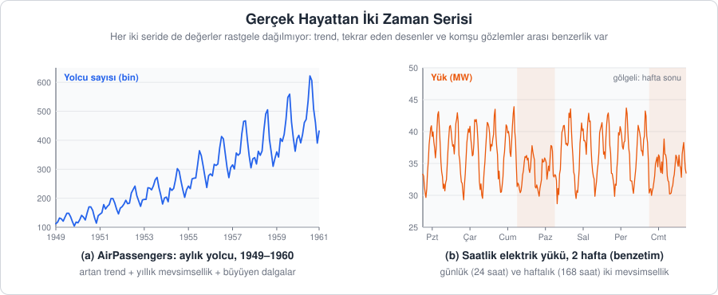
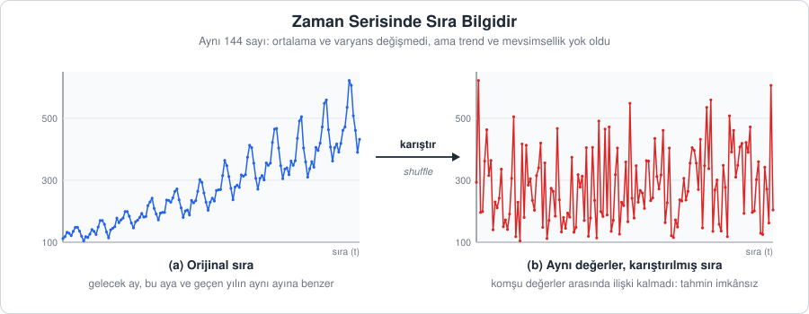
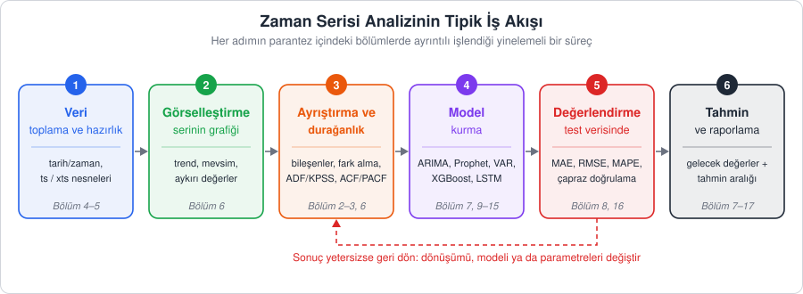
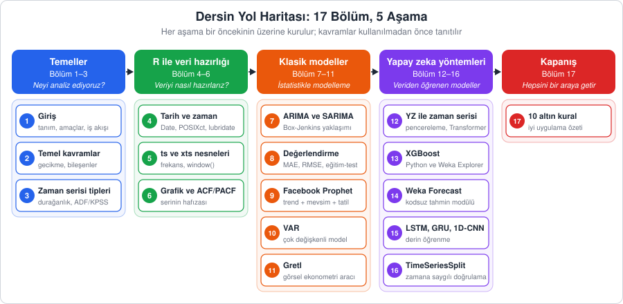

[İçindekiler](../Course_notes.md) · [2. Zaman Serisinin Temel Kavramları ve Bileşenleri →](02_zaman_serisinin_temel_kavramlari_ve_bilesenleri.md)

## 1. Zaman Serisi Analizine Giriş

Bir hastanenin acil servisine her gün kaç hasta geleceğini, bir şehrin yarın akşam saat 19.00'da ne kadar elektrik tüketeceğini ya da bir ürünün gelecek ay kaç adet satılacağını bilmek isteriz. Bu soruların ortak noktası, cevabın **geçmişte aynı büyüklüğün zaman içinde nasıl davrandığına** bakılarak aranmasıdır. İşte zaman serisi analizi, bu tür verileri anlamak ve onlardan geleceğe dair çıkarım yapmak için geliştirilmiş yöntemlerin bütünüdür.

Bu bölümde zaman serisinin ne olduğunu, onu sıradan veri setlerinden ayıran özelliği, analizde hangi amaçları güttüğümüzü ve dersin genel yol haritasını ele alacağız.

---

### 1.1. Zaman Serisi Nedir?

**Açıklama:** Zaman serisi, aynı büyüklüğün zaman içinde **ardışık olarak** ve genellikle **eşit aralıklarla** kaydedilmiş ölçümleridir. Her gözlemin bir zaman damgası vardır ve gözlemler bu zamana göre sıralanır. Günlük hayattan birkaç örnek:

- Bir hastanedeki günlük hasta kabul sayısı,
- Bir şirketin aylık satış rakamları,
- Bir meteoroloji istasyonunda kaydedilen saatlik sıcaklık ölçümleri,
- Bir hisse senedinin dakikalık fiyat hareketleri.

**Tanım:** Zaman serisi, bir büyüklüğün zaman dizinine göre sıralanmış gözlemler dizisidir:

$$
\lbrace x_t : t \in \mathcal{T} \rbrace
$$

Burada $\mathcal{T}$, gözlem anlarının kümesidir. Bu derste çoğunlukla $\mathcal{T} = \lbrace 1, 2, \dots, T \rbrace$ biçiminde, eşit aralıklı ve sonlu sayıda gözlem içeren serilerle çalışacağız. Büyük $T$ toplam gözlem sayısıdır: `AirPassengers` serisinde 12 yıl × 12 ay = 144 gözlem olduğu için $T = 144$'tür. İstatistiksel bakış açısıyla elimizdeki seri, rastgele bir sürecin (stokastik süreç) gözlenmiş **tek bir gerçekleşmesi** olarak düşünülür. Bu fikre Bölüm 3.4'te yeniden döneceğiz.

Bu gösterimi bir kez okumayı öğrenmek dersin geri kalanını çok kolaylaştırır. $x$, ölçtüğümüz büyüklüğün adıdır (örneğin yolcu sayısı). Harfin sağ altına küçük yazılan $t$ ise **alt indis**tir ve "kaçıncı zaman noktası?" sorusunun cevabını taşır; harf, İngilizce *time* (zaman) kelimesinden gelir. `AirPassengers` serisinde $x_1 = 112$ (Ocak 1949), $x_2 = 118$ (Şubat 1949) ve $x_7 = 148$'dir (Temmuz 1949). Alt indiste işlem de yapılabilir: $t$ "bugün" ise $x_{t-1}$ "dün", yani bir önceki dönemin değeri, $x_{t+1}$ ise "yarın" demektir. Örneğin $t = 7$ için $x_{t-1} = x_6 = 135$, yani Haziran 1949 değeridir.

> **Simge notu:** $`x_t`$ *(x t)*: t anındaki gözlem; alt indis zamanı (sırayı) gösterir · $`x_{t-1}`$ *(x t eksi bir)*: bir önceki dönemin değeri · $`T`$ *(büyük te)*: toplam gözlem sayısı · $`\in`$ *(elemanıdır)*: soldaki öğe sağdaki kümeye aittir. Bu işaret, ileride göreceğimiz Yunan harfi $`\varepsilon`$ (epsilon) ile şekil olarak karıştırılır; ikisi farklıdır · $`\mathcal{T}`$ *(kaligrafik T)*: gözlem anlarının (zaman dizininin) kümesi · $`\lbrace \dots \rbrace`$ *(küme parantezi)*: bir küme ya da dizi



*Şekil 1.1 — (a) Derste sık kullanacağımız `AirPassengers` serisi: 1949–1960 arası aylık uluslararası havayolu yolcu sayısı (bin kişi). (b) Saatlik elektrik yükü (benzetim verisi): gündüz ve akşam tepeleri her gün, düşük hafta sonu tüketimi her hafta tekrar eder.*

Şekil 1.1'deki iki seri, ileride ayrıntılı inceleyeceğimiz kavramların neredeyse hepsini şimdiden gösterir. `AirPassengers` serisinde yolcu sayısı yıllar içinde **artar** (trend), her yaz **zirve** yapar (mevsimsellik) ve bu yaz tepeleri seviye yükseldikçe **büyür**. Elektrik yükünde ise iki ayrı tekrar eden desen vardır: 24 saatlik günlük döngü ve 7 günlük haftalık döngü. Bu bileşenler Bölüm 2'de sistematik olarak ele alınacaktır.

> **Hemen deneyin 1.1a · İlk zaman serinizi R'da görün** (R, ~3 dk)
>
> R'ı ilk kez açıyorsanız: RStudio'yu açın, sol alttaki **Console** (konsol) paneline satırları tek tek yazın ve her satırdan sonra `Enter`'a basın. `#` işaretinden sonrasını yazmanız gerekmez; o kısım açıklamadır, R onu okumaz. `AirPassengers` R ile birlikte gelir, hiçbir şey indirmeniz gerekmez.
>
> ```r
> AirPassengers           # serinin tamamını ekrana yazar (12 yıl x 12 ay)
> AirPassengers[7]        # köşeli parantez: 7. gözlemi, yani x_7'yi getirir
> length(AirPassengers)   # gözlem sayısı, yani T
> plot(AirPassengers)     # serinin çizgi grafiği
> ```
>
> **Ne göreceksiniz:** İlk satır 12 satırlık (1949–1960) ve 12 sütunluk (`Jan` … `Dec`) bir tablo yazar; ilk satırı `1949 112 118 132 129 121 135 148 148 136 119 104 118`'dir. İkinci satır `[1] 148` (Temmuz 1949, yani $`x_7`$), üçüncüsü `[1] 144` (yani $`T = 144`$) verir. Baştaki `[1]` yalnızca bir sıra numarasıdır. Son satır sağ alttaki **Plots** panelinde Şekil 1.1a'daki grafiği çizer: yıllar içinde yükselen ve her yaz tepe yapan bir çizgi.
>
> **Şimdi siz:** (1) $`x_{12}`$ ve $`x_{144}`$ kaçtır? (2) Temmuz 1960 kaçıncı gözlemdir? Önce tahmin edin ($`11 \times 12 + 7`$), sonra köşeli parantezle kontrol edin.
>
> <details><summary>Cevap</summary>
>
> `AirPassengers[12]` → `[1] 118` (Aralık 1949), `AirPassengers[144]` → `[1] 432` (Aralık 1960). Temmuz 1960, $`11 \times 12 + 7 = 139`$. gözlemdir: `AirPassengers[139]` → `[1] 622`. Bu, serinin en büyük değeridir.
>
> </details>

> **Hemen deneyin 1.1b · Bir yılı elle çizin** (Excel / LibreOffice Calc, ~5 dk)
>
> R kullanmadan da bir zaman serisini görebilirsiniz.
>
> 1. Boş bir sayfada A1 hücresine `Ay`, B1 hücresine `Yolcu` yazın. A2:A13 hücrelerine 1'den 12'ye kadar sayıları, B2:B13 hücrelerine 1949 değerlerini girin: 112, 118, 132, 129, 121, 135, 148, 148, 136, 119, 104, 118.
> 2. B1:B13 aralığını seçin. Excel'de **Ekle → Grafikler → Çizgi** (İngilizce: **Insert → Charts → Line**), LibreOffice Calc'ta **Ekle → Grafik… → Çizgi** (İngilizce: **Insert → Chart… → Line**) seçin.
> 3. D2 hücresine `=MAK(B2:B13)` (İngilizce: `=MAX(B2:B13)`), D3'e `=MİN(B2:B13)` (İngilizce: `=MIN(B2:B13)`), D4'e `=ORTALAMA(B2:B13)` (İngilizce: `=AVERAGE(B2:B13)`) yazın. Arayüzünüz İngilizceyse İngilizce adları kullanın.
>
> **Ne göreceksiniz:** Grafik 7. ve 8. aylarda (Temmuz, Ağustos) tepe, 11. ayda (Kasım) dip yapar. D2'de 148, D3'te 104, D4'te 126,6666667 görünür (Türkçe arayüz ondalık ayracı olarak virgül kullanır; değer yaklaşık 126.67'dir). Yalnızca 12 gözlemle bile yaz zirvesi fark edilir; ama trendi görmek için birkaç yıl gerekir.
>
> **Şimdi siz:** C sütununa 1950 değerlerini girin (115, 126, 141, 135, 125, 149, 170, 170, 158, 133, 114, 140) ve grafiğe ikinci çizgi olarak ekleyin. Tepe ve dip ayları değişti mi? 1950'nin ortalaması 1949'dan büyük mü?
>
> <details><summary>Cevap</summary>
>
> Tepe yine Temmuz–Ağustos (170), dip yine Kasım (114). Ortalama yaklaşık 139.67'dir; 1949'daki 126.67'den büyüktür. Aynı desen bir üst seviyede tekrar eder: mevsimsellik + artan trend.
>
> </details>

---

### 1.2. Zaman Serisini Sıradan Veriden Farklı Kılan Nedir?

**Açıklama:** Bir sınıftaki öğrencilerin boy ölçümlerini bir tabloya yazdığımızı düşünelim. Satırların sırasını değiştirirsek hiçbir şey kaybetmeyiz: ortalama boy, en uzun öğrenci, dağılım aynı kalır. Çünkü bir öğrencinin boyu, tabloda bir önceki satırdaki öğrencinin boyu hakkında bilgi vermez.

Zaman serisinde durum tamamen farklıdır. Bu ayın yolcu sayısı, geçen ayın yolcu sayısına **çok benzer**. Bu temmuzun değeri, geçen temmuzun değeriyle **yakından ilişkilidir**. Yani gözlemler birbirinden bağımsız değildir; aralarında bir **bağımlılık** (dependence) vardır. Bu yüzden sıra, verinin kendisi kadar önemli bir bilgidir.



*Şekil 1.2 — Solda `AirPassengers` serisinin orijinal hâli, sağda aynı 144 değerin rastgele karıştırılmış hâli. İki grafikteki sayılar aynıdır; ortalama ve varyans değişmez. Ancak trend, mevsimsellik ve "komşu aylar birbirine benzer" bilgisi tamamen kaybolur.*

**Tanım:** Klasik istatistik yöntemlerinin çoğu, gözlemlerin **bağımsız ve özdeş dağılımlı** olduğunu varsayar. Bunu art arda atılan bir zarla düşünebiliriz: Her atış bir öncekinden habersizdir (bağımsız) ve her atışta aynı zar kullanılır, yani hangi sayının hangi olasılıkla geleceği hep aynıdır (özdeş dağılımlı). Zaman serisinde ise yakın zamanlı gözlemler genellikle birbiriyle ilişkilidir:

$$
\mathrm{Cov}(x_t, x_{t-h}) \neq 0 \quad \text{(en azından bazı } h \text{ gecikmeleri için)}
$$

> **Simge notu:** $`\mathrm{Cov}(\cdot,\cdot)`$ *(kovaryans)*: iki değişkenin birlikte değişim ölçüsü · $`\neq`$ *(eşit değildir)* · $`h`$: iki gözlem arasındaki zaman mesafesi, yani gecikme (lag)

Kovaryansı şimdilik şöyle düşünebilirsiniz: İki büyüklük birlikte ortalamanın üstüne çıkıp birlikte altına iniyorsa kovaryans pozitif, biri yükselirken öteki düşüyorsa negatif, aralarında bir düzen yoksa sıfıra yakındır. Buradaki iki büyüklük aynı serinin $h$ adım uzaktaki değerleridir; $h = 1$ için "bu ay" ile "geçen ay". Formül yalnızca şunu söyler: en azından bazı gecikmelerde bu ilişki sıfır değildir. Kovaryansın küçük bir sayısal örnekle nasıl hesaplandığını Bölüm 3.2'de göreceğiz.

**Günlük hayattan bir örnek:** Bir otoyoldaki trafik yoğunluğunu 5 dakikada bir ölçtüğümüzü düşünelim. Şu an yoğunluk ortalamanın üstündeyse 5 dakika sonra da büyük olasılıkla üstündedir: $h = 1$ için kovaryans pozitiftir. 6 saat sonrasıyla ilişki zayıftır (sabah zirvesi geçmiştir), ama 24 saat sonrasıyla yine güçlüdür. Yani ilişki bazı $h$ değerlerinde güçlü, bazılarında zayıftır.

Bu ilişkiye **otokorelasyon** (kendi geçmişiyle korelasyon) denir ve ölçülmesi Bölüm 6'da ayrıntılı olarak ele alınır. Bu basit gözlemin üç önemli sonucu vardır:

1. **Bağımlılık bir engel değil, bir fırsattır.** Geçmiş gelecek hakkında bilgi taşıdığı için tahmin yapabiliriz. ARIMA'dan LSTM'e kadar dersteki tüm modeller bu bağımlılığı farklı yollarla öğrenir.
2. **Standart yöntemler olduğu gibi kullanılamaz.** Örneğin makine öğrenmesinde alışık olduğumuz *rastgele* eğitim-test ayrımı, gelecekteki bilgiyi modele sızdırır. Zaman serisinde test verisi her zaman eğitim verisinden **sonra** gelmelidir (Bölüm 8 ve Bölüm 16).
3. **Zamanın yönü önemlidir.** Model yalnızca geçmişi kullanarak geleceği tahmin etmelidir; tersini değil.

> **Hemen deneyin 1.2 · Seriyi karıştırınca ne kaybolur?** (R, ~4 dk)
>
> Şekil 1.2'yi kendiniz üretin. RStudio'da **Console** paneline yazın:
>
> ```r
> set.seed(1)                           # "rastgele" karıştırma herkeste aynı olsun
> karisik <- sample(AirPassengers)      # sample(): aynı 144 sayıyı rastgele sıraya dizer
> mean(AirPassengers); mean(karisik)    # ortalamalar
> par(mfrow = c(1, 2))                  # grafik alanını yan yana iki parçaya böl
> plot(AirPassengers)                   # solda orijinal sıra
> plot(karisik, type = "l")             # sağda karışık sıra (type = "l": noktaları çizgiyle birleştir)
> par(mfrow = c(1, 1))                  # grafik alanını eski hâline döndür
> ```
>
> `<-` işareti sağdaki sonucu soldaki isimle saklar (ayrıntısı Bölüm 2.5'te). `;` aynı satıra iki komut yazmayı sağlar.
>
> **Ne göreceksiniz:** İki ortalama da `[1] 280.2986`'dır. Solda trend ve yaz tepeleri, sağda hiçbir düzeni olmayan, 104 ile 622 arasında rastgele zıplayan bir çizgi vardır. Sayılar aynı, hikâye kaybolmuştur.
>
> **Şimdi siz:** (1) Standart sapmaların da aynı çıkacağını tahmin edin ve `sd(AirPassengers); sd(karisik)` ile kontrol edin. (2) "Komşu aylar birbirine benzer mi?" sorusunu sayıyla ölçün: `cor(AirPassengers[-1], AirPassengers[-144])` ve aynısını `karisik` için yazın. `[-1]` ilk elemanı, `[-144]` son elemanı atar; böylece her ay bir önceki ayla eşleşir. `cor()` iki dizinin birlikte hareketini −1 ile 1 arasında bir sayıyla ölçer (korelasyon; Bölüm 6'da ayrıntılı).
>
> <details><summary>Cevap</summary>
>
> (1) İkisi de `[1] 119.9663`: yayılım sıradan bağımsızdır. (2) Orijinal seride `[1] 0.9601946`, karışık seride `[1] 0.02751641`. Orijinal seride komşu aylar neredeyse birlikte hareket eder (1'e çok yakın); karıştırınca bu bağımlılık sıfıra yakın bir değere düşer. Kaybolan bilgi tam olarak budur.
>
> </details>

---

### 1.3. Zaman Serisi Analizinin Amaçları

Bir zaman serisini analiz ederken genellikle aşağıdaki beş amaçtan bir ya da birkaçını güderiz:

| Amaç | Yanıtlanan soru | Örnek |
| --- | --- | --- |
| **Tanımlama** (description) | Seride hangi desenler var? | Satışlarda yıllık artış ve aralık ayı zirvesi var mı? |
| **Açıklama** (explanation) | Seriyi hangi etkenler ve ilişkiler belirliyor? | Faizdeki artış birkaç ay sonra enflasyonu nasıl etkiliyor? |
| **Tahmin** (forecasting) | Gelecekte hangi değerler bekleniyor? | Önümüzdeki 12 ayda kaç yolcu taşınacak? |
| **Anomali tespiti** (anomaly detection) | Hangi gözlemler olağan dışı? | Bir sunucunun trafiğindeki ani sıçrama saldırı olabilir mi? |
| **Kontrol** (control) | Süreç istenen düzeyde nasıl tutulur? | Bir üretim hattındaki sıcaklık sapmaya başladığında ne zaman müdahale edilmeli? |

Bu amaçlar birbirinden kopuk değildir. İyi bir tahmin için önce seriyi **tanımlamak** gerekir. Bir anomaliyi fark etmek için ise "normalde ne beklendiğini" gösteren bir tahmine ihtiyaç vardır: gözlenen değer tahmin aralığının çok dışına düşüyorsa, o gözlem şüphelidir.

**Tanım (tahmin):** $T$ anına kadar olan gözlemlere dayanarak $h$ adım sonrası için yapılan tahmin şöyle gösterilir:

$$
\hat{x}_{T+h} = g(x_T, x_{T-1}, \dots, x_1)
$$

Burada $g$, kullandığımız modeldir (ARIMA, Prophet, XGBoost, LSTM vb.). Matematikte **fonksiyon**, girdiyi alıp bir çıktı üreten kuraldır; burada girdi geçmiş gözlemler, çıktı tahmindir. $x$'in üzerindeki şapka işareti, değerin gözlenmiş değil **tahmin edilmiş** olduğunu belirtir. Örneğin `AirPassengers` serisi Aralık 1960'ta bittiği için $T = 144$'tür. $h = 1$ için $\hat{x}_ {145}$ Ocak 1961'in, $h = 12$ için $\hat{x}_ {156}$ Aralık 1961'in tahminidir.

Tahmin ufku ($h$) büyüdükçe belirsizlik artar. Bu nedenle iyi bir tahmin, tek bir sayıyla birlikte bir **tahmin aralığı** da verir: "Tahmin 450; gerçek değer %95 olasılıkla 420 ile 480 arasında olacak" gibi. Aralık ne kadar genişse, model gelecek hakkında o kadar emin değildir.

**Günlük hayattan bir örnek:** Hava durumu yarın için "22–24 °C" diyebilir, ama 10 gün sonrası için ancak "15–28 °C" gibi geniş bir aralık verebilir. Ne kadar ileriye bakarsak belirsizlik o kadar birikir.

> **Simge notu:** $`\hat{x}_{T+h}`$ *(x şapka, T artı h)*: T anındaki bilgiyle, h adım sonrası için yapılan tahmin · $`g(\cdot)`$ *(ge)*: geçmiş gözlemleri tahmine dönüştüren model fonksiyonu · $`h`$: tahmin ufku, yani kaç adım ileriye bakıldığı

> **Hemen deneyin 1.3 · Nil Nehri: tanımlama, anomali ve en basit tahmin** (R, ~4 dk)
>
> R ile gelen `Nile` serisi, Nil Nehri'nin 1871–1970 arasındaki yıllık akış miktarıdır (100 gözlem). RStudio'da **Console** paneline yazın:
>
> ```r
> plot(Nile)               # Nil Nehri'nin yıllık akış miktarı, 1871-1970
> min(Nile)                # en küçük değer
> which.min(Nile)          # en küçük değer kaçıncı gözlemde?
> time(Nile)[43]           # time(): her gözlemin yılı; burada 43. gözleminki
> mean(Nile[1:28])         # 1:28 -> 1'den 28'e: ilk 28 yılın (1871-1898) ortalaması
> mean(Nile[29:100])       # sonraki 72 yılın (1899-1970) ortalaması
> ```
>
> **Ne göreceksiniz:** `[1] 456`, `[1] 43`, `[1] 1913`, `[1] 1097.75` ve `[1] 849.9722`. Grafikte 1900'den hemen önce serinin seviyesi aşağı kayar ve bir daha eski düzeyine çıkmaz. 1913'te ise tek yıllık, çok derin bir düşüş vardır. Bu iki gözlem tablodaki iki amaca karşılık gelir: seviye kayması **tanımlama**, 1913 düşüşü **anomali tespiti** konusudur.
>
> **Şimdi siz:** En basit tahmin modeli "gelecek yıl = bu yıl" kuralıdır: $`\hat{x}_{T+1} = x_T`$, yani $`g`$ fonksiyonu yalnızca son gözlemi döndürür. `Nile[100]` ile 1971 tahminini bulun. Ardından serinin en büyük değerini ve yılını bulun (ipucu: `max()` ve `which.max()`).
>
> <details><summary>Cevap</summary>
>
> `Nile[100]` → `[1] 740`, yani $`\hat{x}_{101} = 740`$. En büyük değer `max(Nile)` → `[1] 1370`; `which.max(Nile)` → `[1] 9`, `time(Nile)[9]` → `[1] 1879`. Bu yüksek değer seviye kaymasından önceki döneme düşer.
>
> </details>

---

### 1.4. Uygulama Alanları

Zaman serisi verisi, ölçümün zaman içinde tekrarlandığı her alanda ortaya çıkar:

| Alan | Örnek seriler | Tipik amaç |
| --- | --- | --- |
| **Finans** | Hisse fiyatları, döviz kurları, işlem hacmi | Risk ölçümü, volatilite tahmini |
| **Ekonomi** | GSYH, enflasyon, işsizlik, faiz | Politika analizi, değişkenler arası ilişkiler |
| **Enerji** | Saatlik elektrik yükü, rüzgâr ve güneş üretimi | Kısa vadeli yük tahmini, şebeke planlaması |
| **Sağlık** | Günlük hasta kabulü, salgın vaka sayıları, EKG sinyalleri | Kapasite planlama, erken uyarı |
| **Perakende ve lojistik** | Günlük satışlar, stok düzeyleri, talep | Talep tahmini, stok optimizasyonu |
| **Çevre ve iklim** | Sıcaklık, yağış, hava kalitesi (PM2.5) | Mevsimsel desenler, uzun vadeli eğilimler |
| **Mühendislik ve IoT** | Sensör ölçümleri, makine titreşimleri | Arıza ve anomali tespiti, kestirimci bakım |
| **Ulaştırma** | Yolcu sayıları, trafik yoğunluğu | Kapasite ve sefer planlama |

> **Hemen deneyin 1.4 · Dört alandan dört seri** (R, ~3 dk)
>
> R ile gelen veri setlerinden tablodaki alanlara birer örnek çizelim. Her satırdan sonra **Plots** panelinde yeni bir grafik açılır; önceki grafiklere panelin üstündeki sol ok ile dönebilirsiniz.
>
> ```r
> plot(ldeaths)          # Sağlık: İngiltere'de aylık akciğer hastalığı ölümleri, 1974-1979
> plot(co2)              # Çevre: Mauna Loa'da aylık atmosferik CO2 (ppm), 1959-1997
> plot(UKgas)            # Enerji: İngiltere'de çeyreklik doğalgaz tüketimi, 1960-1986
> plot(EuStockMarkets)   # Finans: dört Avrupa borsa endeksinin günlük kapanışları, 1991-1998
> ```
>
> **Ne göreceksiniz:** `ldeaths` her kış tepe, her yaz dip yapar (Ocak ortalaması yaklaşık 2959, Eylül ortalaması yaklaşık 1397). `co2` 313'ten 367'ye sürekli yükselir ve üzerinde küçük bir yıllık dalga vardır. `UKgas` hem yükselir hem de dalgaları büyür: 1960'ta en yüksek ve en düşük çeyrek arasındaki fark yaklaşık 75 iken 1986'da yaklaşık 816'dır. `EuStockMarkets` dört paneli alt alta çizer (DAX, SMI, CAC, FTSE).
>
> **Şimdi siz:** Her seri için 1.3'teki tablodan en uygun amacı seçin. Hangi serilerde Şekil 1.1'deki "yaz tepesi büyüyen" yapıya benzer bir **büyüyen dalga** görüyorsunuz?
>
> <details><summary>Cevap</summary>
>
> Örnek bir eşleştirme: `ldeaths` → kapasite planlama için **tahmin** (kış yoğunluğu); `co2` → uzun vadeli eğilimin **tanımlanması**; `UKgas` → talep **tahmini**; `EuStockMarkets` → endeksler arası ilişkilerin **açıklanması** ve risk ölçümü. Büyüyen dalga en belirgin biçimde `UKgas`'ta görülür (her yılın 1. çeyreği tepe; 1960'ta 160.1, 1986'da 1163.9). `co2`'deki yıllık dalganın boyu ise yaklaşık sabittir ve tepesi Mayıs'tadır. Bu fark Bölüm 2.4'teki toplamsal/çarpımsal ayrımının konusudur.
>
> </details>

---

### 1.5. Tipik Bir Zaman Serisi Analizinin İş Akışı

Hangi alanda çalışırsak çalışalım, zaman serisi analizi genellikle benzer adımlarla ilerler. Bu adımlar aynı zamanda dersin akışını da belirler.



*Şekil 1.3 — Zaman serisi analizinin tipik adımları ve her adımın işlendiği bölümler. Değerlendirme adımında sonuç yetersizse geri dönülür; süreç doğrusal değil, yinelemelidir.*

1. **Veri toplama ve hazırlık:** Tarih-zaman bilgisinin doğru okunması, eksik gözlemlerin ele alınması ve verinin R'da bir zaman serisi nesnesine (`ts`, `xts`) dönüştürülmesi.
2. **Görselleştirme:** Seriyi çizmek her zaman ilk iştir. Trend, mevsimsellik, yapısal kırılmalar ve aykırı değerler çoğu zaman ilk grafikte fark edilir.
3. **Ayrıştırma ve durağanlık analizi:** Seriyi bileşenlerine ayırmak, durağan olup olmadığını testlerle sınamak ve gerekirse dönüşüm (log, fark alma) uygulamak. ACF/PACF grafikleri serinin "hafızasını" gösterir.
4. **Model kurma:** Serinin yapısına uygun bir model seçmek: klasik istatistiksel modeller (ARIMA/SARIMA, VAR), ayrıştırmaya dayalı modeller (Prophet) veya makine öğrenmesi ve derin öğrenme modelleri (XGBoost, LSTM, GRU, 1D-CNN).
5. **Değerlendirme:** Modeli, eğitimde görmediği **son dönem** verisi üzerinde MAE, RMSE, MAPE gibi metriklerle ölçmek. Sonuç yetersizse 3. ya da 4. adıma geri dönülür.
6. **Tahmin ve raporlama:** Seçilen modelle geleceği tahmin etmek, tahmin aralıklarıyla birlikte yorumlamak ve sunmak.

> **Hemen deneyin 1.5 · İş akışının ilk iki adımı Gretl'de** (Gretl menüleri, ~5 dk)
>
> İş akışının "veri" ve "görselleştirme" adımlarını kod yazmadan, Gretl ile deneyelim (Gretl'i Bölüm 11'de ayrıntılı tanıyacağız). Gretl kendi örnek veri dosyalarıyla gelir; aralarında `AirPassengers`'ın aynısı da vardır.
>
> 1. Gretl'i açın. **File → Open data → Sample file…** seçin. Açılan pencerenin **Gretl** sekmesinde `bjg` (*Box and Jenkins Series G (airline passengers)*) satırına çift tıklayın.
> 2. Ana pencerede iki değişken görünür: `g` (yolcu sayısı) ve `lg` (onun doğal logaritması). `g`'ye sağ tıklayıp **Time series plot** seçin (ya da **View → Graph specified vars → Time series plot…**).
> 3. `g` seçiliyken **View → Summary statistics** seçin.
>
> Aynı işin betik karşılığı (**File → Script files → New script** penceresine yapıştırıp çalıştırabilirsiniz):
>
> ```gretl
> open bjg.gdt
> summary g --simple
> gnuplot g --time-series --with-lines --output=display
> ```
>
> **Ne göreceksiniz:** Grafik Şekil 1.1a ile aynıdır. Özet istatistiklerde `Mean 280.299`, `Minimum 104.000`, `Maximum 622.000`, `Standard deviation 119.966` yazar. Bu sayılar 1.2'de R'da bulduğunuz ortalama (280.2986) ve standart sapmayla (119.9663) aynıdır: Araç değişse de veri aynıdır.
>
> **Şimdi siz:** Aynı yolla `lg` değişkeninin zaman grafiğini çizin. `g` grafiğine göre mevsimsel dalgaların boyunda ne değişti? Bu gözlem iş akışının hangi adımına (Şekil 1.3) aittir?
>
> <details><summary>Cevap</summary>
>
> `lg` grafiğinde yaz tepeleri yıllar içinde büyümez, yaklaşık aynı boyda kalır; `g`'de ise belirgin biçimde büyür. Log dönüşümü iş akışının 3. adımına (ayrıştırma ve durağanlık analizi, dönüşüm) aittir. Nedeni Bölüm 2.4'te açıklanır.
>
> </details>

---

### 1.6. Dersin Yol Haritası

Ders 17 bölümden oluşur ve beş aşamada ilerler. Her aşama bir öncekinin üzerine kurulur. Bu nedenle bölümleri sırayla okumanız önerilir.



*Şekil 1.4 — Dersin beş aşaması ve her aşamadaki bölümler.*

**1. Temeller (Bölüm 1–3):** Zaman serisinin ne olduğunu, bileşenlerini (trend, mevsimsellik, döngü, düzensiz bileşen) ve tiplerini öğreniriz. Dersin en kritik kavramı olan **durağanlık** burada tanımlanır; "birim kök" kavramı ve ADF testinin mantığı adım adım anlatılır (testlerin ayrıntısı Bölüm 7.5'te).

**2. R ile veri hazırlığı (Bölüm 4–6):** R'da tarih ve zaman nesneleriyle (`Date`, `POSIXct`, `lubridate`), zaman serisi nesneleriyle (`ts`, `xts`) çalışmayı öğreniriz. Ardından serileri görselleştirir, ayrıştırır ve ACF/PACF grafikleriyle serinin geçmişine ne kadar "bağlı" olduğunu okuruz.

**3. Klasik modeller ve değerlendirme (Bölüm 7–11):** Box-Jenkins yaklaşımıyla ARIMA ve SARIMA modellerini R ve Python'da kurarız. Bölüm 8'de modellerin başarısını ölçmek için hata metriklerini ve eğitim-test ayrımını öğreniriz; bu araçları sonraki tüm bölümlerde kullanacağız. Ardından Facebook Prophet'i, çok değişkenli VAR modelini ve kod yazmadan ekonometrik analiz yapmayı sağlayan Gretl'i inceleriz.

**4. Yapay zeka yöntemleri (Bölüm 12–16):** Bir zaman serisini denetimli öğrenme problemine dönüştürmeyi ve derin öğrenme yaklaşımının temel fikirlerini (LSTM hücresi, Transformer) öğreniriz. Ardından XGBoost'u Python ve Weka ile, Weka'nın zaman serisi tahmin modülünü ve LSTM, GRU, 1D-CNN gibi derin öğrenme modellerini uygularız. Bölüm 16'da zaman sırasını bozmadan çapraz doğrulama yapmayı sağlayan `TimeSeriesSplit` ele alınır.

**5. Kapanış (Bölüm 17):** Ders boyunca öğrenilenler, zaman serisi tahmininde dikkat edilmesi gereken on altın kuralda toplanır.

**Not —** Ders boyunca aynı veri setlerine (özellikle `AirPassengers`) farklı yöntemlerle tekrar tekrar döneceğiz. Böylece klasik modellerle yapay zeka modellerini aynı problem üzerinde karşılaştırma fırsatı bulacağız.

---

[İçindekiler](../Course_notes.md) · [2. Zaman Serisinin Temel Kavramları ve Bileşenleri →](02_zaman_serisinin_temel_kavramlari_ve_bilesenleri.md)
