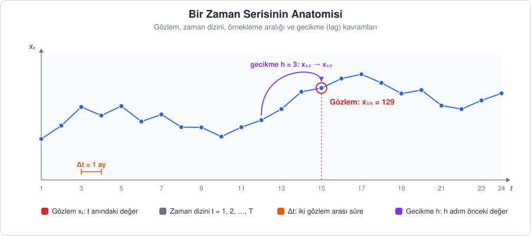
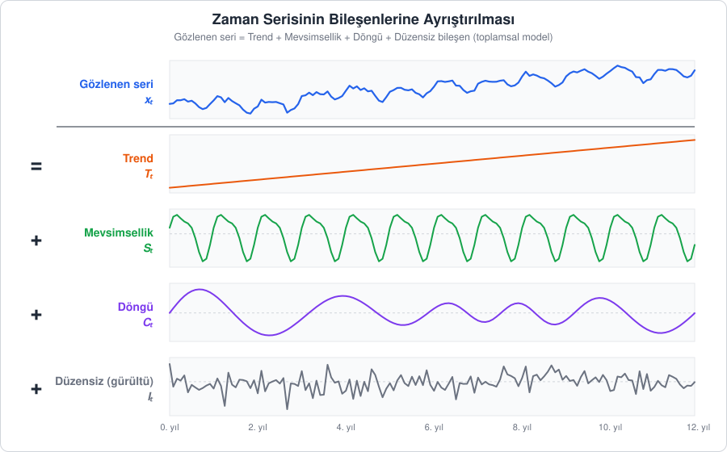
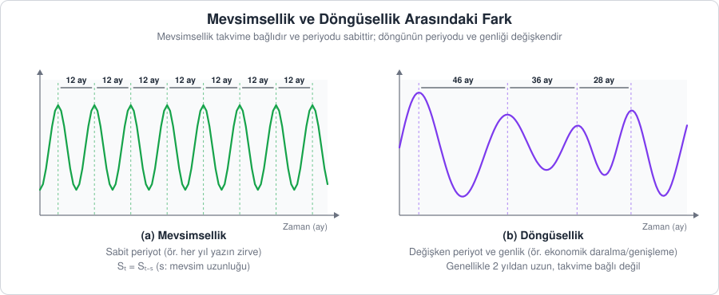
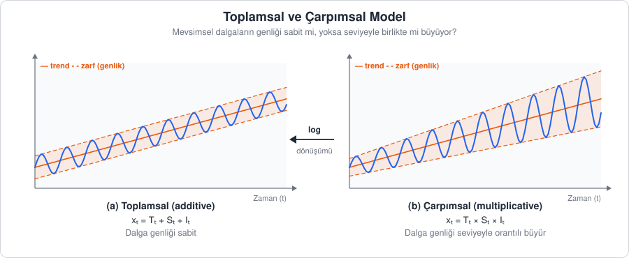

[İçindekiler](../Course_notes.md) · [← 1. Zaman Serisi Analizine Giriş](01_zaman_serisi_analizine_giris.md) · [3. Zaman Serisi Tipleri →](03_zaman_serisi_tipleri.md)

## 2. Zaman Serisinin Temel Kavramları ve Bileşenleri

Bir zaman serisini analiz etmeden önce, onu anlatırken kullanacağımız ortak dili öğrenmemiz gerekir. Bu bölümde önce temel kavramları (gözlem, zaman dizini, gecikme vb.) tanımlayacağız. Ardından bir serinin hangi "parçalardan" oluştuğunu, yani **bileşenlerini** inceleyeceğiz.

Bunu bir müzik parçasına benzetebiliriz: Kulağımıza tek bir ses gelir, ama o ses aslında bas gitar (yavaş ve uzun vadeli hareket), davul (düzenli tekrar eden ritim) ve birkaç rastgele tınının toplamıdır. Zaman serisi analizinde de gözlediğimiz tek bir çizginin arkasındaki bu "enstrümanları" birbirinden ayırmaya çalışırız.

---

### 2.1. Temel Kavramlar



*Şekil 2.1 — Bir zaman serisinin temel kavramları: gözlem ($`x_t`$), zaman dizini ($`t`$), örnekleme aralığı ($`\Delta t`$) ve gecikme ($`h`$).*

> **Simge notu:** $`\Delta t`$ *(delta t)*: ardışık iki gözlem arasındaki zaman farkı (örnekleme aralığı)

**Açıklama:** Bölüm 1.1'de tanımladığımız gibi zaman serisi, bir büyüklüğün zaman içinde **sırayla** kaydedilmiş değerleridir. 1.2'de gördüğümüz gibi bu sırayı bozmak, bir filmin karelerini karıştırmak gibidir; hikâye kaybolur.

**Tanım:** 1.1'deki tanımı, gözlemleri tek tek sayarak şöyle de yazabiliriz:

$$
\lbrace x_t\rbrace _{t=1}^{T} = \lbrace x_1, x_2, \dots, x_T\rbrace 
$$

```math
\underbrace{\lbrace x_t\rbrace_{t=1}^{T}}_{\substack{\text{t = 1'den T'ye kadar}\\\text{gözlemlerin dizisi}}} = \lbrace \overbrace{x_1}^{\text{ilk gözlem}}, x_2, \dots, \overbrace{x_T}^{\text{son gözlem}} \rbrace
```

**Ne anlatıyor?** Seri, birinci gözlemden $T$'nci gözleme kadar zaman sırasıyla dizilmiş $T$ değerden oluşur; alt indis her değerin kaçıncı zaman noktasına ait olduğunu gösterir.

> **Simge notu:** $`\lbrace x_t \rbrace_{t=1}^{T}`$ *(x t, t eşittir 1'den T'ye)*: t = 1, 2, …, T anlarındaki gözlemlerin sıralı kümesi · $`\dots`$ *(üç nokta)*: aradaki terimler aynı düzenle devam eder

Bu gösterimdeki kavramlar şunlardır:

| Kavram | Gösterim | Anlamı | Örnek |
| --- | --- | --- | --- |
| **Gözlem** (observation) | $x_t$ | $t$ anında ölçülen değer | Şekil 2.1'de 15. aydaki değer: $x_{15} = 129$ |
| **Zaman dizini** (time index) | $t = 1, 2, \dots, T$ | Gözlemlerin sıra numarası | 1. ay, 2. ay, … |
| **Seri uzunluğu** | $T$ | Toplam gözlem sayısı | `AirPassengers`: $T = 144$ ay |
| **Örnekleme aralığı** | $\Delta t$ | Ardışık iki gözlem arasındaki süre | 1 ay, 1 gün, 1 saat |
| **Frekans** (frequency) | $s$ | Bir mevsimlik döngüdeki gözlem sayısı (R'daki karşılığı Bölüm 5'te) | Aylık veride $s = 12$, çeyreklik veride $s = 4$ |
| **Gecikme** (lag) | $x_{t-h}$ | $h$ adım önceki gözlem | $h = 1$: bir önceki ay, $h = 12$: geçen yılın aynı ayı |

> **Gecikme neden bu kadar önemli?** Zaman serisi analizinin temel varsayımı, **geçmişin geleceği hakkında bilgi taşıdığıdır.** Bugünkü değer ($`x_t`$) ile gecikmeli değerler ($`x_{t-1}, x_{t-2}, \dots`$) arasındaki ilişki, ACF/PACF grafiklerinin (Bölüm 6), ARIMA modellerinin (Bölüm 7) ve LSTM gibi derin öğrenme modellerinin (Bölüm 15) temelini oluşturur.

Zaman serisi formüllerinde iki **operatör** çok sık geçer. Operatör bir sayı değil, bir **komuttur**: önüne yazıldığı seriye "şunu yap" der. Bunu hesap makinesindeki karekök tuşuna benzetebiliriz: Tuşun kendisi bir sayı değildir, önündeki sayıya uygulanan bir işlemdir.

- **Gecikme (backshift) operatörü $B$:** "Bir adım geri git" komutudur: $B x_t = x_{t-1}$. Komutu iki kez uygularsak iki adım geri gideriz: $B(B x_t) = B^2 x_t = x_{t-2}$. Genel olarak $B^h x_t = x_{t-h}$'dir. Buradaki üs (sağ üstteki küçük sayı) bir sayının kuvveti anlamına gelmez; "$`B`$ komutunu $h$ kez uygula" demektir. Ekonometri kaynaklarının çoğu (ve birim kök tartışmalarının büyük kısmı) aynı operatörü İngilizce *lag* kelimesinden $L$ harfiyle yazar: $L x_t = x_{t-1}$. $B$ ile $L$ aynı şeydir; bu derste $B$ kullanıyoruz.
- **Fark operatörü $\nabla$:** "Bugünden dünü çıkar" komutudur: $\nabla x_t = x_t - x_{t-1}$. Mevsimsel fark ise "bugünden $s$ dönem önceki değeri çıkar" komutudur: $\nabla_s x_t = x_t - x_{t-s}$.

Küçük bir örnekle görelim. Üç gözlemlik bir seri olsun: $x_1 = 5$, $x_2 = 8$, $x_3 = 6$.

| $`t`$ | $`x_t`$ | $`B x_t = x_{t-1}`$ | $`\nabla x_t = x_t - x_{t-1}`$ |
| --- | --- | --- | --- |
| 1 | 5 | yok (öncesi gözlenmemiş) | yok |
| 2 | 8 | 5 | 8 − 5 = 3 |
| 3 | 6 | 8 | 6 − 8 = −2 |

Ayrıca $B^2 x_3 = x_1 = 5$'tir: 3. dönemden iki adım geri gidince 1. döneme varırız. Birinci fark serisi $3, -2$ değerlerinden oluşur. Fark almak serinin başından bir gözlem (mevsimsel farkta $s$ gözlem) kaybettirir, çünkü ilk gözlemin "dünü" yoktur. Mevsimsel farka gerçek bir örnek: `AirPassengers` serisinde Ocak 1950 değeri 115, Ocak 1949 değeri 112'dir. $s = 12$ ile $\nabla_{12} x_t = 115 - 112 = 3$ olur: yolcu sayısı bir yılda, aynı ay için 3 bin kişi artmıştır.

**Günlük hayattan bir örnek:** Bir kırtasiyeci eylül satışını ağustosla kıyaslarsa her yıl "büyük artış" görür, çünkü okullar eylülde açılır. Doğru soru "Geçen eylüle göre ne kadar arttık?" sorusudur. Mevsimsel fark tam olarak bunu yapar: Mevsim etkisini dışarıda bırakıp yıllık değişimi gösterir.

Operatörlerin işe yarayan özelliği, komutları sayılar gibi parantez içinde toplayıp çıkarabilmemizdir. $(1 - B)x_t$ ifadesinde parantezi dağıtırız: "$`x_t`$'nin kendisi" eksi "$`x_t`$'ye $B$ komutunun uygulanmış hâli", yani $1 \cdot x_t - B x_t = x_t - x_{t-1}$. Bu tam olarak birinci farktır. Yukarıdaki seride $t = 3$ için $(1 - B)x_3 = 6 - 8 = -2$ bulunur. Aynı şekilde $\nabla_s x_t = (1 - B^s) x_t$ yazılır. Bölüm 3.2'de bu yazım bir adım daha ileri götürülecek: $B$ komutunun yerine geçici olarak sıradan bir bilinmeyen koyacak ve **birim kök** kavramına buradan ulaşacağız.

> **Simge notu:** $`B`$ *(be)*: gecikme (backshift) operatörü, seriyi bir adım geriye kaydırır · $`L`$ *(le, lag)*: aynı operatörün birçok kaynaktaki adı · $`B^h`$ *(be üzeri h)*: B'nin h kez uygulanması, yani h adım geri kaydırma · $`\nabla`$ *(nabla, ters üçgen)*: birinci fark operatörü. Büyük delta $`\Delta`$ ile karıştırılmamalıdır; $`\Delta t`$ yukarıda iki gözlem arasındaki süreyi gösteriyor · $`\nabla_s`$ *(nabla s)*: s adımlık mevsimsel fark operatörü

> **Hemen deneyin 2.1a · Fark operatörünü R'a hesaplatın** (R, ~3 dk)
>
> RStudio'da **Console** paneline yazın:
>
> ```r
> x <- c(5, 8, 6)                          # c(): sayıları bir listede birleştirir; <- ile x adını verir
> diff(x)                                  # birinci fark: x_t - x_(t-1)
> head(diff(AirPassengers), 6)             # head(..., 6): sonucun yalnızca ilk 6 elemanını göster
> head(diff(AirPassengers, lag = 12), 3)   # mevsimsel fark: x_t - x_(t-12)
> ```
>
> **Ne göreceksiniz:** `diff(x)` → `[1]  3 -2`, yani tablodaki $`\nabla x_2 = 3`$ ve $`\nabla x_3 = -2`$. Yolcu serisinin ilk farkları `Feb 6, Mar 14, Apr -3, May -8, Jun 14, Jul 13` (1949) olarak yazılır: Şubat'ta 6 bin yolcu artış, Nisan'da 3 bin azalış. Mevsimsel farkın ilk değerleri `1950 Jan 3, Feb 8, Mar 9`'dur; Ocak 1950 için metindeki $`115 - 112 = 3`$ hesabının aynısıdır. İlk farkın Ocak 1949 yerine Şubat 1949'dan başladığına dikkat edin: İlk gözlemin "dünü" yoktur.
>
> **Şimdi siz:** (1) `diff(AirPassengers)` ve `diff(AirPassengers, lag = 12)` kaç gözlemlik olur? Önce tahmin edin, sonra `length()` ile kontrol edin. (2) `diff(x, lag = 2)` ne verir? Bu, $`B^2`$ ile hangi ifadeye karşılık gelir?
>
> <details><summary>Cevap</summary>
>
> (1) `[1] 143` ve `[1] 132`: Birinci fark 1, mevsimsel fark 12 gözlem kaybettirir. (2) `[1] 1`: $`x_3 - x_1 = 6 - 5 = 1`$, yani $`(1 - B^2)x_3 = x_3 - B^2 x_3`$.
>
> </details>

> **Hemen deneyin 2.1b · Gecikme ve fark sütunları** (Excel / LibreOffice Calc, ~4 dk)
>
> 1. A1'e `Yolcu` yazın, A2:A14 hücrelerine Ocak 1949'dan Ocak 1950'ye 13 değeri girin: 112, 118, 132, 129, 121, 135, 148, 148, 136, 119, 104, 118, 115.
> 2. B1'e `Fark` yazın. B2'yi **boş** bırakın, B3'e `=A3-A2` yazın ve hücrenin sağ alt köşesinden tutup B14'e kadar aşağı sürükleyin.
> 3. C1'e `MevsimselFark` yazın, C14'e `=A14-A2` yazın.
>
> **Ne göreceksiniz:** B sütunu 6, 14, −3, −8, 14, 13, 0, −12, −17, −15, 14, −3 olur; C14'te 3 görünür. Bu sayılar 2.1a'daki R çıktısıyla aynıdır. Formül hücreden hücreye kaydırıldıkça "bu satır eksi bir üst satır" kuralı korunur: Bu tam olarak $`x_t - x_{t-1}`$ ya da $`(1 - B)x_t`$'dir.
>
> **Şimdi siz:** B2 neden boş kalmak zorunda? Fark sütununun en büyük düşüşü hangi aydadır?
>
> <details><summary>Cevap</summary>
>
> A1 bir başlık olduğu için Ocak 1949'un (A2) bir önceki gözlemi yoktur; $`x_0`$ gözlenmemiştir, bu yüzden ilk fark tanımsızdır. En büyük düşüş −17'dir (B11): Ekim 1949 (119) eksi Eylül 1949 (136).
>
> </details>

---

### 2.2. Zaman Serisinin Bileşenleri

**Açıklama:** Bir dondurmacının aylık satışlarını düşünelim. Satışlar:

- dükkân tanındıkça yıldan yıla **artıyor** (trend),
- her yıl yazın **zirve**, kışın **dip** yapıyor (mevsimsellik),
- ekonomi iyi giderken biraz yükselip kriz yıllarında biraz düşüyor (döngü),
- bazı aylarda da açıklanamayan küçük iniş çıkışlar gösteriyor (gürültü).

Gözlediğimiz satış rakamı, bu dört etkinin **üst üste binmiş** hâlidir.

**Tanım (toplamsal ayrıştırma):**

```math
\underbrace{x_t}_{\text{gözlenen değer}} = \overbrace{T_t}^{\text{trend}} + \underbrace{S_t}_{\text{mevsimsellik}} + \overbrace{C_t}^{\text{döngü}} + \underbrace{I_t}_{\text{düzensiz bileşen}}
```

**Ne anlatıyor?** Gözlenen değer, her $t$ anında trend, mevsimsellik, döngü ve düzensiz bileşenin o andaki değerlerinin toplanmasıyla oluşur. Bileşenler birbirinin büyüklüğünü değiştirmez; her biri gözleme kendi payını ekler.



*Şekil 2.2 — Gözlenen seri (en üstte), altındaki dört bileşenin toplamıdır. Tek başına bakıldığında karmaşık görünen seri, ayrıştırılınca basit parçalara dönüşür.*

| Bileşen | Sembol | Ne anlatır? | Zaman ölçeği | Örnek |
| --- | --- | --- | --- | --- |
| **Trend** (*trend*) | $T_t$ | Uzun vadeli yön: artış, azalış ya da sabitlik | Yıllar | E-ticaret satışlarının sürekli büyümesi |
| **Mevsimsellik** (*seasonality*) | $S_t$ | Takvime bağlı, **sabit periyotla** tekrar eden desen | Gün, hafta, yıl içi | Yazın artan dondurma, kışın artan doğalgaz tüketimi |
| **Döngü** (*cycle*) | $C_t$ | **Periyodu sabit olmayan**, genellikle uzun dalgalanmalar | Genellikle 2 yıldan uzun | Ekonomik genişleme ve daralma dönemleri |
| **Düzensiz bileşen** (*irregular component*) | $I_t$ | Diğer bileşenlerle açıklanamayan rastgele kısım | Her gözlem | Grev, beklenmedik hava olayı, ölçüm hatası |

**Bileşenlerin özellikleri:**

- **Trend** doğrusal olmak zorunda değildir. Üstel büyüme, doygunluğa ulaşan S-eğrisi ya da yön değiştiren bir trend de olabilir.
- **Mevsimsellik** için $S_t \approx S_{t-s}$ geçerlidir: desen her $s$ adımda bir tekrar eder. Aylık veride ($s = 12$) bu, "bu Ocak'ın mevsim etkisi geçen Ocak'ınkine yaklaşık eşittir" demektir. Toplamsal modelde mevsimsel etkilerin bir periyot boyunca toplamı sıfırdır ($\sum_{j=1}^{s} S_j = 0$). Böylece mevsimsellik seviyeyi değil, yalnızca yıl içindeki dağılımı etkiler.
- **Bir seride birden fazla mevsimsellik olabilir.** Örneğin saatlik elektrik tüketiminde hem günlük (24 saat) hem haftalık (168 saat) desen bulunur.
- **Düzensiz bileşen**, ideal durumda ortalaması sıfır olan ve kendi içinde ilişki taşımayan **beyaz gürültüdür** (*white noise*): $I_t \sim \text{iid}(0, \sigma^2)$. Burada beyaz gürültünün güçlü biçimi, yani bağımsız ve özdeş dağılımlı şoklar varsayılır; Bölüm 6.6.1'deki genel tanım yalnızca şokların birbiriyle ilişkisiz olmasını ister. Ayrıştırma sonrasında kalan bileşende hâlâ bir desen görülüyorsa bazı yapılar yakalanamamış demektir.

Toplam sembolü $\sum$ (büyük sigma) "topla" komutudur. Altındaki $j = 1$ "saymaya 1'den başla", üstündeki $s$ "$`s`$'de dur" demektir; aradaki her $j$ için $S_j$ terimleri toplanır. Çeyreklik bir seride ($s = 4$) mevsim etkileri $+10$, $-5$, $+15$, $-20$ ise $\sum_{j=1}^{4} S_j = 10 + (-5) + 15 + (-20) = 0$ olur. Yani bazı çeyrekler ortalamanın üstünde, bazıları altındadır ama yıl boyunca birbirlerini dengelerler. Mevsimsellik yıllık toplamı değil, toplamın çeyreklere nasıl dağıldığını değiştirir.

```math
\underbrace{I_t}_{\text{düzensiz bileşen}} \overbrace{\sim}^{\substack{\text{dağılımına}\\\text{sahiptir}}} \underbrace{\text{iid}}_{\substack{\text{bağımsız ve}\\\text{özdeş dağılımlı}}}\big(\overbrace{0}^{\text{ortalama}}, \underbrace{\sigma^2}_{\text{varyans}}\big)
```

$I_t \sim \text{iid}(0, \sigma^2)$ ifadesi şöyle okunur: "$`I_t`$ değerleri birbirinden bağımsızdır, hepsi aynı olasılık dağılımından gelir; bu dağılımın ortalaması 0, varyansı $\sigma^2$'dir." **Varyans** (*variance*), değerlerin ortalama etrafında ne kadar yayıldığının ölçüsüdür. Hesabı şöyledir: Her değerin ortalamadan farkı alınır, bu farkların karesi alınır ve karelerin ortalaması bulunur. Örneğin 2, 4 ve 6 değerlerinin ortalaması 4'tür. Ortalamadan farklar −2, 0 ve 2, kareleri 4, 0 ve 4'tür. Karelerin ortalaması $8/3 \approx 2.67$ olur. Kare almamızın nedeni, eksi ve artı farkların birbirini götürmesini engellemektir (farkların düz toplamı her zaman sıfırdır). Varyansın karekökü **standart sapma**dır (*standard deviation*, $\sigma$; burada $\sqrt{2.67} \approx 1.63$) ve aynı yayılımı verinin kendi biriminde ifade eder.

```math
\begin{gathered}
\underbrace{\bar{x}}_{\text{ortalama}} = \underbrace{\frac{1}{n}\sum_{i=1}^{n} x_i}_{\substack{\text{değerleri topla,}\\\text{n'ye böl}}}
\\[6pt]
\underbrace{\sigma^2}_{\text{varyans}} = \underbrace{\frac{1}{n}\sum_{i=1}^{n}}_{\substack{\text{n değerin}\\\text{ortalamasını al}}} \underbrace{\big(\overbrace{x_i - \bar{x}}^{\text{ortalamadan fark}}\big)^2}_{\text{farkın karesi}}, \qquad \underbrace{\sigma}_{\substack{\text{standart}\\\text{sapma}}} = \sqrt{\sigma^2}
\end{gathered}
```

**Ne anlatıyor?** Ortalama, değerlerin toplamının değer sayısına bölünmesiyle bulunur. Varyans, her değerin ortalamadan farkının karesinin ortalamasıdır; standart sapma ise varyansın kareköküdür ve yayılımı verinin kendi biriminde ifade eder. Burada $n$ değer sayısı, $x_i$ ise $i$'nci değerdir; 2, 4, 6 örneğinde $n = 3$, $\bar{x} = 4$ ve $\sigma^2 = 8/3$ olur.

**Günlük hayattan bir örnek:** İki fırının ekmekleri ortalama 250 gram gelsin. Birinde ekmekler 245–255 gram arasında, diğerinde 200–300 gram arasında. Ortalama aynı, ama ikinci fırının varyansı çok daha büyüktür. Standart sapma, "Bir ekmek ortalamadan tipik olarak kaç gram şaşar?" sorusunun cevabıdır. Dikkat: Standart sapma en büyük sapma değil, tipik sapmadır; ikinci fırında bazı ekmekler 50 gram şaşar, ama standart sapma bundan küçüktür.

Bu tür bir gürültüye "beyaz" denmesinin nedeni bir benzetmedir: Beyaz ışık bütün renkleri (dalga boylarını) eşit ölçüde içerir; beyaz gürültü de yavaş ve hızlı bütün salınımları (frekansları) eşit güçte içerir. Hiçbir ritim öne çıkmadığı için seride bir düzen ya da tekrar görülmez.

> **Simge notu:** $`\approx`$ *(yaklaşık eşittir)*: iki değer birbirine yakındır · $`\sum_{j=1}^{s}`$ *(büyük sigma, j eşittir 1'den s'ye)*: j = 1, …, s için terimlerin toplamı · $`\sim`$ *(tilda)*: "… dağılımına sahiptir" · $`\text{iid}`$ *(ay-ay-di)*: bağımsız ve özdeş dağılımlı (independent and identically distributed) · $`\sigma`$ *(küçük sigma)*: standart sapma · $`\sigma^2`$ *(sigma kare)*: varyans. Toplam sembolü büyük sigma ($`\Sigma`$) ile standart sapma sembolü küçük sigma ($`\sigma`$) aynı harfin iki biçimidir ama anlamları tamamen farklıdır

> **Uygulamada trend ve döngü genellikle birleştirilir.** Döngünün periyodu değişken olduğu için onu trendden güvenilir biçimde ayırmak zordur. Bu yüzden R'daki `decompose()` ve `stl()` gibi yöntemler seriyi **üç** bileşene ayırır: *trend-döngü* ($`T_t`$, döngüyü de içerir), *mevsimsellik* ($`S_t`$) ve *kalan* ($`R_t`$ ya da $`I_t`$). Bölüm 2.5'teki ve Bölüm 6.2.3'teki `decompose()` çıktılarında bu yüzden gözlenen serinin altında yalnızca üç bileşen görürüz.

> **Hemen deneyin 2.2a · Kendi serinizi bileşenlerden üretin** (R, ~5 dk)
>
> Ayrıştırmanın tersini yapalım: trend, mevsimsellik ve gürültüyü kendimiz üretip toplayalım. RStudio'da **Console** paneline yazın:
>
> ```r
> t <- 1:48                                    # 4 yıllık aylık veri: t = 1, 2, ..., 48
> trend  <- 100 + 2 * t                        # her ay 2 birim artan trend
> mevsim <- rep(c(-20, -15, -5, 0, 5, 15, 30, 25, 10, -5, -20, -20), times = 4)
>                                              # rep(): 12 aylık deseni 4 kez art arda yazar
> set.seed(7)                                  # rastgele sayılar herkeste aynı olsun
> gurultu <- rnorm(48, mean = 0, sd = 5)       # rnorm(): ortalaması 0, std. sapması 5 olan 48 rastgele sayı
> seri <- trend + mevsim + gurultu             # x_t = T_t + S_t + I_t
> sum(mevsim[1:12])                            # bir yılın mevsim etkileri toplamı
> plot(seri, type = "l")                       # type = "l": noktaları çizgiyle birleştir
> round(seri[c(7, 19, 31, 43)], 1)             # her yılın Temmuz değeri (7., 19., 31., 43. ay)
> ```
>
> **Ne göreceksiniz:** `sum(mevsim[1:12])` → `[1] 0`: Mevsim etkileri bir yıl boyunca birbirini dengeler. Grafik, her yıl Temmuz civarında tepe yapan ve yukarı doğru tırmanan bir seridir; Şekil 2.2'nin en üst paneline benzer. Temmuz değerleri `[1] 147.7 168.0 187.6 214.6` çıkar: Her yıl yaklaşık 24 birim (12 ay × 2) yükselir, aradaki küçük sapmalar gürültüden gelir.
>
> **Şimdi siz:** `sd = 5` yerine `sd = 20` yazıp `set.seed(7)` satırından itibaren tekrar çalıştırın. Mevsim deseni hâlâ görünüyor mu? Her yılın en yüksek ayını bulmak için `which.max(seri[1:12])`, `which.max(seri[13:24])` … yazın.
>
> <details><summary>Cevap</summary>
>
> `sd = 5` iken yılların en yüksek ayları 7, 8, 8, 7'dir (Temmuz–Ağustos). `sd = 20` iken 7, 8, 8, 5 olur: Son yılda tepe Mayıs'a kayar ve grafikteki yıllık dalga gürültünün içinde zor seçilir. Gürültü büyüdükçe bileşenleri gözle ayırmak zorlaşır; ayrıştırma yöntemlerine bu yüzden ihtiyaç duyarız.
>
> </details>

> **Hemen deneyin 2.2b · Varyansı elle ve fonksiyonla hesaplayın** (R ve Excel / LibreOffice Calc, ~3 dk)
>
> Metindeki 2, 4, 6 örneğini R'da adım adım tekrarlayalım:
>
> ```r
> v <- c(2, 4, 6)
> mean(v)                      # ortalama
> v - mean(v)                  # ortalamadan farklar
> mean((v - mean(v))^2)        # ^2: kare alma; farkların karelerinin ortalaması (n'ye bölen varyans)
> var(v)                       # R'ın var(): n - 1'e böler
> sd(v)                        # standart sapma: var(v)'nin karekökü
> ```
>
> Excel'de: A1:A3'e 2, 4, 6 yazın; B1'e `=VAR.P(A1:A3)` (İngilizce de `=VAR.P(A1:A3)`), B2'ye `=VAR.S(A1:A3)` (İngilizce de `=VAR.S(A1:A3)`), B3'e `=STDSAPMA.S(A1:A3)` (İngilizce: `=STDEV.S(A1:A3)`) yazın.
>
> **Ne göreceksiniz:** R'da sırasıyla `4`, `-2 0 2`, `2.666667`, `4` ve `2`. Excel'de B1 = 2,666667 (n'ye böler, metindeki $`8/3`$), B2 = 4 (n − 1'e böler, R'ın `var()`'ı ile aynı), B3 = 2.
>
> **Şimdi siz:** 1, 4, 7 için iki varyansı ve `sd()`'yi önce kâğıtta hesaplayın, sonra kontrol edin.
>
> <details><summary>Cevap</summary>
>
> Ortalama 4, farklar −3, 0, 3, kareler 9, 0, 9. $`n`$'ye bölen varyans $`18/3 = 6`$, `var()` $`18/2 = 9`$, `sd()` $`\sqrt{9} = 3`$.
>
> </details>

**Not — Neden $n - 1$?** Varyans hesabında sapmalar, bilinmeyen gerçek ortalamadan değil, verinin kendi ortalamasından alınır. Verinin kendi ortalaması tanımı gereği o verinin tam ortasına düşer; bu yüzden sapmalar gerçek ortalamaya göre olacağından biraz küçük çıkar ve $n$'ye bölünen varyans yayılımı sistematik olarak küçük gösterir. $n - 1$'e bölmek bu küçülmeyi düzeltir (*Bessel düzeltmesi*, Bessel's correction). 2, 4, 6 örneğinde iki tanım $8/3 \approx 2.67$ ve $8/2 = 4$ verir. Gözlem sayısı büyüdükçe fark önemsizleşir: 144 gözlemli `AirPassengers` serisinde iki varyansın oranı $143/144 \approx 0.993$'tür.

**Günlük hayattan bir örnek:** Okçunun isabetini ölçmek için hedef tahtası, atışlardan sonra okların tam ortasına çizilirse oklar hedefe olduğundan yakın görünür. Verinin kendi ortalamasını referans almak da böyledir; $n - 1$'e bölmek bu iyimserliği telafi eder.

---

### 2.3. Mevsimsellik ile Döngüsellik Arasındaki Fark

Bu iki kavram, ikisi de "iniş çıkış" olduğu için en sık karıştırılan kavramlardır. Ayrımı anlamak için **periyot** kavramı yeterlidir: Periyot, bir desenin kendini bir kez tamamlaması için geçen süredir ve grafikte iki tepe arasındaki mesafe olarak okunur.



*Şekil 2.3 — (a) Mevsimsellikte tepeler arası mesafe hep aynıdır (12 ay). (b) Döngüde ise tepeler arası mesafe (46, 36, 28 ay) ve dalgaların yüksekliği değişir.*

| Özellik | Mevsimsellik | Döngüsellik |
| --- | --- | --- |
| Periyot | **Sabit** ve bilinir (12 ay, 7 gün, 24 saat) | **Değişken**, önceden bilinmez |
| Kaynağı | Takvim, iklim, gelenek (tatiller, bayramlar) | Ekonomik, sosyal ya da doğal süreçler |
| Süresi | Genellikle bir yıl veya daha kısa | Genellikle 2 yıldan uzun |
| Genlik | Görece istikrarlı | Döngüden döngüye değişir |
| Tahmin edilebilirlik | Yüksek: "gelecek temmuz da zirve olacak" | Düşük: "bir sonraki kriz ne zaman?" |

**Pratik bir test:** Şu soru sorulur: *"Bir sonraki tepenin hangi tarihte olacağı takvime bakarak söylenebilir mi?"* Cevap evetse mevsimselliktir, hayırsa döngüdür.

> **Hemen deneyin 2.3 · Vaşaklar ve sıcaklık: döngü mü, mevsim mi?** (R, ~5 dk)
>
> R ile gelen iki seriyi karşılaştıralım. RStudio'da **Console** paneline yazın:
>
> ```r
> plot(lynx)       # Kanada'da yıllık vaşak yakalama sayısı, 1821-1934
> plot(nottem)     # Nottingham'da aylık ortalama sıcaklık (Fahrenheit), 1920-1939
> m <- matrix(nottem, ncol = 12, byrow = TRUE)   # matrix(): seriyi tabloya diz; her satır bir yıl, her sütun bir ay
> apply(m, 1, which.max)                          # apply(..., 1, ...): her satıra (yıla) which.max uygula
> ```
>
> **Ne göreceksiniz:** `nottem` grafiğinde her yıl aynı yükseklikte, aynı aralıkla tekrarlayan dalgalar vardır. Son satır 20 yılın her birinde en sıcak ayı verir: `[1] 6 7 6 7 7 7 7 8 7 7 8 7 8 7 7 7 8 8 8 8`. Tepe her yıl Haziran–Ağustos arasındadır, yani takvime bağlıdır: **mevsimsellik**. `lynx` grafiğinde ise tepelerin yüksekliği çok farklıdır (yaklaşık 2000'den 7000'e) ve tepeler takvimin belli bir gününe bağlı değildir: **döngü**.
>
> **Şimdi siz:** `lynx` grafiğinden 2000'in üstündeki tepelerin yıllarını yaklaşık olarak okuyun. Tepeler arası mesafe hep aynı mı? "Bir sonraki tepe hangi yıl?" sorusunu takvime bakarak cevaplayabilir misiniz?
>
> <details><summary>Cevap</summary>
>
> Tepeler 1828, 1838, 1848, 1857, 1866, 1875, 1885, 1895, 1904, 1913, 1916 ve 1925'tedir; yükseklikleri 2251 ile 6991 arasında değişir. Aralar 10, 10, 9, 9, 9, 10, 10, 9, 9, 3, 9 yıldır: Çoğu 9–10 yıl ama sabit değil, hatta 1913–1916'da çift tepe vardır. Takvime bakarak kesin bir yıl söylenemez; bu yüzden döngüdür. Bu yılları isterseniz şu satırlarla da bulabilirsiniz (`diff(sign(diff(...))) == -2`, "önce artıp sonra azalan" noktaları, yani yerel tepeleri işaretler):
>
> ```r
> tepe <- which(diff(sign(diff(lynx))) == -2) + 1
> buyuk <- tepe[lynx[tepe] > 2000]
> time(lynx)[buyuk]
> ```
>
> </details>

---

### 2.4. Toplamsal ve Çarpımsal Model

Bileşenler her zaman toplanarak bir araya gelmez. Bazı serilerde birbirleriyle **çarpılarak** birleşirler.



*Şekil 2.4 — (a) Toplamsal modelde mevsimsel dalgaların yüksekliği trendden bağımsızdır. (b) Çarpımsal modelde dalgalar seviyeyle birlikte büyür: seri "huni" gibi açılır.*

**Tanım 1 (toplamsal model):**

$$
x_t = T_t + S_t + I_t
$$

```math
\underbrace{x_t}_{\text{gözlenen değer}} = \overbrace{T_t}^{\text{trend}} + \underbrace{S_t}_{\substack{\text{mevsimsel etki}\\\text{(sabit miktar)}}} + \overbrace{I_t}^{\text{düzensiz bileşen}}
```

**Ne anlatıyor?** Gözlenen değer, trend, mevsimsel etki ve düzensiz bileşenin toplanmasıyla oluşur; bileşenler birbirinin büyüklüğünü etkilemez.

Mevsimsel etki **sabit bir miktardır.** Örneğin "Temmuz'da satışlar ortalamadan her yıl yaklaşık 500 birim fazladır."

**Tanım 2 (çarpımsal model):**

```math
\underbrace{x_t}_{\text{gözlenen değer}} = \underbrace{T_t}_{\text{trend (seviye)}} \times \overbrace{S_t}^{\substack{\text{mevsim katsayısı}\\\text{(ör. 1.20)}}} \times \underbrace{I_t}_{\substack{\text{düzensiz katsayı}\\\text{(1 çevresinde)}}}
```

**Ne anlatıyor?** Gözlenen değer, trend seviyesinin mevsim katsayısı ve düzensiz katsayıyla çarpılmasıyla elde edilir. Katsayı 1'in üstündeyse seviye büyütülür, altındaysa küçültülür; bu nedenle mevsimsel etki seviyeyle orantılı olarak değişir.

Mevsimsel etki **bir orandır.** Örneğin "Temmuz'da satışlar ortalamadan her yıl yaklaşık %20 fazladır." Trend yükseldikçe bu %20'nin mutlak karşılığı da büyür. Çarpımsal modelde mevsimsel katsayıların ortalaması 1'dir. Örneğin $S_{\text{Temmuz}} = 1.20$, %20 fazlalık anlamına gelir.

Farkı sayılarla görelim. Trend bir yıl 1000, birkaç yıl sonra 3000 birim olsun. Toplamsal modelde Temmuz etkisi "+500 birim" ise Temmuz değeri $1000 + 500 = 1500$'den $3000 + 500 = 3500$'e çıkar: dalganın boyu hep 500'dür. Çarpımsal modelde Temmuz katsayısı 1.20 ise Temmuz değeri $1000 \times 1.20 = 1200$'den $3000 \times 1.20 = 3600$'e çıkar: dalganın boyu 200'den 600'e büyür. Şekil 2.4b'deki "huni" görüntüsü buradan doğar.

**Hangi model seçilmeli?**

| Grafikte görülen | Model |
| --- | --- |
| Mevsimsel dalgaların yüksekliği zaman içinde yaklaşık sabit | Toplamsal |
| Dalgalar seviye yükseldikçe büyüyor ("huni" şekli) | Çarpımsal |

**Log dönüşümü ile köprü kurmak:** **Logaritma**, çarpmayı toplamaya çeviren bir işlemdir. En kolay 10 tabanında görülür: $\log_{10} 100 = 2$'dir, çünkü $10^2 = 100$; $\log_{10} 1000 = 3$'tür, çünkü $10^3 = 1000$. Yani logaritma "tabanı kaçıncı kuvvetine yükseltirsem bu sayıyı elde ederim?" sorusunun cevabıdır. Şimdi iki sayının çarpımına bakalım: $100 \times 1000 = 100\thinspace 000 = 10^5$, dolayısıyla $\log_{10} 100\thinspace 000 = 5 = 2 + 3$. Çarpımın logaritması, logaritmaların toplamıdır: $\log(a \times b) = \log a + \log b$. R'daki `log()` fonksiyonu aynı kuralı 10 yerine $e \approx 2.718$ tabanıyla uygular (**doğal logaritma**).

Bu kural sayesinde çarpımsal bir modelin logaritması alınınca model toplamsal hâle gelir:

```math
\underbrace{\log x_t}_{\substack{\text{gözlenen değerin}\\\text{logaritması}}} = \underbrace{\log T_t}_{\text{log trend}} + \overbrace{\log S_t}^{\text{log mevsim}} + \underbrace{\log I_t}_{\text{log düzensiz}}
```

**Ne anlatıyor?** Çarpımsal modelin logaritması alındığında bileşenler artık çarpılmaz, toplanır. Böylece çarpımsal bir seri, log ölçeğinde toplamsal modelle incelenebilir.

> **Simge notu:** $`\log`$ *(logaritma)*: bu derste doğal logaritma (R'daki `log()` gibi e tabanında); çarpımı toplama çevirir: log(a × b) = log a + log b · $`\log_{10}`$ *(on tabanında logaritma)* · $`e`$ *(e sayısı)*: ≈ 2.718 sabiti

Bunun pratik sonucu şudur: Eşit **oranlar**, logaritmada eşit **farklara** dönüşür. 100'den 120'ye de 500'den 600'e de çıkış %20'lik bir artıştır. Mutlak farklar 20 ve 100 iken logaritmik farklar ikisinde de aynıdır: $\log 120 - \log 100 = \log 600 - \log 500 = \log 1.2 \approx 0.182$. Bu yüzden seviye yükseldikçe büyüyen dalgalar, log ölçeğinde eşit boylu hâle gelir.

**Günlük hayattan bir örnek:** 10.000 TL maaşa 1.000 TL zam ile 50.000 TL maaşa 5.000 TL zam aynı oranda, yüzde 10'dur. Lira olarak ikinci zam beş kat büyüktür, ama log ölçeğinde iki zam eşit boyda görünür.

Bu nedenle çarpımsal yapıdaki serilerde (örneğin `AirPassengers`) önce `log()` dönüşümü uygulanır, ardından toplamsal yöntemler kullanılır. Bölüm 7'deki SARIMA uygulamasında `log(AirPassengers)` kullanmamızın nedeni budur.

> **Hemen deneyin 2.4 · "Huni"yi sayıyla ölçün** (R, ~4 dk)
>
> Bir yılın en yüksek ve en düşük ayı arasındaki fark, o yılın mevsimsel dalgasının boyudur. 1949 ile 1960'ı karşılaştıralım:
>
> ```r
> y49 <- window(AirPassengers, start = c(1949, 1), end = c(1949, 12))  # window(): yalnızca 1949'u al
> y60 <- window(AirPassengers, start = c(1960, 1), end = c(1960, 12))  # yalnızca 1960
> diff(range(y49)); diff(range(y60))             # range(): en küçük ve en büyük; diff(): aradaki fark
> diff(range(log(y49))); diff(range(log(y60)))   # aynı farklar log ölçeğinde
> par(mfrow = c(1, 2))                           # iki grafiği yan yana çiz
> plot(AirPassengers); plot(log(AirPassengers))
> par(mfrow = c(1, 1))
> ```
>
> **Ne göreceksiniz:** Ham seride dalga boyu 1949'da `44`, 1960'ta `232`'dir: 5 kattan fazla büyümüştür. Log ölçeğinde ise `0.3528214` ve `0.4667934`'tür, yani yalnızca yaklaşık 1.3 kat. Yan yana grafiklerde soldaki seri huni gibi açılır, sağdakinin dalgaları ise yaklaşık eşit boydadır. Seri çarpımsal yapıdadır; log onu toplamsala yaklaştırır.
>
> **Şimdi siz:** Aynı hesabı 1954 için yapın. Ham ve log dalga boylarını tahmin edin, sonra kontrol edin.
>
> <details><summary>Cevap</summary>
>
> 1954'te en düşük 188, en yüksek 302'dir. Ham dalga boyu `114`, log dalga boyu `0.4739851`'dir. Ham ölçekte boy 44 → 114 → 232 diye sürekli büyürken log ölçeğinde 0.35 → 0.47 → 0.47 olur: İlk yıldan sonra neredeyse sabittir.
>
> </details>

---

### 2.5. Mini Uygulama: `AirPassengers` Serisini Ayrıştırmak

> **Uygulama dosyası:** [`Codes/R/ch02_ayristirma.R`](../Codes/R/ch02_ayristirma.R)
>
> Bu bölümdeki R kodlarının tamamı bu dosyada. Dosya RStudio'da açılıp satır satır ya da depo kök dizininde `Rscript Codes/R/ch02_ayristirma.R` komutuyla çalıştırılabilir.


Bu bölümde anlattığımız ayrıştırmayı şimdi gerçek bir seriye uygulayalım.

```r
data("AirPassengers")

# 1) Çarpımsal ayrıştırma: xt = Tt x St x It
ayr_carp <- decompose(AirPassengers, type = "multiplicative")
plot(ayr_carp)

# Mevsimsel katsayılar (ortalaması 1): Temmuz ~1.23 -> trend seviyesinden ~%23 fazla
round(ayr_carp$figure, 3)
#>  [1] 0.910 0.884 1.007 0.976 0.981 1.113 1.227 1.220 1.060 0.922 0.801 0.899

# 2) Log dönüşümü + toplamsal ayrıştırma: log(xt) = log(Tt) + log(St) + log(It)
ayr_log <- decompose(log(AirPassengers), type = "additive")
plot(ayr_log)

# 3) Daha modern ve sağlam bir yöntem: STL (Seasonal-Trend decomposition using Loess)
ayr_stl <- stl(log(AirPassengers), s.window = "periodic")
plot(ayr_stl)
```

Kod, `AirPassengers` serisini aynı amaçla üç farklı yoldan bileşenlerine ayırır: doğrudan çarpımsal ayrıştırma, log dönüşümünden sonra toplamsal ayrıştırma ve STL. Bu seride mevsimsel dalgalar yıllar içinde büyüdüğü için çarpımsal model uygundur (2.4); üç yolun aynı mevsimsel deseni bulduğunu görmek, sonucun seçilen yönteme bağlı olmadığını gösterir. Koddaki `#` ile başlayan satırlar **yorumdur**; R onları çalıştırmaz, okuyucuya açıklama içindir. `#>` ile başlayan satır da kodun parçası değildir: R'ın o satırda ekrana yazdığı çıktıyı gösterir ve notta okunabilsin diye kodun altına eklenmiştir. Kodu satır satır okuyalım:

1. `data("AirPassengers")`: R ile gelen `AirPassengers` serisini yükler (aylık `ts`, Bölüm 5). Seri `datasets` paketinde olduğu için bu satır zorunlu değildir; verinin kaynağını göstermek için yazılmıştır.
2. `ayr_carp <- decompose(AirPassengers, type = "multiplicative")`: Buradaki `<-` **atama** işaretidir: sağdaki hesabın sonucunu soldaki isimle (`ayr_carp`, "çarpımsal ayrıştırma"nın kısaltması) saklar. `decompose()` bir **fonksiyondur**: adının ardındaki parantezin içine verilen değerlerle bir iş yapar ve bir sonuç döndürür. Parantez içindeki değerlere **argüman** denir ve virgülle ayrılır. İlk argüman ayrıştırılacak seridir; adı yazılmadan, yalnızca sırasıyla verilmiştir (*konumsal argüman*: fonksiyonun ilk argümanının yerine geçer). İkincisi `type = "multiplicative"` biçiminde adıyla verilmiştir (*adlandırılmış argüman*) ve modelin çarpımsal olacağını söyler. `"multiplicative"` tırnak içinde olduğu için bir nesne adı değil, düz bir metin değeridir. Bu argüman hiç yazılmasaydı varsayılan değer olan `"additive"`, yani toplamsal model kullanılırdı. Sonuç, `decomposed.ts` sınıfında, birkaç parçayı bir arada tutan bir nesnedir (parçalarına 4. maddede bakacağız).

   `decompose()` üç basit adımda çalışır. Önce **trendi** 12 aylık merkezlenmiş hareketli ortalamayla bulur: Her ay için çevresindeki bir yıllık değerlerin ortalaması alınır; bir yıllık pencerede yaz tepeleriyle kış dipleri birbirini götürdüğü için geriye trend kalır. Pencere ayın iki yanına altışar ay uzandığı için serinin ilk ve son 6 ayında trend hesaplanamaz (`NA`, yani "değer yok"). Sonra her gözlem kendi trendine bölünür. Örneğin Temmuz 1949'da gözlem 148, trend 126.79'dur ve oran $148 / 126.79 \approx 1.167$ çıkar. Tüm yılların Temmuz oranlarının ortalaması alınıp katsayılar ortalamaları 1 olacak şekilde ölçeklenince Temmuz'un **mevsimsel katsayısı** bulunur. Son olarak kalan bileşen $x_t / (T_t \times S_t)$ olarak hesaplanır.
3. `plot(ayr_carp)`: `plot()` R'ın genel çizim fonksiyonudur ve kendisine verilen nesnenin türüne uygun grafiği kendisi seçer. `decompose()` sonucu için "Decomposition of multiplicative time series" başlıklı, alt alta dört panelden oluşan bir grafik çizer: `observed` (gözlenen seri), `trend`, `seasonal` (mevsimsel bileşen) ve `random` (düzensiz bileşen). Grafiğin nasıl okunacağı aşağıdadır.
4. `round(ayr_carp$figure, 3)`: İç içe yazılmış ifadeler içten dışa okunur: önce `ayr_carp$figure` alınır, sonra `round()` ile yuvarlanır. `$` işareti, bir nesnenin içindeki parçayı adıyla çağırır. `decompose()` sonucunda `x` (orijinal seri), `seasonal`, `trend`, `random`, `figure` ve `type` adlı parçalar vardır; `figure`, 12 ayın mevsimsel katsayısını tutan 12 sayılık bir vektördür. `round(..., 3)` sayıları ikinci argümanda verilen kadar, yani üç ondalık basamağa yuvarlar. Bu satırda `<-` olmadığı için sonuç bir isimle saklanmaz, doğrudan ekrana yazılır. Çıktıdaki 12 sayı Ocak–Aralık katsayılarıdır ve ortalamaları 1'dir. Temmuz 1.227 (trendin yaklaşık %23 üstü), Kasım 0.801'dir (yaklaşık %20 altı).
5. `ayr_log <- decompose(log(AirPassengers), type = "additive")`: Yine içten dışa okuyalım. Önce `log()` serinin her değerinin logaritmasını alır (R'da `log()` varsayılan olarak tabanı $e \approx 2.718$ olan doğal logaritmayı hesaplar); sonuç yine aylık bir `ts`'dir. Sonra bu log serisi `type = "additive"` ile toplamsal olarak ayrıştırılır ve sonuç `ayr_log` adıyla saklanır. Log alınmasının nedeni, logaritmanın çarpmayı toplamaya çevirmesidir: Kodun yorum satırındaki $`\log(x_t) = \log(T_t) + \log(S_t) + \log(I_t)`$ formülü, çarpımsal modelin log alınınca toplamsal modele dönüştüğünü söyler (2.4). Bu ayrıştırmada Temmuz'un mevsimsel bileşeni 0.211 çıkar. Bu sayı log ölçeğindedir; `exp()` ile, yani logaritmanın tersiyle geri çevrilince $e^{0.211} \approx 1.235$ elde edilir. Bu, birinci yoldaki 1.227'ye çok yakındır: İki yol aynı yapıyı bulur.
6. `plot(ayr_log)`: Aynı dört paneli bu kez log ölçeğinde ve "Decomposition of additive time series" başlığıyla çizer. Gözlenen panelde değerler yaklaşık 4.6 ile 6.4 arasındadır; bunlar en küçük (104) ve en büyük (622) yolcu sayılarının logaritmalarıdır. Log ölçeğinde mevsimsel dalgaların yüksekliği yıllar içinde belirgin biçimde büyümez; toplamsal modelin varsaydığı da budur.
7. `ayr_stl <- stl(log(AirPassengers), s.window = "periodic")`: `stl()` **STL** (*Seasonal-Trend decomposition using Loess*) yöntemini uygular. Loess, her noktanın çevresine küçük bir eğri uyduran yerel bir düzeltmedir. STL yalnızca toplamsal çalıştığı için önce `log()` alınır. `s.window` zorunludur: `"periodic"` mevsimsel desenin her yıl aynı kaldığını, `13` gibi bir sayı ise yavaşça değişebildiğini söyler. `decompose()`'dan farklı olarak uçlarda `NA` bırakmaz. `robust = TRUE` ile aykırı değerlere karşı daha dayanıklı hâle getirilebilir. Temmuz bileşeni 0.216'dır ($e^{0.216} \approx 1.24$); üç yol aynı sonuca varır.
8. `plot(ayr_stl)`: `stl()` sonucu için de alt alta dört panel çizer: `data` (log alınmış seri), `seasonal`, `trend` ve `remainder`. Her panelin sağında açık gri bir çubuk bulunur. Bu çubukların hepsi veri biriminde aynı uzunluğu temsil eder; bu yüzden çubuğu kendi paneline göre uzun görünen bileşen, aslında küçük bir değişim aralığına sahiptir. Çubuklar, panellerin dikey ölçeklerinin farklı olduğunu unutmamak için konmuştur.

**Grafikleri yorumlarken:**

- **trend** panelinde yolcu sayısının 1949–1960 arasında istikrarlı biçimde arttığını,
- **seasonal** panelinde her yıl Temmuz–Ağustos'ta zirve, Kasım'da dip olduğunu,
- **random** panelinde belirgin bir desen kalmadığını, yani ayrıştırmanın yapıyı büyük ölçüde yakaladığını görürüz. `decompose()` grafiğinde trend ve random panellerinin ilk ve son altı ayı, hareketli ortalama nedeniyle boştur.

> **Hemen deneyin 2.5a · Başka bir seriyi ayrıştırın: ABD'de kaza ölümleri** (R, ~4 dk)
>
> Aynı yöntemi, dalga boyu yıllar içinde büyümeyen bir seriye uygulayalım. RStudio'da **Console** paneline yazın:
>
> ```r
> plot(USAccDeaths)                       # ABD'de aylık kaza sonucu ölümler, 1973-1978
> ayr <- decompose(USAccDeaths)           # type yazılmadı: varsayılan toplamsal model
> round(ayr$figure)                       # 12 ayın mevsim etkisi (kişi)
> plot(ayr)
> ```
>
> **Ne göreceksiniz:** Mevsim etkileri `[1]  -806 -1523  -741  -515   340   745  1679   986  -109   264  -261   -59` çıkar. Bunlar çarpımsal modeldeki gibi oran değil, **kişi sayısı**dır: Temmuz ayında trend seviyesinin yaklaşık 1679 kişi üstünde, Şubat'ta yaklaşık 1523 kişi altında ölüm olur. Grafiğin başlığı "Decomposition of additive time series"tır; trend paneli 1973'ten 1976'ya düşüp sonra hafifçe yükselir.
>
> **Şimdi siz:** (1) 12 mevsim etkisinin toplamı kaç olmalı? `sum(ayr$figure)` ile kontrol edin. (2) Bu seri için toplamsal model neden uygundur? Her yılın en yüksek ve en düşük ayı arasındaki farkı 2.4'teki gibi `window()` ile hesaplayıp karar verin.
>
> <details><summary>Cevap</summary>
>
> (1) `[1] 0` (yuvarlama kırıntısı olarak çok küçük bir sayı da görülebilir). Toplamsal modelde etkiler yıl boyunca birbirini dengeler. (2) Yıllık dalga boyları 1973'ten 1978'e 3211, 3139, 2787, 2617, 3668, 3592'dir: Seviyeyle birlikte sürekli büyümez, belli bir aralıkta kalır. "Huni" yoktur; toplamsal model yeterlidir.
>
> </details>

> **Hemen deneyin 2.5b · Aynı ayrıştırma Python'da** (Python, ~5 dk)
>
> Python'da `statsmodels` paketindeki `seasonal_decompose()` aynı klasik yöntemi uygular. Depo kök dizininde bir Python dosyası ya da Jupyter hücresi açıp çalıştırın (Colab'da dosya yolu yerine `https://raw.githubusercontent.com/erkanozhan/AI_Based_Time_Series-Data_Analytics/main/data/AirPassengers.csv` yazın):
>
> ```python
> import pandas as pd
> import matplotlib.pyplot as plt
> from statsmodels.tsa.seasonal import seasonal_decompose
>
> veri = pd.read_csv("data/AirPassengers.csv", parse_dates=["Month"], index_col="Month")
> seri = veri["Passengers"]                       # tek sütunu seri olarak al
> ayr = seasonal_decompose(seri, model="multiplicative", period=12)
> print(ayr.seasonal.iloc[:12].round(3).values)   # ilk 12 ayın mevsimsel katsayısı
> ayr.plot()
> plt.show()
> ```
>
> **Ne göreceksiniz:** `[0.91  0.884 1.007 0.976 0.981 1.113 1.227 1.22  1.06  0.922 0.801 0.899]`. Bu, R'daki `round(ayr_carp$figure, 3)` çıktısıyla birebir aynıdır (Temmuz 1.227, Kasım 0.801). Grafik dört panellidir: `Passengers`, `Trend`, `Seasonal`, `Resid`. Python'da kalan bileşen çizgi yerine nokta olarak çizilir.
>
> **Şimdi siz:** `model="additive"` ile tekrar çalıştırın. Temmuz etkisi bu kez nasıl bir sayı olur, neden? Trend serisinde kaç değer boştur (`ayr.trend.isna().sum()`)?
>
> <details><summary>Cevap</summary>
>
> Toplamsal modelde etkiler `[-24.7 -36.2  -2.2  -8.   -4.5  35.4  63.8  62.8  16.5 -20.6 -53.6 -28.6]` olur: Temmuz yaklaşık +63.8 bin yolcu. Artık oran değil, sabit bir miktardır; ama bu seride dalgalar büyüdüğü için tek bir sabit miktar ilk yıllara fazla, son yıllara az gelir. Trendde 12 değer boştur (baştaki ve sondaki 6'şar ay), R'daki `NA`'larla aynı.
>
> </details>

---

### 2.6. Durağanlık: Kısa Bir Ön Bakış

Bileşenler kavramı bizi doğrudan dersin en kritik kavramına götürür: **durağanlık** (stationarity).

**Açıklama:** Kabaca, durağan bir seride trend ve sabit mevsimsel desen yoktur; seri sabit bir düzey çevresinde, hep aynı genişlikte dalgalanır. Serinin hangi zaman diliminden parça alınırsa alınsın, ortalama ve dalgalanma düzeyi aynıdır. Bu, serinin tamamen rastgele olduğu anlamına gelmez: Bugünkü değer dünküne benzeyebilir (Bölüm 3.2.2'deki AR(1)). Önemli olan, bu benzerliğin zamanla değişmemesidir.

Bu yüzden ayrıştırma ile durağanlık birbirine sıkı sıkıya bağlıdır: Klasik modellerin (ARIMA vb.) çoğu durağan seri ister. Seriyi durağanlaştırmak için yaptığımız işlemler de aslında bileşenleri temizlemektir:

- Fark alma ($\nabla x_t$) **trendi**,
- Mevsimsel fark alma ($\nabla_s x_t$) **mevsimselliği**,
- Log dönüşümü ise **çarpımsal yapıyı ve artan varyansı** ortadan kaldırır.

Durağanlığın matematiksel tanımı ve testleri Bölüm 3.2'de ayrıntılı olarak ele alınmaktadır.

> **Hemen deneyin 2.6 · Fark alınca ortalama sabitlenir mi?** (R, ~4 dk)
>
> Durağan seride "hangi parçayı alırsanız alın, ortalama aynıdır". Bunu serinin ilk ve son yarısının ortalamasıyla kaba biçimde sınayalım:
>
> ```r
> mean(AirPassengers[1:72])        # ilk 6 yılın ortalaması
> mean(AirPassengers[73:144])      # son 6 yılın ortalaması
> d <- diff(log(AirPassengers))    # log alıp birinci fark: trend temizlenir
> mean(d[1:71]); mean(d[72:143])   # d 143 gözlemlik; iki yarısının ortalaması
> plot(d)
> ```
>
> **Ne göreceksiniz:** Ham seride ilk yarının ortalaması `182.9028`, son yarınınki `377.6944`'tür: Ortalama iki katına çıkmıştır, seri durağan değildir. Log-fark serisinde `0.01007357` ve `0.008815328`, yani iki yarı neredeyse aynıdır. Grafik artık yükselmez, sıfır çevresinde salınır. Ama her yıl aynı yerde tekrarlayan aşağı-yukarı bir desen hâlâ vardır: Mevsimsellik temizlenmemiştir.
>
> **Şimdi siz:** Mevsimselliği de temizlemek için `d`'ye mevsimsel fark uygulayın: `dd <- diff(d, lag = 12)`. `dd` kaç gözlemlik olur? `plot(dd)` ile çizin; yıllık desen kayboldu mu?
>
> <details><summary>Cevap</summary>
>
> `length(dd)` → `[1] 131` (144 − 1 − 12). Grafikte yıllık tekrar eden desen kaybolur, seri sıfır çevresinde düzensiz dalgalanır; iki yarının ortalamaları 0.0023 ve −0.0017'dir. Bu, Bölüm 7'deki SARIMA modelinin kullandığı "log + birinci fark + mevsimsel fark" dönüşümüdür. Serinin başındaki dalgalanmanın sonundakinden biraz büyük olduğunu da fark edebilirsiniz; tam durağanlık kararını Bölüm 3.2'deki testlere bırakırız.
>
> </details>

<details>
<summary><b>Kendinizi test edin (cevaplar için tıklayın)</b></summary>

1. **Bir alışveriş merkezinin günlük ziyaretçi sayısında hafta sonları sürekli artış görülüyor. Bu hangi bileşendir? Periyodu nedir?**
   → Mevsimsellik. Periyot 7 gündür (günlük veride $s = 7$).

2. **Bir ülkenin GSYH serisinde 1990–2020 arasında 3, 7 ve 5 yıl arayla gerçekleşen dört durgunluk dönemi var. Bu hangi bileşendir?**
   → Döngü. Durgunluklar arasındaki süre (3, 7, 5 yıl) sabit değildir ve takvimden önceden tahmin edilemez.

3. **Bir seride mevsimsel dalgaların yüksekliği 10 yılda iki katına çıkmış. Hangi model uygundur, ne yapılmalıdır?**
   → Çarpımsal model. Ya doğrudan `type = "multiplicative"` kullanılır ya da seriye `log()` uygulanıp toplamsal yöntemlerle devam edilir.

4. **Ayrıştırma sonrasında düzensiz bileşende hâlâ her yıl tekrar eden bir desen görülüyor. Bu ne anlama gelir?**
   → Mevsimsellik tam olarak yakalanamamıştır. Model türü (toplamsal/çarpımsal) yanlış seçilmiş olabilir, mevsimsel desen zamanla değişiyor olabilir (bu durumda `stl()` ile `s.window` ayarlanmalıdır) ya da ikinci bir mevsimsellik bulunuyor olabilir.

5. **$`\nabla_{12}  x_t`$ ifadesi ne anlama gelir?**
   → $x_t - x_{t-12}$: Aylık bir seride her ayın geçen yılın aynı ayından farkı, yani mevsimsel fark.

</details>

---

[İçindekiler](../Course_notes.md) · [← 1. Zaman Serisi Analizine Giriş](01_zaman_serisi_analizine_giris.md) · [3. Zaman Serisi Tipleri →](03_zaman_serisi_tipleri.md)
