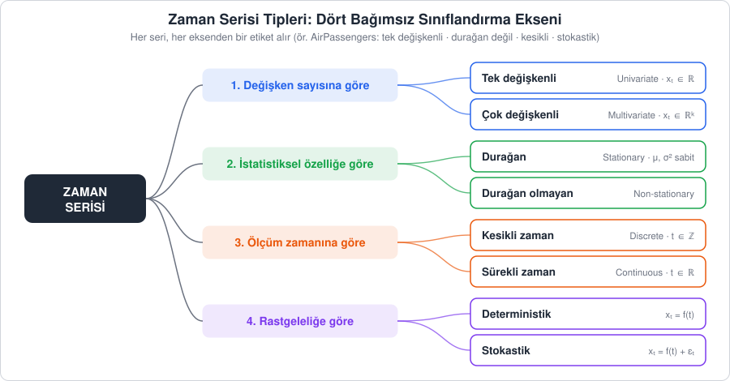
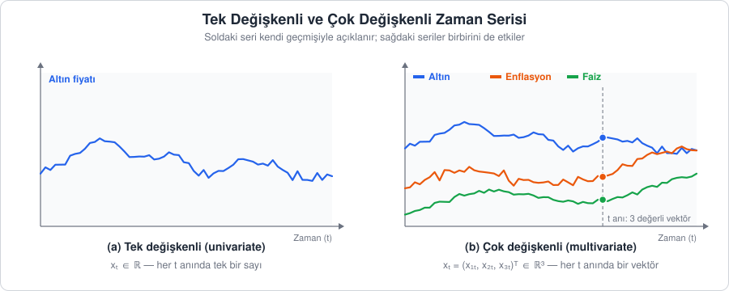
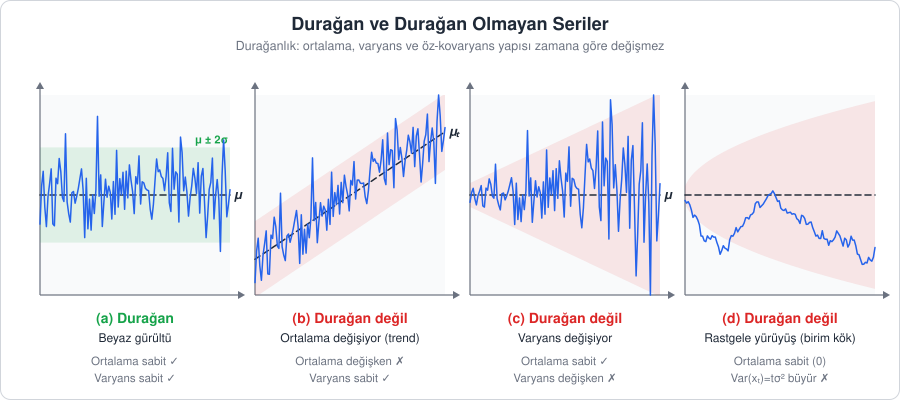
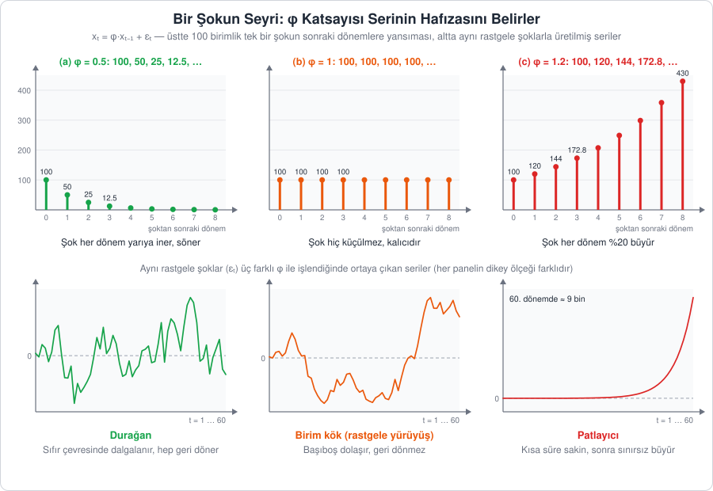
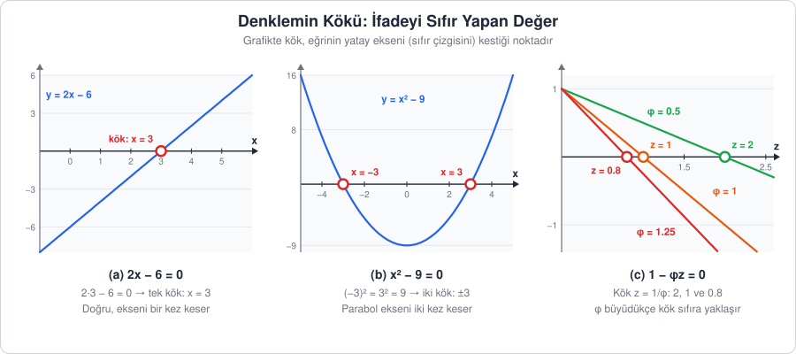
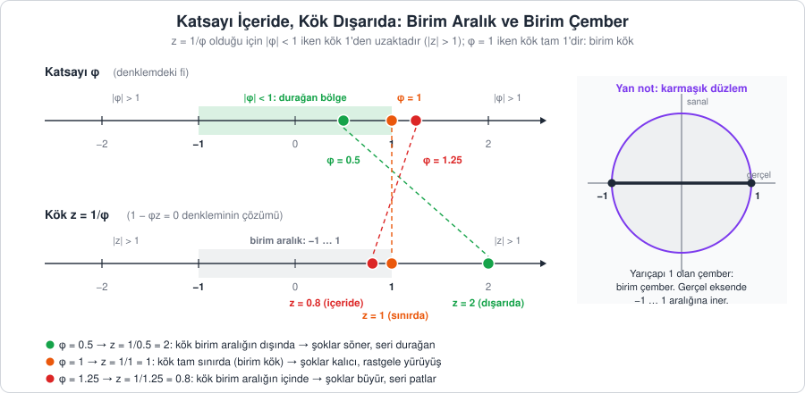
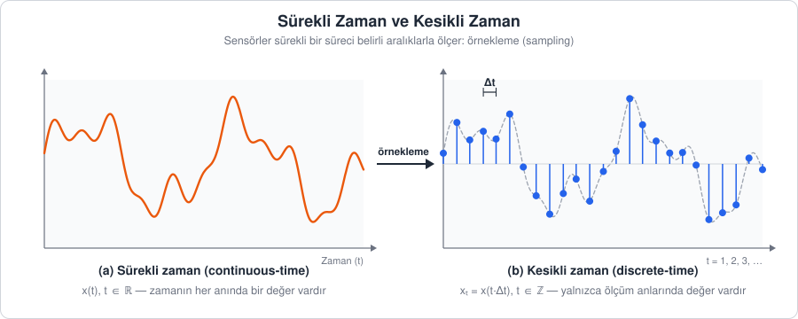
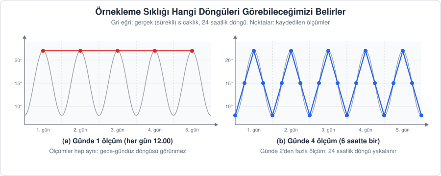
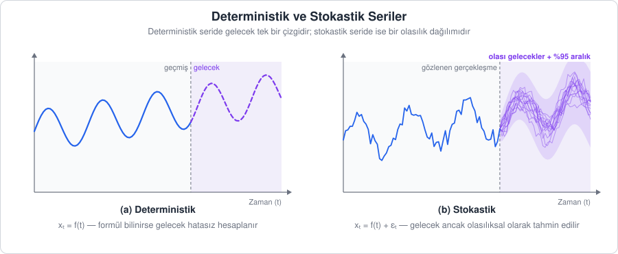

[İçindekiler](../Course_notes.md) · [← 2. Zaman Serisinin Temel Kavramları ve Bileşenleri](02_zaman_serisinin_temel_kavramlari_ve_bilesenleri.md) · [4. R'da Tarih ve Zaman Nesneleri →](04_rda_tarih_ve_zaman_nesneleri.md)

## 3. Zaman Serisi Tipleri

Bir doktor tedaviye başlamadan önce teşhis koyar. Zaman serisi analizinde de durum aynıdır: **modeli seçmeden önce serinin "tipini" belirlemeliyiz.** Çünkü her seriye aynı yöntem uygulanmaz; yanlış tipe uygun bir model seçmek, grip hastasına kırık kol tedavisi uygulamaya benzer.

Zaman serilerini sınıflandırırken **dört bağımsız eksen** kullanırız. Buradaki kilit fikir şudur: bu eksenler birbirini dışlamaz. Her seri, her eksenden **birer etiket** alır. Örneğin derste sık kullanacağımız `AirPassengers` serisi aynı anda *tek değişkenli*, *durağan olmayan*, *kesikli zamanlı* ve *stokastik* bir seridir.



*Şekil 3.1 — Zaman serilerini sınıflandırmanın dört ekseni. Her seri her eksenden bir etiket alır.*

> **Neden önemli?** Serinin tipi, kullanılacak araç setini doğrudan belirler:
>
> | Serinin tipi | Tipik soru | Örnek yöntemler (bu derste) |
> | --- | --- | --- |
> | Tek değişkenli | "Bu serinin geçmişi geleceği hakkında ne söylüyor?" | ARIMA/SARIMA (Bölüm 7), Prophet (Bölüm 9), XGBoost (Bölüm 13), LSTM/GRU/1D-CNN (Bölüm 15) |
> | Çok değişkenli | "Seriler birbirini nasıl etkiliyor?" | VAR (Bölüm 10, Gretl ile Bölüm 11), çok girdili LSTM/GRU (Bölüm 15) |
> | Durağan olmayan | "Seriyi nasıl durağan hâle getiririm?" | Fark alma, log dönüşümü (Bölüm 2.4, 3.2), ADF/KPSS testleri (Bölüm 3.2 ve 7.5) |
> | Stokastik | "Tahminim ne kadar belirsiz?" | Tahmin aralıkları (Bölüm 7, 9), eğitim-test ayrımı ve hata metrikleri (Bölüm 8, 16) |

---

### 3.1. Değişken Sayısına Göre: Tek Değişkenli ve Çok Değişkenli

**Açıklama:** Bir öğrencinin notlarını tahmin etmek istediğimizi düşünelim. Yalnızca öğrencinin geçmiş notlarına bakılırsa *tek değişkenli*, geçmiş notlarının yanında çalışma saati, devam durumu ve uyku süresi de birlikte izlenirse *çok değişkenli* bir analiz yapılmış olur.

**Tanım:**

- **Tek değişkenli (univariate) seri:** Her $t$ anında tek bir skaler gözlem vardır.

$$
\lbrace x_t\rbrace _{t=1}^{T}, \qquad x_t \in \mathbb{R}
$$

```math
\underbrace{\lbrace x_t\rbrace_{t=1}^{T}}_{\substack{\text{T gözlemlik}\\\text{seri}}}, \qquad \underbrace{x_t \in \mathbb{R}}_{\substack{\text{her anda tek bir}\\\text{gerçel sayı}}}
```

**Ne anlatıyor?** Tek değişkenli bir seride her zaman noktasında yalnızca bir sayı gözlenir.

> **Simge notu:** $`\in`$ *(elemanıdır)*: soldaki öğe sağdaki kümeye aittir · $`\mathbb{R}`$ *(reel sayılar)*: tüm gerçel sayıların kümesi, yani sayı doğrusundaki eksi, kesirli ve ondalıklı sayılar dahil bütün sayılar

$x_t \in \mathbb{R}$ ifadesi yalnızca "her an elimizde tek bir gerçel sayı vardır" demektir (örneğin $x_t = 432$ yolcu).

- **Çok değişkenli (multivariate) seri:** Her $t$ anında $k$ değişkenden oluşan bir **gözlem vektörü** vardır.

$$
\mathbf{x}_t = (x_{1,t}, x_{2,t}, \dots, x_{k,t})^\top \in \mathbb{R}^k
$$

```math
\underbrace{\mathbf{x}_t}_{\substack{\text{t anındaki}\\\text{gözlem vektörü}}} = (\overbrace{x_{1,t}}^{\text{1. değişken}}, x_{2,t}, \dots, \overbrace{x_{k,t}}^{\text{k. değişken}})^\top \in \underbrace{\mathbb{R}^k}_{\substack{\text{k gerçel sayıdan}\\\text{oluşan vektörler}}}
```

**Ne anlatıyor?** Çok değişkenli bir seride her zaman noktasında $k$ değişkenin değeri birlikte gözlenir ve tek bir vektörde toplanır; böylece değişkenler arasındaki etkileşim incelenebilir.

> **Simge notu:** $`\mathbf{x}_t`$ *(kalın x t)*: t anındaki gözlem vektörü · $`x_{1,t}`$ *(x bir t)*: 1. değişkenin t anındaki değeri; virgülden önceki alt indis değişkenin numarası, sonraki zaman · $`^\top`$ *(transpoz)*: satır vektörünü sütun vektörüne çevirir · $`\mathbb{R}^k`$ *(R üzeri k)*: k bileşenli gerçel sayı vektörlerinin kümesi

**Vektör**, sırası belli bir sayı listesidir. Altın fiyatı, enflasyon ve faizi birlikte izlediğimizde ($k = 3$) bir ayın gözlemi, örneğin $\mathbf{x}_ t = (2400,\ 3.1,\ 5.25)^\top$ gibi üç sayılık bir listedir. Sıra önemlidir: Birinci sayı her zaman altın, ikincisi enflasyon, üçüncüsü faizdir. Kalın yazılmış $\mathbf{x}$ bunun tek bir sayı değil bir liste olduğunu hatırlatır. Transpoz işareti ise yalnızca bir yazım kolaylığıdır: Listeyi aslında alt alta (sütun olarak) düşünürüz ama yer kazanmak için yan yana yazarız.

Çok değişkenli analizde yalnızca her serinin kendi geçmişi değil, seriler **arasındaki** ilişkiler de modellenir. Örneğin faizdeki bir artışın birkaç ay sonra enflasyonu etkilemesi gibi. Bu ilişkiler çapraz kovaryans ile ölçülür: $\mathrm{Cov}(x_{i,t}, x_{j,t-h})$. Bu değer, $i$. serinin bugünkü değeri ile $j$. serinin $h$ adım önceki değerinin birlikte nasıl değiştiğini gösterir. Yukarıdaki örnekte $i = 2$ (enflasyon), $j = 3$ (faiz) ve $h = 6$ alınırsa, bu ayın enflasyonu ile 6 ay önceki faizin birlikte hareketine bakmış oluruz.

> **Simge notu:** $`\mathrm{Cov}(\cdot,\cdot)`$ *(kovaryans)*: iki değişkenin birlikte değişim ölçüsü; pozitifse birlikte artıp azalırlar



*Şekil 3.2 — (a) Tek değişkenli seride her an tek bir sayı vardır. (b) Çok değişkenli seride her an bir vektördür (kesikli çizgi ile gösterilen kesit).*

| | Tek değişkenli | Çok değişkenli |
| --- | --- | --- |
| Her andaki gözlem | Bir sayı: $x_t$ | Bir vektör: $\mathbf{x}_ t$ |
| Örnek | Aylık yolcu sayısı (`AirPassengers`) | Altın fiyatı + enflasyon + faiz |
| Güçlü yanı | Basit, az veri ister, yorumlaması kolay | Değişkenler arası etkileşimi yakalar |
| Zayıf yanı | Dış etkenleri görmez | Parametre sayısı hızla artar, daha çok veri ister |

> **Dikkat, sık yapılan bir karışıklık:** Bir hedef seriyi dış değişkenlerle birlikte tahmin etmek (ör. ARIMAX, Prophet'a regresör eklemek) *her zaman* tam çok değişkenli modelleme değildir. Orada ilişki **tek yönlüdür** (dış değişken → hedef). VAR gibi gerçek çok değişkenli modellerde ise tüm seriler **birbirini karşılıklı olarak** etkiler (ayrıntısı Bölüm 10'da).

> **Hemen deneyin 3.1a · Çok değişkenli bir seri: dört borsa endeksi** (R, ~4 dk)
>
> R ile gelen `EuStockMarkets`, 1991–1998 arasında dört Avrupa borsa endeksinin (Almanya DAX, İsviçre SMI, Fransa CAC, İngiltere FTSE) günlük kapanış değerleridir. RStudio'da **Console** paneline yazın:
>
> ```r
> dim(EuStockMarkets)              # dim(): satır (gün) ve sütun (değişken) sayısı
> head(EuStockMarkets, 3)          # ilk 3 gün
> EuStockMarkets[1, ]              # [satır, sütun]: 1. satırın tamamı, yani x_1 vektörü
> plot(EuStockMarkets)             # dört seri alt alta
> round(cor(EuStockMarkets), 2)    # cor(): seriler arası korelasyon tablosu (-1 ile 1 arası)
> ```
>
> **Ne göreceksiniz:** `dim()` → `[1] 1860    4`: 1860 gün, $`k = 4`$ değişken. `EuStockMarkets[1, ]` dört sayılık bir vektör yazar: `DAX 1628.75  SMI 1678.10  CAC 1772.80  FTSE 2443.60`. Bu, metindeki $`\mathbf{x}_1 = (x_{1,1}, x_{2,1}, x_{3,1}, x_{4,1})^\top`$'nin ta kendisidir. Grafikte dört seri birlikte yükselir; korelasyon tablosunda bütün değerler 0.92 ile 0.99 arasındadır (ör. DAX–SMI 0.99, CAC–FTSE 0.92).
>
> **Şimdi siz:** Son günün gözlem vektörünü yazdırın (satır sayısını `dim()` çıktısından bulun). Hangi endeks dönem içinde en çok büyümüş?
>
> <details><summary>Cevap</summary>
>
> `EuStockMarkets[1860, ]` → `DAX 5473.72  SMI 7676.30  CAC 3995.00  FTSE 5455.00`. SMI 1678.1'den 7676.3'e, yani yaklaşık 4.6 katına çıkmıştır; en çok büyüyen odur (DAX yaklaşık 3.4, FTSE 2.2, CAC 2.3 kat). Bu yüksek korelasyonların bir kısmı "hepsinin aynı dönemde yükselmesinden", yani ortak trendden gelir; trendli serilerde korelasyon yanıltıcı olabilir (Bölüm 10).
>
> </details>

> **Hemen deneyin 3.1b · Çok değişkenli seriyi Python'da okumak** (Python, ~3 dk)
>
> Depodaki `data/macro.csv` dosyası aylık enflasyon, faiz ve döviz kuru serilerini içerir (Bölüm 10 ve 11'de VAR için kullanılır). Depo kök dizininde çalıştırın:
>
> ```python
> import pandas as pd
>
> makro = pd.read_csv("data/macro.csv", parse_dates=["date"], index_col="date")
> print(makro.shape)              # (satır sayısı, sütun sayısı)
> print(makro.head(3))            # ilk 3 ay
> print(makro.iloc[0].values)     # iloc[0]: 1. satır; yani 1. ayın gözlem vektörü x_1
> print(makro.corr().round(2))    # seriler arası korelasyon tablosu
> ```
>
> **Ne göreceksiniz:** `(120, 3)`: 120 ay, $`k = 3`$ değişken. İlk ayın vektörü `[7.24 7.75 2.32]` (enflasyon, faiz, kur). Korelasyon tablosunda enflasyon–kur 0.84, faiz–kur 0.80, enflasyon–faiz 0.54'tür. Metindeki "altın + enflasyon + faiz" örneğinin benzeridir: Her ay bir sayı değil, üç sayılık bir listedir.
>
> **Şimdi siz:** Verinin hangi aydan hangi aya uzandığını `print(makro.index.min(), makro.index.max())` ile bulun. 120 ay kaç yıl eder?
>
> <details><summary>Cevap</summary>
>
> `2015-01-01 00:00:00 2024-12-01 00:00:00`: Ocak 2015 – Aralık 2024, yani 120 / 12 = 10 yıl.
>
> </details>

---

### 3.2. İstatistiksel Özelliklere Göre: Durağan ve Durağan Olmayan

> **Uygulama dosyası:** [`Codes/R/ch03_duraganlik.R`](../Codes/R/ch03_duraganlik.R)
>
> Bu bölümdeki R kodlarının tamamı bu dosyada. Dosya RStudio'da açılıp satır satır ya da depo kök dizininde `Rscript Codes/R/ch03_duraganlik.R` komutuyla çalıştırılabilir.


Bu ayrım, klasik zaman serisi analizinin **en kritik** kavramıdır. Bu bölüm aynı zamanda dersin ilerleyen bölümlerinde sık sık başvuracağımız **birim kök** kavramının ve ADF testinin temelini de anlatır.

#### 3.2.1. Tanım

**Açıklama:** Sakin bir göl yüzeyini düşünelim. Dalgacıklar vardır ama su seviyesi (ortalama) ve dalgaların büyüklüğü (varyans) hep aynıdır. Hangi saatte fotoğraf çekilirse çekilsin, göl "aynı karakterde" görünür. Bu **durağan** bir seridir. Şimdi yağmur mevsiminde yükselen bir nehri düşünelim: su seviyesi sürekli değişir. Bu da **durağan olmayan** bir seridir.

Kısacası durağan bir seride, **seriden hangi zaman diliminde parça alınırsa alınsın, parça istatistiksel olarak benzer görünür.**

Tanımda üç istatistiksel kavram kullanılır. Üçünü de basit örneklerle önceden tanıyalım:

- **Beklenen değer** $E[x_t]$, bir rastgele büyüklüğün "uzun vadede ortalaması"dır. Hilesiz bir zarın beklenen değeri $(1 + 2 + 3 + 4 + 5 + 6)/6 = 3.5$'tir. Tek bir atışta 3.5 gelmez ama çok sayıda atışın ortalaması 3.5'e yaklaşır. Durağan bir seride bu kuramsal ortalama ($\mu$, "mü") her $t$ için aynıdır.
- **Varyans** $\mathrm{Var}(x_t)$, değerlerin ortalama etrafındaki yayılımıdır (hesabı Bölüm 2.2'de). Değeri $\sigma^2$ ile gösterilir.
- **Kovaryans** $\mathrm{Cov}(x_t, x_{t+h})$, iki değerin birlikte hareket etme eğilimidir. Hesabı varyansa benzer: Her çiftte iki değerin kendi ortalamasından farkları **çarpılır** ve bu çarpımların ortalaması alınır. Örneğin bir yukarı bir aşağı giden 4, 6, 4, 6, 4 serisinde ardışık çiftler ($h = 1$) şunlardır: (4, 6), (6, 4), (4, 6), (6, 4). Her iki konumun ortalaması 5'tir. Her çiftte farklar zıt işaretlidir, örneğin $(4-5)(6-5) = (-1)(+1) = -1$. Dört çarpımın hepsi $-1$ olduğu için kovaryans $-1$ çıkar. Negatif kovaryans, "bugün yüksekse yarın düşük" düzenini yakalamıştır. Değerler birlikte yükselip birlikte düşseydi çarpımlar pozitif, kovaryans pozitif olurdu.

**Tanım 1 (zayıf / kovaryans durağanlığı):** Bir $\lbrace x_t\rbrace$ süreci aşağıdaki üç koşulu sağlıyorsa *zayıf durağandır*:

```math
\begin{aligned}
&1)\quad \underbrace{E[x_t]}_{\text{t anındaki ortalama}} = \underbrace{\mu}_{\substack{\text{sabit sayı,}\\\text{t'ye bağlı değil}}}\\[6pt]
&2)\quad \underbrace{\mathrm{Var}(x_t)}_{\text{t anındaki varyans}} = \underbrace{\sigma^2 < \infty}_{\text{sabit ve sonlu}}\\[6pt]
&3)\quad \underbrace{\mathrm{Cov}(x_t, x_{t+h})}_{\substack{\text{h adım arayla iki}\\\text{değerin kovaryansı}}} = \underbrace{\gamma(h)}_{\substack{\text{yalnızca gecikme h'ye}\\\text{bağlı, t'ye değil}}}
\end{aligned}
```

**Ne anlatıyor?** Zayıf durağan bir süreçte ortalama sabittir, varyans sabit ve sonludur, iki değer arasındaki kovaryans ise yalnızca aralarındaki gecikmeye ($h$) bağlıdır. Üç ölçünün hiçbiri takvimde hangi anda bulunulduğuna, yani $t$'ye bağlı değildir.

> **Simge notu:** $`E[\cdot]`$ *(e, beklenen değer)*: rastgele değişkenin kuramsal ortalaması · $`\mu`$ *(mü)*: ortalama · $`\mathrm{Var}(\cdot)`$ *(varyans)*: ortalama etrafındaki yayılım · $`\sigma^2`$ *(sigma kare)*: varyansın değeri · $`\infty`$ *(sonsuz)*: $`\sigma^2 < \infty`$ varyansın sonlu olduğunu belirtir · $`\gamma(h)`$ *(gama h)*: h gecikmeli otokovaryans (*autocovariance*) fonksiyonu, yani kovaryansın yalnızca h'ye bağlı bir kural olarak yazılmış hâli

Üçüncü koşul şunu söyler: bugün ile yarın arasındaki ilişki, geçen yılın aynı iki ardışık günü arasındaki ilişkiyle aynıdır. İlişki "saatin" kaç olduğuna değil, yalnızca **aradaki mesafeye** bağlıdır. Bu kovaryansın korelasyona çevrilmiş hâli, Bölüm 6'da göreceğimiz ACF'dir.

**Günlük hayattan bir örnek:** Bir ağrı kesici sabah 8'de de akşam 8'de de alınsa 4 saat sonra kanda kalan oran aynıdır. Önemli olan saat değil, aradan geçen süredir. Durağan seride iki gözlem arasındaki ilişki de böyledir: "Hangi gün?" sorusuna değil, yalnızca "Kaç gün arayla?" sorusuna bağlıdır. Benzetmenin sınırı: İlacın etkisi her seferinde aynıdır, kovaryans ise birçok gözlem çiftinin ortalama ilişkisidir.

> **Tanım 2 (katı / strict durağanlık):** Daha güçlü bir koşuldur; $`(x_{t_1}, \dots, x_{t_n})`$ vektörünün **ortak olasılık dağılımının** tamamı zaman kaymasına karşı değişmezdir. **Olasılık dağılımı**, hangi değerlerin hangi olasılıkla gelebileceğinin tam listesidir (hilesiz zarda her yüz için 1/6). Katı durağanlık yalnızca ortalama ve varyansın değil, bu listenin tamamının zamanla değişmemesini ister. Uygulamada "durağan" dendiğinde neredeyse her zaman *zayıf durağanlık* kastedilir.



*Şekil 3.3 — (a) Beyaz gürültü: ortalama ve varyans sabit. (b) Trend: ortalama zamanla artıyor. (c) Varyans zamanla büyüyor. (d) Rastgele yürüyüş: ortalama sabit görünse de varyans $`t\sigma^2`$ şeklinde büyür; bu nedenle durağan değildir.*

**Durağanlığı bozan başlıca nedenler:**

| Neden | Ne değişir? | Tipik çözüm |
| --- | --- | --- |
| Trend | Ortalama ($\mu_t$) | Fark alma: $\nabla x_t = x_t - x_{t-1}$ ya da trendi çıkarma |
| Mevsimsellik | Ortalama, periyodik olarak | Mevsimsel fark: $x_t - x_{t-s}$ (aylık veride $s=12$) |
| Değişen varyans | Varyans ($\sigma_t^2$) | Log veya Box-Cox dönüşümü |
| Birim kök (rastgele yürüyüş) | Varyans zamanla büyür | Fark alma |

> **Simge notu:** $`\mu_t`$ *(mü t)*: zamana bağlı olarak değişen ortalama · $`\sigma_t^2`$ *(sigma t kare)*: zamana bağlı olarak değişen varyans · $`\nabla`$ *(nabla)*: birinci fark operatörü (Bölüm 2.1)

#### 3.2.2. AR(1) ve Bir Şokun Yolculuğu

Tablonun son satırındaki **birim kök**, ADF testinin sınadığı ve ders boyunca karşımıza çıkacak olan kavramdır. Adının nereden geldiğini, en basit zaman serisi modeli üzerinden adım adım kuralım.

**AR(1) denklemini kelime kelime okumak.** Bir dondurma dükkânının günlük satışlarını düşünelim. Bugünkü satış büyük ölçüde dünkü satışa benzer: Dün kalabalık olan dükkân bugün de büyük olasılıkla kalabalıktır. Ama her gün bir de önceden bilinemeyen bir sürpriz vardır: ani bir sağanak satışları düşürür, bir okul gezisi artırır. Bu iki fikir tek bir denklemde toplanır. Bu denkleme **birinci dereceden otoregresif model**, kısaca **AR(1)** denir ("oto": kendi, "regresif": geçmişine dayanan, "1": yalnızca bir önceki döneme bakılır):

```math
x_t = \phi \, x_{t-1} + \varepsilon_t
```

```math
\underbrace{x_t}_{\text{bugünkü değer}} = \underbrace{\phi}_{\substack{\text{katsayı:}\\\text{serinin hafızası}}} \, \overbrace{x_{t-1}}^{\text{dünkü değer}} + \underbrace{\varepsilon_t}_{\substack{\text{bugüne özgü}\\\text{şok (sürpriz)}}}
```

**Ne anlatıyor?** Bugünkü değer, dünkü değerin bugüne taşınan kısmı ile geçmişten tahmin edilemeyen bugünkü şokun toplamıdır; $\phi$, dünün ne kadarının bugüne taşındığını belirler.

Denklemi parça parça okuyalım:

- $x_t$: **bugünkü** değer (bugünkü satış). Alt indisteki $t$ zamanı gösterir; $t$ "bugün" ise $t - 1$ "dün"dür (Bölüm 1.1).
- $x_{t-1}$: **dünkü** değer (dünkü satış).
- $\phi$: Yunan harfi **fi**. Dünkü değeri çarpan sabit sayıdır; matematikte bir terimi çarpan böyle sabit sayılara **katsayı** denir. $\phi$, dünün ne kadarının bugüne taşındığını söyler. $\phi = 0.5$ ise dünkü değerin yarısı bugüne aktarılır. Bu nedenle $\phi$'ye serinin **hafızası** diyebiliriz.
- $\varepsilon_t$: Yunan harfi **epsilon**. Bugüne ait, geçmişten tahmin edilemeyen **şok**tur (hata terimi, sürpriz): bugünkü ani yağmur. Ortalaması sıfırdır ve her gün yenisi, öncekilerden bağımsız olarak gelir; yani Bölüm 2.2'deki beyaz gürültüdür.

Tüm denklem şu cümlenin kısaltmasıdır: **Bugünkü satış = (dünkü satışın bugüne yansıyan kısmı) + (bugüne özgü sürpriz).**

> **Simge notu:** $`\phi`$ *(fi)*: AR(1) katsayısı, serinin hafızası. Pi ($`\pi \approx 3.14`$) ile karıştırılmamalıdır; $`\phi`$ bir sabit değil, veriden kestirilen bir katsayıdır · $`\varepsilon_t`$ *(epsilon t)*: t anındaki rastgele şok. Küme işareti $`\in`$ (elemanıdır) ile karıştırılmamalıdır; $`\varepsilon`$ bir harftir, "ait olma" anlamı taşımaz · $`x_{t-1}`$ *(x t eksi bir)*: bir önceki dönemin değeri

**Bir şokun yolculuğu.** $\phi$'nin neden bu kadar önemli olduğunu görmek için tek bir şoku izleyelim. Seri sıfırda dururken bir gün 100 birimlik bir şok gelsin ($\varepsilon = 100$) ve sonrasında hiç yeni şok gelmesin. Her gün bir önceki günün $\phi$ katı bugüne taşınır:

| Dönem | $`\phi = 0.5`$ | $`\phi = 1`$ | $`\phi = 1.2`$ |
| --- | --- | --- | --- |
| Şok günü | 100 | 100 | 100 |
| 1 gün sonra | 0.5 × 100 = 50 | 1 × 100 = 100 | 1.2 × 100 = 120 |
| 2 gün sonra | 0.5 × 50 = 25 | 100 | 1.2 × 120 = 144 |
| 3 gün sonra | 0.5 × 25 = 12.5 | 100 | 1.2 × 144 = 172.8 |
| 8 gün sonra | ≈ 0.39 | 100 | ≈ 430 |

Üç farklı davranış ortaya çıkar:

- $\phi = 0.5$ iken şok her gün yarıya iner ve **söner**. Seri hep eski düzeyine döner: **durağan**.
- $\phi = 1$ iken şok hiç küçülmez, **kalıcıdır**. Her yeni şok öncekilerin üstüne eklenir ve seri başıboş dolaşır. Denklem $x_t = x_{t-1} + \varepsilon_t$ hâline gelir; bu modele **rastgele yürüyüş** (*random walk*) denir. Seri **durağan değildir**.
- $\phi = 1.2$ iken şok her gün %20 büyür ve seri **patlar** (*explosive*). Gerçek ekonomik ve iş verilerinde nadir görülür.

```math
\underbrace{x_t}_{\text{bugün}} = \underbrace{x_{t-1}}_{\substack{\text{dün, olduğu gibi}\\\text{taşınır } (\phi = 1)}} + \overbrace{\varepsilon_t}^{\text{bugünün yeni şoku}}
```

**Ne anlatıyor?** Dünün değeri bugüne olduğu gibi taşınır ve üzerine yeni şok eklenir. Hiçbir şok sönmediği için şoklar birikir ve seri başıboş dolaşır.

**Günlük hayattan bir örnek:** Bayramda alınan 2 kilo, düzenli spor yapan biri için birkaç haftada erir ($\phi < 1$, şok söner). Hiç dikkat etmeyen biri için ise her bayramın kilosu bir öncekinin üstüne eklenir ($\phi = 1$, şoklar birikir).



*Şekil 3.4 — Üstte, 100 birimlik tek bir şokun $`x_t = \phi x_{t-1} + \varepsilon_t`$ formülüyle hesaplanan seyri: (a) $`\phi = 0.5`$ iken söner, (b) $`\phi = 1`$ iken aynen kalır, (c) $`\phi = 1.2`$ iken büyür. Altta, aynı rastgele şoklar üç farklı $`\phi`$ ile işlendiğinde ortaya çıkan 60 dönemlik seriler: durağan seri sıfır çevresinde dalgalanır, rastgele yürüyüş geri dönmeden dolaşır, patlayıcı seri sınırsız büyür.*

Rastgele yürüyüşün varyansının neden $t\sigma^2$ olduğu da artık kolayca görülür. $x_0 = 0$'dan başlarsak $x_1 = \varepsilon_1$, $x_2 = \varepsilon_1 + \varepsilon_2$, …, $x_t = \varepsilon_1 + \varepsilon_2 + \dots + \varepsilon_t$ olur: Seri, o güne kadarki bütün şokların toplamıdır. Bağımsız büyüklüklerin toplamının varyansı, varyanslarının toplamına eşittir. Bu yüzden $\mathrm{Var}(x_t) = \sigma^2 + \sigma^2 + \dots + \sigma^2 = t\sigma^2$ olur. Örneğin $\sigma^2 = 1$ ise 1. günde varyans 1, 100. günde 100'dür (standart sapma 10). Ortalama hep 0 kalsa da serinin sıfırdan ne kadar uzaklaşabileceği zamanla büyür; Şekil 3.3d'nin anlattığı budur.

**Günlük hayattan bir örnek:** Her gün rastgele birkaç saniye ileri ya da geri kayan bir duvar saati düşünelim. Ortalama kayma sıfırdır, ama hatalar birikir: Bir hafta sonra saat birkaç saniye, bir yıl sonra dakikalarca şaşmış olabilir. Ortalama aynı kalırken olası sapma aralığı zamanla genişler.

> **Hemen deneyin 3.2a · Bir şokun yolculuğunu R'a hesaplatın** (R, ~3 dk)
>
> Yukarıdaki tabloyu tek satırlık hesaplarla üretelim. RStudio'da **Console** paneline yazın:
>
> ```r
> gun <- 0:8                        # şok günü (0) ve sonraki 8 gün
> round(100 * 0.5^gun, 2)           # ^ üs alma: 0.5^gun, phi'nin gun kez çarpılması
> round(100 * 1^gun, 2)             # phi = 1
> round(100 * 1.2^gun, 2)           # phi = 1.2
> ```
>
> **Ne göreceksiniz:** `100.00 50.00 25.00 12.50 6.25 3.12 1.56 0.78 0.39` (söner), `100 100 100 100 100 100 100 100 100` (kalıcı) ve `100.00 120.00 144.00 172.80 207.36 248.83 298.60 358.32 429.98` (patlar). Tablodaki "8 gün sonra ≈ 0.39" ve "≈ 430" değerleri son sütunlardır.
>
> **Şimdi siz:** $`\phi = 0.9`$ ve $`\phi = -0.5`$ için de hesaplayın. Hangisi daha yavaş söner? Negatif $`\phi`$'de şok nasıl davranır?
>
> <details><summary>Cevap</summary>
>
> $`\phi = 0.9`$: `100.00 90.00 81.00 72.90 65.61 59.05 53.14 47.83 43.05`; 8 gün sonra hâlâ 43'tür, çok yavaş söner. $`\phi = -0.5`$: `100.00 -50.00 25.00 -12.50 6.25 -3.12 1.56 -0.78 0.39`; işaret her gün değişir (bir gün yukarı, bir gün aşağı) ama büyüklük $`\phi = 0.5`$'teki gibi yarıya iner. $`\lvert \phi \rvert < 1`$ olduğu için ikisi de durağandır.
>
> </details>

> **Hemen deneyin 3.2b · $`\mathrm{Var}(x_t) = t\sigma^2`$'yi simülasyonla görün** (Python, ~4 dk)
>
> Tarihi 5000 kez "yeniden oynatıp" her seferinde 100 günlük bir rastgele yürüyüş üretelim; sonra belirli bir günde bu 5000 değerin ne kadar yayıldığına bakalım.
>
> ```python
> import numpy as np
>
> np.random.seed(0)
> soklar = np.random.normal(0, 1, size=(5000, 100))   # 5000 satır x 100 gün; ortalama 0, std. sapma 1
> yuruyus = soklar.cumsum(axis=1)                      # her satırda birikimli toplam: rastgele yürüyüş
> for t in [1, 25, 100]:
>     print(t, round(yuruyus[:, t - 1].var(), 2))      # t. gündeki 5000 değerin varyansı
> ```
>
> **Ne göreceksiniz:** `1 0.99`, `25 25.41`, `100 96.82`. Varyans yaklaşık $`t \cdot 1`$'dir: 1. günde 1, 25. günde 25, 100. günde 100 dolayında (simülasyon olduğu için tam değil). Python'da indeks 0'dan başladığı için $`t`$. gün `t - 1` sütunudur.
>
> **Şimdi siz:** `np.random.normal(0, 1, ...)` yerine `np.random.normal(0, 2, ...)` yazın (σ = 2). 100. gündeki varyans yaklaşık kaç olmalı?
>
> <details><summary>Cevap</summary>
>
> $`\sigma^2 = 4`$ olduğu için $`\mathrm{Var}(x_{100}) \approx 100 \times 4 = 400`$. Çıktı `1 3.96`, `25 101.63`, `100 387.28`'dir.
>
> </details>

#### 3.2.3. Karakteristik Denklem ve Birim Kök

**Denklemin kökü.** Matematikte bir denklemin **kökü**, içindeki bilinmeyenin yerine yazıldığında eşitliği doğru yapan, yani ifadeyi sıfıra eşitleyen değerdir. İki örnek:

- $2x - 6 = 0$ denkleminde $x$ yerine 3 yazarsak $2 \cdot 3 - 6 = 0$ olur. Denklemin kökü $x = 3$'tür.
- $x^2 - 9 = 0$ denkleminde karesi 9 olan iki sayı vardır: $3^2 = 9$ ve $(-3)^2 = 9$. Bu denklemin iki kökü vardır: $x = 3$ ve $x = -3$.

Grafik üzerinde kök, ifadenin grafiğinin yatay ekseni (sıfır çizgisini) kestiği noktadır, çünkü tam o noktada ifadenin değeri sıfırdır. $2x - 6$ ve $x^2 - 9$ gibi, bilinmeyenin kuvvetlerinin ($x$, $x^2$, $x^3$, …) sabit sayılarla çarpılıp toplandığı ifadelere **polinom** denir. $2x - 6$ birinci dereceden, $x^2 - 9$ ikinci dereceden bir polinomdur.



*Şekil 3.5 — Denklemin kökü, grafiğin yatay ekseni kestiği noktadır. (a) $`2x - 6 = 0`$ tek köklüdür: $`x = 3`$. (b) $`x^2 - 9 = 0`$ iki köklüdür: $`x = \pm 3`$. (c) AR(1) modelinin karakteristik denklemi $`1 - \phi z = 0`$: kök $`z = 1/\phi`$'dir; $`\phi = 0.5`$ için 2, $`\phi = 1`$ için 1, $`\phi = 1.25`$ için 0.8.*

**AR(1) modelinden "kök"e: gecikme operatörü ve $z$.** AR(1) denkleminin bir kökü olabilmesi için önce onu bir polinom gibi yazmamız gerekir. Bunun için Bölüm 2.1'deki gecikme operatörünü ($B x_t = x_{t-1}$, birçok kaynakta $L$) kullanırız. Adım adım:

1. Denklemi yazıp $x_{t-1}$ terimini sol tarafa geçiririz: $x_t - \phi x_{t-1} = \varepsilon_t$.
2. $x_{t-1}$ yerine $B x_t$ yazarız: $x_t - \phi B x_t = \varepsilon_t$.
3. Her iki terimde ortak olan $x_t$'yi paranteze alırız:

```math
(1 - \phi B)\, x_t = \varepsilon_t
```

```math
\underbrace{(1 - \phi B)}_{\substack{\text{modelin iskeleti: bugün}\\\text{eksi dünün }\phi\text{ katı}}}\, \overbrace{x_t}^{\text{seri}} = \underbrace{\varepsilon_t}_{\text{bugünün şoku}}
```

**Ne anlatıyor?** AR(1) modeli gecikme operatörüyle tek bir parantez hâline getirilir; modelin bütün yapısı, seriye uygulanan bu parantezde toplanır.

Parantezin içi, modelin iskeletidir: "Bugünkü değerden, dünkü değerin $\phi$ katını çıkar; geriye yalnızca bugünün şoku kalır." Ancak $B$ bir sayı değil, "bir adım geri git" **komutudur**. "$`1 - \phi B = 0`$ olsun, $B$'yi çözelim" diyemeyiz; bir komutun sayısal değeri olmaz. Matematikçiler bu tür zaman içinde ilerleyen sistemleri (*fark denklemlerini*) incelerken şu yolu izler: Komut olan $B$'nin yerine geçici olarak sıradan bir bilinmeyen koyarlar, genellikle $z$ harfini. Bu $z$ gökten inmemiştir; $B$'nin yerine konmuş bir **kukla değişkendir**. Böylece iskelet, kökü bulunabilen sıradan bir denkleme dönüşür. Bu denkleme modelin **karakteristik denklemi** denir:

$$
1 - \phi z = 0
$$

```math
\underbrace{1 - \phi z}_{\substack{\text{B yerine kukla}\\\text{değişken z konmuş iskelet}}} = 0
```

**Ne anlatıyor?** Gecikme operatörünün yerine sıradan bir bilinmeyen konularak modelin karakteristik denklemi kurulur. Bu denklemin kökü, serinin durağan olup olmadığını belirler.

Bu birinci dereceden denklemi $2x - 6 = 0$ gibi çözeriz: $\phi z = 1$, buradan $z = 1/\phi$. Sayılarla:

| $`\phi`$ | Kök $`z = 1/\phi`$ | Kökün sıfıra uzaklığı | Seri |
| --- | --- | --- | --- |
| 0.5 | 1 / 0.5 = 2 | 1'den büyük | Durağan, şoklar söner |
| 1 | 1 / 1 = 1 | Tam 1 | Birim kök, rastgele yürüyüş |
| 1.25 | 1 / 1.25 = 0.8 | 1'den küçük | Patlayıcı |

Kökün tersi ($1/z$), bir şokun her dönem çarpıldığı sayıdır: $z = 2$ ise şok her dönem yarıya iner, $z = 1$ ise hiç küçülmez.

Adın kaynağı da buradadır: Matematikte 1 sayısına **birim** denir. $\phi = 1$ olduğunda karakteristik denklemin kökü tam 1 çıkar; yani modelin **kökü birimdir**. "Birim kök" (*unit root*) adı buradan gelir. Bir seride birim kök olması, şokların hiç sönmemesi, birikerek kalması ve serinin durağan olmaması demektir.

**Kural: kök 1'den uzaksa durağan.** Kök ile katsayı birbirinin tersidir ($z = 1/\phi$). Bu yüzden katsayı 1'den küçükken kök 1'den büyüktür; katsayı 1'e yaklaştıkça kök de 1'e yaklaşır. Negatif katsayılar da olabileceği için büyüklüğü işaretten bağımsız ölçen **mutlak değer** kullanılır: $\lvert z \rvert$, sayının işaretini atıp sıfıra uzaklığına bakmaktır ($\lvert -2 \rvert = 2$, $\lvert 0.8 \rvert = 0.8$). Kural şöyledir:

- $\lvert z \rvert > 1 \iff \lvert \phi \rvert < 1$: kök sıfıra 1'den daha uzaktır, seri **durağandır**.
- $\lvert z \rvert = 1 \iff \lvert \phi \rvert = 1$: **birim kök**, seri durağan değildir.
- $\lvert z \rvert < 1 \iff \lvert \phi \rvert > 1$: seri **patlayıcıdır**.

> **Simge notu:** $`z`$: karakteristik denklemde B (ya da L) operatörünün yerine konan bilinmeyen · $`\lvert z \rvert`$ *(z'nin mutlak değeri)*: z'nin sıfıra uzaklığı · $`\iff`$ *(ancak ve ancak)*: iki ifade birlikte doğru ya da birlikte yanlıştır



*Şekil 3.6 — Üst sayı doğrusu katsayıyı ($`\phi`$), alttaki kökü ($`z = 1/\phi`$) gösterir. Katsayı −1 ile 1 arasındaysa (yeşil bölge) kök bu aralığın dışına düşer ve seri durağandır. $`\phi = 1`$ iken kök tam sınırdadır (birim kök). Sağda, karmaşık sayılarda aynı sınırın bir çember olduğu gösterilir: birim çember.*

Bu kural kaynaklarda çoğu zaman "**kökler birim çemberin dışında olmalıdır**" diye yazılır. Gerçel sayılarla çalışırken bu cümle Şekil 3.6'daki sayı doğrusu üzerinde okunabilir: Sıfıra uzaklığı tam 1 olan yalnızca iki nokta vardır, −1 ve +1. "Birim çemberin içi" −1 ile 1 arasındaki aralık, "dışı" bu aralığın ötesidir. *Yan not:* Daha uzun modellerde kökler karmaşık sayı çıkabilir (örneğin $1.2 + 0.9i$ gibi, gerçel ve sanal kısmı olan sayılar). Karmaşık sayılar bir doğruya değil bir düzleme yerleştirilir. O düzlemde sıfıra uzaklığı 1 olan noktalar bir çember oluşturur: **birim çember**. Kural aynıdır; örnekteki kökün sıfıra uzaklığı $\sqrt{1.2^2 + 0.9^2} = \sqrt{2.25} = 1.5 > 1$ olduğu için durağanlık koşulunu sağlar.

VAR bölümünde (10.5) aynı koşul katsayılar üzerinden yazılır: "öz değerler birim çemberin içinde". Kök katsayının tersi olduğu için bu, "kökler dışarıda" cümlesiyle aynı şeydir.

**Daha uzun modellerde kökler.** AR(1)'de tek katsayı olduğu için kökü hesaplamadan doğrudan $\lvert \phi \rvert < 1$ koşuluna bakmak yeterlidir. Ama model birden fazla gecikme içerdiğinde (Bölüm 7.1.1'deki AR(p)) katsayılara tek tek bakmak yanıltır. Örneğin $x_t = 1.5\thinspace x_{t-1} - 0.5\thinspace x_{t-2} + \varepsilon_t$ modelinde ilk katsayı 1'den büyüktür ama seri patlamaz. Aynı adımlarla karakteristik denklem $1 - 1.5z + 0.5z^2 = 0$ olur. Bu ikinci dereceden polinom $(1 - z)(1 - 0.5z)$ biçiminde çarpanlarına ayrılır (çarpım açılarak kontrol edilebilir: $1 - 0.5z - z + 0.5z^2 = 1 - 1.5z + 0.5z^2$). Kökleri $z = 1$ ve $z = 2$'dir. Köklerden biri tam 1 olduğu için bu seri de **birim köklüdür**: Bir kez farkı alındığında, kalan kısım $\phi = 0.5$ olan durağan bir AR(1) gibi davranır. Karakteristik denklemin bütün kökleri birim çemberin dışındaysa seri durağandır; bu genel kural her model uzunluğunda geçerlidir. R'da polinom köklerini `polyroot()` bulur:

```r
# Katsayılar sabit terimden başlayarak verilir: c(1, -0.5) -> 1 - 0.5z
Mod(polyroot(c(1, -0.5)))         # AR(1), phi = 0.5
#> [1] 2
Mod(polyroot(c(1, -1)))           # rastgele yürüyüş, phi = 1
#> [1] 1
Mod(polyroot(c(1, -1.5, 0.5)))    # 1 - 1.5z + 0.5z^2 = 0
#> [1] 1 2
```

Bu kod, yukarıda elle bulduğumuz kökleri R'a hesaplatır ve kural için gereken sayıyı, yani her kökün sıfıra uzaklığını verir. Model uzadıkça kökleri elle bulmak zorlaştığı için pratikte bu iş R'a bırakılır. Kodu satır satır okuyalım:

1. `Mod(polyroot(c(1, -0.5)))`: `c(1, -0.5)`, $1 - 0.5z$ polinomunun sabit terimden başlayan katsayılarıdır. `polyroot()` kökleri karmaşık sayı olarak verir (`2+0i`). `Mod()` her kökün sıfıra uzaklığını hesaplar; birim çember kuralı için gereken sayı budur.
2. `Mod(polyroot(c(1, -1)))`: Aynı işi $1 - z$ polinomu, yani $\phi = 1$ olan rastgele yürüyüş için yapar.
3. `Mod(polyroot(c(1, -1.5, 0.5)))`: Vektörde üç katsayı olduğu için polinom ikinci derecedendir: $1 - 1.5z + 0.5z^2$. İkinci dereceden bir polinomun iki kökü olduğu için sonuç iki elemanlı bir vektördür. `polyroot()` sonucu tek başına yazdırılırsa `1+3.56945e-20i` ve `2-3.56945e-20i` gibi değerler görülebilir. Buradaki `e-20` "çarpı 10 üzeri −20" demektir; bu kadar küçük sanal kısımlar, bilgisayarın ondalıklı sayılarla hesap yaparken bıraktığı yuvarlama kırıntılarıdır ve aslında sıfırdır. `Mod()` bu kırıntıları da temizleyip düz uzaklıkları verir.

Çıktılar elle bulduğumuz köklerle aynıdır: 2 (durağan), 1 (birim kök), 1 ve 2 (bir kök tam 1, dolayısıyla birim köklü).

> **Hemen deneyin 3.2c · Kökleri kendiniz bulun** (R, ~3 dk)
>
> Önce kâğıtta $`z = 1/\phi`$ ile kökü hesaplayın, sonra R'a kontrol ettirin:
>
> ```r
> Mod(polyroot(c(1, -0.9)))        # phi = 0.9  -> 1 - 0.9z
> Mod(polyroot(c(1, -1.2)))        # phi = 1.2  -> 1 - 1.2z
> Mod(polyroot(c(1, 0.5)))         # phi = -0.5 -> 1 - (-0.5)z = 1 + 0.5z
> ```
>
> **Ne göreceksiniz:** `[1] 1.111111` (1'den büyük: durağan), `[1] 0.8333333` (1'den küçük: patlayıcı) ve `[1] 2` (durağan). Son satırda katsayı negatif olduğu halde kök yine 2'dir; kural kökün işaretine değil, sıfıra uzaklığına bakar.
>
> **Şimdi siz:** $`x_t = 1.25\thinspace x_{t-1} - 0.25\thinspace x_{t-2} + \varepsilon_t`$ modelinin karakteristik denklemi $`1 - 1.25z + 0.25z^2 = 0`$'dır. Kökleri `polyroot()` ile bulun. Seri durağan mı?
>
> <details><summary>Cevap</summary>
>
> `Mod(polyroot(c(1, -1.25, 0.25)))` → `[1] 1 4`. Köklerden biri tam 1 olduğu için seri birim köklüdür, durağan değildir. (Polinom $`(1 - z)(1 - 0.25z)`$ biçiminde çarpanlarına ayrılır; bir kez fark alınınca $`\phi = 0.25`$ olan durağan bir AR(1) kalır.)
>
> </details>

#### 3.2.4. Trend-Durağan ve Fark-Durağan Seriler

Durağan olmayan serilerin hepsi aynı türden değildir. İki tür özellikle önemlidir:

- **Trend-durağan (trend-stationary):** $x_t = \beta_0 + \beta_1 t + \varepsilon_t$. Deterministik trend çıkarılınca seri durağan olur. Şoklar geçicidir, seri trende geri döner.
- **Fark-durağan (difference-stationary, birim köklü):** $x_t = x_{t-1} + \varepsilon_t$ (rastgele yürüyüş). Burada $\mathrm{Var}(x_t) = t\sigma^2$ olur. Şoklar **kalıcıdır**, bu yüzden seriyi durağanlaştırmak için fark almak gerekir: $\nabla x_t = \varepsilon_t$.

> **Simge notu:** $`\beta_0`$, $`\beta_1`$ *(beta sıfır, beta bir)*: doğrusal trendin sabit terimi (başlangıç düzeyi) ve eğimi (her dönemdeki artış)

```math
\underbrace{x_t}_{\text{gözlem}} = \underbrace{\beta_0 + \beta_1 t}_{\substack{\text{deterministik trend}\\\text{(düz çizgi)}}} + \overbrace{\varepsilon_t}^{\substack{\text{geçici şok}\\\text{(trende geri döner)}}}
```

**Ne anlatıyor?** Gözlem, düz bir trend çizgisi ile geçici bir şokun toplamıdır. Şok bir sonraki döneme taşınmadığı için seri her sapmadan sonra trend çizgisine geri döner.

```math
\underbrace{\nabla x_t}_{\text{birinci fark}} = \overbrace{x_t - x_{t-1}}^{\text{bugün eksi dün}} = \underbrace{\varepsilon_t}_{\substack{\text{yalnızca şok:}\\\text{durağan}}}
```

**Ne anlatıyor?** Bugünkü değerden dünkü değer çıkarıldığında rastgele yürüyüşte birikmiş şoklar ortadan kalkar ve geriye yalnızca bugünün şoku, yani beyaz gürültü kalır. Bu nedenle fark-durağan bir seri, farkı alınarak durağanlaştırılır.

Örneğin $\beta_0 = 100$ ve $\beta_1 = 2$ ise trend çizgisi 100'den başlar ve her dönem 2 birim yükselir; seri bu çizginin çevresinde dalgalanır ve bir şoktan sonra yine çizgiye döner. Rastgele yürüyüşte ise dönülecek bir çizgi yoktur. Bu ayrım önemlidir çünkü yanlış dönüşüm (trend-durağan seriden fark almak ya da birim köklü seriden sadece trend çıkarmak) hatalı modellere yol açar. ARIMA'daki "I" (Integrated) harfi tam olarak bu fark alma işlemini temsil eder.

**Günlük hayattan bir örnek:** Trend-durağan seri raydaki bir tren gibidir: Sarsıntıyla biraz yana yatsa da rayın üstüne döner; ray deterministik trendtir. Fark-durağan seri ise rüzgârla sürüklenen bir sandal gibidir: Her dalga onu biraz iter ve gittiği yerde kalır; dönülecek bir ray yoktur. Benzetmenin sınırı: Seride trende dönüş anlık değil, kademelidir.

#### 3.2.5. ADF Testi

**ADF testi: hipotezler ve p-değeri.** Gerçek veride $\phi$'yi bilmeyiz; elimizde yalnızca gözlenmiş seri vardır. Bu seriden tahmin edilen katsayı, şans eseri 1'den biraz küçük ya da büyük çıkabilir. "Bu fark gerçek mi, yoksa tesadüf mü?" sorusunu yanıtlayan araca **hipotez testi** denir. Birim kök için en yaygın test **ADF** (*Augmented Dickey-Fuller*, genişletilmiş Dickey-Fuller) testidir. ADF iki iddiayı karşı karşıya koyar:

- **Sıfır hipotezi** $H_0$: "Seride birim kök vardır ($\phi = 1$); seri durağan değildir."
- **Alternatif hipotez** $H_1$: "Birim kök yoktur ($\phi < 1$); seri durağandır." R çıktılarında görülen `alternative hypothesis: stationary` satırı tam olarak bunu söyler.

> **Simge notu:** $`H_0`$ *(ha sıfır)*: sıfır hipotezi, testin aksi kanıtlanana kadar doğru kabul ettiği varsayım · $`H_1`$ *(ha bir)*: alternatif hipotez, $`H_0`$ reddedilirse kabul edilen iddia (bazı kaynaklarda $`H_a`$)

Hipotez testini bir mahkemeye benzetebiliriz. Sanık, suçu kanıtlanana kadar **masum** kabul edilir. ADF'de "masumiyet" varsayımı $H_0$'dır: Seri, aksi kanıtlanana kadar birim köklü kabul edilir. Veri (delil) bu varsayımla çok zor bağdaşıyorsa $H_0$ **reddedilir** ve seri durağan kabul edilir.

Delilin gücünü **p-değeri** ölçer: $H_0$ doğru olsaydı, elimizdeki kadar (ya da daha) aşırı bir sonucu sırf şans eseri görme olasılığıdır. Bir benzetme: Bir paranın hilesiz olduğunu varsayalım ($H_0$). On atışta on kez yazı gelirse, hilesiz bir parada bunun olasılığı $(1/2)^{10} = 1/1024 \approx 0.001$'dir. Bu sonuç "hilesiz para" varsayımı altında o kadar şaşırtıcıdır ki varsayımdan şüphe ederiz. p-değeri küçükse veri $H_0$ altında şaşırtıcıdır; büyükse şaşırtıcı değildir.

Karar için önceden bir eşik seçilir, genellikle **0.05** (yüzde 5). Bu eşik, $H_0$ aslında doğruyken onu yanlışlıkla reddetme riskini en fazla %5'te tutmayı kabul ettiğimiz anlamına gelir. ADF için kural:

- **p < 0.05:** $H_0$ reddedilir. Birim kök yoktur, seri durağan kabul edilir.
- **p ≥ 0.05:** $H_0$ reddedilemez. Seriyi birim köklü kabul edip durağanlaştırmak için fark alırız (gerekirse log dönüşümüyle birlikte).

İkinci durumdaki ince nokta özellikle önemlidir: **"Reddedilemedi", "kanıtlandı" demek değildir.** Mahkemede beraat eden sanık için "masum olduğu kanıtlandı" denmez, "suçu kanıtlanamadı" denir. p = 0.40 sonucu "birim kök olduğu kanıtlandı" anlamına gelmez; yalnızca durağanlığı gösterecek kadar güçlü delil yoktur. Kısa serilerde ADF'nin $H_0$'ı reddetmesi zordur. Bu yüzden ADF, hipotezleri tam ters kuran **KPSS** testiyle ($H_0$: seri durağandır) ve grafikle birlikte kullanılır.

ADF, $\phi = 1$ olup olmadığını küçük bir cebir hilesiyle sınar. AR(1) denkleminin iki tarafından $x_{t-1}$ çıkarıldığında şu eşitlik elde edilir:

```math
x_t - x_{t-1} = (\phi - 1)\, x_{t-1} + \varepsilon_t, \qquad \text{yani} \qquad \nabla x_t = (\phi - 1)\, x_{t-1} + \varepsilon_t
```

```math
\underbrace{x_t - x_{t-1}}_{\substack{\text{bugünkü}\\\text{değişim}}} = \overbrace{(\phi - 1)}^{\substack{\text{sınanan}\\\text{katsayı}}}\, \underbrace{x_{t-1}}_{\substack{\text{dünkü}\\\text{seviye}}} + \overbrace{\varepsilon_t}^{\text{şok}}, \qquad \text{yani} \qquad \underbrace{\nabla x_t}_{\text{birinci fark}} = (\phi - 1)\, x_{t-1} + \varepsilon_t
```

**Ne anlatıyor?** AR(1) denklemi seviye yerine değişim üzerinden yeniden yazılır: Bugünkü değişim, dünkü seviyenin $(\phi - 1)$ katı ile şokun toplamıdır.

$\phi = 1$ ise sağdaki katsayı $\phi - 1 = 0$ olur; $\phi = 0.5$ ise $-0.5$ olur. Böylece "$`\phi = 1`$ mi?" sorusu "farkı alınmış seriyi önceki seviyeye bağlayan katsayı sıfır mı?" sorusuna dönüşür. Bu katsayı veriden **regresyonla** (*regression*; Latince *regressus*, "geri dönüş"; adın öyküsü Bölüm 7.1.1'de), yani verideki ilişkiyi en iyi açıklayan katsayıyı bulan yöntemle kestirilir. ADF'deki "genişletilmiş" (*augmented*) kelimesi, denkleme gecikmeli fark terimleri de eklendiğini anlatır. Regresyonun tam biçimi (orada bu katsayı $\gamma$ ile gösterilir; 3.2.1'deki otokovaryans fonksiyonu $\gamma(h)$ ile karıştırılmamalıdır), KPSS testi ve iki testin birlikte yorumlanması Bölüm 7.5'tedir.

**Günlük hayattan bir örnek:** Gerilmiş bir lastik ne kadar çekilirse o kadar güçlü geri döner: Seviye ortalamadan uzaklaştıkça bir sonraki değişim onu geri çeker ($\phi - 1 < 0$). Birim kökte lastik kopmuştur: Seri itildiği yerde kalır ($\phi - 1 = 0$). ADF, "Lastik kopmuş mu?" sorusunu sorar. Benzetmenin sınırı: Seriye her dönem yeni şoklar da gelir; lastik geri çekerken onu yeniden iten küçük darbeler hiç bitmez.

**Durağanlığı nasıl anlarız?**

1. **Göz ile:** Seri çizilir. Belirgin bir trend, mevsimsellik ya da açılan bir "huni" varsa seri büyük olasılıkla durağan değildir.
2. **ACF grafiği ile:** Durağan olmayan serilerde ACF çok yavaş söner (ayrıntısı Bölüm 6'da).
3. **İstatistiksel testlerle:** ADF testi ($H_0$: birim kök var, yani seri durağan değil) ve KPSS testi ($H_0$: seri durağan). İki test zıt hipotezler kurduğu için birlikte kullanılması önerilir. Bu testlerin ARIMA modellemesindeki kullanımı Bölüm 7.5 ve 7.6.2'de gösterilmektedir.

**Mini uygulama (R):** Beyaz gürültü ile rastgele yürüyüşü üretip karşılaştıralım ve ADF testinin ikisini ayırt edip edemediğine bakalım.

```r
set.seed(42)
beyaz_gurultu <- rnorm(200)             # durağan
rastgele_yuruyus <- cumsum(rnorm(200))  # durağan değil (birim kök)

par(mfrow = c(1, 2))
plot.ts(beyaz_gurultu, main = "Beyaz Gürültü (durağan)")
plot.ts(rastgele_yuruyus, main = "Rastgele Yürüyüş (durağan değil)")
par(mfrow = c(1, 1))

# install.packages("tseries")
library(tseries)
adf.test(beyaz_gurultu)           # küçük p-değeri -> H0 reddedilir -> durağan
#>  Augmented Dickey-Fuller Test
#> data:  beyaz_gurultu
#> Dickey-Fuller = -5.6389, Lag order = 5, p-value = 0.01
#> alternative hypothesis: stationary
#> Warning: p-value smaller than printed p-value

adf.test(rastgele_yuruyus)        # büyük p-değeri -> H0 reddedilemez (birim kök)
#> Dickey-Fuller = -1.9193, Lag order = 5, p-value = 0.6099
#> alternative hypothesis: stationary

adf.test(diff(rastgele_yuruyus))  # farkı alınınca durağanlaşır
#> Dickey-Fuller = -6.09, Lag order = 5, p-value = 0.01
#> alternative hypothesis: stationary
#> Warning: p-value smaller than printed p-value
```

Bu kodda durağan seriyi ve birim köklü seriyi bilerek biz üretiyoruz. Doğru cevabı önceden bildiğimiz için hem iki serinin grafikte nasıl farklı göründüğünü görebilir hem de ADF testinin doğru karar verip vermediğini kontrol edebiliriz. Kodu satır satır okuyalım:

1. `set.seed(42)`: Bilgisayarın ürettiği "rastgele" sayılar aslında bir formülle, bir başlangıç noktasından yola çıkarak üretilir. `set.seed()` bu başlangıç noktasını (*tohum*, seed) sabitler. Böylece kodu her çalıştıran aynı "rastgele" sayıları alır ve aşağıdaki çıktıları aynen görür. 42 sayısının özel bir anlamı yoktur; başka bir sayı farklı ama yine tekrarlanabilir sonuçlar verir.
2. `beyaz_gurultu <- rnorm(200)`: `rnorm()`, **normal dağılımdan** (çan eğrisi biçimli dağılım) rastgele sayılar üretir. Tek argümanı olan 200, kaç sayı üretileceğidir. Fonksiyonun `mean` (ortalama) ve `sd` (standart sapma) argümanları yazılmadığı için varsayılan değerleri, yani ortalama 0 ve standart sapma 1 kullanılır. Sonuç 200 sayılık bir vektördür ve `<-` ile `beyaz_gurultu` adıyla saklanır. Bu sayılar birbirinden bağımsız $\varepsilon_t$ şoklarıdır, yani beyaz gürültüdür. Satır sonundaki `# durağan` bir yorumdur.
3. `rastgele_yuruyus <- cumsum(rnorm(200))`: İçten dışa okuyalım. Önce `rnorm(200)` 200 yeni sayı üretir; üreteç kaldığı yerden devam ettiği için bunlar 2. satırdaki sayılardan farklıdır. Sonra `cumsum()` bu sayıların **birikimli toplamını** alır: `cumsum(c(1, -2, 3))` sonucu `1, -1, 2` olur. Her eleman, kendisine kadarki tüm sayıların toplamıdır. Bu, $x_t = x_{t-1} + \varepsilon_t$ (başlangıç $x_0 = 0$) formülünün aynısıdır; yani `cumsum(rnorm(200))` bir rastgele yürüyüş üretir ($\phi = 1$). Sonuç yine 200 sayılık bir vektördür.
4. `par(mfrow = c(1, 2))`, iki `plot.ts()` satırı ve `par(mfrow = c(1, 1))`: `par()` grafik ayarlarını değiştirir; `mfrow = c(1, 2)` grafik alanını "1 satır, 2 sütun" olarak böler, böylece iki grafik yan yana çizilir. `plot.ts()` bir vektörü zaman serisi grafiği olarak çizer; tarih bilgisi olmadığı için yatay eksen gözlem sıra numarasıdır (1–200), `main` ise grafiğin başlığıdır. Son satır grafik alanını yeniden tek parçaya döndürür.
5. `# install.packages("tseries")`: Başındaki `#` yüzünden çalışmayan bir satırdır. `tseries` paketi bilgisayarda kurulu değilse `#` işareti silinip bu satır **bir kez** çalıştırılır; `install.packages()` paketi internetten (CRAN'dan) indirip kurar. Paket adı tırnak içinde yazılır.
6. `library(tseries)`: `adf.test()` fonksiyonunu içeren `tseries` paketini bu oturuma yükler. Kurulum bir kez yapılır, `library()` ise R her açıldığında yeniden çalıştırılır. Yükleme sırasında bazı kurulumlarda `Registered S3 method overwritten by 'quantmod'` gibi bir bilgi mesajı görülebilir; hata değildir.
7. `adf.test(beyaz_gurultu)`: ADF testini uygular. Bu fonksiyon regresyona bir sabit ve doğrusal trend de ekler; bu yüzden $H_1$ burada "seri bir trend çevresinde durağandır", yani trend-durağandır anlamına gelir (3.2.4; ayrıntısı Bölüm 7.5). Yalnızca seri verilmiştir, diğer iki argüman varsayılan değerlerini alır. `alternative` argümanının varsayılanı `"stationary"`dir; $H_1$'in "durağan" olması buradan gelir. `k` argümanı, regresyona kaç gecikmeli fark terimi ekleneceğidir; varsayılanı $(n - 1)^{1/3}$ sayısının tam kısmıdır ($n$: gözlem sayısı). 200 gözlem için $199^{1/3} \approx 5.84$, tam kısmı 5'tir; çıktıdaki `Lag order = 5` budur. Sonuç bir test nesnesidir (`htest` sınıfı); bir isme atanmadığı için doğrudan ekrana yazılır.
8. `adf.test(rastgele_yuruyus)`: Aynı testi rastgele yürüyüşe uygular.
9. `adf.test(diff(rastgele_yuruyus))`: İçten dışa: Önce `diff()` birinci farkı alır, $\nabla x_t = x_t - x_{t-1}$. Her eleman bir öncekinden çıkarıldığı için sonuç 199 sayılık bir vektördür. Rastgele yürüyüşün farkı, onu oluşturan şokların kendisidir. Sonra bu farklar ADF testine verilir. Gecikme sayısı yine 5'tir ($198^{1/3} \approx 5.83$).

İki grafik yan yana çıkar. Solda beyaz gürültü, yaklaşık −3 ile +2.7 arasında, hep sıfır çizgisinin çevresinde ve serinin başından sonuna aynı genişlikte dalgalanır. Sağda rastgele yürüyüş sabit bir düzeye bağlı değildir: uzun süre aşağı inip yaklaşık −8'e kadar düşer, sonra yeniden +2 dolayına çıkar. Durağan olmayan bir serinin "dönülecek bir çizgisi olmaması" bu görüntüdür.

Her `adf.test()` çıktısı aynı satırlardan oluşur (notta yer kazanmak için ikinci ve üçüncü çıktıda ilk iki satır, yani test adı ve `data:` satırı gösterilmemiştir):

- `Dickey-Fuller = -5.6389`: Test regresyonundan hesaplanan istatistik. Ne kadar negatifse birim kök aleyhine delil o kadar güçlüdür ve p-değeri o kadar küçük çıkar.
- `Lag order = 5`: Kullanılan gecikmeli fark terimi sayısı (7. madde).
- `p-value = 0.01`: Karar için bakacağımız asıl sayı.
- `alternative hypothesis: stationary`: Testin **sonucu değil**, sınanan alternatif hipotezdir ($H_1$: seri durağandır). Bu satır her çıktıda aynıdır; seri durağan olsa da olmasa da yazılır. Kararı p-değeri verir.
- `Warning: p-value smaller than printed p-value`: R bu uyarıyı ekranda `Warning message: In adf.test(beyaz_gurultu) : p-value smaller than printed p-value` biçiminde yazar. `adf.test()` p-değerini hazır bir tablodan okuduğu için sonucu 0.01 ile 0.99 arasına sıkıştırır. Gerçek p-değeri 0.01'den küçük olduğunda 0.01 yazar ve bu uyarıyı verir. Bu bir hata değildir; "p-değeri en fazla 0.01" diye okunur.

Beyaz gürültüde (−5.64, p = 0.01) ve farkı alınmış seride (−6.09, p = 0.01) $H_0$ reddedilir; rastgele yürüyüşte (−1.92, p = 0.61) reddedilemez. Üç karar da bildiğimiz doğru cevapla örtüşür: Tek bir fark birim kökü ortadan kaldırmıştır, yani $\nabla x_t = \varepsilon_t$ ilişkisi uygulamada da görülür.

> **Hemen deneyin 3.2d · ADF testi $`\phi = 0.95`$'i ayırt edebilir mi?** (R, ~5 dk)
>
> Yukarıdaki uygulamada ADF doğru karar verdi. Peki seri durağan ama $`\phi`$ 1'e çok yakınsa? Üç AR(1) serisi üretip test edelim:
>
> ```r
> library(tseries)
> set.seed(2)
> ar05  <- arima.sim(model = list(ar = 0.5),  n = 200)   # arima.sim(): phi = 0.5 olan 200 gözlemlik AR(1)
> ar095 <- arima.sim(model = list(ar = 0.95), n = 200)   # phi = 0.95: durağan ama 1'e çok yakın
> rw    <- cumsum(rnorm(200))                            # phi = 1: rastgele yürüyüş
> par(mfrow = c(1, 3)); plot(ar05); plot(ar095); plot.ts(rw); par(mfrow = c(1, 1))
> adf.test(ar05)$p.value          # $p.value: test sonucundan yalnızca p-değerini al
> adf.test(ar095)$p.value
> adf.test(rw)$p.value
> ```
>
> **Ne göreceksiniz:** p-değerleri `0.01` (yanında `p-value smaller than printed p-value` uyarısı), `0.5870476` ve `0.5223882`. Birinci seri doğru biçimde durağan bulunur. İkinci seri gerçekte durağan olduğu halde ADF $`H_0`$'ı reddedemez; p-değeri rastgele yürüyüşünkünden bile büyüktür. Grafikte de $`\phi = 0.95`$ serisi (yaklaşık −5 ile +12 arasında uzun inişler ve çıkışlar) rastgele yürüyüşe çok benzer. "Reddedilemedi, kanıtlandı demek değildir" uyarısının somut örneği budur: 200 gözlem, 0.95 ile 1'i ayırmaya yetmez.
>
> **Şimdi siz:** Seriyi uzatın: `set.seed(2)` ve `ar095_uzun <- arima.sim(model = list(ar = 0.95), n = 2000)` yazıp `adf.test(ar095_uzun)` çalıştırın. Sonuç değişti mi?
>
> <details><summary>Cevap</summary>
>
> `Dickey-Fuller = -6.1435, Lag order = 12, p-value = 0.01` (ve küçük p-değeri uyarısı). 2000 gözlemle test $`H_0`$'ı reddeder ve seriyi doğru biçimde durağan bulur. (`Lag order` da $`1999^{1/3} \approx 12.6`$ olduğu için 12'ye çıkmıştır.)
>
> </details>

> **Hemen deneyin 3.2e · Gerçek bir hisse serisinde ADF** (Gretl betiği, ~4 dk)
>
> Gretl'in örnek dosyalarından `djclose`, Dow Jones endeksinin 1980–1989 arasındaki günlük kapanışlarıdır (2528 gözlem). Gretl'de **File → Script files → New script** ile açılan pencereye yapıştırıp **Run** (dişli simgesi) düğmesine basın:
>
> ```gretl
> open djclose.gdt                              # Dow Jones günlük kapanış, 1980-1989
> series getiri = 100 * diff(log(djclose))      # günlük log getiri (yüzde)
> adf 10 djclose --c --test-down                # fiyat serisine ADF (sabitli, en çok 10 gecikme)
> adf 10 getiri --c --test-down                 # getiri serisine ADF
> summary getiri --simple
> ```
>
> Menüden yapmak isterseniz: **File → Open data → Sample file…** → **Gretl** sekmesi → `djclose`; değişkeni seçip **Variable → Unit root tests → Augmented Dickey-Fuller test**. Pencerede gecikme sayısını 10 yapın, "test down" seçeneğini ve yalnızca "with constant" kutusunu işaretleyin; başka seçeneklerle sayılar biraz farklı çıkar.
>
> **Ne göreceksiniz:** Fiyat serisi için `test statistic: tau_c(1) = 0.185532`, `asymptotic p-value 0.9718`: Birim kök reddedilemez. Getiri serisi için `tau_c(1) = -22.7267`, `asymptotic p-value 4.301e-51` (yani neredeyse sıfır): Birim kök açıkça reddedilir, getiri durağandır. Bu, Bölüm 3.5'teki tablonun "hisse fiyatı durağan değil, getirisi yaklaşık durağan" satırının ve "Kendinizi test edin" 3. sorunun uygulamadaki karşılığıdır. Gretl'de `L`, metindeki $`B`$ operatörüdür; `(1-L)y` birinci farktır.
>
> **Şimdi siz:** `summary` çıktısında getirinin en küçük değeri kaçtır? Hangi güne ait olabilir? (İpucu: 1987 sonbaharı.)
>
> <details><summary>Cevap</summary>
>
> `Minimum -25.6320`: Endeks tek günde yaklaşık %25.6 (log ölçeğinde) düşmüştür. Bu 19 Ekim 1987, "Kara Pazartesi"dir; betiğe `smpl getiri < -20 --restrict` ve `print getiri --byobs` eklerseniz `1987-10-19 -25.63196` satırını görürsünüz. Böyle bir gözlem 1.3'teki **anomali** kavramının örneğidir.
>
> </details>

---

### 3.3. Ölçüm Zamanına Göre: Kesikli ve Sürekli Zaman

**Açıklama:** Bir odadaki sıcaklık, zamanın **her anında** bir değere sahiptir. Bu *sürekli* bir süreçtir. Ancak bir termometre bu sıcaklığı yalnızca belirli anlarda, örneğin her saat başı, kaydeder. Bilgisayara giren veri artık *kesikli* bir seridir. Film de böyledir: gerçek hareket süreklidir ama kamera saniyede 24 kare kaydeder.

**Tanım:**

- **Sürekli zamanlı seri:** $\lbrace x(t) : t \in \mathbb{R}\rbrace$. Zaman ekseni kesintisizdir.
- **Kesikli zamanlı seri:** $\lbrace x_t : t \in \mathbb{Z}\rbrace$. Gözlemler yalnızca belirli anlarda vardır. Sürekli bir süreçten $\Delta t$ aralıklarla **örnekleme (sampling)** yapılarak elde edilir:

$$
x_t = x(t \cdot \Delta t), \qquad t = 0, 1, 2, \dots
$$

```math
\underbrace{x_t}_{\substack{\text{t'nci}\\\text{gözlem}}} = \overbrace{x(t \cdot \Delta t)}^{\substack{\text{sürekli sürecin}\\t \cdot \Delta t\text{ anındaki değeri}}}, \qquad \underbrace{t = 0, 1, 2, \dots}_{\text{örnek numarası}}
```

**Ne anlatıyor?** Kesikli seri, sürekli bir süreçten eşit aralıklarla alınan ölçümlerden oluşur: $t$'nci gözlem, sürecin $t \cdot \Delta t$ anındaki değeridir.

> **Simge notu:** $`x(t)`$ *(x parantez t)*: sürekli zamanda t anındaki değer · $`\mathbb{Z}`$ *(tam sayılar)*: …, −1, 0, 1, 2, … kümesi · $`\Delta t`$ *(delta t)*: örnekleme aralığı · $`\cdot`$ *(çarpı)*: çarpma

İki gösterim arasındaki fark önemlidir: Parantezli $x(t)$ zamanın her anında tanımlıdır ($t = 2.37$ saat bile olabilir), alt indisli $x_t$ ise yalnızca tam sayı sıra numaralarında vardır. Formül, kesikli serinin $t$. gözleminin sürekli süreçte hangi ana karşılık geldiğini söyler. Örneğin her 15 dakikada bir ölçüm yapılıyorsa ($\Delta t = 0.25$ saat), $x_8 = x(8 \cdot 0.25) = x(2)$, yani ölçüm başladıktan 2 saat sonraki değerdir.



*Şekil 3.7 — Solda sürekli bir sinyal, sağda aynı sinyalin $`\Delta t`$ aralıklarla örneklenmiş kesikli hâli.*

Bu dersteki ve gerçek dünyadaki analizlerin **büyük çoğunluğu kesikli zamanlıdır**, çünkü bilgisayarlar yalnızca sonlu sayıda ölçümü saklayabilir. EKG, sismograf veya ses sinyali gibi doğası gereği sürekli olan süreçler bile analizden önce örneklenerek kesikli seriye dönüştürülür.

**Kesikli serilerde iki önemli ayrıntı:**

1. **Örnekleme frekansı:** $\Delta t$'nin seçimi hangi desenleri görebileceğimizi belirler. Aylık veride haftalık bir döngü hiçbir zaman görülemez. R'daki `ts` nesnesinin `frequency` parametresi tam olarak bu bilgiyi tutar (ayrıntısı Bölüm 5'te).
2. **Düzenli ve düzensiz aralıklı seriler:**
    - *Düzenli (regular):* Gözlemler eşit aralıklıdır (her ay, her saat). Klasik modellerin (ARIMA vb.) çoğu bunu varsayar.
    - *Düzensiz (irregular):* Aralıklar eşit değildir (borsa yalnızca iş günleri açıktır, sensör ara sıra veri kaçırır). Bu tür veriler için `xts` gibi araçlar gerekir (ayrıntısı Bölüm 5'te).

> **Not — örtüşme (aliasing):** Bir salınımın **frekansı** ($`f`$), birim zamanda kaç kez tekrarlandığıdır: 24 saatlik gece-gündüz döngüsünün frekansı günde 1, 30 dakikalık bir döngünün frekansı saatte 2'dir. (Bu, R'daki `frequency` argümanından farklı bir kavramdır; orada frekans bir mevsimlik döngüdeki gözlem sayısıdır.) Örnekleme teoremine (Nyquist-Shannon) göre, $`f`$ frekanslı bir salınımı yakalayabilmek için örnekleme frekansının $`2f`$'den büyük olması, kabaca **her döngüde ikiden fazla ölçüm** yapılması gerekir. Daha seyrek örneklenirse hızlı döngüler kaybolur ya da yanlışlıkla yavaş döngüler gibi görünür. Örneğin günde bir kez, hep öğlen ölçülen sıcaklık serisinde her gün aynı noktada ölçüm yapıldığı için gece-gündüz döngüsü tamamen kaybolur (Şekil 3.8a). Günlük döngünün frekansı günde 1 olduğundan, onu görmek için günde 2'den fazla ölçüm gerekir; 6 saatte bir ölçüm (günde 4) döngüyü yakalar (Şekil 3.8b).

**Günlük hayattan bir örnek:** Filmlerde hızlanan bir arabanın tekerleği yavaşlıyor, hatta geri dönüyor gibi görünür: Kamera saniyede 24 kare çeker, tekerlek ise iki kare arasında neredeyse tam bir tur atar. Kamera dönüşü fazla seyrek örneklediği için hızlı dönüş, yavaş (ya da ters) bir dönüş gibi görünür; örtüşme budur.



*Şekil 3.8 — Aynı günlük sıcaklık döngüsü (gri eğri) iki farklı sıklıkta ölçülüyor. (a) Günde bir kez, hep 12.00'de ölçülünce bütün ölçümler aynı çıkar ve döngü görünmez olur. (b) Günde dört ölçüm, döngü başına ikiden fazla ölçüm demektir ve 24 saatlik döngü yakalanır.*

> **Hemen deneyin 3.3 · Örtüşmeyi kendiniz üretin** (R, ~5 dk)
>
> Şekil 3.8'i çizelim: 5 günlük bir sıcaklık döngüsünü önce günde 4 kez, sonra her gün öğlen ölçelim.
>
> ```r
> saat <- 0:120                                       # 5 gün boyunca saat saat: 0, 1, ..., 120
> sicaklik <- 15 + 8 * sin(2 * pi * (saat - 8) / 24) # en sıcak 14.00, en soğuk 02.00
> plot(saat, sicaklik, type = "l", col = "grey")     # "gerçek" günlük döngü
> alti  <- saat %in% seq(0, 120, by = 6)             # seq(): 0, 6, 12, ...; %in%: bu saat listede var mı?
> oglen <- saat %in% seq(12, 120, by = 24)           # her gün 12.00 mi?
> points(saat[alti],  sicaklik[alti],  col = "blue", pch = 19)   # points(): grafiğe nokta ekler
> points(saat[oglen], sicaklik[oglen], col = "red",  pch = 19)
> round(sicaklik[alti], 1)
> round(sicaklik[oglen], 1)
> ```
>
> **Ne göreceksiniz:** 6 saatte bir ölçümler `8.1 11.0 21.9 19.0` dörtlüsünü her gün tekrarlar; mavi noktalar gri eğrinin inişini ve çıkışını izler, günlük döngü görünür. Öğlen ölçümleri ise `[1] 21.9 21.9 21.9 21.9 21.9`'dur: Kırmızı noktalar (mavilerin bir kısmının üstüne düşer) düz bir çizgi oluşturur ve döngü tamamen kaybolur.
>
> **Şimdi siz:** Her 20 saatte bir ölçüm yaparsak ne olur? Döngü başına kaç ölçüm düşer, Nyquist koşulu sağlanır mı? Aşağıdakini çalıştırın:
>
> ```r
> saat <- 0:240
> sicaklik <- 15 + 8 * sin(2 * pi * (saat - 8) / 24)
> yirmi <- saat %in% seq(0, 240, by = 20)
> plot(saat[yirmi], sicaklik[yirmi], type = "b")      # type = "b": hem nokta hem çizgi
> round(sicaklik[yirmi], 1)
> ```
>
> <details><summary>Cevap</summary>
>
> Döngü başına $`24 / 20 = 1.2`$ ölçüm düşer; ikiden az olduğu için koşul sağlanmaz. Değerler `8.1 15.0 21.9 21.9 15.0 8.1 8.1 15.0 21.9 21.9 15.0 8.1 8.1` olur: 6 ölçümde, yani 120 saatte (5 günde) bir tekrar eden **sahte, yavaş bir dalga** görünür. 24 saatlik gerçek döngü 5 günlük bir döngü gibi görünmektedir; örtüşme budur.
>
> </details>

---

### 3.4. Rastgelelik Durumuna Göre: Deterministik ve Stokastik

**Açıklama:** Güneşin yarın saat kaçta doğacağını saniyesine kadar hesaplayabiliriz. Bu **deterministik** bir olaydır. Ama yarın kaç kişinin otobüse bineceğini kesin olarak bilemeyiz. En iyi ihtimalle "büyük olasılıkla 900 ile 1100 arasında" diyebiliriz. Bu da **stokastik** (rastlantısal) bir olaydır.

**Tanım:**

- **Deterministik seri:** Tamamen bilinen bir fonksiyonla ifade edilir, hiçbir belirsizlik içermez:

```math
x_t = \underbrace{f(t)}_{\substack{\text{zamanın bilinen}\\\text{fonksiyonu}}}, \qquad \text{örneğin} \quad x_t = \underbrace{A}_{\text{genlik}} \underbrace{\sin\left(\frac{2\pi t}{P}\right)}_{\substack{\text{her P adımda}\\\text{tekrar eden dalga}}} + \overbrace{\beta t}^{\substack{\text{doğrusal}\\\text{trend}}}
```

**Ne anlatıyor?** Deterministik bir seride her değer, zamanın bilinen bir fonksiyonundan hatasız hesaplanır. Örnekteki seri, her $P$ adımda kendini tekrarlayan bir dalga ile doğrusal bir trendin toplamıdır.

> **Simge notu:** $`f(t)`$ *(ef t)*: zamanın bilinen bir fonksiyonu · $`A`$: dalganın genliği · $`\pi`$ *(pi)*: ≈ 3.14159 sabiti. Bölüm 3.2'deki $`\phi`$ (fi) bir katsayıdır, buradaki $`\pi`$ ise değişmeyen bir sayıdır · $`P`$: dalganın periyodu · $`\beta`$ *(beta)*: doğrusal trendin eğimi

Sinüs ($\sin$) fonksiyonu, düzenli bir dalga üreten fonksiyondur: −1 ile +1 arasında gidip gelir ve girdisi $2\pi$ kadar ilerleyince kendini tekrar eder. Formüldeki $2\pi t / P$ ifadesi, dalganın her $P$ adımda bir tamamlanmasını sağlar. Aylık veride $P = 12$ alalım:

| $`t`$ | 0 | 3 | 6 | 9 | 12 |
| --- | --- | --- | --- | --- | --- |
| $`2\pi t / 12`$ | 0 | $`\pi/2`$ | $`\pi`$ | $`3\pi/2`$ | $`2\pi`$ |
| $`\sin(2\pi t / 12)`$ | 0 | 1 | 0 | −1 | 0 |

Dalga 12 ayda bir tam tur atar ve 13. aydan itibaren aynı değerleri tekrarlar. $A$ genliktir: $A = 10$ ise dalga −10 ile +10 arasında salınır. $\beta t$ terimi ise her dönem $\beta$ kadar artan doğrusal trendi ekler. Hepsi önceden bilinen sayılar olduğu için seri herhangi bir $t$ için hatasız hesaplanabilir.

- **Stokastik seri:** Bir **stokastik sürecin** (rastgele değişkenler ailesi $\lbrace X_t\rbrace$) bir gerçekleşmesidir. Genellikle sistematik bir kısım ile rastgele bir kısmın toplamı olarak yazılır:

```math
x_t = \underbrace{f(t)}_{\text{sistematik kısım}} + \overbrace{\varepsilon_t}^{\text{rastgele kısım}}, \qquad \varepsilon_t \sim \text{iid}(0, \sigma^2)
```

**Ne anlatıyor?** Stokastik seri, zamanın bilinen bir fonksiyonu olan sistematik kısım ile önceden bilinemeyen rastgele kısmın toplamıdır. Rastgele kısım, Bölüm 2.2'deki beyaz gürültüdür: ortalaması 0, varyansı $\sigma^2$ olan bağımsız ve özdeş dağılımlı şoklardan oluşur.

> **Simge notu:** $`\lbrace X_t \rbrace`$ *(büyük X t)*: stokastik süreç, yani her t için bir rastgele değişken · $`\sim`$ *(tilda)*: "… dağılımına sahiptir" · $`\text{iid}(0, \sigma^2)`$ *(ay-ay-di sıfır, sigma kare)*: ortalaması 0, varyansı σ² olan bağımsız ve özdeş dağılımlı değişkenler

Büyük harf $X_t$ ile küçük harf $x_t$ arasındaki fark, zar ile zarın gösterdiği sayı arasındaki fark gibidir. $X_t$ henüz atılmamış zardır: hangi değeri alacağı belli değildir, yalnızca olasılıkları bilinir (**rastgele değişken**). $x_t$ ise atış yapıldıktan sonra gözlenen sayıdır, örneğin 4.



*Şekil 3.9 — (a) Deterministik seride gelecek tek bir çizgidir. (b) Stokastik seride ise aynı geçmişten birçok farklı gelecek doğabilir. Bu yüzden tahmin, bir **nokta** değil bir **aralık** olarak verilir.*

**Önemli kavram — gerçekleşme (realization):** Elimizdeki gözlenmiş seri (ör. 1949–1960 yolcu sayıları), olası sonsuz sayıda yoldan **yalnızca biridir**. Tarihi geri sarıp yeniden oynatabilseydik, biraz farklı bir seri görecektik. Bu bakış açısı iki önemli sonuç doğurur:

1. Tahminler her zaman **belirsizlik** içerir. Bu nedenle `forecast()` çıktılarında %80 ve %95'lik **tahmin aralıkları** görürüz.
2. Sürecin özelliklerini (ortalama, varyans, ACF) **tek bir gerçekleşmeden** tahmin etmek zorundayız. Bu ancak süreç durağan (ve ergodik) ise mümkündür. **Ergodik** süreçte, tek bir uzun gerçekleşmenin zaman içindeki ortalaması, sürecin kuramsal ortalamasına yaklaşır: Bir zarı 1000 kez atıp ortalamayı almak, 1000 zarı birer kez atmakla aynı bilgiyi verir. İşte durağanlığın bu kadar önemli olmasının asıl nedeni budur. Durağan olmayan bir seride ise ortalama (trendli seride) ya da yayılım (rastgele yürüyüşte) dönemden döneme değiştiği için geçmişten hesaplanan ortalama ve varyans geleceği temsil etmez.

> **Gerçek dünyada** serilerin neredeyse tamamı stokastiktir. Deterministik bileşenler (trend, mevsimsellik) genellikle stokastik bir gürültüyle birlikte bulunur. Bölüm 2.2'deki $`x_t = T_t + S_t + C_t + I_t`$ ayrıştırması tam olarak bu fikre dayanır: $`T_t`$ ve $`S_t`$ büyük ölçüde sistematik, $`I_t`$ ise stokastik kısımdır.

> **Hemen deneyin 3.4a · Aynı formül, farklı gerçekleşmeler** (R, ~4 dk)
>
> Metindeki deterministik formülü ($`A = 10`$, $`P = 12`$, $`\beta = 0.5`$) ve ona gürültü eklenmiş iki stokastik gerçekleşmeyi aynı grafikte çizelim:
>
> ```r
> t <- 1:36
> belirli <- 10 * sin(2 * pi * t / 12) + 0.5 * t      # deterministik: x_t = f(t)
> set.seed(10); s1 <- belirli + rnorm(36, sd = 3)     # stokastik: f(t) + gürültü (1. gerçekleşme)
> set.seed(20); s2 <- belirli + rnorm(36, sd = 3)     # 2. gerçekleşme
> plot(t, belirli, type = "l", lwd = 2, ylim = c(-12, 25))   # lwd = 2: kalın çizgi; ylim: dikey eksen aralığı
> lines(t, s1, col = "red"); lines(t, s2, col = "blue")      # lines(): aynı grafiğe çizgi ekler
> round(c(belirli[36], s1[36], s2[36]), 2)
> ```
>
> **Ne göreceksiniz:** Kalın siyah çizgi her 12 ayda bir tekrarlayan ve yavaşça yükselen pürüzsüz bir dalgadır. Kırmızı ve mavi çizgiler onun çevresinde zikzak yapar ve birbirinden farklıdır. 36. ayda değerler `18.00 13.69 12.42`'dir: Deterministik değer tamdır, iki gerçekleşme ondan ve birbirinden farklıdır. Elimizdeki gerçek veri bu renkli çizgilerden yalnızca biri gibidir.
>
> **Şimdi siz:** (1) Deterministik formülü $`t = 3`$, $`t = 15`$ ve $`t = 27`$ için önce kâğıtta hesaplayın ($`\sin`$ değeri hep 1'dir), sonra `belirli[3]` vb. ile kontrol edin. (2) `set.seed(10)` satırını tekrar çalıştırırsanız `s1` değişir mi?
>
> <details><summary>Cevap</summary>
>
> (1) $`10 \cdot 1 + 0.5 \cdot 3 = 11.5`$, $`10 + 7.5 = 17.5`$, $`10 + 13.5 = 23.5`$; R da `11.5`, `17.5`, `23.5` verir. (2) Değişmez: Aynı tohum aynı "rastgele" sayıları üretir. `set.seed(10); s1_tekrar <- belirli + rnorm(36, sd = 3); identical(s1, s1_tekrar)` → `[1] TRUE`. Tohum değişirse (ör. 20) başka bir gerçekleşme elde edilir.
>
> </details>

> **Hemen deneyin 3.4b · Ergodiklik: tek zarı çok kez atmak** (R, ~2 dk)
>
> ```r
> set.seed(1)
> atislar <- sample(1:6, 1000, replace = TRUE)   # bir zarı 1000 kez at (replace = TRUE: aynı sayı tekrar gelebilir)
> mean(atislar[1:10])                             # ilk 10 atışın ortalaması
> mean(atislar)                                   # 1000 atışın ortalaması
> ```
>
> **Ne göreceksiniz:** `[1] 3` ve `[1] 3.514`. On atışın ortalaması kuramsal değerden (3.5) belirgin biçimde uzaktır; tek bir uzun "gerçekleşmenin" zaman ortalaması ise 3.5'e çok yakındır. Durağan ve ergodik bir süreçte tek bir uzun seriden ortalama öğrenebilmemizin nedeni budur.
>
> **Şimdi siz:** İlk 100 atışın ortalaması 3.5'e 10 atışınkinden daha mı yakın olur? Tahmin edip `mean(atislar[1:100])` ile kontrol edin.
>
> <details><summary>Cevap</summary>
>
> `[1] 3.52`: 10 atıştaki 3'ten çok daha yakındır. Gözlem sayısı arttıkça zaman ortalaması kuramsal ortalamaya yaklaşır.
>
> </details>

---

### 3.5. Özet: Bir Seriyi Sınıflandırmak

Yeni bir veri setiyle karşılaşıldığında aşağıdaki dört soru sırayla sorulur:

1. **Kaç değişken var?** → Tek değişkenli mi, çok değişkenli mi?
2. **Ortalama, varyans ve ilişkiler zamanla değişiyor mu?** → Durağan mı, değil mi?
3. **Veri nasıl ölçülmüş?** → Kesikli mi, sürekli mi? Aralıklar düzenli mi?
4. **Gelecek kesin olarak hesaplanabilir mi?** → Deterministik mi, stokastik mi?

Derste kullanacağımız serilerin sınıflandırması:

| Seri | Değişken sayısı | Durağanlık | Ölçüm zamanı | Rastgelelik |
| --- | --- | --- | --- | --- |
| `AirPassengers` (aylık yolcu) | Tek | Durağan değil (trend + mevsimsellik + artan varyans) | Kesikli, düzenli (aylık) | Stokastik |
| `USgas` (aylık gaz tüketimi; TSstudio paketi, Bölüm 5.2.2) | Tek | Durağan değil (trend + mevsimsellik) | Kesikli, düzenli (aylık) | Stokastik |
| Günlük hisse kapanış fiyatları | Tek | Durağan değil (birim kök) | Kesikli, düzensiz (yalnızca iş günleri) | Stokastik |
| Hisse fiyatının günlük getirisi | Tek | Genellikle yaklaşık durağan | Kesikli, düzensiz | Stokastik |
| Altın + enflasyon + faiz | Çok (3) | Genellikle durağan değil | Kesikli, düzenli (aylık) | Stokastik |
| EKG sinyali | Tek | Yaklaşık durağan (kısa pencerede) | Doğası sürekli, örneklenmiş hâli kesikli | Stokastik |
| $x_t = \sin(2\pi t / 12)$ | Tek | Durağan değil (ortalama $t$'ye bağlı) | Kesikli | Deterministik |

> **Hemen deneyin 3.5 · İki seriyi dört soruyla sınıflandırın** (R, ~5 dk)
>
> `lynx` (yıllık vaşak sayısı, 2.3) ve `co2` (aylık CO2, 1.4) için dört soruyu R'a yardımcı olarak sorduralım:
>
> ```r
> library(tseries)
> NCOL(lynx); frequency(lynx)        # NCOL(): kaç değişken? frequency(): yılda kaç gözlem?
> NCOL(co2);  frequency(co2)
> plot(lynx); plot(co2)
> adf.test(lynx)$p.value
> adf.test(co2)$p.value
> ```
>
> **Ne göreceksiniz:** İkisi de tek değişkenlidir (`1`); `lynx` yıllık (`1`), `co2` aylık (`12`) frekanstadır. ADF p-değerleri `lynx` için `0.01` (küçük p-değeri uyarısıyla), `co2` için `0.2269262`'dir.
>
> **Şimdi siz:** Tablodaki beş sütunu iki seri için doldurun. Sonra aynı soruları `EuStockMarkets` için sorun (`NCOL()`, `frequency()` ve `adf.test(EuStockMarkets[, "DAX"])$p.value`).
>
> <details><summary>Cevap</summary>
>
> - `lynx`: tek değişkenli; ADF birim kökü reddeder (p = 0.01): tepeleri farklı olsa da seri sabit bir düzey çevresinde iner çıkar, trendi yoktur. Döngü durağanlığı bozmaz. Kesikli, düzenli (yıllık); stokastik.
> - `co2`: tek değişkenli; ADF reddedemez (p ≈ 0.23) ve grafikte açık bir trend ile mevsimsellik vardır: durağan değil. Kesikli, düzenli (aylık); stokastik.
> - `EuStockMarkets`: çok değişkenli (`4`); frekans `260` (yılda yaklaşık 260 iş günü; hafta sonları yok, yani takvim günlerine göre düzensiz); DAX için p ≈ 0.96, durağan değil (birim kök). Stokastik.
>
> </details>

<details>
<summary><b>Kendinizi test edin (cevaplar için tıklayın)</b></summary>

1. **Bir şehirdeki günlük sıcaklık, nem ve elektrik tüketimi birlikte kaydediliyor. Bu seri hangi tiptir?**
   → Çok değişkenli ($k=3$), kesikli (günlük), stokastik. Yaz-kış mevsimselliği nedeniyle büyük olasılıkla durağan değildir.

2. **Rastgele yürüyüşün ortalaması sabit (0) olduğu halde neden durağan değildir?**
   → Çünkü varyansı $\mathrm{Var}(x_t) = t\sigma^2$ zamanla büyür. Durağanlık için ortalamanın yanında varyansın ve otokovaryansın da sabit olması gerekir.

3. **Hisse fiyatı durağan değilken günlük getirisi neden yaklaşık durağandır?**
   → Getiri, fiyatın (log) farkıdır: $r_t = \ln P_t - \ln P_{t-1}$. Fark alma işlemi birim kökü ortadan kaldırır.

   > **Simge notu:** $`\ln`$ *(doğal logaritma, "el en")*: e tabanında logaritma · $`P_t`$: t günündeki fiyat · $`r_t`$: t günündeki log getiri

4. **Saatlik ölçülen bir seride 30 dakikalık bir döngü görülebilir mi?**
   → Hayır. 30 dakikalık döngünün frekansı saatte 2'dir; bunu yakalamak için saatte 4'ten fazla ölçüm, yani 15 dakikadan daha sık örnekleme gerekir (Nyquist). Saatlik örneklemede bu döngü kaybolur ya da örtüşme nedeniyle yanıltıcı görünür.

5. **Bir AR(1) modelinde $`\phi = 0.8`$ tahmin edilmiş. Karakteristik denklemin kökü nedir, seri durağan mıdır? 100 birimlik bir şok iki dönem sonra kaça iner?**
   → $`1 - 0.8z = 0`$ denkleminden $`z = 1/0.8 = 1.25`$ bulunur. Kök 1'den büyük olduğu için (birim çemberin dışında) seri durağandır. Şok $`100 \to 0.8 \times 100 = 80 \to 0.8 \times 80 = 64`$ olur; yavaş da olsa söner.

6. **Bir seriye uygulanan ADF testi p = 0.32 verdi. "Seride birim kök olduğu kanıtlandı" demek doğru mu?**
   → Hayır. p = 0.32 > 0.05 olduğu için $`H_0`$ (birim kök var) yalnızca **reddedilemez**; bu bir kanıt değil, durağanlığı gösterecek delilin yetersiz olduğu anlamına gelir. Uygulamada seri birim köklü kabul edilip farkı alınır, sonuç KPSS testi ve grafikle desteklenir (Bölüm 7.5).

</details>

---

[İçindekiler](../Course_notes.md) · [← 2. Zaman Serisinin Temel Kavramları ve Bileşenleri](02_zaman_serisinin_temel_kavramlari_ve_bilesenleri.md) · [4. R'da Tarih ve Zaman Nesneleri →](04_rda_tarih_ve_zaman_nesneleri.md)
