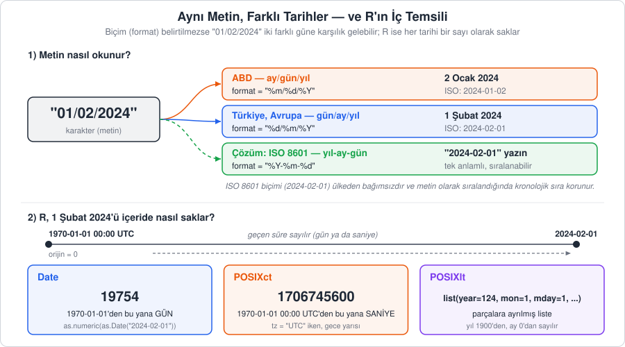
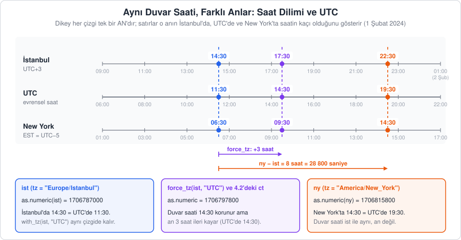
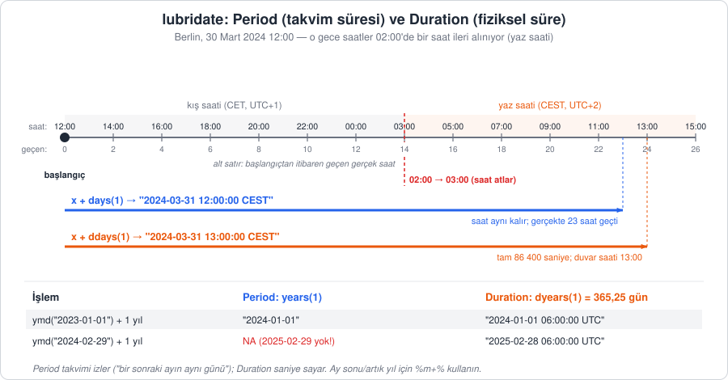

[İçindekiler](../Course_notes.md) · [← 3. Zaman Serisi Tipleri](03_zaman_serisi_tipleri.md) · [5. R'da Zaman Serisi Nesneleri: `ts` ve `xts` →](05_rda_zaman_serisi_nesneleri_ts_ve_xts.md)

## 4. R'da Tarih ve Zaman Nesneleri

Bir zaman serisinde her gözlemin bir "ne zaman" bilgisi vardır. Bu bilgiyi yanlış okursak (ayı gün sanmak, saat dilimini karıştırmak, yaz saati geçişini unutmak) sonraki bütün analizler — grafikler, mevsimsellik, modeller — hatalı bir temel üzerine kurulur. Bu bölüm pratiğe geçmeden önce bu temeli sağlamlaştırır: tarih formatları, R'ın tarih/zaman sınıfları, saat dilimleri, `lubridate` paketi ve tarih aritmetiği.

Bölüm 5'te göreceğimiz `ts` ve `xts` nesneleri, burada öğrendiğimiz tarih sınıflarının üzerine kurulur. R'ın temel yapıları (atama, vektör, veri çerçevesi, paket kurma) [Ek A: R'a Giriş](../R_Giris.md)'te özetlenmiştir.

### 4.1. Tarih Formatı Sorunu ve ISO 8601

Şu tarihe bakalım: `01/02/2024`. Bu ne anlama geliyor? Cevap, metni okuyan kişinin (ya da yazılımın) hangi yazım düzenine alışkın olduğuna bağlıdır:

- **ABD'de (ay/gün/yıl):** ilk sayı ay, ikincisi gündür → 2 Ocak 2024.
- **Türkiye'de ve Avrupa'nın çoğunda (gün/ay/yıl):** ilk sayı gün, ikincisi aydır → 1 Şubat 2024.

Yani aynı metin, okuyanın alışkanlığına göre aralarında 30 gün olan iki farklı güne karşılık gelir.

Yanlış okuma ne zaman fark edilir? Gün kısmı 12'den büyük olan bir tarihte (`15/03/2024`) ay/gün okuması imkânsızdır, çünkü 15. ay yoktur. Ama bu, yazılımın mutlaka bir hata mesajı göstereceği anlamına gelmez:

- R'da `as.Date("15/03/2024", format = "%m/%d/%Y")` (ay/gün/yıl kuralıyla okuma) hata vermez; sessizce `NA` (*Not Available*, "değer yok") döndürür. Binlerce satırlık bir sütunda bu `NA`'lar ancak özellikle aranırsa fark edilir (4.2.1).
- Python'daki pandas kütüphanesinde `pd.to_datetime("15/03/2024")` çağrısı, ay/gün okuması tutmayınca hata vermeden gün/ay okumasına geçer ve 15 Mart 2024 döndürür; yalnızca kolayca gözden kaçan bir uyarı yazar. Değerler tek tek dönüştürülürse aynı sütunda iki kural karışabilir: `01/02/2024` 2 Ocak, `15/03/2024` ise 15 Mart olarak okunur.

`01/02/2024` gibi gün ve ay kısmının ikisi de 12 ya da daha küçük olan tarihlerde durum daha da kötüdür: iki okuma da takvimde var olan bir gündür, bu yüzden ne `NA` oluşur ne de uyarı çıkar; veri sessizce yanlış okunur. Çözüm, tarihleri tek anlamlı bir düzende yazmaktır.

**Tanım (ISO 8601):** Tarih ve saat yazımı için uluslararası standarttır (ISO: Uluslararası Standartlar Örgütü). Bileşenleri büyükten küçüğe sıralar: 4 haneli yıl (`Y`), 2 haneli ay (`M`), 2 haneli gün (`D`); gerekirse başa 0 eklenir (`02`, `01`). En sık yazım tireli `YYYY-MM-DD`'dir (*genişletilmiş biçim*); ayraçsız `YYYYMMDD` (*temel biçim*) da geçerlidir. Saat eklenecekse araya `T` konur (`YYYY-MM-DDTHH:MM:SS`); sondaki `Z` ya da `+03:00` saatin UTC'ye göre farkını söyler (bkz. tablo ve 4.2.2). Bu şablonda ilk `MM` ay, ikincisi dakikadır; R'ın biçim kodlarında bu ikisi `%m` ve `%M` ile ayrılır (4.2.1).

| Yazım | Anlamı |
| --- | --- |
| `2024-02-01` | 1 Şubat 2024 (yalnızca tarih, genişletilmiş biçim) |
| `20240201` | Aynı tarih, ayraçsız temel biçim |
| `2024-02` | Şubat 2024 (yalnızca yıl ve ay) |
| `2024-02-01T14:30:00` | 1 Şubat 2024, 14:30:00 (saat dilimi belirtilmemiş) |
| `2024-02-01T14:30:00Z` | 1 Şubat 2024, 14:30:00 UTC |
| `2024-02-01T14:30:00+03:00` | 1 Şubat 2024, 14:30:00, UTC'den 3 saat ileride olan yerel saat (ör. Türkiye); UTC'de saat 14:30 − 3 = 11:30'dur |

ISO 8601 tek anlamlıdır, R/Python/SQL tarafından ek ayarsız tanınır ve metin olarak alfabetik sıralandığında kronolojik sıra da korunur (ay ve gün iki haneli yazıldığı sürece; Hemen deneyin 4.1); bu nedenle veri kaydedilirken ve paylaşılırken her zaman ISO 8601 kullanılmalıdır.



*Şekil 4.1 — "01/02/2024" metni ABD biçiminde 2 Ocak, Türkiye/Avrupa biçiminde 1 Şubat olarak okunur; ISO 8601 (2024-02-01) bu belirsizliği ortadan kaldırır. Alt kısım, R'ın aynı tarihi içeride nasıl sakladığını gösterir (4.2): `Date` için 1970-01-01'den bu yana geçen gün, `POSIXct` için saniye sayısı, `POSIXlt` için parçalara ayrılmış bir liste.*

> **Hemen deneyin 4.1 · ISO 8601 neden sıralanır, pandas neden tahmin eder?** (R ve Python, ~5 dk)
>
> Önce RStudio konsoluna şu satırları yazın. Aynı üç günü bir kez gün/ay/yıl, bir kez ISO 8601 biçiminde metin olarak sıralayacağız.
>
> ```r
> tr  <- c("15/03/2023", "01/02/2024", "31/12/2023")   # gün/ay/yıl yazımı
> iso <- c("2023-03-15", "2024-02-01", "2023-12-31")   # aynı günler, ISO 8601
> sort(tr)     # sort(): metinleri alfabetik (soldan sağa) sıralar
> sort(iso)
> ```
>
> Sonra aynı konuyu Python'da (Jupyter, Spyder ya da Colab) pandas ile deneyin:
>
> ```python
> import pandas as pd
> print(pd.to_datetime("01/02/2024"))                     # biçim yok: pandas tahmin eder
> print(pd.to_datetime("01/02/2024", dayfirst=True))      # "önce gün gelir" ipucu
> print(pd.to_datetime("01/02/2024", format="%d/%m/%Y"))  # en güvenlisi: biçimi söylemek
> ```
>
> **Ne göreceksiniz:** R'da `sort(tr)` sonucu `"01/02/2024" "15/03/2023" "31/12/2023"` olur: 2024'teki bir gün en başa geçmiştir, çünkü metin karşılaştırması ilk karakterden (`0` < `1` < `3`) başlar. `sort(iso)` ise `"2023-03-15" "2023-12-31" "2024-02-01"` verir; alfabetik sıra kronolojik sırayla aynıdır. Python'da ilk satır `2024-01-02 00:00:00` (2 Ocak, ABD okuması), ikinci ve üçüncü satır `2024-02-01 00:00:00` (1 Şubat) yazar. Python'daki `%d/%m/%Y` kodları R'dakilerle birebir aynıdır (4.2.1).
>
> **Şimdi siz:** (1) Ay ve gün başına sıfır koymadan yazılmış bir ISO tarihi deneyin: `sort(c("2024-2-1", "2024-10-01", "2024-03-15"))`. Sonucu önce tahmin edin. (2) Python'da iki tarihi tek bir sütunda (pandas `Series`) birlikte, biçim vermeden çevirin: `pd.to_datetime(pd.Series(["01/02/2024", "15/03/2024"]))`. Ne olur?
>
> <details><summary>Cevap</summary>
>
> (1) `[1] "2024-03-15" "2024-10-01" "2024-2-1"`: Şubat en sona düştü, çünkü `"2024-2"` ile `"2024-1"` karşılaştırılırken `2` > `1`'dir. ISO 8601'in sıralanabilirliği ancak ay ve gün iki haneli yazılırsa geçerlidir. (2) pandas 2 ve sonrasında bir hata alırsınız: `ValueError: time data "15/03/2024" doesn't match format "%m/%d/%Y"`. pandas biçimi ilk elemandan (`01/02/2024`, ay/gün sanarak) tahmin etmiş, ikinci eleman bu biçime uymamıştır. `format="%d/%m/%Y"` eklerseniz iki satır da doğru okunur: `2024-02-01` ve `2024-03-15`. (Eski pandas sürümleri hata yerine yalnızca uyarı verip iki kuralı karıştırabilir; 4.1'de anlatılan durum budur.)
>
> </details>

### 4.2. R'da Tarih ve Zaman Sınıfları: `Date`, `POSIXct`, `POSIXlt`

> **Uygulama dosyası:** [`Codes/R/ch04_tarih_zaman.R`](../Codes/R/ch04_tarih_zaman.R)
>
> Bu bölümdeki R kodlarının tamamı bu dosyada. Dosya RStudio'da açılıp satır satır ya da depo kök dizininde `Rscript Codes/R/ch04_tarih_zaman.R` komutuyla çalıştırılabilir.

**Not —** Bu bölümdeki çıktılar saat dilimi `Europe/Istanbul` ve tarih dili Türkçe olan bir bilgisayarda R 4.5 ile üretilmiştir; `tz = ...` açıkça yazılan satırlar her bilgisayarda aynı sonucu verir, gün ve ay adları ise dil ayarına göre Türkçe ya da İngilizce yazılır (dil `Sys.setlocale()` ile değiştirilir, bkz. Hemen deneyin 4.2.1).

R, bu format karmaşasını yönetmek için özel veri tipleri sunar. Temel fikir şudur: **tarih, ekranda metin gibi görünse de içeride bir sayıdır.** Sayı olduğu için tarihler sıralanabilir, birbirinden çıkarılabilir ve grafik eksenlerine yerleştirilebilir.

Bir sayının tarih olarak anlam kazanması için bir başlangıç noktası (sıfır noktası) gerekir. R, birçok yazılım gibi **1970-01-01** tarihini sıfır kabul eder; buna *Unix orijini* ya da *epoch* (sayımın başladığı an) denir. Bunu cetveldeki sıfır çizgisine benzetebiliriz: 1970-01-02 tarihi `1`, 1969-12-31 tarihi `-1` olarak saklanır; 1970'ten önceki tarihler negatif sayılardır.

**Tanım 1 (`Date`):** Yalnızca takvim gününü (yıl, ay, gün) tutar. İçeride, **1970-01-01'den bu yana geçen gün sayısı** olarak saklanır. Saat bilgisi gerekmiyorsa (günlük, aylık, yıllık veriler) bu sınıf kullanılır.

**Tanım 2 (`POSIXct`):** Tarih ile saati birlikte tutar. İçeride, **1970-01-01 00:00:00 UTC'den bu yana geçen saniye sayısı** olarak saklanır (POSIX: Unix türevi işletim sistemlerinin ortak standardının adı; ct: *calendar time*, takvim zamanı). Tek bir sayı olduğu için hızlıdır, az yer kaplar ve veri çerçevelerinde (tablolarda) sütun olarak kullanılmaya en uygun sınıftır.

**Tanım 3 (`POSIXlt`):** Aynı anı, parçalarına ayrılmış bir **liste** olarak tutar (lt: *local time*, yerel zaman): saniye, dakika, saat, gün, ay, yıl, haftanın günü, yılın günü... Tek tek bileşenlere erişmek için kullanışlıdır, ama hesaplama ve depolama için `POSIXct` tercih edilir.

**Günlük hayattan bir örnek:** `POSIXct`'yi arabanın kilometre sayacına benzetebiliriz: tek bir sayı gösterir (1970'ten bu yana geçen saniye) ve iki okumayı birbirinden çıkarınca aradaki mesafe hemen bulunur. `POSIXlt` ise aynı konumu "yıl: 2024, ay: Şubat, gün: 1, saat: 14, dakika: 30" diye parça parça yazan bir yol defteridir: tek bir parçaya bakmak kolaydır, ama iki kayıt arasındaki farkı bulmak için önce hepsini tek sayıya çevirmek gerekir.

| Sınıf | Neyi tutar? | İçeride nasıl saklanır? | Tipik kullanım |
| --- | --- | --- | --- |
| `Date` | Gün | 1970-01-01'den bu yana gün (tam sayı) | Günlük/aylık/yıllık seriler |
| `POSIXct` | Gün + saat (+ saat dilimi) | 1970-01-01 00:00 UTC'den bu yana saniye | Saatlik, dakikalık, sensör, borsa verileri |
| `POSIXlt` | Gün + saat (+ saat dilimi) | Bileşen listesi (`year`, `mon`, `mday`, `hour`, ...) | Bileşenlere erişim, ara işlem |

Bunu doğrudan görelim. Kod okunurken 2.5'teki kurallar geçerlidir: `#` sonrası yorumdur, `#>` satırları R'ın ekrana yazdığı çıktıdır (konsola yazılmaz), baştaki `[1]` ise sıra numarasıdır (Ek A.2).

```r
# Date: içeride gün sayısı
d <- as.Date("2024-02-01")
class(d)
#> [1] "Date"
as.numeric(d)          # 1970-01-01'den bu yana geçen gün
#> [1] 19754
as.Date(19754)         # Ters yön: sayıdan tarihe
#> [1] "2024-02-01"
d + 1                  # Bir gün sonrası: sayıya 1 eklemek yeterli
#> [1] "2024-02-02"

# POSIXct: içeride saniye sayısı (saat UTC'ye göre 14:30)
ct <- as.POSIXct("2024-02-01 14:30:00", tz = "UTC")
class(ct)
#> [1] "POSIXct" "POSIXt"
as.numeric(ct)         # 1970-01-01 00:00:00 UTC'den bu yana geçen saniye
#> [1] 1706797800

# POSIXlt: bileşen listesi
lt <- as.POSIXlt(ct)
lt$hour                # Saat
#> [1] 14
lt$mday                # Ayın günü
#> [1] 1
lt$mon                 # Ay: DİKKAT, 0'dan başlar (0 = Ocak, 1 = Şubat)
#> [1] 1
lt$year                # Yıl: DİKKAT, 1900'den bu yana geçen yıl
#> [1] 124
lt$year + 1900
#> [1] 2024
```

Bu kod, aynı tarihi önce `Date`, sonra `POSIXct`, en son `POSIXlt` olarak oluşturup her birinin içine bakar. Amaç, yukarıdaki tablonun "İçeride nasıl saklanır?" sütununu kendi gözümüzle doğrulamaktır. Kodu satır satır okuyalım:

1. `d <- as.Date("2024-02-01")`: `as.Date()` fonksiyonu, argüman olarak verilen `"2024-02-01"` metnini okuyup bir `Date` nesnesine çevirir; tırnak, bunun bir nesne adı değil düz metin (*karakter dizisi*) olduğunu söyler. `<-` sonucu `d` adıyla saklar; bundan sonra `d` yazdığımızda bu tarih kullanılır (fonksiyon, argüman ve atama için bkz. 2.5). Atama satırları ekrana bir şey yazmaz, bu yüzden altında `#>` satırı yoktur.
2. `class(d)`: `class()` bir nesnenin sınıfını, yani türünü söyler. Sonuç `"Date"`'tir.
3. `as.numeric(d)`: `as.numeric()` nesneyi düz sayıya çevirir; böylece sınıf etiketi kalkar ve içerideki çıplak sayı görünür: `19754`. Yani 1 Şubat 2024, 1970-01-01'den 19754 gün sonradır.
4. `as.Date(19754)`: Aynı fonksiyonun ters yönde kullanımıdır. Argüman metin değil sayı olduğunda `as.Date()` onu "1970-01-01'den bu yana geçen gün sayısı" olarak yorumlar ve yeniden 1 Şubat 2024'ü verir. (R 4.3'ten eski sürümlerde bu kullanımda başlangıç noktasını `origin = "1970-01-01"` diye ayrıca yazmak gerekiyordu.)
5. `d + 1`: Bir `Date` nesnesine 1 eklemek, içerideki gün sayısına 1 eklemektir (19755). Sonuç yine bir `Date`'tir ve bir sonraki günü gösterir.
6. `ct <- as.POSIXct("2024-02-01 14:30:00", tz = "UTC")`: `as.POSIXct()` tarih ve saat içeren bir metni `POSIXct` nesnesine çevirir; metindeki saat `saat:dakika:saniye` düzenindedir. İkinci argüman adıyla verilmiştir (*adlandırılmış argüman*, 2.5). `tz` (*time zone*, saat dilimi) argümanı, metindeki saatin hangi saat dilimine göre okunacağını belirler. Burada saat **UTC'ye göre** 14:30'dur; bu an, Türkiye saatiyle 17:30'a karşılık gelir. UTC'yi seçmemizin nedeni, sonucun her bilgisayarda aynı çıkmasıdır (bkz. aşağıdaki not). Sonuç `ct` adıyla saklanır.
7. `class(ct)`: Bu kez iki sınıf adı yazılır: `POSIXct` ve onun ortak üst sınıfı `POSIXt`. Bir R nesnesinin birden fazla sınıfı olabilir; `POSIXt`, `POSIXct` ile `POSIXlt`'nin ortak davranışlarını (ör. iki zamanı birbirinden çıkarmayı) taşıyan sınıftır.
8. `as.numeric(ct)`: İçerideki saniye sayısını gösterir. Bu sayı adım adım şöyle bulunur:
   - Bir gün $`24 \times 60 \times 60 = 86\,400`$ saniyedir. 1 Şubat 2024 gece yarısına kadar geçen tam günler: $`19\,754 \times 86\,400 = 1\,706\,745\,600`$ saniye.
   - Gece yarısından 14:30'a kadar 14.5 saat geçer: $`14.5 \times 3\,600 = 52\,200`$ saniye.
   - Toplam: $`1\,706\,745\,600 + 52\,200 = 1\,706\,797\,800`$. Çıktıdaki `1706797800` tam olarak budur.
9. `lt <- as.POSIXlt(ct)`: Aynı anı parçalarına ayrılmış bir `POSIXlt` listesine çevirir ve `lt` adıyla saklar. `ct` UTC'de olduğu için parçalar da UTC saatine göredir.
10. `lt$hour` ve `lt$mday`: Dolar işareti (`$`), bir listenin adı verilmiş bir parçasına erişir; `lt$hour` "`lt`'nin `hour` parçası" diye okunur. `hour` saati (14), `mday` (*month day*) ayın gününü (1) verir.
11. `lt$mon` ve `lt$year`: Burada iki tuzak vardır. Ay 0'dan sayılır (`0` = Ocak, dolayısıyla `1` Şubat demektir); yıl ise 1900'den itibaren sayılır (`124`). Bu alışkanlık, R'ın bu yapıyı C programlama dilinden devralmasından gelir.
12. `lt$year + 1900`: Yıl parçasına 1900 ekleyerek gerçek yılı bulur: $`124 + 1900 = 2024`$.

Çıktıları okurken: her sonuç tek bir değer olduğu için her satır `[1]` ile başlar. Tarihler çıktıda tırnak içinde görünür (`"2024-02-01"`); bu yalnızca R'ın `Date` nesnelerini ekrana yazma biçimidir, nesne metne dönüşmüş değildir (`class(d)` bunu doğrular). `class()` çıktılarındaki tırnaklı adlar ise gerçekten metindir. `19754`, `1706797800`, `14` gibi tırnaksız değerler sayıdır.

**Not —** `tz` argümanını vermeseydik R, metindeki saati bilgisayarın saat dilimine göre yorumlardı. Saat dilimi Türkiye olan bir bilgisayarda `as.numeric(as.POSIXct("2024-02-01 14:30:00"))` sonucu `1706787000` olur: Türkiye'de 14:30, UTC'de 11:30'dur ve bu sayı yukarıdakinden 3 saat (10800 saniye) küçüktür. Aynı kod başka bir ülkedeki bilgisayarda başka bir sayı üretir; bu farkı 4.2.2'de ayrıntılı göreceğiz.

Sistem saatini almak için:

```r
Sys.Date()     # Bugünün tarihi (Date)
#> [1] "2024-10-26"
Sys.time()     # Şu anki zaman (POSIXct)
#> [1] "2024-10-26 15:30:00 +03"
```

Bu iki satır, bilgisayarın saatini okuyarak bugünün tarihini ve şu anki zamanı R nesnesi olarak verir; bir analizin çalıştırıldığı anı kaydetmek ya da "bugüne kadar kaç gün geçti?" gibi hesaplar için gerekir. Kodu satır satır okuyalım:

1. `Sys.Date()`: Bugünün tarihini `Date` olarak verir. Parantezler boştur, çünkü fonksiyon hiçbir argüman almaz; ama fonksiyonun çalışması için parantezleri yine de yazmak gerekir (parantezsiz `Sys.Date` yazmak fonksiyonu çalıştırmaz, onun kodunu ekrana döker).
2. `Sys.time()`: Şu anki zamanı saniyesine kadar `POSIXct` olarak verir.

Çıktıları okurken: yukarıdaki değerler yalnızca örnektir; kod çalıştırıldığında o anın tarihi ve saati, bilgisayarın saat diliminde gösterilir. İkinci çıktı `YYYY-MM-DD HH:MM:SS` düzenindedir; sondaki `+03`, saatin UTC'den 3 saat ileride olduğunu söyler. Türkiye 2016'dan beri yıl boyu UTC+3 kullanır ve R'ın kullandığı saat dilimi veritabanında bu saat için harfli bir kısaltma (`EET` gibi) bulunmadığından R kısaltma yerine `+03` yazar.

> **Hemen deneyin 4.2 · Doğum gününüz R'ın içinde hangi sayı?** (R, ~3 dk)
>
> Konsola yazın; tarih yerine kendi doğum tarihinizi ISO biçiminde (`YYYY-MM-DD`) yazabilirsiniz.
>
> ```r
> d <- as.Date("2001-10-29")          # kendi doğum tarihinizi yazın
> as.numeric(d)                       # 1970-01-01'den bu yana geçen gün
> as.numeric(as.Date("1969-12-31"))   # orijinden bir gün önce
> ```
>
> **Ne göreceksiniz:** `[1] 11624` ve `[1] -1`. 29 Ekim 2001, Unix orijininden (1970-01-01) 11624 gün sonradır; orijinden bir gün önceki tarih ise `-1` olarak saklanır. 1970'ten önce doğanlar negatif bir sayı görür.
>
> **Şimdi siz:** (1) Önce tahmin edin, sonra `as.Date(20000)` ile kontrol edin: 20000. gün hangi yıla düşer? (2) `as.numeric(Sys.Date())` ile bugünün sayısını bulun.
>
> <details><summary>Cevap</summary>
>
> (1) `[1] "2024-10-04"`: 20000 gün ≈ 20000 / 365.25 ≈ 54.8 yıl; 1970 + 54.8 ≈ 2024'ün son çeyreği. (2) Sonuç çalıştırdığınız güne bağlıdır; örneğin 2026-10-14 için `[1] 20740`.
>
> </details>

#### 4.2.1. Metni Tarihe Çevirmek: `as.Date()` ve Format Kodları

Elimizdeki `"15/03/2024"` gibi bir metni R'ın anlayacağı bir `Date` nesnesine `as.Date()` ile çeviririz. Püf noktası şudur: **Metnin hangi biçimde yazıldığı R'a `format` argümanıyla söylenmelidir.** Argümanlar fonksiyona `ad = değer` biçiminde verilir; `format = "%d/%m/%Y"` gibi.

Biçim metnindeki `%d`, `%m`, `%Y` gibi parçalar *yer tutuculardır*: `%` işareti ve ardından gelen harf, "buraya gün / ay / yıl gelecek" der. Aradaki `/`, `.`, `-` gibi karakterler ise metinde birebir aynen bulunmalıdır. Örneğin `"%d/%m/%Y"` şunu söyler: önce gün, sonra `/`, sonra ay, sonra `/`, sonra dört haneli yıl.

**Günlük hayattan bir örnek:** İlaç kutusundaki "SKT: 03/04/26" yazısı tek başına belirsizdir: 3 Nisan 2026 mı, 4 Mart 2026 mı? Eczacı bu yazıyı ancak kutuya hangi düzende basıldığını bilirse doğru okur. `format` argümanı R'a bu düzeni söyler: `"%d/%m/%y"` "gün/ay/iki haneli yıl" demektir. Düzen yanlış verilirse R da yanlış okur ya da hiç okuyamaz (`NA`).

Biçim verilmezse R yalnızca `YYYY-MM-DD` ve `YYYY/MM/DD` biçimlerini dener; bu da tehlikeli sonuçlar doğurabilir:

```r
as.Date("2024-02-01")                    # ISO biçimi: sorunsuz
#> [1] "2024-02-01"

as.Date("01/02/2024")                    # Biçim verilmedi: YANLIŞ ama hata yok!
#> [1] "0001-02-20"

as.Date("01/02/2024", format = "%d/%m/%Y")   # Türkiye/Avrupa: gün/ay/yıl
#> [1] "2024-02-01"
as.Date("01/02/2024", format = "%m/%d/%Y")   # ABD: ay/gün/yıl
#> [1] "2024-01-02"
as.Date("01.02.2024", format = "%d.%m.%Y")   # Noktalı Türkçe yazım
#> [1] "2024-02-01"
as.Date("15/03/2024", format = "%m/%d/%Y")   # 15. ay yok: hata değil, sessizce NA
#> [1] NA
as.Date("2024-02-30", format = "%Y-%m-%d")   # Takvimde olmayan gün
#> [1] NA
```

Bu kod, aynı `as.Date()` fonksiyonunun biçim verildiğinde ve verilmediğinde nasıl davrandığını karşılaştırır; amaç, 4.1'de anlatılan sessiz yanlış okumayı R'da kendi gözümüzle görmek ve doğru okumanın `format` argümanıyla nasıl yapıldığını öğrenmektir. Kodu satır satır okuyalım:

1. `as.Date("2024-02-01")`: Biçim verilmemiştir. R sırasıyla `"%Y-%m-%d"` ve `"%Y/%m/%d"` biçimlerini dener; ISO metni ilk biçime uyduğu için sorunsuz okunur.
2. `as.Date("01/02/2024")`: Yine biçim yoktur; bu kez metin yanlış okunur ve hata da çıkmaz (nedeni aşağıdaki notta).
3. `as.Date("01/02/2024", format = "%d/%m/%Y")`: İlk argüman adsız (*konumsal*), ikincisi adlıdır (`format`). Biçim, yukarıda anlatıldığı gibi "gün/ay/dört haneli yıl" der; metin Türkiye/Avrupa düzeniyle okunur: 1 Şubat 2024.
4. `as.Date("01/02/2024", format = "%m/%d/%Y")`: Aynı metin, `%m` ile `%d`'nin yeri değiştirilerek ABD düzeniyle (ay/gün/yıl) okunur: 2 Ocak 2024. Metin aynı, sonuç farklı: R'a hangi okumayı istediğimizi ancak `format` söyler.
5. `as.Date("01.02.2024", format = "%d.%m.%Y")`: Metinde ayraç nokta olduğu için biçimde de nokta yazılır. Biçimdeki ayraç metindekiyle birebir aynı olmalıdır; `"%d/%m/%Y"` ile bu metin `NA` olurdu.
6. `as.Date("15/03/2024", format = "%m/%d/%Y")`: `%m` ilk parçayı ay olarak okumaya çalışır, ama 15. ay yoktur. Sonuç hata değil, sessizce `NA` (değer yok) olur.
7. `as.Date("2024-02-30", format = "%Y-%m-%d")`: Biçim metne uyar ama 30 Şubat takvimde yoktur; sonuç yine `NA`'dır.

Çıktıları okurken: girdi hangi düzende yazılmış olursa olsun, R okuduğu tarihi her zaman ISO 8601 (`YYYY-MM-DD`) biçiminde gösterir; bu yüzden 1., 3. ve 5. satırların çıktıları aynıdır. Tırnaksız `[1] NA` ise "bu değer okunamadı" demektir; `NA` bir metin değil, R'ın eksik değer işaretidir.

**Not —** İkinci satırdaki sonuç, bu bölümün en önemli uyarısıdır. R, `"01/02/2024"` metnini denediği ikinci biçim olan `%Y/%m/%d` ile okumuştur: `%Y` ilk parçadaki `01`'i yıl (1. yıl), `%m` ikinci parçadaki `02`'yi ay olarak almış; `%d` en fazla iki rakam okuduğu için `2024`'ün ilk iki rakamını (`20`) gün saymış ve geriye kalan `24`'ü sessizce atmıştır. Sonuç, 1. yılın 20 Şubat'ıdır ve hiçbir uyarı yoktur. (Metin iki biçimden hiçbirine uymasaydı, örneğin `as.Date("15.03.2024")`, R bu kez `character string is not in a standard unambiguous format` hatasını verirdi; yani hata alınmaması, okumanın doğru olduğu anlamına gelmez.)

Bu yüzden veri okunurken biçim **her zaman** açıkça belirtilmeli ve okumadan sonra iki basit kontrol yapılmalıdır: `range(tarihler)` en küçük ve en büyük tarihi verir; `0001` gibi bir yıl ya da `NA NA` sonucu okumanın bozuk olduğunu hemen ele verir. `sum(is.na(tarihler))` ise kaç değerin okunamadığını sayar (`is.na()` her değer için "NA mı?" sorusunu `TRUE`/`FALSE` olarak cevaplar, `sum()` de `TRUE`'ları sayar).

Tarih ve saati birlikte okumak için `as.POSIXct()` kullanılır; yine `format` ve saat dilimi (`tz`) verilir:

```r
as.POSIXct("01.02.2024 14:30", format = "%d.%m.%Y %H:%M", tz = "Europe/Istanbul")
#> [1] "2024-02-01 14:30:00 +03"
```

Bu tek satır, Türkçe düzende yazılmış bir tarih-saat metnini `POSIXct` nesnesine çevirir; saatli verilerde (ör. sensör kayıtları) her satır bu şekilde okunur. Satırı argüman argüman okuyalım:

1. `"01.02.2024 14:30"`: Okunacak metin. Önce gün.ay.yıl, ardından bir boşluk ve saat:dakika gelir; saniye yazılmamıştır.
2. `format = "%d.%m.%Y %H:%M"`: `%d.%m.%Y` kısmı tarihi az önceki gibi okur. Biçimdeki boşluk, metindeki boşluğa karşılık gelir. `%H` saati 24 saat düzeninde (00–23) okur, ardından aynen bir `:` gelir, `%M` (büyük M) de dakikayı okur. Küçük `%m` ay, büyük `%M` dakikadır; karıştırmak sık yapılan bir hatadır. Saniye biçimde olmadığı için 0 kabul edilir.
3. `tz = "Europe/Istanbul"`: Metindeki saatin Türkiye saati olduğunu söyler. Bu "Kıta/Şehir" biçimindeki saat dilimi adlarını 4.2.2'de açıklıyoruz.

Sonuç bir ada atanmadığı için doğrudan ekrana yazılır. Çıktıda R saati her zaman `YYYY-MM-DD HH:MM:SS` düzeninde gösterir: metinde olmayan saniye `:00` olarak eklenmiştir, sondaki `+03` de saatin UTC'den 3 saat ileride (Türkiye saati) olduğunu gösterir.

Ters yönde, bir tarihi istediğimiz biçimde metne çevirmek için `format()` kullanılır. Aynı yer tutucular bu kez "buraya günü / ayı / yılı yaz" anlamına gelir:

```r
d <- as.Date("2024-02-01")
format(d, "%d.%m.%Y")        # Türkçe raporlar için
#> [1] "01.02.2024"
format(d, "%j")              # Yılın kaçıncı günü
#> [1] "032"
format(ct, "%Y-%m-%dT%H:%M:%SZ")   # ISO 8601 (UTC)
#> [1] "2024-02-01T14:30:00Z"
```

Bu kod, bir tarihi rapor, tablo ya da dosya adı için istediğimiz biçimde yazdırmayı gösterir; okuma işinin tersidir. Kodu satır satır okuyalım:

1. `d <- as.Date("2024-02-01")`: 4.2'deki `d` nesnesini yeniden oluşturur; böylece bu parça tek başına çalıştırıldığında da çalışır.
2. `format(d, "%d.%m.%Y")`: `format()` ilk argümandaki tarihi, ikinci argümandaki biçim metnine göre yazıya çevirir. İkinci argüman adsız verilmiştir; `format(d, format = "%d.%m.%Y")` yazmakla aynıdır. `%d`, `%m`, `%Y` yerlerine gün (`01`), ay (`02`) ve yıl (`2024`) yazılır, aradaki noktalar aynen kalır.
3. `format(d, "%j")`: `%j` yılın kaçıncı günü olduğunu üç haneyle (başına sıfır ekleyerek) yazar: Ocak'ın 31 günü + 1 = 32. gün, yani `032`.
4. `format(ct, "%Y-%m-%dT%H:%M:%SZ")`: 4.2'de oluşturduğumuz `ct` nesnesini ISO 8601 biçiminde yazar. `%H`, `%M`, `%S` sırasıyla saati, dakikayı ve saniyeyi (00–59) yazar. Biçimdeki `T` ve `Z` harfleri ise yer tutucu değildir (önlerinde `%` yoktur), metne aynen eklenir; bu yüzden sondaki `Z` yalnızca `ct` gerçekten UTC olduğu için doğrudur. Türkiye saatindeki bir zamanı yazarken `Z` yerine, UTC farkını `+0300` biçiminde (işaret, iki hane saat, iki hane dakika) yazan `%z` kodu kullanılmalıdır: `"%Y-%m-%dT%H:%M:%S%z"` → `2024-02-01T14:30:00+0300`.

Çıktıları okurken: `format()` her zaman metin (karakter dizisi) döndürür. Buradaki tırnaklar 4.2'deki `Date` çıktılarından farklı olarak gerçekten metin olduğunu gösterir: `"032"` bir sayı değil, üç karakterlik bir yazıdır; onunla toplama yapılamaz.

**Sık kullanılan format kodları:** Bu kodlar, R'a metnin hangi parçasının yıl, ay, gün, saat olduğunu anlatır. Hem okurken (`as.Date`, `as.POSIXct`, `strptime`) hem yazarken (`format`) aynı kodlar kullanılır.

| Kod | Anlamı | Örnek (1 Şubat 2024, 14:30:05) |
| --- | --- | --- |
| `%Y` | 4 haneli yıl | `2024` |
| `%y` | 2 haneli yıl (okurken 00–68 → 20xx, 69–99 → 19xx) | `24` |
| `%m` | Ay, sayı (01–12) | `02` |
| `%d` | Ayın günü (01–31) | `01` |
| `%j` | Yılın günü (001–366) | `032` |
| `%H` | Saat, 24 saat düzeni (00–23) | `14` |
| `%M` | Dakika (00–59) | `30` |
| `%S` | Saniye (00–59) | `05` |
| `%z` | UTC'ye göre fark, saat ve dakika | `+0300` |

Büyük-küçük harf önemlidir: `%m` ay, `%M` dakikadır; `%Y` dört haneli, `%y` iki haneli yıldır.

**Not —** Ay ve gün adı yazan `%B` (ay adı) ve `%A` (gün adı) kodları dil (*locale*) ayarına bağlıdır; "15 Mart 2024" Türkçe sistemde okunur, İngilizce sistemde `NA` olur, bu yüzden taşınabilir kodda ay numaraları tercih edilmelidir.

> **Hemen deneyin 4.2.1 · Doğum tarihinizi format kodlarıyla yazdırın** (R, ~4 dk)
>
> ```r
> Sys.setlocale("LC_TIME", "Turkish_Türkiye.utf8")   # Windows; Linux/macOS: "tr_TR.UTF-8"
> d <- as.Date("2001-10-29")                         # kendi doğum tarihinizi yazın
> format(d, "%d %B %Y, %A")                          # gün, ay adı, yıl, gün adı
> format(d, "%j")                                    # yılın kaçıncı günü
> as.Date("29 Ekim 2001", format = "%d %B %Y")       # Türkçe ay adıyla okuma
> ```
>
> **Ne göreceksiniz:** İlk satır dilin değiştiğini onaylayan `[1] "Turkish_Türkiye.utf8"` yazar. Ardından `"29 Ekim 2001, Pazartesi"`, `"302"` ve `"2001-10-29"` gelir. Biçim metnindeki virgül ve boşluklar aynen kalmış, `%B` ve `%A` yerine Türkçe ay ve gün adları yazılmıştır. `"302"` metindir: 2001 artık yıl değildir; 29 Ekim yılın 302. günüdür.
>
> **Şimdi siz:** (1) Dili İngilizceye çevirin (`Sys.setlocale("LC_TIME", "English_United States.utf8")`, Linux/macOS: `"en_US.UTF-8"`) ve son üç satırı yeniden çalıştırın. Hangi satır `NA` olur? (2) İki haneli yıl tuzağı: `as.Date("29.10.68", format = "%d.%m.%y")` ile `as.Date("29.10.69", format = "%d.%m.%y")` hangi yılları verir?
>
> <details><summary>Cevap</summary>
>
> (1) `format()` satırı `"29 October 2001, Monday"` yazar; `"302"` değişmez (sayı kodu dile bağlı değildir); `as.Date("29 Ekim 2001", ...)` ise `NA` olur, çünkü İngilizce sistem "Ekim" adını tanımaz (`"29 October 2001"` yazılırsa okunur). (2) `"2068-10-29"` ve `"1969-10-29"`: `%y` okurken 00–68'i 20xx, 69–99'u 19xx sayar (4.2.1'deki tablo). 1968 doğumlu birinin tarihi bu yüzden 2068 olur; dört haneli yıl (`%Y`) kullanın.
>
> </details>

#### 4.2.2. Saat Dilimleri (`tz`)

Aynı "14:30" (*duvar saati*: o şehirde saatin gösterdiği yerel saat), İstanbul'da ve New York'ta farklı *anlara* (dünyanın her yerinde aynı olan tek bir zaman noktası) karşılık gelir. `POSIXct` her zaman **tek bir evrensel anı** (UTC saniyesi) saklar; `tz` özniteliği yalnızca bu anın **hangi yerel saatle gösterileceğini** belirler.

**Tanım (UTC ve saat dilimi):** UTC (*Coordinated Universal Time*, Eş Güdümlü Evrensel Saat), dünya genelinde referans kabul edilen saattir; pratikte Londra'nın kış saatiyle aynıdır. Bir saat dilimi, bir bölgenin yerel saatinin UTC'den ne kadar ileride ya da geride olduğunu söyler; bu farka *UTC farkı* (*offset*) denir ve "UTC+3" gibi yazılır. Türkiye UTC+3'tür: UTC'de saat 11:30 iken Türkiye'de 11:30 + 3 = 14:30'dur. New York kışın UTC−5'tir: UTC'de 19:30 iken New York'ta 19:30 − 5 = 14:30'dur.

**Tanım (yaz saati):** Bazı ülkeler ilkbaharda saatleri bir saat ileri, sonbaharda bir saat geri alır (*yaz saati uygulaması*, İngilizce *daylight saving time*, DST). Bu ülkelerde UTC farkı yıl içinde değişir: Berlin kışın UTC+1 (CET), yazın UTC+2'dir (CEST); New York kışın UTC−5 (EST), yazın UTC−4'tür (EDT). Türkiye 2016'dan beri yaz saati uygulamaz ve yıl boyu UTC+3'tür.

R'da saat dilimleri `"Europe/Istanbul"`, `"America/New_York"`, `"UTC"` gibi "Kıta/Şehir" biçimindeki IANA (Olson) adlarıyla verilir. Bu adlar, bölgenin yaz saati kurallarını ve geçmişteki değişiklikleri de içerdiği için "UTC+3" gibi sabit bir farktan daha güvenlidir. Tam liste için `OlsonNames()`, sistemin saat dilimi için `Sys.timezone()` kullanılır.

```r
ist <- as.POSIXct("2024-02-01 14:30:00", tz = "Europe/Istanbul")
ny  <- as.POSIXct("2024-02-01 14:30:00", tz = "America/New_York")

ist
#> [1] "2024-02-01 14:30:00 +03"
ny
#> [1] "2024-02-01 14:30:00 EST"

ny - ist            # Duvar saatleri aynı ama anlar farklı
#> Time difference of 8 hours

as.numeric(ist)     # İçerideki sayı: UTC saniyesi
#> [1] 1706787000
as.numeric(ny)
#> [1] 1706815800
format(ist, tz = "UTC", usetz = TRUE)   # Aynı anı UTC olarak göster
#> [1] "2024-02-01 11:30:00 UTC"
```

Bu kod, aynı duvar saatini (14:30) iki farklı saat dilimiyle okuyup bunların aslında farklı anlar (içerideki UTC saniyeleri farklı) olduğunu sayılarla gösterir. Kodu satır satır okuyalım:

1. `ist <- as.POSIXct("2024-02-01 14:30:00", tz = "Europe/Istanbul")`: Metni Türkiye saatine göre okur ve `ist` adıyla saklar.
2. `ny  <- as.POSIXct("2024-02-01 14:30:00", tz = "America/New_York")`: Aynı metni New York saatine göre okur ve `ny` adıyla saklar. `ny`'den sonraki fazladan boşluk yalnızca iki satırı alt alta hizalamak içindir; R boşlukları önemsemez.
3. `ist` ve `ny`: Bir nesnenin adını tek başına yazmak, onu ekrana yazdırır. Her iki nesne de kendi saat diliminde 14:30 olarak görünür.
4. `ny - ist`: İki zamanı çıkarır. Sonuç bir süre (`difftime`, *time difference*) nesnesidir; R birimi farkın büyüklüğüne göre kendisi seçer (burada saat).
5. `as.numeric(ist)` ve `as.numeric(ny)`: İki nesnenin içindeki UTC saniyelerini gösterir; görünüşte aynı olan iki zamanın içeride farklı sayılar olduğu burada açıkça görülür.
6. `format(ist, tz = "UTC", usetz = TRUE)`: `format()` biçim metni verilmeden çağrıldığında zamanı standart `YYYY-MM-DD HH:MM:SS` düzeninde yazar. Burada `tz` argümanı "okuma" değil "gösterme" ayarıdır: anı değiştirmeden UTC saatiyle yaz demektir. `usetz = TRUE` (*use time zone*) sona saat dilimi adını ekler. `TRUE` ("doğru/evet") ve `FALSE` ("yanlış/hayır") R'ın mantıksal değerleridir; tırnaksız ve büyük harfle yazılırlar.

Çıktıları okurken: `ist` ve `ny` çıktılarının sonundaki `+03` ve `EST` (*Eastern Standard Time*, ABD doğu kış saati), zamanın hangi yerel saatle gösterildiğini söyler. `Time difference of 8 hours` "zaman farkı: 8 saat" demektir. Bu 8 saat şöyle hesaplanır:

- İstanbul'da 14:30 → UTC'de 14:30 − 3 saat = 11:30.
- New York'ta 14:30 (Şubat'ta EST, UTC−5) → UTC'de 14:30 + 5 saat = 19:30.
- Fark: 19:30 − 11:30 = 8 saat. Aynı fark içerideki sayılarda da görülür: $`1\,706\,815\,800 - 1\,706\,787\,000 = 28\,800`$ saniye $`= 8 \times 3\,600`$.

Son çıktı, `ist` anının UTC'de 11:30 olduğunu doğrular; sondaki `UTC` yazısını `usetz = TRUE` eklemiştir. Base R'da anı değiştirmeden yalnızca gösterimi değiştirmek için bu `format(..., tz = )` kullanımı yeterlidir; saat dilimini değiştiren `lubridate` fonksiyonlarını (`with_tz()`, `force_tz()`) 4.3.1'de göreceğiz.



*Şekil 4.2 — Her dikey çizgi tek bir andır; üç satır o anın İstanbul, UTC ve New York'taki duvar saatini gösterir. İstanbul'da 14:30 (mavi) ile New York'ta 14:30 (turuncu) arasında 8 saat vardır. Mor çizgi, 4.3.1'de göreceğimiz `force_tz(x, "UTC")` sonucudur (`x`, `ist` ile aynı an): duvar saatini (14:30) korur ama anı 3 saat kaydırır; bu an, 4.2'deki `ct` nesnesiyle aynıdır (`1706797800`).*

Zaman serisi çalışmalarında pratik kurallar:

- Farklı kaynaklardan gelen zaman damgaları birleştirilmeden önce **aynı saat dilimine** getirilmelidir; mümkünse içeride UTC ile çalışılmalı, yerel saate yalnızca raporlarken çevrilmelidir.
- `tz` verilmezse R bilgisayarın saat dilimini varsayar; kod başka bir makinede farklı sonuç verebilir. Bu nedenle `tz` her zaman açıkça yazılmalıdır.
- Yaz saati uygulanan bölgelerde (ör. Avrupa, ABD) yılda bir gün 23, bir gün 25 saat sürer. Saatlik verilerde bu, ilkbaharda bir saatin "kaybolması", sonbaharda ise bir saatin "iki kez görünmesi" demektir (ayrıntısı 4.4.2'de).

**Günlük hayattan bir örnek:** Hastanedeki gece nöbet çizelgesini düşünelim: nöbet her gece 00:00–08:00, yani çizelgede 8 saat. Saatlerin ileri alındığı gece aynı nöbet gerçekte 7 saat, geri alındığı gece 9 saat sürer, ama çizelgede hiçbir şey değişmez. Saatlik bir veri setinde de ilkbahar gecesinde bir saatin satırı hiç yoktur, sonbahar gecesinde bir saat iki kez görünür.

### 4.3. `lubridate` Paketi: Tarihlerle Rahat Çalışmak

`as.Date()` ve format kodları güçlüdür ama her seferinde biçim yazmak yorucu ve hataya açıktır. `lubridate` paketi (tidyverse ailesinin bir parçası), tarih işlemlerini çok daha okunur hâle getirir.

R'da *paket*, başkalarının yazdığı hazır fonksiyonların bir araya getirildiği eklentidir. 3.2'de `tseries` ile gördüğümüz gibi paket bir kez `install.packages()` ile kurulur, her yeni oturumda `library()` ile yüklenir; `library()` çalıştırılmadan paketin fonksiyonları (`ymd()` vb.) bulunamaz.

**Okuma (ayrıştırma) fonksiyonları:** Fonksiyon adı, metindeki bileşenlerin **sırasını** söyler: `y` = yıl, `m` = ay, `d` = gün; alt çizgiden sonraki kısımda `h` = saat, `m` = dakika, `s` = saniye. Ayraçlar (`-`, `/`, `.`, boşluk) otomatik tanınır.

```r
# install.packages("lubridate") # Yüklü değilse
library(lubridate)

ymd("2024-03-15")        # yıl-ay-gün
#> [1] "2024-03-15"
dmy("15.03.2024")        # gün-ay-yıl (Türkçe yazım)
#> [1] "2024-03-15"
mdy("03/15/2024")        # ay-gün-yıl (ABD yazımı)
#> [1] "2024-03-15"
ymd("20240315")          # ayraçsız da çalışır (ISO 8601 temel biçimi)
#> [1] "2024-03-15"
ymd("01/02/2024")        # Sıra uymuyor: tahmin etmez, NA + uyarı verir
#> [1] NA
#> Warning message:
#> All formats failed to parse. No formats found.

# Tarih + saat: ymd_hms(), dmy_hm() vb.
ymd_hms("2024-03-15 14:30:00")            # tz verilmezse UTC varsayılır
#> [1] "2024-03-15 14:30:00 UTC"
ymd_hms("2024-03-15T14:30:00+03:00")      # ISO 8601 ve saat farkı tanınır
#> [1] "2024-03-15 11:30:00 UTC"
```

Bu kod, `lubridate`'in okuma fonksiyonlarını tanıtır: aynı günü farklı yazımlardan okur, uymayan bir metinde ne olduğunu gösterir ve saatli metinlerle biter. Kodu satır satır okuyalım:

1. `# install.packages("lubridate") # Yüklü değilse`: Paketi kuran satırdır, `#` yüzünden şimdilik yorumdur. Paket kurulu değilse 3.2'deki `tseries` örneğinde olduğu gibi baştaki `#` silinip satır bir kez çalıştırılır.
2. `library(lubridate)`: Kurulu paketi bu oturuma yükler; aynı oturumda tekrar çalıştırmak zararsızdır. Yükleme sırasında R, `The following objects are masked from 'package:base': date, intersect, setdiff, union` gibi bir mesaj yazabilir. Bu bir hata değildir; paketin, base R'daki aynı adlı birkaç fonksiyonun yerine kendi sürümlerini kullanacağını haber verir.
3. `ymd("2024-03-15")`: Fonksiyon adındaki `ymd` harfleri metindeki sırayı söyler: yıl-ay-gün. Biçim metni yazmaya gerek yoktur; ayraç (`-`) kendiliğinden tanınır. Saat dilimi verilmediği için sonuç bir `Date` nesnesidir.
4. `dmy("15.03.2024")` ve `mdy("03/15/2024")`: Aynı işi gün-ay-yıl (Türkçe yazım, noktalı) ve ay-gün-yıl (ABD yazımı, eğik çizgili) sırası için yapar. Ayraçların farklı olması sorun değildir.
5. `ymd("20240315")`: Ayraçsız ISO 8601 temel biçimini de okur; dört haneli yıl, iki haneli ay ve iki haneli gün sırasıyla ayrılır.
6. `ymd("01/02/2024")`: Metin yıl-ay-gün sırasına uymaz (son parçadaki `2024` bir gün olamaz). `ymd()`, `as.Date()`'in aksine `0001-02-20` gibi uydurma bir tarih üretmez; `NA` döndürür ve uyarı yazar.
7. `ymd_hms("2024-03-15 14:30:00")`: Alt çizgiden sonraki `hms` saat (*hour*), dakika (*minute*), saniye (*second*) sırasını söyler. Sonuç bir `POSIXct` nesnesidir (saat dilimi için bkz. aşağıdaki not).
8. `ymd_hms("2024-03-15T14:30:00+03:00")`: ISO 8601'in tam yazımını okur: tarih ile saat arasındaki `T` harfini ve sondaki `+03:00` UTC farkını tanır. Saat, Türkiye saati olarak yorumlanıp UTC'ye çevrilir: 14:30 − 3 = 11:30.

Çıktıları okurken: ilk dört satırın çıktısı aynıdır (`"2024-03-15"`): dört farklı yazım aynı günü verir; hangi fonksiyonun seçileceği yalnızca metindeki sıraya bağlıdır. 6. maddedeki `ymd("01/02/2024")` satırında `[1] NA`'nın altında bir uyarı (*warning*) vardır. Uyarı, hatadan farklı olarak kodu durdurmaz, yalnızca dikkat çeker. `All formats failed to parse. No formats found.` "Hiçbir biçimle okunamadı; uyan biçim bulunamadı" demektir. Son iki satırdaki `UTC` eki sonucun hangi saat diliminde gösterildiğini söyler.

**Not —** 6. maddedeki gibi `NA` ile birlikte gelen "failed to parse" (okunamadı) uyarısı ciddiye alınmalıdır. Ancak sıra yanlış seçilirse (Türkçe yazılmış `01.02.2024` için `mdy()`) iki okuma da geçerli bir tarih olduğundan uyarı çıkmaz; sıranın veriye bakılarak doğru seçilmesi yine kullanıcının sorumluluğundadır. Ayrıca `ymd_hms()` saat dilimi verilmezse **UTC** varsayar (base R'daki `as.POSIXct()` ise sistemin saat dilimini varsayar); yerel saatle çalışılıyorsa `tz = "Europe/Istanbul"` mutlaka yazılmalıdır.

**Bileşen çekme fonksiyonları:** Zaman serilerinde mevsimsellik analizi için tarihin ayını, haftanın gününü, çeyreğini ayrı bir değişken olarak çıkarmak çok sık yapılır; örneğin "satışlar cuma günleri daha mı yüksek?" sorusu için önce her tarihin haftanın hangi günü olduğunu bilmek gerekir.

```r
t1 <- ymd("2024-03-15")

year(t1)                    # 2024
month(t1)                   # 3
day(t1)                     # 15
yday(t1)                    # 75  (yılın 75. günü)
quarter(t1)                 # 1   (1. çeyrek)
isoweek(t1)                 # 11  (ISO 8601 hafta numarası)
wday(t1)                    # 6   (varsayılan: 1 = Pazar, ..., 7 = Cumartesi)
wday(t1, week_start = 1)    # 5   (1 = Pazartesi olacak şekilde)
wday(t1, label = TRUE)      # Cum (Türkçe sistemde) / Fri (İngilizce sistemde)
```

Bu blokta çıktılar, kısalık için satır sonundaki yorumlarda verilmiştir; örnek tarih olan 15 Mart 2024 bir cumadır. Kodu satır satır okuyalım:

1. `t1 <- ymd("2024-03-15")`: Örnek tarihi `Date` olarak oluşturup `t1` adıyla saklar.
2. `year(t1)`, `month(t1)`, `day(t1)`: Yılı (2024), ay numarasını (3) ve ayın gününü (15) düz sayı olarak verir. `POSIXlt`'deki tuzaklar burada yoktur: ay 1'den, yıl olduğu gibi sayılır.
3. `yday(t1)`: Yılın kaçıncı günü olduğunu verir (*year day*; `format(..., "%j")` ile aynı bilgi, ama metin değil sayı olarak): Ocak (31) + Şubat (2024 artık yıl olduğu için 29; tanım aşağıda) + 15 = 75.
4. `quarter(t1)`: Yılı üçer aylık dört çeyreğe böler (Ocak–Mart 1., Nisan–Haziran 2., Temmuz–Eylül 3., Ekim–Aralık 4. çeyrek); Mart 1. çeyrektir.
5. `isoweek(t1)`: ISO 8601 hafta numarasını verir (haftalar pazartesi başlar; 2024'ün 1. haftası 1 Ocak pazartesi başladığı için 11. hafta 11 Mart'ta başlar ve 15 Mart'ı içerir).
6. `wday(t1)`: Haftanın gününü (*week day*) sayı olarak verir. Varsayılan ABD alışkanlığıdır: hafta pazar başlar (pazar 1, ..., cumartesi 7), bu yüzden cuma 6. gündür.
7. `wday(t1, week_start = 1)`: `week_start` argümanı haftanın hangi günle başlayacağını söyler; `1` pazartesi demektir (varsayılan değer `7`, yani pazar). Türkiye'deki alışkanlığa uyan bu ayarla cuma 5 olur.
8. `wday(t1, label = TRUE)`: `label = TRUE` sayı yerine gün adını yazdırır; ad varsayılan olarak kısaltılmıştır (`Cum`). Ad, 4.2'deki nota göre sistemin dil ayarına bağlıdır.

Kodu çalıştırdığınızda ilk sekiz satırın her biri `[1] 2024`, `[1] 3` gibi tek bir sayı yazar. Son satır ise iki satırlık bir çıktı verir: `[1] Cum` ve altında `Levels: Paz < Pzt < Sal < Çar < Per < Cum < Cmt` (İngilizce sistemde `Sun < Mon < ...`). Bunun nedeni, sonucun bir *faktör* olmasıdır: R'da sınırlı sayıda kategoriden birini tutan veri tipi. `Levels` satırı olası bütün kategorileri, aradaki `<` işaretleri de bunların sırasını gösterir (pazar, pazartesiden önce gelir). Sıralı olması, gün adlarına göre gruplanmış sonuçların alfabetik değil haftanın sırasıyla dizilmesini sağlar.

**Tanım (artık yıl):** Dünya'nın Güneş etrafındaki bir turu yaklaşık 365.25 gün sürer. Aradaki çeyrek günler birikmesin diye 4'e bölünebilen yıllara 29 Şubat eklenir ve yıl 366 gün olur (2024 gibi). İstisna: 100'e bölünüp 400'e bölünemeyen yıllar artık yıl değildir (1900 değil, 2000 artık yıldır). `lubridate::leap_year(2024)` bunu otomatik olarak kontrol eder.

**Yuvarlama fonksiyonları:** Günlük veriyi aylık ya da haftalık gruplara toplamak için tarihleri dönem başına yuvarlamak işe yarar. Mantık, sayılardaki aşağı ve yukarı yuvarlamayla aynıdır: 3.7 aşağı yuvarlanınca 3, yukarı yuvarlanınca 4 olur; bir tarih de içinde bulunduğu ayın başına (aşağı) ya da sonraki ayın başına (yukarı) yuvarlanır.

```r
floor_date(t1, "month")                  # Ayın ilk günü
#> [1] "2024-03-01"
floor_date(t1, "week", week_start = 1)   # Haftanın pazartesisi
#> [1] "2024-03-11"
ceiling_date(t1, "month")                # Sonraki ayın ilk günü
#> [1] "2024-04-01"
```

Kodu satır satır okuyalım (`t1`, önceki bloktaki 15 Mart 2024'tür):

1. `floor_date(t1, "month")`: `floor_date()` (*floor*: taban) tarihi aşağı, yani dönemin başına yuvarlar. İkinci argüman (adı `unit`) dönemin birimidir ve tırnak içinde metin olarak verilir: `"day"`, `"week"`, `"month"`, `"quarter"`, `"year"` gibi. Sonuç ayın ilk günüdür.
2. `floor_date(t1, "week", week_start = 1)`: Bu kez birim haftadır; `week_start = 1` haftanın pazartesi başladığını söyler (önceki bloktaki `wday()` ile aynı argüman). Sonuç, 15 Mart'ın içinde bulunduğu haftanın pazartesisidir: 11 Mart. `week_start = 1` verilmezse hafta pazar başlar ve sonuç `2024-03-10` olur.
3. `ceiling_date(t1, "month")`: `ceiling_date()` (*ceiling*: tavan) yukarı yuvarlar; sonuç sonraki dönemin başıdır, yani 1 Nisan.

Üç çıktı da `Date` nesnesidir. Bir ayın bütün günleri `floor_date(..., "month")` ile aynı tarihe (ayın 1'ine) çevrilirse, aylık toplam ya da ortalama almak için bir gruplama anahtarı elde edilmiş olur: Mart'ın 31 gününün hepsi `2024-03-01` olur.

> **Hemen deneyin 4.3a · Doğum gününüz her yıl haftanın hangi gününe düşüyor?** (R ve Python, ~4 dk)
>
> ```r
> library(lubridate)
> Sys.setlocale("LC_TIME", "Turkish_Türkiye.utf8")    # Türkçe gün adları (Windows)
> dogum <- dmy("29.10.2001")                          # kendi doğum tarihinizi yazın
> dogum_gunleri <- dogum + years(0:6)                 # doğum günü ve sonraki 6 yıl dönümü
> wday(dogum_gunleri, label = TRUE, week_start = 1)
> ```
>
> Python'da aynı bileşenler `Timestamp` nesnesinin özellikleridir:
>
> ```python
> import pandas as pd
> d = pd.Timestamp("2001-10-29")
> print(d.day_name(), d.dayofweek, d.dayofyear, d.quarter)
> ```
>
> **Ne göreceksiniz:** R'da `[1] Pzt Sal Çar Cum Cmt Paz Pzt` ve altında `Levels: Pzt < Sal < Çar < Per < Cum < Cmt < Paz`. İngilizce dil ayarında aynı sonuç `Mon Tue Wed Fri Sat Sun Mon` olarak yazılır. Yıl dönümü her yıl bir gün ileri kayar (365 = 52 hafta + 1 gün), ama 2003'ten 2004'e Perşembe atlanmıştır. Python `Monday 0 302 4` yazar: gün adı (pandas her zaman İngilizce yazar), haftanın günü, yılın günü ve çeyrek. **Dikkat:** pandas'ta `dayofweek` Pazartesi için **0**'dır (Pazar 6); R'da `wday()` varsayılan olarak Pazartesi'ye 2, `week_start = 1` ile 1 verir.
>
> **Şimdi siz:** (1) 2003'ten 2004'e neden iki gün atlandı? (2) R'da `wday(dogum)` ve `wday(dogum, week_start = 1)` sonuçlarını önce tahmin edin, sonra çalıştırın.
>
> <details><summary>Cevap</summary>
>
> (1) 29 Ekim 2003 ile 29 Ekim 2004 arasında 29 Şubat 2004 vardır; bu aralık 366 gün = 52 hafta + 2 gündür, bu yüzden Çarşamba'dan Cuma'ya geçilir. (2) `[1] 2` (varsayılan: Pazar = 1, Pazartesi = 2) ve `[1] 1` (Pazartesi = 1). Aynı gün için R'da 2 ya da 1, pandas'ta 0: hangi yazılımda hangi numaralandırmanın kullanıldığını her zaman kontrol edin.
>
> </details>

#### 4.3.1. Saat Dilimi Dönüşümleri: `with_tz()` ve `force_tz()`

4.2.2'de base R ile bir anı başka bir saat diliminde göstermeyi gördük. Saat dilimi dönüşümleri için `lubridate` iki kullanışlı fonksiyon sunar:

```r
library(lubridate)
x <- ymd_hms("2024-02-01 14:30:00", tz = "Europe/Istanbul")

with_tz(x, "UTC")      # Aynı AN, farklı saatle gösterim
#> [1] "2024-02-01 11:30:00 UTC"
force_tz(x, "UTC")     # Aynı DUVAR SAATİ, farklı an (saat dilimi yanlış girilmişse düzeltmek için)
#> [1] "2024-02-01 14:30:00 UTC"
```

Bu kod, bir zamanın saat dilimini değiştirmenin iki farklı anlamını karşılaştırır: anı koruyup yalnızca gösterimi değiştirmek ya da duvar saatini koruyup anı değiştirmek. Kodu satır satır okuyalım:

1. `library(lubridate)`: Paketi yükler (4.3); `with_tz()` ve `force_tz()` bu paketten gelir.
2. `x <- ymd_hms("2024-02-01 14:30:00", tz = "Europe/Istanbul")`: Metni Türkiye saatiyle `POSIXct` olarak okur; yani `x`, 4.2.2'deki `ist` ile aynı andır.
3. `with_tz(x, "UTC")`: İkinci argüman (fonksiyondaki adı `tzone`) adsız verilmiştir: hangi saat diliminde gösterileceği. `with_tz()` anı (içerideki sayıyı) değiştirmez, yalnızca gösterim etiketini değiştirir: İstanbul'daki 14:30, UTC'de 11:30 olarak gösterilir.
4. `force_tz(x, "UTC")`: Ekrandaki duvar saatini (14:30) olduğu gibi bırakıp ona yeni bir saat dilimi yapıştırır; içerideki sayı 3 saat (10800 saniye) değişir. Bu, veri yanlış saat dilimiyle okunduğunda (örneğin aslında UTC olan sensör kayıtları yerel saat sanılarak okunduysa) düzeltmek için kullanılır; doğru okunmuş bir veriye uygulanırsa veriyi bozar.

Çıktıları okurken: iki satırda da `UTC` yazar, ama ilki `x` ile aynı anı, ikincisi 3 saat sonraki başka bir anı gösterir (Şekil 4.2: mavi çizgi hem `x`'i hem `with_tz()` sonucunu, mor çizgi `force_tz()` sonucunu gösterir).

**Günlük hayattan bir örnek:** Bir uçak biletini ele alalım: "İstanbul 10:00 kalkış → Londra 11:00 varış" (Ocak). Biletteki iki saat farklı şehirlerin duvar saatidir; uçak havada 1 değil 4 saat kalır, çünkü İstanbul UTC+3, Londra kışın UTC+0'dır. `with_tz()` aynı bileti başka bir şehrin saatiyle yeniden yazdırmaktır: iniş anı değişmez, Londra'daki 11:00 İstanbul saatiyle 14:00 görünür. `force_tz()` ise "11:00" rakamına dokunmadan yanındaki şehir adını değiştirmektir: "Londra 11:00" yerine "İstanbul 11:00" yazılırsa uçak kâğıt üzerinde 3 saat erken inmiş olur. Şehir adı yanlış basılmışsa bu bir düzeltmedir, doğru basılmışsa veriyi bozar.

> **Hemen deneyin 4.3b · İstanbul–New York toplantısı kaçta?** (R ve Python, ~6 dk)
>
> İstanbul'daki bir ekip her salı 17:00'de New York'la çevrim içi toplantı yapıyor. Art arda iki salıya bakalım: 5 Mart ve 12 Mart 2024.
>
> ```r
> library(lubridate)
> # ymd_hm(): metni yıl-ay-gün saat:dakika sırasıyla okur (saniyesiz ymd_hms)
> toplanti <- ymd_hm(c("2024-03-05 17:00", "2024-03-12 17:00"), tz = "Europe/Istanbul")
> with_tz(toplanti, "America/New_York")      # aynı anlar, New York saatiyle
> ```
>
> Aynı iş Python'da (pandas):
>
> ```python
> import pandas as pd
> toplanti = pd.to_datetime(["2024-03-05 17:00", "2024-03-12 17:00"]).tz_localize("Europe/Istanbul")
> print(toplanti.tz_convert("America/New_York"))
> ```
>
> **Ne göreceksiniz:** R'da `[1] "2024-03-05 09:00:00 EST" "2024-03-12 10:00:00 EDT"`. İstanbul saati aynı kaldığı halde New York'taki saat bir hafta içinde 09:00'dan 10:00'a kaymıştır: ABD 10 Mart 2024'te yaz saatine (EDT, UTC−4) geçmiştir, Türkiye ise geçmez. Python çıktısı aynı saatleri `'2024-03-05 09:00:00-05:00'` ve `'2024-03-12 10:00:00-04:00'` olarak, UTC farkıyla yazar. pandas'ta `tz_localize()` metne saat dilimini yapıştırır (`ymd_hm(..., tz = )` ya da `force_tz()` gibi), `tz_convert()` ise anı koruyup gösterimi değiştirir (`with_tz()` gibi).
>
> **Şimdi siz:** (1) R'da `with_tz(toplanti, "Europe/London")` çalıştırın. Londra'da iki toplantı da aynı saatte mi? (2) Bu kez New York'taki ekip 12 Mart 09:00'u öneriyor: `with_tz(ymd_hm("2024-03-12 09:00", tz = "America/New_York"), "Europe/Istanbul")` İstanbul'da kaçı gösterir?
>
> <details><summary>Cevap</summary>
>
> (1) Evet: `"2024-03-05 14:00:00 GMT" "2024-03-12 14:00:00 GMT"`. Birleşik Krallık yaz saatine ancak 31 Mart'ta geçer; örneğin 2 Nisan 17:00 (İstanbul) Londra'da `15:00:00 BST` olur. Yaz saati geçiş tarihleri ülkeden ülkeye değişir. (2) `"2024-03-12 16:00:00 +03"`: 09:00 EDT = 13:00 UTC = 16:00 İstanbul.
>
> </details>

### 4.4. Tarih Aritmetiği ve Tarih Dizileri

Tarihler içeride sayı olduğu için onlarla aritmetik işlem yapabiliriz. "30 gün sonrası", "iki olay arasındaki gün sayısı" ya da "analiz için baştan sona düzenli bir tarih dizisi" gibi ihtiyaçlar zaman serisi çalışmalarında sürekli karşımıza çıkar.

```r
baslangic <- as.Date("2024-01-01")

# Base R: Date nesnesine sayı eklemek = gün eklemek
baslangic + 30
#> [1] "2024-01-31"

# lubridate ile okunur biçimde gün, hafta, ay, yıl ekleme
baslangic + days(30)
#> [1] "2024-01-31"
baslangic + weeks(2)
#> [1] "2024-01-15"
baslangic + months(3)
#> [1] "2024-04-01"
baslangic + years(1)
#> [1] "2025-01-01"

# İki tarih arasındaki fark (difftime nesnesi)
bitis <- as.Date("2024-12-31")
fark <- bitis - baslangic
fark
#> Time difference of 365 days
as.numeric(fark)                                  # Sayıya çevirme
#> [1] 365
difftime(bitis, baslangic, units = "weeks")       # Farklı birimde
#> Time difference of 52.14286 weeks
```

Kodu satır satır okuyalım:

1. `baslangic <- as.Date("2024-01-01")`: Başlangıç tarihini `Date` olarak oluşturup `baslangic` adıyla saklar. (R'da nesne adlarında Türkçe karakterler kullanılabilir, ama başka bilgisayarlarda sorun çıkmasın diye `ı`, `ş`, `ğ` yerine `i`, `s`, `g` yazmak yaygın bir alışkanlıktır.)
2. `baslangic + 30`: Base R'da (yani ek paket olmadan) bir `Date` nesnesine sayı eklemek, içerideki gün sayısına eklemek demektir: 1 Ocak + 30 gün = 31 Ocak.
3. `baslangic + days(30)`: `lubridate`'in `days(30)` fonksiyonu "30 gün" uzunluğunda bir süre nesnesi (*period*, 4.4.2'de) üretir; sonuç bir önceki satırla aynıdır ama kod ne eklendiğini açıkça söyler.
4. `baslangic + weeks(2)`: 2 hafta = 14 gün ekler: 1 + 14 = 15 Ocak.
5. `baslangic + months(3)`: Takvimde 3 ay ileri gider: 1 Ocak + 3 ay = 1 Nisan, ayların kaç gün çektiğine bakmadan. (`months()` adlı bir fonksiyon base R'da da vardır ve bir tarihin ay adını yazar; `lubridate` yüklüyken ona sayı verildiğinde ay uzunluğunda bir süre üretir.)
6. `baslangic + years(1)`: Takvimde 1 yıl ileri gider: 1 Ocak 2025.
7. `bitis <- as.Date("2024-12-31")` ve `fark <- bitis - baslangic`: Bitiş tarihini oluşturur ve iki tarihi çıkarır. Sonuç, birimi gün olan bir `difftime` (zaman farkı) nesnesidir ve `fark` adıyla saklanır; alttaki `fark` satırı onu ekrana yazar.
8. `as.numeric(fark)`: Birimi atıp çıplak sayıyı (365) verir; sayıyla başka hesaplara devam etmek için gerekir.
9. `difftime(bitis, baslangic, units = "weeks")`: `difftime()` iki zamanın farkını, ilk argümandan ikinciyi çıkararak hesaplar (sıra önemlidir; ters yazılırsa sonuç eksi olur). `units` argümanı sonucun birimini seçer: `"secs"`, `"mins"`, `"hours"`, `"days"` ya da `"weeks"`. Burada hafta istedik.

Çıktıları okurken: ilk beş çıktı yeni tarihlerdir (hepsi `Date`). `Time difference of 365 days`, "zaman farkı: 365 gün" demektir. Neden 366 değil? İki tarihi çıkarmak, aradaki gün *adımlarının* sayısını verir: 1 Ocak'tan 2 Ocak'a 1 adım, ..., 31 Aralık'a 365 adım vardır. 2024 artık yıldır, yani 366 gün sürer; 366. adım bizi 2025'in 1 Ocak'ına götürürdü. Son çıktı aynı farkın hafta cinsinden değeridir: $`365 / 7 \approx 52.14286`$.

**Düzenli tarih dizileri:** Eksik günleri tespit etmek, bir veri çerçevesine zaman sütunu eklemek ya da tahmin dönemi için gelecekteki tarihleri üretmek için `seq()` kullanılır:

```r
# Aylık bir tarih dizisi (çok sık kullanılır)
aylik_dizi <- seq(from = as.Date("2024-01-01"),
                  to   = as.Date("2024-12-31"),
                  by   = "month")
aylik_dizi
#>  [1] "2024-01-01" "2024-02-01" "2024-03-01" "2024-04-01" "2024-05-01"
#>  [6] "2024-06-01" "2024-07-01" "2024-08-01" "2024-09-01" "2024-10-01"
#> [11] "2024-11-01" "2024-12-01"

# Başlangıç + adım + uzunluk ile
seq(as.Date("2024-01-01"), by = "week", length.out = 4)
#> [1] "2024-01-01" "2024-01-08" "2024-01-15" "2024-01-22"
```

Kodu satır satır okuyalım; dizi iki yoldan üretilir: başlangıç ve bitiş vererek ya da başlangıç ve eleman sayısı vererek.

1. `aylik_dizi <- seq(from = ..., to = ..., by = "month")`: `seq()` (*sequence*, dizi) bir başlangıçtan (`from`) itibaren sabit adımlarla (`by`) ilerleyen bir dizi üretir ve `to` tarihini geçmeden durur. Çağrı üç satıra yayılmıştır: parantez kapanmadığı sürece R satırın devam ettiğini anlar; bölmek yalnızca okunurluk içindir. İç içe çağrılar içten dışa okunur: önce iki `as.Date()` metinleri tarihe çevirir, sonra `seq()` bu tarihleri kullanır. `by = "month"` her adımın bir takvim ayı olduğunu söyler; `"day"`, `"week"`, `"quarter"`, `"year"` ya da gün sayısı olarak bir sayı da verilebilir. Sonuç `aylik_dizi` adıyla saklanır.
2. `aylik_dizi`: Diziyi ekrana yazdırır.
3. `seq(as.Date("2024-01-01"), by = "week", length.out = 4)`: İlk argüman adsızdır; `seq()`'in ilk argümanı `from` olduğu için başlangıç tarihi olarak anlaşılır. Bu kez bitiş tarihi yerine `length.out = 4` (çıktının uzunluğu) verilmiştir: haftalık adımlarla 4 tarih üretilir. Tahmin dönemi için "bundan sonraki 12 ay" gibi tarihler üretirken bu biçim kullanışlıdır.

Çıktıları okurken: ilk sonuç 12 tarihlik bir *vektördür*, yani aynı türden değerlerin sıralı bir listesidir (4.2'deki tek değerli sonuçlar da aslında bir elemanlı vektörlerdir). Çıktı ekrana sığmadığı için alt satırlara bölünmüştür; satır başlarındaki `[1]`, `[6]` ve `[11]`, o satırın vektörün 1., 6. ve 11. elemanıyla başladığını gösterir. İkinci çıktı 7'şer gün arayla 4 pazartesidir. Bir veri setindeki tarihler böyle bir tam diziyle karşılaştırılarak (`setdiff(tam_dizi, tarihler)`: ilk vektörde olup ikincide olmayan değerler) eksik dönemler bulunabilir.

> **Hemen deneyin 4.4 · 2026'da kaç tane "13'ü Cuma" var?** (R, ~4 dk)
>
> Yılın bütün günlerini `seq()` ile üretip içlerinden koşula uyanları seçeceğiz.
>
> ```r
> library(lubridate)
> gunler <- seq(as.Date("2026-01-01"), as.Date("2026-12-31"), by = "day")  # yılın bütün günleri
> length(gunler)
> # == "eşit mi?", & "ve" demektir; köşeli parantez yalnızca TRUE olan günleri seçer
> gunler[day(gunler) == 13 & wday(gunler, week_start = 1) == 5]
> ```
>
> **Ne göreceksiniz:** `[1] 365` ve `[1] "2026-02-13" "2026-03-13" "2026-11-13"`. `day(gunler) == 13` her gün için "ayın 13'ü mü?" sorusunu `TRUE`/`FALSE` olarak cevaplar; `wday(..., week_start = 1) == 5` "cuma mı?" sorusunu. `&` ikisinin de `TRUE` olduğu günleri bırakır. 2026'da üç tane 13'ü Cuma vardır; Şubat ile Mart'ın art arda gelmesinin nedeni, 2026 Şubat'ının tam 28 gün (4 hafta) sürmesidir.
>
> **Şimdi siz:** (1) Kodu 2027 için çalıştırın. (2) `sum(wday(gunler, week_start = 1) <= 5)` 2026'daki hafta içi günlerini sayar (`sum()` `TRUE`'ları sayar). 365 günün kaçı hafta içidir?
>
> <details><summary>Cevap</summary>
>
> (1) 2027'de yalnızca bir tane vardır: `[1] "2027-08-13"`. (2) `[1] 261`: 52 tam hafta 260 iş günü eder; 2026 bir perşembe başladığı için artan bir gün (1 Ocak) de hafta içidir.
>
> </details>

#### 4.4.1. Ay Sonu Tuzağı ve `%m+%`

"Bir ay sonrası" masum görünen ama belirsiz bir ifadedir: 31 Ocak'tan bir ay sonrası 31 Şubat olamaz.

```r
ymd("2024-01-31") + months(1)        # 31 Şubat yok → NA
#> [1] NA
ymd("2024-01-31") %m+% months(1)     # Ayın son gününe yuvarlar
#> [1] "2024-02-29"
ymd("2024-01-31") %m+% months(0:3)   # Ay sonu dizisi
#> [1] "2024-01-31" "2024-02-29" "2024-03-31" "2024-04-30"

# Base R'ın seq() fonksiyonu ise taşan günü sonraki aya kaydırır:
seq(as.Date("2024-01-31"), by = "month", length.out = 4)
#> [1] "2024-01-31" "2024-03-02" "2024-03-31" "2024-05-01"
```

Kodu satır satır okuyalım; üç farklı sonuç göreceğiz: `NA`, ay sonuna yuvarlama ve sonraki aya taşma.

1. `ymd("2024-01-31") + months(1)`: Önce `ymd()` 31 Ocak'ı `Date` yapar, `months(1)` "1 ay" süresini üretir, sonra `+` ikisini toplar. Düz `+` takvimde olmayan bir güne (31 Şubat) varınca `NA` döndürür.
2. `ymd("2024-01-31") %m+% months(1)`: `%m+%`, `lubridate`'in tanımladığı özel bir toplama işlemcisidir (R'da `%...%` biçiminde yazılan işaretler, iki değerin arasına yazılan özel işlemlerdir ve `+` gibi kullanılırlar; *m* burada *month*, ay demektir). Bu işlemci ay eklerken, sonuç ayda o gün yoksa ayın son gününde durur: 31 Ocak + 1 ay = 29 Şubat (2024 artık yıl).
3. `ymd("2024-01-31") %m+% months(0:3)`: `0:3` yazımı 0'dan 3'e kadar tam sayıları içeren bir vektör (`0, 1, 2, 3`) üretir. `months(0:3)` böylece dört ayrı süre (0, 1, 2 ve 3 ay) olur ve `%m+%` her birini başlangıç tarihine ayrı ayrı ekler. Tek satırda, her ayın son gününden oluşan 4 elemanlı bir tarih vektörü elde edilir. Çıkarma için `%m-%` kullanılır.
4. `seq(as.Date("2024-01-31"), by = "month", length.out = 4)`: Base R'ın `seq()` fonksiyonuyla (4.4'te anlatıldı) aynı ay sonu dizisini üretmeyi dener.

Çıktıları okurken: ilk satırdaki `NA`, sonucun okunamadığını değil, böyle bir günün takvimde olmadığını söyler. Üçüncü satır 31 Ocak, 29 Şubat, 31 Mart ve 30 Nisan'ı verir; hepsi ay sonudur. Son satırda ise base R'ın `seq()` fonksiyonu olmayan günü sayıp taşırır: "31 Şubat", 29 Şubat'tan 2 gün sonrası olarak 2 Mart'a; "31 Nisan", 30 Nisan'dan 1 gün sonrası olarak 1 Mayıs'a kayar. Ay sonu verileriyle (ör. aylık finansal kapanışlar) çalışırken `%m+%` kullanılmalıdır; `"2024-03-02"` gibi kaymalar hata mesajı üretmediği için fark edilmesi zor hatalara yol açar.

> **Hemen deneyin 4.4.1 · Ay sonu tuzağı geriye doğru ve pandas'ta** (R ve Python, ~4 dk)
>
> Bu kez 31 Mart'tan bir ay **geriye** gidelim.
>
> ```r
> library(lubridate)
> ymd("2024-03-31") - months(1)       # 31 Şubat yok → NA
> ymd("2024-03-31") %m-% months(1)    # geriye doğru: ayın son gününde durur
> ```
>
> pandas'ta aylık takvim kayması `DateOffset` ile yapılır:
>
> ```python
> import pandas as pd
> print(pd.Timestamp("2024-01-31") + pd.DateOffset(months=1))   # ay sonunda durur
> print(pd.date_range("2024-01-31", periods=4, freq="ME"))      # ME: her ayın son günü
> ```
>
> **Ne göreceksiniz:** R'da `[1] NA` ve `[1] "2024-02-29"`. Python'da `2024-02-29 00:00:00` ve `DatetimeIndex(['2024-01-31', '2024-02-29', '2024-03-31', '2024-04-30'], ...)`. pandas'ın `DateOffset`'i, `%m+%` gibi, olmayan günü ayın son gününe çeker; `NA` üretmez. `pd.date_range()` R'daki `seq()`'in karşılığıdır; `freq="ME"` (*month end*) her ayın son gününü verir. (2.2'den eski pandas sürümlerinde `"ME"` yerine `"M"` yazılır.)
>
> **Şimdi siz:** (1) `ymd("2023-03-31") %m-% months(1)` ne verir? 2024'ten farkı ne? (2) `ymd("2024-08-31") %m+% months(0:6)` ile Ağustos 2024'ten itibaren yedi ay sonu üretin; Şubat 2025 hangi güne düşer?
>
> <details><summary>Cevap</summary>
>
> (1) `[1] "2023-02-28"`: 2023 artık yıl olmadığı için Şubat 28 gün çeker. (2) `"2024-08-31" "2024-09-30" "2024-10-31" "2024-11-30" "2024-12-31" "2025-01-31" "2025-02-28"`: her ayın gerçek son günü; Şubat 2025, 28'ine düşer.
>
> </details>

#### 4.4.2. Period ve Duration: İki Farklı "Süre" Kavramı

`lubridate`, süreyi iki farklı şekilde ifade eder ve bu ayrım özellikle saatlik verilerde önemlidir. Gündelik bir benzetme: *period* duvar takvimine bakarak "yarın aynı saatte" demektir; *duration* ise bir kronometreyi başlatıp "tam 24 saat sonra" demektir. Gün düzeyinde çoğu zaman aynı yere varırlar, yaz saati geçişlerinde ayrışırlar; yıl düzeyinde ise `dyears(1)` 365.25 gün olduğu için `years(1)`'den her zaman sapar: 365 günlük yılda 6 saat, artık yılda 18 saat.

**Tanım 1 (Period):** İnsanların takvimde kullandığı süredir: "1 gün", "1 ay", "1 yıl". Uzunluğu sabit değildir; 1 ay 28–31 gün, 1 gün (yaz saati geçişinde) 23 ya da 25 saat olabilir. `days()`, `months()`, `years()` gibi **çoğul adlı** fonksiyonlarla oluşturulur. Period eklemek duvar saatini (takvimi) korur.

**Tanım 2 (Duration):** Fiziksel olarak geçen süredir ve her zaman **saniye** cinsinden sabittir: 1 gün = 86400 saniye, 1 yıl = 365.25 gün. Başında `d` olan `ddays()`, `dweeks()`, `dyears()` gibi fonksiyonlarla oluşturulur. Duration eklemek kronometreyi korur. Bir yılın 365.25 gün sayılması, dört yıllık döngünün ortalamasından gelir: $`(365 + 365 + 365 + 366) / 4 = 1461 / 4 = 365.25`$ gün; yani `dyears(1)` $`365.25 \times 86\,400 = 31\,557\,600`$ saniyedir.

```r
days(1)       # period
#> [1] "1d 0H 0M 0S"
ddays(1)      # duration
#> [1] "86400s (~1 days)"

# Berlin'de 31 Mart 2024 gecesi saatler 02:00'den 03:00'e alındı
x <- ymd_hms("2024-03-30 12:00:00", tz = "Europe/Berlin")
x + days(1)     # Ertesi gün aynı saat (gerçekte 23 saat geçti)
#> [1] "2024-03-31 12:00:00 CEST"
x + ddays(1)    # Tam 24 saat sonra
#> [1] "2024-03-31 13:00:00 CEST"

# Artık yıl
ymd("2024-02-29") + years(1)     # 29 Şubat 2025 yok
#> [1] NA
ymd("2024-02-29") + dyears(1)    # 365.25 gün sonrası
#> [1] "2025-02-28 06:00:00 UTC"
```

Bu kod, period ile duration'ın önce nasıl yazıldığını, sonra iki kritik durumda (yaz saatine geçiş günü ve artık yıl) nasıl farklı sonuç verdiğini gösterir. Kodu satır satır okuyalım:

1. `days(1)` ve `ddays(1)`: Aynı "1 gün" bilgisini iki türde üretir: `days()` bir period, başında `d` (*duration*) olan `ddays()` bir duration verir. Bir ada atanmadıkları için doğrudan ekrana yazılırlar.
2. `x <- ymd_hms("2024-03-30 12:00:00", tz = "Europe/Berlin")`: Berlin saatiyle 30 Mart 2024 12:00 (CET, UTC+1). Türkiye artık saat değiştirmediği için Berlin'i seçtik: o gece 02:00 → 03:00 olur, 31 Mart 23 saat sürer (CEST, UTC+2). (`x` adı önceki değerin üzerine yazılır.)
3. `x + days(1)` (period): "ertesi gün, yine 12:00". Duvar saati korunur ama gerçekte 12 + 11 = 23 saat geçmiştir (30 Mart 12:00'den gece yarısına 12 saat, gece yarısından 31 Mart 12:00'ye kaybolan saat yüzünden 11 saat).
4. `x + ddays(1)` (duration): tam 24 saat = 86400 saniye ekler. Kaybolan saat yüzünden duvar saati 13:00'ü gösterir.
5. `ymd("2024-02-29") + years(1)`: `years(1)` "gelecek yıl aynı gün" der ama 29 Şubat 2025 olmadığı için `NA` döner (4.4.1'deki `+ months(1)` ile aynı durum).
6. `ymd("2024-02-29") + dyears(1)`: `dyears(1)` 365.25 gün ekler: 2024-02-29'dan 365 gün sonrası 2025-02-28'dir, kalan 0.25 gün de $`0.25 \times 24 = 6`$ saattir; sonuç 2025-02-28 06:00'dır.

Çıktıları okurken: period gün-saat-dakika-saniye parçalarıyla yazılır (`1d 0H 0M 0S`: 1 gün, 0 saat, 0 dakika, 0 saniye); duration ise saniye olarak yazılır (`86400s`), parantez içindeki `~1 days` de "yaklaşık 1 gün" diye okunur ve yalnızca kolay okuma içindir. Berlin çıktılarındaki `CEST`, sonucun yaz saatinde olduğunu gösterir. Son satırda saat içeren bir süre eklendiği için sonuç `Date` olmaktan çıkıp `POSIXct` olmuştur; `ymd()` saat dilimi bilgisi taşımadığından UTC ile gösterilir.



*Şekil 4.3 — Yaz saatine geçiş gecesinde `days(1)` (period) ertesi günün aynı duvar saatine gider ve gerçekte 23 saat ilerler; `ddays(1)` (duration) tam 86400 saniye ilerler ve saat 13:00'ü gösterir. Alttaki tablo, aynı farkın yıllar için de geçerli olduğunu gösterir.*

Hangisini ne zaman kullanmalı?

- **Takvime bağlı işler** (her ayın aynı günü, gelecek yılın aynı tarihi, aylık tahmin dönemleri) → **period** (`months()`, `years()`, gerekirse `%m+%`).
- **Fiziksel süre ölçümü** (bir makinenin kaç saat çalıştığı, iki sensör okuması arasındaki gerçek süre) → **duration** (`ddays()`, `dhours()`) ya da iki `POSIXct` arasındaki fark.

**Tam yaş: `interval()` ve `%/%` —** "Kaç tam yıl/ay geçti?" sorusu için üçüncü bir yapı vardır: `interval(bas, bit)` başlangıcı ve bitişi ayrı ayrı hatırlayan bir *aralık* kurar. Aralığı bir period'a `%/%` (tam sayı bölmesi: yalnızca bölümün tam kısmı) ile bölmek, içine sığan tam takvim yılı ya da ayı sayısını verir; gün sayısını 365'e bölmek ise artık günler yüzünden yanılabilir:

```r
dogum <- ymd("2001-10-29"); bitis <- ymd("2026-10-25")
interval(dogum, bitis) %/% years(1)   # doğum günü henüz gelmedi: 24 tam yıl
#> [1] 24
as.numeric(bitis - dogum) %/% 365     # 9127 gün / 365: YANLIŞ
#> [1] 25
```

> **Hemen deneyin 4.4.2 · Sonbaharda saatler geri alınınca: 25 saatlik gün** (R ve Python, ~5 dk)
>
> Bölümdeki Berlin örneği ilkbahardaki 23 saatlik günü gösterdi. Şimdi sonbaharda saatlerin geri alındığı geceye bakalım.
>
> ```r
> library(lubridate)
> # New York'ta 3 Kasım 2024 gecesi saatler 02:00'den 01:00'e geri alındı
> x <- ymd_hms("2024-11-02 12:00:00", tz = "America/New_York")
> x + days(1)                                  # period: ertesi gün, aynı duvar saati
> x + ddays(1)                                 # duration: tam 24 saat sonra
> difftime(x + days(1), x, units = "hours")    # period gerçekte kaç saat sürdü?
> ```
>
> pandas'ta period'un karşılığı `DateOffset`, duration'ın karşılığı `Timedelta`'dır:
>
> ```python
> import pandas as pd
> x = pd.Timestamp("2024-11-02 12:00", tz="America/New_York")
> print(x + pd.DateOffset(days=1))   # takvim günü ekler (period gibi)
> print(x + pd.Timedelta(days=1))    # tam 24 saat ekler (duration gibi)
> ```
>
> **Ne göreceksiniz:** R'da `"2024-11-03 12:00:00 EST"`, `"2024-11-03 11:00:00 EST"` ve `Time difference of 25 hours`. Bu kez period 25 saat sürmüştür; duration ise kronometreye bağlı kaldığı için duvar saati 11:00'i gösterir. Python aynı iki anı `2024-11-03 12:00:00-05:00` ve `2024-11-03 11:00:00-05:00` olarak yazar.
>
> **Şimdi siz:** (1) `tz`'yi `"Europe/Istanbul"` yapıp ilk iki satırı tekrarlayın. Neden fark kalmadı? (2) New York'ta ilkbahar geçişi 10 Mart 2024'tedir: `x`'i `"2024-03-09 12:00:00"` yapıp `difftime` satırını çalıştırmadan önce sonucu tahmin edin.
>
> <details><summary>Cevap</summary>
>
> (1) İkisi de `"2024-11-03 12:00:00 +03"` verir: Türkiye 2016'dan beri yaz saati uygulamadığı için bugün her gün 24 saattir ve period ile duration aynı yere varır. (2) `Time difference of 23 hours`: ilkbaharda bir saat kaybolur.
>
> </details>

Bu bölümde tarihlerin içeride nasıl saklandığını, nasıl okunup yazıldığını ve nasıl hesaplandığını gördük. Bölüm 5'te bu tarih bilgisini veriye bağlayarak R'ın zaman serisi nesneleri `ts` ve `xts`'i oluşturacağız.

<details>
<summary><b>Kendinizi test edin (cevaplar için tıklayın)</b></summary>

1. **Bir CSV dosyasındaki tarihler `03/04/2024` biçiminde. `as.Date(x)` hata vermedi. Verinin doğru okunduğundan emin olunabilir mi?**
   → Hayır. Biçim verilmezse R metni `%Y/%m/%d` ile okumayı dener ve `0003-04-20` gibi anlamsız bir tarih üretir. Önce verinin gün/ay mı ay/gün mü yazıldığı belirlenmeli (gün kısmı 12'den büyük bir satır aranır), sonra `format = "%d/%m/%Y"` ya da `"%m/%d/%Y"` verilmeli ve `range()` ile `sum(is.na())` kontrolleri yapılmalıdır.

2. **`as.POSIXct("2024-06-01 09:00", tz = "Europe/Istanbul")` ile `as.POSIXct("2024-06-01 09:00", tz = "UTC")` aynı anı mı gösterir?**
   → Hayır. İstanbul'daki 09:00, UTC'de 06:00'dır; ikinci nesne ise UTC'de 09:00'dır. Aralarında 3 saat (10800 saniye) fark vardır. Duvar saati aynı, an farklıdır.

3. **Her ayın son gününe denk gelen aylık bir rapor tarih dizisi üretilmek isteniyor. `ymd("2024-01-31") + months(1:11)` neden uygun değildir?**
   → 30 günlük aylarda ve Şubat'ta "31." gün olmadığı için bu aylar `NA` olur. `%m+%` kullanılmalıdır: `ymd("2024-01-31") %m+% months(1:11)` her ayın son gününü verir.

</details>

---

[İçindekiler](../Course_notes.md) · [← 3. Zaman Serisi Tipleri](03_zaman_serisi_tipleri.md) · [5. R'da Zaman Serisi Nesneleri: `ts` ve `xts` →](05_rda_zaman_serisi_nesneleri_ts_ve_xts.md)
