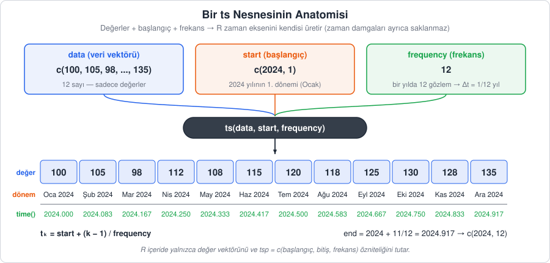
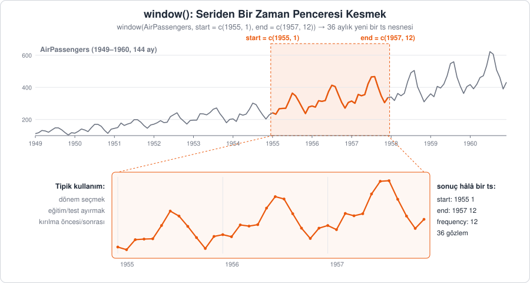
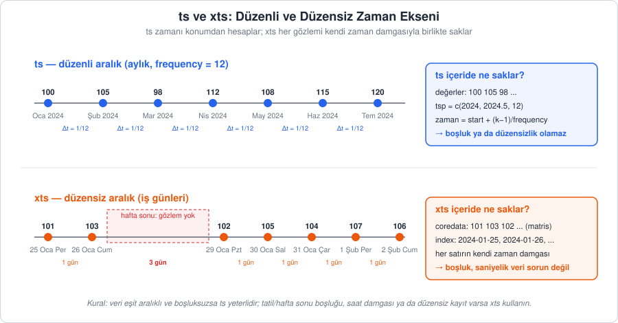

[İçindekiler](../Course_notes.md) · [← 4. R'da Tarih ve Zaman Nesneleri](04_rda_tarih_ve_zaman_nesneleri.md) · [6. Veri Manipülasyonu, Görselleştirme ve ACF/PACF →](06_veri_manipulasyonu_gorsellestirme_ve_acf_pacf.md)

## 5. R'da Zaman Serisi Nesneleri: `ts` ve `xts`

Bölüm 4'te tarih ve zaman bilgisini doğru okumayı ve saklamayı gördük. Şimdi bu bilgiyi verinin kendisiyle birleştirip R'ın zaman serisi analizinde kullandığı özel nesnelere dönüştüreceğiz. İki temel yapı var:

- **`ts` (time series):** R'ın yerleşik, eşit aralıklı seriler için tasarlanmış nesnesi. `decompose()`, `acf()`, `arima()` gibi klasik fonksiyonların çoğu bu nesneyi bekler (Bölüm 6 ve 7).
- **`xts` (eXtensible Time Series):** Her gözlemi kendi zaman damgasıyla saklayan, düzensiz aralıklı ve yüksek frekanslı veriler için esnek nesne.

Bir `ts` nesnesi iki temel bilgiden oluşur:

1. **Veri:** Sayısal değerlerden oluşan bir vektör (aynı türden değerlerin sıralı listesi) ya da çok değişkenli seriler için bir matris (satır ve sütunlardan oluşan sayı tablosu; her sütun bir değişken).
2. **Zaman bilgisi:** Serinin başlangıç zamanı (`start`) ve frekansı (`frequency`). Her gözlemin zamanı bu ikisinden **hesaplanır**; ayrıca saklanmaz.

### 5.1. Frekans Kavramı ve `start`/`end` Argümanları

**Tanım (frekans):** Frekans, **bir temel döngü (çoğunlukla bir yıl) içindeki gözlem sayısıdır.** Aylık veride yıl 12 aya bölündüğü için `frequency = 12`, çeyreklik veride `frequency = 4` olur. Frekans aynı zamanda mevsimsel dönemin uzunluğudur: `decompose()` ve mevsimsel ARIMA (Bölüm 7.3) gibi yöntemler "kaç gözlemde bir tekrar eden desen aranacağını" bu sayıdan öğrenir.

Bu parametre yanlış ayarlanırsa mevsimsellik gibi önemli desenler modellenemez. Örneğin aylık bir seriyi `frequency = 1` ile tanımlarsanız R, her yıl yaz aylarında tekrar eden zirveyi mevsimsellik olarak göremez; çünkü ona göre seride bir "yıl içi" yoktur, her gözlem ayrı bir yıldır.

| Veri tipi | Temel döngü | `frequency` | Açıklama |
| --- | --- | --- | --- |
| Yıllık | — | `1` | Mevsimsellik yoktur |
| Çeyreklik | Yıl | `4` | 4 çeyrek / yıl |
| Aylık | Yıl | `12` | 12 ay / yıl |
| Haftalık | Yıl | `52` ya da `52.18` | Bir yıl 365,25 / 7 ≈ 52,18 haftadır |
| Günlük | Hafta | `7` | Haftanın günü etkisi (hafta içi / hafta sonu) |
| Günlük | Yıl | `365` ya da `365.25` | Yıllık mevsimsellik (ör. sıcaklık) |
| Günlük (iş günü) | Hafta | `5` | Borsa, hafta sonu olmayan veriler |
| Saatlik | Gün | `24` | Günlük döngü (ör. elektrik tüketimi) |
| Saatlik | Hafta | `168` | 24 × 7; haftalık döngü |
| 30 dakikalık | Gün | `48` | 2 × 24 |
| Dakikalık | Saat / gün | `60` / `1440` | Yüksek frekanslı sensör verisi |

> **Simge notu:** $`\approx`$ *(yaklaşık eşittir)*: iki değerin yaklaşık olarak eşit olduğunu gösterir

**Not —** Günlük veride hangi frekansın seçileceği, hangi döngüyle ilgilendiğinize bağlıdır: haftalık desen için 7, yıllık desen için 365,25. Hem haftalık hem yıllık döngü birlikte varsa tek bir `ts` frekansı yetmez; bu durumda `forecast` paketindeki `msts()` (çok mevsimli seri) ya da Bölüm 9'daki Prophet gibi araçlar kullanılır. Ondalıklı frekanslar (`52.18`, `365.25`) `ts` tarafından kabul edilir, ancak bazı fonksiyonlar (ör. `decompose()`) mevsimsel dönemi tam sayı gözlem olarak ele alır; bu nedenle pratikte çoğunlukla `52` ya da `365` gibi tam sayılar tercih edilir.

**`start` ve `end` argümanları:** Zaman, `c(büyük birim, küçük birim)` biçiminde verilir: birinci sayı döngünün kendisi (çoğunlukla yıl), ikinci sayı döngü içindeki sıra (ay, çeyrek, gün...). `c()` (*combine*, birleştir) R'da birden çok değeri tek bir vektörde toplayan fonksiyondur; `c(2024, 1)` iki sayılık bir vektördür.

- `start = c(2024, 1)` ve `frequency = 12` → 2024 yılının 1. ayı (Ocak 2024).
- `start = c(2023, 3)` ve `frequency = 4` → 2023'ün 3. çeyreği.
- `start = 2020` ve `frequency = 1` → yıllık seride tek sayı yeterlidir.
- `end` verilmezse veri uzunluğundan hesaplanır; verilirse seri o noktada kesilir.

**Günlük hayattan bir örnek:** Okulun haftalık ders programını düşünün: satırlar günler, her satırda 8 ders saati var. "Salı, 3. ders" demek dersi bulmaya yeter, saatini ayrıca yazmaya gerek yoktur; çünkü çizelgenin düzeni bellidir. `ts` de böyledir: `frequency = 12` "her satırda (yılda) 12 hücre var", `start = c(2024, 1)` "ilk değer 2024 satırının 1. hücresinde" der. Sonraki her değer sıradaki hücreye yazılır ve tarihi hücresinden hesaplanır. Benzetmenin sınırı: `ts`'de hücre atlanamaz; eksik dönem `NA` ile doldurulmalıdır.

R içeride zamanı ondalıklı bir yıl sayısı olarak tutar. `c(yıl, p)` biçimindeki bir başlangıç (p: döngü içindeki sıra) şu sayıya çevrilir: yıl + (p − 1) / frekans. Örneğin `c(2023, 3)` ve frekans 4 için 2023 + 2/4 = 2023,5 (3. çeyrek, yılın yarısı geçmişken başlar). Sonraki her gözlem bir öncekinden sabit bir adım sonra gelir. $k$'inci gözlemin zamanı şöyle hesaplanır:

```math
\underbrace{t_k}_{\substack{\text{k'inci gözlemin}\\\text{zamanı}}} = \underbrace{t_1}_{\text{başlangıç}} + \frac{\overbrace{k-1}^{\substack{\text{başlangıçtan bu yana}\\\text{atılan adım sayısı}}}}{\underbrace{f}_{\text{frekans}}}, \qquad \underbrace{\Delta t = \frac{1}{f}}_{\substack{\text{ardışık iki gözlem}\\\text{arasındaki adım}}}
```

**Nasıl okunur?** "t alt k eşittir t alt 1 artı k eksi 1 bölü f; delta t eşittir 1 bölü f." Yani: k'inci gözleme varmak için başlangıçtan k − 1 adım atılır ve her adım 1/f yıl sürer.

> **Simge notu:** $`t_k`$ *(t alt k)*: k'inci gözlemin zamanı; alt indis $`k`$ gözlemin sıra numarasıdır ($`k = 1, 2, 3, \dots`$) · $`t_1`$: ilk gözlemin zamanı (başlangıç) · $`f`$: frekans · $`\Delta t`$ *(delta t; Δ büyük Yunan harfi "delta", "fark/adım" anlamında kullanılır)*: ardışık iki gözlem arasındaki sabit zaman adımı (aylık veride 1/12 yıl)

Aylık seride ($f = 12$) adım $1/12$ yıldır: Ocak 2024 için $t_1 = 2024$, Aralık ($k = 12$) için $2024 + 11/12 \approx 2024.917$. `time()` tam olarak bu değerleri döndürür.



*Şekil 5.1 — Bir `ts` nesnesi yalnızca değer vektörünü ve `tsp = c(başlangıç, bitiş, frekans)` özniteliğini saklar; her gözlemin zamanı `start` ve `frequency` bilgisinden hesaplanır.*

> **Hemen deneyin 5.1 · `time()` formülü sizin hesabınızla aynı mı?** (R, ~3 dk)
>
> 2023'ün 3. çeyreğinden başlayan altı gözlemlik bir seri kuralım ve her gözlemin içeride hangi zamanla saklandığına bakalım.
>
> ```r
> x <- ts(c(50, 52, 55, 53, 58, 60), start = c(2023, 3), frequency = 4)
> time(x)    # her gözlemin zamanı, ondalıklı yıl olarak
> cycle(x)   # döngü içindeki sıra (çeyrek numarası)
> ```
>
> **Ne göreceksiniz:** `time(x)` bir tablo verir: 2023 satırında `2023.50 2023.75`, 2024 satırında `2024.00 2024.25 2024.50 2024.75`. Bunlar $`t_k = 2023{,}5 + (k-1)/4`$ formülünün değerleridir; her adım $`1/4 = 0{,}25`$ yıldır. `cycle(x)` aynı düzende `3 4` ve `1 2 3 4` yazar: gözlemin hangi çeyreğe düştüğü.
>
> **Şimdi siz:** (1) Aynı altı değeri `frequency = 12` ile tanımlayıp `time()`'a bakın. İlk ve son değeri önce kendiniz hesaplayın. (2) Yanlış frekansın etkisi: `ap1 <- ts(as.numeric(AirPassengers), start = 1949, frequency = 1)` yazın (`as.numeric()` serinin zaman bilgisini atıp çıplak sayıları bırakır) ve `end(ap1)` ile bitiş yılına bakın.
>
> <details><summary>Cevap</summary>
>
> (1) Başlangıç artık Mart 2023'tür: $`2023 + 2/12 \approx 2023{,}167`$; son değer $`2023{,}167 + 5/12 \approx 2023{,}583`$ (Ağustos 2023). R bu kez sütun başlıklarına ay adları (`Mar` ... `Aug`) yazar. (2) `[1] 2092    1`: R, 144 aylık gözlemi 144 ayrı **yıl** sanmış ve seriyi 2092'ye kadar uzatmıştır; mevsimsellik de kaybolur. (Ek tuzak: `frequency = 1` iken `start = c(2023, 3)` yazarsanız seri 2023 + (3 − 1)/1 = **2025**'te başlar.)
>
> </details>

### 5.2. `ts` Nesnesi Oluşturma ve İnceleme

> **Uygulama dosyası:** [`Codes/R/ch05_ts_xts.R`](../Codes/R/ch05_ts_xts.R)
>
> Bu bölümdeki R kodlarının tamamı bu dosyada. RStudio'da açıp satır satır çalıştırabilir ya da depo kök dizininde `Rscript Codes/R/ch05_ts_xts.R` komutunu kullanabilirsiniz.

#### 5.2.1. Elle Veri Girerek

```r
# 2024 yılına ait aylık satış verisi
veri <- c(100, 105, 98, 112, 108, 115, 120, 118, 125, 130, 128, 135)

# ts nesnesi: 2024'ün 1. ayından başlıyor, frekansı 12
satis_ts <- ts(data = veri, start = c(2024, 1), frequency = 12)

print(satis_ts)
#>      Jan Feb Mar Apr May Jun Jul Aug Sep Oct Nov Dec
#> 2024 100 105  98 112 108 115 120 118 125 130 128 135

# Zaman bilgisine erişim
start(satis_ts)       # Başlangıç
#> [1] 2024    1
end(satis_ts)         # Bitiş (veri uzunluğundan hesaplandı)
#> [1] 2024   12
frequency(satis_ts)   # Frekans
#> [1] 12
tsp(satis_ts)         # İçeride saklanan öznitelik: başlangıç, bitiş, frekans
#> [1] 2024.000 2024.917   12.000
cycle(satis_ts)       # Her gözlemin döngü içindeki sırası (1 = Ocak, ..., 12 = Aralık)
#>      Jan Feb Mar Apr May Jun Jul Aug Sep Oct Nov Dec
#> 2024   1   2   3   4   5   6   7   8   9  10  11  12

# Her ayın ortalaması (mevsimsel analizde sık kullanılır)
tapply(satis_ts, cycle(satis_ts), mean)
#>   1   2   3   4   5   6   7   8   9  10  11  12 
#> 100 105  98 112 108 115 120 118 125 130 128 135 
```

Bu kod, on iki aylık satış değerini zaman bilgisi taşıyan bir `ts` nesnesine dönüştürür ve 5.1'de anlattığımız `start` ve `frequency` bilgisinin nesnede nasıl saklandığını, nasıl geri okunduğunu gösterir. Kodu satır satır okuyalım:

1. `veri <- c(100, 105, 98, ...)`: `c()` (2.1) on iki aylık satış değerini tek bir vektörde toplar; `<-` (atama, 2.5) bu vektörü `veri` adıyla saklar. Bu vektör yalnızca sayılardan oluşur; hangi aya ait olduklarını bilmez. Üstteki `#` satırı bir yorumdur (2.5).
2. `satis_ts <- ts(data = veri, start = c(2024, 1), frequency = 12)`: `ts()` vektöre zaman bilgisini ekleyip bir `ts` nesnesi oluşturur; sonuç `satis_ts` adıyla saklanır. Üç argüman da adıyla verilmiştir: `data = veri` serinin değerleri, `start = c(2024, 1)` ilk değerin zamanı (2024'ün 1. ayı, yani Ocak 2024), `frequency = 12` bir yıldaki gözlem sayısıdır (veri aylık). `end` verilmediği için bitiş, veri uzunluğundan hesaplanır (Şekil 5.1).
3. `print(satis_ts)`: Nesneyi ekrana yazar. Konsolda yalnızca `satis_ts` yazmak da aynı işi yapar. R, frekansın 12 olduğunu bildiği için değerleri ay adlarıyla bir tabloya yerleştirir (ay kısaltmaları R'ın kendi İngilizce etiketleridir, dil ayarına bağlı değildir).
4. `start(satis_ts)` ve `end(satis_ts)`: Serinin başlangıç ve bitiş zamanını `c(yıl, ay)` biçiminde iki sayılık bir vektör olarak verir. Bitiş, 12 değer olduğu için başlangıçtan 11 adım sonrası olarak hesaplanmıştır.
5. `frequency(satis_ts)`: Nesnenin frekansını tek bir sayı olarak verir.
6. `tsp(satis_ts)`: `tsp` (*time series properties*, zaman serisi özellikleri) içeride gerçekte saklanan üç sayıyı gösterir: başlangıç, bitiş ve frekans. Başlangıç ve bitiş, 5.1'deki ondalıklı yıl biçimindedir.
7. `cycle(satis_ts)`: Her gözlemin döngü içindeki sırasını (ayın numarasını: 1 = Ocak, ..., 12 = Aralık) verir. Sonuç, aynı zaman bilgisini taşıyan yeni bir `ts` nesnesidir.
8. `tapply(satis_ts, cycle(satis_ts), mean)`: `tapply()` üç argümanı sırayla (adları yazılmadan) alır: değerler (`satis_ts`), bu değerleri gruplara ayıracak etiketler (`cycle(satis_ts)`, yani ay numaraları) ve her gruba uygulanacak fonksiyon (`mean`, ortalama). Yani değerleri ay numarasına göre gruplar ve her grubun ortalamasını alır. `mean` parantezsiz yazılmıştır: Ortalamayı burada biz hesaplamıyoruz, fonksiyonun kendisini `tapply()`'ye veriyoruz; `tapply()` onu her grup için ayrı ayrı çağırır. Bu tek yıllık örnekte her grupta yalnızca bir değer olduğu için ortalamalar değerlerin kendisidir; çok yıllık bir seride (ör. `AirPassengers`) aynı satır "ortalama bir Ocak, ortalama bir Temmuz" gibi mevsimsel profili verir. Bu yüzden mevsimsel analizde sık kullanılır.

Çıktıları sırayla okuyalım:

- `print()` çıktısında üst satır sütun başlıklarıdır (aylar), soldaki `2024` satır başlığıdır (yıl); tablonun içi değerlerdir.
- `[1] 2024    1`: Baştaki `[1]`, satırın vektörün 1. elemanıyla başladığını gösteren sıra numarasıdır (2.5). `2024 1` Ocak 2024 demektir; sayılar arasındaki fazla boşluklar yalnızca hizalama içindir. `[1] 2024   12` aynı biçimde Aralık 2024'tür. `[1] 12` frekanstır.
- `[1] 2024.000 2024.917   12.000`: Başlangıç (2024.000, yani Ocak 2024), bitiş ve frekans. `2024.917` değeri, Aralık 2024'ün ondalıklı yıl karşılığıdır ($`2024 + 11/12`$). R aynı vektördeki sayıları aynı ondalık basamak sayısıyla yazdığı için frekans da `12.000` görünür; değeri 12'dir.
- `cycle()` çıktısı, `print()` tablosuyla aynı düzendedir; yalnızca değerlerin yerinde ay numaraları (1–12) vardır.
- `tapply()` çıktısında `[1]` yoktur, çünkü sonuç **adlandırılmış** bir vektördür (teknik olarak tek boyutlu bir dizi, `array`): üst satır grup adlarını (ay numaraları 1–12), alt satır her grubun ortalamasını gösterir.

Başlangıç noktası döngünün ortasında olabilir. Aşağıda 2023'ün 3. çeyreğinden başlayan çeyreklik bir seri var:

```r
ceyrek_ts <- ts(c(50, 52, 55, 53, 58, 60), start = c(2023, 3), frequency = 4)
print(ceyrek_ts)
#>      Qtr1 Qtr2 Qtr3 Qtr4
#> 2023             50   52
#> 2024   55   53   58   60
end(ceyrek_ts)
#> [1] 2024    4
```

Bu örnek, `ts()`'nin değerleri başlangıç noktasından itibaren çeyreklere nasıl yerleştirdiğini ve bitişi nasıl hesapladığını gösterir. Kodu satır satır okuyalım:

1. `ceyrek_ts <- ts(c(50, 52, 55, 53, 58, 60), start = c(2023, 3), frequency = 4)`: Bu kez değerler önce bir isme atanmamış, `c()` ile doğrudan `ts()`'nin içinde verilmiştir. Bu ilk argüman adı yazılmadan (konumsal olarak) verildiği için `ts()`'nin ilk argümanı olan `data`'nın yerine geçer. `frequency = 4` yılda dört gözlem, yani çeyreklik veri demektir; `start = c(2023, 3)` ilk değerin 2023'ün 3. çeyreği olduğunu söyler. Sonuç `ceyrek_ts` adlı bir `ts` nesnesidir.
2. `print(ceyrek_ts)`: Seriyi yıl satırları ve çeyrek sütunları olan bir tablo olarak yazar. `Qtr1`–`Qtr4` başlıkları İngilizce *quarter* (çeyrek) kelimesinin kısaltmasıdır.
3. `end(ceyrek_ts)`: Bitiş zamanını `c(yıl, çeyrek)` biçiminde verir.

Altı değer, 2023'ün 3. çeyreğinden başlayarak sırayla çeyreklere yerleşir: 2023'ün 3. ve 4. çeyreği, ardından 2024'ün dört çeyreği. Bu yüzden tablodaki 2023 satırının ilk iki hücresi boştur (`Qtr1` ve `Qtr2` için veri yoktur) ve `end()` çıktısı `[1] 2024    4`, yani 2024'ün 4. çeyreğidir. `tsp(ceyrek_ts)` başlangıç ve bitişi, Hemen deneyin 5.1'de `time()` ile bulduğumuz ondalıklı yıllar olarak verir: `2023.50 2024.75 4.00`.

> **Hemen deneyin 5.2.1 · Son 12 ayın harcaması bir `ts` nesnesi olsun** (R ve Python, ~6 dk)
>
> Aşağıdaki sayılar Kasım 2025'ten başlayan 12 aylık örnek market harcamalarıdır (TL); isterseniz kendi harcamalarınızı yazın.
>
> ```r
> harcama <- c(4200, 3900, 5100, 3800, 3700, 4400, 4100, 4600, 5200, 4800, 4300, 4900)
> h_ts <- ts(harcama, start = c(2025, 11), frequency = 12)
> h_ts
> end(h_ts)
> tapply(h_ts, floor(time(h_ts)), sum)   # floor(): aşağı yuvarlar, ondalıklı yıldan yılı çıkarır
> ```
>
> pandas'ta aynı aylık seri, indeksi aylardan oluşan bir `Series`'tir (`period_range()` R'daki `start` + `frequency` bilgisinin karşılığıdır):
>
> ```python
> import pandas as pd
> harcama = [4200, 3900, 5100, 3800, 3700, 4400, 4100, 4600, 5200, 4800, 4300, 4900]
> s = pd.Series(harcama, index=pd.period_range("2025-11", periods=12, freq="M"))
> print(s.groupby(s.index.year).sum())
> ```
>
> **Ne göreceksiniz:** R tabloyu iki satıra böler: 2025 satırında yalnızca `Nov` ve `Dec` (4200, 3900), 2026 satırında `Jan`–`Oct` dolu, son iki hücre boştur. `end(h_ts)` `[1] 2026   10` (Ekim 2026) verir. `tapply()` satırında `floor(time(h_ts))` her ayın yılını (2025 ya da 2026) grup etiketi yapar; sonuç `2025: 8100`, `2026: 44900`'dür. Python aynı iki toplamı (`2025     8100`, `2026    44900`) yazar.
>
> **Şimdi siz:** En çok harcanan ay hangisi? R'da `cycle(h_ts)[which.max(h_ts)]` (`which.max()` en büyük değerin sıra numarasını verir), Python'da `s.idxmax()` ile bulun.
>
> <details><summary>Cevap</summary>
>
> `which.max(h_ts)` = `9` (9. gözlem), `cycle(h_ts)[9]` = `7`, yani Temmuz; `time(h_ts)[9]` = `2026.5` (Temmuz 2026'nın ondalıklı yılı: $`2026 + 6/12`$). Python `2026-07` yazar. Değer 5200 TL'dir.
>
> </details>

#### 5.2.2. Paketten Gelen Veri Seti: `USgas`

`TSstudio` paketindeki `USgas`, ABD'nin aylık doğal gaz tüketimini (milyar kübik fit) içeren bir `ts` nesnesidir.

```r
# install.packages("TSstudio") # Yüklü değilse
library(TSstudio)
data(USgas)

ts_info(USgas)
#>  The USgas series is a ts object with 1 variable and 238 observations
#>  Frequency: 12
#>  Start time: 2000 1
#>  End time: 2019 10

start(USgas)       # [1] 2000    1
end(USgas)         # [1] 2019   10
frequency(USgas)   # [1] 12
```

Bu kod, hazır bir veri setini bir paketten yükler ve zaman bilgisini kontrol eder. Bir seriyle çalışmaya başlamadan önce nerede başlayıp bittiğine ve frekansına bakmak, yanlış ayarlanmış zaman bilgisini erkenden yakalamanın en kolay yoludur. Kodu satır satır okuyalım:

1. `# install.packages("TSstudio") # Yüklü değilse`: Başındaki `#` yüzünden çalışmayan bir satırdır. `TSstudio` kurulu değilse baştaki `#` silinip satır **bir kez** çalıştırılır; `install.packages()` paketi internetten (CRAN'dan) indirip kurar (3.2).
2. `library(TSstudio)`: `TSstudio` paketini bu oturuma yükler; `USgas` verisi ve `ts_info()` fonksiyonu bu paketten gelir. Yüklerken `package 'TSstudio' was built under R version ...` gibi bir uyarı görebilirsiniz; paketin sizin R'ınızdan biraz farklı bir sürümle hazırlandığını söyler ve kodu etkilemez.
3. `data(USgas)`: Paketle gelen `USgas` veri setini çalışma alanına getirir. Ad burada tırnaksız yazılmıştır; `data("USgas")` ile aynıdır (2.5).
4. `ts_info(USgas)`: Bir `ts` nesnesinin özetini tek seferde ekrana yazar. Bu fonksiyon yalnızca yazdırır; saklanacak bir sonuç döndürmez.
5. `start(USgas)`, `end(USgas)`, `frequency(USgas)`: 5.2.1'deki fonksiyonlardır. Bu kez beklenen çıktılar ayrı `#>` satırları yerine her satırın sonuna yorum olarak yazılmıştır (`# [1] 2000    1` gibi).

`ts_info()` çıktısı dört satırdır. İlk satır serinin tek değişkenli (*1 variable*) ve 238 gözlemli bir `ts` nesnesi olduğunu, `Frequency: 12` aylık olduğunu söyler. `Start time: 2000 1` Ocak 2000, `End time: 2019 10` Ekim 2019'dur; kontrol: $19 \times 12 + 10 = 238$.

**Not —** Paketin eski sürümlerinde `USgas` Kasım 2018'de biten 227 gözlemlik bir seriydi; kitaplarda ve eski kaynaklarda bu değerleri görebilirsiniz. Yukarıdaki çıktı güncel `TSstudio` sürümüne aittir.

> **Hemen deneyin 5.2.2 · ABD'de doğal gaz en çok hangi ay tüketiliyor?** (R, ~3 dk)
>
> ```r
> library(TSstudio)
> data(USgas)
> max(USgas)                                 # en yüksek aylık tüketim
> time(USgas)[which.max(USgas)]              # which.max(): en büyük değerin sıra numarası
> cycle(USgas)[which.max(USgas)]             # o gözlem hangi ay?
> round(tapply(USgas, cycle(USgas), mean))   # ay ortalamaları (mevsimsel profil); round(): yuvarlar
> ```
>
> **Ne göreceksiniz:** `[1] 3399.9`, `[1] 2019` ve `[1] 1`: rekor tüketim Ocak 2019'dadır (`2019` = 2019,000, yani yılın ilk ayı). Son satır 12 ayın ortalamasını verir: `1` (Ocak) `2806` ile en yüksek, `12` (Aralık) `2543`, `2` (Şubat) `2502`; en düşükler `9` (Eylül) `1687` ve `6` (Haziran) `1691`'dir. Kış zirvesi ısınmadan gelir; yazın küçük bir tepe (Temmuz `1864`, Ağustos `1889`) ise klimalar için elektrik üretiminden kaynaklanır.
>
> **Şimdi siz:** En düşük aylık tüketimi ve zamanını `min()`, `which.min()`, `time()` ve `cycle()` ile bulun.
>
> <details><summary>Cevap</summary>
>
> `min(USgas)` = `1368.4`; `time(USgas)[which.min(USgas)]` = `2003.417` ($`2003 + 5/12`$); `cycle(...)` = `6`. En düşük tüketim Haziran 2003'tedir.
>
> </details>

#### 5.2.3. R'ın Yerleşik Veri Seti: `AirPassengers`

`AirPassengers`, 1949–1960 yılları arasındaki aylık uluslararası havayolu yolcu sayılarını (bin kişi) içerir. Bölüm 2.5'da ayrıştırdığımız bu seriyi ders boyunca defalarca kullanacağız.

```r
data(AirPassengers)

class(AirPassengers)       # Zaten 'ts' formatında
#> [1] "ts"
start(AirPassengers)
#> [1] 1949    1
end(AirPassengers)
#> [1] 1960   12
frequency(AirPassengers)   # Aylık veri
#> [1] 12
length(AirPassengers)      # 12 yıl × 12 ay
#> [1] 144

# Görselleştirme
plot(AirPassengers,
     main = "Aylık Uluslararası Havayolu Yolcu Sayıları (1949-1960)",
     ylab = "Yolcu Sayısı (Bin)",
     xlab = "Yıl",
     col  = "darkblue")
grid()
```

Bu kod, ders boyunca kullanacağımız `AirPassengers` serisinin zaten bir `ts` olduğunu ve zaman bilgisinin doğru ayarlandığını kontrol eder; sonra seriyi çizerek trendi ve mevsimselliği gözle görmemizi sağlar. Kodu satır satır okuyalım:

1. `data(AirPassengers)`: R ile birlikte gelen veri setini çalışma alanına yükler (2.5); paket kurmak gerekmez.
2. `class(AirPassengers)`: Nesnenin sınıfını, yani R'ın onu hangi tür nesne olarak gördüğünü verir. Seri zaten `ts` olduğu için `ts()` ile dönüştürmeye gerek yoktur.
3. `start(AirPassengers)`, `end(AirPassengers)`, `frequency(AirPassengers)`: 5.2.1'deki fonksiyonlardır.
4. `length(AirPassengers)`: Nesnedeki eleman, yani gözlem sayısını verir.
5. `plot(AirPassengers, main = ..., ylab = ..., xlab = ..., col = "darkblue")`: Bu, beş satıra bölünmüş **tek** bir komuttur. R, açılan parantez kapanana kadar sonraki satırları aynı komutun devamı olarak okur; bu yüzden argümanları ayıran virgüller satır sonlarında durur. `plot()` (2.5) bir `ts` nesnesi gördüğünde yatay ekseni otomatik olarak zaman ekseni (yıllar) yapar ve gözlemleri çizgiyle birleştirir. `main` grafik başlığını, `ylab` dikey (y) eksenin adını, `xlab` yatay (x) eksenin adını, `col` çizgi rengini belirler. Bu dört argümanın değerleri tırnak içinde metindir; `"darkblue"` R'ın tanıdığı renk adlarından biridir (koyu mavi). `col  =` yazımındaki fazladan boşluk yalnızca satırları hizalamak içindir, sonucu değiştirmez.
6. `grid()`: Var olan grafiğin arka planına açık gri, noktalı yardımcı ızgara çizgileri ekler. Yeni bir grafik açmaz, mevcut grafiğin üzerine çizer; bu yüzden `plot()`'tan sonra çalıştırılır.

İlk çıktı `[1] "ts"`: Değerin tırnak içinde yazılması, sonucun bir sayı değil bir metin olduğunu gösterir. `[1] 1949    1` Ocak 1949, `[1] 1960   12` Aralık 1960, `[1] 12` aylık frekanstır. `[1] 144` gözlem sayısıdır: 1949'dan 1960'a 12 yıl × 12 ay = 144. Grafikte hem artan bir trend (yıllar içinde yolcu sayısının artması) hem de belirgin bir mevsimsellik (her yıl yaz aylarında zirve) görülür; ayrıca mevsimsel dalgalanmaların genliği seviyeyle birlikte büyür, bu da çarpımsal bir yapıya işaret eder (bkz. 2.4).

> **Hemen deneyin 5.2.3 · `AirPassengers`'ın mevsimsel profili: R ve pandas** (R ve Python, ~5 dk)
>
> 5.2.1'deki `tapply()` satırını bu kez 12 yıllık seriye uygulayalım.
>
> ```r
> round(tapply(AirPassengers, cycle(AirPassengers), mean), 1)   # her ayın 12 yıllık ortalaması
> ```
>
> Aynı hesap Python'da, depodaki CSV dosyasından (Colab'da dosya yolu yerine `https://raw.githubusercontent.com/erkanozhan/AI_Based_Time_Series-Data_Analytics/main/data/AirPassengers.csv` yazın):
>
> ```python
> import pandas as pd
> ap = pd.read_csv("data/AirPassengers.csv", parse_dates=["Month"], index_col="Month")
> yolcu = ap["Passengers"]
> print(yolcu.groupby(yolcu.index.month).mean().round(1))
> ```
>
> **Ne göreceksiniz:** İki araç da aynı 12 sayıyı verir: Ocak `241.8`, Şubat `235.0`, ..., Haziran `311.7`, Temmuz `351.3`, Ağustos `351.1`, Eylül `302.4`, Ekim `266.6`, Kasım `232.8`, Aralık `261.8`. En kalabalık ay Temmuz, en sakin ay Kasım'dır. R'da grupları `cycle()`, pandas'ta `index.month` belirler.
>
> **Şimdi siz:** Gruplama etiketini aydan yıla çevirin: R'da `cycle(AirPassengers)` yerine `floor(time(AirPassengers))`, Python'da `yolcu.index.month` yerine `yolcu.index.year` yazın. Trend görünüyor mu?
>
> <details><summary>Cevap</summary>
>
> Yıllık ortalamalar 1949'da `126.7`'den her yıl artarak 1960'ta `476.2`'ye çıkar (1950 `139.7`, 1955 `284.0`, 1959 `428.3`); bu, grafikte gördüğümüz artan trendin sayısal karşılığıdır. İki araç yine aynı sayıları verir.
>
> </details>

#### 5.2.4. Veri Alt Kümesi Alma: `window()`

Bir `ts` serisinin belirli bir dönemini seçmek için `window()` fonksiyonu kullanılır. Bu, en sık kullanacağınız fonksiyonlardan biridir: belirli bir dönemi incelemek, bir kırılma öncesini ve sonrasını karşılaştırmak ve özellikle **eğitim/test ayrımı** yapmak (Bölüm 8) için kullanılır.

`start` ve `end` argümanları 5.1'deki `c(yıl, dönem)` biçimini izler; ikisinden biri verilmezse serinin başı ya da sonu kabul edilir. Sonuç yine bir `ts` nesnesidir, yani frekans ve zaman bilgisi korunur.

```r
# AirPassengers'tan 1955-1957 dönemini seçelim
ap_pencere <- window(AirPassengers, start = c(1955, 1), end = c(1957, 12))
print(ap_pencere)
#>      Jan Feb Mar Apr May Jun Jul Aug Sep Oct Nov Dec
#> 1955 242 233 267 269 270 315 364 347 312 274 237 278
#> 1956 284 277 317 313 318 374 413 405 355 306 271 306
#> 1957 315 301 356 348 355 422 465 467 404 347 305 336
length(ap_pencere)
#> [1] 36

# USgas'tan 2010-2015 yılları arasındaki veri
subset_gas <- window(USgas, start = c(2010, 1), end = c(2015, 12))
length(subset_gas)   # 6 yıl × 12 ay
#> [1] 72

# Eğitim/test ayrımı: son iki yılı test için ayıralım
egitim <- window(AirPassengers, end = c(1958, 12))     # 1949-1958
test   <- window(AirPassengers, start = c(1959, 1))    # 1959-1960
length(egitim)
#> [1] 120
length(test)
#> [1] 24
```

Bu kod `window()` ile üç kesim yapar: `AirPassengers`'tan üç yıllık bir dönem, `USgas`'tan altı yıllık bir dönem ve modelleme için eğitim/test ayrımı. Kodu satır satır okuyalım:

1. `ap_pencere <- window(AirPassengers, start = c(1955, 1), end = c(1957, 12))`: İlk argüman (konumsal) kesilecek seridir. `start = c(1955, 1)` Ocak 1955'ten, `end = c(1957, 12)` Aralık 1957'ye kadar kesileceğini söyler; iki uç da dahildir. Sonuç `ap_pencere` adlı yeni bir `ts` nesnesidir; `AirPassengers`'ın kendisi değişmez.
2. `print(ap_pencere)` ve `length(ap_pencere)`: Kesilen seriyi tablo olarak yazar ve gözlem sayısını verir (5.2.1, 5.2.3).
3. `subset_gas <- window(USgas, start = c(2010, 1), end = c(2015, 12))`: `USgas`'tan Ocak 2010 – Aralık 2015 dönemini keser. Bu satır `USgas`'ı kullandığı için 5.2.2'deki `library(TSstudio)` ve `data(USgas)` satırlarının önceden çalıştırılmış olması gerekir.
4. `length(subset_gas)`: Kesilen dönemin gözlem sayısıdır.
5. `egitim <- window(AirPassengers, end = c(1958, 12))`: Yalnızca `end` verilmiştir; `start` yazılmadığı için serinin başı (Ocak 1949) kabul edilir. Satır sonundaki `# 1949-1958` bir yorumdur.
6. `test   <- window(AirPassengers, start = c(1959, 1))`: Yalnızca `start` verilmiştir; `end` yazılmadığı için serinin sonuna (Aralık 1960) kadar gider. `test` ile `<-` arasındaki fazladan boşluklar yalnızca iki satırı hizalamak içindir.
7. `length(egitim)` ve `length(test)`: İki parçanın gözlem sayılarını verir.

`print(ap_pencere)` 1955–1957 için ay sütunlu bir tablo verir. Uzunluklar: 3 × 12 = 36, 6 × 12 = 72, 10 × 12 = 120 ve 2 × 12 = 24; 120 + 24 = 144, yani iki parça seriyi örtüşmeden ve boşluk bırakmadan kapsar.



*Şekil 5.2 — `window()` uzun bir seriden `start` ve `end` ile belirlenen dönemi keser; sonuç, kendi başlangıç, bitiş ve frekans bilgisini taşıyan yeni bir `ts` nesnesidir.*

**Not —** Zaman serisinde eğitim ve test kümeleri rastgele değil, **zaman sırasına göre** ayrılır: model geçmişle eğitilir, gelecekle test edilir. `window()` bu ayrımı doğal olarak yapar. Ayrıntısı Bölüm 8'de, zaman serisinde çapraz doğrulama ise Bölüm 16'da ele alınacaktır.

> **Hemen deneyin 5.2.4 · Başka bir seride eğitim/test ayrımı** (R ve Python, ~5 dk)
>
> `USAccDeaths`, ABD'deki aylık kaza sonucu ölüm sayılarıdır (1973–1978, R ile birlikte gelir). Son yılı test için ayıralım (ayrıntılı gerekçe Bölüm 8.1.1).
>
> ```r
> egitim <- window(USAccDeaths, end = c(1977, 12))     # 1973-1977
> test   <- window(USAccDeaths, start = c(1978, 1))    # 1978
> length(egitim); length(test)
> window(USAccDeaths, start = c(1978, 6), end = c(1978, 8))   # 1978 yazı
> ```
>
> pandas'ta aynı ayrım tarih dilimiyle yapılır; bölümdeki `AirPassengers` ayrımını tekrarlayalım:
>
> ```python
> import pandas as pd
> ap = pd.read_csv("data/AirPassengers.csv", parse_dates=["Month"], index_col="Month")
> yolcu = ap["Passengers"]
> egitim = yolcu.loc[:"1958"]     # başlangıçtan 1958 sonuna kadar
> test   = yolcu.loc["1959":]     # 1959'dan sona kadar
> print(len(egitim), len(test))
> ```
>
> **Ne göreceksiniz:** R'da `[1] 60` ve `[1] 12` (5 yıl × 12 ay ve 1 yıl × 12 ay), ardından `Jun 9434`, `Jul 10484`, `Aug 9827` değerlerini içeren tek satırlık bir tablo. Python `120 24` yazar; bölümdeki R ayrımıyla aynı sayılardır.
>
> **Şimdi siz:** Yıllık bir seride `start` ve `end` tek sayıdır. `window(Nile, start = 1910, end = 1915)` ile Nil nehrinin 1910–1915 yıllık akımlarını alın. En düşük değer hangi yıla aittir?
>
> <details><summary>Cevap</summary>
>
> `Start = 1910`, `End = 1915`, `Frequency = 1` başlıklarının altında `969 831 726 456 824 702`. En düşük değer `456`, 1913 yılına aittir; bu aynı zamanda serinin tamamının (1871–1970) en düşük değeridir.
>
> </details>

### 5.3. `ts` Nesnesinin Ötesi: `xts` ile Gerçek Dünya Verileri

`ts` nesnesi, ders kitaplarındaki gibi **eşit aralıklı ve boşluksuz** veriler (aylık, çeyreklik, yıllık) için uygundur. Gerçek dünya verileri ise nadiren bu kadar düzenlidir: hafta sonları ve tatillerde işlem görmeyen borsa verileri, zaman zaman kesintiye uğrayan sensör kayıtları, saniyelik işlem kayıtları... `ts`'nin "başlangıç + sabit adım" yapısı bu durumlarda yetersiz kalır, çünkü bir gözlemin zamanını yalnızca sırasından hesaplar; arada bir boşluk olduğunu bilemez. Örneğin cuma gününden sonra pazartesi gelen bir borsa serisini günlük `ts` olarak tanımlarsanız, R pazartesi değerini cumartesiye yazar.

**Tanım (`xts`):** `xts` (eXtensible Time Series, genişletilebilir zaman serisi), `zoo` paketi üzerine kurulmuş bir zaman serisi sınıfıdır. İki parçadan oluşur: bir **veri matrisi** (`coredata`, "çekirdek veri") ve her satıra karşılık gelen, sıralı bir **zaman indeksi** (`index`; `Date`, `POSIXct` gibi Bölüm 4'teki sınıflardan biri). İndeks, bir kitabın sayfa numaraları gibidir: her satırın "adresi" o satırın tarihidir; üstelik numaralar ardışık olmak zorunda değildir: 25, 26, 29 diye giden sayfalar gibi, hafta sonu "sayfaları" yoktur ve hiçbir şey kaymaz. Böylece her gözlem kendi zaman damgasıyla eşleşir ve düzensiz ya da yüksek frekanslı verilerle çalışmak kolaylaşır.

| Özellik | `ts` | `xts` |
| --- | --- | --- |
| Zaman ekseni | Düzenli: `start` + `frequency` ile hesaplanır | Düzensiz olabilir: her satırın açık zaman damgası vardır |
| Zaman tipi | Ondalıklı sayı (ör. `2024.083`) | `Date`, `POSIXct`, `yearmon` ... |
| Boşluk / tatil / hafta sonu | Temsil edemez (NA ile doldurmak gerekir) | Doğal olarak desteklenir |
| Gün içi (saatlik, saniyelik) veri | Zor | Kolay |
| Tarihle alt küme | `window(x, start = c(2024, 3))` | `x["2024-03"]`, `x["2024-01-26/2024-01-30"]` |
| Dönem dönüştürme | `aggregate()` | `to.period()`, `apply.monthly()` ... |
| Tipik kullanım | Klasik modeller: `decompose`, `arima`, `HoltWinters` | Finans, sensör, log verisi; ön işleme |

Tablodaki `HoltWinters` (Holt-Winters), geçmiş değerlerin, yakın geçmişe daha çok ağırlık veren ağırlıklı ortalamasıyla düzey, trend ve mevsimselliği güncelleyen üstel düzeltme yöntemidir.



*Şekil 5.3 — `ts` gözlemleri eşit adımlarla dizer ve zamanı konumdan hesaplar; `xts` ise her gözlemi kendi tarihiyle saklar. Alttaki iş günü serisinde 27–28 Ocak hafta sonunda gözlem yoktur; bu yüzden 26 Ocak (Cuma) ile 29 Ocak (Pazartesi) gözlemleri arasında 3 gün vardır ve `xts` bunu sorunsuz temsil eder.*

```r
# install.packages("xts") # Yüklü değilse
library(xts)

# Düzensiz aralıklı bir veri: yalnızca iş günleri (27-28 Ocak hafta sonu atlanmış)
degerler <- c(101, 103, 102, 105, 104, 107, 106)
tarihler <- as.Date(c("2024-01-25", "2024-01-26", "2024-01-29", "2024-01-30",
                      "2024-01-31", "2024-02-01", "2024-02-02"))

# xts nesnesi: veri + zaman indeksi (order.by)
veri_xts <- xts(x = degerler, order.by = tarihler)

print(veri_xts)
#>            [,1]
#> 2024-01-25  101
#> 2024-01-26  103
#> 2024-01-29  102
#> 2024-01-30  105
#> 2024-01-31  104
#> 2024-02-01  107
#> 2024-02-02  106

diff(index(veri_xts))    # Gözlemler arası süre: hafta sonunda 3 gün
#> Time differences in days
#> [1] 1 3 1 1 1 1
```

Bu kod, hafta sonu boşluğu olan küçük bir iş günü serisini `xts` nesnesi olarak kurar ve gözlemler arasındaki süreleri hesaplayarak bu boşluğun nesnede kaybolmadığını gösterir. Kodu satır satır okuyalım:

1. `# install.packages("xts") # Yüklü değilse`: Çalışmayan bir yorum satırıdır; paket kurulu değilse `#` silinip bir kez çalıştırılır (3.2).
2. `library(xts)`: `xts` paketini yükler. `xts`, `zoo` paketi üzerine kurulu olduğu için R `zoo`'yu da kendiliğinden yükler. Ekranda `Loading required package: zoo` ve `The following objects are masked from 'package:base': as.Date, as.Date.numeric` gibi mesajlar görülebilir. İkincisi, `zoo`'nun bu fonksiyonların kendi sürümünü devreye aldığını söyler; ikisi de bilgi mesajıdır, hata değildir.
3. `degerler <- c(101, 103, 102, 105, 104, 107, 106)`: Yedi gözlemi bir sayı vektöründe toplar ve `degerler` adıyla saklar.
4. `tarihler <- as.Date(c("2024-01-25", ...))`: İçten dışa okuyalım. `c()` tırnak içindeki yedi tarih metnini bir metin vektöründe toplar; `as.Date()` bu metinleri `Date` nesnelerine çevirir (Bölüm 4). Komut iki satıra bölünmüştür (5.2.3). Tarihler 25 Ocak 2024 Perşembe'den başlar; 27–28 Ocak hafta sonu olduğu için listede yoktur. İki vektörün aynı uzunlukta (7) olması gerekir, çünkü i'inci değer i'inci tarihle eşleşir.
5. `veri_xts <- xts(x = degerler, order.by = tarihler)`: `xts()` bu ikisini birleştirir: `x` verinin kendisi, `order.by` ("şuna göre sırala") zaman indeksidir. Tarihler karışık sırada verilse bile `xts` satırları tarihe göre sıralar. Sonuç 7 satır ve 1 sütunluk bir `xts` nesnesidir ve `veri_xts` adıyla saklanır (`class(veri_xts)` hem `"xts"` hem `"zoo"` verir, çünkü `xts` bir tür `zoo` nesnesidir).
6. `print(veri_xts)`: Nesneyi tablo olarak yazar.
7. `diff(index(veri_xts))`: İçten dışa okuyalım. `index()` nesnenin zaman indeksini, yani yedi tarihlik `Date` vektörünü çıkarır. `diff()` (3.2) ardışık elemanların farkını alır. İki tarihin farkı bir süredir; sonuç bu yüzden süre tutan bir `difftime` nesnesidir.

`print()` çıktısında sol sütundaki tarihler verinin bir sütunu değil, nesnenin **indeksidir**; `index(veri_xts)` ile indekse, `coredata(veri_xts)` ile yalın veri matrisine erişilir. `[,1]` başlığı, matrisin 1. sütununun bir adı olmadığını gösterir (`colnames(veri_xts) <- "fiyat"` ile ad verilebilir; o zaman başlıkta `fiyat` yazar). `diff()` çıktısının ilk satırı `Time differences in days`, sonucun gün cinsinden süreler olduğunu söyler. `[1] 1 3 1 1 1 1` ise altı farktır, çünkü yedi tarih arasında altı aralık vardır: 26 − 25 = 1 gün, 29 − 26 = 3 gün (hafta sonu), sonrakiler 1'er gün. Aradaki 3, `ts`'nin göremediği hafta sonu boşluğunun `xts`'te açıkça durduğunu gösterir.

> **Hemen deneyin 5.3 · Düzensiz bir seri: yakıt alımlarınız** (R ve Python, ~5 dk)
>
> Arabaya yakıt aldığınız günler düzenli değildir; böyle bir seri `ts` ile değil `xts` ile tutulur.
>
> ```r
> library(xts)
> litre    <- c(35, 42, 38, 40, 37)
> tarihler <- as.Date(c("2026-09-02", "2026-09-11", "2026-09-19", "2026-10-03", "2026-10-09"))
> yakit <- xts(litre, order.by = tarihler)
> colnames(yakit) <- "litre"
> diff(index(yakit))          # alımlar arası kaç gün geçmiş?
> mean(diff(index(yakit)))    # ortalama aralık
> ```
>
> pandas'ta tarih indeksli bir `Series` aynı işi görür:
>
> ```python
> import pandas as pd
> yakit = pd.Series([35, 42, 38, 40, 37],
>                   index=pd.to_datetime(["2026-09-02", "2026-09-11", "2026-09-19", "2026-10-03", "2026-10-09"]))
> print(yakit.index.to_series().diff().dt.days.tolist())
> ```
>
> **Ne göreceksiniz:** R'da `Time differences in days` ve `[1]  9  8 14  6`, ardından `Time difference of 9.25 days`. Python `[nan, 9.0, 8.0, 14.0, 6.0]` yazar: ilk gözlemin öncesi olmadığı için fark `nan` (değer yok) olur. Aralıklar 6 ile 14 gün arasında değişir; bu seriye "başlangıç + sabit adım" yapısındaki bir `ts` uymaz.
>
> **Şimdi siz:** Tarihleri karışık sırada verin: `karisik <- xts(c(40, 35, 42), order.by = as.Date(c("2026-10-03", "2026-09-02", "2026-09-11")))` ve `karisik` yazdırın. Değerler hangi sırayla gelir?
>
> <details><summary>Cevap</summary>
>
> `xts` satırları tarihe göre sıralar ve her değer kendi tarihiyle birlikte taşınır: `2026-09-02 35`, `2026-09-11 42`, `2026-10-03 40`. Sütun adı verilmediği için başlıkta `[,1]` yazar.
>
> </details>

Bir `ts` nesnesini `xts`'e dönüştürmek için `as.xts()` kullanılır:

```r
head(as.xts(AirPassengers), 3)
#>          [,1]
#> Jan 1949  112
#> Feb 1949  118
#> Mar 1949  132
```

Bu tek satır, bir `ts` serisini `xts`'e çevirmenin ne kadar kolay olduğunu ve aylık bir seride indeksin nasıl göründüğünü gösterir. İç içe yazıldığı için içten dışa okuyalım:

1. `as.xts(AirPassengers)`: `as.xts()` (`xts` paketinden) bir `ts` nesnesini `xts` nesnesine dönüştürür. `ts`'nin hesapladığı zamanlar artık her satırın yanında duran indekse dönüşür.
2. `head(..., 3)`: Bir nesnenin ilk satırlarını gösterir; ikinci argüman kaç satır gösterileceğidir (yazılmazsa 6). 144 satırın hepsini basmak yerine yalnızca başına bakmak için kullanılır.

Çıktıda sol sütun indekstir: `Jan 1949`, `Feb 1949`, `Mar 1949`. Bu indeks `yearmon` (*year-month*, yıl-ay) sınıfındadır; `yearmon`, `zoo` paketinin yalnızca yıl ve aydan oluşan zaman sınıfıdır. Aylık veride gün bilgisi anlamsız olduğu için `ts`'den dönüştürülen aylık seriler bu sınıfı kullanır. `[,1]` başlığı yine adı olmayan tek sütunu gösterir; 112, 118 ve 132 ilk üç ayın yolcu sayılarıdır (bin kişi).

#### 5.3.1. Tarih Bazlı Filtreleme

`xts`'in en büyük avantajlarından biri, tarih bazlı alt küme almanın çok kolay olmasıdır. R'da köşeli parantez `[ ]` bir nesnenin bir kısmını seçer: `degerler[2]` vektörün 2. elemanını (`103`) verir; matrislerde `[satır, sütun]` yazılır ve boş bırakılan taraf "hepsi" demektir (`[,1]`: bütün satırlar, 1. sütun). `xts`, köşeli parantez içine sıra numarası yerine ISO 8601 biçiminde (`YYYY-MM-DD`, bkz. 4.1) tarih metni yazılmasına da izin verir; `/` işareti bir aralık belirtir.

```r
# Belirli bir tarih aralığı (iki uç dahil)
veri_xts["2024-01-26/2024-01-30"]
#>            [,1]
#> 2024-01-26  103
#> 2024-01-29  102
#> 2024-01-30  105

# Belirli bir ay (ya da yıl: veri_xts["2024"])
veri_xts["2024-02"]
#>            [,1]
#> 2024-02-01  107
#> 2024-02-02  106

# Açık uçlu aralık: başlangıçtan 26 Ocak'a kadar
veri_xts["/2024-01-26"]
#>            [,1]
#> 2024-01-25  101
#> 2024-01-26  103
```

Bu kod, aynı `xts` nesnesinden üç farklı tarih seçimiyle alt küme alır. Satır numarası hesaplamadan doğrudan tarih yazarak veri seçebilmek, `xts`'in günlük işlerde en çok işe yarayan özelliğidir. Kodu satır satır okuyalım:

1. `veri_xts["2024-01-26/2024-01-30"]`: Köşeli parantez içindeki metin bir tarih aralığıdır: `/` işaretinin solu başlangıç, sağı bitiştir ve iki uç da dahildir. Arada hafta sonu olduğu için üç satır gelir (26, 29 ve 30 Ocak).
2. `veri_xts["2024-02"]`: `"2024-02"` ISO 8601'in yalnızca yıl-ay yazımıdır ve Şubat 2024'e düşen bütün satırları seçer. Yalnızca yıl yazılırsa (yorumdaki `veri_xts["2024"]`) o yılın bütün satırları gelir.
3. `veri_xts["/2024-01-26"]`: `/` işaretinin sol tarafı boş bırakıldığı için aralık o yönde açık uçludur: serinin başından 26 Ocak'a kadar. Tersine, `"2024-01-29/"` 29 Ocak'tan serinin sonuna kadar demektir.

Bu satırlar bir isme atanmadığı için sonuçlar doğrudan ekrana yazılır. Her sonuç yine bir `xts` nesnesidir; bu yüzden çıktılar `veri_xts`'in kendisiyle aynı biçimdedir: solda indeks (tarihler), üstte `[,1]` sütun başlığı, sağda değerler. Yalnızca seçilen tarihlerin satırları gelir: ilk çıktıda 3, ikinci ve üçüncü çıktıda 2'şer satır.

`ts` nesnelerinde `window()` (5.2.4) ile yaptığımız kesimi `xts` nesnelerinde bu köşeli parantez sözdizimi yapar; istenirse `window(veri_xts, start = as.Date("2024-01-26"), end = as.Date("2024-01-30"))` ile tarih vererek de yapılabilir.

> **Hemen deneyin 5.3.1 · `AirPassengers`'tan tarihle dilim almak** (R ve Python, ~4 dk)
>
> ```r
> library(xts)
> ap <- as.xts(AirPassengers)   # ts → xts (5.3)
> ap["1955-06/1955-08"]         # 1955 yazı
> max(ap["1955"])               # 1955'in en kalabalık ayı
> ```
>
> pandas'ta aynı tarih metinleri `.loc[...]` içine yazılır; `/` yerine `:` kullanılır:
>
> ```python
> import pandas as pd
> ap = pd.read_csv("data/AirPassengers.csv", parse_dates=["Month"], index_col="Month")
> print(ap.loc["1955-06":"1955-08"])
> ```
>
> **Ne göreceksiniz:** R'da `Jun 1955 315`, `Jul 1955 364`, `Aug 1955 347` satırları ve `[1] 364`. Python aynı üç değeri `1955-06-01`, `1955-07-01`, `1955-08-01` tarihleriyle yazar: pandas aylık veriyi ayın ilk günüyle saklar, `xts` ise `yearmon` (`Jun 1955`) sınıfıyla. İki araçta da uçlar dahildir.
>
> **Şimdi siz:** 1958'den serinin sonuna kadar kaç ay vardır? (R: `nrow(ap["1958/"])`, Python: `len(ap.loc["1958":])`.) 1960'ın en yüksek değeri nedir?
>
> <details><summary>Cevap</summary>
>
> Her iki araçta `36` (1958, 1959, 1960: 3 × 12). 1960'ın en yüksek değeri `622`'dir (R: `max(ap["1960"])`, Python: `ap.loc["1960", "Passengers"].max()`); Temmuz 1960'a aittir.
>
> </details>

#### 5.3.2. Dönem Dönüştürme

`xts`'in bir diğer güçlü yanı, veriyi farklı zaman periyotlarına kolayca dönüştürmesidir. Örneğin günlük veriden haftalık ya da aylık özetler çıkarmak tek satırlık iştir.

```r
# Günlük veriden haftalık veriye: to.period() her dönem için
# açılış (Open), en yüksek (High), en düşük (Low) ve kapanış (Close) değerlerini hesaplar
haftalik_veri <- to.period(veri_xts, period = "weeks")
print(haftalik_veri)
#>            veri_xts.Open veri_xts.High veri_xts.Low veri_xts.Close
#> 2024-01-26           101           103          101            103
#> 2024-02-02           102           107          102            106

# Aylık ortalamalar (sütun bazında ortalama için colMeans önerilir)
aylik_ortalama <- apply.monthly(veri_xts, FUN = colMeans)
print(aylik_ortalama)
#>             [,1]
#> 2024-01-31 103.0
#> 2024-02-02 106.5
```

Bu kod, günlük `xts` verisini daha kaba dönemlere özetler: önce haftalara, sonra aylara. Günlük veriden haftalık ya da aylık seriye geçmek, hem gürültüyü azaltmak hem de farklı sıklıktaki verileri karşılaştırabilmek için sık yapılan bir ön işlemedir. Kodu satır satır okuyalım:

1. `haftalik_veri <- to.period(veri_xts, period = "weeks")`: `to.period()` seriyi `period` argümanında verilen dönemlere böler ve her dönemi dört sayıyla özetler (üstteki iki yorum satırı bu dört özeti hatırlatır). `period = "weeks"` haftalık dönemler demektir; haftalar pazartesi başlar, pazar biter. Aynı yere `"months"` (aylar; varsayılan değer), `"quarters"` (çeyrekler) ya da `"years"` (yıllar) da yazılabilir. Sonuç `haftalik_veri` adlı yeni bir `xts` nesnesidir.
2. `print(haftalik_veri)`: Sonucu ekrana yazar.
3. `aylik_ortalama <- apply.monthly(veri_xts, FUN = colMeans)`: `apply.monthly()` veriyi takvim aylarına böler ve her aya `FUN` (*function*, fonksiyon) argümanıyla verilen fonksiyonu uygular. `colMeans` (*column means*) her sütunun ortalamasını alır. 5.2.1'deki `mean` gibi parantezsiz yazılır, çünkü burada fonksiyonun kendisi verilir; onu her ay için `apply.monthly()` çağırır. Sonuç `aylik_ortalama` adlı bir `xts` nesnesidir.
4. `print(aylik_ortalama)`: Sonucu ekrana yazar.

`to.period()` çıktısının dört sütunu borsa dünyasından gelen dört özettir: dönemin ilk değeri (*Open*, açılış), en yüksek değeri (*High*), en düşük değeri (*Low*) ve son değeri (*Close*, kapanış). Sütun adlarının başındaki `veri_xts.` öneki, fonksiyona verilen nesnenin adından gelir. İlk hafta (25–26 Ocak) değerleri 101 ve 103'tür: açılış 101, en yüksek 103, en düşük 101, kapanış 103. İkinci hafta (29 Ocak – 2 Şubat) değerleri 102, 105, 104, 107, 106'dır: açılış 102, en yüksek 107, en düşük 102, kapanış 106. Her dönem, o dönemin **son gözleminin tarihiyle** etiketlenir: ilk hafta 26 Ocak ile, ikinci hafta 2 Şubat ile.

`apply.monthly()` çıktısında da her ay, verideki son tarihiyle etiketlenir: Ocak `2024-01-31`, Şubat `2024-02-02`. Ocak ayının ortalaması $(101 + 103 + 102 + 105 + 104) / 5 = 515 / 5 = 103$, Şubat'ınki $(107 + 106) / 2 = 106{,}5$'tir. R aynı sütundaki sayıları aynı ondalık basamak sayısıyla yazdığı için 103 de `103.0` olarak görünür. `FUN = mean` da aynı sonucu verir, ancak güncel `xts` sürümleri çok sütunlu verilerde karışıklığı önlemek için `colMeans` kullanılmasını öneren bir bilgi notu (*NOTE*) yazdırır.

**Günlük hayattan bir örnek:** Harçlığınızdan her gün biraz ayırıp kumbaraya attığınızı ve deftere yazdığınızı düşünün. Ay sonunda o ayın bütün satırlarını toplayıp tek satıra yazmak `apply.monthly(..., FUN = colSums)`'tır; ortalamayı yazmak `colMeans`'tir. `to.period()` ise her ay için dört değeri not eder: ayın ilk kaydı (Open), ay içindeki en büyük ve en küçük kayıt (High, Low) ve son kayıt (Close). Deftere günlük miktar yerine kumbaradaki toplam parayı yazsaydınız, bunlar ayın açılış, en yüksek, en düşük ve kapanış bakiyesi olurdu.

> **Hemen deneyin 5.3.2 · Günlükten aylığa: elle hesaplayıp kontrol edin** (R ve Python, ~5 dk)
>
> Değerleri 1, 2, 3, ... diye artan 91 günlük (1 Ocak – 31 Mart 2024) bir seri kuralım; böylece aylık toplamları elle de hesaplayabiliriz.
>
> ```r
> library(xts)
> gunler <- seq(as.Date("2024-01-01"), as.Date("2024-03-31"), by = "day")
> adim <- xts(seq_along(gunler), order.by = gunler)   # seq_along(): 1, 2, ..., 91
> apply.monthly(adim, FUN = colSums)                  # colSums: sütun toplamı
> ```
>
> pandas'ta dönem dönüştürmenin adı `resample()`'dır:
>
> ```python
> import pandas as pd
> adim = pd.Series(range(1, 92), index=pd.date_range("2024-01-01", periods=91, freq="D"))
> print(adim.resample("ME").sum())     # ME: ay sonu ile etiketle (eski pandas'ta "M")
> ```
>
> **Ne göreceksiniz:** İki araç da `2024-01-31  496`, `2024-02-29  1334`, `2024-03-31  2356` verir. Elle kontrol: Ocak'ta 1'den 31'e kadar sayılar vardır ve toplamları $`31 \times 32 / 2 = 496`$'dır; Şubat'ta 32'den 60'a 29 sayı, toplamı $`(32 + 60) \times 29 / 2 = 1334`$.
>
> **Şimdi siz:** R'da `to.period(adim, period = "months")`, Python'da `adim.resample("ME").ohlc()` çalıştırın. Şubat satırının dört değerini önce tahmin edin. Ardından haftalık dönemlerin sayısını bulun: `nrow(to.period(adim, period = "weeks"))` ve `len(adim.resample("W").ohlc())`.
>
> <details><summary>Cevap</summary>
>
> Şubat: açılış `32`, en yüksek `60`, en düşük `32`, kapanış `60` (seri hep arttığı için açılış en düşük, kapanış en yüksek değerdir). İki araç da aynı tabloyu verir; yalnızca sütun adları farklıdır (`adim.Open` ... / `open` ...). Haftalık dönem sayısı ikisinde de `13`'tür: 1 Ocak 2024 pazartesi, 31 Mart 2024 pazardır; arada tam 13 hafta vardır.
>
> </details>

Özetle: düzenli ve boşluksuz seriler için `ts` (klasik modellerle doğrudan uyumlu), düzensiz ya da gün içi veriler için `xts`. Sık izlenen yol: ön işleme `xts` ile yapılır, modellemeden önce seri `ts`'ye çevrilir.

<details>
<summary><b>Kendinizi test edin (cevaplar için tıklayın)</b></summary>

1. **Çeyreklik bir seri 2022'nin 2. çeyreğinde başlıyor ve 10 gözlemden oluşuyor. `ts()` çağrısını yazın; seri hangi çeyrekte biter?**
   → `ts(x, start = c(2022, 2), frequency = 4)`. Başlangıç $`2022 + 1/4 = 2022{,}25`$; bitiş $`2022{,}25 + 9/4 = 2024{,}5`$, yani 2024'ün 3. çeyreği (`end()` sonucu `2024 3`).

2. **Saatlik elektrik tüketiminde günlük döngüyü modellemek istiyorsunuz. `frequency` kaç olmalı? Haftalık döngü için?**
   → Günlük döngü için 24 (bir günde 24 gözlem), haftalık döngü için $`24 \times 7 = 168`$.

3. **Bir hisse senedinin yalnızca iş günlerinde kaydedilen kapanış fiyatlarını `ts(fiyat, frequency = 7)` ile tanımlamak neden hatalıdır?**
   → `ts` her gözlemin zamanını sırasından hesaplar ve haftada 7 gözlem varsayar; oysa haftada 5 gözlem vardır. Pazartesi değerleri cumartesiye kayar ve "haftanın günü" deseni bozulur. Ya `xts` kullanılmalı ya da iş günü serisi için `frequency = 5` seçilmelidir (resmî tatiller bu düzeni yine bozar; bu yüzden `xts` daha güvenlidir).

</details>

---

[İçindekiler](../Course_notes.md) · [← 4. R'da Tarih ve Zaman Nesneleri](04_rda_tarih_ve_zaman_nesneleri.md) · [6. Veri Manipülasyonu, Görselleştirme ve ACF/PACF →](06_veri_manipulasyonu_gorsellestirme_ve_acf_pacf.md)
