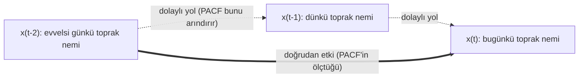

[İçindekiler](../Course_notes.md) · [← 5. R'da Zaman Serisi Nesneleri: `ts` ve `xts`](05_rda_zaman_serisi_nesneleri_ts_ve_xts.md) · [7. Klasik İstatistiksel Modeller: ARIMA ve SARIMA →](07_klasik_istatistiksel_modeller_arima_ve_sarima.md)

## 6. Veri Manipülasyonu, Görselleştirme ve ACF/PACF

Elimizde artık bir `ts` nesnesi var (Bölüm 5). Bu bölümde üç soruyu yanıtlayacağız:

1. Seriyi nasıl görselleştiririz? (`plot()`, `ggplot2`)
2. Seriyi nasıl dönüştürür ve parçalarına ayırırız? (`aggregate()`, `lag()`, `decompose()`)
3. Serinin "hafızasını", yani bugünkü değerin geçmiş değerlere ne kadar bağlı olduğunu nasıl ölçeriz? (ACF ve PACF)

Üçüncü sorunun cevabı, Bölüm 7'deki ARIMA modellerinin derecelerini seçerken kullanacağımız temel araçtır. Bölüm boyunca `TSstudio` paketindeki `USgas` serisini (ABD aylık doğal gaz tüketimi, milyar kübik fit) kullanacağız.

> **Not —** Bu bölümdeki çıktılar `TSstudio`'nun güncel sürümüyle (0.1.7; 238 gözlem) üretilmiştir. Eski sürümlerde seri daha kısadır (bkz. 5.2.2'deki not); sayılar biraz farklı çıkar ama yorumlar değişmez.

### 6.1. Temel Görselleştirme

> **Uygulama dosyası:** [`Codes/R/ch06_manipulasyon_acf.R`](../Codes/R/ch06_manipulasyon_acf.R)
>
> Bu bölümdeki R kodlarının tamamı bu dosyada. RStudio'da açıp satır satır çalıştırabilir ya da depo kök dizininde `Rscript Codes/R/ch06_manipulasyon_acf.R` komutunu kullanabilirsiniz. Python örnekleri [`Codes/python/ch06_acf_pacf.py`](../Codes/python/ch06_acf_pacf.py) dosyasındadır (Bölüm 6.3.7 ve 6.4.3).


İlk kural: **Veriyi çizin. Her zaman.** Grafiğe bakmadan analize başlamak, gözü kapalı araba kullanmaya benzer. Bir zaman serisi grafiğinde şu dört soruya cevap ararız:

- **Trend** var mı? Seri uzun vadede yükseliyor ya da düşüyor mu?
- **Mevsimsellik** var mı? Aynı desen her yıl (ya da her hafta) tekrar ediyor mu?
- **Varyans** sabit mi? Dalgalanmaların genliği zamanla büyüyor mu? (Büyüyorsa çarpımsal model ya da log dönüşümü düşünülür, bkz. Bölüm 2.4.)
- **Aykırı değer** veya yapısal kırılma var mı?

#### 6.1.1. `plot()` ile Hızlı Grafik

`ts` nesneleri, `plot()` fonksiyonu ile doğrudan çizilebilir. Zaman ekseni, nesnenin `start` ve `frequency` bilgisinden otomatik olarak oluşturulur.

```r
library(TSstudio)
data(USgas)

plot(USgas,
     main = "ABD Doğal Gaz Tüketimi (2000-2019)",
     ylab = "Milyar Kübik Fit",
     xlab = "Yıl",
     col = "blue")
grid()
```

Bu kod `USgas` serisini tek komutla çizer ve okumayı kolaylaştırmak için grafiğe başlık, eksen adları ve bir ızgara ekler. Analize başlamadan önce yukarıdaki dört soruya gözle cevap aramanın en hızlı yolu budur. Kodu satır satır okuyalım:

1. `library(TSstudio)`: `TSstudio` paketini bu oturuma yükler (5.2.2); `USgas` veri seti bu paketten gelir. Paket kurulu değilse önce bir kez `install.packages("TSstudio")` çalıştırılır (3.2).
2. `data(USgas)`: Paketle gelen `USgas` veri setini çalışma alanına (RStudio'daki *Environment* paneli) getirir. Seri, Ocak 2000'de başlayan, frekansı 12 olan, 238 aylık gözlemli bir `ts` nesnesidir (Bölüm 5.2.2).
3. `plot(...)` ve `grid()`: 5.2.3'teki `AirPassengers` grafiğiyle aynı çalışır: `main` başlık, `xlab`/`ylab` eksen adları, `col` çizgi rengidir; `grid()` mevcut grafiğe ızgara ekler.

Kod ekrana sayı yazdırmaz, yalnızca bir grafik açar (RStudio'da *Plots* panelinde; `Rscript` ile çalıştırıldığında grafik, çalışma klasöründeki `Rplots.pdf` dosyasına yazılır). Yatay eksende yıllar, dikey eksende milyar kübik fit cinsinden aylık tüketim vardır. `USgas` grafiğinde hem yavaş yükselen bir **trend** hem de her kış zirve yapan güçlü bir **mevsimsellik** görülür. Mevsimsel dalgaların genliği seviyeyle birlikte belirgin biçimde büyümediği için toplamsal model makul bir başlangıçtır.

> **Hemen deneyin 6.1.1 · Dört soruyu başka bir seride sorun** (R, ~3 dk)
>
> R ile birlikte gelen `UKgas` serisi, İngiltere'nin 1960–1986 arasındaki **çeyreklik** gaz tüketimidir. RStudio konsoluna yazın:
>
> ```r
> plot(UKgas, main = "İngiltere Gaz Tüketimi (çeyreklik)", col = "darkgreen")
> grid()
> diff(range(window(UKgas, 1960, c(1960, 4))))   # 1960'ın en büyük - en küçük çeyreği
> diff(range(window(UKgas, 1986, c(1986, 4))))   # 1986'nın en büyük - en küçük çeyreği
> ```
>
> `window(seri, başlangıç, bitiş)` serinin yalnızca verilen tarih aralığını keser (`c(1960, 4)` = 1960'ın 4. çeyreği); `range()` en küçük ve en büyük değeri, `diff()` bu ikisinin farkını verir.
>
> **Ne göreceksiniz:** Grafikte seri 1970'e kadar yavaş, sonra hızla yükselir (**trend**); her yıl 1. çeyrekte (kış) tepe, 3. çeyrekte (yaz) dip yapar (**mevsimsellik**). Konsolda `[1] 75.3` ve `[1] 816.5` yazar: Bir yıl içindeki dalganın boyu 1960'tan 1986'ya yaklaşık 11 kat büyümüştür. Yani dört sorudan üçüncüsünün cevabı "**varyans sabit değil**"dir; `USgas`'ın aksine bu seride çarpımsal model ya da log dönüşümü düşünülmelidir (Bölüm 2.4).
>
> **Şimdi siz:** Aynı dört soruyu `AirPassengers` için sorun (`plot(AirPassengers)`). Dalga boyu büyüyor mu? 1949 ve 1960 için yukarıdaki iki satırı uyarlayıp kontrol edin.
>
> <details><summary>Cevap</summary>
>
> Evet: `diff(range(window(AirPassengers, 1949, c(1949, 12))))` 44, aynı komut 1960 için 232 verir. Dalga boyu yaklaşık 5 kat büyümüştür; `AirPassengers` da çarpımsal yapıdadır.
>
> </details>

#### 6.1.2. Gelişmiş Görselleştirme: `ggplot2`

`ggplot2` paketi, R'da yayın kalitesinde ve özelleştirilebilir grafikler oluşturmak için kullanılır. `ggplot2` veri çerçevesi (`data.frame`, satır ve sütunlardan oluşan tablo) ile çalıştığı için önce `ts` nesnesini bir tarih sütunu ve bir değer sütunu olan tabloya çevirmemiz gerekir.

```r
library(ggplot2)

# USgas ts nesnesini data.frame'e dönüştür
df_gg <- data.frame(
  tarih = seq(as.Date("2000-01-01"), by = "month", length.out = length(USgas)), # Aylık tarih dizisi
  deger = as.numeric(USgas)                                                     # ts değerlerini sayısal vektöre çevir
)

# Zaman serisi grafiği ve yumuşatılmış trend çizgisi
ggplot(df_gg, aes(x = tarih, y = deger)) +
  geom_line(color = "blue", linewidth = 0.8) +
  geom_smooth(method = "loess", formula = y ~ x,
              color = "red", se = FALSE, linetype = "dashed") + # Trend çizgisi ekle
  labs(title = "ABD Doğal Gaz Tüketimi (2000-2019)",
       subtitle = "ggplot2 ile Gelişmiş Görselleştirme",
       x = "Tarih",
       y = "Milyar Kübik Fit") +
  theme_minimal()
```

Bu kod aynı `USgas` grafiğini `ggplot2` ile daha özenli biçimde çizer ve üzerine mevsimsel dalgaları bastıran yumuşatılmış bir trend eğrisi ekler. Kod iki aşamadan oluşur: Önce `ts` nesnesi `ggplot2`'nin anladığı tabloya çevrilir, sonra grafik katman katman kurulur. Kodu satır satır okuyalım:

1. `library(ggplot2)`: `ggplot2` paketini oturuma yükler; `ggplot()`, `aes()`, `geom_line()`, `geom_smooth()`, `labs()` ve `theme_minimal()` bu paketten gelir. Kurulu değilse önce bir kez `install.packages("ggplot2")` çalıştırılır.
2. `# USgas ts nesnesini data.frame'e dönüştür`: Yorum satırıdır (2.5); satır sonlarındaki `# Aylık tarih dizisi` gibi notlar da yorumdur.
3. `df_gg <- data.frame(tarih = ..., deger = ...)`: `data.frame()` virgülle ayrılmış her `ad = değer` çiftinden bir sütun kurar; ad sütunun başlığı, değer de sütunun içeriği olur. `<-` (atama işareti) sağda oluşan tabloyu soldaki `df_gg` adına kaydeder. Komut dört satıra yayılmıştır, çünkü parantez kapanana kadar R okumaya devam eder. İki sütunun içeriği şöyle üretilir:
   - `tarih = seq(as.Date("2000-01-01"), by = "month", length.out = length(USgas))`: İç içe çağrılar içten dışa okunur. `as.Date("2000-01-01")` tırnak içindeki metni bir `Date` (tarih) nesnesine çevirir (Bölüm 4.2.1); `length(USgas)` serideki gözlem sayısını, yani 238'i verir. `seq()` (*sequence*, dizi) ilk argümandaki başlangıç tarihinden itibaren `by = "month"` ile birer ay ilerleyen ve `length.out = 238` ile tam 238 elemanda duran bir tarih **vektörü** üretir (Bölüm 4.4): 2000-01-01, 2000-02-01, …, 2019-10-01. Uzunluğu `length(USgas)` ile yazmak, sayıyı elle girmekten daha güvenlidir: `TSstudio` sürümü değişip seri kısalsa ya da uzasa bile tarih sütunu seriyle aynı uzunlukta kalır.
   - `deger = as.numeric(USgas)`: `as.numeric()` `ts` nesnesinin zaman bilgisini (başlangıç, frekans) atar ve geriye yalnızca 238 sayıdan oluşan düz bir vektör bırakır: 2510.5, 2330.7, 2050.6, …

   Sonuç 238 satır ve 2 sütunluk bir veri çerçevesidir: Her satır bir aydır; ilk satırda `tarih` 2000-01-01, `deger` 2510.5'tir. İki sütunun aynı uzunlukta olması zorunludur, aksi hâlde `data.frame()` hata verir.
4. `ggplot(df_gg, aes(x = tarih, y = deger))`: Boş bir tuval açar; henüz hiçbir şey çizilmez. İlk argüman, verinin hangi tablodan alınacağını söyler. İkinci argüman `aes()` (*aesthetics*, estetik eşleme), tablodaki sütunları grafiğin görsel özelliklerine bağlar: `x = tarih` "`tarih` sütunu yatay eksene", `y = deger` "`deger` sütunu dikey eksene" demektir. `aes()` içindeki `tarih` ve `deger` tırnaksız yazılır, çünkü bunlar metin değil, `df_gg` tablosundaki sütunların adlarıdır. `tarih` sütunu `Date` türünde olduğu için `ggplot2` yatay ekseni kendiliğinden tarih ekseni olarak (2000, 2005, …) düzenler. Burada verilen eşleme sonraki bütün katmanlara geçer; bu yüzden `geom_line()` ve `geom_smooth()` içinde `x` ve `y`'yi yeniden yazmayız.
5. Satır sonlarındaki `+`: `ggplot2`'de grafik, üst üste konan saydam katmanlar gibi parça parça kurulur ve her parça bir öncekine `+` ile eklenir. `+` işareti mutlaka satırın **sonunda** durmalıdır: R, `ggplot(...)` satırını tek başına tamamlanmış bir komut sayar; `+` bir sonraki satırın başına yazılırsa grafik orada biter ve sonraki satır hata verir ("Did you accidentally put `+` on a new line?").
6. `geom_line(color = "blue", linewidth = 0.8)`: İlk çizim katmanıdır (*geom*, geometrik nesne). Noktaları yatay eksendeki sıraya göre bir çizgiyle birleştirir. `color = "blue"` çizgiyi maviye boyar; bu ayar `aes()` dışında yazıldığı için veriye bağlı değildir, bütün çizgi için sabit bir renktir. `linewidth = 0.8` çizgi kalınlığıdır (varsayılan 0.5); çizgi biraz kalınlaştırılarak öne çıkarılmıştır.
7. `geom_smooth(method = "loess", formula = y ~ x, color = "red", se = FALSE, linetype = "dashed")`: İkinci katman olarak verinin üzerine yumuşatılmış bir trend eğrisi çizer. Komut iki satıra bölünmüştür; sondaki `# Trend çizgisi ekle` bir yorumdur. Argümanlar:
   - `method = "loess"`: Yumuşatma yöntemini seçer (yöntem aşağıdaki **Açıklama**'da). Yazılmazsa 1000'den az gözlemde zaten `loess` seçilir, ama R bunu bir bilgi mesajıyla bildirir; açıkça yazmak hem mesajı önler hem de okuyana yöntemi söyler.
   - `formula = y ~ x`: `~` (tilde) işareti R'da **formül** kurar ve "solundaki, sağındakine göre açıklanır" diye okunur. Buradaki `y` ve `x` tablodaki sütunlar değil, `aes()` ile eşlenen eksenlerdir: "dikey eksendeki değeri yatay eksene göre yumuşat". Yazılmazsa R aynı formülü kullanır ve "`geom_smooth()` using formula = 'y ~ x'" mesajını basar.
   - `color = "red"`: Eğrinin rengi.
   - `se = FALSE`: `se` (*standard error*) varsayılan olarak `TRUE`'dur ve eğrinin çevresine gri bir %95 belirsizlik şeridi çizer. `FALSE` bu şeridi kapatır; burada amacımız trendin yalnızca biçimini görmektir. `TRUE` ve `FALSE` R'ın mantıksal (evet/hayır) değerleridir ve tırnaksız, büyük harfle yazılır.
   - `linetype = "dashed"`: Eğriyi kesikli çizer; böylece gözlem çizgisinden kolayca ayırt edilir.
8. `labs(title = ..., subtitle = ..., x = "Tarih", y = "Milyar Kübik Fit")`: Grafiğin yazılarını (*labels*) belirler: `title` başlık, `subtitle` başlığın altındaki küçük alt başlık, `x` ve `y` eksen adları. Buradaki `x` ve `y` veri değil, yalnızca eksenlere yazılacak metinlerdir.
9. `theme_minimal()`: Grafiğin genel görünümünü belirleyen hazır bir temadır. `ggplot2`'nin varsayılan gri arka planını, çerçeveyi ve eksen çentiklerini kaldırır, yalnızca açık gri ızgara çizgilerini bırakır. Sonunda `+` olmadığı için grafik tanımı burada biter.

Kod ekrana sayı ya da mesaj yazdırmaz (`method` ve `formula` açıkça verildiği için bilgi mesajı da çıkmaz); yalnızca grafiği çizer. Grafikte mavi çizgi aylık gözlemleri, kırmızı kesikli eğri ise trendi gösterir. Sonra eklenen katman öncekinin üzerine çizilir ve herhangi bir katman satırını (ve önündeki `+`'yı) silmek yalnızca o katmanı kaldırır. Bu yüzden `ggplot2` ile bir grafiği adım adım geliştirmek kolaydır.

**Açıklama:** `loess` (*locally estimated scatterplot smoothing*, yerel regresyonla yumuşatma) her tarih için yalnızca o tarihin çevresindeki gözlemlere bakar, yakın olanlara daha fazla ağırlık vererek bu gözlemlere basit bir eğri (küçük bir parabol) uydurur ve eğrinin o tarihteki değerini alır. `geom_smooth()` varsayılan olarak her noktada verinin %75'ini kullanır (`span = 0.75`); `USgas` için bu, her tarihin çevresindeki yaklaşık 178 ay, yani 15 yıl kadar gözlem demektir. Pencere bu kadar geniş olduğu için kış zirveleri ile yaz dipleri birbirini dengeler; mevsimsel dalgalar "bastırılır" ve geriye trend kalır. Kırmızı kesikli çizgi, 2000'lerin ortasına kadar hafifçe gerileyip yaklaşık 1850 düzeyine inen tüketimin, 2010 sonrasında hızlanarak yükseldiğini gösterir (2017 sonunda yaklaşık 2400).

> **Not —** Tarih dizisini `seq()` ile üretiyoruz, çünkü `time()` ondalıklı yıl (ör. 2000.083) döndürdüğü için `as.Date(time(USgas))` doğrudan çalışmaz (`zoo` yüklüyse `as.Date(zoo::as.yearmon(time(USgas)))` de olur). `ggplot2` 3.4 ve sonrasında çizgi kalınlığı `size` yerine `linewidth` ile verilir.

> **Not — `source()` ile çalıştırma.** Bir `ggplot(...)` ifadesi konsolda ya da dosya `Rscript dosya.R` ile çalıştırıldığında grafik kendiliğinden çizilir. Dosya `source()` ile (RStudio'daki *Source* düğmesi de bunu kullanır) ya da ifade bir fonksiyon veya döngü içinde çalıştırıldığında ise R sonucu otomatik olarak ekrana basmaz; grafiği bir nesneye atayıp `print()` ile çizdirmek gerekir. Uygulama dosyasında `p <- ggplot(...)` ve `print(p)` bu yüzden kullanılmıştır.

> **Hemen deneyin 6.1.2 · Tek katmanla log ölçeği** (R, ~4 dk)
>
> `ggplot2`'de katman eklemenin ne kadar kolay olduğunu `AirPassengers` ile görelim. Önce aşağıdaki kodu `scale_y_log10() +` satırını **silerek** çalıştırın, sonra satırı geri koyup yeniden çalıştırın.
>
> ```r
> library(ggplot2)
> df_ap <- data.frame(
>   tarih = seq(as.Date("1949-01-01"), by = "month", length.out = length(AirPassengers)),
>   yolcu = as.numeric(AirPassengers)
> )
> ggplot(df_ap, aes(x = tarih, y = yolcu)) +
>   geom_line(color = "blue") +
>   scale_y_log10() +   # dikey ekseni logaritmik ölçeğe çevirir (100, 300, 500 ...)
>   theme_minimal()
> ```
>
> **Ne göreceksiniz:** Katman yokken dalgalar sağa doğru belirgin biçimde büyür (1949'da yıl içi fark 44, 1960'ta 232 bin yolcu). `scale_y_log10()` ile eksen 100, 300, 500 etiketli logaritmik ölçeğe geçer ve dalgaların boyu birbirine çok yaklaşır. Verinin kendisi değişmez, yalnızca eksen değişir: Log ölçekte eşit uzunluk, eşit **oranda** değişim demektir.
>
> **Şimdi siz:** Log ölçekte de dalga boyunu sayıyla ölçün: `diff(range(log10(window(AirPassengers, 1949, c(1949, 12)))))` ve aynısını 1960 için çalıştırın. Ham ölçekte 5 kat olan büyüme kaç kata iner?
>
> <details><summary>Cevap</summary>
>
> 1949 için 0.153, 1960 için 0.203 çıkar; oran yaklaşık 1.3'tür. Dalgalar log ölçekte tam eşit olmasa da 5 katlık farkın büyük kısmı kaybolur. Bölüm 7'de `AirPassengers`'ı bu yüzden log dönüşümünden sonra modelleyeceğiz.
>
> </details>

### 6.2. Zaman Serisi Manipülasyonu

#### 6.2.1. Frekansı Düşürmek: `aggregate()`

`aggregate()`, yüksek frekanslı veriyi daha düşük bir frekansa toplar. Örneğin aylık veriyi yıllık toplamlara çevirebiliriz.

```r
# Aylık veriyi yıllık toplam tüketime çevirelim
USgas_yillik <- aggregate(USgas, nfrequency = 1, FUN = sum)
USgas_yillik
```

**Çıktı:**

```
Time Series:
Start = 2000 
End = 2018 
Frequency = 1 
 [1] 22538.6 22238.8 23027.0 22276.5 22402.5 22014.5 21699.2 23103.8 23276.9
[10] 22910.1 24086.8 24477.4 25538.6 26155.2 26593.4 27243.7 27444.3 27145.9
[19] 30075.3
```

Bu kod aylık `USgas` serisini yıllık toplam tüketim serisine çevirir; amaç mevsimsel dalgaları ortadan kaldırıp uzun vadeli eğilimi tek bakışta görmektir. Kodu satır satır okuyalım:

1. `USgas_yillik <- aggregate(USgas, nfrequency = 1, FUN = sum)`: `aggregate()` seriyi baştan başlayarak eski frekans / yeni frekans = 12 / 1 = 12 gözlemlik ardışık bloklara böler ve her bloğa `FUN` ile verilen fonksiyonu uygular. Argümanlar:
   - `USgas`: Toplanacak seri (konumsal argüman, ilk sırada).
   - `nfrequency = 1`: Yeni frekans (*new frequency*), yani yılda kaç gözlem olacağı. Yıllık seri istediğimiz için 1; çeyreklik seri isteseydik 4 yazardık (o zaman 3'er aylık bloklar oluşurdu).
   - `FUN = sum`: Her bloğa uygulanacak fonksiyon (*function*); `sum` bir bloktaki 12 değeri toplar. 5.2.1'deki `mean` gibi tırnaksız ve parantezsiz yazılır, çünkü fonksiyonun kendisi verilir.

   Sonuç yine bir `ts` nesnesidir (frekansı 1) ve `<-` ile `USgas_yillik` adına kaydedilir.
2. `USgas_yillik`: Bir nesnenin adını tek başına yazmak, R'da onu ekrana yazdırır (`print(USgas_yillik)` ile aynıdır). Uygulama dosyasında ise açıkça `print()` yazılır; nedeni 6.1.2'deki `source()` notunda (`source()` ile çalıştırmada otomatik yazdırma olmaz).

Çıktının ilk dört satırı serinin kimlik bilgisidir: `Time Series:` bir `ts` nesnesine bakıldığını, `Start = 2000` ve `End = 2018` ilk ve son yılı, `Frequency = 1` yılda bir gözlem olduğunu söyler. Sonraki satırlar 19 yıllık toplamdır (2000–2018). Satır başlarındaki `[1]`, `[10]`, `[19]` o satırdaki ilk değerin kaçıncı eleman olduğunu gösteren R işaretleridir: İkinci satır 10. eleman (2009), üçüncü satır 19. eleman (2018) ile başlar. İlk değer olan 22538.6, Ocak–Aralık 2000'in toplamıdır (2510.5 + 2330.7 + … + 2587.5).

**Yorum:** Seri Ekim 2019'da bittiği halde çıktı 2018'de bitiyor. `aggregate()` yalnızca **tam** dönemleri toplar; 2019 yılında yalnızca 10 ay bulunduğu için bu yıl atılır. Bu davranış önemlidir: Eksik bir yılın toplamını diğer yıllarla karşılaştırmak yanıltıcı olurdu. Bloklar serinin ilk gözleminden itibaren sayıldığı için, Ocak'ta başlayan `USgas` serisinde bloklar takvim yıllarıyla çakışır; Nisan'da başlayan bir seride ise her blok Nisan–Mart dönemini kapsardı. Yıllık seride mevsimsellik tamamen kaybolur ve geriye yalnızca trend kalır: Tüketim 2000'lerin ortasına kadar yatay seyredip 2010 sonrasında belirgin şekilde artmıştır. Ortalama almak için `FUN = mean` kullanılabilir. Hangisinin anlamlı olduğu verinin türüne bağlıdır: Tüketim, satış gibi dönem boyunca biriken büyüklüklerde toplam; faiz oranı, sıcaklık gibi bir anın düzeyini ölçen büyüklüklerde ortalama kullanılır.

> **Hemen deneyin 6.2.1a · Sıcaklık serisinde ortalama** (R, ~3 dk)
>
> `nottem`, İngiltere'nin Nottingham kentinde 1920–1939 arasındaki aylık ortalama hava sıcaklığıdır (Fahrenheit, °F). Sıcaklık bir "düzey" büyüklüğü olduğu için yıllığa çevirirken toplam değil ortalama alırız:
>
> ```r
> yillik_ort <- aggregate(nottem, nfrequency = 1, FUN = mean)   # 12 ayın ortalaması
> round(yillik_ort, 1)
> ```
>
> **Ne göreceksiniz:**
>
> ```text
> Time Series:
> Start = 1920 
> End = 1939 
> Frequency = 1 
>  [1] 48.9 50.7 47.3 47.8 48.7 48.5 49.4 48.4 49.0 48.1 49.1 48.1 49.0 50.2 50.3
> [16] 49.9 48.6 49.1 50.3 49.4
> ```
>
> Yıllık ortalamalar 47.3 (1922) ile 50.7 (1921) °F arasında dolaşır; `USgas`'taki gibi belirgin bir trend yoktur.
>
> **Şimdi siz:** `nfrequency = 4` yazarak çeyreklik ortalamaları bulun ve `round(head(..., 8), 1)` ile ilk iki yılı yazdırın. Hangi çeyrek en sıcaktır?
>
> <details><summary>Cevap</summary>
>
> 1920 için `41.9 53.1 56.1 44.4`, 1921 için `43.0 53.3 61.1 45.6` çıkar ve R bunları `Qtr1 ... Qtr4` sütunlarıyla tablo hâlinde yazar. En sıcak çeyrek 3. çeyrektir (Temmuz–Eylül). `FUN = sum` kullansaydınız "toplam sıcaklık" gibi anlamsız bir sayı elde ederdiniz.
>
> </details>

> **Hemen deneyin 6.2.1b · Aynı iş Python'da** (Python, ~4 dk)
>
> Depo kök dizininde bir Python oturumu açın (VS Code, Jupyter ya da `python`). Aylık `AirPassengers` verisini yıllık toplama çevirelim:
>
> ```python
> import pandas as pd
> seri = pd.read_csv("data/AirPassengers.csv", index_col="Month", parse_dates=True)["Passengers"]
> yillik = seri.groupby(seri.index.year).sum()   # aynı yıla ait 12 ayı topla
> print(yillik.head(3))
> print(yillik.pct_change().round(3).head(4))    # bir önceki yıla göre değişim oranı
> ```
>
> `parse_dates=True` ilk sütundaki `1949-01` gibi metinleri tarihe çevirir; `seri.index.year` her tarihin yılını verir; `groupby(...).sum()` aynı yıla düşen değerleri toplar (R'daki `aggregate(..., FUN = sum)` karşılığı). `pct_change()` her yılı bir öncekiyle karşılaştırıp oransal değişimi hesaplar.
>
> **Ne göreceksiniz:** 1949, 1950 ve 1951 için `1520`, `1676`, `2042` toplamları; ardından değişim oranları: 1949 için `NaN` (öncesi yok), 1950 için `0.103`, 1951 için `0.218`, 1952 için `0.158`. Yani 1951'de yolcu sayısı bir önceki yıla göre yaklaşık %22 artmıştır.
>
> **Şimdi siz:** 1960'ın toplamını bulun (`yillik.tail(1)`) ve 1949'a göre kaç kat büyüdüğünü hesaplayın.
>
> <details><summary>Cevap</summary>
>
> 1960 toplamı 5714'tür; `yillik.iloc[-1] / yillik.iloc[0]` yaklaşık 3.76 verir. Yolcu sayısı 12 yılda yaklaşık 3.8 katına çıkmıştır.
>
> </details>

#### 6.2.2. Gecikmeli Değerler: `lag()`

Zaman serisi analizinin en temel fikirlerinden biri **gecikmeli değer (lagged value)** kavramıdır. Bugünkü hava sıcaklığını tahmin ederken aklınıza ilk gelen bilgi dünkü sıcaklık olur. Bu ayki satışları değerlendirirken geçen ayın satışlarına, daha da önemlisi geçen yılın aynı ayındaki satışlara bakarsınız. İngilizce "lag" kelimesi de "geride kalmak" anlamına gelir (ör. *jet lag*).

**Tanım:** $h$ adım gecikmeli seri, orijinal serinin zaman ekseninde $h$ dönem sağa (ileri tarihlere) kaydırılmış hâlidir. Böylece her tarihte, $h$ dönem önceki değer okunur. Bölüm 2.1'deki B operatörüyle $B^h x_t = x_{t-h}$ yazılır. Bir örnekle: $t$ = Mart 2000 ise $x_t = 2050.6$, $x_{t-1}$ = Şubat 2000 değeri = 2330.7, $x_{t-2}$ = Ocak 2000 değeri = 2510.5'tir.

`lag()` fonksiyonu seriyi zamanda kaydırarak geçmiş değerleri bugünkü değerlerle aynı hizaya getirir. Amaç, geçmişin bugünü nasıl etkilediğini görmek ve bu bilgiyi modele bir **özellik (feature)** olarak sunmaktır. Aylık veride lag-1 "geçen ay", lag-12 ise "geçen yılın aynı ayı" demektir; lag-12 özellikle mevsimsel etkileri yakalamak için kullanılır. Bu fikir, Bölüm 12.1'de zaman serisini denetimli öğrenme problemine dönüştürürken yeniden karşımıza çıkacak.

```r
# 1 ay önceki değeri (lag-1) ve 12 ay önceki değeri (lag-12) oluşturalım
USgas_lag1  <- stats::lag(USgas, k = -1)
USgas_lag12 <- stats::lag(USgas, k = -12)

# Orijinal seri ile gecikmeli değerleri yan yana koyalım
comparison_df <- cbind(
    Original = USgas,
    Lag1  = USgas_lag1,
    Lag12 = USgas_lag12
)
head(comparison_df, 15) # İlk 15 satır kaydırmayı açıkça gösterir
```

**Çıktı:**

```
         Original   Lag1  Lag12
Jan 2000   2510.5     NA     NA
Feb 2000   2330.7 2510.5     NA
Mar 2000   2050.6 2330.7     NA
Apr 2000   1783.3 2050.6     NA
May 2000   1632.9 1783.3     NA
Jun 2000   1513.1 1632.9     NA
Jul 2000   1525.6 1513.1     NA
Aug 2000   1653.1 1525.6     NA
Sep 2000   1475.0 1653.1     NA
Oct 2000   1567.8 1475.0     NA
Nov 2000   1908.5 1567.8     NA
Dec 2000   2587.5 1908.5     NA
Jan 2001   2677.0 2587.5 2510.5
Feb 2001   2309.5 2677.0 2330.7
Mar 2001   2246.6 2309.5 2050.6
```

Bu kod `USgas` serisinin bir ay ve on iki ay gecikmeli kopyalarını üretir ve orijinal seriyle yan yana koyar; böylece kaydırmanın her tarihe hangi geçmiş değeri getirdiğini tabloda doğrudan görürüz. Kodu satır satır okuyalım:

1. `USgas_lag1 <- stats::lag(USgas, k = -1)`: `stats::` ön eki "`stats` paketindeki `lag` fonksiyonu" demektir. `paket::fonksiyon` yazımı bir fonksiyonu hangi paketten aldığımızı açıkça söyler; paketi `library()` ile yüklemeden de çalışır ve aynı adı taşıyan başka bir paketin fonksiyonuyla karışmayı önler (aşağıdaki nota bakın). `stats::lag()` değerlere dokunmaz; yalnızca serinin **zaman etiketlerini** kaydırır. `k` kaç dönem ve hangi yönde kaydırılacağını belirler; `k = -1` ile aynı 238 değer bir ay ileri tarihlere taşınır: Yeni seri Ocak 2000 yerine Şubat 2000'de başlar, Ekim 2019 yerine Kasım 2019'da biter. Böylece Şubat 2000 tarihinde Ocak 2000'in değeri durur; yani her $t$ tarihinde $x_{t-1}$ okunur. Sonuç yine 238 değerli bir `ts` nesnesidir ve `USgas_lag1` adına kaydedilir.
2. `USgas_lag12 <- stats::lag(USgas, k = -12)`: Aynı işi 12 ay için yapar; aylık veride 12 dönem "geçen yılın aynı ayı" demektir. Seri Ocak 2001'de başlar, Ekim 2020'de biter.
3. `comparison_df <- cbind(Original = USgas, Lag1 = USgas_lag1, Lag12 = USgas_lag12)`: `cbind()` (*column bind*, sütunları birleştir) birden fazla seriyi yan yana sütunlar hâlinde birleştirir. `Original = USgas` gibi yazımlarda eşittirin solundaki ad sütunun başlığı olur. `ts` nesneleri birleştirilirken satırlar **tarihe göre** hizalanır: `USgas_lag1` serisinin Şubat 2000 değeri, tablonun Şubat 2000 satırına yerleşir. Üç seri farklı tarihlerde başlayıp bittiği için `cbind()` bütün tarihleri kapsayan bir tablo kurar ve boş kalan hücrelere `NA` (*Not Available*, mevcut değil) yazar. Sonuç 238 + 12 = 250 satır ve 3 sütunluk, çok değişkenli bir zaman serisidir (sınıfı `mts`, *multiple time series*); adında `df` geçse de bir `data.frame` değildir. `Lag12` sütunu Ekim 2020'ye kadar uzadığı için tablonun son 12 satırında `Original` boştur (`Lag1` ise Kasım 2019'da biter).
4. `head(comparison_df, 15)`: İlk 15 satırı gösterir (`head()`, 5.3.2); bu satırlar `Lag12` sütununun ilk dolu değere ulaştığı Ocak 2001'i de içerdiği için kaydırmayı açıkça gösterir.

Çıktıda sütun başlıkları `cbind()` içinde verdiğimiz adlardır. Satır başlarındaki `Jan 2000`, `Feb 2000`, … etiketleri, tablonun hâlâ bir zaman serisi olduğunu ve her satırın bir aya karşılık geldiğini gösterir (R ay adlarını İngilizce kısaltmayla yazar). Değerlerin ve `NA` hücrelerinin nasıl okunacağı aşağıdaki **Yorum**'dadır.

> **Not — Yalnızca dolu satırlar.** Üç sütunun da dolu olduğu tarihleri (Ocak 2001 – Ekim 2019, 226 satır) isterseniz `cbind()` yerine aynı argümanlarla `ts.intersect()` (*intersect*, kesişim) kullanın; bu fonksiyon yalnızca bütün serilerin ortak olduğu tarihleri tutar. Uygulama dosyası iki tablonun boyutlarını `dim()` ile (250 × 3 ve 226 × 3), kaydırmanın yönünü de `tsp()` (başlangıç, bitiş, frekans) ile gösterir.

> **Not — `lag()` fonksiyonlarında yön karışıklığa açıktır.** `stats::lag()` fonksiyonunda geçmiş değeri getirmek için `k` **negatif** verilir: `k = -1` her tarihe bir dönem önceki değeri ($`x_{t-1}`$) getirir. Pozitif `k` ters yönde çalışır: `stats::lag(USgas, k = 1)` seriyi Aralık 1999'da başlatır ve her tarihe bir dönem **sonraki** değeri ($`x_{t+1}`$, "öncü" değer) getirir. Bu, R'ın varsayılanıdır: `stats::lag(USgas)` yazarsanız gecikme değil öncü değer elde edersiniz. `dplyr` paketindeki `lag()` ise ters işaret kuralını kullanır: `dplyr::lag(x, n = 1)` geçmiş değeri verir (pozitif `n` = geriye). Üstelik `dplyr::lag()` tarihlere değil yalnızca sıradaki konuma bakar ve güncel sürümlerinde (ör. 1.1.4) bir `ts` nesnesi verildiğinde "do you want `stats::lag()`?" hatası verir. `dplyr` yüklendiğinde onun `lag()` fonksiyonu R'ınkini gölgelediği için fonksiyonu her zaman `stats::` ön ekiyle çağırıyoruz. Python'daki karşılığı pandas'ın `.shift(1)` metodudur (Bölüm 12.1).


*Şekil 6.1 — Gecikme operatörünün etkisi: Ocak 2000 değeri (2510.5), Lag1 sütununda bir ay, Lag12 sütununda on iki ay sonraya taşınır. Serinin başındaki NA hücreleri, geçmişi olmayan gözlemlerdir.*

**Yorum:**

- **`Lag1` sütunu:** Her satırdaki `Lag1` değeri, bir önceki ayın `Original` değeridir. Şubat 2000'deki `Lag1` (2510.5), Ocak 2000'in gözlemidir.
- **`Lag12` sütunu:** 12 ay (1 yıl) önceki değeri gösterir. Ocak 2001'deki `Lag12` (2510.5), tam bir yıl önceki Ocak 2000 gözlemidir. Mevsimsel serilerde "geçen yılın aynı ayı" çoğu zaman çok güçlü bir bilgi taşır; bunu Bölüm 6.3'te sayısal olarak göreceğiz (`USgas` için lag-12 otokorelasyonu 0.87'dir).
- **`NA` değerleri:** Tablo `cbind()` ile hizalandığında gecikmeli sütunun ilk $h$ satırı `NA` olur, çünkü Ocak 2000'den önceki veri elimizde yoktur (`stats::lag()` kendisi `NA` üretmez, yalnızca tarihleri kaydırır). Modelleme sırasında bu satırlar genellikle atılır; yani lag-12 kullanmak ilk 12 gözlemi kaybetmek demektir.

Bu gecikmeli sütunlar arasındaki korelasyonu ölçtüğümüzde, Bölüm 6.3'teki **otokorelasyon** kavramına ulaşırız.

> **Hemen deneyin 6.2.2 · Python'da gecikme: `.shift()`** (Python, ~4 dk)
>
> Aynı gecikme tablosunu Python'da `AirPassengers` için kuralım:
>
> ```python
> import pandas as pd
> seri = pd.read_csv("data/AirPassengers.csv", index_col="Month", parse_dates=True)["Passengers"]
> df = pd.DataFrame({"yolcu": seri})
> df["lag1"]  = df["yolcu"].shift(1)    # 1 ay önceki değer (R: stats::lag(x, k = -1))
> df["lag12"] = df["yolcu"].shift(12)   # 12 ay önceki değer
> print(df.head(14))
> ```
>
> **Ne göreceksiniz:** 14 satırlık bir tablo. `1949-02-01` satırında `lag1` = 112.0 (Ocak 1949'un değeri); `lag12` sütunu ilk 12 satırda `NaN`'dır ve ilk kez `1950-01-01` satırında 112.0 olur. R'dan farklı olarak pandas tabloyu uzatmaz; gecikmeli sütun aynı 144 satıra sığdırılır ve baştaki boş hücrelere `NaN` yazılır. Pozitif `shift(1)` geçmişi getirir; işaret kuralı `stats::lag()`'in tersidir.
>
> **Şimdi siz:** (1) `df["yolcu"].shift(-1).head(3)` ne verir? Tahmin edin, sonra çalıştırın. (2) Üç sütunun da dolu olduğu kaç satır vardır? (`df.dropna().shape`)
>
> <details><summary>Cevap</summary>
>
> (1) `118.0, 132.0, 129.0`: Negatif kaydırma her aya bir **sonraki** ayın değerini getirir (öncü değer). (2) `(132, 3)`: Lag-12 yüzünden ilk 12 satır atılır, 144 − 12 = 132 satır kalır.
>
> </details>

#### 6.2.3. Bileşenlere Ayırma: `decompose()`

Zaman serisini trend, mevsimsellik ve kalan (düzensiz) bileşenlere ayırmanın mantığını, toplamsal ve çarpımsal modeller arasındaki farkı ve `decompose()` ile `stl()` fonksiyonlarını Bölüm 2.4 ve 2.5'te `AirPassengers` serisi üzerinde görmüştük. Burada aynı aracı `USgas` serisine uygulayıp çıktıyı sayısal olarak okuyacağız.

`USgas` serisinde mevsimsel dalgaların genliği zamanla belirgin biçimde büyümediği için **toplamsal** model (varsayılan `type = "additive"`) uygundur:

```r
# USgas serisini bileşenlerine ayıralım (toplamsal model)
USgas_ayristir <- decompose(USgas)
plot(USgas_ayristir)

# Her ayın mevsimsel etkisi (12 değer)
round(USgas_ayristir$figure)
```

**Çıktı:**

```
 [1]  766  453  278 -174 -352 -366 -203 -181 -385 -295  -34  491
```

Bu kod `USgas` serisini trend, mevsimsel etki ve kalan olarak üç bileşene ayırır, bileşenleri çizer ve her ayın tipik mevsimsel etkisini sayı olarak yazdırır. Kodu satır satır okuyalım:

1. `USgas_ayristir <- decompose(USgas)`: `decompose()` seriyi hareketli ortalamalarla bileşenlerine ayırır (yöntem aşağıda). `type` argümanı yazılmadığı için varsayılan `type = "additive"` (toplamsal model) kullanılır; çarpımsal model için `type = "multiplicative"` yazılırdı. Fonksiyon bir **liste** döndürür (sınıfı `decomposed.ts`) ve bu liste `USgas_ayristir` adına kaydedilir; parçalar `$trend`, `$seasonal`, `$random`, `$figure` (bkz. 2.5).
2. `plot(USgas_ayristir)`: `plot()` yine nesnenin sınıfına bakar; `decomposed.ts` gördüğünde bileşenleri alt alta dört panel hâlinde, "Decomposition of additive time series" başlığıyla çizer.

Çıktı, `round()` ile tam sayıya yuvarlanmış `$figure` vektörüdür (12 aylık mevsimsel desen). Çıktıdaki `[1]`, satırın vektörün 1. elemanıyla başladığını gösterir. 12 sayı sırasıyla Ocak, Şubat, …, Aralık aylarının tipik etkisidir: Pozitif sayı o ayda tüketimin trendin üzerinde, negatif sayı altında olduğunu söyler. Yuvarlanmamış 12 değerin toplamı sıfırdır (yuvarlanmış sayılarda −2 çıkar); yani mevsimsel etki yıl boyunca dengelenir. Sayıların ayrıntılı yorumu aşağıdadır.

Grafik dört panelden oluşur: `observed` (orijinal seri), `trend` (12 aylık merkezî hareketli ortalama), `seasonal` (her yıl aynen tekrar eden mevsimsel desen) ve `random` (kalan). Bu dört panelin dikey eksenleri farklı ölçeklerdedir; bileşenlerin büyüklüğünü karşılaştırırken eksen değerlerine bakın. Yöntem 2.5'tekiyle aynıdır, yalnızca toplamsal modelde bölme yerine çıkarma kullanılır: Trend 2×12 merkezî hareketli ortalamadır (13 aylık pencerede iki uç ay yarım ağırlıkla sayılır), Kalan = gözlem − trend − mevsimsel etki.

**Günlük hayattan bir örnek:** Bir fakültenin çay ocağının aylık satışlarını düşünün: Kışın sıcak çay çok satılır, yazın okul boşalınca satış düşer. Bir ayın "gerçek gidişatını" görmek için o ayı ortaya alan bir yıllık pencerenin ortalamasına bakarız. Pencerede hem kış hem yaz ayları bulunduğu için mevsim etkisi birbirini götürür ve geriye trend kalır; pencereyi her ay bir adım kaydırınca trend eğrisi çıkar. Benzetmenin sınırı: Serinin başında ve sonunda pencere dolmadığı için trend `NA` kalır.

Ocak 2001 için: Gözlem 2677.0, trend 1896.7, Ocak'ın mevsimsel etkisi 766.4'tür. Kalan $2677.0 - 1896.7 - 766.4 = 13.9$ olur. Yani Ocak 2001'deki tüketim, "trendin o dönemdeki düzeyi + tipik bir Ocak artışı" toplamından yalnızca 13.9 birim fazla gerçekleşmiştir. Toplamsal modelde üç bileşen toplandığında gözlem geri elde edilir: $1896.7 + 766.4 + 13.9 = 2677.0$.

**Yorum:**

- **Mevsimsel etki:** Ocak ayında tüketim, trendin yaklaşık **766 birim üzerinde**, Eylül ayında ise yaklaşık **385 birim altındadır**. Aralık (+491) ve Şubat (+453) da kış zirvesinin parçasıdır. İlginç bir ayrıntı: Temmuz–Ağustos (−203, −181), Haziran ve Eylül'den daha yüksektir; bunun nedeni yazın klimalar için elektrik üretiminde doğal gaz kullanılmasıdır. Yani seride kışın büyük, yazın küçük olmak üzere **iki tepe** vardır.
- **Trend:** Trend bileşeni Temmuz 2000'de yaklaşık 1885 iken Nisan 2019'da yaklaşık 2573'e çıkar. Hareketli ortalamanın penceresi her iki yana 6 ay uzandığı için serinin ilk ve son 6 ayında trend (ve dolayısıyla kalan) hesaplanamaz ve `NA` olur.
- **Kalan:** `random` bileşeninde belirgin bir desen kalmamalıdır. Kalan bileşende hâlâ yapı varsa (ör. mevsimsel tepeler), bunu bir sonraki adımda ACF grafiğiyle kontrol edebiliriz.

> **Not —** `decompose()` mevsimsel deseni tüm yıllar boyunca **sabit** kabul eder. Mevsimsellik zamanla değişiyorsa `stl()` fonksiyonu ve `s.window` parametresi daha esnek bir ayrıştırma sağlar (bkz. Bölüm 2.5).

> **Hemen deneyin 6.2.3 · Nottingham'ın mevsim deseni** (R, ~3 dk)
>
> `decompose()`'u sıcaklık serisi `nottem` üzerinde deneyin:
>
> ```r
> nottem_ayr <- decompose(nottem)
> plot(nottem_ayr)
> round(nottem_ayr$figure, 1)     # Ocak ... Aralık mevsimsel etkileri (°F)
> ```
>
> **Ne göreceksiniz:** `[1] -9.3 -9.9 -6.9 -2.8  3.5  9.0 13.0 11.5  7.4  0.7 -6.6 -9.4`. En soğuk ay Şubat (trendin 9.9 °F altında), en sıcak ay Temmuz'dur (13.0 °F üstünde). `USgas`'taki "iki tepeli" desen burada yoktur: Tek bir yaz tepesi ve tek bir kış dibi vardır. Grafikte `seasonal` paneli büyük, `trend` paneli ise neredeyse düzdür.
>
> **Şimdi siz:** `range(nottem_ayr$trend, na.rm = TRUE)` ile trendin en küçük ve en büyük değerini bulun (`na.rm = TRUE`, baştaki ve sondaki 6 `NA`'yı yok sayar). Trendin oynaması mı, mevsimsel etkinin oynaması mı daha büyük?
>
> <details><summary>Cevap</summary>
>
> Trend yaklaşık 47 ile 51 °F arasında kalır (4 derecelik oynama). Mevsimsel etki ise −9.9 ile +13.0 arasında, yani yaklaşık 23 derece oynar. Bu seride yapının neredeyse tamamı mevsimseldir.
>
> </details>

### 6.3. ACF: Otokorelasyon Fonksiyonu

Verimizi çizdik ve bileşenlerini ayırdık. Şimdi daha derin bir soru soralım: Serinin içindeki bağımlılık yapısı nasıl? Hangi modelin ona uygun olacağına nasıl karar veririz? Bu noktada iki temel aracımız devreye giriyor: **ACF** ve **PACF**. Bu iki grafik, serinin adeta röntgenini çekerek onun **hafızasını** gösterir.

#### 6.3.1. Sezgi: Serinin Hafızası

##### Ön bilgi: korelasyon

**Korelasyon nedir?** ACF'yi anlamak için tek bir kavram yeterlidir: korelasyon. İki değişkeni düşünün, örneğin boy ve kilo. Boyu uzun olanların kilosu da genellikle fazlaysa, bu iki değişken **birlikte hareket ediyor** demektir. Korelasyon katsayısı ($r$) bu birlikte hareketi −1 ile +1 arasında tek bir sayıyla özetler:

- **+1'e yakın:** İkisi birlikte artar, birlikte azalır (pozitif ilişki).
- **0'a yakın:** Birini bilmek ötekini tahmin etmeye yardım etmez (ilişki yok).
- **−1'e yakın:** Biri artarken öteki azalır (negatif ilişki).

Sayının **işareti** ilişkinin yönünü, **büyüklüğü** ise gücünü gösterir: −0.8 ile +0.8 aynı güçte, zıt yönde iki ilişkidir.


*Şekil 6.2 — Korelasyonun beş tipik görünümü. Her nokta bir gözlem çiftidir; noktalar kırmızı doğru etrafında ne kadar dar toplanırsa korelasyon o kadar güçlüdür, doğrunun eğimi ise yönü gösterir.*

**Korelasyon nasıl hesaplanır?** Dört günlük sıcaklık ($x$, °C) ve bir dondurmacının satışı ($y$, yüz adet) şöyle olsun:

| Gün | Sıcaklık $`x`$ | Satış $`y`$ | $`x - \bar{x}`$ | $`y - \bar{y}`$ | Çarpım $`(x - \bar{x})(y - \bar{y})`$ | $`(x - \bar{x})^2`$ | $`(y - \bar{y})^2`$ |
| :---: | :---: | :---: | :---: | :---: | :---: | :---: | :---: |
| 1 | 18 | 9 | −2 | −1 | 2 | 4 | 1 |
| 2 | 19 | 8 | −1 | −2 | 2 | 1 | 4 |
| 3 | 21 | 12 | 1 | 2 | 2 | 1 | 4 |
| 4 | 22 | 11 | 2 | 1 | 2 | 4 | 1 |
| **Toplam** | 80 | 40 | 0 | 0 | **8** | **10** | **10** |

1. **Ortalamaları bulun:** $\bar{x} = 80/4 = 20$, $\bar{y} = 40/4 = 10$. ($\bar{x}$ "x bar" diye okunur; harfin üstündeki çizgi "ortalama" demektir.)
2. **Sapmaları bulun:** Her değerden kendi ortalamasını çıkarın. Negatif sapma "ortalamanın altında", pozitif sapma "ortalamanın üstünde" demektir. 1. gün sıcaklık ortalamanın 2 derece altında ($18 - 20 = -2$), satış 1 birim altındadır ($9 - 10 = -1$).
3. **Sapmaları gün gün çarpın:** İki değişken aynı gün ortalamanın aynı tarafındaysa (ikisi de üstte ya da ikisi de altta) çarpım pozitif, farklı taraflardaysa negatif çıkar: $(-2) \times (-1) = 2$. Burada dört çarpımın dördü de pozitiftir; serin günlerde satış düşük, sıcak günlerde yüksektir. Çarpımların toplamı 8'dir.
4. **Kovaryans:** Bu toplamın ortalamasına **kovaryans** (birlikte değişim) denir: $8/4 = 2$. (R'daki `cov()` gibi yazılımlar gözlem sayısı yerine bir eksiğine böler ve $8/3 \approx 2.67$ verir; korelasyonda bu fark sadeleşir.) Kovaryansın işareti yönü gösterir, ama büyüklüğü birimlere bağlıdır: Satışı yüz adet yerine adet olarak yazsaydık aynı ilişki için kovaryans 100 kat büyük çıkardı. Bu yüzden kovaryans tek başına "ilişki ne kadar güçlü?" sorusunu yanıtlayamaz.
5. **Korelasyon:** Birimlerden kurtulmak için çarpımlar toplamını, iki değişkenin kareli sapma toplamlarının çarpımının kareköküne böleriz. Bir sayının karesi kendisiyle çarpımıdır ($(-2)^2 = 4$); kare almak negatif sapmaları da pozitif yapar. Sonuç: $r = 8/\sqrt{10 \times 10} = 8/10 = 0.8$.

Bu beş adımın formül hâli şudur:

$$
r = \frac{\sum (x - \bar{x})(y - \bar{y})}{\sqrt{\sum (x - \bar{x})^2 \cdot \sum (y - \bar{y})^2}}
$$

> **Simge notu:** $`r`$: korelasyon katsayısı · $`\bar{x}`$ *(x bar)*: x'in ortalaması · $`\sum`$ *(büyük sigma, toplam)*: "yanındaki ifadeyi her gözlem için hesapla ve hepsini topla" · $`\sqrt{\thickspace}`$ *(karekök)*: karesi içindeki sayıyı veren sayı; $`\sqrt{100} = 10`$ · $`(\cdot)^2`$ *(kare)*: sayının kendisiyle çarpımı

Payın büyüklüğü, işareti ne olursa olsun, hiçbir zaman paydayı aşamaz (bu matematiksel bir kuraldır); bu yüzden $r$ her zaman −1 ile +1 arasında kalır. Sonuç olan 0.8 güçlü ve pozitif bir ilişkidir. R'da `cor(c(18, 19, 21, 22), c(9, 8, 12, 11))` komutu aynı 0.8 değerini verir.

> **Hemen deneyin 6.3.1 · Korelasyonu tabloda hesaplayın** (Excel / LibreOffice Calc, ~4 dk)
>
> Boş bir çalışma sayfası açın. A1:C1 hücrelerine `Gün`, `Sıcaklık`, `Satış` yazın; A2:C5'e yukarıdaki tablonun dört satırını girin (sıcaklık 18, 19, 21, 22; satış 9, 8, 12, 11). Boş bir hücreye şu formülü yazın:
>
> ```text
> =KORELASYON(B2:B5;C2:C5)        (İngilizce Excel: =CORREL(B2:B5,C2:C5))
> ```
>
> LibreOffice Calc'ta da aynı fonksiyon vardır (İngilizce adı `CORREL`, ayırıcı `;`); adını bulamazsanız **Insert → Function…** sihirbazında arayın.
>
> **Ne göreceksiniz:** `0,8` (İngilizce Excel'de `0.8`): elle bulduğumuz değerle aynı.
>
> **Şimdi siz:** (1) 4. günün satışını 11 yerine 5 yapın. Korelasyonun işareti ne olur? (2) Satışı 5'e çevirmeden önceki hâline döndürün ve bu kez bütün satışları 100 ile çarpın (9 → 900 …). Korelasyon değişir mi?
>
> <details><summary>Cevap</summary>
>
> (1) Yaklaşık −0,25 çıkar: En sıcak günde satış düşünce ilişki zayıf ve negatif olur. Tek bir uç değer korelasyonu tersine çevirebilir. (2) Değişmez, yine 0,8 çıkar: Korelasyon birimlerden bağımsızdır (kovaryans ise 100 kat büyürdü).
>
> </details>

##### Sezgi: serinin hafızası

**Açıklama:** Bir serinin bugünkü değeri, dünkü değerine ne kadar benziyor? Peki ya geçen haftaki değerine? Ya da tam bir yıl önceki değerine? ACF (*Autocorrelation Function*, otokorelasyon fonksiyonu) bu soruların cevabını verir: Serinin **kendi geçmişiyle** olan korelasyonunu ölçer. Adındaki "oto" öneki de "kendi" anlamına gelir. Burada iki ayrı değişken yoktur; yukarıdaki tablodaki $x$'in yerine serinin bugünkü değerini, $y$'nin yerine aynı serinin $h$ adım önceki değerini koyarız.

Mekanizma çok basittir: Seriyi $h$ adım kaydırırız (Bölüm 6.2.2'deki `Lag1`, `Lag12` sütunları) ve orijinal seri ile kaydırılmış kopyası arasındaki korelasyonu hesaplarız. Bunun her gecikme için bir çubuğa nasıl dönüştüğünü 6.3.2'de adım adım göreceğiz.


*Şekil 6.3 — ACF'nin anlamı: `USgas` serisi (mavi) ve $`h`$ ay kaydırılmış kopyası (turuncu). Kaydırma bir ay olduğunda eğriler hâlâ örtüşür ($`\hat{\rho}_1 = 0.78`$); altı ay kaydırıldığında kış ile yaz üst üste gelir ve ilişki negatife döner ($`\hat{\rho}_6 = -0.17`$); on iki ay kaydırıldığında aynı takvim ayları hizalanır ve korelasyon en yüksek değerine ulaşır ($`\hat{\rho}_{12} = 0.87`$).*

> **Simge notu:** $`h`$: gecikme, yani kaç adım geriye bakıldığı · $`\rho`$ *(ro)*: Yunan alfabesindeki "r" harfi; korelasyonu gösterir (Latin "p" harfi değildir) · $`\hat{\rho}_h`$ *(ro şapka h)*: h gecikmedeki örneklem otokorelasyonu; şapka, değerin veriden **tahmin edildiğini** gösterir

"Hafıza" benzetmesi buradan gelir: ACF'nin yavaş sönmesi, serinin geçmişini kolay kolay unutmadığını; hızla sıfıra inmesi ise geçmişin bugüne çok az bilgi taşıdığını gösterir.

**Günlük hayattan bir örnek:** Bir spor salonunun her akşamki doluluğunu düşünün. Bu akşam salon kalabalıksa yarın akşam da büyük olasılıkla kalabalık olur: lag-1 otokorelasyonu pozitiftir. Ama bu pazartesinin kalabalığına en çok benzeyen gün genellikle geçen pazartesidir, çünkü insanlar haftalık programla gelir: lag-7'de yüksek bir çubuk. ACF "bugün, $h$ gün öncesine ne kadar benziyor?" sorusunu her $h$ için ayrı ayrı yanıtlar. Benzetmenin sınırı: Yüksek otokorelasyon nedensellik değildir; dünkü kalabalık bugünkünü doğurmaz, ikisi aynı alışkanlıktan gelir.

#### 6.3.2. ACF Grafiği Nasıl Elde Edilir? Adım Adım

Yazılımların çizdiği ACF grafiği bir dizi dikey çubuktan oluşur. İlk bakışta karmaşık görünse de her çubuk **aynı dört adımın** sonucudur. Şekil 6.4, `USgas` serisi için $h = 1$ çubuğunun nasıl oluştuğunu gösteriyor ($T$ serideki gözlem sayısıdır; `USgas` için $T = 238$):

1. **Kaydır:** Serinin bir kopyasını $h$ adım sağa kaydırın (Bölüm 6.2.2'deki `lag()` işlemi). $h = 1$ için her ay, bir önceki ayın değeriyle alt alta gelir.
2. **Eşle:** Alt alta gelen değerlerden (dün, bugün) çiftleri oluşturun. Serinin ilk $h$ gözleminin geçmişi olmadığı için eşi de yoktur, bu yüzden $T - h$ çift kalır. `USgas` için $238 - 1 = 237$ çift.
3. **Hesapla:** Bu çiftlerin korelasyonunu hesaplayın. Saçılım grafiğinde noktalar sağa yukarı uzanan dar bir bulut oluşturuyor; sonuç $\hat{\rho}_ 1 = 0.78$.
4. **Çiz:** Bu sayıyı, yatay eksende $h = 1$ konumunda, yüksekliği 0.78 olan bir çubuk olarak çizin.

Ardından aynı dört adım $h = 2, 3, \dots$ için tekrarlanır. Her gecikme bir çubuk verir; çubuklar yan yana dizilince ACF grafiği, yani **korelogram** ortaya çıkar. Uygulama dosyasındaki "6.3.2" kısmı bu adımları `USgas` için kodla yapar ve elle bulunan 0.78'in `acf()` sonucuyla aynı olduğunu gösterir.


*Şekil 6.4 — Bir ACF çubuğunun dört adımda oluşumu (üstte) ve bu adımlar her gecikme için tekrarlandığında ortaya çıkan korelogram (altta). Turuncu çubuk, 4. adımda çizilen $`h = 1`$ çubuğudur.*

Grafiği okurken bilmeniz gereken üç ayrıntı:

- **$`h = 0`$ çubuğu her zaman 1'dir.** Bu gecikmede seri, kaydırılmamış kendisiyle karşılaştırılır ve bir şey kendisiyle her zaman tam uyumludur. R ve Python bu çubuğu varsayılan olarak çizer; bilgi taşımadığı için okumaya $h = 1$'den başlanır.
- **Uzak gecikmeler daha az güvenilirdir.** $h$ büyüdükçe eşleşen çift sayısı ($T - h$) azalır ve tahmin zayıflar. Bu yüzden genellikle en fazla $T/4$ gecikmeye bakılır; aylık veride 24–36 gecikme yaygındır. R ve Python, gecikme sayısı belirtilmezse yaklaşık $10 \log_{10} T$ gecikme çizer: `USgas` için $10 \times \log_{10} 238 = 10 \times 2.377 = 23.77$, aşağı yuvarlanınca R'da 23 (Python grafiğinde sürüme göre 23–24).
- **Bu hesabı elle yapmanız gerekmez.** Grafiği yazılım tek komutla çizer (Bölüm 6.3.7); adımları bilmek, grafikte ne gördüğünüzü anlamanızı sağlar.

> **Simge notu:** $`T`$: serideki gözlem sayısı · $`\log_{10}`$ *(on tabanında logaritma)*: bir sayının 10'un kaçıncı kuvveti olduğu; $`\log_{10} 100 = 2`$ çünkü $`10^2 = 100`$, $`\log_{10} 238 \approx 2.377`$ çünkü 238, 100 ile 1000 arasındadır

> **Hemen deneyin 6.3.2 · Bir ACF çubuğunu dört adımda kurun** (R, ~5 dk)
>
> `AirPassengers` için lag-1 çubuğunu adım adım üretip `acf()` ile karşılaştırın:
>
> ```r
> x <- as.numeric(AirPassengers)   # zaman bilgisini at, 144 sayılık düz vektör
> bugun <- x[2:144]                # 1-2. adım: kaydır ve eşle (143 çift)
> dun   <- x[1:143]
> cor(bugun, dun)                  # 3. adım: çiftlerin sıradan korelasyonu
> acf(x, lag.max = 1, plot = FALSE)$acf[2]   # acf()'in lag-1 değeri
> ```
>
> `x[2:144]` vektörün 2. ile 144. elemanlarını seçer; `x[1:143]` aynı uzunlukta, bir adım geride kalan kopyadır. `plot = FALSE` sayıları döndürür; `$acf[2]` lag-1'dir, çünkü 1. eleman lag-0'dır.
>
> **Ne göreceksiniz:** `[1] 0.9601946` ve `[1] 0.9480473`. İkisi çok yakındır; küçük farkın nedeni Bölüm 6.3.3'teki notta açıklanır (ACF her iki kopya için de **tüm serinin** ortalamasını kullanır).
>
> **Şimdi siz:** Aynı adımları lag-12 için yapın: `cor(x[13:144], x[1:132])` ve `acf(x, lag.max = 12, plot = FALSE)$acf[13]`. Fark yine küçük mü?
>
> <details><summary>Cevap</summary>
>
> `cor()` 0.9905, `acf()` 0.7604 verir; fark büyüktür. Neden: Seride güçlü trend var. `x[13:144]` kopyasının ortalaması 294.3, `x[1:132]` kopyasınınki 262.5'tir. `cor()` her kopyadan kendi ortalamasını çıkardığı için trendin yarattığı kaymayı siler; ACF ise ikisinden de ortak ortalamayı (280.3) çıkarır ve paydada 144 terim toplar. Trendli serilerde iki yaklaşım arasındaki fark büyük gecikmelerde belirginleşir.
>
> </details>

#### 6.3.3. Formel Tanım

Aşağıdaki iki tanım, Bölüm 6.3.1'deki korelasyon tarifinin (sapmaları bul, çiftler hâlinde çarp, topla, ölçekle) matematik dilindeki karşılığıdır. Birincisi, sonsuz uzunlukta bir veride ortaya çıkacak "gerçek" değeri (teorik otokorelasyon), ikincisi elimizdeki sonlu veriden hesapladığımız tahmini (örneklem otokorelasyonu) tanımlar.

**Tanım 1 (Teorik otokorelasyon):** Durağan bir süreçte (Bölüm 3.2) $h$ gecikmedeki otokovaryans ve otokorelasyon şöyle tanımlanır:

$$
\gamma(h) = \mathrm{Cov}(x_t, x_{t-h}) = E[(x_t - \mu)(x_{t-h} - \mu)], \qquad \rho_h = \frac{\gamma(h)}{\gamma(0)} = \frac{\mathrm{Cov}(x_t, x_{t-h})}{\mathrm{Var}(x_t)}
$$

> **Simge notu:** $`\gamma(h)`$ *(gama h)*: h gecikmedeki otokovaryans; $`\gamma`$ Yunan alfabesindeki "g" harfidir · $`\mathrm{Cov}`$ *(kovaryans)*: iki değişkenin birlikte değişimi (Bölüm 6.3.1, 4. adım) · $`E[\cdot]`$ *(beklenen değer)*: köşeli parantez içindekinin uzun vadeli ortalaması; aynı süreci çok çok uzun süre gözleseydik bulacağımız ortalama · $`\mu`$ *(mü)*: serinin uzun vadeli ortalaması · $`\mathrm{Var}`$ *(varyans)*: ortalamadan sapmaların karelerinin ortalaması, yani yayılım; $`\gamma(0) = \mathrm{Var}(x_t)`$ · $`\rho_h`$ *(ro h)*: h gecikmedeki teorik otokorelasyon

Formülü sözle okuyalım: $\gamma(h)$, "bugünün ortalamadan sapması × $h$ adım öncesinin ortalamadan sapması" çarpımının uzun vadeli ortalamasıdır; yani bugün ile $h$ adım öncesi arasındaki kovaryanstır. $h = 0$ olduğunda iki kopya aynıdır, çarpım sapmanın karesine dönüşür ve $\gamma(0)$ varyansın kendisi olur. $\rho_h = \gamma(h)/\gamma(0)$ ise kovaryansı varyansa bölerek birimlerden kurtulur (Bölüm 6.3.1'deki 5. adım). Korelasyon formülünün paydasında iki değişkenin yayılımı bulunuyordu; durağan bir seride bugünün ve $h$ adım öncesinin yayılımı aynı olduğu için $\sqrt{\mathrm{Var} \cdot \mathrm{Var}}$ tek bir $\mathrm{Var}$'a iner.

Durağanlık sayesinde $\gamma(h)$ yalnızca aradaki mesafeye ($h$) bağlıdır, $t$'ye bağlı değildir; bu yüzden tek bir "lag-$`h`$ korelasyonundan" söz edebiliriz. Tanım gereği $\rho_0 = 1$ ve $-1 \le \rho_h \le 1$'dir.

**Tanım 2 (Örneklem otokorelasyonu):** Elimizde $x_1, \dots, x_T$ gözlemleri varsa $\rho_h$ şöyle tahmin edilir:

$$
\hat{\rho}_h = \frac{\sum_{t=h+1}^{T} (x_t - \bar{x})(x_{t-h} - \bar{x})}{\sum_{t=1}^{T} (x_t - \bar{x})^2}
$$

> **Simge notu:** $`x_1, \dots, x_T`$: birinciden T'nciye kadar bütün gözlemler; üç nokta "arada kalanlar" demektir · $`\bar{x}`$ *(x bar)*: serinin örneklem ortalaması · $`\sum_{t=h+1}^{T}`$ *(toplam, t eşittir h artı 1'den T'ye)*: t'yi h + 1'den başlatıp T'ye kadar birer artırarak her terimi hesapla ve topla

Formülü şöyle okuyabiliriz: Pay, "bugünün ortalamadan sapması" ile "$`h`$ adım önceki değerin ortalamadan sapması"nın çarpımlarının toplamıdır (Bölüm 6.3.1'deki tablonun "çarpım" sütunu). Toplam $t = h + 1$'den başlar, çünkü ilk $h$ gözlemin $h$ adım öncesi yoktur (Bölüm 6.2.2'deki `NA` hücreleri). İki sapma çoğunlukla aynı yönde ise pay pozitif, zıt yönde ise negatif olur. Payda ise serinin toplam değişkenliğidir (tablonun "kare" sütunu) ve sonucu $[-1, 1]$ aralığına ölçekler. Bölüm 6.3.4'te bu formülü beş sayılık bir seriye elle uygulayacağız.

> **Not —** Bu formül, `Lag` sütunlarıyla hesaplanan sıradan (Pearson) korelasyonla neredeyse aynıdır ama iki farkı vardır: (1) her iki sütun için de **tüm serinin** ortalaması $`\bar{x}`$ kullanılır; (2) paydada her zaman $`T`$ terimli toplam bulunur, paydaki terim sayısı ise $`T - h`$'dir. Bu yüzden büyük gecikmelerde $`\hat{\rho}_h`$ biraz sıfıra doğru çekilir. Uzun serilerde fark küçüktür, çok kısa serilerde belirgindir (Bölüm 6.3.4'teki örnekte −0.324'e karşı −0.448). R'daki `acf()` ve Python'daki `statsmodels.tsa.stattools.acf()` bu formülü kullanır.

#### 6.3.4. Elle Hesaplama Örneği

Formülü küçük bir örnekle adım adım uygulayalım. Elimizde beş günlük sıcaklık verisi olsun: $x = [10, 12, 15, 11, 17]$. Lag-1 otokorelasyonu, yani dünkü sıcaklık ile bugünkü sıcaklık arasındaki ilişki nedir? Burada $T = 5$, $h = 1$'dir; $x_1 = 10$ birinci günün, $x_5 = 17$ beşinci günün sıcaklığıdır.

**1. Ortalamayı bulalım:**

$$
\bar{x} = \frac{10 + 12 + 15 + 11 + 17}{5} = \frac{65}{5} = 13
$$

**2. Hesaplama tablosu:** Bugünkü değerin sapması ile dünkü değerin sapmasını çarpıyoruz. 1. günün "dünü" veride olmadığı için o satırda çarpım yoktur (–).

| Zaman ($`t`$) | $`x_t`$ (bugün) | $`x_{t-1}`$ (dün) | $`x_t - \bar{x}`$ | $`x_{t-1} - \bar{x}`$ | Pay için çarpım | Payda için kare $`(x_t - \bar{x})^2`$ |
| :---: | :---: | :---: | :---: | :---: | :---: | :---: |
| 1 | 10 | – | −3 | – | – | 9 |
| 2 | 12 | 10 | −1 | −3 | $`(-1)(-3) = 3`$ | 1 |
| 3 | 15 | 12 | 2 | −1 | $`(2)(-1) = -2`$ | 4 |
| 4 | 11 | 15 | −2 | 2 | $`(-2)(2) = -4`$ | 4 |
| 5 | 17 | 11 | 4 | −2 | $`(4)(-2) = -8`$ | 16 |
| **Toplam** | | | | | **−11** | **34** |

Pay: $3 + (-2) + (-4) + (-8) = -11$. Payda: $9 + 1 + 4 + 4 + 16 = 34$.

**3. Sonucu bulalım:**

```math
\begin{aligned}
\hat{\rho}_1 &= \frac{\sum_{t=2}^{5} (x_t - \bar{x})(x_{t-1} - \bar{x})}{\sum_{t=1}^{5} (x_t - \bar{x})^2} \\
             &= \frac{-11}{34} \\
             &\approx -0.324
\end{aligned}
```

Pay 4 terimden ($t = 2, \dots, 5$), payda 5 terimden oluşur; bu, Tanım 2'deki toplam sınırlarının doğrudan uygulamasıdır. R'da `acf(c(10, 12, 15, 11, 17), plot = FALSE)$acf[2]` aynı sonucu (−0.3235) verir; bu yazımın parçaları (`plot = FALSE`, `$acf`, neden `[2]`) Bölüm 6.3.7'de satır satır açıklanır.

Aynı dört çiftin (12, 10), (15, 12), (11, 15), (17, 11) sıradan Pearson korelasyonu ise −0.448'dir (R'da `cor(c(12, 15, 11, 17), c(10, 12, 15, 11))`). Fark, Bölüm 6.3.3'teki notta anlatılan iki ayrıntıdan gelir: ACF formülü her iki sütun için de beş günün ortalamasını (13) kullanır ve paydada beş terim toplar. Bu kadar kısa bir seride fark büyüktür; yüzlerce gözlemde önemsizleşir.

**Yorum:** $\hat{\rho}_ 1 \approx -0.324$, dünkü ve bugünkü sıcaklıklar arasında zayıf, **negatif** bir ilişkiye işaret eder: Sıcaklık bir gün ortalamanın üzerine çıktığında ertesi gün ortalamanın altına düşme eğilimindedir. Bu tür bir desen, serinin ortalamaya geri dönen (*mean-reverting*), salınımlı bir yapıya sahip olabileceğini düşündürür.

Ancak bu sonuç yalnızca 5 gözleme dayanıyor. Bu örnek hesaplamanın mekanizmasını göstermek içindir; gerçek analizlerde güvenilir bir ACF için en az 50 gözlem önerilir. −0.324'ün şans eseri çıkıp çıkmadığını aşağıdaki güven bandıyla sınayacağız.

> **Hemen deneyin 6.3.4a · Formülü kendiniz yazın** (Python, ~5 dk)
>
> Tanım 2'deki formülü dört satırlık bir Python fonksiyonuna çevirip `statsmodels` ile karşılaştıralım:
>
> ```python
> import numpy as np
> from statsmodels.tsa.stattools import acf
>
> def acf_elle(x, h):                       # def: kendi fonksiyonumuzu tanımlarız
>     x = np.asarray(x, dtype=float)
>     xbar = x.mean()                                     # ortalama
>     pay = np.sum((x[h:] - xbar) * (x[:-h] - xbar))      # bugün x geçmiş, T-h çarpım
>     payda = np.sum((x - xbar) ** 2)                     # T kare
>     return pay / payda
>
> x = [10, 12, 15, 11, 17]
> print(acf_elle(x, 1))
> print(acf(x, nlags=1))
> ```
>
> `x[h:]` h. elemandan sonuna kadar ("bugünler"), `x[:-h]` sondan h eleman hariç ("h adım öncesi") demektir; `**` Python'da üs alma işaretidir.
>
> **Ne göreceksiniz:** `-0.3235294117647059` ve `[ 1.         -0.32352941]`. Elle tabloda bulduğumuz −11/34 değeri, hem kendi fonksiyonumuzdan hem de `acf()`'ten çıkar.
>
> **Şimdi siz:** Lag-2'yi önce kâğıtta hesaplayın (sapmalar −3, −1, 2, −2, 4; iki adım arayla eşleşen üç çarpımı toplayıp 34'e bölün), sonra `acf_elle(x, 2)` ile kontrol edin.
>
> <details><summary>Cevap</summary>
>
> Çarpımlar: (2)(−3) + (−2)(−1) + (4)(2) = −6 + 2 + 8 = 4; 4/34 ≈ 0.118. `acf_elle(x, 2)` ve `acf(x, nlags=2)[2]` ikisi de 0.11764705882352941 verir.
>
> </details>

#### Güven bandı

**Mavi bant nereden gelir?** ACF grafiklerinde sıfırın altında ve üstünde iki kesikli çizgi bulunur. Bu bandı anlamak için şu deneyi düşünün. Elimizde tamamen rastgele bir seri olsun: Her değer yazı-tura gibi diğerlerinden bağımsız üretilmiş (bu, Bölüm 2.2 ve 3.2'deki **beyaz gürültüdür**; formel tanımı 6.6.1'de). Böyle bir seride gerçek otokorelasyon sıfırdır. Ama sonlu bir veriden hesaplanan $\hat{\rho}_ h$, şans eseri tam sıfır çıkmaz; tıpkı on kez yazı-tura atınca tam beş yazı gelmemesi gibi. Şekil 6.5 bu deneyi bilgisayarda yapıyor: 238 gözlemlik 5000 rastgele seri üretip her birinin lag-1 otokorelasyonunu hesapladık. Sonuçlar sıfırın çevresinde, çan biçiminde bir yığın oluşturur.


*Şekil 6.5 — Güven bandının kaynağı: 238 gözlemlik 5000 tamamen rastgele seride hesaplanan lag-1 otokorelasyonları (gri histogram) sıfır çevresinde toplanır ve standart sapması yaklaşık $`1/\sqrt{238} \approx 0.065`$ olan bir çan eğrisine (kırmızı) uyar. Değerlerin yaklaşık %95'i $`\pm 1.96/\sqrt{T} = \pm 0.127`$ bandının içinde kalır; turuncu çubuklar, gerçekte hiçbir ilişki yokken şans eseri bandın dışına taşan değerlerdir.*

Bu çan biçimli dağılıma **normal dağılım** denir. Bir normal dağılım iki sayıyla tarif edilir: ortası (burada 0) ve **standart sapması**, yani değerlerin ortadan tipik uzaklığı (varyansın karekökü). İstatistikte iyi bilinen bir kural vardır: Normal dağılımda değerlerin %95'i, ortanın 1.96 standart sapma solu ile 1.96 standart sapma sağı arasında kalır. 1.96 sayısı buradan gelir; "%95" ile "1.96" birbirine bağlıdır (%99'luk bir bant isteseydik 2.58 kullanırdık).

Geriye standart sapmayı bulmak kalır. Rastgele bir seride $\hat{\rho}_ h$'nin standart sapması yaklaşık $1/\sqrt{T}$'dir: Gözlem sayısı arttıkça şans dalgalanması küçülür. İkisini birleştirince %95 güven sınırları:

$$
\pm 1.96 \times \frac{1}{\sqrt{T}} = \pm \frac{1.96}{\sqrt{T}}
$$

> **Simge notu:** $`\pm`$ *(artı eksi)*: hem pozitif hem negatif sınır · $`\sqrt{T}`$ *(karekök T)*: gözlem sayısının karekökü

`USgas` için adım adım: $\sqrt{238} \approx 15.43$, $1/15.43 \approx 0.0648$ ve $1.96 \times 0.0648 \approx 0.127$. Sınırlar $\pm 0.127$'dir. Şekil 6.5'teki deneyde 5000 korelasyonun standart sapması 0.063 çıkmıştır (formül 0.065 diyor) ve değerlerin %95.7'si gerçekten −0.127 ile +0.127 arasında kalmıştır; %2.3'ü alttan, %2.0'ı üstten şans eseri dışarı taşmıştır.

İstatistik dilinde bandın arkasındaki varsayıma **hipotez** denir (bkz. Bölüm 3.2'deki hipotez testi): "Seri beyaz gürültüdür, yani gerçek otokorelasyon sıfırdır." Bu varsayım doğruysa bir çubuğun bandın dışına çıkma olasılığı yalnızca %5'tir. Bu yüzden mavi bandı bir **tesadüf bölgesi** olarak düşünün:

- Çubuk **bandın içindeyse**: "Bu kadarını şans da üretebilirdi." Çubuk yorumlanmaz.
- Çubuk **bandın dışındaysa** korelasyon istatistiksel olarak **anlamlıdır**: Şansla açıklamak zordur, gerçek bir ilişki olması muhtemeldir. Çubuk yorumlanır.

Seri uzadıkça şans dalgalanması küçülür ve bant daralır: 100 gözlemde $1.96/\sqrt{100} = 1.96/10 = \pm 0.196$, 400 gözlemde $1.96/20 = \pm 0.098$. Veriyi dört katına çıkarmak bandı yarıya indirir, çünkü $\sqrt{4} = 2$'dir. Kısa serilerde bu yüzden yalnızca güçlü ilişkiler bandı aşabilir. Uç bir örnek 6.3.4'teki beş günlük seridir: Sınır $\pm 1.96/\sqrt{5} = \pm 1.96/2.236 \approx \pm 0.88$ olduğundan −0.324 bandın içinde kalır ve istatistiksel olarak **anlamlı değildir**.

> **Not —** Sınırlar %95 düzeyinde olduğu için, gerçekten beyaz gürültü olan bir seride bile 20 çubuktan yaklaşık 1'inin bandı az farkla aşması beklenir (Şekil 6.5'teki turuncu uçlar). Tek başına, sınırı hafifçe geçen uzak bir çubuğa fazla anlam yüklemeyin.

Grafiğin nasıl okunacağı Bölüm 6.3.5 ve 6.3.6'da ayrıntılı olarak ele alınıyor.

> **Hemen deneyin 6.3.4b · Tesadüf bandını sınayın** (R, ~4 dk)
>
> Tamamen rastgele bir seri üretip kaç çubuğun bandı şans eseri aştığını sayalım:
>
> ```r
> set.seed(1)
> wn <- rnorm(100)                                   # 100 gözlemlik beyaz gürültü
> r <- acf(wn, lag.max = 20, plot = FALSE)$acf[-1]   # [-1]: lag-0'ı at, 20 değer kalır
> sinir <- 1.96 / sqrt(100)
> sinir
> sum(abs(r) > sinir)                                # bandı aşan çubuk sayısı
> acf(wn, lag.max = 20)                              # grafiği de görelim
> ```
>
> `abs()` mutlak değer alır (eksi çubukları da sayabilmek için); `abs(r) > sinir` her çubuk için `TRUE`/`FALSE` üretir, `sum()` de `TRUE`'ları (1 sayılır) toplar.
>
> **Ne göreceksiniz:** `[1] 0.196` ve `[1] 0`. 20 çubuğun hiçbiri ±0.196 bandını aşmaz; en uzun çubuk 16. gecikmededir (−0.14).
>
> **Şimdi siz:** `rnorm(100)` ve `sqrt(100)` yerine 400 yazıp tekrar çalıştırın (`set.seed(1)` satırını da yeniden çalıştırın). Bant ne kadar daralır? Kaç çubuk dışarı çıkar?
>
> <details><summary>Cevap</summary>
>
> Bant ±0.098'e iner (dört kat veri → yarı genişlik). Bu kez 1 çubuk, 14. gecikmedeki yaklaşık 0.10, bandı kıl payı aşar. Seri yine saf gürültüdür; bu, "20 çubukta 1" uyarısının canlı bir örneğidir.
>
> </details>

#### 6.3.5. ACF Grafiğinin Anatomisi

R ya da Python'un çizdiği bir ACF grafiğinde altı öğe vardır. Şekil 6.6 bunları `USgas` serisinin gerçek grafiği üzerinde numaralarla gösteriyor.


*Şekil 6.6 — `USgas` serisinin ACF grafiği ve okunması gereken altı öğe. Mavi çubuklar bandın dışında (anlamlı), gri çubuklar bandın içinde (anlamsız), turuncu çubuklar mevsimsel gecikmelerdir.*

| No | Öğe | Ne anlatır? |
| --- | --- | --- |
| — | Yatay eksen | Gecikme $`h`$: kaç adım geriye bakıldığı. Aylık veride $`h = 12`$, "bir yıl önce" demektir. |
| — | Dikey eksen | Korelasyon $`\hat{\rho}_h`$; −1 ile +1 arasında. |
| ① | $`h = 0`$ çubuğu | Bilgi taşımaz, atlanır. |
| ② | Bandın dışındaki çubuk | Anlamlı bir ilişki. Çubuk ne kadar uzunsa ilişki o kadar güçlü. |
| ③ | Düzenli aralıklı tepeler | Mevsimsellik. İki tepe arasındaki mesafe, mevsimin uzunluğudur (burada 12 ay). |
| ④ | Sıfırın altındaki çubuk | Negatif ilişki: $`h`$ adım önce değer ortalamanın üstündeyse bugün altında olma eğilimi. `USgas`'ta 6 ay önce kışsa bugün yazdır. |
| ⑤ | Mavi bant | Tesadüf bölgesi, $`\pm 1.96/\sqrt{T}`$ (Bölüm 6.3.4). |
| ⑥ | Bandın içindeki (gri) çubuk | Şansla açıklanabilir; yorumlanmaz. |

**Okuma sırası:** Bir ACF grafiğine baktığınızda şu dört adımı izleyin:

1. $h = 0$ çubuğunu atlayın.
2. Mavi bandı bulun.
3. Hangi çubukların bandın dışında kaldığına bakın ve yalnızca onları yorumlayın.
4. Genel desene bakın: Çubuklar hızlı mı, yavaş mı azalıyor? Düzenli aralıklarla tekrar eden tepeler var mı? Bu sorunun cevabı serinin türünü söyler (Bölüm 6.3.6).

> **Not —** R'da `ts` nesnelerinin ACF grafiğinde yatay eksen gecikme sayısıyla değil, **yıl** cinsinden etiketlenir: Aylık veride 1.0 işareti $`h = 12`$'yi gösterir (Bölüm 6.5). Şekil 6.6 gecikme sayısını kullanır.

#### 6.3.6. ACF Grafiği Nasıl Okunur? Tipik Desenler

Tek tek çubuklardan çok, çubukların oluşturduğu **desen** önemlidir. Pratikte karşılaşacağınız ACF grafiklerinin çoğu aşağıdaki beş desenden birine ya da birkaçının karışımına benzer. Bir grafiğe baktığınızda ilk sorunuz şu olmalı: *"Bu, hangisine benziyor?"*


*Şekil 6.7 — Beş tipik ACF deseni. Solda seri, sağda ACF'si. İlk dört satır benzetimle üretilmiştir; son satır gerçek `AirPassengers` verisidir.*

| Desen | ACF'de ne görürsünüz? | Ne anlama gelir? | Ne yapılır? |
| --- | --- | --- | --- |
| **Beyaz gürültü** | Çubukların hepsi bandın içinde (ya da en fazla 20'de 1'i, az farkla dışında) | Seri geçmişini hatırlamıyor; bugünü geçmişten tahmin edemeyiz | Modellenecek doğrusal yapı yok. Bir modelin **artıklarında** görmek istediğimiz desen budur (Bölüm 7.4, 7.6.6). |
| **Trend** | Çubuklar 1'e yakın başlar ve çok yavaş azalır | Seri durağan değil; yüksek değerleri yine yüksek değerler izliyor | Fark alın, sonra ACF'yi yeniden çizin (Bölüm 3.2, 7.1.4) |
| **Mevsimsellik** | Dalgalı: mevsim uzunluğunun katlarında (12, 24, …) tepe, mevsim uzunluğunun yarım katlarında (6, 18, 30, …) dip | Takvime bağlı, tekrar eden bir desen | Mevsim uzunluğunu tepelerin aralığından okuyun; mevsimsel fark ya da SARIMA (Bölüm 7.3) |
| **Kısa hafıza (AR tipi)** | İlk birkaç çubuk büyük, sonra hızla ve düzgünce sönüp bandın içine iner | Bugün yakın geçmişe bağlı, ama etki çabuk kayboluyor | AR modeli adayı; derecesini PACF söyler (Bölüm 6.4, 6.6) |
| **Trend + mevsimsellik** | Yavaş sönme ve mevsim uzunluğunun katlarında çıkıntılar | Gerçek verilerde en sık karşılaşılan durum | Önce trendi ve mevsimselliği giderin (log, fark, mevsimsel fark), sonra yeniden bakın |

**Günlük hayattan bir örnek:** Bahar boyunca kar suyuyla dolan bir baraj gölünün her sabah ölçülen su seviyesini düşünün. Bugünkü seviye dünküne, geçen haftakine, hatta geçen ayınkine de benzer, çünkü hepsi aynı uzun yükselişin üzerindedir; ACF bu yüzden 1'e yakın başlar ve çok yavaş azalır (tablodaki trend satırı). "Dünden bugüne kaç santim yükseldi?" diye sorduğumuzda (birinci fark) ortak yükseliş silinir, geriye günlük yağış etkisi kalır ve ACF hızla söner. Yavaş sönme "hafıza çok güçlü" demek değil, "sökülmesi gereken bir trend var" demektir.

> **Not — Sık yapılan hatalar:**
>
> - $`h = 0`$ çubuğunu "çok güçlü bir ilişki" sanmak. Bu çubuk her zaman 1'dir.
> - Bandı az farkla aşan uzak, tek bir çubuğa anlam yüklemek. %95'lik bantta 20 çubuktan biri şans eseri dışarı taşabilir (Bölüm 6.3.4).
> - Trendli bir serinin ACF'sinden model derecesi okumaya çalışmak. Yavaş sönme diğer bütün yapıları örter; önce seriyi durağanlaştırın.
> - Korelasyonu nedensellik sanmak. ACF yalnızca "birlikte hareket ediyor mu?" sorusunu yanıtlar, "biri ötekine mi yol açıyor?" sorusunu değil.

> **Hemen deneyin 6.3.6 · Dört korelogram, dört desen** (R, ~5 dk)
>
> Aşağıdaki kod dört serinin ACF grafiğini 2 × 2 düzende çizer. Çalıştırın ve her grafiği tablodaki desenlerden biriyle eşleştirin.
>
> ```r
> set.seed(42)
> gurultu <- rnorm(120)
> par(mfrow = c(2, 2))
> acf(Nile,    lag.max = 24, main = "A: Nile")      # Nil nehri yıllık akışı, 1871-1970
> acf(lynx,    lag.max = 24, main = "B: lynx")      # Kanada vaşak yakalama sayısı, yıllık
> acf(nottem,  lag.max = 24, main = "C: nottem")    # Nottingham aylık sıcaklık
> acf(gurultu, lag.max = 24, main = "D: gurultu")
> par(mfrow = c(1, 1))
> ```
>
> **Ne göreceksiniz:**
>
> - **A (Nile):** 0.50 ile başlar ve yavaş azalır; ilk 8 çubuğun hepsi ±0.196 bandının dışındadır ve korelasyonlar 20. gecikmeye kadar pozitif kalır. Yavaş sönme: seri durağan değil (trend / seviye kayması).
> - **B (lynx):** 0.71 ile başlar, 5. gecikmede −0.50'ye iner, 9–10. gecikmelerde yeniden +0.50'ye çıkar. Düzenli tekrar eden tepeler: periyodik bir döngü.
> - **C (nottem):** 6. gecikmede −0.88, 12. gecikmede +0.88. Mevsimsellik. (Seri aylık bir `ts` olduğu için eksen yıl cinsindendir: 0.5 = 6 ay, 1.0 = 12 ay.)
> - **D (gurultu):** Bütün çubuklar ±0.179 bandının içinde (en uzunu yaklaşık −0.16). Beyaz gürültü.
>
> **Şimdi siz:** B grafiğindeki döngünün uzunluğu kaç yıldır? `lynx` yıllık veri olduğu için bu bir "mevsim" değildir; tepeler arasındaki mesafeyi okuyun.
>
> <details><summary>Cevap</summary>
>
> Tepeler 9–10. ve 19. gecikmelerde, dipler 5. ve 14–15. gecikmelerdedir; döngü yaklaşık 10 yıldır. Vaşak popülasyonundaki bu ünlü 10 yıllık döngü, takvime bağlı olmadığı için "mevsimsellik" değil, **döngü** (cycle) olarak adlandırılır (Bölüm 2.3).
>
> </details>

#### 6.3.7. Python ve R ile ACF

> **Uygulama dosyası:** [`Codes/python/ch06_acf_pacf.py`](../Codes/python/ch06_acf_pacf.py) · [Notebook](../Codes/notebooks/ch06_acf_pacf.ipynb) · [](https://colab.research.google.com/github/erkanozhan/AI_Based_Time_Series-Data_Analytics/blob/main/Codes/notebooks/ch06_acf_pacf.ipynb) (Python kodları) ve [`Codes/R/ch06_manipulasyon_acf.R`](../Codes/R/ch06_manipulasyon_acf.R) (R kodları)
>
> Python dosyası 6.3.7 ve 6.4.3'teki Python kodlarının tamamını içerir. Bilgisayarınızda depo kök dizininde `python Codes/python/ch06_acf_pacf.py` komutuyla çalıştırın ya da dosyayı VS Code'da açıp hücre hücre çalıştırın; kurulum yapmadan denemek için Colab bağlantısını kullanabilirsiniz. Dosyadaki `veri_yolu()` yardımcı fonksiyonu, `data/` klasörü bulunamazsa (ör. Colab'da) veriyi doğrudan GitHub'dan okur. Dosya, aşağıdaki kodlara ek olarak notta yalnızca sözü geçen iki seçeneği de çalıştırır: sabit bantlı ACF grafiği (`bartlett_confint=False`) ve R ile aynı PACF sonucunu veren `method="ywm"`.

Aşağıda `[20, 22, 21, 23, 24]` serisi için lag-1 otokorelasyonunu iki dilde hesaplıyoruz.

**Python ile ACF:**

```python
from statsmodels.tsa.stattools import acf  # ACF fonksiyonunu içeri aktar
import numpy as np                          # Numpy kütüphanesini içeri aktar

data = np.array([20, 22, 21, 23, 24])  # Örnek bir zaman serisi verisi oluştur
acf_values = acf(data, nlags=2)        # 2 gecikmeye kadar ACF değerlerini hesapla
print(f"Lag-1 ACF: {acf_values[1]:.3f}")  # 1. gecikmedeki (lag-1) ACF değerini yazdır
```

**Çıktı:**

```
Lag-1 ACF: 0.100
```

`from statsmodels.tsa.stattools import acf` satırı, `statsmodels` kütüphanesinin `tsa.stattools` modülünden yalnızca `acf` fonksiyonunu alır. `import numpy as np` ise `numpy` kütüphanesini kısa adı `np` ile yükler (`import ... as ...`, "bu kütüphaneyi şu kısa adla kullanacağım" demektir). `np.array([...])` köşeli parantez içindeki sayılardan bir dizi oluşturur. `acf(data, nlags=2)` lag-0, lag-1 ve lag-2 için üç değerlik bir dizi döndürür: `[1.0, 0.1, 0.0]`. Python'da sayma 0'dan başladığı için `acf_values[0]` lag-0'ı, `acf_values[1]` lag-1'i verir. Son satırdaki `f"..."` bir *f-string*'dir: Süslü parantez içindeki değer metnin içine yerleştirilir, `:.3f` de bu değeri üç ondalık basamakla yazar.

**R ile ACF:**

```r
data <- c(20, 22, 21, 23, 24)          # Örnek bir zaman serisi vektörü oluştur
acf_result <- acf(data, plot = FALSE)  # Grafik çizmeden ACF değerlerini hesapla
# R'da acf() çıktısının ilk elemanı lag-0'dır (her zaman 1), bu yüzden lag-1 için 2. elemanı alırız.
cat("Lag-1 ACF:", round(acf_result$acf[2], 3))
```

**Çıktı:**

```
Lag-1 ACF: 0.1
```

Bu R kodu, Python kodunun yaptığını yapar: Beş sayılık seri için örneklem otokorelasyonlarını hesaplar ve bunlardan yalnızca lag-1 değerini ekrana yazar. Kodu satır satır okuyalım:

1. `data <- c(20, 22, 21, 23, 24)`: `c()` (2.1) beş sayıyı bir vektörde toplar; sonuç `data` adına kaydedilir. Bu sıradan bir vektördür, `ts` nesnesi değildir; `acf()` ikisiyle de çalışır. (`data`, R'daki `data()` fonksiyonuyla aynı adı taşır. R, parantezli kullanımda fonksiyonu, parantezsiz kullanımda bu vektörü bulduğu için sorun çıkmaz; yine de kendi kodlarınızda `veri` gibi ayrı bir ad seçmek karışıklığı önler.)
2. `acf_result <- acf(data, plot = FALSE)`: `acf()` otokorelasyonları Bölüm 6.3.3'teki Tanım 2 ile hesaplar. Argümanlar:
   - `data`: Otokorelasyonu hesaplanacak seri (konumsal argüman).
   - `plot = FALSE`: Varsayılan `plot = TRUE` grafiği çizer; `FALSE` grafik çizmeden yalnızca sonuçları döndürür, çünkü burada sayıya ihtiyacımız var.
   - `lag.max` (yazılmamış): Kaç gecikmeye kadar hesaplanacağı. Verilmezse yaklaşık $10 \log_{10} T$ alınır, ama bu sayı hiçbir zaman $T - 1$'i aşamaz; beş gözlemde en fazla 4 gecikme hesaplanabilir. Sonuç lag-0'dan lag-4'e beş değerdir: 1.0, 0.1, 0.0, −0.2, −0.4.

   Dönen nesne `acf` sınıfında bir **liste**dir ve `acf_result` adına kaydedilir. Parçalarından `$acf` korelasyon değerlerini, `$lag` bunların hangi gecikmeye ait olduğunu, `$n.used` kullanılan gözlem sayısını (5) tutar.
3. `cat("Lag-1 ACF:", round(acf_result$acf[2], 3))`: İçten dışa okunur:
   - `acf_result$acf`: Listenin korelasyon değerlerini içeren parçası. `acf()` birden fazla seriyi birlikte de işleyebildiği için bu parça 5 × 1 × 1 boyutlu bir dizi (*array*) olarak saklanır; tek seride bunu sıradan bir sayı listesi gibi düşünebilirsiniz.
   - `[2]`: Köşeli parantez, bir vektörden sıra numarasıyla eleman seçer. R'da sayma 1'den başlar ve 1. eleman lag-0 olduğu için lag-1 değeri 2. sıradadır.
   - `round(..., 3)`: Sayıyı üç ondalık basamağa yuvarlar.
   - `cat()`: Kendisine virgülle verilen parçaları (burada tırnak içindeki metin ve sayı) aralarına birer boşluk koyarak ekrana yazar. Satır sonuna kendiliğinden yeni satır eklemez; uygulama dosyasında bu yüzden sona `"\n"` (yeni satır karakteri) eklenmiştir.

Çıktı `Lag-1 ACF: 0.1` satırıdır. `round(..., 3)` üç basamak bıraksa da R sondaki sıfırları yazmadığı için değer `0.100` yerine `0.1` olarak görünür; Python ise `:.3f` biçimiyle sıfırları da yazmıştı. Sonucun tamamını görmek isterseniz `acf_result` yazın: R, "Autocorrelations of series 'data', by lag" başlığının altına gecikmeleri (0, 1, 2, 3, 4) ve değerlerini iki satır hâlinde basar.

**Yorum:** Elle kontrol edelim: $\bar{x} = 110/5 = 22$, sapmalar $[-2, 0, -1, 1, 2]$. Pay, ardışık sapmaların çarpımlarının toplamıdır: $(0)(-2) + (-1)(0) + (1)(-1) + (2)(1) = 0 + 0 - 1 + 2 = 1$. Payda, sapmaların karelerinin toplamıdır: $4 + 0 + 1 + 1 + 4 = 10$. Dolayısıyla $\hat{\rho}_ 1 = 1/10 = 0.1$. Her iki dil de aynı formülü kullandığı için aynı sonucu verir. Değer 0'a çok yakındır: Dünkü değer bugünkü değer hakkında neredeyse hiç doğrusal bilgi taşımaz. 5 gözlemde güven sınırı $\pm 0.88$ olduğundan bu korelasyon da anlamsızdır.

**ACF grafiğini çizmek:** Yukarıdaki kodlar yalnızca sayıları verir. Grafiği çizmek için tek bir komut yeterlidir.

R'da `acf()` grafiği varsayılan olarak çizer:

```r
acf(AirPassengers, lag.max = 36, main = "AirPassengers ACF")
```

Bu tek satır, R ile birlikte gelen aylık `AirPassengers` serisinin (Bölüm 5.2.3) korelogramını çizer. Paket yüklemeye gerek yoktur; hem `acf()` hem de veri, R açıldığında hazırdır. Argümanlar:

1. `AirPassengers`: Korelogramı çizilecek seri (konumsal argüman).
2. `lag.max = 36`: Grafiğin kaç gecikmeye kadar çizileceği. Aylık veride 36 gecikme üç yıl demektir; böylece 12, 24 ve 36. gecikmelerdeki mevsimsel tepeler görünür. Yazılmasaydı $10 \log_{10} 144 \approx 21$ gecikme çizilirdi.
3. `main = "AirPassengers ACF"`: Grafiğin başlığı.
4. `plot` (yazılmamış): Varsayılanı `TRUE` olduğu için grafik çizilir. Bu durumda `acf()` hesapladığı değerleri ekrana yazmaz; isterseniz `a <- acf(...)` ile bir ada kaydedip sonra `a` yazarak görebilirsiniz.

Ekranda sayı çıkmaz, yalnızca grafik açılır. Her gecikme için dikey bir çubuk, yatay eksende gecikme, dikey eksende (`ACF` etiketiyle) korelasyon vardır; mavi kesikli çizgiler $\pm 1.96/\sqrt{T}$ güven sınırlarıdır (Bölüm 6.3.4). Seri `ts` olduğu için yatay eksen yıl cinsindendir (1.0 = lag-12; 6.3.5'teki not). Grafikte bütün çubukların bandın çok üstünde başlayıp yavaş azaldığı (lag-1 0.95) ve 1.0, 2.0, 3.0 konumlarında yeniden yükseldiği (lag-12 0.76) görülür: Bu, Bölüm 6.3.6'daki "trend + mevsimsellik" desenidir.

Python'da `statsmodels` kütüphanesinin `plot_acf()` fonksiyonu kullanılır:

```python
import pandas as pd
import matplotlib.pyplot as plt
from statsmodels.graphics.tsaplots import plot_acf

seri = pd.read_csv("data/AirPassengers.csv", index_col=0)["Passengers"]
plot_acf(seri, lags=36, title="AirPassengers ACF")  # lags: kaç gecikme çizileceği
plt.show()
```

`pd.read_csv("data/AirPassengers.csv", index_col=0)` CSV dosyasını bir tabloya (pandas *DataFrame*) okur ve ilk sütunu (`Month`) satır etiketi (indeks) yapar; sonundaki `["Passengers"]` tablodan yolcu sayısı sütununu tek bir seri olarak seçer. `plot_acf()` korelogramı çizer; `lags=36` R'daki `lag.max` argümanının karşılığıdır. `plt.show()` (`matplotlib` kütüphanesinin çizim modülü `pyplot`, kısa adıyla `plt`) çizilen grafiği ekranda gösterir.

> **Not —** İki dilin çizdiği bantlar farklı görünür. R, Bölüm 6.3.4'teki sabit $`\pm 1.96/\sqrt{T}`$ bandını çizer. Python'daki `plot_acf()` ise varsayılan olarak **Bartlett formülünü** kullanır: Bu formül, $`h`$. gecikmedeki bandı hesaplarken ondan önceki gecikmelerde bulunan korelasyonları da hesaba katar (önceki korelasyonlar ne kadar büyükse bant o kadar geniş olur). Önceki gecikmelerde güçlü korelasyon varsa ardışık gözlemler birbirinin tekrarı gibidir; 144 gözlem 144 bağımsız bilgi taşımaz, şans dalgalanması büyür ve bant genişler. Bu yüzden bant gecikme arttıkça genişler ve açık mavi bir huni gibi görünür. `AirPassengers` için ($`T = 144`$) bant, 1. gecikmede ±0.16 iken 12. gecikmede ±0.60'a çıkar. R ile aynı sabit bandı görmek için `plot_acf(seri, lags=36, bartlett_confint=False)` yazın. Bu farkı bilmezseniz aynı seri için iki dilde farklı sonuçlar okuduğunuzu sanabilirsiniz.

> **Hemen deneyin 6.3.7 · Gretl'de korelogram** (Gretl menüleri, ~4 dk)
>
> Gretl, `AirPassengers` verisini `bjg` adıyla hazır getirir (`g` yolcu sayısı, `lg` onun logaritması).
>
> 1. **File → Open data → Sample file…** seçin; açılan pencerenin **Gretl** sekmesinde `bjg` dosyasına çift tıklayın.
> 2. Ana pencerede `g` değişkenini seçin ve **Variable → Correlogram** seçin.
> 3. En büyük gecikme (*maximum lag*) olarak 24 yazıp **OK** deyin.
>
> Aynı işin betik karşılığı (**File → Script files → New script**, yapıştır, **Run**):
>
> ```gretl
> open bjg
> corrgm g 24
> ```
>
> **Ne göreceksiniz:** ACF ve PACF grafiği ile birlikte 24 satırlık bir tablo (PACF sütununu 6.4'te öğreneceğiz; başlığında değişkenin etiketi olan `passengers` yazar). Seçilmiş satırlar:
>
> ```text
>   LAG      ACF          PACF         Q-stat. [p-value]
>
>     1   0.9480  ***   0.9480 ***    132.1415  [0.000]
>    12   0.7604  ***  -0.1354       1036.4819  [0.000]
>    13   0.7127  ***  -0.5397 ***   1117.9917  [0.000]
> ```
>
> ACF değerleri, yukarıda R ile bulduğumuz lag-1 (0.948) ve lag-12 (0.760) değerlerinin aynısıdır. Yıldızlar anlamlılığı gösterir (`***` %1, `**` %5, `*` %10 düzeyinde); `Q-stat.` sütunu Bölüm 7.4'te göreceğimiz Ljung-Box istatistiğidir. Bütün ACF çubukları yıldızlıdır: trend + mevsimsellik deseni.
>
> **Şimdi siz:** Aynı korelogramı log serisi `lg` için alın (`corrgm lg 24`). Log dönüşümü ACF'nin yavaş sönmesini ortadan kaldırıyor mu?
>
> <details><summary>Cevap</summary>
>
> Hayır: lag-1 0.9537, lag-12 0.7619 çıkar ve 24 çubuğun hepsi yine `***` alır. Log dönüşümü dalgaların büyümesini (varyansı) dengeler ama trendi silmez; trendi silmek için fark almak gerekir (Bölüm 7.1.4).
>
> </details>

### 6.4. PACF: Kısmi Otokorelasyon Fonksiyonu

#### 6.4.1. Sezgi: Doğrudan Etki

ACF bize **toplam** ilişkiyi gösterir. Ancak bu ilişkinin bir kısmı dolaylı olabilir. PACF (*Partial Autocorrelation Function*, kısmi otokorelasyon fonksiyonu) ise **aradaki gecikmelerin etkisi arındırılmış** korelasyonu, yani **doğrudan** etkiyi ölçer.

Şöyle bir zincir düşünün: Bir bahçenin toprak nemini her gün ölçüyoruz. Islak toprak bir günde kurumadığı için evvelsi günkü toprak nemi ($x_{t-2}$) dünkü toprak nemini ($x_{t-1}$), dünkü nem de bugünkü toprak nemini ($x_t$) etkiler. Yağmur bu zincirin dışından gelen bir şoktur: Yağdığı gün nemi yükseltir, sonra etkisi zincir boyunca taşınır. ACF, evvelsi günkü nem ile bugünkü nem arasında güçlü bir ilişki bulur, çünkü aralarında bir zincir vardır. PACF ise aradaki "dünkü nem" etkisini devreden çıkarır ve şunu sorar: *Dünü zaten bildiğimize göre, evvelsi günün bugüne ek, doğrudan bir katkısı var mı?*



Bunu bir AR(1) süreciyle (Bölüm 3.2) sayılarla görelim: $\phi = 0.5$ (okunuşu "fi") iken her gün, bir önceki günün değerinin yarısını taşır: Evvelsi gün gelen 100 birimlik bir şok dün 50, bugün 25 olarak hissedilir. Bu yüzden evvelsi gün ile bugün arasında da bir ilişki görünür: Lag-1 korelasyonu 0.5 ise lag-2 korelasyonu $0.5 \times 0.5 = 0.25$'tir (ACF). Ama bu ilişkinin tamamı dün üzerinden geçer: Dünün değerini (50) biliyorsanız, bugünü tahmin etmek için evvelsi güne (100) bakmanız size yeni bir şey söylemez. ACF lag-2'de 0.25 gösterirken PACF lag-2'de 0 gösterir.

#### 6.4.2. Formel Tanım

PACF'in birinci tanımı **regresyon** kavramını kullanır. Regresyon, bir değişkeni başka değişkenlerin ağırlıklı toplamıyla açıklamaya çalışmaktır; bu ağırlıklara **katsayı** denir. Örneğin $x_t = 0.6\thinspace x_{t-1} + 0.2\thinspace x_{t-2}$ eşitliği "bugün = dünün 0.6'sı + evvelsi günün 0.2'si" demektir. Katsayılar, açıklamanın veriye en iyi uyduğu değerler seçilerek bulunur.

**Tanım 1 (Regresyon katsayısı olarak PACF):** $h$ gecikmedeki kısmi otokorelasyon $\phi_{hh}$, $x_t$'nin ilk $h$ gecikmesine regresyonundaki **son** katsayıdır (seriden ortalaması çıkarılmış kabul edilir):

$$
x_t = \phi_{h1} x_{t-1} + \phi_{h2} x_{t-2} + \dots + \phi_{hh} x_{t-h} + e_t
$$

> **Simge notu:** $`\phi`$ *(fi)*: Yunan harfi; π (pi) ile karıştırılmamalıdır · $`\phi_{hh}`$ *(fi h h)*: h gecikmedeki kısmi otokorelasyon; ilk alt indis regresyonda kaç gecikme kullanıldığını, ikincisi hangi gecikmenin katsayısı olduğunu söyler · $`\phi_{hj}`$ *(fi h j)*: aynı regresyondaki j. gecikmenin katsayısı · $`e_t`$ *(e alt t)*: regresyonun hata terimi, yani geçmişle açıklanamayan kısım

Somut olarak: Lag-1 PACF için tek gecikmeli regresyon $x_t = \phi_{11} x_{t-1} + e_t$ kurulur ve $\phi_{11}$ okunur. Lag-2 PACF için iki gecikmeli regresyon $x_t = \phi_{21} x_{t-1} + \phi_{22} x_{t-2} + e_t$ kurulur ve **yalnızca** son katsayı $\phi_{22}$ okunur. Aradaki $x_{t-1}, \dots, x_{t-h+1}$ değişkenleri regresyonda "kontrol değişkeni" olarak yer aldığı için $\phi_{hh}$, onların etkisi sabit tutulduğunda $x_{t-h}$'nin $x_t$'ye **ek** katkısını ölçer.

**Tanım 2 (Arındırılmış korelasyon olarak PACF):** Eşdeğer olarak $\phi_{hh}$, aradaki gecikmelerle açıklanabilen kısım çıkarıldıktan sonra $x_t$ ve $x_{t-h}$'nin **kalıntıları** (açıklanamayan artakalan kısımları) arasındaki korelasyondur. $h = 1$ için arada gecikme olmadığından $\phi_{11} = \rho_1$'dir. $h = 2$ için kapalı formül:

$$
\phi_{22} = \frac{\rho_2 - \rho_1^2}{1 - \rho_1^2}
$$

Formülün sezgisi: $\rho_1^2 = \rho_1 \times \rho_1$ ("ro bir kare"), "$`x_{t-2} \to x_{t-1} \to x_t`$" zincirinin, yani iki adet lag-1 ilişkisinin art arda bağlanmasının üreteceği dolaylı korelasyondur. Pay, gözlenen lag-2 korelasyonundan bu dolaylı kısmı çıkarır; payda ($1 - \rho_1^2$) sonucu yine −1 ile +1 arasına ölçekler. İki küçük örnek:

- **Zincirden fazlası yok:** $\rho_1 = 0.5$, $\rho_2 = 0.25$ (yukarıdaki AR(1) örneği). Zincirin ürettiği kısım $0.5^2 = 0.25$; $\phi_{22} = (0.25 - 0.25)/(1 - 0.25) = 0/0.75 = 0$. Lag-2'nin doğrudan etkisi yoktur.
- **Zincirden fazlası var:** $\rho_1 = 0.5$, $\rho_2 = 0.6$. Zincir yalnızca 0.25'i açıklar, geriye $0.6 - 0.25 = 0.35$ kalır; $\phi_{22} = 0.35/0.75 \approx 0.47$. Evvelsi günün bugüne dünden bağımsız, kendine ait bir katkısı vardır (ör. iki günde bir tekrarlanan bir etki).

Daha büyük $h$ değerleri için PACF, Yule-Walker denklemleri ya da Durbin-Levinson özyinelemesi ile ACF değerlerinden hesaplanır. Bu adlar, yukarıdaki "zincirin açıkladığını çıkar" fikrini $h = 3, 4, \dots$ için de uygulayan hesap tarifleridir; R ve Python bunu otomatik yapar. Güven sınırları ACF'deki gibi yaklaşık $\pm 1.96/\sqrt{T}$'dir.

> **Hemen deneyin 6.4.2 · $\phi_{22}$ formülünü gerçek veride deneyin** (R, ~3 dk)
>
> `LakeHuron`, Huron Gölü'nün 1875–1972 arasındaki yıllık su seviyesidir (98 gözlem).
>
> ```r
> r <- acf(LakeHuron, plot = FALSE)$acf      # r[2] = lag-1, r[3] = lag-2
> (r[3] - r[2]^2) / (1 - r[2]^2)              # formülle lag-2 PACF
> pacf(LakeHuron, plot = FALSE)$acf[2]        # pacf() ile lag-2 PACF
> ```
>
> **Ne göreceksiniz:** İki satır da `[1] -0.2667516` yazar. Burada $\hat{\rho}_ 1 = 0.832$, $\hat{\rho}_ 2 = 0.610$'dur. Zincirin tek başına üreteceği lag-2 korelasyonu $0.832^2 \approx 0.692$ olurdu; gözlenen 0.610 bundan **küçük** olduğu için doğrudan etki negatif çıkar.
>
> **Şimdi siz:** (1) Lag-1 PACF'in lag-1 ACF'ye eşit olduğunu kontrol edin (`pacf(LakeHuron, plot = FALSE)$acf[1]` ile `r[2]`). (2) Güven sınırı $\pm 1.96/\sqrt{98}$ kaçtır? −0.267 anlamlı mı?
>
> <details><summary>Cevap</summary>
>
> (1) İkisi de 0.8319'dur ($\phi_{11} = \rho_1$). (2) $1.96/\sqrt{98} \approx 0.198$; |−0.267| > 0.198 olduğu için lag-2 PACF anlamlıdır.
>
> </details>

#### 6.4.3. Python ve R ile PACF

Aynı `[20, 22, 21, 23, 24]` serisi için lag-2 PACF değerini hesaplayalım.

**Python ile PACF:**

```python
from statsmodels.tsa.stattools import pacf  # PACF fonksiyonunu içeri aktar
import numpy as np

data = np.array([20, 22, 21, 23, 24])
pacf_values = pacf(data, nlags=2)  # nlags, gözlem sayısının yarısını aşamaz
print(f"Lag-2 PACF: {pacf_values[2]:.3f}")
```

**Çıktı:**

```
Lag-2 PACF: -0.016
```

`pacf()` de `acf()` gibi lag-0'dan başlayan bir dizi döndürür (`[1.0, 0.125, -0.016]`), bu yüzden lag-2 değeri `pacf_values[2]`'dedir. `nlags` en fazla gözlem sayısının yarısı olabilir: 5 gözlemde `5 // 2 = 2` (`//` Python'da kalanı atan tam sayı bölmesidir); `nlags=3` yazılırsa fonksiyon hata verir.

**R ile PACF:**

```r
data <- c(20, 22, 21, 23, 24)
pacf_result <- pacf(data, plot = FALSE)
# Dikkat: pacf() çıktısı lag-1'den başlar (lag-0 yoktur), bu yüzden lag-2 için 2. elemanı alırız.
cat("Lag-2 PACF:", round(pacf_result$acf[2], 3))
```

**Çıktı:**

```
Lag-2 PACF: -0.01
```

Kod 6.3.7'deki ACF koduyla aynı yapıdadır. `pacf()` kısmi otokorelasyonları ACF değerlerinden (Durbin-Levinson) hesaplar ve sonucu yine `$acf` adlı parçada saklar (ad yanıltıcıdır, içindekiler kısmi otokorelasyonlardır). Tek fark: `pacf()` sonucunda lag-0 yoktur, bu yüzden lag-2 değeri `[2]`'dedir (aşağıdaki **İndeks tuzağı** notu). Lag-1…4 değerleri 0.100, −0.010, −0.201, −0.379'dur. R sondaki sıfırı yazmadığı için −0.010, −0.01 görünür. Python'un −0.016 vermesinin nedeni aşağıda.

**Yorum:** Önce elle hesaplayalım. Bu seride $\hat{\rho}_ 1 = 0.1$ (Bölüm 6.3.7) ve $\hat{\rho}_ 2 = 0$'dır: Sapmalar $[-2, 0, -1, 1, 2]$ için iki adım arayla eşleşen çarpımlar $(-1)(-2) + (1)(0) + (2)(-1) = 2 + 0 - 2 = 0$'dır. Formülden:

$$
\hat{\phi}_{22} = \frac{0 - 0.1^2}{1 - 0.1^2} = \frac{-0.01}{0.99} \approx -0.0101
$$

R bu sonucu verir. Python'un farklı çıkmasının nedeni varsayılan yöntemdir: `statsmodels` `pacf()` fonksiyonu $T-h$ bölenli bir yöntem (`method="ywadjusted"`) kullanır; R ile aynı sonuç için `method="ywm"` yazılır: `pacf(data, nlags=2, method="ywm")`. Grafik çizen `plot_pacf()` ise (statsmodels 0.14 ve sonrası) varsayılan olarak zaten `method="ywm"` kullanır; yani PACF grafiklerinde iki dil aynı değerleri gösterir. Uzun serilerde iki yöntem arasındaki fark ihmal edilebilir düzeydedir.

<details><summary>Ayrıntı: −0.016 nasıl çıkar?</summary>

`ywadjusted` yönteminde çarpımlar toplamı $T$ yerine $T - h$ ile bölünür: Lag-1 çarpımlarının toplamı olan 1, $T - h = 5 - 1 = 4$'e bölünür ve 0.25 olur. Varyans $10/5 = 2$ olduğundan $\hat{\rho}_ 1 = 0.25/2 = 0.125$ çıkar; dolayısıyla $\hat{\phi}_ {22} = -0.125^2/(1 - 0.125^2) = -0.015625/0.984375 \approx -0.016$ olur.

</details>

Sonucun yorumu ise nettir: Lag-1 bilindikten sonra lag-2'nin bugüne ek bir doğrudan katkısı yoktur.

PACF grafiği, ACF grafiğiyle aynı biçimde çizilir: R'da `pacf(AirPassengers, lag.max = 36)`, Python'da `from statsmodels.graphics.tsaplots import plot_pacf` ile `plot_pacf(seri, lags=36)`. Python'un PACF bandı, R'ınki gibi sabit $\pm 1.96/\sqrt{T}$ bandıdır.

> **Not — İndeks tuzağı.** Sonuç dizisinden belirli bir gecikmeyi seçerken iki şeye dikkat edin: dizinin lag-0'ı içerip içermediği ve dilin saymaya 0'dan mı 1'den mi başladığı.
>
> | Fonksiyon | lag-0 dahil mi? | Sayma başlangıcı | lag-1 | lag-2 |
> | --- | :---: | :---: | :---: | :---: |
> | R `acf()$acf` | Evet | 1 | `[2]` | `[3]` |
> | R `pacf()$acf` | Hayır | 1 | `[1]` | `[2]` |
> | Python `acf()` | Evet | 0 | `[1]` | `[2]` |
> | Python `pacf()` | Evet | 0 | `[1]` | `[2]` |
>
> R'da `acf_result$acf[2]` lag-1'i, `pacf_result$acf[2]` ise lag-2'yi verir. Bu indeks farkı sık yapılan bir hatadır.

> **Hemen deneyin 6.4.3 · PACF = regresyondaki son katsayı** (Python, ~5 dk)
>
> Tanım 1'i doğrudan sınayalım: $x_t$'yi $x_{t-1}$ ve $x_{t-2}$ üzerine regresyonla açıklayıp son katsayıyı `pacf()` ile karşılaştıracağız. Seri olarak `AirPassengers`'ın yıllık değişimini (bu ay − geçen yılın aynı ayı) kullanıyoruz.
>
> ```python
> import numpy as np
> import pandas as pd
> from statsmodels.tsa.stattools import pacf
>
> seri = pd.read_csv("data/AirPassengers.csv", index_col="Month", parse_dates=True)["Passengers"]
> x = seri.diff(12).dropna().values      # x_t - x_(t-12); ilk 12 boş değer atılır, 132 değer
> y = x[2:]                              # bugün
> X = np.column_stack([np.ones(len(y)), x[1:-1], x[:-2]])   # sabit, dün, evvelsi gün
> katsayi = np.linalg.lstsq(X, y, rcond=None)[0]           # en küçük kareler regresyonu
> print(katsayi.round(4))
> print(pacf(x, nlags=2, method="ols").round(4))
> ```
>
> `np.column_stack` sütunları yan yana koyarak bir tablo (matris) kurar; `np.linalg.lstsq` bu tabloyla en iyi uyan katsayıları bulur. `method="ols"` `pacf()`'e değerleri tam da bu regresyon yoluyla hesaplamasını söyler.
>
> **Ne göreceksiniz:** `[6.7383 0.5837 0.2118]` (sabit, $\phi_{21}$, $\phi_{22}$) ve `[1.     0.7469 0.2118]`. Regresyonun **son** katsayısı (0.2118), lag-2 PACF ile birebir aynıdır. Dünün katsayısı (0.5837) ise lag-1 PACF değildir; o, tek gecikmeli ayrı bir regresyondan gelir.
>
> **Şimdi siz:** Varsayılan yöntemle `pacf(x, nlags=2).round(4)` çalıştırın. Değerler ne kadar değişir?
>
> <details><summary>Cevap</summary>
>
> `[1.     0.7522 0.2102]` çıkar. Yöntemler arasındaki fark üçüncü ondalıkta kalır; 132 gözlemli bir seride ihmal edilebilir düzeydedir.
>
> </details>

### 6.5. Uygulama: `USgas` Serisinin ACF ve PACF Grafikleri

Şimdi iki aracı gerçek veride birlikte kullanalım.

```r
# USgas verisinin ACF ve PACF grafiklerini alt alta çizelim
par(mfrow = c(2, 1))  # 2 satır, 1 sütunluk grafik düzeni
acf(USgas,  lag.max = 36, main = "Otokorelasyon Fonksiyonu (ACF)")
pacf(USgas, lag.max = 36, main = "Kısmi Otokorelasyon Fonksiyonu (PACF)")
par(mfrow = c(1, 1))  # Grafik düzenini eski hâline getir
```

Bu kod `USgas` serisinin ACF ve PACF grafiklerini aynı pencerede alt alta çizer; iki grafiği birlikte okumak, Bölüm 6.6'da göreceğimiz model imzalarını tanımanın temelidir. Kodu satır satır okuyalım:

1. `par(mfrow = c(2, 1))`: Çizim alanını 2 satır × 1 sütuna böler; sonraki iki grafik alt alta yerleşir (Bölüm 3.2).
2. `acf(USgas, lag.max = 36, main = "Otokorelasyon Fonksiyonu (ACF)")`: Üst kutuya ACF grafiğini çizer (Bölüm 6.3.7). `lag.max = 36` üç yıllık gecikmeye kadar bakmamızı sağlar; böylece 12, 24 ve 36. gecikmelerdeki mevsimsel tepeler görünür. `main` başlığı belirler. `USgas,` sonrasındaki fazladan boşluk yalnızca alt satırla hizalama içindir.
3. `pacf(USgas, lag.max = 36, main = "Kısmi Otokorelasyon Fonksiyonu (PACF)")`: Aynı ayarlarla alt kutuya PACF grafiğini çizer. PACF lag-0 içermediği için (Bölüm 6.4.3) bu grafikte $h = 0$ çubuğu yoktur; çubuklar lag-1'den başlar.
4. `par(mfrow = c(1, 1))`: Düzeni tek grafiğe geri döndürür (Bölüm 3.2).

Kod ekrana sayı yazmaz; iki panelli bir grafik açar. Her panelde dikey çubuklar korelasyonları, mavi kesikli çizgiler $\pm 1.96/\sqrt{238} \approx \pm 0.127$ güven sınırlarını gösterir; dikey eksen üstte `ACF`, altta `Partial ACF` diye etiketlenir. Uygulama dosyası ayrıca yorumda geçen sayıları `acf(as.numeric(USgas), lag.max = 36, plot = FALSE)` ve aynı biçimde `pacf(...)` ile yazdırır.


*Şekil 6.8 — `USgas` serisinin ilk 36 gecikmedeki ACF (üstte) ve PACF (altta) değerleri. Mavi kesikli çizgiler $`\pm 1.96/\sqrt{T} \approx \pm 0.127`$ sınırlarıdır; gri çubuklar bu sınırların içinde kalır. Turuncu çubuklar mevsimsel gecikmelerdir (12, 24, 36).*

> **Not —** Ekseni gecikme sayısıyla görmek için `acf(as.numeric(USgas))` yazın; Şekil 6.6 ve 6.8 bu gösterimi kullanır.

**Yorum:**

- **ACF:** $\hat{\rho}_ 1 = 0.78$ ve $\hat{\rho}_ 2 = 0.41$ ile başlayan korelasyonlar, 4–8. gecikmelerde negatife döner (−0.13 ile −0.17 arası; kış ile yaz aylarının karşılaştırıldığı gecikmeler) ve 12. gecikmede tekrar en yüksek değerine çıkar ($\hat{\rho}_ {12} = 0.87$). Bu desen 24 ve 36. gecikmelerde de tekrar eder ($\hat{\rho}_ {24} = 0.77$, $\hat{\rho}_ {36} = 0.73$). Dalgalı, 12 aylık periyotla tekrarlayan ve **çok yavaş sönen** bu yapı, güçlü bir mevsimselliğin ve serinin durağan olmadığının işaretidir.
- **PACF:** Lag-1 (0.78) ve lag-2 (−0.51) çok büyüktür. Lag-2'nin negatif olması, lag-1 bilindikten sonra iki ay önceki değerin ters yönde bir düzeltme etkisi taşıdığını gösterir. Lag-6 (−0.19) bandı az farkla aşar; 9–13. gecikmelerde ise belirgin çubuklar vardır (lag-9 0.44, lag-10 0.48, lag-13 −0.41). Bunlar mevsimsel yapının PACF'e yansımasıdır.
- **Sonuç:** Bu seri olduğu hâliyle basit bir AR ya da MA modeline uymaz. Önce mevsimsel ve/veya normal **fark alma** ile durağan hâle getirilmesi (durağanlık kavramı için Bölüm 3.2, durağanlık testleri için Bölüm 7.5), ardından farkı alınmış serinin ACF/PACF grafiklerine bakılması gerekir. Bu süreç, Bölüm 7'deki SARIMA modellemesinin konusudur.

> **Hemen deneyin 6.5 · Mevsimsel fark ACF'yi nasıl değiştirir?** (R, ~4 dk)
>
> Bölüm 7.1.4'e küçük bir ön bakış: Her aydan geçen yılın aynı ayını çıkarıp ACF'ye yeniden bakalım.
>
> ```r
> library(TSstudio)
> yillik_fark <- diff(USgas, lag = 12)    # bu ay - geçen yılın aynı ayı
> acf(yillik_fark, lag.max = 36)
> a <- acf(as.numeric(yillik_fark), lag.max = 36, plot = FALSE)$acf
> round(a[c(2, 3, 13, 25, 37)], 2)        # lag 1, 2, 12, 24, 36
> ```
>
> **Ne göreceksiniz:** `[1]  0.47  0.22 -0.23 -0.20 -0.02`. Orijinal seride bu gecikmeler 0.78, 0.41, 0.87, 0.77, 0.73 idi. 12, 24 ve 36. gecikmelerdeki büyük pozitif tepeler kaybolmuş; lag-12 ve lag-24'te ±0.13 bandını aşan küçük **negatif** çubuklar kalmıştır. Çubuklar artık hızla söner: Mevsimsel fark serinin büyük ölçüde durağan hâle gelmesini sağlamıştır.
>
> **Şimdi siz:** `pacf(yillik_fark, lag.max = 36)` ile PACF'i de çizin. Lag-1 ve lag-12 değerleri kaçtır?
>
> <details><summary>Cevap</summary>
>
> Lag-1 PACF 0.47, lag-12 PACF −0.32'dir. Lag-12'deki negatif çubuk, Bölüm 7.6.4'te `AirPassengers`'ta göreceğimiz "mevsimsel MA" izine benzer.
>
> </details>

**Günlük hayattan bir örnek:** Bir sınıfın günlük devamsızlık sayısında pazartesi ve cuma hep yüksek, çarşamba düşüktür. "Bu pazartesi devamsızlık arttı mı?" sorusunu bir önceki okul günüyle (cuma) kıyaslayarak yanıtlamak anlamsızdır; doğru kıyas geçen pazartesidir. Mevsimsel fark bunu yapar. Tek seferlik bir olay (ör. grip haftası) ise farkı alınmış seride iki kez görünür: O hafta artı, bir hafta sonra eksi işaretle. Yukarıdaki kutuda lag-12'deki negatif çubuğun kaynağı budur: Sıra dışı bir ay, ertesi yılın farkında ters işaretle geri gelir.

### 6.6. AR ve MA Modelleri için ACF ve PACF İmzaları

ACF ve PACF grafiklerinin asıl gücü, **durağan** bir seri için uygun model tipini ve derecesini önermeleridir. Bunun için önce iki temel model ailesini kısaca tanıyalım; tam teori ve tahmin yöntemleri Bölüm 7.1'dedir.

#### 6.6.1. Beyaz Gürültü, AR ve MA Modelleri: Kısa Tanımlar

**Tanım 1 (Beyaz gürültü):** Ortalaması sıfır, varyansı sabit ve farklı zamanlardaki değerleri birbiriyle ilişkisiz olan seriye beyaz gürültü denir:

$$
\varepsilon_t \sim WN(0, \sigma^2): \quad E[\varepsilon_t] = 0, \quad \mathrm{Var}(\varepsilon_t) = \sigma^2, \quad \mathrm{Cov}(\varepsilon_t, \varepsilon_s) = 0 \quad (t \neq s)
$$

> **Simge notu:** $`\varepsilon_t`$ *(epsilon t)*: t anındaki rastgele şok (beyaz gürültü terimi); Yunan "e" harfidir, kümelerdeki "elemanıdır" işareti ∈ ile karıştırılmamalıdır · $`\sim`$ *(tilde)*: "dağılımına sahiptir" · $`WN`$ *(white noise)*: beyaz gürültü · $`\sigma^2`$ *(sigma kare)*: şokların varyansı · $`s`$: t'den farklı başka bir zaman · $`\neq`$ *(eşit değil)*

Formüldeki üç koşul sözle şöyledir: Şokların uzun vadeli ortalaması sıfırdır (ne yukarı ne aşağı yönde sistematik bir eğilim vardır); şokların yayılımı her dönem aynıdır; farklı dönemlerin şokları birbirinden habersizdir (kovaryansları sıfırdır). Beyaz gürültü "hafızası olmayan" seridir; geçmişi bilmek geleceği tahmin etmeye **doğrusal** olarak yardımcı olmaz. Bu nedenle iyi kurulmuş bir modelin **artıklarının** (kalıntılarının) beyaz gürültü olması beklenir.

**Tanım 2 (Otoregresif model, AR(p)):** Bugünkü değer, kendi son $p$ değerinin doğrusal bir bileşimi (her birinin bir katsayıyla çarpılıp toplanması) ile yeni bir şokun toplamıdır:

$$
x_t = c + \phi_1 x_{t-1} + \phi_2 x_{t-2} + \dots + \phi_p x_{t-p} + \varepsilon_t
$$

> **Simge notu:** $`\phi_i`$: i. gecikmenin AR katsayısı · $`c`$: sabit terim · $`p`$: modelin derecesi · $`\lvert \phi \rvert`$: mutlak değer (ayrıntı Bölüm 7.1)

Sezgi: "Bugün, dünün (ve önceki $p - 1$ günün) bir kısmıdır, üstüne yeni bir sürpriz eklenir." En basit örnek AR(1): $x_t = \phi x_{t-1} + \varepsilon_t$. Bölüm 3.2'de gördüğümüz gibi $\phi = 0.5$ için 100 birimlik bir şok 100 → 50 → 25 → 12.5 diye söner. $\lvert \phi \rvert < 1$ olduğunda süreç durağandır ve bir şokun etkisi her adımda $\phi$ ile çarpılarak geometrik biçimde (her adımda aynı oranda) azalır, ama hiçbir zaman tam sıfıra inmez.

**Tanım 3 (Hareketli ortalama modeli, MA(q)):** Bugünkü değer, bugünkü şok ile son $q$ şokun ağırlıklı toplamıdır:

$$
x_t = \mu + \varepsilon_t + \theta_1 \varepsilon_{t-1} + \dots + \theta_q \varepsilon_{t-q}
$$

> **Simge notu:** $`\mu`$: serinin ortalaması · $`\theta_j`$ *(teta j)*: j. gecikmeli şokun MA katsayısı · $`q`$: modelin derecesi (ayrıntı Bölüm 7.1)

Sezgi: "Bugün, son $q$ dönemde yaşanan sürprizlerin yankısıdır." Bir şok tam $q$ dönem boyunca etkisini sürdürür, sonra tamamen kaybolur: MA(1) ve $\theta = 0.8$ için 100 birimlik bir şok seriyi geldiği gün 100, ertesi gün 80 birim etkiler, sonraki günlerde hiç etkilemez. (Buradaki "hareketli ortalama", `decompose()`'daki trend yumuşatması ile karıştırılmamalıdır; burada ortalaması alınan şeyler gözlemler değil, geçmiş şoklardır.)

Şekil 6.9 bu iki farklı yankıyı ve bunların ACF/PACF'e nasıl yansıdığını yan yana gösteriyor. Aşağıdaki iki alt bölüm, şekildeki çubukların nedenini açıklar.


*Şekil 6.9 — Bir şokun yankısı ve teorik korelogramlar. Üstte AR(1) ($`\phi = 0.5`$): Şokun etkisi her gün yarıya iner ama hiç sıfırlanmaz; ACF $`0.5^h`$ olarak söner, PACF 1. gecikmeden sonra sıfırdır. Altta MA(1) ($`\theta = 0.8`$): Şok yalnızca bir gün sonraya taşınır; ACF 1. gecikmeden sonra sıfırdır, PACF işaret değiştirerek söner.*

> **Hemen deneyin 6.6.1 · MA yankısını tabloda izleyin** (Excel / LibreOffice Calc, ~4 dk)
>
> Şekil 6.9'un alt kısmındaki MA(1) yankısını kendiniz üretin (AR yankısı için bkz. Hemen deneyin 3.2a).
>
> 1. A1:C1'e `t`, `şok`, `MA(1)`; F1 ve G1'e `teta1` ve `teta2` yazın. F2'ye `0,8`, G2'ye `0` girin (Türkçe Excel'de ondalık ayırıcı virgüldür; İngilizce Excel'de `0.8`).
> 2. A2:A12'ye 0'dan 10'a kadar sayıları yazın. B2'ye `100`, B3:B12'ye `0` girin (yalnızca t = 0'da şok var).
> 3. C2'ye `=B2`, C3'e `=B3+$F$2*B2` (bugünkü şok + teta1 × dünkü şok) yazın.
> 4. C4'e `=B4+$F$2*B3+$G$2*B2` (ikinci katsayı için evvelsi günün şoku da eklenir) yazın ve 12. satıra kadar aşağı çekin.
>
> `$F$2` gibi dolarlı adresler formül aşağı çekilince kaymaz; her satır aynı katsayıyı kullanır.
>
> **Ne göreceksiniz:** MA(1) sütunu 100, 80, 0, 0, … verir: Şok bir gün sonra tamamen kaybolur. AR(1)'de ise aynı şok 100, 50, 25, … diye yarılanır ve hiç sıfırlanmaz.
>
> **Şimdi siz:** (1) F2'yi `-0,5` yapın; sütun ne olur? (2) F2'yi yeniden `0,8`, G2'yi `0,5` yapın (MA(2)). Şok kaç gün sürer?
>
> <details><summary>Cevap</summary>
>
> (1) 100, −50, 0, 0, …: Şok ertesi gün ters işaretle yankılanır, sonra kaybolur. (2) 100, 80, 50, 0, 0, …: Şok tam iki gün sürer, yani q = 2.
>
> </details>

AR ve MA terimlerini birlikte içeren modele ARMA(p, q) denir (Bölüm 7.1.3).

#### 6.6.2. MA(q) Süreci: ACF Kesilir

MA(q) sürecinin hafızası kısadır: $x_t$ ile $x_{t-h}$, ancak ortak bir şok paylaşıyorlarsa ilişkilidir. MA(1) için ardışık üç günü alt alta yazalım:

```math
\begin{aligned}
x_t     &= \varepsilon_t + 0.8\,\varepsilon_{t-1} \\
x_{t-1} &= \varepsilon_{t-1} + 0.8\,\varepsilon_{t-2} \\
x_{t-2} &= \varepsilon_{t-2} + 0.8\,\varepsilon_{t-3}
\end{aligned}
```

$x_t$ ile $x_{t-1}$'in ortak bir parçası vardır: dünkü şok $\varepsilon_{t-1}$ (birinde 0.8 ağırlıkla, ötekinde 1 ağırlıkla). Bu yüzden ilişkilidirler. $x_t$ ile $x_{t-2}$'nin ise hiç ortak şoku yoktur: Biri $\varepsilon_t$ ve $\varepsilon_{t-1}$'den, öteki $\varepsilon_{t-2}$ ve $\varepsilon_{t-3}$'ten oluşur. Şoklar birbirinden habersiz olduğu için korelasyon **tam olarak sıfırdır**. Genel olarak $h > q$ olduğunda iki değerin ortak şoku kalmaz.

Lag-1 korelasyonunun büyüklüğünü de hesaplayabiliriz. Şokların varyansını 1 kabul edelim. Ortak parçanın katkısı (kovaryans) iki ağırlığın çarpımıdır: $0.8 \times 1 = 0.8$. $x_t$'nin varyansı ise içindeki bağımsız şokların ağırlıklarının karelerinin toplamıdır: $1^2 + 0.8^2 = 1 + 0.64 = 1.64$. Korelasyon = kovaryans / varyans = $0.8/1.64 \approx 0.49$. Genel formül:

$$
\rho_1 = \frac{\theta}{1 + \theta^2}, \qquad \rho_h = 0 \quad (h \ge 2)
$$

Yani 2. gecikmeden itibaren ACF tam olarak sıfırdır.

PACF ise sıfıra hemen inmez; genellikle işaret değiştirerek (ya da geometrik olarak) yavaşça söner. Nedeni şudur: Bugünü etkileyen dünkü şok $\varepsilon_{t-1}$ doğrudan gözlenemez; elimizde yalnızca $x$ değerleri vardır. Dünkü şoku tahmin etmek için $x_{t-1}$'e bakarız, ama $x_{t-1}$ içinde evvelsi günün şoku da vardır; onu ayıklamak için $x_{t-2}$'ye, onun içindeki şoku ayıklamak için $x_{t-3}$'e ihtiyaç duyarız ve bu böyle sürer:

```math
\varepsilon_{t-1} = x_{t-1} - 0.8\,x_{t-2} + 0.64\,x_{t-3} - 0.512\,x_{t-4} + \dots
```

Her eski değer, giderek küçülen ve işaret değiştiren bir **ek** bilgi taşır. PACF tam da bu ek bilgiyi ölçtüğü için $0.49, -0.31, 0.22, -0.17, \dots$ şeklinde işaret değiştirerek söner (Şekil 6.9, sağ alt).

**Günlük hayattan bir örnek:** Her sabah okunan eski, ibreli bir termometre düşünün. Bir sabahki küçük okuma hatası, ibre biraz takıldığı için ertesi sabaha da kısmen taşınır, iki gün sonra ise tamamen kaybolur. Ardışık iki okuma aynı hatayı paylaştığı için ilişkilidir; iki gün arayla yapılan okumalar hiç ortak hata paylaşmaz (ACF lag-1'den sonra kesilir). Ama dünkü hatayı doğrudan göremeyiz; onu dünkü okumadan çıkarmaya çalışırız ve dünkü okuma da evvelsi günün takılmasını içerir. Bu yüzden PACF azalarak sürer. Benzetmenin sınırı: Benzetme gerçek sıcaklığı sabit varsayar; okumalardaki bütün oynama hatadan gelir.

- **Kural:** ACF $q$ gecikmeden sonra aniden **kesiliyor** (çubuklar güven bandının içine düşüyor) ve PACF yavaşça sönümleniyorsa, bu bir **MA(q)** modeline işaret eder.

> **Hemen deneyin 6.6.2 · Teorik korelogramı R'a çizdirin** (R, ~3 dk)
>
> `ARMAacf()` bir modelin **teorik** (sonsuz veride ortaya çıkacak) ACF ve PACF değerlerini hesaplar; simülasyona gerek kalmaz.
>
> ```r
> round(ARMAacf(ma = 0.8, lag.max = 4), 3)               # teorik ACF, lag 0-4
> round(ARMAacf(ma = 0.8, lag.max = 4, pacf = TRUE), 3)  # teorik PACF, lag 1-4
> ```
>
> **Ne göreceksiniz:**
>
> ```text
>     0     1     2     3     4 
> 1.000 0.488 0.000 0.000 0.000 
> [1]  0.488 -0.312  0.221 -0.165
> ```
>
> ACF'de 0.8/1.64 ≈ 0.488 ve ardından tam sıfırlar (kesilme); PACF'de işaret değiştirerek sönen 0.488, −0.312, 0.221, −0.165 (kuyruk). Bunlar metindeki elle hesaplanan değerlerin aynısıdır.
>
> **Şimdi siz:** (1) `ma = -0.5` deneyin; önce lag-1 ACF'yi $\theta/(1+\theta^2)$ formülüyle tahmin edin. (2) `ma = c(0.8, 0.5)` ile bir MA(2) deneyin: ACF kaçıncı gecikmeden sonra kesilir?
>
> <details><summary>Cevap</summary>
>
> (1) −0.5/1.25 = −0.4. ACF `1.0 -0.4 0.0 0.0 0.0`; PACF bu kez hep negatif kalarak söner: −0.400, −0.190, −0.094, −0.047. (2) ACF `1.000 0.635 0.265 0.000 0.000`: 2. gecikmeden sonra kesilir, yani q = 2.
>
> </details>

#### 6.6.3. AR(p) Süreci: PACF Kesilir

AR(p) sürecinde bir şokun etkisi, geri besleme yoluyla sonsuza kadar (azalarak) aktarılır: Bugünün bir kısmı yarına, yarının bir kısmı öbür güne geçer. Bu yüzden ACF sıfıra aniden inmez, **kuyruk** yaparak söner. AR(1) için teorik ACF:

$$
\rho_h = \phi^h, \qquad h = 0, 1, 2, \dots
$$

$\phi^h$, "$`\phi`$'yi $h$ kez kendisiyle çarp" demektir. $\phi = 0.5$ için (Şekil 6.9) $\rho_1 = 0.5$, $\rho_2 = 0.25$, $\rho_3 = 0.125$; $\phi = 0.7$ için $\rho_1 = 0.7$, $\rho_2 = 0.7 \times 0.7 = 0.49$, $\rho_3 = 0.49 \times 0.7 \approx 0.34$, … şeklinde geometrik olarak azalır. $\phi$ negatifse ACF işaret değiştirerek söner (ör. $\phi = -0.5$ için $-0.5, 0.25, -0.125, \dots$).

PACF ise tam burada net bir cevap verir: AR(p) sürecinde $x_t$ yalnızca son $p$ değere doğrudan bağlı olduğu için, $x_{t-p-1}$ ve daha eski değerlerin **ek** katkısı sıfırdır. Bölüm 6.4.1'deki örnekte olduğu gibi, dünü bilen biri evvelsi günden yeni bir şey öğrenmez. Dolayısıyla $\phi_{hh} = 0$ ($h > p$) olur ve PACF $p$ gecikmeden sonra kesilir.

**Günlük hayattan bir örnek:** Kampüste yayılan bir söylentiyi düşünün: Her gün, dün konuşanların yaklaşık yarısı konuyu yeniden açar ($\phi = 0.5$). Pazartesi patlayan dedikodu salı yarı, çarşamba çeyrek şiddette konuşulur; etki azalır ama hemen sıfırlanmaz (ACF kuyruk yapar). Yine de bugün ne kadar konuşulacağını tahmin etmek için dünkü düzeyi bilmek yeter; evvelsi günün etkisi zaten dünkü düzeyin içindedir (PACF lag-1'den sonra kesilir).

İki model arasındaki bu ayna simetrisini tek cümleyle özetleyebiliriz: AR'da *değerler* yalnızca $p$ adım geriye doğrudan bağlıdır ama şok sonsuza kadar yankılanır → PACF kesilir, ACF söner. MA'da şok yalnızca $q$ adım yankılanır ama geçmiş şoklar gözlenemediği için onları eski değerlerden geri çıkarmak sonsuz bir zincir gerektirir → ACF kesilir, PACF söner.

- **Kural:** PACF $p$ gecikmeden sonra aniden **kesiliyor** ve ACF yavaşça sönümleniyor (ya da sinüs dalgası gibi salınarak sönüyorsa), bu bir **AR(p)** modeline işaret eder.

> **Hemen deneyin 6.6.3 · Negatif $\phi$ ile AR(1)** (R, ~4 dk)
>
> ```r
> set.seed(3)
> ar_neg <- arima.sim(model = list(ar = -0.6), n = 300)          # AR(1), phi = -0.6
> round(acf(ar_neg, lag.max = 6, plot = FALSE)$acf[2:7], 2)       # lag 1-6
> round(pacf(ar_neg, lag.max = 6, plot = FALSE)$acf[1:6], 2)      # lag 1-6
> ```
>
> **Ne göreceksiniz:** ACF `-0.64  0.38 -0.20  0.14 -0.09  0.08`: işaret değiştirerek söner (teorik değerler −0.6, 0.36, −0.216, …). PACF `-0.64 -0.05  0.04  0.06  0.00  0.03`: yalnızca lag-1 büyüktür, sonrası ±0.113 bandının içindedir. AR(1) imzası $\phi$ negatif olsa da aynıdır: PACF 1'den sonra kesilir.
>
> **Şimdi siz:** `ar = 0.9` yazıp (önce `set.seed(3)`) tekrar çalıştırın. ACF ne kadar hızlı söner? PACF'in imzası değişir mi?
>
> <details><summary>Cevap</summary>
>
> ACF `0.88 0.78 0.70 0.60 0.51 0.42`: çok yavaş söner ve trendli bir serininkine benzemeye başlar ($\phi$ 1'e yaklaştıkça). PACF `0.88  0.04 -0.01 -0.08 -0.06 -0.02`: yine 1. gecikmeden sonra kesilir. Yavaş sönen bir ACF tek başına "durağan değil" demek değildir; PACF ve testlerle (Bölüm 7.5) birlikte okunmalıdır.
>
> </details>

#### 6.6.4. İmzaları Yan Yana Görmek

Şekil 6.9 teorik, yani sonsuz uzunlukta bir veride ortaya çıkacak değerleri gösteriyordu. Gerçekte elimizde sonlu bir örneklem vardır. Aşağıdaki şekil, beyaz gürültü, AR(1) ve MA(1) süreçlerinden simüle edilmiş 400'er gözlemin ACF ve PACF grafiklerini göstermektedir.


*Şekil 6.10 — Üç temel sürecin korelogram imzaları. Beyaz gürültüde hiçbir çubuk anlamlı değildir. AR(1) sürecinde ($`\phi = 0.7`$) ACF geometrik olarak söner, PACF 1. gecikmeden sonra kesilir. MA(1) sürecinde ($`\theta = 0.8`$) ACF 1. gecikmeden sonra kesilir, PACF işaret değiştirerek söner.*

Şekildeki örneklem değerleri teorik değerlerle uyumludur: AR(1) için $\hat{\rho}_ 1 \approx 0.65$ (teorik 0.7), MA(1) için $\hat{\rho}_ 1 \approx 0.46$ (teorik 0.49). Örneklem değerlerinin teorik değerlerden biraz sapması, sonlu örneklemin doğal sonucudur. Aynı nedenle AR(1) ACF'sinin 12–15. gecikmelerinde bandı az farkla aşan küçük negatif çubuklar görülür; bunlar gerçek bir yapı değil, örneklem dalgalanmasıdır (Bölüm 6.3.4'teki "20 çubukta 1" uyarısını hatırlayın). Aynı deneyi R'da kendiniz yapabilirsiniz (şekil Python ile üretildiği için R'da sayılar biraz farklı çıkar, imzalar aynıdır):

```r
set.seed(42)
wn  <- rnorm(400)                                       # Beyaz gürültü
ar1 <- arima.sim(model = list(ar = 0.7), n = 400)       # AR(1), phi = 0.7
ma1 <- arima.sim(model = list(ma = 0.8), n = 400)       # MA(1), theta = 0.8

par(mfrow = c(3, 2))  # 3 satır (süreçler) x 2 sütun (ACF, PACF)
acf(wn,  lag.max = 15, main = "Beyaz gürültü: ACF");  pacf(wn,  lag.max = 15, main = "Beyaz gürültü: PACF")
acf(ar1, lag.max = 15, main = "AR(1): ACF");          pacf(ar1, lag.max = 15, main = "AR(1): PACF")
acf(ma1, lag.max = 15, main = "MA(1): ACF");          pacf(ma1, lag.max = 15, main = "MA(1): PACF")
par(mfrow = c(1, 1))
```

Bu kod üç yapay seri üretir (beyaz gürültü, AR(1) ve MA(1)) ve her birinin ACF ve PACF grafiğini tek bir pencerede, altı panel hâlinde yan yana çizer. Modeli bildiğimiz serilerle çalıştığımız için, Bölüm 6.6.2 ve 6.6.3'teki kuralların sonlu bir örneklemde nasıl göründüğünü doğrudan kontrol edebiliriz. Kodu satır satır okuyalım:

1. `set.seed(42)`: Rastgele sayı üretecini sabitler (Bölüm 3.2); tohum sonraki üç seriyi birlikte belirlediği için satırların sırası değişirse seriler de değişir.
2. `wn <- rnorm(400)`: `rnorm()` (*random normal*) ortalaması 0, standart sapması 1 olan normal dağılımdan 400 bağımsız rastgele sayı çeker (3.2). Sonuç `wn` (*white noise*, beyaz gürültü) adına kaydedilir; sayılar birbirinden bağımsız olduğu için bu seri tanım gereği beyaz gürültüdür (Bölüm 6.6.1).
3. `ar1 <- arima.sim(model = list(ar = 0.7), n = 400)`: `arima.sim()` (*simulate*, benzetim) kendisine verilen modelden yapay bir seri üretir. Argümanlar:
   - `model = list(ar = 0.7)`: Modelin tarifi. `list()` farklı ayarları adlarıyla bir arada tutan bir kaptır; içindeki `ar = 0.7` "tek AR katsayısı 0.7 olan model", yani $\phi = 0.7$ ile AR(1) demektir. İki katsayılı bir AR(2) için `ar = c(0.5, 0.2)` yazılırdı. AR(1) katsayısının mutlak değeri 1'den küçük olmalıdır (Bölüm 6.6.1); durağan olmayan bir model verilirse (ör. `ar = 1.1`) fonksiyon "'ar' part of model is not stationary" hatasıyla durur.
   - `n = 400`: Üretilecek serinin uzunluğu.

   Şokları `arima.sim()` kendisi `rnorm()` ile çeker (`rand.gen` argümanının varsayılanı). Serinin başı sıfırdan başlamanın etkisini taşımasın diye fonksiyon önce bize gösterilmeyen bir "ısınma" (*burn-in*) bölümü üretip atar; uzunluğunu kendisi seçer (`n.start` argümanı). Sonuç 400 değerli bir `ts` nesnesidir (1'den 400'e, frekansı 1) ve `ar1` adına kaydedilir.
4. `ma1 <- arima.sim(model = list(ma = 0.8), n = 400)`: Aynı işi `ma = 0.8`, yani $\theta = 0.8$ ile MA(1) modeli için yapar.
5. `par(mfrow = c(3, 2))`: Çizim alanını 3 satır × 2 sütunluk bir ızgaraya böler (Bölüm 6.5). Grafikler satır satır yerleştiği için her satırdaki ilk grafik sola, ikincisi sağa düşer.
6. `acf(wn, lag.max = 15, main = "Beyaz gürültü: ACF");  pacf(wn, lag.max = 15, main = "Beyaz gürültü: PACF")` ve sonraki iki benzer satır: Her satırda iki komut vardır; `;` işareti "komut burada bitti, aynı satırda bir sonraki başlıyor" demektir. Böylece her süreç ızgarada bir satır kaplar: ACF solda, PACF sağda. `lag.max = 15` ilk 15 gecikmeye bakar; kesilme ve sönme desenleri ilk birkaç gecikmede ortaya çıktığı için bu yeterlidir. `main` her panele hangi süreç ve hangi fonksiyon olduğunu yazar. Komutlardan sonraki boşluklar yalnızca hizalama içindir.
7. `par(mfrow = c(1, 1))`: Düzeni tek grafiğe geri döndürür.

Kod ekrana sayı yazmaz; altı panelli bir grafik açar. `wn` sıradan bir vektör, `ar1` ve `ma1` ise frekansı 1 olan `ts` nesneleri olduğu için yatay eksen doğrudan gecikme sayısını (1, 2, …, 15) gösterir. Güven sınırları $\pm 1.96/\sqrt{400} = \pm 0.098$'dir. Grafikte görmeniz gerekenler:

- **Beyaz gürültü (üst satır):** ACF ve PACF'te hiçbir çubuk bandı aşmaz (en büyük değer yaklaşık −0.09).
- **AR(1) (orta satır):** ACF 0.72, 0.50, 0.34, 0.24, … diye geometrik olarak söner; PACF'te lag-1 çubuğu (0.72) büyüktür, lag-2'den itibaren çubuklar sıfıra yakındır. PACF 1. gecikmeden sonra kesilir: AR(1) imzası. Lag-6 ve lag-11'deki iki küçük negatif çubuk (yaklaşık −0.14) bandı az farkla aşar; bunlar örneklem dalgalanmasıdır (Bölüm 6.3.4'teki "20 çubukta 1" uyarısı).
- **MA(1) (alt satır):** ACF'de yalnızca lag-1 çubuğu (0.48) büyüktür, sonrası sıfıra yakındır (lag-13'teki 0.10 bandı kıl payı aşar); PACF ise 0.48, −0.31, 0.23, −0.19, … diye işaret değiştirerek söner: MA(1) imzası.

Değerler teorik olanlara çok yakındır (AR(1) ACF 0.7, 0.49, 0.34; MA(1) PACF 0.49, −0.31, 0.22, −0.17).

> **Not —** R'daki `arima.sim()` fonksiyonu MA katsayısını bu bölümdeki gibi **artı** işaretle ($`x_t = \varepsilon_t + \theta \varepsilon_{t-1}`$) kullanır. Bazı kitaplar ve yazılımlar eksi işaretli gösterim tercih eder; katsayıların işaretini yorumlarken bu farka dikkat edin.

> **Hemen deneyin 6.6.4a · Bir AR(2)'nin imzası** (R, ~4 dk)
>
> ```r
> set.seed(1)
> ar2 <- arima.sim(model = list(ar = c(0.5, 0.3)), n = 400)   # x_t = 0.5 x_(t-1) + 0.3 x_(t-2) + e_t
> par(mfrow = c(1, 2))
> acf(ar2,  lag.max = 15, main = "ACF")
> pacf(ar2, lag.max = 15, main = "PACF")
> par(mfrow = c(1, 1))
> ```
>
> **Ne göreceksiniz:** ACF 0.67, 0.63, 0.51, 0.42, … diye yavaşça söner ve 15 çubuğun hepsi ±0.098 bandının dışında kalır. PACF'te yalnızca iki çubuk büyüktür (lag-1 0.67, lag-2 0.32); 9. gecikmedeki yaklaşık 0.10'luk çubuk bandın hemen sınırındadır, aşmaz. PACF 2. gecikmeden sonra kesilir: **AR(2)**.
>
> **Şimdi siz:** Teorik PACF'i `round(ARMAacf(ar = c(0.5, 0.3), lag.max = 4, pacf = TRUE), 3)` ile hesaplayın. Lag-2 değeri hangi katsayıya eşittir?
>
> <details><summary>Cevap</summary>
>
> `0.714 0.300 0.000 0.000`. Lag-2 PACF, modelin son katsayısı $\phi_2 = 0.3$'e eşittir (Bölüm 6.4.2, Tanım 1). Simülasyonda bulunan 0.32 buna yakındır.
>
> </details>

> **Hemen deneyin 6.6.4b · Gretl'de AR(1) üretmek** (Gretl betiği, ~4 dk)
>
> Gretl'de **File → Script files → New script** ile bir betik penceresi açın, aşağıdakini yapıştırıp **Run** düğmesine basın.
>
> ```gretl
> nulldata 300                     # 300 gözlemlik boş bir veri seti
> set seed 42                      # rastgele sayıları sabitle
> series e = normal()              # beyaz gürültü şokları
> series x = 0
> series x = 0.7*x(-1) + e         # AR(1): x(-1) bir dönem önceki değerdir
> corrgm x 8
> ```
>
> Gretl kendisine atıfta bulunan formülü gözlem gözlem (özyinelemeli) hesaplar; ilk gözlemde geçmiş olmadığı için `x` orada 0 kalır.
>
> **Ne göreceksiniz:** ACF sütunu 0.7219, 0.5567, 0.4296, 0.3291, … diye söner; PACF sütunu 0.7219'dan sonra 0.0743, 0.0082, −0.0042 gibi küçük değerlerdir ve yalnızca lag-1 yıldız alır. AR(1) imzası.
>
> **Şimdi siz:** Yeni bir seri ekleyin: `series z = 0`, `series z = -0.7*z(-1) + e`, `corrgm z 4`. ACF'nin işaretleri nasıl ilerler?
>
> <details><summary>Cevap</summary>
>
> ACF −0.7165, 0.5060, −0.3268, 0.2162: işaret değiştirerek söner. PACF yalnızca lag-1'de büyüktür (−0.7165), sonrası −0.0150, 0.0625, 0.0169.
>
> </details>

#### 6.6.5. Özet Tablo ve Pratik Uyarılar

| Model | ACF grafiği | PACF grafiği |
| :--- | :--- | :--- |
| **Beyaz gürültü** | Tüm gecikmelerde anlamsız | Tüm gecikmelerde anlamsız |
| **AR(p)** | Yavaşça sönümlenir (kuyruk) | **p** gecikmeden sonra **kesilir** |
| **MA(q)** | **q** gecikmeden sonra **kesilir** | Yavaşça sönümlenir (kuyruk) |
| **ARMA(p, q)** | Yavaşça sönümlenir | Yavaşça sönümlenir |
| **Durağan olmayan seri** | Çok yavaş, neredeyse doğrusal azalır | Lag-1 yaklaşık 1, sonrası küçük |

Kısa hafıza kuralı: **ACF kesilirse → MA(q); PACF kesilirse → AR(p).** "Kesilme" (*cut-off*), belirli bir gecikmeden sonra çubukların aniden güven bandının içine girip orada kalmasıdır; "kuyruk" (*tail-off*) ise çubukların birkaç gecikme boyunca yavaş yavaş küçülmesidir.

Bu kurallar model seçiminde güçlü bir başlangıç noktasıdır, ancak uygulamada şunlara dikkat etmek gerekir:

- **Önce durağanlık:** İmzalar yalnızca durağan seriler için geçerlidir. `USgas` gibi trendli ve mevsimsel serilerde önce fark alınır (Bölüm 7.1.4, 7.6.3).
- **Örneklem büyüklüğü:** Küçük veri setlerinde güven bandı geniştir ve kesilme noktası net görünmeyebilir.
- **Karışık yapılar:** ARMA süreçlerinde iki grafik de söner; mevsimsellik ise 12, 24, … gecikmelerinde ek çubuklar ekleyerek deseni karmaşıklaştırır.
- **Doğrulama:** Kesin model seçimi için ACF/PACF gözlemi, bilgi kriterleri (AIC/BIC), `auto.arima()` gibi otomatik araçlar ve artıkların beyaz gürültü olup olmadığının kontrolü (ör. Ljung-Box testi) birlikte kullanılmalıdır. Bu adımların tamamı Bölüm 7'de uygulanmaktadır (Bölüm 7.4 ve 7.6).

> **Hemen deneyin 6.6.5 · ARMA'da iki grafik de söner** (R, ~2 dk)
>
> Tablonun ARMA satırını teorik değerlerle doğrulayalım: $\phi = 0.5$, $\theta = 0.4$ olan ARMA(1,1).
>
> ```r
> round(ARMAacf(ar = 0.5, ma = 0.4, lag.max = 5), 3)
> round(ARMAacf(ar = 0.5, ma = 0.4, lag.max = 5, pacf = TRUE), 3)
> ```
>
> **Ne göreceksiniz:** ACF `1.000 0.692 0.346 0.173 0.087 0.043` (her adımda yarıya inerek söner), PACF `0.692 -0.256  0.101 -0.040  0.016` (işaret değiştirerek söner). İki grafikte de keskin bir kesilme yoktur: ARMA.
>
> **Şimdi siz:** ACF'de lag-1'den sonra (lag-2'den itibaren) her değerin bir öncekinin yarısı olduğuna dikkat edin. Bu 0.5 hangi katsayıdan gelir?
>
> <details><summary>Cevap</summary>
>
> AR katsayısı $\phi = 0.5$'ten. MA kısmı yalnızca lag-1'i etkiler (0.692 değeri saf AR(1)'in 0.5'inden büyüktür); sonrasında sönmeyi AR kısmı yönetir. Bölüm 7.1.3'te göreceğimiz "önce ek itme, sonra yarılanma" deseninin korelogramdaki karşılığı budur.
>
> </details>

---

[İçindekiler](../Course_notes.md) · [← 5. R'da Zaman Serisi Nesneleri: `ts` ve `xts`](05_rda_zaman_serisi_nesneleri_ts_ve_xts.md) · [7. Klasik İstatistiksel Modeller: ARIMA ve SARIMA →](07_klasik_istatistiksel_modeller_arima_ve_sarima.md)
