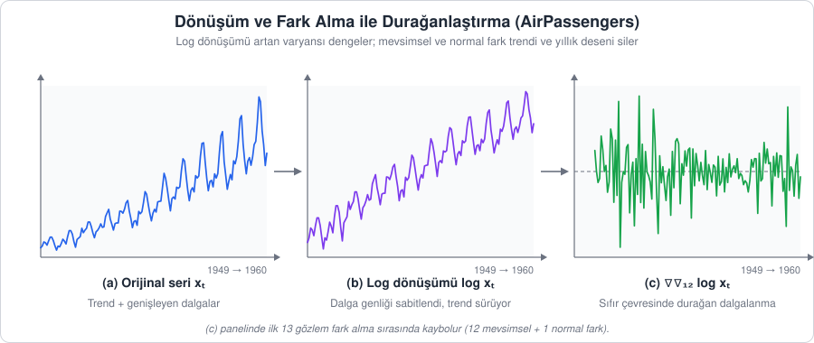
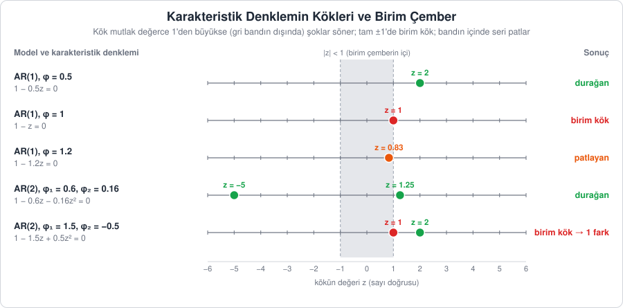
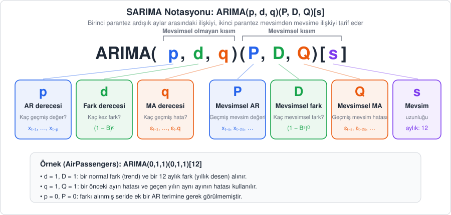
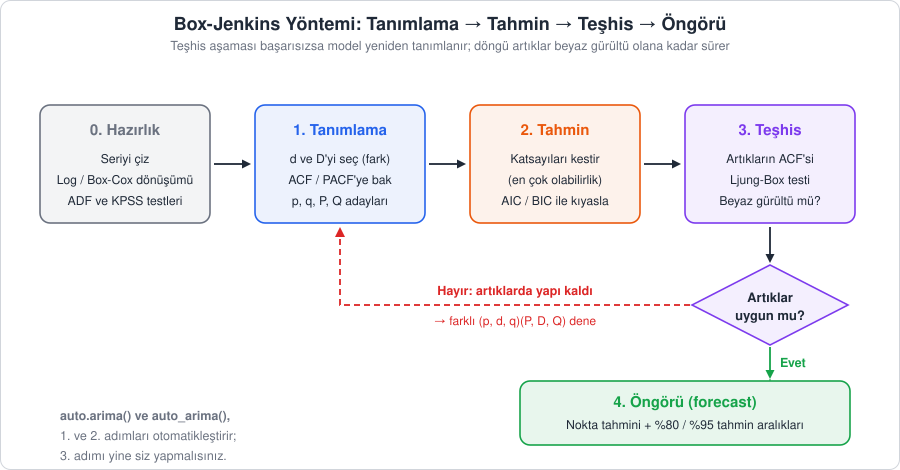
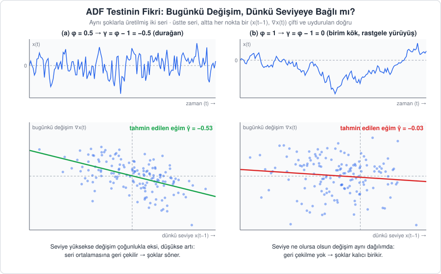
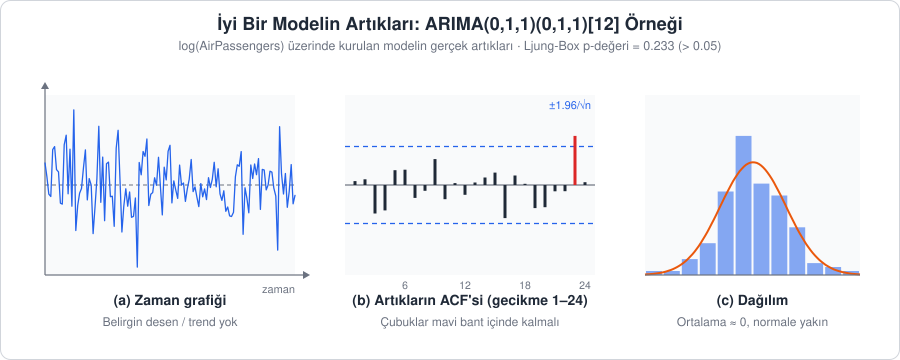

[İçindekiler](../Course_notes.md) · [← 6. Veri Manipülasyonu, Görselleştirme ve ACF/PACF](06_veri_manipulasyonu_gorsellestirme_ve_acf_pacf.md) · [8. Model Değerlendirme: Hata Metrikleri ve Eğitim-Test Ayrımı →](08_model_degerlendirme_hata_metrikleri_ve_egitim_te.md)

## 7. Klasik İstatistiksel Modeller: ARIMA ve SARIMA

Önceki bölümlerde veriyi tanımayı, `ts` nesnesine dönüştürmeyi, görselleştirmeyi ve ACF/PACF grafiklerini okumayı öğrendik. Artık modelleme aşamasına geçebiliriz.

Bu bölümde zaman serisi analizinin "klasik" temelini oluşturan **ARIMA** ailesini inceleyeceğiz. Bu modellerin ortak fikri basittir: Bir serinin geleceğini, **yalnızca serinin kendi geçmişini** (geçmiş değerlerini ve geçmişte yapılan tahmin hatalarını) kullanarak tahmin etmek. Dışarıdan ek bir değişkene ihtiyaç duymazlar.

Bölümün yol haritası şöyledir:

1. Yapı taşları: AR, MA, ARMA ve fark alma (I) (7.1)
2. Bu parçaların birleşimi olan ARIMA(p,d,q) ve gecikme operatörüyle yazımı (7.2)
3. Mevsimsel seriler için SARIMA(p,d,q)(P,D,Q)[s] (7.3)
4. Model kurma yöntemi: Box-Jenkins döngüsü (7.4)
5. Durağanlık testleri: ADF ve KPSS (7.5)
6. R ile `AirPassengers` uygulaması (7.6)
7. Aynı analizin Python ile yapılması (7.7)

**Not —** Bu bölüm, Bölüm 3.2'deki temellerin üzerine kurulur: AR(1) denklemi $x_t = \phi x_{t-1} + \varepsilon_t$'nin nasıl okunduğu (alt indisler $t$ ve $t-1$, $\phi$ "fi" ve $\varepsilon$ "epsilon"), bir şokun $\phi$'nin değerine göre sönmesi ya da kalıcı olması, bir denklemin kökünün ne olduğu, gecikme operatörü $B$, birim kök kavramı, ADF testinin hipotezleri ve p-değerinin okunması. Bu konulardan emin değilseniz önce o bölüme göz atın. Burada aynı fikirleri birer adım ileri taşıyacağız.

---

### 7.1. Temel Yapı Taşları: AR, MA, ARMA ve Fark Alma

#### 7.1.1. AR(p): Otoregresif Model

**Açıklama:** Otoregresyonun arkasındaki fikir son derece sezgiseldir: Bir serinin bugünkü değeri, dünkü ve daha önceki değerlerine bağlıdır. Tıpkı bugünkü hava sıcaklığının dünkü sıcaklıktan etkilenmesi gibi.

"Regresyon" kelimesi Latince *regressus* ("geri adım atmak, geri dönmek") kelimesinden gelir. Terimi istatistikte ilk kullananlardan biri Francis Galton'dır. Galton, ebeveynlerin ve çocuklarının boylarını incelerken çok uzun boylu ebeveynlerin çocuklarının da uzun olduğunu, ancak ebeveynleri kadar aşırı uzun olmayıp ortalamaya daha yakın olma eğiliminde olduklarını fark etti. Bu duruma "ortalamaya geri dönüş" (*regression toward the mean*) adını verdi.

Zaman serisinde de benzer bir "geri adım" atarız: Bugünü anlamak için zamanda geriye gidip geçmiş değerlere bakarız. "Oto" ön eki Yunanca "kendi" demektir; yani seri, **kendi geçmişi üzerine** bir regresyon kurar.

**Tanım:** Bir AR(p) modeli, bugünkü değerin geçmişteki $p$ adet değerin ağırlıklı toplamı ile rastgele bir şokun toplamı olduğunu söyler:

$$
x_t = c + \phi_1 x_{t-1} + \phi_2 x_{t-2} + \dots + \phi_p x_{t-p} + \varepsilon_t
$$

> **Simge notu:** $`\phi_i`$ *(fi; π "pi" ile karıştırmayın)*: $`i`$ adım önceki değerin ağırlık katsayısı · $`\varepsilon_t`$ *(epsilon; kümelerdeki "elemanıdır" işareti ∈ değildir)*: $`t`$ anındaki rastgele şok (beyaz gürültü) · $`\dots`$ *(üç nokta)*: aynı kalıp $`p`$'ye kadar sürer

Formülü kelime kelime okuyalım. Alt indisler zamanı gösterir: $x_t$ bu dönemin (örneğin bugünün) değeri, $x_{t-1}$ bir önceki dönemin, $x_{t-2}$ iki dönem öncesinin değeridir; $x_{t-p}$ ise $p$ dönem geriye kadar gidildiğini söyler. $\phi$'nin alt indisi de hangi gecikmeye ait olduğunu gösterir: $\phi_1$ dünkü değerin, $\phi_2$ evvelsi günkü değerin katsayısıdır. **Katsayı**, bir değerin önünde duran ve onu çarpan sayıdır; $0.6\thinspace  x_{t-1}$ ifadesinde katsayı 0.6'dır ve "dünkü değerin %60'ı bugüne taşınır" anlamına gelir. AR(1) denkleminin sözcük sözcük okunuşu ve $\phi$'ye göre şokların nasıl söndüğü Bölüm 3.2'de anlatılmıştı; AR(p) aynı fikri birden çok geçmiş değere genişletir.

Burada:

- $x_t$ tahmin etmeye çalıştığımız bugünkü değerdir; $x_{t-1}, x_{t-2}, \dots$ serinin geçmiş değerleridir.
- $\phi_1, \dots, \phi_p$ geçmiş değerlerin bugünü ne kadar etkilediğini gösteren katsayılardır.
- $c$ **sabit terimdir** (*constant*): Her dönem değişmeden eklenen bir sayıdır ve serinin hangi seviye etrafında dalgalanacağını belirler. Durağan bir AR(p) sürecinin uzun dönem ortalaması $\mu = c / (1 - \phi_1 - \dots - \phi_p)$'dir. Bunu görmek için serinin hiç şok almadan hep aynı $\mu$ değerinde durduğunu düşünün: AR(2) için $\mu = c + \phi_1 \mu + \phi_2 \mu$ olur; $\mu$'lü terimleri sola toplayınca $\mu (1 - \phi_1 - \phi_2) = c$ bulunur. Yani $c$ ortalamanın kendisi değil, ortalamayı belirleyen bir sayıdır; $c = 0$ ise seri sıfır etrafında dalgalanır.
- $\varepsilon_t$ modelin açıklayamadığı, öngörülemeyen rastgele şoktur: Bölüm 6.6.1'de tanımladığımız beyaz gürültü, $\varepsilon_t \sim \mathrm{WN}(0, \sigma^2)$.

> **Simge notu:** $`\sim`$ *(tilda)*: "… dağılımına sahiptir" · $`\mathrm{WN}(0, \sigma^2)`$: ortalaması 0, varyansı $`\sigma^2`$ *(sigma kare)* olan beyaz gürültü (white noise) · $`\mu`$ *(mü)*: serinin uzun dönem ortalaması · $`\cdot`$: çarpma işareti

**Sayısal örnek (AR(2)).** Bir kafede günlük satılan çay sayısını $x_t$ ile gösterelim ve modelin şu olduğunu varsayalım ($c = 12$, $\phi_1 = 0.6$, $\phi_2 = 0.16$):

```math
x_t = 12 + 0.6\, x_{t-1} + 0.16\, x_{t-2} + \varepsilon_t
```

Önce ortalamayı bulalım: $\mu = 12 / (1 - 0.6 - 0.16) = 12 / 0.24 = 50$ çay. Dün 50, evvelsi gün 40 çay satılmış ($x_{t-1} = 50$, $x_{t-2} = 40$) ve bugün beklenmedik bir kalabalık 3 çaylık sürpriz getirmiş olsun ($\varepsilon_t = 3$):

```math
\begin{aligned}
x_t &= 12 + 0.6 \cdot 50 + 0.16 \cdot 40 + 3 \\
    &= 12 + 30 + 6.4 + 3 \\
    &= 51.4
\end{aligned}
```

Ertesi gün her şey bir adım kayar: "dün" artık 51.4, "evvelsi gün" 50 olur. Sürpriz bu kez −1 ise $x_{t+1} = 12 + 0.6 \cdot 51.4 + 0.16 \cdot 50 - 1 = 12 + 30.84 + 8 - 1 = 49.84$ bulunur. Seri 50'lik ortalamanın çevresinde dolaşır: Şoklar onu biraz yukarı ya da aşağı iter, geçmiş değerlerin ağırlıklı toplamı ise ortalamaya doğru geri çeker. Tahmin yaparken geleceğin şokunu bilemeyiz; onun yerine şokların ortalaması olan 0'ı koyarız. Bugün için tahmin $12 + 30 + 6.4 = 48.4$ olurdu; gerçekleşen 51.4 ile arasındaki 3'lük fark tam da o günün şokudur.

$p$ değeri modelin "hafızasının" ne kadar geriye gittiğini belirtir. Örneğin AR(1) modeli yalnızca bir önceki değerin bugünü etkilediğini varsayar: $x_t = c + \phi_1 x_{t-1} + \varepsilon_t$.

**Not —** AR(1) sürecinin durağan olması için $\lvert \phi_1 \rvert < 1$ olmalıdır ($\lvert \cdot \rvert$ **mutlak değer**dir: sayının işaretini atıp yalnızca büyüklüğüne bakar, örneğin $\lvert -0.7 \rvert = 0.7$). $\phi_1 = 1$ olursa süreç rastgele yürüyüşe (birim kök, Bölüm 3.2) dönüşür ve şoklar hiç sönmez. AR(p) için koşul tek tek katsayılara bakarak değil, 7.2'de göreceğimiz karakteristik denklemin kökleriyle kontrol edilir.

> **Hemen deneyin 7.1.1 · Çay modelini tabloda çalıştırın** (Excel / LibreOffice Calc, ~5 dk)
>
> Kafedeki AR(2) modelini ($c = 12$, $\phi_1 = 0.6$, $\phi_2 = 0.16$) şoksuz, yani "tahmin" olarak ileri doğru yürütelim.
>
> 1. A1'e `gün`, B1'e `çay` yazın. E1:G1'e `c`, `fi1`, `fi2`; E2:G2'ye `12`, `0,6`, `0,16` girin (İngilizce Excel'de `0.6`, `0.16`).
> 2. A2:A21'e 1'den 20'ye kadar gün numaralarını yazın. B2'ye `40` (evvelsi gün), B3'e `50` (dün) girin.
> 3. B4'e şu formülü yazıp B21'e kadar aşağı çekin:
>
> ```text
> =$E$2+$F$2*B3+$G$2*B2
> ```
>
> Formül "bugün = c + fi1 × dün + fi2 × evvelsi gün" demektir; şok yerine 0 koyduğumuz için bu, modelin tahminidir.
>
> **Ne göreceksiniz:** B4'te 48,4 (metindeki hesapla aynı), ardından 49,04; 49,17; 49,35 … ve 20. günde 49,97. Seri, 50 olan uzun dönem ortalamasına yavaşça yaklaşır.
>
> **Şimdi siz:** (1) G2'yi `0,4` yapın ($\phi_1 + \phi_2 = 1$). Ne olur? (2) G2'yi `0,3` yapın. Seri hangi değere doğru gidiyor? $\mu = c / (1 - \phi_1 - \phi_2)$ ile kontrol edin.
>
> <details><summary>Cevap</summary>
>
> (1) Seri hiç durmadan büyür: 20. günde 203,88'e ulaşır ve birkaç günden sonra her gün yaklaşık 8,57 artar. $\phi_1 + \phi_2 = 1$ olduğunda karakteristik denklemin bir kökü tam 1'dir (birim kök); $\mu$ formülünün paydası sıfır olur, yani geri çekilecek bir ortalama yoktur. (2) $\mu = 12/(1 - 0.9) = 120$. Seri 120'ye doğru gider ama bu kez yavaş: 20. günde henüz 102,71'dir. Katsayıların toplamı 1'e yaklaştıkça ortalamaya dönüş yavaşlar.
>
> </details>

#### 7.1.2. MA(q): Hareketli Ortalama Modeli

**Açıklama:** Buradaki "hareketli ortalama", `decompose()` fonksiyonunun trendi bulmak için kullandığı ve veriyi düzleştiren hareketli ortalamayla (Bölüm 6.2.3) **aynı şey değildir**; isim benzerliği kafa karıştırmasın. Orada gözlemlerin ortalaması alınır, burada ise geçmiş şokların ağırlıklı toplamı kullanılır.

Bir hedefe ok attığınızı düşünün. İlk atış hedefin biraz sağına gitti; bu bir hatadır. İkinci atışta bu hatayı dikkate alarak nişanınızı hafifçe sola kaydırırsınız. MA modeli de bunu yapar: Önceki adımlardaki tahmin hatalarını, yani öngörülemeyen "şokları", bugünkü değeri açıklamak için kullanır. Kısacası model geçmiş hatalarından ders çıkarır.

**Tanım:** Bir MA(q) süreci, bugünkü değerin serinin ortalaması, bugünkü şok ve geçmişteki $q$ adet şokun ağırlıklı toplamından oluştuğunu söyler:

$$
x_t = \mu + \varepsilon_t + \theta_1 \varepsilon_{t-1} + \theta_2 \varepsilon_{t-2} + \dots + \theta_q \varepsilon_{t-q}
$$

> **Simge notu:** $`\mu`$ *(mü)*: serinin ortalaması · $`\theta_j`$ *(teta)*: $`j`$ adım önceki şokun ağırlık katsayısı · $`\varepsilon_{t-1}`$: bir önceki dönemin şoku

AR modelindeki $c$'den farklı olarak MA modelinde sabit terim doğrudan serinin ortalamasıdır ($\mu$), çünkü denklemde geçmiş değerler yoktur.

**Sayısal örnek (MA(1)).** $\mu = 100$ ve $\theta_1 = 0.6$ olan bir MA(1) süreci düşünelim: $x_t = 100 + \varepsilon_t + 0.6\thinspace  \varepsilon_{t-1}$. Şokun nasıl girip çıktığını net görmek için yalnızca 1. dönemde $\varepsilon_1 = 10$ büyüklüğünde bir şok olduğunu, diğer bütün dönemlerde şokun 0 olduğunu varsayalım:

| Dönem $`t`$ | Bugünkü şok $`\varepsilon_t`$ | Dünkü şok $`\varepsilon_{t-1}`$ | Hesap | $`x_t`$ |
| --- | --- | --- | --- | --- |
| 0 | 0 | 0 | $`100 + 0 + 0.6 \cdot 0`$ | 100 |
| 1 | 10 | 0 | $`100 + 10 + 0.6 \cdot 0`$ | 110 |
| 2 | 0 | 10 | $`100 + 0 + 0.6 \cdot 10`$ | 106 |
| 3 | 0 | 0 | $`100 + 0 + 0.6 \cdot 0`$ | 100 |

Şok 1. dönemde tam gücüyle girer (+10), 2. dönemde yalnızca %60'ı kalır (+6), 3. dönemde model onu artık "hatırlamaz" ve seri ortalamasına döner. Ok atışı benzetmesiyle: Atıcı yalnızca bir önceki atışın sapmasını hatırlar ve nişanını ona göre düzeltir; iki atış öncesini unutmuştur. Aynı şok, ortalaması 100 olan bir AR(1) modelinde ($\phi_1 = 0.6$) 110, 106, 103.6, 102.16, … biçiminde **yavaş yavaş** söner ama hiçbir zaman tam sıfırlanmaz, çünkü her değer bir öncekinden pay alır. MA ile AR arasındaki temel fark budur.

$\theta$ katsayıları geçmiş şokların bugünkü değeri ne kadar etkilediğini belirler. İsim de bu formülden gelir: Model, geçmiş şokların "kayan" bir ağırlıklı toplamını kullanır. MA süreci bu yüzden **kısa hafızalıdır** ve ACF'si $q$ gecikmeden sonra kesilir (Bölüm 6.6.2).

> **Hemen deneyin 7.1.2 · MA(1) üret, katsayıyı geri bul** (Python, ~5 dk)
>
> $\mu = 100$, $\theta_1 = 0.6$ olan bir MA(1)'den 500 gözlem üretip `statsmodels` ile modeli veriden kestirelim:
>
> ```python
> import numpy as np
> from statsmodels.tsa.arima.model import ARIMA
>
> np.random.seed(1)
> eps = np.random.normal(0, 1, 501)          # 501 rastgele şok (beyaz gürültü)
> x = 100 + eps[1:] + 0.6 * eps[:-1]         # x_t = 100 + e_t + 0.6 e_(t-1)
> model = ARIMA(x, order=(0, 0, 1)).fit()    # order = (p, d, q): saf MA(1)
> print(model.params.round(3))               # sabit, ma.L1, sigma2
> ```
>
> `eps[1:]` "bugünkü şoklar", `eps[:-1]` bir adım geride kalan "dünkü şoklar"dır; ikisi 500'er elemanlıdır. `.fit()` katsayıları en çok olabilirlik yöntemiyle kestirir (Bölüm 7.4).
>
> **Ne göreceksiniz:** `[100.077   0.574   0.975]`. Sabit (ortalama) 100.08, $\hat{\theta}_ 1 = 0.574$, şok varyansı 0.975: Gerçek değerler olan 100, 0.6 ve 1'e yakındır. Sapma, sonlu örneklemin doğal sonucudur.
>
> **Şimdi siz:** Dördüncü satırdaki `+ 0.6` ifadesini `- 0.6` yapıp tekrar çalıştırın (`np.random.seed(1)` satırı da yeniden çalışmalı). `ma.L1` hangi işaretle gelir?
>
> <details><summary>Cevap</summary>
>
> `[100.019  -0.622   0.982]`: $\hat{\theta}_ 1 = -0.622$. `statsmodels` MA kısmını artı işaretiyle yazdığı için ($x_t = \mu + \varepsilon_t + \theta_1 \varepsilon_{t-1}$, Bölüm 7.2'deki not) eksiyle ürettiğimiz katsayıyı eksi olarak bulur.
>
> </details>

#### 7.1.3. ARMA(p, q): İkisinin Birleşimi

**Açıklama:** Gerçek serilerde çoğu zaman hem "geçmiş değerlerin" hem de "geçmiş şokların" etkisi bir aradadır. ARMA modeli bu iki fikri tek denklemde birleştirir. Böylece saf AR ya da saf MA ile çok sayıda terim gerektirecek bir yapı, az sayıda parametreyle ifade edilebilir.

**Tanım:**

$$
x_t = c + \phi_1 x_{t-1} + \dots + \phi_p x_{t-p} + \varepsilon_t + \theta_1 \varepsilon_{t-1} + \dots + \theta_q \varepsilon_{t-q}
$$

Bu denklem, 7.1.1'deki AR(p) ile 7.1.2'deki MA(q) denklemlerinin sağ taraflarının yan yana yazılmasıdır: önce geçmiş **değerler** ($\phi$'li terimler), sonra bugünkü ve geçmiş **şoklar** ($\varepsilon$ ve $\theta$'lı terimler).

**Sayısal örnek (ARMA(1,1)).** Basitlik için $c = 0$ (seri sıfır etrafında dalgalanıyor), $\phi_1 = 0.5$ ve $\theta_1 = 0.4$ alalım: $x_t = 0.5\thinspace  x_{t-1} + \varepsilon_t + 0.4\thinspace  \varepsilon_{t-1}$. Yine yalnızca 1. dönemde $\varepsilon_1 = 10$ şoku olsun ve seri 0'dan başlasın:

```math
\begin{aligned}
x_1 &= 0.5 \cdot 0 + 10 + 0.4 \cdot 0 = 10 \\
x_2 &= 0.5 \cdot 10 + 0 + 0.4 \cdot 10 = 5 + 4 = 9 \\
x_3 &= 0.5 \cdot 9 + 0 + 0.4 \cdot 0 = 4.5 \\
x_4 &= 0.5 \cdot 4.5 + 0 + 0.4 \cdot 0 = 2.25
\end{aligned}
```

Saf AR(1) ($\phi_1 = 0.5$) aynı şoka 10, 5, 2.5, 1.25 diye tepki verirdi. ARMA(1,1)'de MA kısmı ikinci dönemde şoka bir kez daha +4'lük "ek itme" yapar; sonra devreden çıkar ve AR kısmı etkiyi her dönem yarıya indirerek söndürür. Saf bir AR modeliyle bu "önce ek itme, sonra yarılanma" desenini kurmak için çok sayıda gecikme gerekir; ARMA bunu iki katsayıyla yapar. Az parametreli (tutumlu) model kurmanın anlamı budur.

ARMA modeli **durağan** bir seri varsayar. ACF ve PACF grafiklerinin ikisi de keskin bir kesilme göstermeden yavaşça sönümleniyorsa ARMA yapısından şüphelenilir (Bölüm 6.6.5).

> **Hemen deneyin 7.1.3 · Şok tepkisini R'a hesaplatın** (R, ~2 dk)
>
> `ARMAtoMA()` bir ARMA modelinin, 1 birimlik bir şoka sonraki dönemlerde verdiği tepkiyi hesaplar.
>
> ```r
> ARMAtoMA(ar = 0.5, ma = 0.4, lag.max = 5)   # şoktan 1, 2, ..., 5 dönem sonraki tepki
> ```
>
> **Ne göreceksiniz:** `[1] 0.90000 0.45000 0.22500 0.11250 0.05625`. Şok 10 birim olduğunda bu sayılar 10 ile çarpılır: 9, 4.5, 2.25, … Metindeki elle hesaplanan $x_2 = 9$, $x_3 = 4.5$, $x_4 = 2.25$ değerlerinin aynısı.
>
> **Şimdi siz:** Aynı fonksiyonu yalnızca `ar = 0.5` ile, sonra yalnızca `ma = 0.4` ile çalıştırın. ARMA'daki 0.9, iki parçadan nasıl oluşuyor?
>
> <details><summary>Cevap</summary>
>
> Saf AR(1): `0.50000 0.25000 0.12500 0.06250 0.03125`. Saf MA(1): `0.4 0.0 0.0 0.0 0.0`. İlk dönemdeki 0.9 = 0.5 (AR'ın taşıdığı pay) + 0.4 (MA'nın "ek itmesi"); sonrasında MA devreden çıkar ve AR her dönem yarıya indirir.
>
> </details>

#### 7.1.4. I: Entegrasyon ve Fark Alma

**Açıklama:** Birçok zaman serisi, özellikle ekonomi ve finansta, durağan değildir. Yıllar içinde sürekli büyüyen bir şirketin satışlarını düşünün: Grafikte yukarı doğru giden bir trend görürsünüz, ortalama sabit değildir.

Bu, modelleme için bir sorundur, çünkü AR ve MA modelleri serinin istatistiksel özelliklerinin zamanla değişmediğini, yani **durağan** olduğunu varsayar. Sürekli yer değiştiren bir hedefi vurmaya çalışmak çok daha zordur.

Çözüm **fark alma** (differencing) işlemidir: Madem serinin kendisini modellemek zor, serideki **değişimi** modelleyelim. Bugünkü satışı tahmin etmek yerine, bugünkü satış ile dünkü satış arasındaki farkı tahmin ederiz. Günlük artış ve azalışlara baktığımızda genellikle sıfır civarında dalgalanan, çok daha kararlı bir seri elde ederiz.

**Tanım:** Birinci fark, Bölüm 2.1'de tanıttığımız fark operatörüyle yazılır:

$$
y_t = \nabla x_t = x_t - x_{t-1}
$$

> **Simge notu:** $`\nabla`$ *(nabla)*: fark operatörü, $`\nabla x_t = x_t - x_{t-1}`$ · $`\nabla^2`$ *(nabla kare)*: farkın bir kez daha farkı · $`\nabla_s`$ *(nabla s)*: $`s`$ adımlık mevsimsel fark

**Sayısal örnek.** Bir mağazanın beş aylık satışları 100, 104, 110, 113, 120 olsun. Birinci farklar şunlardır:

```math
\begin{aligned}
y_2 &= 104 - 100 = 4, & y_3 &= 110 - 104 = 6, \\
y_4 &= 113 - 110 = 3, & y_5 &= 120 - 113 = 7
\end{aligned}
```

Seviye 100'den 120'ye tırmanırken farklar 3 ile 7 arasında, yerinde sayan bir seri oluşturur: Trend gitmiş, geriye "aylık artış" kalmıştır. İlk ayın farkı hesaplanamaz (öncesi yoktur), bu yüzden fark alınca bir gözlem kaybedilir.

Farkı alınmış seri hâlâ durağan değilse işlem bir kez daha uygulanır: $\nabla^2 x_t = y_t - y_{t-1}$. Örneğimizde ikinci farklar $6 - 4 = 2$, $3 - 6 = -3$ ve $7 - 3 = 4$ olur. Seriyi durağanlaştırmak için kaç kez fark alındığı, ARIMA(p,d,q) modelindeki **d** parametresidir. Pratikte $d$ genellikle 0, 1 ya da en fazla 2'dir.

Mevsimsel seriler için ayrıca **mevsimsel fark** alınır: $\nabla_s x_t = x_t - x_{t-s}$. Aylık veride ($s = 12$) bu, "bu Ocak eksi geçen Ocak" demektir ve yıllık tekrar eden deseni siler. Örneğin geçen Ocak 200, bu Ocak 230 yolcu taşındıysa $\nabla_{12} x_t = 230 - 200 = 30$'dur.

"Integrated" (entegre) terimi bu işlemin tersini ifade eder. Model farkı alınmış seri için tahmin ürettikten sonra, bu tahminlerin art arda toplanarak (entegre edilerek) orijinal ölçeğe geri döndürülmesi gerekir. Örneğimizde ilk değer (100) ve farklar (4, 6, 3, 7) biliniyorsa seri art arda toplamayla (**kümülatif toplam**) geri kurulur: 100, $100 + 4 = 104$, $104 + 6 = 110$, $110 + 3 = 113$, $113 + 7 = 120$. Tahminde de aynısı olur: Model gelecek ay için farkı +5, sonraki ay için +6 tahmin ederse seviye tahminleri $120 + 5 = 125$ ve $125 + 6 = 131$ olur. Özetle: Fark alarak seriyi analiz edilebilir hâle getiririz, modelleriz, sonra sonucu orijinal bağlamına entegre ederiz. R ve Python fonksiyonları bu geri dönüşü bizim yerimize otomatik yapar.

Şekil 7.1, `AirPassengers` serisi üzerinde bu adımları göstermektedir. Log dönüşümü dalgaların giderek büyümesini (artan varyansı) dengeler; ardından alınan mevsimsel ve normal fark, trendi ve yıllık deseni silerek sıfır çevresinde dalgalanan durağan bir seri bırakır. Log dönüşümünün işe yarama nedeni, logaritmanın çarpmayı toplamaya çevirmesidir: Log serinin farkı yaklaşık olarak **yüzde değişimi** verir. Örneğin 100'den 110'a çıkış için $\log(110) - \log(100) = 0.0953$, yani yaklaşık %10'dur; 1000'den 1100'e çıkışta da aynı 0.0953 bulunur. Böylece yüksek seviyelerdeki büyük dalgalanmalar ile düşük seviyelerdeki küçük dalgalanmalar aynı ölçeğe gelir. (Bu bölümde $\log$, R'daki `log()` ve Python'daki `np.log()` gibi doğal logaritmadır.)



*Şekil 7.1 — `AirPassengers` serisinin durağanlaştırılması: (a) orijinal seri, (b) log dönüşümü, (c) log serinin 12 aylık ve ardından 1 aylık farkı ($`\nabla \nabla_{12} \log x_t`$).*

> **Hemen deneyin 7.1.4 · Fark al, geri topla** (R, ~3 dk)
>
> ```r
> satis <- c(100, 104, 110, 113, 120)
> diff(satis)                       # birinci fark
> diff(satis, differences = 2)      # ikinci fark (farkın farkı)
> diffinv(diff(satis), xi = 100)    # farkları art arda topla: seriyi geri kur
> ```
>
> `diffinv()` fark almanın tersidir ("entegrasyon"): `xi` başlangıç değeridir, farklar bunun üzerine art arda eklenir.
>
> **Ne göreceksiniz:** `[1] 4 6 3 7`, `[1]  2 -3  4` ve `[1] 100 104 110 113 120`: metinde elle bulduğumuz farklar ve geri kurulan seri.
>
> **Şimdi siz:** (1) Model gelecek iki ay için farkı +5 ve +6 tahmin ediyor. Seviye tahminlerini `diffinv()` ile bulun. (2) `diff(AirPassengers, lag = 12)[1]` neyi hesaplar ve kaç verir?
>
> <details><summary>Cevap</summary>
>
> (1) `diffinv(c(5, 6), xi = 120)` → `120 125 131`; ilk eleman başlangıç değeridir, tahminler 125 ve 131'dir. (2) Mevsimsel farkın ilk değeri: Ocak 1950 − Ocak 1949 = 115 − 112 = `3`.
>
> </details>

---

### 7.2. ARIMA(p, d, q) Modeli ve Gecikme Operatörüyle Yazım

Üç bileşen bir araya gelerek **ARIMA(p, d, q)** (AutoRegressive Integrated Moving Average) modelini oluşturur:

| Parametre | Bileşen | Anlamı |
| --- | --- | --- |
| **p** | AR | Kaç geçmiş **değerin** kullanılacağı |
| **d** | I | Seriyi durağanlaştırmak için kaç kez **fark** alındığı |
| **q** | MA | Kaç geçmiş **hatanın (şokun)** kullanılacağı |

Örneğin ARIMA(1,1,0), "seriyi bir kez farkla, farkı alınmış seriye AR(1) uygula" demektir. ARIMA(0,0,0) ise saf beyaz gürültüdür; ARIMA(0,1,0) rastgele yürüyüştür.

**Gecikme operatörüyle yazım.** ARIMA denklemleri açık hâliyle uzun ve okunaksızdır. Bölüm 2.1'de tanıttığımız gecikme (backshift) operatörü $B$ ile bu denklemleri çok kısa yazabiliriz. Hatırlatma: $B$ bir sayı değil, "önündeki seriyi bir dönem geri kaydır" komutudur; $B x_t = x_{t-1}$ ve genel olarak $B^k x_t = x_{t-k}$'dir (bazı kaynaklarda $L$).

> **Simge notu:** $`B`$ *(be)*: gecikme operatörü, seriyi bir adım geriye kaydırır · $`B^k`$ *(be üzeri k)*: $`k`$ adım geri kaydırma

Önce AR ve MA kısımlarını birer **polinom** olarak tanımlarız. Polinomu Bölüm 3.2'den hatırlayın: Örneğin $1 - 0.6z - 0.16z^2$, en büyük üssü 2 olduğu için **2. dereceden** bir polinomdur. Bilinmeyenin yerinde $B$ durduğunda ortaya bir "gecikme polinomu" çıkar:

```math
\begin{aligned}
\phi(B) &= 1 - \phi_1 B - \phi_2 B^2 - \dots - \phi_p B^p \\
\theta(B) &= 1 + \theta_1 B + \theta_2 B^2 + \dots + \theta_q B^q
\end{aligned}
```

$\phi(B)$ "fi B" diye okunur ve "$\phi$ katsayılarıyla kurulmuş, $B$ cinsinden polinom" demektir; $\phi$ ile $B$'nin çarpımı değil, bir addır. Bir gecikme polinomunu seriye uygulamak, parantezdeki her terimi seriye ayrı ayrı uygulayıp sonuçları toplamak demektir. 7.1.1'deki AR(2) örneğiyle ($\phi_1 = 0.6$, $\phi_2 = 0.16$):

```math
(1 - 0.6B - 0.16B^2)\, x_t = x_t - 0.6\, x_{t-1} - 0.16\, x_{t-2}
```

Bunu $12 + \varepsilon_t$'ye eşitleyip geçmiş değerleri eşitliğin sağına taşırsak 7.1.1'deki $x_t = 12 + 0.6\thinspace  x_{t-1} + 0.16\thinspace  x_{t-2} + \varepsilon_t$ denklemini geri buluruz. Yani polinom yazımı yeni bir model değil, aynı modelin kısaltmasıdır. Bu polinomlarla modeller şu biçimi alır:

```math
\begin{aligned}
\text{AR}(p):&\quad \phi(B)\, x_t = c + \varepsilon_t \\
\text{MA}(q):&\quad x_t = \mu + \theta(B)\, \varepsilon_t \\
\text{ARMA}(p,q):&\quad \phi(B)\, x_t = c + \theta(B)\, \varepsilon_t \\
\text{ARIMA}(p,d,q):&\quad \phi(B)\, (1 - B)^d\, x_t = c + \theta(B)\, \varepsilon_t
\end{aligned}
```

Son satırı okuyalım: $(1 - B)^d$ çarpanı seriye $d$ kez fark uygular (çünkü $(1 - B)x_t = x_t - x_{t-1} = \nabla x_t$). Ortaya çıkan durağan seri, $\phi(B)$ ile AR yapısına, $\theta(B)$ ile MA yapısına bağlanır. Yani ARIMA, "farkı alınmış serinin ARMA modeli"dir.

**Örnek: ARIMA(1,1,1)'i adım adım açmak.** Model kısaltılmış hâliyle şöyledir:

```math
(1 - \phi_1 B)(1 - B)\, x_t = (1 + \theta_1 B)\, \varepsilon_t
```

Sol tarafı iki yoldan açabiliriz.

*Yol 1 (içten dışa):* Önce $x_t$'ye en yakın parantezi uygularız: $(1 - B)x_t = x_t - x_{t-1}$. Bu, bu ayın değişimidir; ona $y_t$ diyelim. Sonra soldaki parantezi bu yeni seriye uygularız: $(1 - \phi_1 B)\thinspace  y_t = y_t - \phi_1 y_{t-1}$. $y$'lerin yerine karşılıklarını yazınca sol taraf $(x_t - x_{t-1}) - \phi_1 (x_{t-1} - x_{t-2})$ olur.

*Yol 2 (önce parantezleri çarpmak):* Gecikme polinomları sıradan cebirdeki gibi çarpılır: Birinci parantezin her terimi ikincinin her terimiyle çarpılır ve $B \cdot B = B^2$ olur.

```math
\begin{aligned}
(1 - \phi_1 B)(1 - B) &= 1 \cdot 1 - 1 \cdot B - \phi_1 B \cdot 1 + \phi_1 B \cdot B \\
&= 1 - B - \phi_1 B + \phi_1 B^2 \\
&= 1 - (1 + \phi_1) B + \phi_1 B^2
\end{aligned}
```

Bunu $x_t$'ye uygularsak $x_t - (1 + \phi_1) x_{t-1} + \phi_1 x_{t-2}$ çıkar; terimler yeniden gruplanınca Yol 1'deki ifadeyle aynıdır. Sağ taraf ise $(1 + \theta_1 B)\thinspace  \varepsilon_t = \varepsilon_t + \theta_1 \varepsilon_{t-1}$'dir. Hepsini birleştirip $\phi_1$'li terimi sağa taşırsak:

```math
\begin{aligned}
(1 - \phi_1 B)(1 - B)\, x_t &= (1 + \theta_1 B)\, \varepsilon_t \\
x_t - x_{t-1} &= \phi_1 (x_{t-1} - x_{t-2}) + \varepsilon_t + \theta_1 \varepsilon_{t-1}
\end{aligned}
```

Yani bu ayki **değişim**, geçen ayki değişim, bu ayın şoku ve geçen ayın şoku ile açıklanır. Sayılarla: $\phi_1 = 0.5$, $\theta_1 = 0.3$, son iki ayın değerleri $x_{t-2} = 100$ ve $x_{t-1} = 104$, geçen ayın şoku $\varepsilon_{t-1} = 2$ ve bu ayın şoku $\varepsilon_t = 1$ olsun. Bu ayki değişim $0.5 \cdot (104 - 100) + 1 + 0.3 \cdot 2 = 2 + 1 + 0.6 = 3.6$, bu ayın değeri de $104 + 3.6 = 107.6$ olur.

**Not —** Katsayıların işaret kuralı yazılımdan yazılıma değişebilir. R (`arima`, `auto.arima`) ve Python `statsmodels`/`pmdarima`, MA kısmını yukarıdaki gibi **artı** işaretiyle ($1 + \theta_1 B$) yazar. Bazı ders kitapları ise eksi işareti kullanır; sonuçları karşılaştırırken buna dikkat edin.

**Durağanlık koşulu: karakteristik denklem ve kökler.** Bölüm 3.2'de AR(1) için şunu gördük: $B$ komutunun yerine sıradan bir bilinmeyen $z$ koyup $1 - \phi z = 0$ denklemini (**karakteristik denklem**) kurarız; kökü $z = 1/\phi$'dir ve bu kök 1'e eşitse "birim kök" vardır. Aynı yöntem her AR(p) için işler: $\phi(B)$ polinomunda $B$ yerine $z$ yazıp sıfıra eşitleriz:

$$
1 - \phi_1 z - \phi_2 z^2 - \dots - \phi_p z^p = 0
$$

$p$. dereceden bir polinom denkleminin $p$ tane kökü vardır (bazıları aynı değer olabilir). Kural, Bölüm 3.2'de AR(1) için gördüğümüzle aynıdır:

> **Durağanlık kuralı:** AR kısmının karakteristik denkleminin **bütün kökleri mutlak değerce 1'den büyükse** ($`\lvert z \rvert > 1`$, yani "birim çemberin dışında") süreç durağandır. Köklerden biri tam 1 ise birim kök vardır; mutlak değeri 1'den küçük bir kök patlayan bir seri demektir.

Kökler sıradan (gerçel) sayılar olduğunda kural "kök, sayı doğrusunda −1 ile 1 arasında olmamalı" demektir; karmaşık köklerde bu sınırın neden bir çembere dönüştüğü Bölüm 3.2'de (Şekil 3.6) gösterilmişti. AR(p)'de yeni olan, **tek bir kökün değil, bütün köklerin** bu koşulu sağlaması gerektiğidir.

**Örnek 1 (durağan AR(2)).** 7.1.1'deki modelin ($\phi_1 = 0.6$, $\phi_2 = 0.16$) karakteristik denklemi şudur:

$$
1 - 0.6z - 0.16z^2 = 0
$$

Sol taraf iki basit parantezin çarpımı olarak yazılabilir: $(1 - 0.8z)(1 + 0.2z)$. Çarparak kontrol edelim: $1 + 0.2z - 0.8z - 0.16z^2 = 1 - 0.6z - 0.16z^2$. İki sayının çarpımı ancak biri sıfırsa sıfır olabileceği için kökler, parantezleri tek tek sıfır yapan değerlerdir:

```math
\begin{aligned}
1 - 0.8z = 0 &\;\Rightarrow\; z = 1 / 0.8 = 1.25 \\
1 + 0.2z = 0 &\;\Rightarrow\; z = -1 / 0.2 = -5
\end{aligned}
```

Yerine koyarak doğrulayalım: $z = 1.25$ için $1 - 0.6 \cdot 1.25 - 0.16 \cdot 1.5625 = 1 - 0.75 - 0.25 = 0$; $z = -5$ için $1 + 0.6 \cdot 5 - 0.16 \cdot 25 = 1 + 3 - 4 = 0$. İki kökün de mutlak değeri 1'den büyüktür (1.25 ve 5), dolayısıyla model durağandır. 7.1.1'de serinin 50'lik ortalama çevresinde dolaştığını görmemiz bununla tutarlıdır.

**Örnek 2 (birim köklü AR(2)).** Bölüm 3.2'deki $x_t = 1.5\thinspace  x_{t-1} - 0.5\thinspace  x_{t-2} + \varepsilon_t$ modelini hatırlayın: Karakteristik denklemi $1 - 1.5z + 0.5z^2 = (1 - z)(1 - 0.5z) = 0$, kökleri $z = 1$ ve $z = 2$'dir; köklerden biri tam 1 olduğu için seri birim köklüdür. Orada "bir kez farkı alındığında kalan kısım $\phi = 0.5$ olan durağan bir AR(1) gibi davranır" demiştik. Gecikme polinomlarıyla bu cümle tek satırda görülür. Aynı çarpanlara ayırmayı $z$ yerine $B$ ile yazarsak model şu hâli alır:

```math
(1 - 0.5B)(1 - B)\, x_t = \varepsilon_t
```

Bu, yukarıdaki ARIMA(1,1,1) açılımından tanıdık gelen yapıdır: $(1 - B)$ çarpanı bir kez fark alır, geriye $\phi_1 = 0.5$ olan durağan bir AR(1) kalır. Yani bu "AR(2)" aslında bir **ARIMA(1,1,0)** modelidir. Genel ders şudur: Karakteristik denklemdeki her birim kök, modelden bir $(1 - B)$ çarpanı olarak ayrılır ve bir fark alma işlemine karşılık gelir. ARIMA'daki $d$, serideki birim kök sayısıdır.

Şekil 7.2 bu örneklerin köklerini sayı doğrusu üzerinde gösterir.



*Şekil 7.2 — Karakteristik denklemin kökleri. Gri bant, mutlak değeri 1'den küçük sayıları (birim çemberin içini) gösterir. Durağan modellerin bütün kökleri bandın dışındadır; birim köklü modellerde bir kök tam 1'dedir; patlayan AR(1)'in ($`\phi = 1.2`$) kökü ($`z = 1/1.2 \approx 0.83`$) bandın içindedir.*

Kökleri elle bulmak yalnızca bu tür basit örneklerde kolaydır; yüksek dereceli polinomlarda Bölüm 3.2'de tanıdığımız `polyroot()` fonksiyonu kullanılır. Fonksiyon polinomun katsayılarını **küçük üsten büyüğe** doğru bir vektör olarak alır:

```r
round(polyroot(c(1, -0.6, -0.16)), 4)   # 1 - 0.6z - 0.16z^2 = 0 denkleminin kökleri
#> [1]  1.25+0i -5.00+0i
Mod(polyroot(c(1, -0.6, -0.16)))        # köklerin mutlak değerleri
#> [1] 1.25 5.00
```

Bu iki satır, Örnek 1'de elle bulduğumuz kökleri (1.25 ve −5) bilgisayara buldurur ve "bütün kökler birim çemberin dışında mı?" sorusunu doğrudan cevaplar. Elle çarpanlara ayıramayacağımız yüksek dereceli polinomlarda da aynı iki satır işe yarar. Kodu satır satır okuyalım:

1. `round(polyroot(c(1, -0.6, -0.16)), 4)`: İçten dışa okunur. `c(1, -0.6, -0.16)` katsayıları 3.2'deki kuralla, sabit terimden başlayarak sıralar: 1 sabit terim, −0.6 $z$'nin, −0.16 $z^2$'nin katsayısıdır; sırayı ters çevirmek (`c(-0.16, -0.6, 1)`) başka bir polinomun köklerini verir. `polyroot()` kökleri her zaman karmaşık sayı olarak döndürür (Bölüm 3.2). `round(..., 4)` sonucu dört ondalığa yuvarlar; yuvarlamasaydık R kökleri `1.25+4.493859e-15i` gibi, sanal kısmında pratikte sıfır olan hesap kırıntılarıyla yazardı (3.2'deki `e-20` örneği gibi).
2. `Mod(polyroot(c(1, -0.6, -0.16)))`: Aynı köklerin sıfıra uzaklığını (mutlak değerini) verir; 3.2'de olduğu gibi birim çember kuralını, karmaşık kökler için de, doğrudan denetler.

Çıktıyı okuyalım. İlk çıktıdaki `1.25+0i` ve `-5.00+0i`, sanal kısmı 0 olan, yani sıradan sayı olan köklerdir (`i` sanal birimdir); elle bulduğumuz 1.25 ve −5 ile aynıdır. İkinci çıktıdaki `1.25 5.00` köklerin mutlak değerleridir; ikisi de 1'den büyük olduğu için model durağandır. Örnek 2'deki birim köklü model için `Mod(polyroot(c(1, -1.5, 0.5)))` yazsaydık `[1] 1 2` görürdük: Tam 1'e eşit bir değer birim kökün işaretidir.

**Not —** MA kısmı için de benzer bir koşul vardır: $\theta(z) = 0$ denkleminin kökleri de birim çemberin dışında olmalıdır. Bu koşula **tersinirlik** (*invertibility*) denir ve geçmiş şokların gözlenen veriden tek bir şekilde geri hesaplanabilmesini sağlar. R ve Python model kurarken bu koşulları kendileri denetler.

> **Hemen deneyin 7.2 · AR(1) üret, $\phi$'yi ve kökü geri bul** (R, ~5 dk)
>
> ```r
> library(forecast)
> set.seed(2024)
> x <- arima.sim(model = list(ar = 0.7), n = 300)             # gerçek phi = 0.7
> fit <- Arima(x, order = c(1, 0, 0), include.mean = FALSE)   # AR(1) kur, sabit yok
> fit
> polyroot(c(1, -coef(fit)["ar1"]))                           # 1 - phi z = 0 denkleminin kökü
> ```
>
> `Arima()` (`forecast` paketi) derecelerini bizim verdiğimiz bir ARIMA modelini kurar; `order = c(p, d, q)`. `include.mean = FALSE` sabit terim eklememesini söyler (seri sıfır çevresinde üretildi). `coef(fit)["ar1"]` modelden `ar1` adlı katsayıyı çeker.
>
> **Ne göreceksiniz:** Çıktıda `ARIMA(1,0,0) with zero mean`, `ar1 = 0.6907`, `s.e. 0.0419`. Ardından `[1] 1.447763+0i`: Tahmin edilen modelin karakteristik kökü $1/0.6907 \approx 1.45$'tir; 1'den büyük olduğu için model durağandır (gerçek kök $1/0.7 \approx 1.43$).
>
> **Şimdi siz:** (1) `n = 3000` ile tekrarlayın (önce `set.seed(2024)`). Standart hata ne kadar küçülür? (2) `Mod(polyroot(c(1, -0.5, -0.5)))` ile $x_t = 0.5\thinspace x_{t-1} + 0.5\thinspace x_{t-2} + \varepsilon_t$ modelini denetleyin. Durağan mı?
>
> <details><summary>Cevap</summary>
>
> (1) `ar1 = 0.6858`, `s.e. 0.0133`: Veri 10 katına çıkınca standart hata yaklaşık $\sqrt{10} \approx 3.2$ kat küçülür. 0.7 değeri hâlâ "tahmin ± 2 s.e." aralığındadır. (2) `[1] 1 2`: Bir kök tam 1, yani birim kök var; model durağan değildir ve bir kez fark alınınca ARIMA(1,1,0) olur.
>
> </details>

---

### 7.3. Mevsimsel ARIMA: SARIMA(p, d, q)(P, D, Q)[s]

**Açıklama:** `AirPassengers` gibi aylık verilerde iki tür ilişki vardır: Ardışık aylar arasındaki ilişki (Şubat, Ocak'a benzer) ve **aynı mevsimler** arasındaki ilişki (bu Temmuz, geçen Temmuz'a benzer). Normal ARIMA yalnızca ilkini modeller. **SARIMA** (Seasonal ARIMA), aynı AR/I/MA fikrini $s$ adım aralıklı gecikmelere ($x_{t-12}, x_{t-24}, \dots$) de uygulayarak ikincisini ekler.

**Tanım:** SARIMA(p,d,q)(P,D,Q)[s] modeli, gecikme operatörüyle şöyle yazılır:

$$
\Phi(B^s) \phi(B) (1 - B)^d (1 - B^s)^D x_t = \theta(B) \Theta(B^s) \varepsilon_t
$$

Burada mevsimsel polinomlar $B$ yerine $B^s$ içerir:

```math
\begin{aligned}
\Phi(B^s) &= 1 - \Phi_1 B^s - \Phi_2 B^{2s} - \dots - \Phi_P B^{Ps} \\
\Theta(B^s) &= 1 + \Theta_1 B^s + \Theta_2 B^{2s} + \dots + \Theta_Q B^{Qs}
\end{aligned}
```

> **Simge notu:** $`\Phi_i`$ *(büyük fi)*: mevsimsel AR katsayısı · $`\Theta_j`$ *(büyük teta)*: mevsimsel MA katsayısı · $`s`$: mevsim uzunluğu (aylık veride 12) · $`B^s`$ *(be üzeri s)*: $`s`$ adım geri kaydırma, örneğin $`B^{12} x_t = x_{t-12}`$ (geçen yılın aynı ayı)

Formül uzun görünse de yalnızca 7.2'deki parçaların yan yana yazılmasıdır: Sol tarafta mevsimsel ve mevsimsel olmayan AR polinomları ile iki tür fark, sağ tarafta iki MA polinomu vardır. Parametrelerin anlamı Şekil 7.3'te özetlenmiştir:

- **(p, d, q):** Mevsimsel olmayan kısım (ardışık gözlemler arası ilişki).
- **(P, D, Q):** Mevsimsel kısım. $P$ geçmiş mevsimlerin değerlerini, $D$ mevsimsel fark sayısını, $Q$ geçmiş mevsimlerin hatalarını ifade eder.
- **[s]:** Mevsim uzunluğu. Aylık veride 12, çeyreklik veride 4, saatlik veride günlük döngü için 24.



*Şekil 7.3 — SARIMA notasyonunun parçaları. Büyük harfler, küçük harflerin $`s`$ adım aralıklı (mevsimsel) karşılıklarıdır.*

**Örnek (Havayolu modeli):** Box ve Jenkins'in ünlü kitabında `AirPassengers` için önerilen, bu yüzden literatürde **"airline model"** olarak anılan ARIMA(0,1,1)(0,1,1)[12] modeli şöyle yazılır:

$$
(1 - B)(1 - B^{12}) \log x_t = (1 + \theta_1 B)(1 + \Theta_1 B^{12}) \varepsilon_t
$$

Bu denklemi 7.2'deki gibi parantezleri çarparak açalım. Tek yeni kural üslerin toplanmasıdır: $B \cdot B^{12} = B^{13}$, çünkü önce 1 adım, sonra 12 adım geri gitmek toplam 13 adım geri gitmek demektir.

*Sağ taraf (şoklar):*

```math
\begin{aligned}
(1 + \theta_1 B)(1 + \Theta_1 B^{12}) &= 1 \cdot 1 + 1 \cdot \Theta_1 B^{12} + \theta_1 B \cdot 1 + \theta_1 B \cdot \Theta_1 B^{12} \\
&= 1 + \theta_1 B + \Theta_1 B^{12} + \theta_1 \Theta_1 B^{13}
\end{aligned}
```

Bu polinomu $\varepsilon_t$'ye uygularken her $B^k$ terimi şoku $k$ ay geri kaydırır ve şu ifade çıkar: $\varepsilon_t + \theta_1 \varepsilon_{t-1} + \Theta_1 \varepsilon_{t-12} + \theta_1 \Theta_1 \varepsilon_{t-13}$. Dördüncü terim modelde ayrıca tanımlanmamıştır; iki parantezin çarpımından kendiliğinden doğar. Sezgisi şöyledir: Aylık düzeltme ($\theta_1$) geçen ayın şokunu, yıllık düzeltme ($\Theta_1$) geçen yılın aynı ayının şokunu kullanır. Geçen yılın aynı ayından **bir ay önceki** şok (13 ay önce) ise hem yıllık hem aylık düzeltmeden geçtiği için iki katsayının çarpımı kadar ağırlık alır.

*Sol taraf (seri):* Kısaca $l_t = \log x_t$ yazalım:

```math
\begin{aligned}
(1 - B)(1 - B^{12})\, l_t &= (1 - B - B^{12} + B^{13})\, l_t \\
&= l_t - l_{t-1} - l_{t-12} + l_{t-13} \\
&= (l_t - l_{t-12}) - (l_{t-1} - l_{t-13})
\end{aligned}
```

Son satır "bu ayın geçen yıla göre (log) değişimi eksi geçen ayın geçen yıla göre değişimi" demektir. Buna $w_t$ diyelim; bu, Şekil 7.1c'deki durağanlaştırılmış seridir. Model böylece şu hâli alır:

$$
w_t = \varepsilon_t + \theta_1 \varepsilon_{t-1} + \Theta_1 \varepsilon_{t-12} + \theta_1 \Theta_1 \varepsilon_{t-13}
$$

7.6.5'te R'ın bulduğu katsayılarla ($\theta_1 = -0.4018$, $\Theta_1 = -0.5569$) çapraz terimin katsayısı $(-0.4018) \cdot (-0.5569) \approx 0.224$ olur (iki negatif sayının çarpımı pozitiftir). Yani tahmin edilen model $w_t = \varepsilon_t - 0.402\thinspace  \varepsilon_{t-1} - 0.557\thinspace  \varepsilon_{t-12} + 0.224\thinspace  \varepsilon_{t-13}$'tür; iki katsayıdan dört terimli bir şok yapısı elde edilmiştir.

Bu model 7.6'daki R uygulamasında `auto.arima()` tarafından da seçilecektir.

> **Hemen deneyin 7.3 · Havayolu modeli Python'da** (Python, ~4 dk)
>
> R'ın 7.6.5'te bulacağı katsayıları ($\theta_1 = -0.4018$, $\Theta_1 = -0.5569$) `statsmodels` ile karşılaştıralım:
>
> ```python
> import numpy as np
> import pandas as pd
> from statsmodels.tsa.arima.model import ARIMA
>
> seri = pd.read_csv("data/AirPassengers.csv", index_col="Month",
>                    parse_dates=True)["Passengers"].asfreq("MS")   # "MS": aylık, ay başı
> model = ARIMA(np.log(seri), order=(0, 1, 1), seasonal_order=(0, 1, 1, 12)).fit()
> print(model.params.round(4))
> print(round(model.llf, 2), round(model.aic, 2))     # log olabilirlik ve AIC
> ```
>
> `seasonal_order=(P, D, Q, s)` mevsimsel kısmı verir; `(0, 1, 1, 12)` = (0,1,1)[12]. `.asfreq("MS")` serinin aylık olduğunu `statsmodels`'a bildirir.
>
> **Ne göreceksiniz:** `ma.L1 -0.4017`, `ma.S.L12 -0.5567`, `sigma2 0.0013`, ardından `244.7 -483.39`. Katsayılar ve AIC, R'ın sonuçlarıyla (−0.4018, −0.5569, −483.4) üçüncü ondalığa kadar örtüşür; `ma.S.L12` R'daki `sma1`'in, yani $\Theta_1$'in karşılığıdır.
>
> **Şimdi siz:** `order=(1, 1, 1)` ile tekrar kurun. Log olabilirlik ve AIC kaç olur? Bölüm 7.4'teki tabloyla karşılaştırın.
>
> <details><summary>Cevap</summary>
>
> `ar.L1 0.1972`, `ma.L1 -0.5796`, `ma.S.L12 -0.5644`; log olabilirlik 244.95, AIC −481.89. 7.4'teki tablonun ikinci satırıyla aynıdır: Ek AR katsayısı AIC'yi iyileştirmez, sade model tercih edilir.
>
> </details>

---

### 7.4. Model Kurma Süreci: Box-Jenkins Yöntemi

George Box ve Gwilym Jenkins, 1970'te ARIMA modellerinin nasıl kurulacağını sistematik bir döngü olarak tarif ettiler. Bugün de kullanılan bu yöntem dört aşamadan oluşur (Şekil 7.4):



*Şekil 7.4 — Box-Jenkins yöntemi. Teşhis aşamasında artıklarda hâlâ yapı varsa model yeniden tanımlanır.*

**0. Hazırlık.** Seriyi çizin; trend, mevsimsellik ve varyans değişimini gözle inceleyin. Varyans seviyeyle birlikte büyüyorsa log (ya da Box-Cox) dönüşümü uygulayın (Bölüm 2.4). Durağanlığı ADF ve KPSS testleriyle sınayın (7.5).

**1. Tanımlama (identification).** Seriyi durağanlaştıracak fark sayılarını ($d$ ve $D$) belirleyin. Ardından durağan serinin ACF ve PACF grafiklerinden (Bölüm 6.6) $p$, $q$, $P$, $Q$ için aday değerler çıkarın. Kural olarak mevsimsel olmayan terimlere küçük gecikmelerde (1, 2, 3), mevsimsel terimlere $s$'nin katlarında (12, 24, …) bakılır.

**2. Tahmin (estimation).** Aday modellerin katsayılarını ($\phi$, $\theta$, $\Phi$, $\Theta$) veriden kestirin. Yazılımlar bunu **en çok olabilirlik** (*maximum likelihood*) yöntemiyle yapar. **Olabilirlik** şu sorunun cevabıdır: "Model ve katsayıları doğru olsaydı, elimizdeki veriyi tam olarak bu hâliyle gözlemleme olasılığı ne kadar olurdu?" Yazılım katsayıları bu olasılığı en büyük yapacak şekilde ayarlar; bir radyonun düğmesini sesin en net çıktığı noktaya getirmek gibi. Bu olasılıklar çok küçük sayılar olduğu için pratikte logaritmaları ($\log L$, *log likelihood*) kullanılır. **Daha büyük $\log L$, veriye daha iyi uyum** demektir.

Adaylar arasında seçim için bilgi kriterleri kullanılır. En yaygını Akaike Bilgi Kriteri'dir:

$$
\mathrm{AIC} = -2 \log L + 2k
$$

> **Simge notu:** $`L`$: modelin olabilirlik (likelihood) değeri, yani veriyi ne kadar iyi açıkladığı · $`\log L`$: olabilirliğin doğal logaritması · $`k`$: tahmin edilen parametre sayısı (katsayılar ve beyaz gürültünün varyansı $`\sigma^2`$)

İlk terim ($-2 \log L$) uyum iyileştikçe küçülür; ikinci terim ($2k$) her ek parametre için 2 puan ceza ekler. **Daha küçük AIC daha iyidir.** Ceza neden gereklidir? Modele parametre eklemek $\log L$'yi hemen her zaman biraz artırır, ama bu artış gerçek bir yapıyı değil, verideki tesadüfi gürültünün ezberlenmesini yansıtabilir. AIC, eklenen parametrenin "kendi maliyetini çıkarıp çıkarmadığını" sorar.

**Sayısal karşılaştırma.** 7.6'daki `log(AirPassengers)` serisi için iki aday modelin R'daki sonuçları şöyledir:

| Model | $`\log L`$ | $`k`$ | $`\mathrm{AIC} = -2 \log L + 2k`$ |
| --- | --- | --- | --- |
| ARIMA(0,1,1)(0,1,1)[12] | 244.70 | 3 ($`\theta_1, \Theta_1, \sigma^2`$) | $`-489.40 + 6 = -483.40`$ |
| ARIMA(1,1,1)(0,1,1)[12] | 244.95 | 4 ($`\phi_1, \theta_1, \Theta_1, \sigma^2`$) | $`-489.90 + 8 = -481.90`$ |

İkinci model fazladan bir AR katsayısı taşır ve $\log L$'yi yalnızca 0.25 artırır. Bu küçük iyileşme, eklenen parametrenin 2 puanlık cezasını karşılamaz. İkinci modelin AIC'si daha büyük olduğu için (−481.90, −483.40'tan büyüktür; negatif sayılarda sıfıra daha yakın olan büyüktür) **sade model tercih edilir**.

BIC benzer bir kriterdir ama parametre cezası daha ağırdır: $2k$ yerine $k \log n$ ($n$: gözlem sayısı). Farkı alınmış `AirPassengers` serisinde $n = 131$ olduğundan $\log 131 \approx 4.88$'dir ve her parametre 2 yerine yaklaşık 4.9 puan ceza alır; bu yüzden BIC daha sade modelleri tercih eder. AICc ise küçük örneklemler için düzeltilmiş AIC'dir; `auto.arima()` varsayılan olarak AICc'ye bakar.

**3. Teşhis (diagnostic checking).** Modelin açıklayamadığı kısma, yani **artıklara** (residuals) bakılır: $e_t = x_t - \hat{x}_ t$. İyi bir modelin artıkları beyaz gürültü gibi davranmalıdır (ayrıntısı 7.6.6'da). Bunun formel testi **Ljung-Box** testidir. Fikri basittir: Artıkların 1, 2, …, $h$ gecikmedeki otokorelasyonlarını (Bölüm 6.3) hesapla, her birinin **karesini** al (böylece artı ve eksi değerler birbirini götürmez) ve hepsini tek bir sayıda topla:

$$
Q^{\ast} = n(n+2) \sum_{k=1}^{h} \frac{r_k^2}{n-k}
$$

> **Simge notu:** $`\hat{x}_t`$ *(x şapka)*: modelin $`t`$ anı için ürettiği tahmin · $`n`$: artık sayısı · $`r_k`$ *(r k)*: artıkların $`k`$ gecikmedeki örneklem otokorelasyonu · $`\sum_{k=1}^{h}`$ *(büyük sigma, toplam)*: $`k = 1`$'den $`h`$'ye kadar her terimi hesaplayıp topla · $`Q^{\ast}`$ *(Q yıldız)*: Ljung-Box test istatistiği

$n(n+2)$ ve $n - k$ çarpanları, kısa serilerde otokorelasyon ölçümündeki küçük sapmaları düzelten ağırlıklardır. Küçük bir örnek: $n = 100$ artık, $h = 2$ gecikme, $r_1 = 0.1$ ve $r_2 = -0.05$ olsun:

```math
Q^{\ast} = 100 \cdot 102 \cdot \left( \frac{0.1^2}{99} + \frac{(-0.05)^2}{98} \right) = 10200 \cdot (0.000101 + 0.0000255) \approx 1.29
```

Artıklar gerçekten beyaz gürültüyse $Q^{\ast}$'ın ortalama değeri, testin **serbestlik derecesi** (`df`) denen sayı kadardır; bu örnekte 2'dir (bir model artıklarında, tahmin edilen katsayı sayısı kadar düşülür; 7.6.6). 1.29 bu yüzden şüphe uyandırmaz. Yazılım p-değerini, $Q^{\ast}$'ı "artıklar saf gürültü olsaydı $Q^{\ast}$ hangi değerleri alırdı?" sorusunun dağılımıyla (**ki-kare dağılımı**) karşılaştırarak hesaplar.

Kısacası ilk $h$ gecikmedeki otokorelasyonlar toplu olarak sıfıra yakınsa $Q^{\ast}$ küçük çıkar. Sıfır hipotezi $H_0$: "artıklar arasında otokorelasyon yoktur" şeklindedir. Bu yüzden burada **yüksek p-değeri (> 0.05) iyi haberdir.** Bu, ADF'deki alışkanlığın tersidir: ADF'de küçük p-değeri aranır, burada ise $H_0$ "her şey yolunda" iddiası olduğu için büyük p-değeri istenir. Artıklarda yapı kalmışsa 1. adıma dönülür.

> **Simge notu:** $`H_0`$ *(H sıfır)*: sıfır hipotezi, testin "varsayılan" iddiası

**4. Öngörü (forecasting).** Teşhisten geçen model geleceği tahmin etmek için kullanılır. Nokta tahminlerinin yanında, belirsizliği gösteren **tahmin aralıkları** (%80, %95) da raporlanmalıdır. %95 tahmin aralığı, gerçek değerin %95 olasılıkla içine düşmesi beklenen alt ve üst sınırdır.

**Not —** R'daki `auto.arima()` ve Python'daki `pmdarima.auto_arima()` fonksiyonları 1. ve 2. adımları otomatikleştirir: Fark sayılarını istatistiksel testlerle belirler (7.6.3), sonra farklı (p,q)(P,Q) kombinasyonlarını deneyip en küçük AICc/AIC değerli modeli seçer. **Teşhis adımını ise yine sizin yapmanız gerekir.** Otomatik seçilen bir model de artık testlerinden kalabilir.

> **Hemen deneyin 7.4a · Ljung-Box'ı elle hesaplayın** (R, ~4 dk)
>
> ```r
> set.seed(5)
> e <- rnorm(100)                                   # 100 "artık" (burada saf gürültü)
> r <- acf(e, lag.max = 2, plot = FALSE)$acf[2:3]   # r_1 ve r_2
> n <- 100
> n * (n + 2) * sum(r^2 / (n - 1:2))                # Q* formülü, h = 2
> Box.test(e, lag = 2, type = "Ljung-Box")          # hazır fonksiyon
> ```
>
> `1:2` iki elemanlı `c(1, 2)` vektörüdür; `r^2 / (n - 1:2)` iki kesri birlikte hesaplar, `sum()` toplar.
>
> **Ne göreceksiniz:** `[1] 3.496648` ve `X-squared = 3.4966, df = 2, p-value = 0.1741`. Elle hesap ile hazır fonksiyon aynıdır ($r_1 = 0.0715$, $r_2 = 0.1689$). p > 0.05: Artıklar beyaz gürültüden ayırt edilemiyor (`Box.test()`'te modelden gelmeyen saf seri için `df` = gecikme sayısıdır).
>
> **Şimdi siz:** Hafızası olan bir seri deneyin: `set.seed(5)`, `ar <- arima.sim(model = list(ar = 0.5), n = 100)`, `Box.test(ar, lag = 2, type = "Ljung-Box")`. Sonuç ne der?
>
> <details><summary>Cevap</summary>
>
> `X-squared = 45.672, df = 2, p-value = 1.209e-10`. p-değeri sıfıra çok yakındır; "otokorelasyon yok" hipotezi reddedilir. Bir modelin artıkları böyle çıksaydı model yapıyı kaçırmış olurdu.
>
> </details>

> **Hemen deneyin 7.4b · Gretl'de iki aday, iki kriter** (Gretl menüleri, ~6 dk)
>
> 1. **File → Open data → Sample file…** ile **Gretl** sekmesinden `nile` dosyasını açın (Nil nehri yıllık akışı, 1871–1970).
> 2. **Model → Univariate time series → ARIMA…** seçin. **Dependent variable**: `nile`; **AR order** 0, **Difference** 1, **MA order** 1; **Include a constant** işaretini kaldırın; **OK**.
> 3. Aynı adımları **AR order** 1 ile tekrarlayın.
>
> Betik karşılığı:
>
> ```gretl
> open nile
> arima 0 1 1 ; nile --nc
> arima 1 1 1 ; nile --nc
> ```
>
> **Ne göreceksiniz:** ARIMA(0,1,1): `theta_1 = -0.732942`, `Akaike criterion 1269.091`, `Schwarz criterion 1274.281`. ARIMA(1,1,1): `phi_1 = 0.254376`, `theta_1 = -0.874137`, `Akaike criterion 1267.255`, `Schwarz criterion 1275.040`. (Gretl BIC'yi *Schwarz criterion* adıyla yazar.) İki modelde de $d = 1$ olduğu için kriterler karşılaştırılabilir.
>
> **Şimdi siz:** Hangi model AIC'ye, hangisi BIC'ye göre seçilir? Neden farklı?
>
> <details><summary>Cevap</summary>
>
> AIC ARIMA(1,1,1)'i (1267.26 < 1269.09), BIC ise ARIMA(0,1,1)'i (1274.28 < 1275.04) seçer. Ek AR katsayısı log olabilirliği yaklaşık 1.9 artırır; bu, AIC'nin 2 puanlık cezasını karşılar ama BIC'nin yaklaşık $\log 99 \approx 4.6$ puanlık cezasını karşılamaz. Kriterler çeliştiğinde teşhis (artık testleri) ve sadelik ilkesi karar verir. R'da `Arima(Nile, order = c(1, 1, 1))` aynı sayıları verir.
>
> </details>

---

### 7.5. Durağanlık Testleri: ADF ve KPSS

Bölüm 3.2'de durağanlığı grafikle ve ACF ile nasıl sezeceğimizi, birim kökün ne olduğunu, ADF testinin hipotezlerini ve p-değerinin nasıl okunacağını gördük. Modelleme öncesinde durağanlık kararını istatistiksel testlerle desteklemek gerekir. En yaygın iki test birbirinin **tersi** hipotezler kurar. Önce ADF testinin içine bakalım: "ADF testi aslında $\phi$'nin 1'e eşit olup olmadığını sınar" cümlesi formülde nasıl karşılık bulur?

**ADF'nin çekirdeği: AR(1)'den bir çıkarma işlemi.** Bölüm 3.2'de AR(1) denkleminin ($x_t = \phi\thinspace  x_{t-1} + \varepsilon_t$) iki tarafından $x_{t-1}$ çıkarmıştık. Sağ tarafta $x_{t-1}$ iki kez geçtiği için ortak paranteze alınır: $\phi\thinspace  x_{t-1} - 1 \cdot x_{t-1} = (\phi - 1)\thinspace  x_{t-1}$. Sol taraf ise bu dönemin **değişimidir** ($\nabla x_t$, 7.1.4). Parantezdeki sayıya $\gamma$ adını verirsek ADF'nin çekirdek denklemi çıkar:

```math
\nabla x_t = \gamma\, x_{t-1} + \varepsilon_t, \qquad \gamma = \phi - 1
```

> **Simge notu:** $`\gamma`$ *(gama)*: $`\phi - 1`$; ADF'nin sınadığı "birim kök katsayısı" · $`\iff`$ *(ancak ve ancak)*: iki ifade birbirine denktir, biri doğruysa öteki de doğrudur

Bu denklem aynı modeli başka bir soruyla yazar: "Bugünkü değişim, dünkü seviyeye bağlı mı?" $\gamma$ ile $\phi$ arasında birebir bir ilişki vardır:

| $`\phi`$ (AR katsayısı) | $`\gamma = \phi - 1`$ | Anlamı | Örnek: dün $`x_{t-1} = 100`$, bugün şok yok |
| --- | --- | --- | --- |
| 0.5 | −0.5 | Durağan: seri geri çekilir | Değişim $`-0.5 \cdot 100 = -50`$ → bugün 50 |
| 1 | 0 | Birim kök (rastgele yürüyüş) | Değişim $`0 \cdot 100 = 0`$ → bugün 100 |
| 1.2 | 0.2 | Patlayan seri | Değişim $`0.2 \cdot 100 = 20`$ → bugün 120 |

Bunlar Bölüm 3.2'deki 100 → 50, 100 → 100 ve 100 → 120 örnekleriyle aynı sayılardır; yalnızca "seviye" yerine "değişim" üzerinden okunurlar. Böylece:

- $\gamma = 0 \iff \phi = 1$: birim kök var, seri durağan değil;
- $\gamma < 0 \iff \phi < 1$: seri durağan.

ADF, "$\phi$ 1'e eşit mi?" sorusunu "**$\gamma$ sıfır mı?**" sorusuna çevirir. Bunun pratik nedeni, regresyon yazılımlarının her katsayı için "bu katsayı sıfır mı?" sorusuna hazır bir ölçü (t istatistiği) üretmesidir.

Şekil 7.5 bu fikri görselleştirir. Alt panellerde her nokta bir dönemi temsil eder: Yatay eksende dünkü seviye, dikey eksende bugünkü değişim vardır. Durağan seride ($\phi = 0.5$) nokta bulutu aşağı eğimlidir: Seviye yüksekken değişim çoğunlukla eksi, düşükken artıdır; seri hep ortalamasına geri çekilir. Rastgele yürüyüşte ($\phi = 1$) bulut yataydır: Dünkü seviye ne olursa olsun bugünkü değişim aynı şekilde dağılır; seriyi geri çeken bir kuvvet yoktur. ADF testi, bulutun içinden geçen doğrunun eğiminin ($\gamma$) sıfırdan anlamlı biçimde küçük olup olmadığını sınar.



*Şekil 7.5 — ADF testinin fikri. Aynı rastgele şoklarla üretilmiş iki seri: (a) $`\phi = 0.5`$ olan durağan AR(1), (b) $`\phi = 1`$ olan rastgele yürüyüş. Alt panellerde bugünkü değişim ($`\nabla x_t`$) dünkü seviyeye ($`x_{t-1}`$) karşı çizilmiştir. Uydurulan doğrunun eğimi $`\hat{\gamma}`$, $`\phi - 1`$'in veriden tahminidir: (a)'da yaklaşık −0.5, (b)'de yaklaşık 0.*

**Tanım 1 (ADF testi — Augmented Dickey-Fuller):** Gerçek serilerde yukarıdaki çekirdek denkleme üç parça eklenir. Serinin farkı; bir sabit, bir trend, serinin bir önceki seviyesi ve gecikmeli farkları üzerine regresyonla açıklanır:

$$
\nabla x_t = \alpha + \beta t + \gamma x_{t-1} + \sum_{i=1}^{k} \delta_i \nabla x_{t-i} + \varepsilon_t
$$

> **Simge notu:** $`\alpha`$ *(alfa)*: sabit terim · $`\beta`$ *(beta)*: doğrusal trend katsayısı · $`t`$: burada zaman sayacı (1, 2, 3, …) · $`\gamma`$ *(gama)*: birim kök katsayısı, $`\phi - 1`$ · $`\delta_i`$ *(delta i)*: $`i`$ dönem önceki değişimin katsayısı · $`\sum_{i=1}^{k}`$: $`i = 1`$'den $`k`$'ya kadar toplam · $`k`$: eklenen gecikmeli fark sayısı

- **$\alpha$ (sabit):** Serinin sıfır yerine örneğin 50 etrafında dalgalanmasına izin verir. Sabit olmasaydı test, ortalaması sıfır olmayan durağan serileri yanlış değerlendirirdi.
- **$\beta t$ (doğrusal trend):** $t$ zaman sayacı, $\beta$ her dönem eklenen sabit artıştır. Bu terim sayesinde alternatif hipotez "seri düz bir trend çizgisi etrafında durağan dalgalanıyor" (**trend-durağan**, Bölüm 3.2) biçimini alır. Yani trend terimli ADF testinde $H_0$'ın reddi "trend çizgisi çıkarılınca seri durağan" demektir; "ortalaması sabit" demek değildir.
- **$\sum \delta_i \nabla x_{t-i}$ (genişletilmiş kısım):** Gerçek seriler AR(1)'den daha uzun bir hafızaya sahip olabilir; bugünkü değişim dünkü ve evvelki günkü değişimlerle de ilişkili olabilir. Bu ilişki denklemde yer almazsa hata terimine sızar, $\varepsilon_t$ artık beyaz gürültü olmaz ve testin p-değerleri yanlış çıkar. Denkleme $k$ adet geçmiş değişim eklemek bu kısa dönem hafızayı "emer" ve $\gamma$'nın temiz ölçülmesini sağlar. Örneğin $k = 2$ ise toplam sembolü $\delta_1 \nabla x_{t-1} + \delta_2 \nabla x_{t-2}$ demektir. Testin adındaki *augmented* (genişletilmiş) kelimesi bu eklemeden gelir; bu terimler olmadan test yalnızca "Dickey-Fuller testi"dir.

**Hipotezler ve tek yönlü test:**

- $H_0$: $\gamma = 0$ ($\phi = 1$), yani **birim kök vardır, seri durağan değildir.**
- $H_1$: $\gamma < 0$ ($\phi < 1$), seri durağandır (trend terimi varsa: trend etrafında durağandır).
- Küçük p-değeri (< 0.05) → $H_0$ reddedilir → seri durağan kabul edilir.

Alternatif hipotez "$\gamma$ sıfırdan farklı" değil, "$\gamma$ sıfırdan **küçük**" biçimindedir; bu yüzden test **tek yönlüdür** (*one-sided*): Yalnızca belirgin biçimde negatif bir $\hat{\gamma}$, birim köke karşı kanıt sayılır. $\gamma > 0$ ($\phi > 1$) patlayan bir seri demektir; böyle bir seri de durağan değildir, dolayısıyla "durağanlık" lehine kanıt olamaz. R çıktısındaki `alternative hypothesis: stationary` satırı bu tek yönlü alternatifi belirtir.

**Test istatistiği ve kritik değerler.** Yazılım regresyonu kurar, $\gamma$'yı veriden kestirir ($\hat{\gamma}$, "gama şapka") ve bu tahmini kendi **standart hatasına** böler:

$$
\mathrm{DF} = \frac{\hat{\gamma}}{\mathrm{s.e.}(\hat{\gamma})}
$$

Standart hata (s.e.), tahminin ne kadar belirsiz olduğunu ölçer; oran "tahmin sıfırdan kaç standart hata uzakta?" sorusunun cevabıdır. 7.6.2'deki `AirPassengers` regresyonunda $\hat{\gamma} = -0.7256$ ve standart hatası $0.0991$'dir; $-0.7256 / 0.0991 \approx -7.32$, çıktıdaki `Dickey-Fuller = -7.3186` değeridir.

Sıradan bir regresyonda bu oran t-tablosuyla karşılaştırılır; tek yönlü %5 sınırı yaklaşık −1.65'tir. ADF'de bu yapılamaz: $H_0$ doğruyken seri bir rastgele yürüyüştür ve böyle bir seride oran, alışılmış t-dağılımına uymaz; belirgin biçimde negatif değerlere kaymış bir dağılım (**Dickey-Fuller dağılımı**) izler. Bu dağılımın kritik değerleri bilgisayar simülasyonlarıyla tablolaştırılmıştır. Sabit ve trend içeren regresyonda, yaklaşık 140 gözlem için değerler şöyledir:

| Anlamlılık düzeyi | %1 | %5 | %10 |
| --- | --- | --- | --- |
| Kritik değer | −4.03 | −3.44 | −3.14 |

İstatistik kritik değerden daha negatifse $H_0$ reddedilir. −7.32, −4.03'ten de küçük olduğu için birim kök %1 düzeyinde reddedilir. Sıradan t-tablosunu kullansaydık −1.65 gibi çok daha "kolay" bir sınırla, birim köklü serileri gereğinden sık durağan sanırdık. (Trend terimi olmayan, yalnızca sabitli regresyonda %5 kritik değeri yaklaşık −2.88'dir; Python'un `adfuller()` fonksiyonu varsayılan olarak bu biçimi kullanır, 7.7.2.)

R'daki `tseries::adf.test()` p-değerini bu tablodan **doğrusal ara değerleme** (*interpolation*) ile hesaplar: İstatistik örneğin −3.44 (%5) ile −3.14 (%10) arasında kalsaydı, p-değeri 0.05 ile 0.10 arasında, uzaklıkla orantılı bir sayı olurdu. Tablo uçlarda 0.01 ve 0.99 olasılıklarında biter; istatistik %1 kritik değerinden de negatifse p-değeri 0.01'de sabitlenir. (KPSS için `kpss.test()` aynı yöntemi 0.01–0.10 aralığında kullanır; bu yüzden 7.6.3'te `p-value = 0.1` ve "greater than" uyarısı görülür.) Çıktıdaki `p-value = 0.01` ve `p-value smaller than printed p-value` uyarısı birlikte "gerçek p-değeri 0.01'den de küçük" demektir.

**Tanım 2 (KPSS testi — Kwiatkowski-Phillips-Schmidt-Shin):** KPSS bakış açısını tersine çevirir: "Seri durağandır" varsayımıyla başlar ve buna karşı kanıt arar.

- $H_0$: **Seri durağandır** (seviye etrafında ya da trend etrafında).
- $H_1$: Seri birim kök içerir.
- Küçük p-değeri (< 0.05) → $H_0$ reddedilir → seri durağan **değildir**.

Testin fikri şöyledir: Seriden ortalamasını (trend sürümünde trend çizgisini) çıkarırız ve geriye kalan sapmaları baştan itibaren **art arda toplarız** (kümülatif toplam, 7.1.4). Seri gerçekten durağansa sapmalar bir artı bir eksi gelir, birbirini götürür ve kümülatif toplam sıfır civarında kalır. Seviye bir yöne kayıyorsa sapmalar uzun süre aynı işaretli olur ve toplam sıfırdan uzaklaşır. Örneğin sapmalar $+2, -1, -2, +1$ ise kümülatif toplamlar $2, 1, -1, 0$'dır. Sapmalar $-3, -2, -1, +1, +2, +3$ ise (önce ortalamanın altında, sonra üstünde, yani kayan bir seviye) kümülatif toplamlar $-3, -5, -6, -5, -3, 0$ olur ve sıfırdan çok daha fazla uzaklaşır. KPSS istatistiği, bu kümülatif toplamların karelerinin büyüklüğünü serinin kendi oynaklığına göre ölçekleyerek tek sayıda özetler. **Büyük istatistik → $H_0$ (durağanlık) reddedilir.** Seviye durağanlığı için kritik değerler %10, %5 ve %1 düzeyinde sırasıyla 0.347, 0.463 ve 0.739'dur.

İki testin sonuçları birlikte yorumlanır. Tabloyu okurken önce her testin sonucunu sade bir cümleye çevirin: ADF'de $H_0$'ın reddi "durağan", KPSS'te $H_0$'ın reddi "durağan değil" demektir.

| ADF ($`H_0`$: birim kök) | KPSS ($`H_0`$: durağan) | İki test ne diyor? | Ne yapmalı? |
| --- | --- | --- | --- |
| p < 0.05: $`H_0`$ reddedildi → "durağan" | p ≥ 0.05: $`H_0`$ reddedilmedi → "durağan" | İkisi de **durağan** diyor | Fark almaya gerek yok (7.6.3'teki farkı alınmış seri) |
| p ≥ 0.05: $`H_0`$ reddedilmedi → "durağan değil" | p < 0.05: $`H_0`$ reddedildi → "durağan değil" | İkisi de **durağan değil** diyor | Fark alın (gerekirse önce log), testleri tekrarlayın |
| p < 0.05 → "durağan" | p < 0.05 → "durağan değil" | **Çelişki:** ADF birim kökü, KPSS de durağanlığı reddediyor | Çoğunlukla trend-durağanlık, güçlü mevsimsellik ya da ADF'ye yetersiz gecikme verilmesi (7.6.2'deki ham `AirPassengers`). Grafiğe bakın, fark alıp tekrar test edin |
| p ≥ 0.05 → "durağan değil" | p ≥ 0.05 → "durağan" | **Kararsızlık:** İki test de kendi $`H_0`$'ını reddedecek kanıt bulamadı | Genellikle seri kısadır ya da $`\phi`$ 1'e çok yakındır; testler ayırt edemiyor. Grafiğe ve ACF'ye bakın |

**Not —** "p-değeri 0.05'ten büyük" sonucu, sıfır hipotezinin **doğru olduğunu kanıtlamaz**; yalnızca reddetmek için yeterli kanıt olmadığını söyler. Bu yüzden tek bir teste değil, grafik + ACF + iki testin birlikte verdiği tabloya güvenin.

> **Hemen deneyin 7.5a · Üç seri, iki test** (R, ~5 dk)
>
> ```r
> library(tseries)
> adf.test(Nile)$p.value;   kpss.test(Nile)$p.value    # Nil yıllık akışı
> adf.test(lynx)$p.value;   kpss.test(lynx)$p.value    # vaşak sayısı (10 yıllık döngü)
> adf.test(co2)$p.value;    kpss.test(co2)$p.value     # Mauna Loa aylık CO2
> ```
>
> `$p.value` test sonucundan yalnızca p-değerini çeker; `;` aynı satırda iki komut çalıştırır.
>
> **Ne göreceksiniz:**
>
> | Seri | ADF p | KPSS p | Karar (7.5'teki tablo) |
> | --- | --- | --- | --- |
> | `Nile` | 0.064 | 0.01 | İkisi de "durağan değil" |
> | `lynx` | 0.01 | 0.1 | İkisi de "durağan" |
> | `co2` | 0.227 | 0.01 | İkisi de "durağan değil" |
>
> 0.01 ve 0.1 değerlerinin yanında R, Bölüm 7.6.2'deki gibi "p-value smaller/greater than printed p-value" uyarıları verir. `lynx` güçlü bir döngü içermesine rağmen durağandır: Döngü sabit bir ortalamanın çevresinde tekrarlar. `Nile`'da ise 1898 civarında akış kalıcı olarak düşmüştür (seviye kayması).
>
> **Şimdi siz:** `diff(Nile)` için iki testi tekrarlayın. Karar değişir mi?
>
> <details><summary>Cevap</summary>
>
> ADF p = 0.01 (birim kök reddedilir), KPSS p = 0.1 (durağanlık reddedilmez): Birinci farkı alınmış seri durağandır. Yani `Nile` için $d = 1$ makul bir seçimdir; 7.4b'deki modeller de bu yüzden $d = 1$ ile kuruldu.
>
> </details>

> **Hemen deneyin 7.5b · Güneş lekeleri: Gretl'de ADF ve KPSS** (Gretl menüleri, ~5 dk)
>
> Gretl'in örnek dosyalarındaki `sunspots`, 1700–2021 arasındaki yıllık ortalama güneş lekesi sayısıdır (322 gözlem; yaklaşık 11 yıllık bir döngüsü vardır).
>
> 1. **File → Open data → Sample file…** ile **Gretl** sekmesinden `sunspots` dosyasını açın ve `sunspots` değişkenini seçin.
> 2. **Variable → Unit root tests → Augmented Dickey-Fuller test** seçin. Gecikme sayısını (*lag order*) 4 yapın, gecikmeyi otomatik küçülten "test down from maximum lag order" seçeneği işaretliyse kaldırın, "with constant" ve "with constant and trend" kutularını işaretleyip **OK** deyin.
> 3. **Variable → Unit root tests → KPSS test** seçin, gecikme sayısını 4 yapıp **OK** deyin.
>
> Betik karşılığı (menü etiketleri sürüme göre biraz farklı görünebilir; betik sonucu kesindir):
>
> ```gretl
> open sunspots
> adf 4 sunspots --c --ct
> kpss 4 sunspots
> ```
>
> **Ne göreceksiniz:** ADF'de sabitli sürüm için `tau_c(1) = -8.5338`, `asymptotic p-value 1.281e-14`; sabit ve trendli sürüm için `tau_ct(1) = -8.68544`, `asymptotic p-value 8.497e-15`. KPSS'te `Test statistic = 0.186674`, kritik değerler `0.348 0.462 0.741` ve `P-value > .10`. ADF birim kökü açıkça reddeder, KPSS durağanlığı reddetmez: İki test de "durağan" diyor (7.5'teki tablonun ilk satırı).
>
> **Şimdi siz:** Bu sonuç 7.5a'daki hangi R serisine benziyor? Belirgin bir döngüsü olan seri neden durağan sayılabilir?
>
> <details><summary>Cevap</summary>
>
> `lynx`'e. İki seride de döngü, zaman içinde değişmeyen bir ortalamanın çevresinde tekrarlar; seviye kalıcı olarak kaymaz ve şoklar sönümlenir. Durağanlık "dalgalanma yok" demek değil, ortalama ve varyansın zamanla değişmemesi demektir. (`Nile`'da ise seviye 1898 civarında kalıcı biçimde düşmüştü.)
>
> </details>

<details>
<summary><b>Kendinizi test edin (cevaplar için tıklayın)</b></summary>

1. **Bir AR(1) modelinde $`\phi = 0.8`$ ise ADF denklemindeki $`\gamma`$ kaçtır? Bu seri durağan mıdır?**
   → $`\gamma = 0.8 - 1 = -0.2`$. $`\gamma < 0`$ (yani $`\phi < 1`$) olduğu için seri durağandır. Dün 100 olan seri, şok yoksa bugün $`100 - 0.2 \cdot 100 = 80`$ olur.

2. **Sabit ve trend içeren bir ADF regresyonunda, yaklaşık 140 gözlemle `Dickey-Fuller = -2.10` bulundu. Birim kök %5 düzeyinde reddedilir mi?**
   → Hayır. −2.10, %5 kritik değeri olan −3.44'ten daha negatif değildir. (Bu, 7.6.2'de `AirPassengers` için 13 gecikmeyle bulunan sonuçtur; p ≈ 0.53.)

3. **Karakteristik denklemi $`(1 - z)(1 - 0.4z) = 0`$ olan bir AR(2) süreci için ne söylenebilir?**
   → Kökler $`z = 1`$ ve $`z = 1/0.4 = 2.5`$'tir. Bir birim kök vardır; seri durağan değildir. Model $`(1 - 0.4B)(1 - B)\, x_t = \varepsilon_t`$ biçiminde yazılabilir: Bir kez fark alınınca geriye $`\phi = 0.4`$ olan durağan bir AR(1) kalır, yani model ARIMA(1,1,0)'dır.

4. **Bir modelin artıkları için Ljung-Box p-değeri 0.233 çıktı. Bu iyi mi kötü mü?**
   → İyi. $`H_0`$ "artıklarda otokorelasyon yok" iddiasıdır ve reddedilmemiştir; artıklar beyaz gürültüden ayırt edilemiyor.

</details>

---

### 7.6. R Uygulaması: `AirPassengers` ile SARIMA

> **Uygulama dosyası:** [`Codes/R/ch07_sarima_airpassengers.R`](../Codes/R/ch07_sarima_airpassengers.R)
>
> Bu bölümdeki R kodlarının tamamı bu dosyada. RStudio'da açıp satır satır çalıştırabilir ya da depo kök dizininde `Rscript Codes/R/ch07_sarima_airpassengers.R` komutunu kullanabilirsiniz.


Şimdi Box-Jenkins adımlarını R üzerinde `AirPassengers` veri setiyle uygulayalım. Bu veri seti belirgin bir trend, mevsimsellik ve zamanla artan varyans içerdiği için öğretici bir örnektir. Kod bloklarındaki `#` (yorum) ve `#>` (çıktı) satırları Bölüm 2.6'daki gibi okunur.

#### 7.6.1. Veriyi Görselleştirme

Bir zaman serisi analizine başlarken ilk adım veriyi çizmektir. Grafik bize trend olup olmadığını, düzenli tekrar eden dalgalanmalar (mevsimsellik) bulunup bulunmadığını ve verinin değişkenliğinin zamanla değişip değişmediğini gösterir.

```r
# Gerekli paketler
# install.packages(c("forecast", "tseries"))
library(forecast)
library(tseries)

# Veriyi yükle ve çiz
data(AirPassengers)
plot(AirPassengers, main = "AirPassengers Verisi: Trend ve Artan Varyans",
     ylab = "Yolcu Sayısı", xlab = "Yıl", col = "darkblue")
```

Bu blok, bölüm boyunca kullanacağımız iki paketi yükler, `AirPassengers` verisini çağırır ve seriyi çizer; Box-Jenkins döngüsünün 0. adımı (hazırlık, 7.4) budur. Kodu satır satır okuyalım:

1. `# Gerekli paketler` ve `# install.packages(c("forecast", "tseries"))`: Yorum satırlarıdır. İkincisi bilerek yoruma çevrilmiştir: Paketler kurulu değilse başındaki `#` silinip satır bir kez çalıştırılır (Bölüm 3.2); `c()` iki paket adını tek vektörde toplar, böylece ikisi tek komutla kurulur.
2. `library(forecast)`: Kurulu `forecast` paketini bu oturuma yükler. Bölümde kullanacağımız `auto.arima()`, `forecast()`, `checkresiduals()`, `ndiffs()` ve `nsdiffs()` bu paketten gelir.
3. `library(tseries)`: `adf.test()` ve `kpss.test()` durağanlık testlerini sağlayan `tseries` paketini yükler.
4. `data(AirPassengers)`: R ile birlikte gelen `AirPassengers` veri setini çalışma alanına çağırır. Bu, Ocak 1949'dan Aralık 1960'a kadar 144 aylık uluslararası havayolu yolcu sayısını (bin kişi) tutan, frekansı 12 olan hazır bir `ts` nesnesidir (Bölüm 5.2.3); ayrıca dönüştürmeye gerek yoktur.
5. `plot(AirPassengers, main = ..., ylab = ..., xlab = ..., col = "darkblue")`: `plot()` R'ın genel çizim fonksiyonudur; kendisine bir `ts` nesnesi verildiğinde yatay ekseni zaman olan bir çizgi grafiği çizer (Bölüm 6.1.1). İlk argüman (çizilecek seri) konumsal, diğerleri `isim = değer` biçiminde adlandırılmış argümanlardır (Bölüm 2.6): `main` grafik başlığını, `ylab` dikey eksenin, `xlab` yatay eksenin adını, `col` çizgi rengini belirler. Tırnak içindeki değerler metindir; `"darkblue"` R'ın tanıdığı renk adlarından biridir (koyu mavi). Komut ilk satırın sonundaki virgülden sonra ikinci satırda sürer: Parantez kapanmadığı sürece R komutun devam ettiğini anlar.

Bu blok ekrana sayı yazmaz; çıktısı bir grafiktir (Şekil 7.1a). Grafikte üç şey hemen göze çarpar:

- Yolcu sayısı yıllar içinde sürekli artıyor: **trend** var.
- Her yıl yaz aylarında tepe yapan bir desen tekrarlanıyor: **mevsimsellik** var.
- Dalgaların boyu zamanla büyüyor: **varyans artıyor** (çarpımsal yapı, Bölüm 2.4).

Bu üç özellik de serinin ortalamasının ve varyansının zamanla değiştiğini, yani durağan olmadığını gösterir.

> **Hemen deneyin 7.6.1 · Başka bir aylık seriyi tanıyın** (R, ~3 dk)
>
> `USAccDeaths`, ABD'de 1973–1978 arasındaki aylık kaza kaynaklı ölüm sayısıdır (72 gözlem). Bölüm 7.6'nın geri kalanındaki kutularda bu seriyi `AirPassengers`'ın yanında modelleyeceğiz.
>
> ```r
> plot(USAccDeaths, main = "ABD aylık kaza kaynaklı ölümler", col = "darkred")
> round(tapply(USAccDeaths, cycle(USAccDeaths), mean))   # her takvim ayının ortalaması
> ```
>
> `cycle()` her gözlemin yıl içindeki sırasını (1 = Ocak, …, 12 = Aralık) verir; `tapply(değerler, grup, mean)` değerleri bu gruplara ayırıp her grubun ortalamasını alır.
>
> **Ne göreceksiniz:** Grafikte her yaz tekrar eden belirgin tepeler. Konsolda 12 ortalama: en yüksek Temmuz (`10453`), en düşük Şubat (`7284`). Dalga boyu zamanla belirgin biçimde büyümez; log dönüşümüne gerek yok gibi görünür.
>
> **Şimdi siz:** `round(aggregate(USAccDeaths, FUN = mean))` ile yıllık ortalamaları bulun. Trend `AirPassengers`'taki gibi düzenli mi?
>
> <details><summary>Cevap</summary>
>
> `9652 8718 8589 8395 8577 8802` (1973–1978): Seri 1976'ya kadar düşer, sonra yeniden yükselir. Düzenli bir yükseliş yoktur, ama ortalama da sabit değildir; bu yüzden yine fark almak gerekecektir.
>
> </details>

#### 7.6.2. Durağanlık Testleri

Grafikten edindiğimiz "seri durağan değil" izlenimini şimdi 7.5'teki iki testle sınayalım.

```r
adf.test(AirPassengers)
#>  Augmented Dickey-Fuller Test
#> data:  AirPassengers
#> Dickey-Fuller = -7.3186, Lag order = 5, p-value = 0.01
#> alternative hypothesis: stationary
#> Warning: p-value smaller than printed p-value

adf.test(AirPassengers, k = 13)   # 12 aylık hafızayı kapsayan gecikme sayısıyla
#> Dickey-Fuller = -2.1008, Lag order = 13, p-value = 0.5345

kpss.test(AirPassengers)
#>  KPSS Test for Level Stationarity
#> data:  AirPassengers
#> KPSS Level = 2.7395, Truncation lag parameter = 4, p-value = 0.01
#> Warning: p-value smaller than printed p-value
```

Bu blok aynı seriye iki ADF testi ve bir KPSS testi uygular. Amaç hem durağanlık kararını sayılarla desteklemek hem de bir testin ayarlarının sonucu nasıl değiştirebildiğini görmektir. Kodu satır satır okuyalım:

1. `adf.test(AirPassengers)`: `tseries` paketindeki ADF testini çalıştırır. Varsayılan ayarlar Bölüm 3.2'deki mini uygulamada anlatılmıştı: Regresyon her zaman **sabit ve trend terimiyle** kurulur (7.5), alternatif hipotez tek yönlü "durağan"dır ve gecikmeli fark sayısı `k`, $(n - 1)$'in küp kökünün tam sayı kısmıdır.
2. `adf.test(AirPassengers, k = 13)`: Aynı test, bu kez `k` argümanı elle verilerek çalıştırılır. `k = 13`, regresyona 13 gecikmeli fark ($`\nabla x_{t-1}, \dots, \nabla x_{t-13}`$) ekler. 13, 12 aylık mevsim uzunluğunu bir adım aşar; bu seçimin neden önemli olduğunu çıktının yorumunda tartışıyoruz. Bu testin çıktısı kısaltılmıştır; yalnızca değişen satır gösterilmiştir.
3. `kpss.test(AirPassengers)`: KPSS testini çalıştırır. Varsayılan `null = "Level"` sıfır hipotezini "seri sabit bir seviye etrafında durağandır" olarak kurar (`null = "Trend"` yazılsaydı "trend çizgisi etrafında durağandır" sınanırdı).

Çıktıyı satır satır okuyalım:

- `Dickey-Fuller = -7.3186`: 7.5'teki $\hat{\gamma} / \mathrm{s.e.}(\hat{\gamma})$ oranıdır ve kritik değerlerle (%1 için −4.03) karşılaştırılır.
- `Lag order = 5`: Denkleme eklenen gecikmeli fark sayısı $k$. $n = 144$ için $(144 - 1)$'in küp kökü yaklaşık 5.23'tür ($5.23^3 \approx 143$); tam sayı kısmı 5'tir.
- `p-value = 0.01` ve `Warning: p-value smaller than printed p-value`: Gerçek p-değeri 0.01'den de küçüktür (uyarı hata değildir; Bölüm 3.2 ve 7.5).
- İkinci testteki `Dickey-Fuller = -2.1008, Lag order = 13, p-value = 0.5345` satırı aynı biçimde okunur; `Lag order` artık elle verdiğimiz 13'tür. p-değeri 0.01 ile 0.99 arasında kaldığı için uyarı yoktur. Sonucun anlamını aşağıda tartışıyoruz.
- `KPSS Level = 2.7395`: KPSS istatistiği. %1 kritik değeri 0.739 olduğundan p-değeri tablonun dışına, 0.01'in altına düşer; bu yüzden KPSS de `p-value = 0.01` yazıp aynı uyarıyı verir.
- `Truncation lag parameter = 4`: KPSS'in serinin oynaklığını hesaplarken hesaba kattığı otokorelasyon gecikmesi sayısı ($4 \cdot (n/100)^{1/4}$'ün tam sayı kısmı; $n = 144$ için 4).

**Çıktının yorumu:** İlk bakışta şaşırtıcı bir sonuç: ADF testi p = 0.01 ile birim kök hipotezini **reddediyor**, KPSS testi ise p = 0.01 ile durağanlık hipotezini **reddediyor**. Yani iki test çelişiyor (7.5'teki tablonun üçüncü satırı).

Bunun nedeni `tseries::adf.test()` fonksiyonunun iki varsayılan ayarının birleşimidir. Birincisi, regresyona bir **doğrusal trend terimi** ($\beta t$) ekler; test "seri düz bir trend çizgisi etrafında durağan mı?" sorusunu sorar. İkincisi, yalnızca $k = 5$ gecikmeli fark kullanır. Oysa `AirPassengers`'ın aylık değişimleri 12 ay önceki değişimlerle güçlü biçimde ilişkilidir (yıllık desen). Beş gecikme bu hafızayı emmeye yetmez ve geride kalan mevsimsel yapı testi yanıltır. İkinci satırda aynı test `k = 13` ile, yani bir yılı aşan gecikmeyle tekrarlandığında istatistik −2.10'a, p-değeri 0.53'e çıkar ve birim kök artık reddedilmez. Ortalama sabit değildir ve mevsimsel desen ile artan varyans da hâlâ oradadır. Seviye durağanlığını sınayan KPSS ve grafik bu yüzden daha güvenilir bir tablo çiziyor: **seri durağan değildir.** Bu örnek, tek bir teste ve onun varsayılan ayarlarına körü körüne güvenmemek gerektiğini çok iyi gösterir.

#### 7.6.3. Seriyi Durağanlaştırma

Durağanlığı sağlamak için iki işlem yapılır:

1. **Log dönüşümü:** Artan varyansı dengeler (çarpımsal yapıyı toplamsala çevirir).
2. **Fark alma:** Mevsimsel fark (lag = 12) yıllık deseni, normal fark trendi siler.

```r
# Önce log dönüşümü, sonra mevsimsel (lag = 12) ve normal (lag = 1) fark
AP_stationary <- diff(diff(log(AirPassengers), lag = 12))

plot(AP_stationary, main = "Dönüştürülmüş AirPassengers Serisi",
     ylab = "Fark Değerleri", col = "darkblue")
abline(h = 0, lty = 2)

# Testleri tekrarlayalım
adf.test(AP_stationary)
#> Dickey-Fuller = -5.1993, Lag order = 5, p-value = 0.01
#> alternative hypothesis: stationary
#> Warning: p-value smaller than printed p-value

kpss.test(AP_stationary)
#> KPSS Level = 0.084365, Truncation lag parameter = 4, p-value = 0.1
#> Warning: p-value greater than printed p-value
```

Bu blok, 7.1.4'te anlatılan log dönüşümünü ve iki fark alma işlemini tek satırda uygular, sonucu çizer ve 7.6.2'deki testleri dönüştürülmüş seri üzerinde tekrarlar. Amaç, modele verilecek serinin artık durağan olduğunu göstermektir. Kodu satır satır okuyalım:

1. `AP_stationary <- diff(diff(log(AirPassengers), lag = 12))`: Sonuç `<-` ile (atama, 2.6) `AP_stationary` adıyla saklanır. Sağ taraf iç içe üç fonksiyondan oluşur ve içten dışa okunur:
   - `log(AirPassengers)`: Her ayın değerinin doğal logaritmasını alır; sonuç yine 144 aylık bir `ts` nesnesidir.
   - `diff(..., lag = 12)`: `diff()` bir seriden farklar üretir; `lag` argümanı kaç adım önceki değerin çıkarılacağını söyler. `lag = 12`, her aydan 12 ay önceki değeri çıkarır (mevsimsel fark, $`\nabla_{12}`$), çünkü veri aylık ve mevsim 12 aydır.
   - En dıştaki `diff(...)`: `lag` yazılmadığı için varsayılan `lag = 1` ile her değerden bir önceki ayınkini çıkarır (normal fark, $`\nabla`$).

   Mevsimsel fark ilk 12 ayı, normal fark bir ayı daha kaybettirir; 144 aylık seri Şubat 1950'den başlayan 131 aylık bir `ts` nesnesine iner. Sonuç, 7.3'teki $`w_t`$ serisidir.
2. `plot(AP_stationary, main = ..., ylab = ..., col = "darkblue")`: Dönüştürülmüş seriyi çizer; argümanlar 7.6.1'deki `plot()` çağrısıyla aynı anlamdadır.
3. `abline(h = 0, lty = 2)`: Açık olan grafiğin üstüne düz bir çizgi ekler. `h = 0` çizginin 0 yüksekliğinde yatay (*horizontal*) olacağını, `lty = 2` (*line type*, çizgi tipi) kesikli çizileceğini söyler (1 düz, 2 kesikli, 3 noktalı çizgidir). `abline()` yeni grafik açmaz, son çizilen grafiğe ekleme yapar; bu yüzden `plot()`'tan sonra gelir. Durağan serinin bu sıfır çizgisinin çevresinde dalgalanması beklenir.
4. `adf.test(AP_stationary)` ve `kpss.test(AP_stationary)`: 7.6.2'deki iki testi varsayılan ayarlarıyla bu kez dönüştürülmüş seriye uygular. `# Testleri tekrarlayalım` satırı yorumdur.

Serinin ilk değerini (Şubat 1950) elle hesaplayalım: Ocak ve Şubat 1949'da 112 ve 118, Ocak ve Şubat 1950'de 115 ve 126 bin yolcu vardır.

$$
w = [\log(126) - \log(118)] - [\log(115) - \log(112)] = 0.0656 - 0.0264 = 0.0392
$$

Yani Şubat'ın yıllık büyümesi (yaklaşık %6.6), Ocak'ın yıllık büyümesinden (yaklaşık %2.6) yaklaşık 4 puan fazladır. R'da `AP_stationary[1]` yazarsanız aynı 0.0392'yi görürsünüz.

Çıktıyı okuyalım:

- `Dickey-Fuller = -5.1993, Lag order = 5, p-value = 0.01`: İstatistik −5.20, %1 kritik değeri olan yaklaşık −4.03'ten daha negatiftir; birim kök reddedilir. Gecikme sayısı yine 5'tir, çünkü $(131 - 1)$'in küp kökü yaklaşık 5.07'dir. Uyarı satırı 7.6.2'dekiyle aynı anlamdadır: Gerçek p-değeri 0.01'den de küçüktür.
- `KPSS Level = 0.084365, Truncation lag parameter = 4, p-value = 0.1` ve `Warning: p-value greater than printed p-value`: İstatistik %10 kritik değeri olan 0.347'nin altındadır, yani tablonun en "zararsız" ucunun da ötesindedir. R p-değerini tablonun üst sınırı olan 0.1'de keser ve gerçek değerin bundan **büyük** olduğunu uyarır. Durağanlık reddedilmez.

Artık iki test aynı şeyi söylüyor: ADF birim kökü reddediyor, KPSS durağanlığı reddetmiyor (7.5'teki tablonun ilk satırı). Seri durağandır ve grafikte, Şekil 7.1c'deki gibi sıfır çevresinde dalgalanır.

`forecast` paketi gereken fark sayılarını doğrudan da önerebilir:

```r
nsdiffs(log(AirPassengers))                  # gereken mevsimsel fark sayısı (D)
#> [1] 1
ndiffs(diff(log(AirPassengers), lag = 12))   # mevsimsel farktan sonra gereken normal fark sayısı (d)
#> [1] 1
```

Bu iki satır, fark sayılarına testlere tek tek bakarak karar vermek yerine `forecast` paketinin hazır karar fonksiyonlarına sorar; 7.6.5'teki `auto.arima()` da fark sayılarını içeride bu iki fonksiyonla belirler. Kodu satır satır okuyalım:

1. `nsdiffs(log(AirPassengers))`: Log seriye kaç kez **mevsimsel** fark ($D$) alınması gerektiğini önerir. Varsayılan `test = "seas"` yönteminde seri trend, mevsim ve kalan bileşenlerine ayrılır (Bölüm 6.2.3'teki `decompose()` fikrine benzer) ve mevsimsel desenin gücü 0 ile 1 arasında bir sayıyla ölçülür: 0 "mevsimsellik yok", 1 "kalan dalgalanmanın neredeyse tamamı mevsimsel" demektir. Güç 0.64 eşiğini aşarsa bir mevsimsel fark önerilir; `log(AirPassengers)` için güç yaklaşık 0.96'dır. Mevsim uzunluğunu (`m`) serinin frekansından (12) kendisi okur ve varsayılan `max.D = 1` nedeniyle en fazla 1 önerir. Satır sonundaki `#` sonrası yorumdur.
2. `ndiffs(diff(log(AirPassengers), lag = 12))`: Mevsimsel farkı alınmış seriye kaç kez daha **normal** fark ($d$) gerektiğini önerir. İçteki `diff(log(AirPassengers), lag = 12)`, 7.6.3'teki mevsimsel farktır. `ndiffs()` varsayılan olarak KPSS testini (`test = "kpss"`, `alpha = 0.05`) tekrar tekrar uygular: Test durağanlığı reddederse bir fark alır ve yeniden dener; durağanlık reddedilmeyene kadar aldığı fark sayısını döndürür (en fazla `max.d = 2`). Sıra önemlidir: Önce mevsimsel fark kararı verilir, `ndiffs()` mevsimsel farkı alınmış seriye uygulanır.

İki çıktı da `[1] 1`'dir: Önerilen fark sayısı 1'dir. Böylece $D = 1$ ve $d = 1$ kararını hem testlerle hem de bu fonksiyonlarla doğrulamış olduk.

> **Hemen deneyin 7.6.3 · Kaç fark gerekir?** (R, ~3 dk)
>
> ```r
> library(forecast)
> nsdiffs(USAccDeaths)                     # mevsimsel fark sayısı D
> ndiffs(diff(USAccDeaths, lag = 12))      # mevsimsel farktan sonra normal fark sayısı d
> nsdiffs(nottem)
> ndiffs(diff(nottem, lag = 12))
> ```
>
> **Ne göreceksiniz:** Sırasıyla `[1] 1`, `[1] 1`, `[1] 1`, `[1] 0`. `USAccDeaths` için $D = 1$, $d = 1$ (`AirPassengers` ile aynı); Nottingham sıcaklıkları (`nottem`) için ise $D = 1$, $d = 0$: Yıllık desen silinince geriye trendsiz, durağan bir seri kalır (Bölüm 6.2.3'te trendin neredeyse düz olduğunu görmüştük).
>
> **Şimdi siz:** Aynı iki satırı `co2` için çalıştırın. Sonucu tahmin edin: CO2 hem mevsimsel hem de sürekli yükselen bir seridir.
>
> <details><summary>Cevap</summary>
>
> `nsdiffs(co2)` 1, `ndiffs(diff(co2, lag = 12))` 1 verir: $D = 1$, $d = 1$. Mevsimsel fark yıllık deseni siler, ama yükselişin hızı da değiştiği için bir normal fark daha gerekir.
>
> </details>

#### 7.6.4. Model Belirleme (ACF ve PACF)

Durağan serinin ACF ve PACF grafiklerini inceleyerek AR ve MA terimleri için ipuçları ararız (Bölüm 6.6).

```r
par(mfrow = c(1, 2))  # grafikleri yan yana göster
acf(AP_stationary, lag.max = 36, main = "ACF")
pacf(AP_stationary, lag.max = 36, main = "PACF")
par(mfrow = c(1, 1))
```

Bu blok, durağanlaştırılmış serinin ACF ve PACF grafiklerini yan yana çizer. Box-Jenkins'in 1. adımında (tanımlama, 7.4) $p$, $q$, $P$, $Q$ için aday değerleri bu grafiklerden okuruz. Kodu satır satır okuyalım:

1. `par(mfrow = c(1, 2))`: `par()` (*parameters*) R'ın temel grafik ayarlarını değiştirir. `mfrow` argümanı grafik penceresini satır ve sütun bölmelerine ayırır; `c(1, 2)` ile kurulan iki elemanlı vektör "1 satır, 2 sütun" demektir. Bundan sonra çizilen grafikler bölmeleri soldan sağa doldurur. Satır sonundaki `#` sonrası yorumdur.
2. `acf(AP_stationary, lag.max = 36, main = "ACF")`: `acf()` serinin otokorelasyonlarını hesaplar ve çubuk grafik olarak çizer (Bölüm 6.3). `lag.max` kaç gecikmeye kadar bakılacağını belirler: 36 ay üç yıl demektir; böylece 12, 24 ve 36'daki mevsimsel gecikmeler de görünür. Yazılmasaydı varsayılan değer $10 \log_{10} 131 \approx 21$ gecikme olurdu ve 24 ile 36 grafiğe girmezdi. `main` grafik başlığıdır.
3. `pacf(AP_stationary, lag.max = 36, main = "PACF")`: Aynı ayarlarla kısmi otokorelasyonları çizer (Bölüm 6.4) ve ikinci bölmeye yerleşir.
4. `par(mfrow = c(1, 1))`: Pencereyi yeniden tek grafik düzenine döndürür; bu satır olmasaydı sonraki grafikler de yarım genişlikte çizilirdi.

Bu blok ekrana sayı yazmaz; çıktısı yan yana iki grafiktir. Okurken iki ayrıntıya dikkat edin. Birincisi, R `ts` nesnelerinde yatay ekseni "yıl" cinsinden gösterir; 1.0 = 12 ay, 2.0 = 24 ay gecikme demektir. ACF'nin en soldaki 0 gecikmeli çubuğu serinin kendisiyle korelasyonudur, her zaman 1'dir ve yorumlanmaz; PACF ise 1. gecikmeden başlar. İkincisi, mavi kesikli çizgiler güven bandıdır: $\pm 1.96/\sqrt{131} \approx \pm 0.17$. Bu grafiklerde iki belirgin iz görülür:

- **ACF'de gecikme 1'de** belirgin bir negatif çubuk (yaklaşık −0.34) vardır; 3. gecikmede bandı biraz aşan bir çubuk (yaklaşık −0.20) dışında sonrası kesilir → mevsimsel olmayan kısımda **MA(1)**, yani $q = 1$ adayı.
- **ACF'de gecikme 12'de** (eksende 1.0) belirgin bir negatif çubuk (yaklaşık −0.39) vardır ve 24'te tekrarlamaz → mevsimsel kısımda **MA(1)**, yani $Q = 1$ adayı.
- PACF'de de 1 ve 12'de anlamlı negatif çubuklar (yaklaşık −0.34) vardır, ancak PACF ACF kadar keskin kesilmez: 3. ve 13. gecikmelerde de küçük negatif çubuklar sürer. "ACF kesiliyor, PACF kesilmiyor" deseni MA yapısıyla tutarlıdır (Bölüm 6.6.2 ve 6.6.5).

Bu okuma bizi ARIMA(0,1,1)(0,1,1)[12] adayına götürür. ACF/PACF okumak deneyim ister; bu yüzden elle bulduğumuz adayı otomatik aramayla karşılaştıracağız.

> **Hemen deneyin 7.6.4 · `USAccDeaths` için aday model** (R, ~4 dk)
>
> 7.6.3'teki kutuda $D = 1$, $d = 1$ bulmuştuk. Farkı alınmış serinin korelogramlarına bakalım:
>
> ```r
> w <- diff(diff(USAccDeaths, lag = 12))   # mevsimsel + normal fark: 59 gözlem
> par(mfrow = c(1, 2))
> acf(w,  lag.max = 24, main = "ACF")
> pacf(w, lag.max = 24, main = "PACF")
> par(mfrow = c(1, 1))
> ```
>
> **Ne göreceksiniz:** 59 gözlemde güven bandı $\pm 1.96/\sqrt{59} \approx \pm 0.255$'tir. ACF'de yalnızca iki çubuk bandın dışındadır: lag-1 (yaklaşık −0.35) ve lag-12 (eksende 1.0, yaklaşık −0.34). PACF'te lag-1 (−0.35) ve lag-12 (−0.29) dışında lag-2 (−0.26) de bandı kıl payı aşar; yani PACF ACF kadar keskin kesilmez.
>
> **Şimdi siz:** Bu tabloya bakarak $q$ ve $Q$ için bir aday söyleyin. 7.6.4'teki `AirPassengers` okumasına benziyor mu?
>
> <details><summary>Cevap</summary>
>
> ACF 1'de kesiliyor → $q = 1$; ACF 12'de tek bir çubuk var, 24'te yok → $Q = 1$. Aday ARIMA(0,1,1)(0,1,1)[12], yani yine havayolu modeli. 7.6.5'teki kutuda `auto.arima()` ile kontrol edeceğiz.
>
> </details>

#### 7.6.5. Model Kurma: `auto.arima()` ve Seçilen Modelin Yorumu

Elle bulduğumuz adayı şimdi otomatik bir aramayla karşılaştıralım.

```r
fit <- auto.arima(log(AirPassengers), seasonal = TRUE)
print(fit)
#> Series: log(AirPassengers)
#> ARIMA(0,1,1)(0,1,1)[12]
#>
#> Coefficients:
#>           ma1     sma1
#>       -0.4018  -0.5569
#> s.e.   0.0896   0.0731
#>
#> sigma^2 = 0.001371:  log likelihood = 244.7
#> AIC=-483.4   AICc=-483.21   BIC=-474.77
```

Bu blok, Box-Jenkins'in 1. ve 2. adımlarını (tanımlama ve tahmin) otomatik olarak yapar: Fark sayılarını belirler, aday modelleri dener, en iyisinin katsayılarını kestirir ve sonucu ekrana yazar. Kodu satır satır okuyalım:

1. `fit <- auto.arima(log(AirPassengers), seasonal = TRUE)`:
   - İlk argüman modele verilecek seridir. Log dönüşümünü kendimiz yapıp modele log seriyi veriyoruz; fark alma işlemlerini ise `auto.arima()` kendisi yapar. Bu yüzden `AP_stationary`'yi değil, farkı alınmamış log seriyi veririz.
   - Fonksiyon önce fark sayılarını 7.6.3'teki `nsdiffs()` ve `ndiffs()` ile belirler ($D = 1$, $d = 1$). Ardından farklı (p, q)(P, Q) kombinasyonlarını dener ve varsayılan `ic = "aicc"` ayarı gereği en küçük AICc değerine sahip modeli seçer (7.4).
   - `seasonal = TRUE` mevsimsel terimlerin de aranmasını sağlar (varsayılan zaten budur; açıkça yazmak kodu okunur kılar). `TRUE` ve `FALSE`, R'ın "doğru/evet" ve "yanlış/hayır" anlamına gelen **mantıksal** değerleridir; tırnaksız ve büyük harfle yazılır.
   - Kodda yazılmayan iki varsayılan argüman da önemlidir: `stepwise = TRUE`, bütün kombinasyonları denemek yerine iyi bir başlangıç modelinden komşu modellere adım adım ilerler; hızlıdır ama nadiren en iyi modeli kaçırabilir. `approximation` ise uzun serilerde (150'den fazla gözlem ya da 12'den büyük frekans) arama sırasında olabilirliği yaklaşık hesaplayarak zaman kazandırır; 144 gözlemli `AirPassengers` için zaten kapalıdır. Tam arama yapan `auto.arima(log(AirPassengers), stepwise = FALSE, approximation = FALSE)` de aynı modeli seçer.
   - Sonuç, `fit` adıyla saklanan bir **model nesnesidir**: İçinde seçilen dereceler, katsayılar, standart hatalar, artıklar ve bilgi kriterleri birlikte durur. Sonraki adımlarda (`checkresiduals()`, `forecast()`) hep bu nesneyi kullanacağız.
2. `print(fit)`: Model nesnesinin özetini ekrana yazar. Etkileşimli çalışırken yalnızca `fit` yazmak da aynı özeti verir; `print()` bunu açıkça ister.

Çıktıyı satır satır okuyalım:

- `Series: log(AirPassengers)`: Modelin hangi seriye kurulduğunu gösterir. Fonksiyona verdiğimiz ifade aynen yazılır; modelin log ölçekte olduğunu buradan da hatırlarız.
- `ARIMA(0,1,1)(0,1,1)[12]`: Seçilen model. İlk parantez (p, d, q) = (0, 1, 1) mevsimsel olmayan kısmı, ikinci parantez (P, D, Q) = (0, 1, 1) mevsimsel kısmı, köşeli parantezdeki 12 mevsim uzunluğunu verir (Şekil 7.3). `auto.arima()`, ACF/PACF'den elle çıkardığımız adayla aynı modeli, yani 7.3'teki **havayolu modelini** seçmiştir. İki parçanın ayrıntılı anlamı aşağıdadır.
- `Coefficients:` başlığının altındaki küçük tablo tahmin edilen katsayılardır. Sütun adları katsayının hangi terime ait olduğunu söyler: `ma1` mevsimsel olmayan MA kısmının 1. katsayısı $\theta_1$, `sma1` mevsimsel (*seasonal*) MA kısmının 1. katsayısı $\Theta_1$'dir. Model AR terimi içermediği için `ar1` ya da `sar1` sütunu yoktur. İlk satır tahminlerdir: $\theta_1 = -0.4018$, $\Theta_1 = -0.5569$. R, MA kısmını artı işaretiyle ($1 + \theta_1 B$) yazdığı için (7.2'deki not) bu sayılar 7.3'teki denkleme doğrudan konur.
- `s.e.` satırı her katsayının **standart hatasıdır** (7.5): Tahminin ne kadar belirsiz olduğunu gösterir. Standart hatalar katsayıların çok altındadır: Katsayı/standart hata oranları $-0.4018 / 0.0896 \approx -4.5$ ve $-0.5569 / 0.0731 \approx -7.6$'dır. Kabaca "|katsayı| > 2 × s.e." kuralıyla iki katsayı da istatistiksel olarak anlamlıdır, yani sıfırdan belirgin biçimde farklıdır.
- `sigma^2 = 0.001371`: Beyaz gürültünün ($\varepsilon_t$) tahmini varyansı $\sigma^2$'dir; `^` R'da üs işaretidir. Log ölçekte standart sapması $\sqrt{0.001371} \approx 0.037$ olduğundan (log farkı yaklaşık yüzde değişim olduğu için, 7.1.4) tek adımlık tipik hata yaklaşık **%3.7** mertebesindedir.
- `log likelihood = 244.7`: Modelin log olabilirliği $\log L$'dir (7.4); büyük olması veriye daha iyi uyum demektir.
- `AIC=-483.4   AICc=-483.21   BIC=-474.77`: Üç bilgi kriteri. AIC ile log likelihood arasındaki bağ 7.4'teki formüldür: $-2 \cdot 244.7 + 2 \cdot 3 = -483.4$ ($k = 3$: ma1, sma1 ve sigma^2). AICc, AIC'ye küçük örneklem düzeltmesi olarak $2k(k+1)/(n-k-1)$ ekler; burada $n = 131$'dir, çünkü iki fark işleminden sonra modelin kullanabildiği gözlem sayısı budur: $2 \cdot 3 \cdot 4 / (131 - 3 - 1) = 24/127 \approx 0.19$ ve $-483.40 + 0.19 = -483.21$. BIC cezada $2k$ yerine $k \log n$ kullanır: $-489.40 + 3 \cdot 4.875 \approx -474.77$. Üçü de "küçük olan daha iyi" kuralıyla okunur ve tek başına anlam taşımaz; **aynı veri üzerindeki** farklı modelleri karşılaştırmak için kullanılır (7.4'teki tablo).

> **Simge notu:** $`\approx`$ *(yaklaşık eşittir)*: iki değerin yaklaşık olarak eşit olduğunu belirtir · $`\sqrt{\cdot}`$ *(karekök)*: varyanstan standart sapmaya geçiş

Seçilen modelin iki parçasını ayrı ayrı inceleyelim.

**Mevsimsel olmayan kısım: `(0,1,1)`.** Bu üç sayı serinin aydan aya davranışını açıklar.

- **`d = 1` (fark derecesi):** Model trendi ortadan kaldırmak için bir kez fark alır. Yolcu sayısının kendisini değil, bir aydan diğerine olan değişimi modeller.
- **`q = 1` (MA derecesi):** Model bir önceki ayın tahmin hatasını (öngörülemeyen şoku) kullanarak mevcut tahmini düzeltir.
- **`p = 0` (AR derecesi):** Trend ve geçmiş hata hesaba katıldıktan sonra, farkı alınmış serinin kendi geçmiş değerlerine ayrıca bağlı olmadığı anlamına gelir.

**Mevsimsel kısım: `(0,1,1)[12]`.** Bu kısım yıllık deseni açıklar; `[12]` mevsim uzunluğunun 12 ay olduğunu gösterir.

- **`D = 1` (mevsimsel fark):** Bu Ocak ayını geçen ayla değil, **geçen yılın Ocak ayıyla** karşılaştırır. Her yıl tekrarlanan yaz yoğunluğu gibi desenler böylece temizlenir.
- **`Q = 1` (mevsimsel MA):** Model, geçen yılın aynı ayındaki tahmin hatasını kullanır. Örneğin geçen Temmuz'u eksik tahmin ettiyse, bu bilgiyi bu Temmuz'un tahminini düzeltmek için kullanır.
- **`P = 0` (mevsimsel AR):** Mevsimsel fark ve mevsimsel hata hesaba katıldıktan sonra, önceki yılların aynı ayındaki değerlere ayrıca bağlılık yoktur.

Özetle model, hem trendi hem de yıllık deseni fark alarak durağanlaştırır; ardından hem bir ay önceki hem de geçen yılın aynı ayındaki hatalardan ders çıkararak tahmin yapar. Şimdi bu modelin gerçekten işe yarayıp yaramadığını kontrol etmeliyiz.

> **Hemen deneyin 7.6.5 · `auto.arima()` başka bir seride** (R, ~3 dk)
>
> ```r
> library(forecast)
> fit_us <- auto.arima(USAccDeaths)
> fit_us
> ```
>
> **Ne göreceksiniz:**
>
> ```text
> Series: USAccDeaths 
> ARIMA(0,1,1)(0,1,1)[12] 
>
> Coefficients:
>           ma1     sma1
>       -0.4303  -0.5528
> s.e.   0.1228   0.1784
>
> sigma^2 = 102860:  log likelihood = -425.44
> AIC=856.88   AICc=857.32   BIC=863.11
> ```
>
> `auto.arima()` 7.6.4'teki kutuda korelogramdan okuduğumuz havayolu modelini seçmiştir. Katsayılar da `AirPassengers`'takilere (−0.40, −0.56) çok yakındır. Bu sefer log almadık; `sigma^2` bu yüzden ölüm sayısının karesi biriminde büyük bir sayıdır.
>
> **Şimdi siz:** Her katsayıyı standart hatasına bölün. "|katsayı| > 2 × s.e." kuralına göre ikisi de anlamlı mı?
>
> <details><summary>Cevap</summary>
>
> −0.4303/0.1228 ≈ −3.5 ve −0.5528/0.1784 ≈ −3.1. İkisinin de mutlak değeri 2'den büyüktür; iki katsayı da anlamlıdır. Standart hatalar `AirPassengers`'takinden büyüktür, çünkü seri yalnızca 72 gözlemdir.
>
> </details>

#### 7.6.6. Teşhis: Artıkların İncelenmesi

Kurduğumuz modeli, verideki hikâyeyi açıklamaya çalışan bir dedektif gibi düşünün. Modelin açıklayamadığı, geride bıraktığı kırıntılara **artıklar** diyoruz. Artıklarda bir desen varsa (örneğin her yaz hatalar büyüyorsa) dedektif önemli bir ipucunu kaçırmış demektir. Amacımız artıkların, boş bir radyo kanalındaki cızırtı gibi, tamamen rastgele ve öngörülemez olmasıdır. Bu ideal duruma **beyaz gürültü** diyoruz.

İyi bir modelin artıklarının üç özelliği olmalıdır:

1. **Ortalaması sıfır olmalı:** Model sistematik olarak ne yukarı ne aşağı yönde hata yapmalı.
2. **Varyansı sabit olmalı:** Hataların büyüklüğü zamanla değişmemeli. Hatalar büyüyorsa tahmin aralıkları güvenilmez olur.
3. **Otokorelasyon içermemeli:** En önemlisi budur. Bir dönemin hatası bir sonrakini tahmin etmeye yardım ediyorsa, model kullanılabilecek bir bilgiyi kaçırmıştır.

Ek olarak artıkların **normal dağılıma yakın** olması, tahmin aralıklarının doğru hesaplanması için istenir.

```r
checkresiduals(fit)
#>  Ljung-Box test
#> data:  Residuals from ARIMA(0,1,1)(0,1,1)[12]
#> Q* = 26.446, df = 22, p-value = 0.233
#>
#> Model df: 2.   Total lags used: 24
```

Bu tek satır, Box-Jenkins'in 3. adımını (teşhis) yapar: Modelin artıklarının yukarıdaki özellikleri taşıyıp taşımadığını hem grafiklerle hem de 7.4'teki Ljung-Box testiyle denetler. Kodu okuyalım:

1. `checkresiduals(fit)`: `forecast` paketindeki bu fonksiyon, 7.6.5'te kurduğumuz `fit` model nesnesinin içinden artıkları alır ($e_t = x_t - \hat{x}_ t$; model log seriye kurulduğu için artıklar da log ölçektedir). Ardından iki iş yapar: Üç grafiği tek pencerede çizer (artıkların zaman grafiği, ACF'si ve histogramı) ve Ljung-Box testini uygulayıp sonucunu ekrana yazar. Testte kaç gecikmeye bakılacağını belirleyen `lag` argümanını vermediğimiz için onu kendisi seçer: Mevsimsel veride $2s$ ile $n/5$'ten küçük olanı alır; burada $\min(24,\ 144/5 = 28.8) = 24$'tür. Yalnızca testi görmek isterseniz `checkresiduals(fit, plot = FALSE)` grafikleri kapatır.

Çıktıyı satır satır okuyalım:

- `Ljung-Box test`: Yapılan testin adı. `data:  Residuals from ARIMA(0,1,1)(0,1,1)[12]` testin hangi modelin artıklarına uygulandığını söyler.
- `Q* = 26.446`: 7.4'teki $Q^{\ast}$ istatistiği; artıkların ilk 24 gecikmedeki otokorelasyonlarının karelerinden kurulan ağırlıklı toplam.
- `df = 22`: Testin serbestlik derecesi; kullanılan 24 gecikmeden tahmin edilen 2 katsayının düşülmesiyle elde edilir.
- `p-value = 0.233`: Ljung-Box p-değeri; aşağıda yorumluyoruz.
- `Model df: 2.`: Modelde tahmin edilen katsayı sayısı (ma1 ve sma1); $\sigma^2$ bu sayıya katılmaz.
- `Total lags used: 24`: Testte kullanılan gecikme sayısı, yani 7.4'teki formüldeki $h$.

Grafikler (Şekil 7.6) şöyle okunur:

- **Artıkların zaman grafiği:** Belirgin bir desen ya da trend olmamalı.
- **Artıkların ACF grafiği:** Çubukların neredeyse tamamı mavi kesikli güven bandı ($\pm 1.96/\sqrt{144} \approx \pm 0.16$) içinde kalmalı. 23. gecikmedeki bir çubuğun (yaklaşık 0.22) sınırı aşması, %5 anlamlılık düzeyinde tesadüfen beklenen bir durumdur: 24 çubuktan birinin ya da ikisinin bandı aşması normaldir.
- **Histogram:** Sıfır etrafında, normal dağılıma benzer bir şekil olmalı.

**Çıktının yorumu:** Artıklar saf gürültü olsaydı $Q^{\ast}$'ın ortalama değeri `df` kadar, yani 22 olurdu; bulunan 26.4 buna yakındır. 22 serbestlik dereceli ki-kare dağılımında %5 düzeyindeki sınır yaklaşık 33.9'dur ve 26.4 bunun altında kalır. Bu yüzden p-değeri 0.233'tür (> 0.05): "Artıklar arasında otokorelasyon yoktur" hipotezini reddedemiyoruz; artıklar beyaz gürültüden ayırt edilemiyor. Model teşhis aşamasını geçmiştir.



*Şekil 7.6 — ARIMA(0,1,1)(0,1,1)[12] modelinin gerçek artıkları: (a) zaman grafiği, (b) ACF ve $`\pm 1.96/\sqrt{n}`$ güven bandı, (c) normal eğriyle karşılaştırılan histogram.*

> **Hemen deneyin 7.6.6 · Kötü bir model teşhisten nasıl kalır?** (R, ~4 dk)
>
> Yalnızca fark alan, hiç MA terimi içermeyen bir model kurup artıklarına bakalım:
>
> ```r
> library(forecast)
> kotu <- Arima(log(AirPassengers), order = c(0, 1, 0), seasonal = c(0, 1, 0))   # yalnızca fark
> checkresiduals(kotu)
> ```
>
> `Arima()` dereceleri bizim verdiğimiz modeli kurar: `order` = (p, d, q), `seasonal` = (P, D, Q).
>
> **Ne göreceksiniz:** `Q* = 82.628, df = 24, p-value = 2.308e-08` ve `Model df: 0`. p-değeri sıfıra çok yakındır: Artıklarda otokorelasyon kalmıştır. Artıkların ACF grafiğinde lag-1 (yaklaşık −0.34) ve lag-12 (yaklaşık −0.39) çubukları bandı açıkça aşar. Bunlar 7.6.4'te `AP_stationary` için gördüğümüz çubuklardır: Bu modelin artıkları, farkı alınmış serinin neredeyse aynısıdır; modelin MA(1) ve mevsimsel MA(1) terimlerine ihtiyacı vardır.
>
> **Şimdi siz:** 7.6.5'teki kutuda kurduğunuz `fit_us` modelini `checkresiduals(fit_us)` ile denetleyin. Kaç gecikme kullanıldı, sonuç ne?
>
> <details><summary>Cevap</summary>
>
> `Q* = 13.467, df = 12, p-value = 0.336`, `Total lags used: 14`. 72 gözlemlik seride gecikme sayısı $\min(24,\ 72/5 = 14.4)$, yani 14'tür; 2 katsayı düşülünce `df` 12 olur. p > 0.05: model teşhisten geçer.
>
> </details>

#### 7.6.7. Tahmin (Öngörü)

Model teşhisten geçtiğine göre geleceği tahmin etmek için `forecast()` fonksiyonunu kullanabiliriz.

```r
# Gelecek 24 ay için tahmin (log ölçekte)
fc <- forecast(fit, h = 24)
plot(fc, main = "Gelecek 24 Ay için log(Yolcu Sayısı) Tahmini")
grid()

# Orijinal ölçeğe dönmek için exp() uygularız
round(exp(fc$mean[c(1, 12, 24)]), 1)   # 1., 12. ve 24. ay tahminleri
#> [1] 450.4 477.2 525.5
```

Bu blok, Box-Jenkins'in 4. adımını (öngörü) yapar: Teşhisten geçen modelle gelecek 24 ayı tahmin eder, sonucu çizer ve birkaç tahmini log ölçekten yolcu sayısına geri çevirir. Kodu satır satır okuyalım:

1. `fc <- forecast(fit, h = 24)`: `forecast()`, bir model nesnesini alıp geleceğe tahmin üretir. `h` (*horizon*, ufuk) kaç adım ileri gidileceğidir; veri aylık olduğu için 24 adım, Ocak 1961'den Aralık 1962'ye kadar 24 aydır. Tahmin aralıklarının düzeyini `level` argümanı belirler; yazmadığımız için varsayılan `c(80, 95)`, yani %80 ve %95 aralıkları hesaplanır. Model log seriye kurulduğu için tahminler de log ölçektedir. Sonuç, `fc` adıyla saklanan ve içinde birkaç parça barındıran bir `forecast` nesnesidir.
2. `plot(fc, main = "...")`: `plot()` bir `forecast` nesnesi aldığında ona özel çizim yöntemini kullanır: Geçmiş veriyi, nokta tahminlerini ve tahmin aralıklarını tek grafikte çizer. `main` başlıktır.
3. `grid()`: Açık grafiğe arka plan kılavuz çizgileri (ızgara) ekler; değerleri eksenlerden okumayı kolaylaştırır.
4. `round(exp(fc$mean[c(1, 12, 24)]), 1)`: İçten dışa okunur:
   - `fc$mean`: `$` işareti bir nesnenin içinden adıyla bir parça çeker. `fc$mean` 24 nokta tahmininden oluşan bir `ts` nesnesidir; `fc$lower` ve `fc$upper` ise aralıkların alt ve üst sınırlarını, %80 ve %95 için birer sütun olacak biçimde tutar.
   - `[c(1, 12, 24)]`: Köşeli parantez bir vektörden eleman seçer; içine verilen `c(1, 12, 24)` vektörü 1., 12. ve 24. elemanları, yani Ocak 1961, Aralık 1961 ve Aralık 1962 tahminlerini seçer. Bu tahminler log ölçektedir (örneğin ilk ay için 6.1102).
   - `exp()`: `log()`'un tersidir ($e^x$, $e \approx 2.718$) ve sayıyı orijinal ölçeğe döndürür: $e^{6.1102} \approx 450.4$.
   - `round(..., 1)`: Sonucu bir ondalığa yuvarlar.

   Bloktaki `#` ile başlayan satırlar ve satır sonundaki `#` sonrası yorumdur.

Ekrana yazılan `[1] 450.4 477.2 525.5`, üç elemanlı bir vektördür: Orijinal ölçekte nokta tahminleri Ocak 1961 için yaklaşık 450, Aralık 1961 için 477, Aralık 1962 için yaklaşık 526 bin yolcudur.

**Çıktının yorumu:** Grafikte mavi çizgi **nokta tahminlerini**, koyu ve açık gri alanlar sırasıyla **%80 ve %95 tahmin aralıklarını** gösterir. Model, öğrendiği trendi ve yıllık deseni geleceğe taşır; yaz tepeleri tahminlerde de görülür.

Gri alanların zamanla genişlemesi dikkat çekicidir: Ne kadar uzağı tahmin edersek belirsizlik o kadar artar. Bu, modelin uzun vadeli tahminlerde daha az kesin olduğunu dürüstçe ifade etmesidir. %95 aralığı Ocak 1961 için yaklaşık 419–484 iken Aralık 1962 için 400–691'e genişler (`exp(fc$lower)` ve `exp(fc$upper)` ile hesaplanır).

**Not —** Log ölçekteki tahminin `exp()` ile geri çevrilmesi, orijinal ölçekte ortalamayı değil **ortancayı** (medyanı) verir; ortalama tahmin bundan çok az daha yüksektir. Bu ders kapsamında fark ihmal edilebilir düzeydedir.

**Not —** Bu tahminleri gerçek değerlerle karşılaştırıp modelin **başarısını sayısal olarak ölçmek** için veriyi eğitim ve test kısımlarına ayırmamız gerekir. Bunu, hata metrikleriyle birlikte Bölüm 8.3'te yapacağız.

> **Hemen deneyin 7.6.7 · 1979 için kaza tahmini** (R, ~3 dk)
>
> 7.6.5'teki kutuda kurduğunuz `fit_us` modeliyle bir yıl ileriye tahmin yapın:
>
> ```r
> fc_us <- forecast(fit_us, h = 12)
> plot(fc_us)
> round(fc_us$mean)
> ```
>
> **Ne göreceksiniz:** Grafikte 1979 tahmini, geçmiş yılların yaz tepesini tekrarlar. Konsolda:
>
> ```text
>        Jan   Feb   Mar   Apr   May   Jun   Jul   Aug   Sep   Oct   Nov   Dec
> 1979  8336  7532  8315  8617  9489  9860 10907 10087  9165  9384  8885  9377
> ```
>
> En yüksek tahmin Temmuz (10907), en düşük Şubat'tır (7532). Model log ölçekte kurulmadığı için `exp()` gerekmez.
>
> **Şimdi siz:** Ocak ve Aralık 1979 için %95 aralıklarını bulun: `round(fc_us$lower[c(1, 12), 2])` ve `round(fc_us$upper[c(1, 12), 2])` (`[, 2]` ikinci sütun, yani %95 düzeyi). Aralık 11 ayda ne kadar genişliyor?
>
> <details><summary>Cevap</summary>
>
> Ocak: 7707–8965 (genişlik 1258), Aralık: 8032–10721 (genişlik 2689). Ufuk uzadıkça aralık iki katından fazla genişler.
>
> </details>

---

### 7.7. Python ile Aynı Analiz

> **Uygulama dosyası:** [`Codes/python/ch07_sarima_airpassengers.py`](../Codes/python/ch07_sarima_airpassengers.py) · [Notebook](../Codes/notebooks/ch07_sarima_airpassengers.ipynb) · [](https://colab.research.google.com/github/erkanozhan/AI_Based_Time_Series-Data_Analytics/blob/main/Codes/notebooks/ch07_sarima_airpassengers.ipynb)
>
> Bu bölümdeki kodların tamamı bu dosyada. Bilgisayarınızda çalıştırmak için depo kök dizininde `python Codes/python/ch07_sarima_airpassengers.py` komutunu kullanın ya da dosyayı VS Code'da açıp hücre hücre çalıştırın. Kurulum yapmadan denemek için Colab bağlantısını kullanabilirsiniz.


Aynı `AirPassengers` analizini şimdi Python ile, `statsmodels` ve `pmdarima` kütüphanelerini kullanarak yapalım. Burada tanımlayacağımız `data`, `train_data`, `test_data`, `predictions_arima` ve `rmse_arima` değişkenlerini sonraki bölümlerde, özellikle Bölüm 15'teki LSTM karşılaştırmasında, yeniden kullanacağız.

#### 7.7.1. Veri Setinin Yüklenmesi ve Hazırlanması

Önce gerekli kütüphaneleri projemize dahil edelim.

```python
# Gerekli kütüphaneleri içe aktarıyoruz.
# Kurulum: pip install pandas numpy matplotlib statsmodels pmdarima scikit-learn
import pandas as pd  # Veri manipülasyonu ve analizi için temel kütüphane.
import numpy as np  # Sayısal hesaplamalar için temel kütüphane.
import matplotlib.pyplot as plt  # Veri görselleştirme için kullanılır.
from pmdarima.datasets import load_airpassengers  # AirPassengers veri setini yüklemek için.
from statsmodels.graphics.tsaplots import plot_acf, plot_pacf  # ACF ve PACF grafikleri için
from statsmodels.tsa.stattools import adfuller, kpss  # ADF ve KPSS durağanlık testleri için
from pmdarima import auto_arima  # En uygun (S)ARIMA modelini otomatik bulmak için
from sklearn.metrics import mean_squared_error  # Ortalama kare hata (RMSE hesabı için)
```

`import pandas as pd` kütüphaneyi yükler ve ona kısa bir takma ad verir; bundan sonra `pandas.date_range` yerine `pd.date_range` yazarız. `from ... import ...` biçimi ise bir kütüphaneden yalnızca belirli fonksiyonları alır; örneğin `adfuller` ve `kpss` testleri doğrudan adlarıyla çağrılabilir hâle gelir. R'daki `library()` satırlarının Python'daki karşılığı bu satırlardır.

Şimdi veri setini yükleyelim. `pmdarima` veriyi 0, 1, 2, … şeklinde tam sayı indeksle getirir; grafiklerde yılları görebilmek için aylık bir tarih indeksi ekliyoruz.

```python
# AirPassengers veri setini pmdarima kütüphanesi yardımıyla yüklüyoruz.
# as_series=True parametresi ile veriyi bir Pandas Serisi olarak alıyoruz.
data = load_airpassengers(as_series=True)

# 1949 Ocak'tan başlayan aylık tarih indeksi ekleyelim ("MS" = ay başı).
data.index = pd.date_range(start="1949-01-01", periods=len(data), freq="MS")

# Verinin ilk beş satırını görüntüleyelim.
print(data.head())

# Veriyi görselleştirelim.
plt.figure(figsize=(12, 6))
plt.plot(data)
plt.title('Aylık Hava Yolu Yolcu Sayıları (1949-1960)')
plt.xlabel('Yıl')
plt.ylabel('Yolcu Sayısı')
plt.show()
```

`load_airpassengers(as_series=True)` 144 aylık değeri bir pandas `Series` nesnesi (her değerin bir etiketi, yani **indeksi** olan tek sütunluk veri) olarak getirir. `pd.date_range(start="1949-01-01", periods=len(data), freq="MS")` 1949 Ocak'tan başlayarak `len(data)` = 144 adet ay başı tarihi üretir; bu tarihleri `data.index`'e atayınca her değer kendi ayıyla etiketlenir. `data.head()` ilk beş satırı gösterir:

```text
1949-01-01    112.0
1949-02-01    118.0
1949-03-01    132.0
1949-04-01    129.0
1949-05-01    121.0
Freq: MS, dtype: float64
```

Grafik kısmında `plt.figure(figsize=(12, 6))` 12 × 6 inçlik bir çizim alanı açar, `plt.plot(data)` seriyi çizer (tarih indeksi yatay eksene yerleşir), `plt.title`, `plt.xlabel` ve `plt.ylabel` başlık ve eksen adlarını yazar, `plt.show()` grafiği ekranda gösterir. Grafik, R'da gördüğümüzün aynısıdır: artan bir trend, her yıl tekrarlanan mevsimsel dalgalanma ve zamanla büyüyen dalga boyu.

#### 7.7.2. Durağanlık Testleri ve ACF/PACF

```python
# ADF testi (H0: birim kök var, seri durağan değil)
adf_p = adfuller(data)[1]
# KPSS testi (H0: seri durağan)
kpss_p = kpss(data, regression='c', nlags='auto')[1]
print(f"Orijinal seri  -> ADF p = {adf_p:.3f}, KPSS p = {kpss_p:.3f}")

# Log + mevsimsel fark + normal fark
data_stationary = np.log(data).diff(12).diff().dropna()
print(f"Durağanlaştırılmış seri -> ADF p = {adfuller(data_stationary)[1]:.4f}, "
      f"KPSS p = {kpss(data_stationary, regression='c', nlags='auto')[1]:.3f}")
```

```text
Orijinal seri  -> ADF p = 0.992, KPSS p = 0.010
Durağanlaştırılmış seri -> ADF p = 0.0002, KPSS p = 0.100
```

`adfuller(data)` tek bir sayı değil, bir **demet** (*tuple*: parantez içinde sıralanmış, değiştirilemeyen bir değer listesi) döndürür. Sırasıyla şunları içerir: test istatistiği, p-değeri, kullanılan gecikme sayısı, regresyondaki gözlem sayısı, kritik değerler sözlüğü (`{'1%': ...}` biçiminde anahtar–değer çiftleri) ve gecikme seçiminde kullanılan en iyi bilgi kriteri değeri. Orijinal seri için bu demet yaklaşık olarak (0.815, 0.992, 13, 130, {'1%': −3.48, '5%': −2.88, '10%': −2.58}, …) biçimindedir. Python'da sıra numarası 0'dan başladığı için `[1]` ikinci elemanı, yani p-değerini alır. `kpss(data, regression='c', nlags='auto')` de benzer bir demet döndürür (istatistik, p-değeri, gecikme sayısı, kritik değerler); `regression='c'` seviye durağanlığını sınar (R'daki `null = "Level"`), `nlags='auto'` gecikme sayısını veriden seçer. `print(f"...")` satırı Bölüm 6.3.7'deki f-dizesidir; `:.3f` üç ondalık basamak gösterir.

`np.log(data).diff(12).diff().dropna()` satırı R'daki `diff(diff(log(...), lag = 12))` ile aynı işi soldan sağa zincir hâlinde yapar: log al, 12 aylık farkı al, 1 aylık farkı al. Fark alınamayan ilk 13 ay boş değer (`NaN`) olarak kalır; `.dropna()` bunları atar.

**Çıktının yorumu:** Orijinal seride ADF p-değeri yaklaşık 0.99, KPSS p-değeri 0.01 çıkar: İki test de **durağan değil** diyor. R'daki çelişki burada yok, çünkü `statsmodels`'ın `adfuller()` fonksiyonu iki noktada R'dan farklı varsayılanlarla çalışır: Regresyona yalnızca sabit koyar, trend koymaz (`regression='c'`) ve gecikme sayısını sabit bir kuralla değil, AIC ile seçer (`autolag='AIC'`); burada 13 gecikme seçer ve 12 aylık hafızayı kapsar. İkinci fark belirleyicidir: Trend eklenerek çalıştırılan `adfuller(data, regression='ct')` de birim kökü reddetmez (p ≈ 0.55). R'daki −7.3186 sonucu ancak hem trend hem de sabit 5 gecikme verildiğinde (`regression='ct', maxlag=5, autolag=None`) elde edilir. Ayrıca `adfuller()` p-değerini tablo ara değerlemesiyle değil, sürekli bir yaklaşık formülle (MacKinnon) hesapladığı için R'daki `adf.test()` gibi 0.01–0.99 aralığına sıkıştırmaz; bu yüzden 0.992 gibi değerler görebilirsiniz. Aynı testin farklı yazılımlarda farklı varsayılanlarla çalışabildiğini unutmayın. Durağanlaştırılmış seride ise ADF p ≈ 0.0002 ve KPSS p ≥ 0.1 çıkar: seri durağandır.

**Not —** KPSS p-değeri tablo sınırlarının dışında kaldığında `statsmodels` bir `InterpolationWarning` uyarısı verir; bu, gerçek p-değerinin gösterilenden daha küçük (ya da daha büyük) olduğunu belirtir, bir hata değildir. `statsmodels`'ın yeni sürümleri (0.15 ve sonrası) `adfuller` ve `kpss` için ayrıca bir `FutureWarning` yazabilir: İleride bu fonksiyonlar demet yerine bir sonuç nesnesi döndürecektir. Bu uyarı bugünkü sonuçları değiştirmez.

Şimdi ACF ve PACF grafiklerini çizelim:

```python
# ACF ve PACF grafiklerini çizdirelim
fig, (ax1, ax2) = plt.subplots(2, 1, figsize=(12, 8))

# Orijinal veri için ACF grafiği
plot_acf(data, ax=ax1, lags=40)
ax1.set_title('Otokorelasyon Fonksiyonu (ACF)')

# Orijinal veri için PACF grafiği
plot_pacf(data, ax=ax2, lags=40)
ax2.set_title('Kısmi Otokorelasyon Fonksiyonu (PACF)')

plt.tight_layout()
plt.show()
```

`plt.subplots(2, 1, ...)` alt alta iki grafik alanı (2 satır, 1 sütun) oluşturur ve bunları `ax1`, `ax2` adlarıyla geri verir; R'daki `par(mfrow = ...)` ile aynı amaca hizmet eder. `plot_acf(data, ax=ax1, lags=40)` ACF'yi ilk alana 40 gecikmeye kadar çizer; `ax=` argümanı grafiğin hangi alana çizileceğini söyler. `plt.tight_layout()` başlıkların ve eksen yazılarının üst üste binmemesi için boşlukları ayarlar.

**Çıktının yorumu:** Orijinal verinin ACF'si çok yavaş azalır ve 12, 24, 36. gecikmelerde tümsekler yapar. Yavaş sönüm trendin (durağan olmamanın), tümsekler mevsimselliğin işaretidir. Durağanlaştırılmış seriyi (`data_stationary`) aynı fonksiyonlarla çizerseniz (uygulama dosyasında bu hücre de vardır), 7.6.4'te R'da gördüğümüz gecikme 1 ve 12'deki negatif çubukları görürsünüz.

> **Hemen deneyin 7.7.2 · R'ın ADF sonucunu Python'da yeniden üretin** (Python, ~3 dk)
>
> Metinde R'daki −7.3186 sonucunun ancak "sabit + trend, 5 gecikme" ayarlarıyla elde edildiği söylendi. Deneyelim:
>
> ```python
> import pandas as pd
> from statsmodels.tsa.stattools import adfuller
>
> seri = pd.read_csv("data/AirPassengers.csv", index_col="Month", parse_dates=True)["Passengers"]
> sonuc = adfuller(seri, regression="ct", maxlag=5, autolag=None)   # R'daki adf.test ayarları
> print(round(sonuc[0], 4), sonuc[1])                                # istatistik ve p-değeri
> ```
>
> `regression="ct"` sabit ve trend (*constant + trend*) ekler; `autolag=None` gecikme sayısını seçtirmez, `maxlag=5`'i aynen kullanır.
>
> **Ne göreceksiniz:** `-7.3186 2.658978691224247e-09`. İstatistik R ile aynıdır. p-değeri ise 0.0000000027'dir: R bunu tablonun ucunda 0.01'e sabitleyip "smaller than printed" uyarısı verirken Python sürekli formülle gerçek değeri yazar. `statsmodels` 0.15 ve sonrasında bir `FutureWarning` da görebilirsiniz; sonucu etkilemez.
>
> **Şimdi siz:** `maxlag=13` ile tekrarlayın. R'daki `adf.test(AirPassengers, k = 13)` sonucuyla (−2.1008, p = 0.5345) karşılaştırın.
>
> <details><summary>Cevap</summary>
>
> `-2.1008 0.5456589343124554`. İstatistik birebir aynı; p-değeri biraz farklıdır (0.546 ve 0.535), çünkü iki yazılım p-değerini farklı yöntemle hesaplar. Karar aynıdır: birim kök reddedilmez.
>
> </details>

#### 7.7.3. Veriyi Eğitim ve Test Olarak Ayırma

Modelin performansını ölçmek için verinin son 5 yılını (60 ay) test seti, geri kalanını eğitim seti olarak ayıralım. Zaman serisinde bu ayrım **rastgele değil, kronolojik** yapılır; nedenini Bölüm 8.1'de ayrıntılı olarak ele alacağız.

```python
# Veri setini eğitim ve test olarak ayırıyoruz. Son 60 ay test verisi olacak.
train_data = data[:-60]
test_data = data[-60:]
print(f"Eğitim: {train_data.index[0]:%Y-%m} - {train_data.index[-1]:%Y-%m} ({len(train_data)} ay)")
print(f"Test:   {test_data.index[0]:%Y-%m} - {test_data.index[-1]:%Y-%m} ({len(test_data)} ay)")
```

```text
Eğitim: 1949-01 - 1955-12 (84 ay)
Test:   1956-01 - 1960-12 (60 ay)
```

Köşeli parantez içindeki iki nokta (`:`) bir aralık seçer ve eksi sayılar sondan sayar: `data[:-60]` "baştan, sondan 60. elemana kadar (o hariç)", `data[-60:]` ise "sondan 60. elemandan sona kadar" demektir. `train_data.index[0]` ilk tarihi, `index[-1]` son tarihi verir; f-dizesindeki `:%Y-%m` tarihi "yıl-ay" biçiminde yazar.

**Not —** R uygulamasında (Bölüm 8.3) test seti olarak yalnızca 1960 yılını (12 ay) kullanacağız. Burada 60 ay seçmemizin nedeni, Bölüm 15'teki LSTM modeliyle aynı test dönemi üzerinde karşılaştırma yapabilmektir. Test ufku uzadıkça hatanın büyüyeceğini unutmayın; iki uygulamanın hata değerleri bu yüzden doğrudan karşılaştırılamaz.

#### 7.7.4. `auto_arima` ile En Uygun Modeli Bulma

(p, d, q) ve mevsimsel (P, D, Q, m) parametrelerini elle belirlemek yerine, R'daki `auto.arima()`'nın Python karşılığı olan `auto_arima` fonksiyonunu kullanabiliriz. Fonksiyon önce fark sayılarını testlerle belirler (varsayılan olarak mevsimsel fark $D$ için OCSB testi, normal fark $d$ için KPSS testi), sonra farklı parametre kombinasyonlarını deneyerek en düşük AIC değerine sahip modeli bulur. `pmdarima`'da mevsim uzunluğu `s` yerine `m` parametresiyle verilir.

```python
# auto_arima fonksiyonunu kullanarak en uygun ARIMA modelini buluyoruz.
# seasonal=True, veride mevsimsellik olduğunu belirtir.
# m=12, mevsimsel döngünün 12 ay olduğunu (yıllık) ifade eder.
# stepwise=True, tüm kombinasyonlar yerine daha hızlı bir adımsal arama yapar.
# trace=True, denenen her modeli ve AIC değerini ekrana yazar.
auto_model = auto_arima(train_data,
                        seasonal=True,
                        m=12,
                        stepwise=True,
                        suppress_warnings=True,
                        trace=True)

# Bulunan en iyi modelin özetini yazdırıyoruz.
print(auto_model.summary())
```

Argümanlar kod içindeki yorumlarda özetlenmiştir: `seasonal=True` ve `m=12` mevsimsel terimlerin 12 aylık döngüyle aranmasını, `stepwise=True` R'daki gibi adımsal aramayı, `trace=True` her denemenin ekrana yazılmasını sağlar. `suppress_warnings=True` ise bazı aday modellerin kurulumu sırasında çıkan yakınsama uyarılarını gizler; bu uyarılar seçilen modeli etkilemez. Model yalnızca `train_data` ile kurulur; test dönemi hiç görülmez. Çıktının kısaltılmış hâli şöyledir:

```text
Performing stepwise search to minimize aic
 ARIMA(2,0,2)(1,1,1)[12] intercept   : AIC=542.053, Time=2.55 sec
 ...
 ARIMA(1,0,0)(0,1,1)[12] intercept   : AIC=536.644, Time=0.41 sec
 ...
Best model:  ARIMA(1,0,0)(0,1,1)[12] intercept
...
Model:             SARIMAX(1, 0, 0)x(0, 1, [1], 12)   Log Likelihood                -264.322
...
                 coef    std err          z      P>|z|      [0.025      0.975]
------------------------------------------------------------------------------
intercept      6.4279      2.678      2.401      0.016       1.180      11.676
ar.L1          0.7530      0.103      7.346      0.000       0.552       0.954
ma.S.L12      -0.2999      0.150     -1.997      0.046      -0.594      -0.006
sigma2        87.9963     15.477      5.686      0.000      57.662     118.331
...
Ljung-Box (L1) (Q):                   0.58   Jarque-Bera (JB):                 3.41
Prob(Q):                              0.45   Prob(JB):                         0.18
```

**Çıktının yorumu:** `trace=True` sayesinde denenen modeller ve AIC değerleri satır satır listelenir (süreler bilgisayara göre değişir); en sonda seçilen model `SARIMAX(p,d,q)x(P,D,Q,12)` biçiminde raporlanır. Özet tablosundaki `ar.L1`, `ma.L1`, `ma.S.L12` gibi satırlar sırasıyla $\phi_1$, $\theta_1$, $\Theta_1$ katsayılarıdır; `intercept` sabit terim, `sigma2` beyaz gürültünün varyansıdır. `P>|z|` sütunu her katsayı için "bu katsayı aslında sıfır mı?" testinin p-değeridir; küçük değerler katsayının anlamlı olduğunu gösterir (`ma.S.L12` için 0.046, sınırda anlamlı). Tablonun altındaki `Ljung-Box (L1) (Q)` satırı, 7.6.6'daki artık testinin **yalnızca 1. gecikme** için yapılmış hâlidir (`Prob(Q)` = 0.45); R'ın 24 gecikmeye bakan testinden daha dar bir kontroldür.

Bizim denememizde (pmdarima 2.1) seçilen model sabit terimli **ARIMA(1,0,0)(0,1,1)[12]** oldu. Burada $d = 0$ olmasına şaşırmayın: Mevsimsel fark ($D = 1$) trendin büyük kısmını zaten temizlemiş, kalan kayma sabit terimle karşılanmıştır. Modeli $w_t = x_t - x_{t-12}$ (bu ay eksi geçen yılın aynı ayı) cinsinden yazarsak $w_t = 6.43 + 0.753\thinspace  w_{t-1} + \varepsilon_t - 0.300\thinspace  \varepsilon_{t-12}$ olur. 7.1.1'deki ortalama formülüyle $w_t$'nin uzun dönem ortalaması $6.43 / (1 - 0.753) \approx 26.0$'dır: Model, her ayın geçen yılın aynı ayından ortalama yaklaşık 26 bin yolcu fazla olacağını öğrenmiştir (eğitim dönemindeki gerçek ortalama 26.2'dir). R'daki modelden farklı olmasının iki nedeni vardır: Burada log dönüşümü yapmadık ve model yalnızca 1956 öncesi veriyle kuruldu. Kütüphane sürümüne göre sizin sonucunuz biraz farklı olabilir.

#### 7.7.5. Tahmin ve Değerlendirme

Şimdi bulduğumuz modelle test dönemi için tahmin yapalım ve gerçek değerlerle karşılaştıralım.

```python
# Test seti için tahminler yapıyoruz. n_periods, tahmin edilecek dönem sayısını belirtir.
predictions_arima = auto_model.predict(n_periods=len(test_data))

# Tahminleri, test verisi ile aynı indekse sahip bir Pandas Serisine dönüştürelim.
predictions_arima = pd.Series(np.asarray(predictions_arima), index=test_data.index)

# Gerçek değerler ve tahminleri görselleştirelim.
plt.figure(figsize=(12, 6))
plt.plot(train_data, label='Eğitim Verisi')
plt.plot(test_data, label='Gerçek Değerler (Test)', color='orange')
plt.plot(predictions_arima, label='ARIMA Tahminleri', color='green')
plt.title('ARIMA Modeli ile Yolcu Sayısı Tahmini')
plt.xlabel('Yıl')
plt.ylabel('Yolcu Sayısı')
plt.legend()
plt.show()

# Modelin performansını Kök Ortalama Kare Hata (RMSE) ile ölçelim.
rmse_arima = np.sqrt(mean_squared_error(test_data, predictions_arima))
print(f'ARIMA Modeli RMSE Değeri: {rmse_arima:.2f}')
```

```text
ARIMA Modeli RMSE Değeri: 47.87
```

`auto_model.predict(n_periods=len(test_data))` eğitim döneminin sonundan itibaren 60 ay ileriye tahmin üretir (R'daki `forecast(fit, h = 60)` karşılığı). `np.asarray(...)` sonucu düz bir sayı dizisine çevirir; `pd.Series(..., index=test_data.index)` bu diziyi test dönemiyle aynı tarih etiketlerine sahip bir seriye dönüştürür, böylece gerçek değerlerle aynı grafikte doğru aylara oturur. `label=` her çizginin adını, `plt.legend()` bu adları gösteren açıklama kutusunu ekler. Son iki satırda `mean_squared_error(gerçek, tahmin)` hataların karelerinin ortalamasını hesaplar, `np.sqrt` karekökünü alarak sonucu yeniden yolcu birimine döndürür; bu, **RMSE**'dir.

**Çıktının yorumu:** Grafikte yeşil tahmin çizgisinin trendi ve yaz tepelerini genel olarak izlediği, ancak gerçek değerlerin giderek daha fazla altında kaldığı görülür: Tahmin hataları hep aynı yöndedir ve yıllık ortalama hata 1956'da yaklaşık 18 bin yolcu iken 1960'ta 60'ı aşar (yaklaşık 63). Nedeni 7.7.4'teki model yapısından okunabilir: Model her ayın geçen yılın aynı ayından yaklaşık 26 bin yolcu fazla olacağını varsayar, oysa test döneminde bu yıllık artış ortalama 38.4 olmuştur. Yolcu sayısı yüzde olarak benzer hızla büyüdükçe artışın yolcu cinsinden büyüklüğü de büyür; sabit bir yıllık artış varsayan model geride kalır. RMSE (yaklaşık 47.9 bin yolcu), 60 aylık uzun bir ufukta ortalama hatanın büyüklüğünü kabaca özetler.

**Not —** Burada kullandığımız **RMSE** (Root Mean Squared Error) ve diğer hata metrikleri (MAE, MAPE) bir sonraki bölümde, Bölüm 8.2'de formülleri ve yorumlarıyla ayrıntılı olarak tanımlanacaktır. Şimdilik "küçük RMSE = daha iyi tahmin" demek yeterlidir.

> **Hemen deneyin 7.7.5 · ARIMA'yı basit bir rakiple karşılaştırın** (Python, ~5 dk)
>
> Bir modelin RMSE'si tek başına anlamsızdır; onu en basit tahmin yöntemiyle karşılaştırmak gerekir. **Mevsimsel naif** tahmin şunu der: "Gelecek her yıl, eğitimin son yılının aynısı olacak."
>
> ```python
> import numpy as np
> import pandas as pd
>
> seri = pd.read_csv("data/AirPassengers.csv", index_col="Month", parse_dates=True)["Passengers"]
> train, test = seri[:-60], seri[-60:]
> naif = np.tile(train[-12:].values, 5)          # son 12 ayı 5 kez arka arkaya diz (60 ay)
> rmse = np.sqrt(np.mean((test.values - naif) ** 2))
> print(round(rmse, 2))
> ```
>
> `np.tile(dizi, 5)` diziyi 5 kez arka arkaya ekler. RMSE'yi `sklearn` yerine doğrudan formülle hesapladık: hataların karelerinin ortalamasının karekökü.
>
> **Ne göreceksiniz:** `126.01`. ARIMA'nın 47.87'lik RMSE'si bundan çok daha iyidir: Naif yöntem büyümeyi hiç hesaba katmaz.
>
> **Şimdi siz:** Naif tahmine büyümeyi ekleyin: Eğitimin son yılındaki ortalama yıllık artışı hesaplayıp her yıl üst üste ekleyin.
>
> ```python
> artis = (train[-12:].values - train[-24:-12].values).mean()   # 1955'in 1954'e göre aylık ortalama artışı
> naif2 = naif + np.repeat(artis * np.arange(1, 6), 12)           # 1. yıl +1 artış, 2. yıl +2 artış, ...
> print(round(artis, 2), round(np.sqrt(np.mean((test.values - naif2) ** 2)), 2))
> ```
>
> Sonuç ARIMA'dan iyi mi, kötü mü?
>
> <details><summary>Cevap</summary>
>
> `45.08 37.53`. Bu basit "geçen yıl + sabit artış" kuralı, bu test döneminde ARIMA'nın 47.87'lik RMSE'sinden **daha iyidir**. Nedeni yukarıdaki yorumda açıklanmıştı: `auto_arima`'nın seçtiği model yıllık artışı yaklaşık 26 öğrenmişti, oysa 1955'teki artış 45'tir. Ders: Karmaşık bir modeli her zaman basit bir referans yöntemle karşılaştırın (Bölüm 8).
>
> </details>

**Alıştırma:** Modeli `np.log(train_data)` üzerinde kurun, tahminleri `np.exp()` ile orijinal ölçeğe döndürün ve RMSE'yi yeniden hesaplayın. Bizim denememizde `auto_arima` log seride ARIMA(2,0,0)(0,1,1)[12] modelini seçti ve RMSE yaklaşık 49.0 çıktı; yani bu bölmede toplam hata azalmadı. Hataları yıllara göre inceleyin: Log model 1956–1957'de neredeyse isabetlidir (yıllık ortalama hata 3 bin yolcunun altında), 1958'den sonra ise fazla tahmin yapar, çünkü eğitim döneminin yüksek yüzde büyümesini sürdürürken gerçek büyüme 1958'de yaklaşık %3'e düşmüştür. Bu alıştırma, kuramsal olarak doğru bir dönüşümün her test döneminde daha düşük hata garanti etmediğini ve modelleri her zaman test verisi üzerinde karşılaştırmak gerektiğini gösterir.

Klasik modellerin gücü yorumlanabilirliklerindedir: Her katsayının açık bir anlamı vardır ve tahmin aralıkları kuramsal olarak hesaplanır. Ancak ARIMA ailesi doğrusal ilişkiler varsayar; karmaşık, doğrusal olmayan desenleri yakalamakta zorlanabilir. Bu tür durumlarda Bölüm 12'den itibaren ele alacağımız yapay zekâ tabanlı yöntemler daha etkili olabilir. Ama önce, farklı modelleri adil biçimde karşılaştırabilmek için **model değerlendirme** araçlarını öğrenmemiz gerekiyor.

---

[İçindekiler](../Course_notes.md) · [← 6. Veri Manipülasyonu, Görselleştirme ve ACF/PACF](06_veri_manipulasyonu_gorsellestirme_ve_acf_pacf.md) · [8. Model Değerlendirme: Hata Metrikleri ve Eğitim-Test Ayrımı →](08_model_degerlendirme_hata_metrikleri_ve_egitim_te.md)
