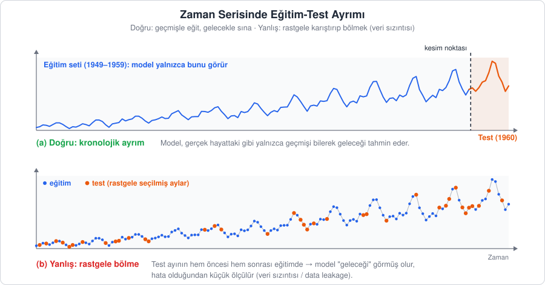
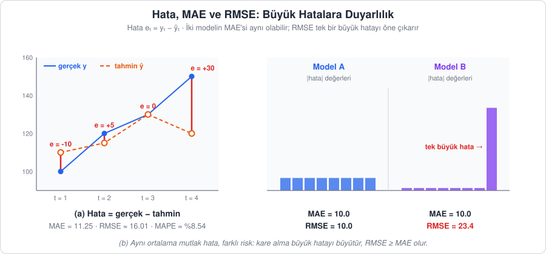
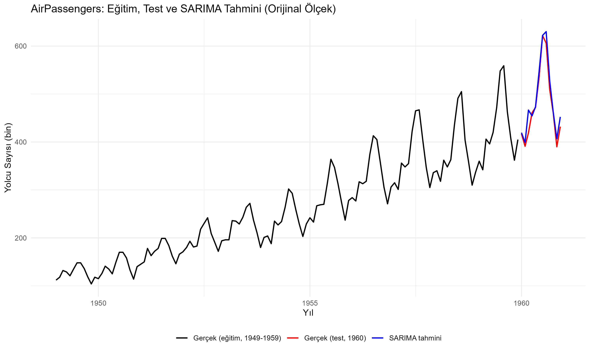

[İçindekiler](../Course_notes.md) · [← 7. Klasik İstatistiksel Modeller: ARIMA ve SARIMA](07_klasik_istatistiksel_modeller_arima_ve_sarima.md) · [9. Facebook Prophet →](09_facebook_prophet.md)

## 8. Model Değerlendirme: Hata Metrikleri ve Eğitim-Test Ayrımı

Bölüm 7'de bir SARIMA modeli kurduk ve geleceğe yönelik tahminler ürettik. Peki bu tahminler ne kadar iyi? Bir grafiğe bakıp "çizgiler birbirine yakın görünüyor" demek bilimsel bir yaklaşım değildir. Başarımızı **sayısal olarak** ifade etmemiz ve bunu modelin **daha önce görmediği** veriler üzerinde yapmamız gerekir.

Bu bölümde iki soruya yanıt arayacağız:

1. Modeli hangi veriyle eğitip hangi veriyle sınamalıyız? (8.1)
2. Tahminle gerçek arasındaki farkı hangi sayılarla özetlemeliyiz? (8.2)

Ardından bu araçları R (8.3) ve Python (8.4) ile `AirPassengers` üzerinde uygulayacağız. Burada tanımlayacağımız metrikleri ve `evaluate_model()` fonksiyonunu ders notunun geri kalanında Prophet, XGBoost ve LSTM gibi modelleri karşılaştırmak için tekrar tekrar kullanacağız.

---

### 8.1. Neden Değerlendirme? Eğitim-Test Mantığı

**Açıklama:** Bir öğrencinin başarısını, sınavda daha önce çözdüğü soruları sorarak ölçülemez; o soruları ezberlemiş olabilir. Gerçek başarı, hiç görmediği yeni soruları çözebilmesidir. Modeller için de aynısı geçerlidir. Bir model eğitildiği veriye çok iyi uyabilir ama geleceği kötü tahmin edebilir. Bu duruma **aşırı öğrenme** (aşırı uyum, overfitting) denir.

Bu yüzden elimizdeki veriyi ikiye ayırırız:

1. **Eğitim seti (training set):** Model geçmişteki desenleri, trendi ve mevsimsel ilişkileri bu veriden öğrenir. Modelin parametreleri bu set kullanılarak kestirilir.
2. **Test seti (test set):** Eğitim tamamlandıktan sonra modelin hiç görmediği bu kısım için tahmin yapılır ve tahminler gerçek değerlerle karşılaştırılır. Test seti modelin **genelleme** yeteneğini, yani yeni verilere ne kadar uyum sağlayabildiğini tarafsız biçimde ölçer.

Eğitim setindeki hataya **örneklem içi** (in-sample), test setindeki hataya **örneklem dışı** (out-of-sample) hata denir. Model seçerken asıl önemli olan örneklem dışı hatadır.

#### 8.1.1. Zaman Serisinde Rastgele Bölme Yapılmaz

Sıradan makine öğrenmesi problemlerinde satırlar rastgele karıştırılıp örneğin %80'i eğitime, %20'si teste ayrılır. **Zaman serisinde bu yapılmaz.** Nedeni Şekil 8.1'de görülmektedir.



*Şekil 8.1 — (a) Doğru: Kronolojik ayrımda model yalnızca kesim noktasından önceki veriyi görür. (b) Yanlış: Rastgele bölmede test aylarının hem öncesi hem sonrası eğitimdedir; model "geleceği" görmüş olur.*

Rastgele bölmede, örneğin Mart 1958 test setindeyse, Şubat 1958 ve Nisan 1958 eğitim setinde olabilir. Model Mart'ı tahmin ederken bir sonraki ayı zaten "bilmektedir". Aradaki değeri iki komşusundan tahmin etmek (interpolasyon), geleceği tahmin etmekten (ekstrapolasyon) çok daha kolaydır. Sonuçta hata olduğundan çok daha küçük ölçülür ve model gerçekte olduğundan iyi görünür.

**Günlük hayattan bir örnek:** Bir futbol maçında 60. dakikadaki skoru, 55. ve 65. dakikanın skorunu bilerek tahmin etmek kolaydır. Asıl zor olan, 55. dakikada durup 65. dakikayı tahmin etmektir. Rastgele bölme modele hep bu kolay "ara dakika" sorularını sorar; gerçek hayatta ise model hep ikinci türden sorularla karşılaşır.

Gelecekten geçmişe bilgi taşınmasına **veri sızıntısı** (data leakage) denir. Zaman serisinde sızıntının yaygın kaynakları şunlardır:

- **Rastgele bölme:** Yukarıda anlattığımız durum.
- **Tüm veriyle ön işleme:** Ölçekleme (ör. `MinMaxScaler`), normalleştirme ya da eksik değer doldurma için gereken istatistikleri (min, max, ortalama) tüm seriden hesaplamak. Bu istatistikler **yalnızca eğitim setinden** hesaplanmalı, sonra test setine aynen uygulanmalıdır (ölçeklemenin ayrıntısı 12.1.4'te).
- **Geleceğe bakan özellikler:** Örneğin merkezî hareketli ortalama gibi, $t$ anının değerini hesaplarken $t+1$, $t+2$ gözlemlerini kullanan özellikler.
- **Test setine bakarak model seçmek:** Test hatasına bakıp parametreleri tekrar tekrar ayarlamak, test setini gizlice eğitime katmak demektir. Model seçimi için eğitim setinin sonundan ayrı bir **doğrulama seti** (validation set) ayırmak daha doğrudur.

**Günlük hayattan bir örnek:** Sınav soruları sızarsa yüksek notlar öğrenmeyi göstermez. Ama sızıntı her zaman soruların kendisi değildir: "En zor soru 20 puanlık, cevaplar 0–100 arasında" bilgisini önceden duymak bile işi kolaylaştırır. Tüm seriden min/max alarak ölçekleme bu ikinci türe benzer: Model, test dönemi dahil bütün serinin en büyük ve en küçük değerini dolaylı yoldan öğrenmiş olur. Benzetmenin sınırı: Veri sızıntısı çoğu zaman kasıtsızdır; kopya çeken öğrenci değil, dikkatsiz bir kod satırıdır.

**Not —** Test setinin uzunluğu, gerçekte ihtiyaç duyulan **tahmin ufkuna** yakın seçilmelidir. Önümüzdeki 12 ay tahmin edilecekse son 12 ayı test setine ayırmak mantıklıdır.

**Günlük hayattan bir örnek:** Navigasyon uygulaması aracın 5 dakika sonra nerede olacağını neredeyse tam bilir, ama 3 saatlik yolculuğun varış saatinde yanılma payı büyüktür. 12 aylık ve 60 aylık testlerin hatasını kıyaslamak da 5 dakikalık ve 3 saatlik tahmini kıyaslamaya benzer; bunu 8.4.2'de sayılarla göreceğiz.

**Not —** Tek bir eğitim-test ayrımı, sonucun seçilen kesim noktasına bağlı olmasına yol açar. Daha sağlam bir değerlendirme için kesim noktası zaman içinde ileri kaydırılarak birden çok kez eğitim-test yapılır. Zaman serisine uygun bu çapraz doğrulama yöntemini (`TimeSeriesSplit`) Bölüm 16'da ayrıntılı olarak ele alacağız.

**Günlük hayattan bir örnek:** Bir okçuyu tek bir atış serisine bakarak değerlendirmek yanıltır; o gün rüzgâr tesadüfen arkadan esmiş olabilir. Farklı günlerdeki serilerin ortalaması gerçek ustalığı gösterir. Kesim noktasını kaydırarak birden çok test yapmak da modeli "farklı günlerde" sınamaktır. Benzetmenin sınırı: Kaydırılan pencerelerin test dönemleri ardışıktır ve birbirinden bağımsız değildir.

> **Hemen deneyin 8.1.1 · Rastgele bölme modeli olduğundan iyi gösterir** (R, ~3 dk)
>
> RStudio'yu açın ve aşağıdaki satırları konsola yapıştırın. Hiçbir şey öğrenmeyen bir "model" kuruyoruz: Rastgele seçilen bir ayı, **önceki ve sonraki ayın ortalaması** ile tahmin ediyor. Yani 8.1.1'deki hatayı bilerek yapıyor ve "geleceği" (sonraki ayı) görüyor. Başarıyı MAE ile ölçüyoruz (MAE: hataların işaretsiz ortalaması; 8.2.1'de).
>
> ```r
> y <- as.numeric(AirPassengers)          # 144 aylık yolcu sayısı, düz sayı vektörü
> set.seed(1)                             # aynı rastgele ayları görmek için
> idx <- sample(2:143, 12)                # sample(): 2..143 arasından rastgele 12 ay seçer
> idx
> tahmin <- (y[idx - 1] + y[idx + 1]) / 2 # önceki ve SONRAKİ ayın ortalaması
> round(mean(abs(y[idx] - tahmin)), 2)    # bu "modelin" MAE'si
> ```
>
> **Ne göreceksiniz:**
>
> ```text
>  [1]  69 130  44  15  52  86  22 107  75   8  74  80
> [1] 13.21
> ```
>
> İlk satır seçilen 12 ayın sıra numaralarıdır (ör. 69 = Eylül 1954). Hata yalnızca **13.21** bin yolcudur; 8.3'te 1960'ı kronolojik olarak tahmin eden SARIMA modelinin MAE'si de 13.26'dır. Test ayları farklı olduğu için kıyas kabacadır, ama hiçbir şey öğrenmeyen bu yöntem rastgele bölme sayesinde SARIMA kadar iyi görünür. Aynı 12 ayı yalnızca önceki ayla tahmin etseydik MAE = 21 olurdu. Sonraki ayı da görmek hatayı 13.21'e indirir; bu düşüş tamamen sızıntıdır.
>
> **Şimdi siz:** `set.seed(1)` yerine `set.seed(2)`, `set.seed(3)` yazıp çalıştırın. MAE kaç kez 20'yi geçiyor?
>
> <details><summary>Cevap</summary>
>
> `set.seed(2)` → 16.96, `set.seed(3)` → 13.79 (4 ve 5 ile de 15.83 ve 17.71). Hiçbiri 20'yi geçmez. Hangi aylar seçilirse seçilsin, komşu ayları görmek hatayı küçük gösterir.
>
> </details>

#### 8.1.2. Referans Model: Naive (Saf) Tahmin

Bir modelin hatasının "iyi" olup olmadığına karar vermek için bir **kıyas noktasına** ihtiyacımız vardır. Ortalama 18 bin yolculuk bir hata iyi mi, kötü mü? Bu soru ancak "neye göre?" sorusuyla birlikte anlamlıdır.

**Açıklama:** En basit kıyas noktası, hiçbir şey öğrenmeyen "tembel" tahmin yöntemleridir. Karmaşık bir model bu basit yöntemleri yenemiyorsa, o modelin kurulmasına değmez.

**Tanım 1 (Naive tahmin):** Gelecekteki tüm değerler, bilinen son gözleme eşit tahmin edilir. Günlük hayattaki karşılığı "yarın da bugünkü gibi olacak" demektir:

```math
\underbrace{\hat{y}_{T+h}}_{\substack{h\text{ adım sonrası}\\\text{için tahmin}}} = \underbrace{y_T}_{\text{son gözlem}}
```

**Nasıl okunur?** "y şapka alt T artı h eşittir y alt T." Yani: Ufuk ne olursa olsun tahmin, eğitim setinin son gözlemidir.

> **Simge notu:** $`y`$: serinin gözlenen (gerçek) değeri; Bölüm 1–7'deki $`x`$ ile aynı anlamdadır (bu bölümden itibaren makine öğrenmesi kaynaklarındaki alışkanlığa uyularak $`y`$ ve $`\hat{y}`$ kullanılır) · $`\hat{y}`$ *(y şapka)*: tahmin edilen değer; şapka işareti "bu bir ölçüm değil, tahmin" anlamına gelir · alt indis (harfin sağ altındaki küçük yazı) değerin **hangi zamana** ait olduğunu gösterir · $`T`$: eğitim setindeki son zaman noktası, yani elimizdeki son gözlemin sırası · $`h`$: kaç adım ilerisinin tahmin edildiği (tahmin ufku) · $`y_T`$: son gözlem · $`\hat{y}_{T+h}`$: son gözlemden $`h`$ adım sonrası için yapılan tahmin

Örneğin eğitim seti Aralık 1959'da bitiyorsa $T$ = Aralık 1959 ve $y_T = 405$'tir (bin yolcu). Naive yöntem Ocak 1960 için ($h = 1$) de, Haziran 1960 için ($h = 6$) de aynı cevabı verir: $\hat{y}_ {T+1} = \hat{y}_ {T+6} = 405$.

**Tanım 2 (Mevsimsel naive tahmin):** Her gelecek dönem, bir önceki mevsimin aynı dönemine eşit tahmin edilir. Örneğin gelecek Temmuz = son bilinen Temmuz:

```math
\underbrace{\hat{y}_{T+h}}_{\substack{h\text{ adım sonrası}\\\text{için tahmin}}} = \underbrace{y_{T+h-s}}_{\substack{s\text{ dönem (bir mevsim)}\\\text{önceki gözlem}}} \quad \overbrace{(h \le s)}^{\substack{\text{yalnızca}\\\text{ilk mevsimde}}}
```

**Nasıl okunur?** "y şapka alt T artı h eşittir y alt T artı h eksi s; h, s'den küçük ya da eşitken."

Burada $s$ mevsim uzunluğudur (aylık veride 12). $y_{T+h-s}$, tahmin edilen aydan tam $s$ dönem, yani bir yıl önceki gözlemdir. Parantez içindeki $h \le s$ ("$`h`$, $s$'den küçük ya da ona eşit") koşulu, bu yazımın yalnızca ilk mevsim boyunca geçerli olduğunu söyler. Ufuk $s$'den uzunsa son bilinen mevsim tekrar tekrar kopyalanır. Aynı örnekte $T$ = Aralık 1959 ve $s = 12$ iken Temmuz 1960 için $h = 7$ olur ve tahmin $y_{T+7-12} = y_{T-5}$, yani Temmuz 1959'un değeri olan 548'dir. Ocak 1960'ın tahmini Ocak 1959'un değeri (360), Şubat 1960'ınki Şubat 1959'unki (342) olur ve bu böyle sürer.

Mevsimsel verilerde asıl rakip mevsimsel naive yöntemdir. 8.3'te göreceğimiz gibi, `AirPassengers` için SARIMA modelinin bu referansı açık farkla yenmesi, modelin yalnızca "geçen yılı kopyalamaktan" daha fazlasını, örneğin yıldan yıla büyümeyi de öğrendiğini gösterir.

---

### 8.2. Hata Metrikleri

Her şeyin temelinde tek bir kavram vardır: **hata** (error), yani gerçek değer ile tahmin arasındaki fark:

```math
\underbrace{e_t}_{\text{hata}} = \underbrace{y_t}_{\text{gerçek değer}} - \underbrace{\hat{y}_t}_{\text{tahmin}}
```

**Nasıl okunur?** "e alt t eşittir y alt t eksi y şapka alt t."

> **Simge notu:** $`e_t`$: $`t`$ anındaki hata (İngilizce *error*'ın baş harfi; Yunan harfi $`\varepsilon`$ "epsilon" ile karıştırılmamalıdır) · $`y_t`$: $`t`$ anındaki gerçek değer · $`\hat{y}_t`$ *(y şapka t)*: aynı an için yapılan tahmin · $`n`$: test setindeki gözlem (hata) sayısı

Örneğin bir ay gerçekte 150 bin yolcu taşınmış ($y_t = 150$), model 120 bin tahmin etmişse ($\hat{y}_ t = 120$) hata $e_t = 150 - 120 = +30$'dur. Model 160 tahmin etseydi hata $150 - 160 = -10$ olurdu.

Pozitif hata, modelin gerçeği **eksik** tahmin ettiğini; negatif hata, **fazla** tahmin ettiğini gösterir. Test setindeki $n$ adet hatayı tek bir sayıda özetlemenin farklı yolları, farklı metrikleri doğurur.

**Not —** Hataların basit ortalamasını almak işe yaramaz: +30 ve −30'luk iki hata toplamda $30 + (-30) = 0$, ortalamada da 0 eder ve model kusursuz görünür. Bu yüzden metrikler ya hatanın **mutlak değerini** (işaretini atıp yalnızca büyüklüğünü) ya da **karesini** kullanır; ikisi de eksi işaretini ortadan kaldırır. Yine de hataların işaretli ortalamasına (**yanlılık**, bias) ayrıca bakmak faydalıdır: Sürekli pozitif çıkıyorsa model sistematik olarak eksik tahmin yapıyor demektir.

```math
\text{Yanlılık} = \underbrace{\frac{1}{n} \sum_{t=1}^{n}}_{\substack{n\text{ hatanın}\\\text{ortalaması}}} \overbrace{e_t}^{\substack{\text{işaretli hata}\\\text{(mutlak değer yok)}}}
```

**Nasıl okunur?** "Yanlılık eşittir, bir bölü n çarpı, t eşittir 1'den n'ye kadar e alt t'lerin toplamı." Yani: Yukarıda "işe yaramaz" dediğimiz basit ortalamanın ta kendisidir; hatanın büyüklüğünü değil, yönünü ölçer.



*Şekil 8.2 — (a) Hata, gerçek değer ile tahmin arasındaki dikey uzaklıktır. (b) Model A ve Model B'nin MAE'si aynıdır (10), ancak Model B'nin tek büyük hatası RMSE'yi 23.4'e çıkarır.*

#### 8.2.1. MAE (Mean Absolute Error — Ortalama Mutlak Hata)

**Açıklama:** Tahmin yaparken bazen gerçek değerin üzerinde, bazen altında kalırız. Yönüne bakmaksızın "ortalama ne kadar yanılıyoruz?" sorusunun cevabı MAE'dir. Tarifi üç adımdır: (1) her dönemin hatasını hesapla, (2) eksi işaretlerini at, (3) bu büyüklüklerin ortalamasını al.

**Tanım:**

```math
\mathrm{MAE} = \underbrace{\frac{1}{n} \sum_{t=1}^{n}}_{\substack{n\text{ değerin}\\\text{ortalamasını al}}} \underbrace{\big\lvert \overbrace{y_t - \hat{y}_t}^{\text{hata } e_t} \big\rvert}_{\substack{\text{hatanın büyüklüğü}\\\text{(işaret atılır)}}}
```

**Nasıl okunur?** "MAE eşittir, bir bölü n çarpı, t eşittir 1'den n'ye kadar y alt t eksi y şapka alt t'nin mutlak değerlerinin toplamı." Yani: Açıklamadaki üç adımın formül hâlidir.

> **Simge notu:** $`\sum`$ *(büyük sigma = toplam)*: "topla" komutunun kısaltmasıdır; altındaki $`t = 1`$ ve üstündeki $`n`$, "$`t`$'yi 1'den başlatıp $`n`$'ye kadar birer birer artır, her $`t`$ için sağdaki ifadeyi hesapla ve hepsini topla" demektir. Küçük sigma $`\sigma`$ (standart sapma) ile karıştırılmamalıdır · $`\lvert \cdot \rvert`$ *(mutlak değer)*: iki dikey çizgi arasındaki sayının işaretsiz büyüklüğü; $`\lvert -10 \rvert = 10`$, $`\lvert 5 \rvert = 5`$, $`\lvert 0 \rvert = 0`$ · $`\frac{1}{n}`$: toplamı $`n`$'ye bölmek, yani ortalamasını almak

Küçük bir örnek: Üç aylık hatalar $-10$, $+5$ ve $+30$ olsun. Mutlak değerler 10, 5 ve 30'dur; toplamları $10 + 5 + 30 = 45$, ortalamaları $45 / 3 = 15$'tir. Yani MAE = 15. İşaretli ortalama ise $(-10 + 5 + 30)/3 \approx 8.3$ olurdu ve hatanın gerçek büyüklüğünü olduğundan küçük gösterirdi.

MAE **verinin kendi biriminde** ifade edilir. Örneğin MAE = 20 ise model ortalama 20 yolcu eksik ya da fazla tahmin yapıyor demektir. Anlaşılması en kolay metrik budur ve her hataya **eşit ağırlık** verir: 30'luk bir hata, 10'luk bir hatanın tam üç katı kadar etkilidir, fazlası değil.

#### 8.2.2. RMSE (Root Mean Squared Error — Kök Ortalama Kare Hata)

**Açıklama:** Bazı problemlerde küçük hatalar önemsizken tek bir büyük hata felakete yol açabilir (ör. elektrik talebini büyük ölçüde eksik tahmin edip kesintiye neden olmak). RMSE hataların karesini aldığı için büyük hataları **orantısız biçimde cezalandırır**.

**Tanım:** Önce hataların karelerinin ortalaması (MSE, *Mean Squared Error*, ortalama kare hata) alınır, sonra birimi geri kazanmak için karekökü alınır:

```math
\mathrm{MSE} = \underbrace{\frac{1}{n} \sum_{t=1}^{n}}_{\substack{n\text{ değerin}\\\text{ortalamasını al}}} \underbrace{\big(\overbrace{y_t - \hat{y}_t}^{\text{hata } e_t}\big)^2}_{\substack{\text{hatanın karesi}\\\text{(büyük hata çok büyür)}}}
```

```math
\mathrm{RMSE} = \underbrace{\sqrt{\mathrm{MSE}}}_{\substack{\text{karekök: verinin}\\\text{birimine geri döner}}}
```

**Nasıl okunur?** "MSE eşittir, bir bölü n çarpı, t eşittir 1'den n'ye kadar y alt t eksi y şapka alt t'nin karelerinin toplamı. RMSE eşittir MSE'nin karekökü."

> **Simge notu:** $`(\cdot)^2`$ *(kare)*: sayıyı kendisiyle çarpmak; $`3^2 = 3 \cdot 3 = 9`$ ve $`(-3)^2 = (-3) \cdot (-3) = 9`$. Eksi çarpı eksi artı ettiği için kare alma da mutlak değer gibi işareti ortadan kaldırır · $`\sqrt{\cdot}`$ *(karekök)*: karesi içerideki sayıya eşit olan pozitif sayı; $`\sqrt{9} = 3`$, $`\sqrt{100} = 10`$ · $`\cdot`$ (ortadaki nokta): çarpma işareti

Kare alma işlemi 2 birimlik hatayı 4'e, 30 birimlik hatayı 900'e çevirir. Hata 15 kat büyürken karesi 225 kat büyür. Bu yüzden büyük hatalar toplamda baskın hâle gelir. Kareli birim ("yolcu kare") yorumlanamayacağı için en sonda karekök alınır ve RMSE de verinin kendi biriminde (yolcu) ifade edilir.

Her zaman $\mathrm{RMSE} \ge \mathrm{MAE}$'dir ("büyük ya da eşittir"); eşitlik ancak tüm hataların büyüklüğü aynıysa sağlanır. Nedenini Şekil 8.2b'deki iki modelle görelim:

- **Model A**'nın sekiz hatası da 10'dur: MAE = 10, RMSE = 10.
- **Model B**'nin yedi hatası 2, biri 66'dır: MAE $= (7 \cdot 2 + 66)/8 = 80/8 = 10$, yani yine 10; ama RMSE $= \sqrt{(7 \cdot 4 + 66^2)/8} = \sqrt{(28 + 4356)/8} = \sqrt{548} \approx 23.4$.

> **Simge notu:** $`\approx`$ *(yaklaşık eşittir)*: iki değerin yaklaşık olarak eşit olduğunu belirtir · $`\ge`$: "büyük ya da eşittir"

Model B'nin hata büyüklüklerinin ortalaması (MAE) 10'dur; yedisi ortalamadan 8 aşağıda, biri 56 yukarıdadır. Bu sapmaların karelerinin ortalaması, yani hata büyüklüklerinin **dağınıklığı**, $(7 \cdot 64 + 56^2)/8 = 448$'dir ve $\mathrm{MSE} = 10^2 + 448 = 548$ bulunur. Bu tesadüf değildir; genel kural şudur: **MSE = MAE² + hata büyüklüklerinin dağınıklığı**. Dağınıklık hiçbir zaman eksi olamayacağı için MSE en az MAE² kadardır, karekökü alınınca da RMSE en az MAE kadar çıkar. Model A'da bütün hatalar eşit olduğundan dağınıklık 0'dır ve RMSE = MAE olur. Hatalar ne kadar düzensizse (birkaç büyük, çok sayıda küçük hata) RMSE, MAE'den o kadar uzaklaşır.

Yani **RMSE, MAE'den belirgin biçimde büyükse, model genel olarak iyi gitse de bazı noktalarda büyük sapmalar yapıyor demektir.**

**Günlük hayattan bir örnek:** İki kargo firması düşünelim. A firması on gönderinin hepsini 1 gün geç teslim ediyor; B firması dokuzunu zamanında, birini 10 gün geç. MAE ikisinde de 1 gündür. RMSE ise A için 1, B için $\sqrt{10} \approx 3.2$ gün çıkar: RMSE, tek bir büyük gecikmeyi ağır cezalandırır. Bozulabilir ürün gönderiliyorsa B'nin 10 günlük gecikmesi felakettir ve RMSE bu riski görünür kılar.

> **Hemen deneyin 8.2.2 · Tek bir büyük hata RMSE'yi nasıl uçurur?** (Python, ~3 dk)
>
> Sekiz ayın hatalarıyla başlayıp yalnızca birini büyütelim ve iki metriği karşılaştıralım.
>
> ```python
> import numpy as np
>
> hata = np.array([5, -4, 6, -5, 4, -6, 5, -5])   # 8 ayın hataları
> print("MAE =", np.mean(np.abs(hata)), " RMSE =", round(np.sqrt(np.mean(hata**2)), 2))
>
> hata[3] = -45                                    # 4. ayda tek bir büyük sapma
> print("MAE =", np.mean(np.abs(hata)), " RMSE =", round(np.sqrt(np.mean(hata**2)), 2))
> ```
>
> `hata[3]` dizinin 4. elemanıdır (Python saymaya 0'dan başlar); `**` Python'da üs işaretidir (`hata**2` = her elemanın karesi).
>
> **Ne göreceksiniz:**
>
> ```text
> MAE = 5.0  RMSE = 5.05
> MAE = 10.0  RMSE = 16.6
> ```
>
> Hatalar birbirine yakınken MAE ile RMSE neredeyse aynıdır. Tek bir ayın hatası −5'ten −45'e çıkınca MAE iki katına (5 → 10) çıkar, RMSE ise üç katından fazla artar (5.05 → 16.6). Şekil 8.2b'deki Model B'nin durumu budur.
>
> **Şimdi siz:** Önce tahmin edin, sonra `-45` yerine `-85` yazıp çalıştırın. MAE kaç olur? RMSE, MAE'nin kaç katı olur?
>
> <details><summary>Cevap</summary>
>
> `MAE = 15.0  RMSE = 30.42`. MAE yalnızca 40 birimlik ek hatanın sekizde birini (5) ekleyerek 15'e çıkar. RMSE ise 30.42 olur, yani MAE'nin yaklaşık 2 katı. Büyük hata büyüdükçe RMSE/MAE oranı da büyür.
>
> </details>

#### 8.2.3. MAPE (Mean Absolute Percentage Error — Ortalama Mutlak Yüzde Hata)

**Açıklama:** 1000 yolcuda 10 kişilik hata ile 20 yolcuda 10 kişilik hata aynı şey değildir. MAPE hatayı gerçek değerin büyüklüğüne oranlayarak bu bağlamı sunar.

**Tanım:**

```math
\mathrm{MAPE} = \underbrace{\frac{100}{n} \sum_{t=1}^{n}}_{\substack{\text{ortalamayı al,}\\\text{100 ile yüzdeye çevir}}} \left\lvert \underbrace{\frac{y_t - \hat{y}_t}{y_t}}_{\substack{\text{hata, gerçek değerin}\\\text{kaçta kaçı?}}} \right\rvert
```

**Nasıl okunur?** "MAPE eşittir, yüz bölü n çarpı, t eşittir 1'den n'ye kadar, y alt t eksi y şapka alt t bölü y alt t oranının mutlak değerlerinin toplamı."

Formülü içeriden dışarıya okuyalım: Her dönem için hata gerçek değere bölünür (hata, gerçeğin kaçta kaçı?), mutlak değeri alınır, bu oranların ortalaması bulunur ve 100 ile çarpılarak yüzdeye çevrilir. Örneğin gerçek değer 200, tahmin 190 ise oran $\lvert (200 - 190)/200 \rvert = 10/200 = 0.05$, yani %5'tir.

Sonuç yüzde cinsindendir ve **ölçekten bağımsızdır**. MAPE = %5 ise model ortalama %5'lik bir sapmayla çalışıyor demektir. Bu sayede farklı ölçekteki serileri (ör. bir ülkenin ve bir şehrin yolcu sayısını) karşılaştırmak ya da sonucu yöneticilere anlatmak kolaylaşır.

**MAPE'nin zayıf noktaları:**

- **Sıfıra yakın değerlerde patlar.** Paydada $y_t$ vardır ve bir sayıyı çok küçük bir sayıya bölmek sonucu çok büyütür. Hatayı hep 1 birim tutup yalnızca gerçek değeri küçültelim: $y_t = 100$ iken yüzde hata $1/100$ = %1, $y_t = 10$ iken $1/10$ = %10, $y_t = 1$ iken $1/1$ = %100, $y_t = 0.1$ iken $1/0.1$ = %1000 olur. Gerçek değer tam 0 ise sıfıra bölme yapılamaz ve MAPE tanımsızdır. Yani 0'a yakın tek bir gözlem, diğer bütün aylar ne kadar iyi tahmin edilmiş olursa olsun ortalamayı uçurur. Bu yüzden satışı sıfır olabilen ürünler, sıcaklık (°C) ya da getiri gibi sıfırın çevresinde dolaşan ya da işaret değiştirebilen serilerde MAPE kullanılmamalıdır.
- **Asimetriktir.** Fazla tahminin cezası sınırsız, eksik tahminin cezası sınırlıdır. Gerçek değer 100 olsun: Model 0 tahmin ederse (olabilecek en kötü eksik tahmin) yüzde hata $100/100$ = %100'dür ve daha fazla olamaz. Model 300 tahmin ederse yüzde hata $200/100$ = %200 olur ve tahmin büyüdükçe sınırsızca artar. Bu yüzden MAPE'yi en aza indirmeye çalışan bir model sistematik olarak **düşük tahmin** yapma eğilimindedir.
- **Anlamlı bir sıfır noktası gerektirir.** Oran ancak ölçeğin doğal bir sıfırı varsa (yolcu sayısı, ciro) yorumlanabilir. 0 °C "sıcaklık yok" demek olmadığından 20 °C, 10 °C'nin "iki katı" değildir; bu yüzden °C cinsinden bir yüzde hata da anlamlı değildir.

**Günlük hayattan bir örnek:** İlk maddedeki patlama bir kantar örneğiyle açıklanabilir. 1 kg şaşan bir kantar kamyon tartarken önemsizdir, ama 500 gramlık bir paketi tartarken %200 yanılmış olur. Kantarın hatası aynıdır; değişen, tartılan şeyin büyüklüğüdür. Kefe neredeyse boşsa yüzde hata uçar, tamamen boşsa tanımsızdır.

> **Hemen deneyin 8.2.3 · MAPE'nin patladığını görün** (Python, ~3 dk)
>
> Bir ürünün dört günlük satışını, model her gün tam **1 adet** fazla tahmin ediyor. Hata hep aynı olduğu hâlde MAPE'ye ne olduğuna bakalım.
>
> ```python
> import numpy as np
>
> gercek = np.array([20.0, 18.0, 15.0, 12.0])   # 4 günlük satış (adet)
> tahmin = gercek + 1                           # her gün 1 adet fazla tahmin
> print("MAE  =", np.mean(np.abs(gercek - tahmin)))
> print("MAPE =", round(np.mean(np.abs((gercek - tahmin) / gercek)) * 100, 2))
>
> gercek[3] = 0.5                               # son gün satış neredeyse sıfır
> tahmin = gercek + 1
> print("MAE  =", np.mean(np.abs(gercek - tahmin)))
> print("MAPE =", round(np.mean(np.abs((gercek - tahmin) / gercek)) * 100, 2))
> ```
>
> **Ne göreceksiniz:**
>
> ```text
> MAE  = 1.0
> MAPE = 6.39
> MAE  = 1.0
> MAPE = 54.31
> ```
>
> MAE iki durumda da 1'dir: Model hep 1 adet yanılıyor. MAPE ise %6.39'dan %54.31'e fırlar, çünkü son günün yüzde hatası $1/0.5$ = %200'dür ve dört günün ortalamasını tek başına uçurur.
>
> **Şimdi siz:** `gercek[3] = 0.5` satırında 0.5 yerine önce `0.1`, sonra `0.0` yazın. Ne bekliyorsunuz?
>
> <details><summary>Cevap</summary>
>
> `0.1` ile `MAPE = 254.31` çıkar (son günün tek başına yüzde hatası %1000). `0.0` ile ekrana `RuntimeWarning: divide by zero encountered in divide` uyarısı gelir ve `MAPE = inf` (sonsuz) yazılır: Sıfıra bölme tanımsızdır. MAE ise her seferinde 1.0 kalır. Sıfıra yakın değer içeren serilerde MAE ya da MASE (8.2.5) kullanmanın nedeni budur.
>
> </details>

#### 8.2.4. Küçük Bir Örnekle Elle Hesaplama

Metriklerin nasıl çalıştığını görmek için dört aylık küçük bir örneği elle hesaplayalım (Şekil 8.2a):

| $`t`$ | Gerçek $`y_t`$ | Tahmin $`\hat{y}_t`$ | Hata $`e_t`$ | $`\lvert e_t \rvert`$ | $`e_t^2`$ | $`\lvert e_t \rvert / y_t`$ |
| --- | --- | --- | --- | --- | --- | --- |
| 1 | 100 | 110 | −10 | 10 | 100 | 0.1000 |
| 2 | 120 | 115 | +5 | 5 | 25 | 0.0417 |
| 3 | 130 | 130 | 0 | 0 | 0 | 0.0000 |
| 4 | 150 | 120 | +30 | 30 | 900 | 0.2000 |
| **Toplam** | | | +25 | **45** | **1025** | **0.3417** |

Tablonun her sütunu formüllerdeki bir adıma karşılık gelir. Hata sütunu $e_t = y_t - \hat{y}_ t$'dir; örneğin ilk ayda $100 - 110 = -10$ (model 10 fazla tahmin etmiş), son ayda $150 - 120 = +30$ (model 30 eksik tahmin etmiş). Kare sütununda $(-10)^2 = 100$, $5^2 = 25$, $30^2 = 900$ bulunur. Son sütun yüzde hatanın ham oranıdır: $10/100 = 0.1000$, $5/120 \approx 0.0417$, $0/130 = 0$, $30/150 = 0.2000$.

Buradan:

- $\mathrm{MAE} = (10 + 5 + 0 + 30)/4 = 45 / 4 = 11.25$
- $\mathrm{MSE} = (100 + 25 + 0 + 900)/4 = 1025 / 4 = 256.25$ ve $\mathrm{RMSE} = \sqrt{256.25} \approx 16.01$ (sağlaması: $16^2 = 256$, yani karekök 16'nın çok az üstündedir)
- $\mathrm{MAPE} = 100 \times 0.3417 / 4 \approx 8.54$ (yani %8.54)
- Yanlılık (işaretli ortalama hata) $= (-10 + 5 + 0 + 30)/4 = 25 / 4 = 6.25$: Pozitif olduğu için model ortalamada biraz **eksik** tahmin yapıyor.

**Yorum:** RMSE (16.01), MAE'den (11.25) belirgin biçimde büyüktür. Sebep 4. aydaki 30'luk hatadır: Bu tek hata, karelerin toplamının %88'ini (900/1025) oluşturur. MAE'ye katkısı ise %67'dir (30/45). Büyük hatalar RMSE'de her zaman daha çok ağırlık taşır.

> **Hemen deneyin 8.2.4 · Aynı tabloyu Excel'de formülle kurun** (Excel / LibreOffice Calc, ~5 dk)
>
> Boş bir çalışma sayfası açın ve 8.2.4'teki tabloyu kurun:
>
> 1. **A1**'e `Gerçek`, **B1**'e `Tahmin`, **C1**'e `Hata`, **D1**'e `Mutlak`, **E1**'e `Kare`, **F1**'e `Oran` yazın.
> 2. **A2:A5** hücrelerine 100, 120, 130, 150; **B2:B5** hücrelerine 110, 115, 130, 120 girin.
> 3. **C2**'ye `=A2-B2`, **D2**'ye `=MUTLAK(C2)` (İngilizce: `=ABS(C2)`), **E2**'ye `=C2^2`, **F2**'ye `=D2/A2` yazın. **C2:F2** hücrelerini seçip sağ alt köşedeki küçük kareden (doldurma tutamacı) 5. satıra kadar aşağı sürükleyin.
> 4. Metrikler için:
>    - **H2** (MAE): `=ORTALAMA(D2:D5)` (İngilizce: `=AVERAGE(D2:D5)`)
>    - **H3** (RMSE): `=KAREKÖK(ORTALAMA(E2:E5))` (İngilizce: `=SQRT(AVERAGE(E2:E5))`)
>    - **H4** (MAPE, %): `=ORTALAMA(F2:F5)*100`
>    - **H5** (yanlılık): `=ORTALAMA(C2:C5)`
>
> LibreOffice Calc'ta fonksiyon adları arayüz diline göre değişebilir; İngilizce adları kullanmak isterseniz **Tools → Options → LibreOffice Calc → Formula** altında "Use English function names" kutusunu işaretleyin.
>
> **Ne göreceksiniz:** H2 = 11,25; H3 = 16,00781 (hücre biçimine göre 16,01); H4 = 8,541667; H5 = 6,25. Bunlar 8.2.4'te elle bulduğumuz MAE = 11.25, RMSE ≈ 16.01, MAPE ≈ %8.54 ve yanlılık = 6.25'in aynısıdır. (Türkçe Excel ondalık ayırıcı olarak virgül gösterir.)
>
> **Şimdi siz:** 4. ayın tahminini (**B5**) 120'den 145'e değiştirin. Formüllere dokunmadan dört metrik kendiliğinden güncellenir. Önce tahmin edin: RMSE ile MAE arasındaki fark büyür mü, küçülür mü?
>
> <details><summary>Cevap</summary>
>
> Hatalar −10, +5, 0, +5 olur. MAE = 5; RMSE = $\sqrt{(100 + 25 + 0 + 25)/4} = \sqrt{37.5} \approx 6.12$; MAPE = 4.375; yanlılık = 0. Büyük hata (30) ortadan kalktığı için RMSE/MAE oranı 16.01/11.25 ≈ 1.42'den 6.12/5 ≈ 1.22'ye düşer: Hatalar artık birbirine daha yakındır. Yanlılığın 0 olması, eksik ve fazla tahminlerin birbirini dengelediğini gösterir; ama MAE'nin 0 olmadığına dikkat edin (8.2'deki Not).
>
> </details>

#### 8.2.5. Ek Metrikler: sMAPE ve MASE

MAPE'nin sorunlarını hafifletmek için önerilmiş iki metrik de literatürde ve tahmin yarışmalarında (ör. M4 yarışması) sıkça kullanılır.

**Tanım 1 (sMAPE — simetrik MAPE):** MAPE'de hata yalnızca gerçek değere bölünüyordu. sMAPE'de ise hata, gerçek değer ile tahminin **ortalamasına** bölünür. İkisinin ortalaması $(\lvert y_t \rvert + \lvert \hat{y}_ t \rvert)/2$ olduğundan, bu ortalamaya bölmek, payı 2 ile çarpıp toplama bölmekle aynı şeydir:

```math
\mathrm{sMAPE} = \underbrace{\frac{100}{n} \sum_{t=1}^{n}}_{\substack{\text{ortalamayı al,}\\\text{yüzdeye çevir}}} \dfrac{\overbrace{2 \lvert y_t - \hat{y}_t \rvert}^{\text{hatanın 2 katı}}}{\underbrace{\lvert y_t \rvert + \lvert \hat{y}_t \rvert}_{\substack{\text{gerçek ile}\\\text{tahminin toplamı}}}}
```

**Nasıl okunur?** "s MAPE eşittir, yüz bölü n çarpı, t eşittir 1'den n'ye kadar; iki çarpı y alt t eksi y şapka alt t'nin mutlak değeri, bölü y alt t'nin mutlak değeri artı y şapka alt t'nin mutlak değeri, terimlerinin toplamı."

Yukarıdaki örnekte ilk ayın terimi $2 \cdot 10 / (100 + 110) = 20/210 \approx 0.0952$'dir. Diğer aylar $10/235 \approx 0.0426$, $0$ ve $60/270 \approx 0.2222$ verir. Toplam $\approx 0.3600$, ortalaması $0.3600/4 = 0.0900$, yani sMAPE ≈ %9.00'dur. Gerçek değer 0 olsa bile payda tahmin sayesinde sıfır olmaz (ikisi birden 0 değilse) ve tek bir terim en fazla 2'ye (%200) çıkabilir; bu yüzden sıfıra yakın değerlerde MAPE kadar patlamaz. Ancak adına rağmen tam simetrik değildir: Gerçek değer 100 iken 110 tahmin etmek $20/210 \approx$ %9.5, 90 tahmin etmek $20/190 \approx$ %10.5 hata sayılır; aynı 10 birimlik sapma, eksik tahminde biraz daha ağır cezalandırılır. Nedeni paydadır: Gerçek değer 100 iken payda, 110 tahmin edilince 210, 90 tahmin edilince 190 olur; düşük tahmin paydayı küçülttüğü için aynı sapma daha büyük bir yüzde verir.

**Tanım 2 (MASE — ölçeklenmiş mutlak hata):** Fikir şudur: Modelin hatasını, "geçen yılın aynı ayını kopyala" diyen tembel yöntemin geçmişte yaptığı tipik hatayla kıyaslamak. Bunun için modelin test setindeki MAE'si, **eğitim setindeki** mevsimsel naive yöntemin MAE'sine bölünür:

```math
\mathrm{MASE} = \dfrac{\overbrace{\mathrm{MAE}_{\text{test}}}^{\text{modelin test hatası}}}{\underbrace{\frac{1}{T-s} \sum_{t=s+1}^{T} \lvert y_t - y_{t-s} \rvert}_{\substack{\text{mevsimsel naive yöntemin}\\\text{eğitimdeki ortalama hatası}}}}
```

**Nasıl okunur?** "MASE eşittir, MAE alt test bölü; bir bölü T eksi s çarpı, t eşittir s artı 1'den T'ye kadar y alt t eksi y alt t eksi s'nin mutlak değerlerinin toplamı."

> **Simge notu:** $`T`$: eğitim setindeki gözlem sayısı · $`s`$: mevsim uzunluğu (aylık veride 12) · $`y_{t-s}`$: $`t`$ anından $`s`$ dönem önceki değer, yani geçen yılın aynı ayı · $`\lvert y_t - y_{t-s} \rvert`$: "bu ayı geçen yılın aynı ayıyla tahmin etseydik" yapacağımız hatanın büyüklüğü

Paydayı adım adım okuyalım. Toplam $t = s+1$'den başlar, çünkü eğitim setinin ilk $s$ gözleminin (ilk yılın) karşılaştırılacağı bir "geçen yılı" yoktur. Toplamda bu yüzden $T - s$ terim bulunur ve $\frac{1}{T-s}$ ile bunların ortalaması alınır. Sonuç olarak payda, eğitim döneminde mevsimsel naive yöntemin **ortalama mutlak hatasıdır**: "Bu seride bir yıl öncesini kopyalamak tipik olarak ne kadar yanıltır?" sorusunun cevabıdır.

Küçük bir örnek (mevsimsellik olmadığını varsayıp $s = 1$ alalım; bu durumda naive yöntem "bir önceki dönemi kopyala" olur): Eğitim seti 10, 12, 11, 15 olsun ($T = 4$). Ardışık farkların büyüklükleri $\lvert 12 - 10 \rvert = 2$, $\lvert 11 - 12 \rvert = 1$, $\lvert 15 - 11 \rvert = 4$'tür. Toplam $2 + 1 + 4 = 7$, terim sayısı $T - s = 3$, payda $7/3 \approx 2.33$ olur. Modelimizin test setindeki MAE'si 1.5 ise $\mathrm{MASE} = 1.5 / 2.33 \approx 0.64$'tür: Model, naive yöntemin tipik hatasının yaklaşık üçte ikisi kadar yanılmaktadır. `AirPassengers` üzerindeki gerçek hesabı 8.3'te yapacağız.

MASE birimsizdir (pay da payda da yolcu cinsinden olduğundan birimler sadeleşir) ve sıfıra bölme sorunu yoktur (eğitimde her değer bir yıl öncekine eşit değilse). Yorumunda dikkatli olmak gerekir: **MASE < 1, modelin test hatasının, mevsimsel naive yöntemin eğitim dönemindeki tipik hatasından küçük olduğunu gösterir; MASE > 1 ise büyük olduğunu.** Bu, modelin test döneminde naive'i yendiği anlamına gelmez, çünkü pay ve payda farklı dönemlerden gelir. Modelin test döneminde naive'i yendiğini görmek için naive'in test MAE'siyle doğrudan kıyaslanmalıdır (8.3). Mevsimsel olmayan veride $s = 1$ alınır. R'daki `forecast::accuracy()` fonksiyonu MASE'yi otomatik olarak hesaplar.

**Günlük hayattan bir örnek:** Bir öğrencinin 100 üzerinden 70 alması tek başına bir şey söylemez; notu bir referansla kıyaslarız. MASE'nin referansı "tembel yöntemin eğitim dönemindeki tipik hatası"dır, tıpkı geçen dönemin sınıf ortalaması gibi. Bu dönemin sınavı zorlaştıysa (seri büyüdüyse) ortalama bir öğrenci bile geçen dönemin ortalamasına ulaşamayabilir; 8.3'te mevsimsel naive yöntemin kendi ölçütüyle 1.57 alması budur. Benzetmenin sınırı: Notta yüksek değer iyidir, MASE'de düşük değer iyidir.

> **Hemen deneyin 8.2.5 · sMAPE ve MASE'yi R'da doğrulayın** (R, ~3 dk)
>
> 8.2.5'te elle bulduğumuz iki sayıyı (sMAPE ≈ %9.00 ve MASE ≈ 0.64) R ile kontrol edelim.
>
> ```r
> y <- c(100, 120, 130, 150)                     # 8.2.4'teki gerçek değerler
> p <- c(110, 115, 130, 120)                     # tahminler
> round(mean(2 * abs(y - p) / (abs(y) + abs(p))) * 100, 2)   # sMAPE
>
> egitim <- c(10, 12, 11, 15)                    # 8.2.5'teki küçük eğitim seti
> payda  <- mean(abs(diff(egitim)))              # diff(): ardışık farklar (12-10, 11-12, 15-11)
> round(c(payda = payda, MASE = 1.5 / payda), 2) # model MAE'si 1.5 idi
> ```
>
> **Ne göreceksiniz:**
>
> ```text
> [1] 9
> payda  MASE 
>  2.33  0.64 
> ```
>
> sMAPE tam olarak %9.00, payda $7/3 \approx 2.33$ ve MASE ≈ 0.64'tür; elle hesapla aynıdır.
>
> **Şimdi siz:** 8.2.5'teki "adına rağmen tam simetrik değil" iddiasını sınayın. Gerçek değer 100 iken tahmin 110 ve 90 olduğunda MAPE ve sMAPE'yi hesaplayın: `f <- function(y, p) c(MAPE = abs(y - p) / y * 100, sMAPE = 2 * abs(y - p) / (abs(y) + abs(p)) * 100)` ve ardından `round(rbind(f(100, 110), f(100, 90)), 2)`.
>
> <details><summary>Cevap</summary>
>
> ```text
>      MAPE sMAPE
> [1,]   10  9.52
> [2,]   10 10.53
> ```
>
> MAPE iki durumda da %10'dur; sMAPE ise aynı 10 birimlik sapmayı fazla tahminde %9.52, eksik tahminde %10.53 sayar. Eksik tahmin biraz daha ağır cezalandırılır.
>
> </details>

#### 8.2.6. Hangi Durumda Hangi Metrik?

Hangi metriğin ne zaman kullanılacağını bilmek, onu hesaplamak kadar önemlidir:

| Durum | Tercih edilecek metrik | Neden |
| --- | --- | --- |
| Sonuçları teknik olmayan birine (ör. yöneticiye) sunarken | **MAE** ya da **MAPE** | Birimle ya da yüzdeyle yorumlaması kolaydır |
| Büyük hataların maliyeti yüksekse (ör. enerji talebi, stok tükenmesi) | **RMSE** | Büyük hataları affetmez |
| Aykırı değerler var ve bunların sonucu domine etmesi istenmiyorsa | **MAE** | Her hataya eşit ağırlık verir |
| Farklı ölçekteki serileri karşılaştırırken | **MAPE**, **sMAPE** ya da **MASE** | Ölçekten bağımsızdır |
| Seride sıfır ya da sıfıra yakın değerler varsa | **MASE** (ya da MAE) | MAPE tanımsızlaşır ya da patlar |
| "Model basit yöntemden iyi mi?" sorusu | Aynı test döneminde **naive modelle doğrudan kıyas**; ek olarak **MASE** | Referansa göre ölçer; MASE'nin referansı eğitim dönemidir (8.2.5) |

Genel bir değerlendirmede tek bir metriğe bağlı kalınmamalıdır. MAE, RMSE ve MAPE birlikte raporlanmalı ve mutlaka bir **naive referans** ile karşılaştırılmalıdır.

> **Hemen deneyin 8.2.6 · Üç tembel yöntem, başka bir seride** (R, ~4 dk)
>
> R'ın yerleşik `USAccDeaths` verisi ABD'de 1973–1978 arasındaki aylık kaza kaynaklı ölüm sayısıdır; yazın tepe yapan güçlü bir mevsimselliği vardır. Son yılı test seti olarak ayırıp üç referans yöntemi karşılaştıralım.
>
> ```r
> library(forecast)
> egitim <- window(USAccDeaths, end = c(1977, 12))   # 1973-1977 (60 ay)
> test   <- window(USAccDeaths, start = c(1978, 1))  # 1978 (12 ay)
> a1 <- accuracy(meanf(egitim,  h = 12), test)       # meanf(): her ay = eğitim ortalaması
> a2 <- accuracy(naive(egitim,  h = 12), test)       # her ay = son gözlem (Aralık 1977)
> a3 <- accuracy(snaive(egitim, h = 12), test)       # her ay = 1977'nin aynı ayı
> round(rbind(Ortalama = a1["Test set", c("MAE", "RMSE", "MAPE", "MASE")],
>             Naive    = a2["Test set", c("MAE", "RMSE", "MAPE", "MASE")],
>             Snaive   = a3["Test set", c("MAE", "RMSE", "MAPE", "MASE")]), 2)
> ```
>
> `forecast` paketindeki `accuracy(tahmin, test)` (8.3'te yeniden karşımıza çıkacak) 8.2'de tanımladığımız metrikleri (MAE, RMSE, MAPE, MASE ...) eğitim ve test seti için iki satırlık bir tablo olarak verir; `["Test set", c(...)]` bu tablodan test satırını ve istediğimiz dört sütunu seçer.
>
> **Ne göreceksiniz:**
>
> ```text
>             MAE   RMSE MAPE MASE
> Ortalama 780.31 946.16 9.19 1.62
> Naive    778.67 946.05 9.18 1.62
> Snaive   259.50 341.16 2.85 0.54
> ```
>
> Mevsimsel naive, diğer ikisinin hatasını üçte birine indirir: Bu seride "geçen yılın aynı ayı" çok güçlü bir rakiptir. Karmaşık bir model kurarsanız onu **259.50**'lik MAE ile kıyaslamalısınız, 780 ile değil.
>
> **Şimdi siz:** Aynı test yılında `auto.arima()` modelini deneyin: `fit <- auto.arima(egitim)` ve `round(accuracy(forecast(fit, h = 12), test)[, c("MAE", "RMSE", "MAPE", "MASE")], 2)`. SARIMA, mevsimsel naive'i ne kadar farkla yeniyor?
>
> <details><summary>Cevap</summary>
>
> `auto.arima()` yine havayolu modeli ARIMA(0,1,1)(0,1,1)[12]'yi seçer. Test satırı: MAE = 231.61, RMSE = 288.83, MAPE = 2.72, MASE = 0.48. Mevsimsel naive'e göre MAE yalnızca yaklaşık %11 düşer (259.50 → 231.61). `AirPassengers`'taki kadar büyük bir fark yoktur, çünkü bu seride belirgin bir büyüme trendi yoktur ve "geçen yılı kopyala" zaten iyi çalışır. 8.1.2'deki uyarıyı doğrular: Kıyas noktası olmadan 231'in iyi olup olmadığını bilemezdik.
>
> </details>

---

### 8.3. R ile Eğitim-Test Uygulaması: `AirPassengers`

> **Uygulama dosyası:** [`Codes/R/ch08_egitim_test.R`](../Codes/R/ch08_egitim_test.R)
>
> Bu bölümdeki R kodlarının tamamı bu dosyada. Dosya RStudio'da açılıp satır satır ya da depo kök dizininde `Rscript Codes/R/ch08_egitim_test.R` komutuyla çalıştırılabilir.

Bölüm 7.6'da SARIMA modelini **tüm veriyle** kurmuştuk; bu yüzden gerçek başarısını ölçemedik. Şimdi 1949–1959 dönemini eğitim, 1960 yılını (12 ay) test seti olarak ayıralım. Bölüm 7.6'daki gibi log dönüşümlü seriyle çalışıyoruz, çünkü `AirPassengers`'ta mevsimsel dalgalar seviyeyle birlikte büyür ve logaritma bu büyümeyi sabit genlikli dalgalara çevirir.

```r
# install.packages(c("forecast", "ggplot2"))
library(forecast)
library(ggplot2)

# 1) Eğitim ve test setleri (log ölçekte)
train <- window(log(AirPassengers), end = c(1959, 12))   # 1949-01 ... 1959-12 (132 ay)
test  <- window(log(AirPassengers), start = c(1960, 1))  # 1960-01 ... 1960-12 (12 ay)

# 2) Modeli YALNIZCA eğitim setiyle kuruyoruz; model 1960'ı hiç görmüyor.
fit_train <- auto.arima(train, seasonal = TRUE)
print(fit_train)
#> Series: train
#> ARIMA(0,1,1)(0,1,1)[12]
#>
#> Coefficients:
#>           ma1     sma1
#>       -0.3484  -0.5623
#> s.e.   0.0943   0.0774
#>
#> sigma^2 = 0.001338:  log likelihood = 223.63
#> AIC=-441.26   AICc=-441.05   BIC=-432.92

# 3) Test dönemi kadar (12 ay) ileriye tahmin
fc_test <- forecast(fit_train, h = length(test))

# 4) Log ölçekten orijinal ölçeğe dönüş: logaritmanın tersi exp()
actual    <- as.numeric(exp(test))
predicted <- as.numeric(exp(fc_test$mean))

comparison <- data.frame(Ay = month.abb, Gercek = actual,
                         Tahmin = round(predicted, 1),
                         Hata = round(actual - predicted, 1))
print(comparison)
#>     Ay Gercek Tahmin  Hata
#> 1  Jan    417  419.3  -2.3
#> 2  Feb    391  398.9  -7.9
#> 3  Mar    419  466.6 -47.6
#> 4  Apr    461  454.4   6.6
#> 5  May    472  473.3  -1.3
#> 6  Jun    535  547.1 -12.1
#> 7  Jul    622  622.2  -0.2
#> 8  Aug    606  630.2 -24.2
#> 9  Sep    508  526.7 -18.7
#> 10 Oct    461  462.3  -1.3
#> 11 Nov    390  406.6 -16.6
#> 12 Dec    432  452.3 -20.3

# 5) Hata metrikleri (8.2'deki formüllerin birebir karşılığı)
mae  <- mean(abs(actual - predicted))
rmse <- sqrt(mean((actual - predicted)^2))
mape <- mean(abs((actual - predicted) / actual)) * 100
cat(sprintf("MAE = %.2f   RMSE = %.2f   MAPE = %%%.2f\n", mae, rmse, mape))
#> MAE = 13.26   RMSE = 18.59   MAPE = %2.90
```

Bu blok 8.1'deki eğitim-test mantığını uygular: Veriyi tarihe göre ikiye böler, modeli yalnızca eğitim kısmıyla kurar, test yılını tahmin eder, tahminleri gerçek değerlerle yan yana koyar ve 8.2'deki üç metriği hesaplar. Kodu adım adım okuyalım:

1. `# install.packages(c("forecast", "ggplot2"))`: Yorum satırıdır; paketler bilgisayarda kurulu değilse başındaki `#` silinip bir kez çalıştırılır (7.6.1). `library(forecast)` modelleme ve tahmin fonksiyonlarını (`auto.arima()`, `forecast()`, `naive()`, `snaive()`), `library(ggplot2)` ise bölümün sonundaki grafiği çizecek paketi bu oturuma yükler.
2. `train <- window(log(AirPassengers), end = c(1959, 12))`: İçten dışa okunur. `log(AirPassengers)` serinin her değerinin doğal logaritmasını alır. `window()` (Bölüm 5.2.4) bir `ts` nesnesinden zaman aralığı keser: `end = c(1959, 12)` "1959'un 12. ayında bitir" demektir; `start` verilmediği için kesim serinin başından (Ocak 1949) başlar. `c(1959, 12)` (yıl, ay) çiftidir. Sonuç 132 aylık bir `ts` nesnesidir ve `train` adıyla saklanır. Satır sonundaki `#` sonrası, hangi ayların seçildiğini not eden yorumdur.
3. `test <- window(log(AirPassengers), start = c(1960, 1))`: Bu kez `start = c(1960, 1)` "1960'ın 1. ayından başla" der; `end` verilmediği için serinin sonuna (Aralık 1960) kadar gider. Sonuç 12 aylık `test` serisidir. Kesim **tarihe göre** yapıldığı için eğitim seti kesin olarak test setinden önce biter; 8.1.1'deki kronolojik ayrım budur. (`test  <-` içindeki fazladan boşluk yalnızca iki satırı alt alta hizalamak içindir; R boşlukları önemsemez.)
4. `fit_train <- auto.arima(train, seasonal = TRUE)`: Yalnızca eğitim setine bakarak fark sayılarını ve (p, q)(P, Q) derecelerini seçer ve katsayıları kestirir (7.6.5). Sonuç `fit_train` adlı model nesnesidir. `print(fit_train)` bu modelin özetini ekrana yazar.
5. `fc_test <- forecast(fit_train, h = length(test))`: Kurulan modelle `h` adım ileriye tahmin üretir (7.6.7). `length()` bir vektörün ya da serinin eleman sayısını verir; `length(test)` 12 olduğu için ufuk test dönemiyle birebir örtüşür. Sayıyı elle 12 yazmak yerine `length(test)` yazmak, test seti değişirse kodun kendiliğinden uyum sağlamasını sağlar. Sonuç, 7.6.7'deki gibi `$mean` (nokta tahminleri), `$lower` ve `$upper` (tahmin aralıkları) parçalarını taşıyan bir `forecast` nesnesidir.
6. `actual <- as.numeric(exp(test))` ve `predicted <- as.numeric(exp(fc_test$mean))`: Model log ölçekte çalıştığı için tahminler de log ölçektedir: Ocak 1960 için tahmin yaklaşık 6.039'dur ve bu sayı yolcu cinsinden bir anlam taşımaz. `exp()` (üstel fonksiyon, $e^x$, $e \approx 2.718$) logaritmanın tersidir ve değeri orijinal ölçeğe geri getirir: $\log(417) \approx 6.033$ iken $\exp(6.033) \approx 417$. Bu yüzden hem gerçek değerler hem tahminler `exp()` ile yolcu sayısına çevrilir; hatayı yolcu cinsinden ölçmek istiyorsak bu adım şarttır. `as.numeric()` `ts` nesnesinin zaman bilgisini atıp düz bir sayı vektörü bırakır; böylece `actual` (gerçek) ve `predicted` (tahmin), sıralarına göre eşleşen 12'şer elemanlı iki sayı vektörü olur.
7. `comparison <- data.frame(Ay = month.abb, Gercek = actual, Tahmin = round(predicted, 1), Hata = round(actual - predicted, 1))`: `data.frame()` aynı uzunluktaki vektörleri sütun olarak yan yana koyup bir tablo (**veri çerçevesi**) oluşturur; her `isim = değer` çifti bir sütundur ve eşittirin solu sütunun adı olur. `month.abb` R'ın hazır İngilizce ay kısaltmaları vektörüdür (`"Jan"`, `"Feb"`, ...). `round(x, 1)` virgülden sonra bir basamağa yuvarlar. `actual - predicted` işlemi 12 farkı tek seferde hesaplar: R'da vektörler arasındaki işlemler eleman eleman yapılır (1. eleman 1. elemandan, 2. eleman 2. elemandan çıkarılır). Bu fark, 8.2'deki hata $e_t = y_t - \hat{y}_ t$'dir. Parantez kapanmadığı için komut sonraki iki satırda sürer. `print(comparison)` tabloyu ekrana yazar.
8. `mae <- mean(abs(actual - predicted))`: İçten dışa: Farkları al, `abs()` ile işaretlerini at (mutlak değer), `mean()` ile ortalamasını bul. Bu, 8.2.1'deki MAE'dir.
9. `rmse <- sqrt(mean((actual - predicted)^2))`: Farkların karesini al (`^` R'da üs işaretidir, `^2` kare demektir), ortalamasını bul (MSE), `sqrt()` ile karekökünü al: 8.2.2'deki RMSE. Parantezler işlem sırasını belirler: `(actual - predicted)^2` önce farkı, sonra karesini alır.
10. `mape <- mean(abs((actual - predicted) / actual)) * 100`: Her hatayı o ayın gerçek değerine böl, mutlak değerini al, ortalamasını bul ve 100 ile çarpıp yüzdeye çevir: 8.2.3'teki MAPE.
11. `cat(sprintf("MAE = %.2f   RMSE = %.2f   MAPE = %%%.2f\n", mae, rmse, mape))`: `sprintf()` bir metin kalıbındaki yer tutucuların yerine, kalıptan sonra verilen değerleri sırasıyla yerleştirir: İlk `%.2f` yerine `mae`, ikincisine `rmse`, üçüncüsüne `mape` gelir. `%.2f` "ondalıklı sayı, virgülden sonra iki basamak" demektir. `%` işareti kalıpta özel anlam taşıdığı için metne düz bir `%` yazmak gerektiğinde `%%` kullanılır; `%%%.2f` bu yüzden "önce `%` işareti, ardından iki basamaklı sayı" olarak okunur. `\n` "yeni satıra geç" anlamına gelen özel karakterdir. `cat()` oluşan metni tırnak işaretleri olmadan ekrana yazar.

Çıktıyı okuyalım:

- `print(fit_train)` çıktısı 7.6.5'teki gibi okunur. `Series: train`, modelin eğitim serisine kurulduğunu gösterir. Seçilen model, Bölüm 7.6'da tüm veriyle bulunan **havayolu modeli** ARIMA(0,1,1)(0,1,1)[12] ile aynıdır; yalnızca katsayılar biraz farklıdır (`ma1 = -0.3484`, `sma1 = -0.5623`), çünkü model 1960'ı görmemiştir. Log likelihood ve AIC değerleri 7.6.5'tekilerle karşılaştırılamaz, çünkü farklı uzunlukta veriye kurulmuşlardır (bilgi kriterleri yalnızca aynı veri üzerinde karşılaştırılır, 7.4).
- `comparison` tablosunda soldaki 1–12 sayıları satır numaralarıdır; R veri çerçevesinin satırlarını kendiliğinden numaralar. Üstteki `Ay`, `Gercek`, `Tahmin`, `Hata` başlıkları `data.frame()` içinde verdiğimiz sütun adlarıdır. `Hata` sütunundaki eksi değerler, modelin o ayı fazla tahmin ettiğini gösterir (8.2).

**Çıktının yorumu:**

- Model 1960'ın 12 ayını ortalama yaklaşık **13 yolcu (bin kişi)** hatayla (MAE) ve **%2.9**'luk ortalama yüzde hatayla tahmin etmiştir. Aylık 400–600 bin yolculu bir seri için bu oldukça başarılı bir sonuçtur.
- RMSE (18.59), MAE'den (13.26) belirgin biçimde büyüktür. Tabloya bakınca nedeni görülür: Mart ayındaki −47.6'lık tek büyük hata. Bu hatanın karesi ($47.6^2 \approx 2266$), 12 ayın kare hatalarının toplamının ($12 \times 18.59^2 \approx 4147$) yarısından fazlasıdır. 1959'da Mart (406) Nisan'dan (396) yüksekti ve model bu deseni 1960'a taşıyarak Mart'ı Nisan'dan yüksek tahmin etti. Oysa 1960'ta Mart (419) Nisan'ın (461) belirgin biçimde altında kaldı. Bunun olası bir nedeni, Paskalya tatilinin 1959'da Mart sonuna (29 Mart), 1960'ta ise Nisan ortasına (17 Nisan) denk gelmesidir; takvime bağlı bu tür etkileri saf SARIMA modeli göremez.
- 12 hatanın 11'i negatiftir: Model 1960 için sistematik olarak biraz **fazla** tahmin yapmıştır. Yani 1960'ta büyüme, geçmiş yıllardaki eğilimin biraz gerisinde kalmıştır.

**Naive referanslarla karşılaştırma.** Bu sonuçların gerçekten iyi olup olmadığını anlamak için 8.1.2'deki basit yöntemlerle karşılaştıralım ve 8.2.5'teki MASE'yi de hesaplayalım:

```r
# Metrikleri tek satırda hesaplayan küçük bir yardımcı fonksiyon
metrikler <- function(a, p) c(MAE  = mean(abs(a - p)),
                              RMSE = sqrt(mean((a - p)^2)),
                              MAPE = mean(abs((a - p) / a)) * 100)

naive_fc  <- as.numeric(exp(naive(train,  h = 12)$mean))  # her ay = Aralık 1959
snaive_fc <- as.numeric(exp(snaive(train, h = 12)$mean))  # her ay = 1959'un aynı ayı

tablo <- rbind(SARIMA            = metrikler(actual, predicted),
               Naive             = metrikler(actual, naive_fc),
               `Mevsimsel Naive` = metrikler(actual, snaive_fc))
round(tablo, 2)
#>                   MAE   RMSE  MAPE
#> SARIMA          13.26  18.59  2.90
#> Naive           76.00 102.98 14.25
#> Mevsimsel Naive 47.83  50.71  9.99

# MASE: MAE'yi eğitim setindeki mevsimsel naive hatasına bölmek
# Payda: eğitim setinde "bu ay = geçen yılın aynı ayı" tahmininin ortalama mutlak hatası
payda <- mean(abs(diff(exp(train), lag = 12)))
round(payda, 2)
#> [1] 30.45
round(tablo[, "MAE"] / payda, 2)
#>          SARIMA           Naive Mevsimsel Naive
#>            0.44            2.50            1.57
```

Bu blok, SARIMA'nın sonuçlarını 8.1.2'deki iki tembel yöntemle aynı test yılı üzerinde karşılaştırır ve 8.2.5'teki MASE'yi hesaplar. Aynı üç formülü her model için yeniden yazmamak için önce küçük bir fonksiyon tanımlanır. Kodu satır satır okuyalım:

1. `metrikler <- function(a, p) c(MAE = ..., RMSE = ..., MAPE = ...)`: Kendi fonksiyonumuzu tanımlıyoruz. `a` (*actual*, gerçek) ve `p` (*predicted*, tahmin) yalnızca fonksiyonun içinde geçerli girdi adlarıdır (**parametre**); fonksiyon her çağrıldığında **gövdesi**, yani tek ifadeden oluştuğu için süslü paranteze gerek duymayan `c(...)` kısmı, bu adların yerine o çağrıda verilen değerler konarak hesaplanır ve bir önceki bloktaki üç metriği **isimli** bir vektör olarak döndürür. Bu satır hesap yapmaz, yalnızca tarifi `metrikler` adıyla kaydeder: Örneğin `metrikler(actual, predicted)` çağrısı `MAE = 13.26`, `RMSE = 18.59`, `MAPE = 2.90` değerlerini taşıyan üç elemanlı bir vektör döndürür.
2. `naive_fc <- as.numeric(exp(naive(train, h = 12)$mean))`: İçten dışa okunur. `naive(train, h = 12)`, `forecast` paketindeki hazır naive yöntemdir (8.1.2): Eğitim setinin son değerini 12 ay boyunca tekrarlar. Sonuç bir `forecast` nesnesidir; `$mean` ile nokta tahminleri alınır. `train` log ölçekte olduğu için `exp()` ile yolcu sayısına çevrilir, `as.numeric()` ile düz vektöre indirilir. Sonuç, 12 kez tekrarlanan 405'tir (Aralık 1959).
3. `snaive_fc <- as.numeric(exp(snaive(train, h = 12)$mean))`: `snaive()` mevsimsel naive yöntemdir: Her ayı eğitim setinin son yılındaki aynı ayla tahmin eder (Ocak 360, Şubat 342, ...). Geri kalanı bir önceki satırla aynıdır.
4. `` tablo <- rbind(SARIMA = ..., Naive = ..., `Mevsimsel Naive` = ...) ``: `metrikler()` üç kez, her seferinde aynı gerçek değerlerle ama farklı tahminlerle çağrılır; her çağrı üç elemanlı isimli bir vektör döndürür. `rbind()` (*row bind*, satır olarak bağla) bu vektörleri satır satır üst üste dizerek bir **matris**, yani yalnızca sayılardan oluşan satır-sütun tablosu yapar. `SARIMA = ` gibi kısımlar satırların adı olur; sütun adları ise vektörlerin eleman adlarından (`MAE`, `RMSE`, `MAPE`) gelir. `Mevsimsel Naive` adı boşluk içerdiği için ters tırnak (`` ` ``) arasına yazılmıştır; ters tırnak R'a "bu, normalde izin verilmeyen karakterler içeren bir addır" der. Sonuç 3 satır ve 3 sütunluk `tablo` matrisidir.
5. `round(tablo, 2)`: Matristeki bütün değerleri iki ondalığa yuvarlayıp ekrana yazar. `tablo`'nun kendisi değişmez; yuvarlanmış hâl yalnızca gösterilir.
6. `payda <- mean(abs(diff(exp(train), lag = 12)))`: MASE'nin paydası. İçten dışa: `exp(train)` eğitim setini yolcu sayısına çevirir; `diff(..., lag = 12)` her ayın değerinden 12 ay önceki değeri çıkarır (7.6.3), yani 8.2.5'teki $y_t - y_{t-s}$ farklarını ($s = 12$) hesaplar. 132 aylık eğitim setinden $132 - 12 = 120$ fark çıkar. `abs()` ve `mean()` bunların ortalama büyüklüğünü verir. Üstteki iki `#` satırı bu hesabı tarif eden yorumlardır.
7. `round(payda, 2)`: Paydayı iki ondalıkla ekrana yazar.
8. `round(tablo[, "MAE"] / payda, 2)`: `tablo[satır, sütun]` biçimindeki köşeli parantez bir matristen parça seçer. Virgülün solu boş olduğu için "bütün satırlar", sağındaki `"MAE"` ise "adı MAE olan sütun" demektir. Sonuç, satır adlarını taşıyan üç elemanlı bir vektördür. `/ payda` her elemanı aynı sayıya böler ve `round(..., 2)` iki ondalığa yuvarlar. Böylece üç modelin MASE değerleri elde edilir.

Çıktıyı okuyalım:

- `round(tablo, 2)` çıktısında satır adları (`SARIMA`, `Naive`, `Mevsimsel Naive`) `rbind()` içinde verdiğimiz adlardır; sütun adları (`MAE`, `RMSE`, `MAPE`) `metrikler()` içinde verdiğimiz adlardır. MAPE sütunu yüzdedir: 2.90, %2.90 demektir.
- `[1] 30.45`: Paydadır. Eğitim döneminde "geçen yılın aynı ayını kopyalamak" ortalama **30.45** bin yolcu yanıltmıştır.
- Son çıktıda her sayının üstünde ait olduğu modelin adı yazar; isimli vektörler ekrana böyle yazdırılır. SARIMA için $13.26 / 30.45 \approx 0.44$ çıkar.

SARIMA'nın hatası, mevsimsel naive yönteminkinin yaklaşık dörtte biri ile %40'ı arasındadır (MAE'de $13.26/47.83 \approx 0.28$, RMSE'de $18.59/50.71 \approx 0.37$). Mevsimsel naive yıllık deseni yakalar ama büyümeyi (trendi) yakalayamaz; SARIMA ikisini de modellediği için açık farkla kazanır. Düz naive yöntem ise mevsimselliği de göremediği için en kötü sonucu verir. MASE sütunu aynı hikâyeyi tek sayıyla anlatır: SARIMA 0.44 ile 1'in çok altındadır. Mevsimsel naive'in MASE'sinin 1.57 çıkması ilk bakışta şaşırtıcı gelebilir, çünkü aynı yöntemi kendisiyle kıyaslıyoruz. Fark dönemden gelir: Payda eğitim dönemindeki tipik hatadır, pay ise 1960'taki hata. Seri büyüdükçe yıllık artış da mutlak olarak büyüdüğü için, geçen yılı kopyalamanın 1960'taki hatası, 1950'lerdeki ortalama hatasından daha büyüktür.

**Not —** `forecast` paketindeki `accuracy(fc_test, test)` fonksiyonu tüm bu metrikleri (ME, RMSE, MAE, MPE, MAPE, MASE, ACF1) hem eğitim hem test seti için tek seferde verir. Ancak burada modeli log ölçekte kurduğumuz için `accuracy()` sonuçları da **log ölçekte** olur (örneğin test seti MASE'si 0.23 çıkar, yukarıdaki 0.44 değil); orijinal yolcu birimindeki hatayı görmek için yukarıdaki gibi `exp()` ile geri dönüp elle hesaplamak daha anlaşılırdır.

**Not —** Bu metriklerin hepsi nokta tahminini ölçer. Tahmin aralıklarının güvenilirliği, gerçek değerlerin aralığa düşme oranıyla ayrıca kontrol edilir (Bölüm 17.8). Bu örnekte kontrol tek satırdır: `sum(actual >= exp(fc_test$lower[, 2]) & actual <= exp(fc_test$upper[, 2]))` sonucu 11'dir, yani 1960'ın 12 ayından 11'i %95 aralığının içindedir; `[, 1]` ile %80 aralığı için de sonuç 11'dir. Aralığın dışında kalan tek ay, en büyük hatanın görüldüğü Mart'tır: Gerçek değer 419, %95 aralığı ise yaklaşık 423.2–514.3'tür. %95'lik bir aralıkta 12 aydan birinin dışarıda kalması olağandır; %80 aralığında ise ortalamada $12 \times 0.2 = 2.4$ ayın dışarıda kalması beklenir.

**Görselleştirme.** Son olarak eğitim dönemini, test yılının gerçek değerlerini ve tahminleri orijinal ölçekte aynı grafikte gösterelim:

```r
# ggplot2 tarih ekseninde Date nesnesiyle daha iyi çalışır: ay başı tarihleri üretelim
egitim_tarihler <- seq(as.Date("1949-01-01"), by = "month", length.out = length(train))
test_tarihler   <- seq(as.Date("1960-01-01"), by = "month", length.out = length(test))

# Üç parçayı alt alta ekleyip tek bir "uzun" veri çerçevesi yapıyoruz
plot_data <- rbind(
  data.frame(Tarih = egitim_tarihler, Deger = as.numeric(exp(train)), Tur = "Gerçek (eğitim, 1949-1959)"),
  data.frame(Tarih = test_tarihler,   Deger = actual,                 Tur = "Gerçek (test, 1960)"),
  data.frame(Tarih = test_tarihler,   Deger = predicted,              Tur = "SARIMA tahmini")
)

ggplot(plot_data, aes(x = Tarih, y = Deger, color = Tur)) +
  geom_line(linewidth = 0.7) +
  labs(title = "AirPassengers: Eğitim, Test ve SARIMA Tahmini (Orijinal Ölçek)",
       y = "Yolcu Sayısı (bin)", x = "Yıl", color = NULL) +
  theme_minimal() +
  theme(legend.position = "bottom") +
  scale_color_manual(values = c("Gerçek (eğitim, 1949-1959)" = "black",
                                "Gerçek (test, 1960)"        = "red",
                                "SARIMA tahmini"             = "blue"))

ggsave("ch08_sarima_test_tahmini.png", width = 10, height = 6, dpi = 300)
```

Bu blok, eğitim dönemini, test yılının gerçek değerlerini ve SARIMA tahminlerini orijinal ölçekte tek grafikte çizer ve grafiği dosyaya kaydeder. `ggplot2` (Bölüm 6.1.2) `ts` nesnesinin zaman bilgisini doğrudan kullanmaz; bu yüzden önce her gözleme bir takvim tarihi eşleyip veriyi bir tabloya dönüştürürüz. Kodu satır satır okuyalım:

1. `egitim_tarihler <- seq(as.Date("1949-01-01"), by = "month", length.out = length(train))`: `as.Date("1949-01-01")` tırnak içindeki metni yıl-ay-gün sırasıyla okuyup bir `Date` (tarih) nesnesine çevirir (Bölüm 4.2.1). `seq()` (*sequence*, dizi) bu tarihten başlayıp düzenli adımlarla ilerleyen bir dizi üretir: `by = "month"` adımın bir takvim ayı olduğunu, `length.out` dizinin kaç elemanlı olacağını söyler. `length(train)` 132 olduğu için sonuç, 1949-01-01'den 1959-12-01'e kadar 132 ay başı tarihinden oluşan bir `Date` vektörüdür. Ayın 1. gününün seçilmesi bir tercihtir; amaç her aya bir tarih vermektir.
2. `test_tarihler <- seq(as.Date("1960-01-01"), by = "month", length.out = length(test))`: Aynı işlemi test yılı için yapar: 1960-01-01'den başlayan 12 tarih.
3. `plot_data <- rbind(data.frame(...), data.frame(...), data.frame(...))`: Her `data.frame()` üç sütunlu bir tablo oluşturur: `Tarih`, `Deger` (yolcu sayısı) ve `Tur` (satırın hangi çizgiye ait olduğunu söyleyen etiket). Üç parça sırasıyla eğitim döneminin gerçek değerleri (`as.numeric(exp(train))`: log ölçekten geri çevrilmiş 132 değer), test yılının gerçek değerleri (`actual`) ve SARIMA tahminleridir (`predicted`). `Tur` sütununa tek bir metin verildiği için R onu o parçanın bütün satırlarına tekrarlar. `rbind()` bu kez veri çerçevelerini alt alta ekler; sütun adları aynı olduğu için tek tabloda birleşirler. Sonuç $132 + 12 + 12 = 156$ satırlık `plot_data` tablosudur. Bu yapıya **uzun biçim** denir: Tüm değerler tek bir `Deger` sütununda durur, hangi çizgiye ait oldukları `Tur` sütununda yazar. `ggplot2` farklı çizgileri ayırt etmek için verinin bu biçimde olmasını ister.
4. `ggplot(plot_data, aes(x = Tarih, y = Deger, color = Tur))`: Grafiğin temelini kurar ve veri olarak `plot_data`'yı kullanır. `aes()` (*aesthetics*, görsel eşlemeler) hangi sütunun grafiğin hangi özelliğine bağlanacağını söyler: `Tarih` yatay eksene, `Deger` dikey eksene, `Tur` renge. Sütun adları burada tırnaksız yazılır, çünkü `aes()` onları `plot_data`'nın içinde arar. `Tur`'un her farklı değeri ayrı renkte ayrı bir çizgi olur.
5. Satır sonlarındaki `+` işaretleri: `ggplot2`'de grafik katman katman kurulur ve her katman bir öncekine `+` ile eklenir. `+` satırın sonunda durmalıdır; R satırın `+` ile bittiğini görünce komutun bir sonraki satırda sürdüğünü anlar.
6. `geom_line(linewidth = 0.7)`: Verileri çizgiyle çizen katmandır; `linewidth` çizgi kalınlığıdır (0.7, ince ama net bir çizgi verir). `Tur` renge bağlandığı için üç ayrı çizgi çizilir.
7. `labs(title = ..., y = ..., x = ..., color = NULL)`: Grafik başlığını ve eksen adlarını belirler. `NULL` R'da "hiçbir şey, boş" anlamına gelir; `color = NULL` renk açıklamasının (lejant) başlığını kaldırır, çünkü lejanttaki etiketler zaten açıklayıcıdır.
8. `theme_minimal()`: Gri arka planı kaldıran sade bir hazır görünüm (tema) uygular.
9. `theme(legend.position = "bottom")`: Lejantı grafiğin altına taşır; uzun etiketler grafiğin yanında yer kaplamaz.
10. `scale_color_manual(values = c("Gerçek (eğitim, 1949-1959)" = "black", ...))`: Renkleri elle belirler. `values` argümanına verilen isimli vektörde eşittirin solu `Tur` sütunundaki etiket, sağı o etiketin rengidir: eğitim siyah, test kırmızı, tahmin mavi. Etiketler `plot_data`'daki metinlerle harfi harfine aynı olmalıdır, yoksa eşleşme kurulmaz. Adlar burada tırnak içindedir, çünkü boşluk ve parantez içeren metinlerdir.
11. `ggsave("ch08_sarima_test_tahmini.png", width = 10, height = 6, dpi = 300)`: Son çizilen `ggplot` grafiğini dosyaya kaydeder. Dosya türünü uzantıdan (`.png`) anlar ve dosyayı R'ın o anki çalışma dizinine yazar. `width` ve `height` inç cinsinden boyutlardır (varsayılan birim inçtir), `dpi` (*dots per inch*) her inçteki nokta sayısı, yani çözünürlüktür: Sonuç $10 \times 300 = 3000$ piksel genişliğinde ve $6 \times 300 = 1800$ piksel yüksekliğinde bir resimdir. (`Codes/R/` dosyasında grafik önce `p` adıyla saklanır, `print(p)` ile çizilir ve `ggsave(..., plot = p)` ile hangi grafiğin kaydedileceği açıkça belirtilir; sonuç aynıdır.)

Bu blok ekrana sayı yazmaz; ekranda Şekil 8.3'teki grafik görünür ve aynı grafik PNG dosyası olarak kaydedilir. Eğitim çizgisi Aralık 1959'da biter, kırmızı test çizgisi Ocak 1960'ta başlar: Grafik, eğitim-test ayrımını da görsel olarak gösterir.



*Şekil 8.3 — 1949–1959 eğitim verisi (siyah), 1960 yılının gerçek değerleri (kırmızı) ve yalnızca eğitim setiyle kurulan SARIMA modelinin tahminleri (mavi), orijinal ölçekte.*

Grafikte mavi tahmin çizgisinin kırmızı gerçek çizgiyi yakından izlediği, yaz tepesini neredeyse tam yakaladığı, Mart ayında ise belirgin biçimde yukarıda kaldığı görülür. Bu görsel izlenim, tablodaki sayılarla tutarlıdır.

> **Hemen deneyin 8.3 · `accuracy()` ile orijinal ölçekte tek satırda** (R, ~4 dk)
>
> 8.3'teki Not'ta `accuracy()`'nin log ölçekte sonuç verdiğini söylemiştik. `auto.arima()`'ya `lambda = 0` argümanı verirseniz model log ölçekte kurulur, ama tahminler **kendiliğinden** orijinal ölçeğe geri çevrilir. Böylece `exp()` ile uğraşmadan yolcu biriminde metrik alırsınız.
>
> ```r
> library(forecast)
> train <- window(AirPassengers, end = c(1959, 12))     # log ALMIYORUZ
> test  <- window(AirPassengers, start = c(1960, 1))
> fit <- auto.arima(train, lambda = 0)   # lambda = 0: log ölçekte kur, sonucu geri çevir
> fc  <- forecast(fit, h = 12)
> round(accuracy(fc, test)[, c("ME", "RMSE", "MAE", "MAPE", "MASE")], 2)
> ```
>
> **Ne göreceksiniz:**
>
> ```text
>                  ME  RMSE   MAE MAPE MASE
> Training set   0.26  9.00  6.75 2.59 0.22
> Test set     -12.16 18.59 13.26 2.90 0.44
> ```
>
> Test satırı, 8.3'te elle bulduğumuz sayılarla birebir aynıdır: RMSE = 18.59, MAE = 13.26, MAPE = 2.90, MASE = 0.44. `ME` (*mean error*) 8.2'deki yanlılıktır: −12.16, modelin 1960'ı ortalama 12 bin yolcu fazla tahmin ettiğini söyler (12 hatadan 11'i negatifti). İlk satır eğitim setindeki (örneklem içi) hatadır; test hatasının yaklaşık yarısıdır.
>
> **Şimdi siz:** `lambda = 0` argümanını silip modeli log dönüşümü olmadan kurun ve test satırını karşılaştırın. Hangi model seçildi, hata ne oldu?
>
> <details><summary>Cevap</summary>
>
> `auto.arima()` bu kez ARIMA(1,1,0)(0,1,0)[12] seçer. Test satırı: RMSE = 23.93, MAE = 18.53, MAPE = 4.18, MASE = 0.61. Log dönüşümü olmadan MAE yaklaşık %40 artar (RMSE yaklaşık %29): Seviyeyle büyüyen mevsimsel dalgaları modellemek için log dönüşümü (7.6) gerçekten işe yarıyor.
>
> </details>

---

### 8.4. Python ile Değerlendirme Fonksiyonu ve Sonuçların Yorumlanması

> **Uygulama dosyası:** [`Codes/python/ch08_model_degerlendirme.py`](../Codes/python/ch08_model_degerlendirme.py) · [Notebook](../Codes/notebooks/ch08_model_degerlendirme.ipynb) · [](https://colab.research.google.com/github/erkanozhan/AI_Based_Time_Series-Data_Analytics/blob/main/Codes/notebooks/ch08_model_degerlendirme.ipynb)
>
> Bu bölümdeki kodların tamamı bu dosyada. Dosya, depo kök dizininde `python Codes/python/ch08_model_degerlendirme.py` komutuyla ya da VS Code'da hücre hücre çalıştırılabilir. Kurulum yapmadan denemek için Colab bağlantısı kullanılabilir.


Farklı modellerin performansını karşılaştırırken her seferinde aynı metrik kodunu yeniden yazmak yerine standart bir fonksiyon kullanmak hem zaman kazandırır hem de hataları önler.

#### 8.4.1. `evaluate_model()` Fonksiyonu

```python
import numpy as np
import pandas as pd
from sklearn.metrics import mean_absolute_error, mean_squared_error

def evaluate_model(y_true, y_pred, model_name):
    """
    Model performansını değerlendirir ve sonuçları yazdırır.

    Parametreler:
        y_true: Gerçek değerler (array veya Series)
        y_pred: Tahmin edilen değerler (array veya Series)
        model_name: Modelin adı (string)

    Döndürür:
        dict: MAE, RMSE ve MAPE değerlerini içeren sözlük
    """
    # Array'e dönüştür (Series indeksleri farklı olsa bile sıraya göre karşılaştırılır)
    y_true = np.array(y_true).flatten()
    y_pred = np.array(y_pred).flatten()

    # Metrikleri hesapla
    mae = mean_absolute_error(y_true, y_pred)
    rmse = np.sqrt(mean_squared_error(y_true, y_pred))

    # MAPE hesaplarken sıfıra bölmeyi önle (gerçek değeri 0 olan noktalar hesaba katılmaz)
    mask = y_true != 0
    mape = np.mean(np.abs((y_true[mask] - y_pred[mask]) / y_true[mask])) * 100

    # Sonuçları yazdır
    print(f"\n{'=' * 40}")
    print(f"{model_name} Performans Sonuçları")
    print(f"{'=' * 40}")
    print(f"MAE:  {mae:>10.2f}")
    print(f"RMSE: {rmse:>10.2f}")
    print(f"MAPE: {mape:>9.2f}%")

    return {'mae': mae, 'rmse': rmse, 'mape': mape}
```

**Açıklama:** Fonksiyon, R'daki `metrikler()` yardımcısının biraz daha kapsamlı Python karşılığıdır. Satırları sırayla okuyalım:

- İlk üç satır kütüphaneleri 7.7.1'deki gibi içe aktarır; `sklearn.metrics`'ten yalnızca iki hata fonksiyonu alınır.
- `def evaluate_model(y_true, y_pred, model_name):` yeni bir fonksiyon tanımlar; parantez içindekiler fonksiyonun girdileridir ve alttaki girintili satırlar fonksiyonun gövdesidir. Üç tırnak (`"""`) arasındaki metin, fonksiyonun ne yaptığını anlatan açıklamadır (docstring); `help(evaluate_model)` yazınca görüntülenir.
- `np.array(...).flatten()` girdileri tek boyutlu, düz bir sayı dizisine çevirir. Bu önemlidir, çünkü tahminler farklı modellerden farklı biçimlerde gelir: SARIMA bir Pandas Series, Prophet bir NumPy dizisi döndürür; LSTM gibi derin öğrenme modelleri ise çoğu zaman `(60, 1)` biçimli, yani 60 satır ve 1 sütundan oluşan iki boyutlu bir dizi verir. `flatten()` hepsini `(60,)` biçimine, yani 60 elemanlı tek bir sıraya indirir. Yan etkisi de faydalıdır: Series'in tarih indeksi atılır ve gerçek değerlerle tahminler **sıralarına göre** eşleştirilir. İndeksleri farklı olan iki Series (örneğin 0, 1, 2, ... indeksli tahminler ile tarih indeksli gerçek değerler) bu sayede yine doğru karşılaştırılır.
- MAE ve RMSE için `scikit-learn`'ün hazır fonksiyonları kullanılır. `mean_absolute_error` doğrudan MAE'yi, `mean_squared_error` ise MSE'yi verir; RMSE için sonucun karekökünü `np.sqrt()` ile kendimiz alıyoruz. Bunlar 8.2'deki formüllerin birebir karşılığıdır.
- MAPE için `mask = y_true != 0` her eleman için "gerçek değer sıfırdan farklı mı?" sorusunun cevabını tutan bir doğru/yanlış (`True`/`False`) dizisi üretir. `y_true[mask]` bu diziyi süzgeç gibi kullanıp yalnızca `True` olan konumları seçer. Böylece gerçek değeri 0 olan noktalar hesaba katılmaz. Bu, sıfıra bölme hatasını önler, ancak 8.2.3'teki "sıfıra **yakın** değerler" sorununu çözmez. Böyle serilerde MAPE yerine MASE ya da MAE tercih edilmelidir.
- `print(f"...")` satırları 7.7.2'deki f-dizeleridir. `{'=' * 40}` 40 tane `=` karakteri yazar; `{mae:>10.2f}` ise sayıyı virgülden sonra iki basamakla (`.2f`) ve 10 karakterlik bir alana sağa yaslanmış olarak (`>10`) yazar, böylece sütunlar alt alta hizalanır.
- `return {'mae': mae, 'rmse': rmse, 'mape': mape}` sonuçları bir sözlük (`dict`) olarak döndürür: Her değer bir isimle (anahtar) eşleştirilir. Bu sayede birden çok modelin sonucu kolayca tabloya dönüştürülebilir.

> **Hemen deneyin 8.4.1 · `evaluate_model()`'i elle hesapladığınız örnekle sınayın** (Python, ~3 dk)
>
> Bir fonksiyon yazdığınızda ilk iş, cevabını bildiğiniz bir örnekle denemektir. Yukarıdaki `evaluate_model()` tanımını çalıştırdıktan sonra (ya da aynı hücrenin altına) şunu yazın:
>
> ```python
> gercek = [100, 120, 130, 150]          # 8.2.4'teki küçük tablo
> tahmin = [110, 115, 130, 120]
> sonuc = evaluate_model(gercek, tahmin, "Elle hesapladığımız örnek")
> ```
>
> **Ne göreceksiniz:**
>
> ```text
> ========================================
> Elle hesapladığımız örnek Performans Sonuçları
> ========================================
> MAE:       11.25
> RMSE:      16.01
> MAPE:      8.54%
> ```
>
> Üç sayı da 8.2.4'teki elle hesapla aynıdır; fonksiyon doğru çalışıyor. (Fonksiyon girdiyi `np.array()` ile diziye çevirdiği için düz Python listesi vermek de yeterlidir.)
>
> **Şimdi siz:** İlk gerçek değeri 0 yapın: `evaluate_model([0, 120, 130, 150], [10, 115, 130, 120], "Sıfırlı örnek")`. MAE ve RMSE değişir mi? MAPE kaç çıkar ve neden?
>
> <details><summary>Cevap</summary>
>
> MAE = 11.25 ve RMSE = 16.01 değişmez, çünkü hatalar (−10, 5, 0, 30) aynıdır. MAPE = %8.06 çıkar: `mask` ilk ayı (gerçek değer 0) hesaptan atar ve ortalama kalan üç ay üzerinden alınır: $(5/120 + 0 + 30/150)/3 \times 100 \approx 8.06$. Fonksiyon hata vermez, ama sıfırlı ayı sessizce yok sayar; bunu bilmeden yorum yapmayın.
>
> </details>

#### 8.4.2. Örnek Kullanım

Şimdilik elimizde Bölüm 7.7'de kurduğumuz Python SARIMA modeli var. Onu, 8.1.2'deki mevsimsel naive referansla karşılaştıralım; bu karşılaştırmanın RMSE kısmını (126.01) 7.7.5'teki kutuda elle yapmıştık, şimdi üç metriği birden `evaluate_model()` ile alıyoruz. Aşağıdaki kod, Bölüm 7.7'deki `train_data` (1949–1955, 84 ay), `test_data` (1956–1960, 60 ay) ve `predictions_arima` değişkenlerinin tanımlı olduğunu varsayar. Uygulama dosyası bu hazırlığı (veriyi yükleme, ayırma ve `auto_arima` ile modeli kurma) kendi başında kısaca yeniden yaptığı için tek başına çalışır.

```python
# 1) Bölüm 7.7'deki SARIMA (auto_arima) tahminleri
arima_metrics = evaluate_model(test_data, predictions_arima, "SARIMA (auto_arima)")

# 2) Referans model: mevsimsel naive
#    Eğitim setinin son 12 ayı, 60 aylık test dönemi boyunca tekrar edilir.
son_yil = train_data[-12:].values
snaive_pred = np.tile(son_yil, len(test_data) // 12 + 1)[:len(test_data)]
snaive_metrics = evaluate_model(test_data, snaive_pred, "Mevsimsel Naive")

# 3) Sonraki bölümlerde aynı fonksiyonu diğer modeller için de kullanacağız.
#    (Bu satırlar, ilgili bölümlerdeki değişkenler tanımlandıktan sonra çalışır.)
#    Dikkat: Test seti Prophet ve XGBoost'ta 12 ay (8.3 ile kıyaslayın), LSTM'de 60 aydır.
# prophet_metrics = evaluate_model(test['y'], tahmin, "Prophet")          # Bölüm 9.3 (12 ay)
# xgb_metrics     = evaluate_model(y_test, y_test_pred, "XGBoost")        # Bölüm 13.4 (12 ay)
# lstm_metrics    = evaluate_model(testY_inv, test_predict[:, 0], "LSTM") # Bölüm 15 (60 ay)

# 4) Sonuçları tek bir tabloda toplayalım
sonuclar = pd.DataFrame({"SARIMA": arima_metrics,
                         "Mevsimsel Naive": snaive_metrics}).T
print(sonuclar.round(2))
```

Mevsimsel naive tahminini üreten iki satır biraz açıklama ister. `train_data[-12:]` son 12 elemanı, yani 1955'in 12 ayını seçer (eksi indeks, 7.7.3). `.values` bunları tarih indeksinden arındırılmış bir NumPy dizisine çevirir. `np.tile(dizi, k)` diziyi uç uca `k` kez tekrarlar; örneğin `np.tile([1, 2, 3], 2)` sonucu `[1, 2, 3, 1, 2, 3]`'tür. Kaç tekrar gerektiğini `len(test_data) // 12 + 1` hesaplar: `//` tam sayı bölmesidir (kalanı atar), $60 // 12 = 5$, artı 1 ile 6 tekrar, yani 72 değer elde edilir. Sondaki `[:len(test_data)]` bu diziyi ilk 60 elemanda keser. Test uzunluğu 12'nin tam katı olmasaydı (ör. 30 ay), "+1" sayesinde yine yeterli değer üretilir ve fazlası kesilirdi.

Son adımda `pd.DataFrame({...})` iki sözlüğü yan yana koyarak bir tablo yapar: Sözlüklerin adları (`"SARIMA"`, `"Mevsimsel Naive"`) sütun, içlerindeki anahtarlar (`mae`, `rmse`, `mape`) satır olur. `.T` (transpose, devrik) satırlarla sütunların yerini değiştirir; böylece her model bir satır, her metrik bir sütun olur. `.round(2)` iki basamağa yuvarlar.

Bizim denememizde (pmdarima 2.1, seçilen model ARIMA(1,0,0)(0,1,1)[12]) çıktı aşağıdaki gibi oldu; kütüphane sürümüne göre SARIMA değerleri biraz değişebilir. `evaluate_model()` her çağrıda kendi kutusunu yazdırır (burada yalnızca ilki gösterilmiştir), en sonda da özet tablo gelir:

```text
========================================
SARIMA (auto_arima) Performans Sonuçları
========================================
MAE:       35.55
RMSE:      47.87
MAPE:      7.95%
...
                    mae    rmse   mape
SARIMA            35.55   47.87   7.95
Mevsimsel Naive  112.43  126.01  27.05
```

**Çıktının yorumu:** SARIMA, 60 aylık uzun ufukta bile mevsimsel naive yöntemin MAE ve MAPE'sini üçte birin altına ($35.55 / 112.43 \approx 0.32$), RMSE'sini ise yaklaşık %38'ine indirmiştir. Mevsimsel naive yöntem her yıl 1955'in desenini kopyaladığı için büyümeyi hiç yakalayamaz ve hatası yıldan yıla artar: Yıllık MAE'si 1956'da yaklaşık 44, 1960'ta ise yaklaşık 192 bin yolcudur. Yine de SARIMA'nın buradaki MAPE'si (yaklaşık %8), R uygulamasındaki %2.9'dan çok yüksektir. Bunun iki nedeni vardır. Birincisi, test ufku 12 yerine 60 aydır; geleceğe ne kadar uzak bakılırsa hata o kadar birikir. İkincisi, 7.7.5'te gördüğümüz gibi Python'un seçtiği model eğitimdeki yıllık artışı (≈26 bin) doğru öğrenmiştir; sorun, test döneminde artışın ortalama 38.4 bine çıkmasıdır. Model sabit bir yıllık artış varsaydığı için hatalar hep aynı yöndedir ve yıldan yıla büyür (log seride kurulan model de bu bölmede RMSE ≈ 49.0 verir).

**Not —** Bölüm 9, 13 ve 15'teki modeller karşılaştırılırken **aynı test döneminin** kullanıldığından emin olunmalıdır; farklı uzunlukta test setleri üzerinde hesaplanmış metrikler karşılaştırılamaz (hangi modelin hangi tabloyla kıyaslanacağı koddaki 3. adımın yorumlarında yazılıdır).

> **Hemen deneyin 8.4.2 · Test seti uzadıkça hata büyür** (Python, ~3 dk)
>
> Yukarıdaki Not'u sayılarla görelim: Aynı yöntem (mevsimsel naive), yalnızca test setinin uzunluğu değiştirilerek değerlendiriliyor. Depo kök dizininden çalıştırın.
>
> ```python
> import numpy as np
> import pandas as pd
>
> y = pd.read_csv("data/AirPassengers.csv")["Passengers"].values   # 144 değer
> for n_test in [12, 24, 60]:                       # test seti uzunluğu (ay)
>     egitim, test = y[:-n_test], y[-n_test:]
>     tahmin = np.tile(egitim[-12:], n_test // 12)  # eğitimin son yılını tekrarla
>     print(n_test, "ay test -> mevsimsel naive MAE:", round(np.mean(np.abs(test - tahmin)), 2))
> ```
>
> **Ne göreceksiniz:**
>
> ```text
> 12 ay test -> mevsimsel naive MAE: 47.83
> 24 ay test -> mevsimsel naive MAE: 71.25
> 60 ay test -> mevsimsel naive MAE: 112.43
> ```
>
> 12 aylık sonuç 8.3'teki R tablosuyla (47.83), 60 aylık sonuç yukarıdaki Python tablosuyla (112.43) aynıdır. Yöntem hiç değişmediği hâlde MAE iki katından fazla büyür. Bu yüzden 12 aylık testle ölçülmüş bir modeli 60 aylık testle ölçülmüş bir modelle karşılaştıramazsınız.
>
> **Şimdi siz:** Listeyi `[12, 24, 36, 60]` yapın. 36 aylık testin MAE'sinin 71.25 ile 112.43 arasında çıkmasını mı bekliyorsunuz? Çalıştırıp kontrol edin.
>
> <details><summary>Cevap</summary>
>
> Şaşırtıcı biçimde `36 ay test -> mevsimsel naive MAE: 60.08` çıkar, yani 24 aylık testten (71.25) **küçük**. Nedeni hangi yılın kopyalandığıdır. 36 aylık testte 1957 kopyalanır ve test 1958 ile başlar; 1958 neredeyse büyümesiz bir yıldır (aylık ortalama 368 → 381 bin), bu yüzden ilk test yılının hatası çok küçüktür. 24 aylık testte ise 1958 kopyalanır ve hızlı büyüyen 1959–1960 (aylık ortalama 428 ve 476 bin) tahmin edilir. Sonuç yalnızca test uzunluğuna değil, kesim noktasına da bağlıdır; 8.1.1'deki Not'un (kesim noktasını kaydırarak birden çok kez ölçmek) nedeni budur.
>
> </details>

#### 8.4.3. Sonuçların Yorumlanması

Metrikler karşılaştırılırken şu sorulara yanıt aranır:

**1. Model naive referansı yeniyor mu?**

- Evet, açık farkla → Model veriden gerçekten bir şey öğrenmiş.
- Hayır ya da çok az farkla → Karmaşık modele gerek yok; basit yöntem kullanılmalı ya da model gözden geçirilmelidir.

**2. MAE ile RMSE birbirine yakın mı?**

- Yakın → Hatalar benzer büyüklükte, model tutarlı.
- RMSE belirgin biçimde büyük → Bazı noktalarda büyük sapmalar var; hataların hangi dönemlerde yoğunlaştığına bakılmalıdır (ör. yaz tepeleri, özel günler).

**3. MAPE makul düzeyde mi?** Kabaca bir fikir vermesi için şu eşikler sıkça kullanılır:

- %10'un altı → İyi performans
- %10–20 → Kabul edilebilir
- %20'nin üstü → Model iyileştirilmeli

Bu eşikler evrensel değildir. Günlük hisse senedi getirisinde %20 mükemmel olabilirken, elektrik yükü tahmininde %5 bile yetersiz sayılabilir. Asıl ölçüt, **naive referans ve alandaki mevcut çözümlerle** karşılaştırmadır.

**4. Eğitim ve test metrikleri arasında fark var mı?**

- Eğitim hatası çok düşük, test hatası yüksek → **Aşırı öğrenme** (overfitting): Model eğitim verisini ezberlemiş.
- İkisi de yüksek → **Yetersiz öğrenme** (underfitting): Model veriyi yakalayacak kadar esnek değil.
- İkisi yakın ve düşük → **İyi genelleme**.

**5. Hatalarda sistematik bir yön var mı?** Hataların çoğu aynı işaretteyse (8.3'teki gibi) model sistematik olarak fazla ya da eksik tahmin yapıyordur. Bu, trendin değiştiğine işaret edebilir.

Hangi metriğe öncelik verileceği probleme bağlıdır (8.2.6'daki tablo). Metriklerin yanında modelin yorumlanabilirliği, eğitim süresi ve bakım kolaylığı da seçimde rol oynar.

> **Hemen deneyin 8.4.3 · Eğitim hatası düşerken test hatası patlayabilir** (R, ~4 dk)
>
> 8.4.3'teki 4. soruyu (aşırı öğrenme) görelim. Trendi önce düz bir çizgiyle, sonra giderek daha kıvrak eğrilerle modelleyip eğitim ve test hatalarını yan yana yazdırıyoruz.
>
> ```r
> library(forecast)
> train <- window(AirPassengers, end = c(1959, 12))
> test  <- window(AirPassengers, start = c(1960, 1))
> for (d in c(1, 3, 6)) {          # trend eğrisinin derecesi: 1 = düz çizgi
>   # tslm(): trend + ay etkileri regresyonu; poly(trend, d): d. dereceden eğri; lambda = 0: log ölçek
>   fit <- tslm(train ~ poly(trend, d) + season, lambda = 0)
>   a <- accuracy(forecast(fit, h = 12), test)
>   cat("derece", d, " eğitim RMSE:", round(a[1, "RMSE"], 2),
>       " test RMSE:", round(a[2, "RMSE"], 2), "\n")
> }
> ```
>
> **Ne göreceksiniz:**
>
> ```text
> derece 1  eğitim RMSE: 15.49  test RMSE: 40.15 
> derece 3  eğitim RMSE: 12.25  test RMSE: 32.63 
> derece 6  eğitim RMSE: 10.1  test RMSE: 262.28 
> ```
>
> Eğri kıvraklaştıkça eğitim hatası hep düşer (15.49 → 12.25 → 10.1). Test hatası 3. derecede biraz iyileşir, 6. derecede ise 262'ye fırlar: 6. dereceden eğri 1949–1959'un her kıvrımını izler, ama eğitim döneminin sonunda yukarı kıvrılıp 1960'a doğru hızla tırmanır. Bu, 8.4.3'teki "eğitim hatası çok düşük, test hatası yüksek" durumudur.
>
> **Şimdi siz:** `print(round(forecast(fit, h = 12)$mean))` satırını döngüden sonra çalıştırın (son kurulan 6. derece modelin tahminleri). Aralık 1960 için tahmin kaç? Gerçek değer 432'dir.
>
> <details><summary>Cevap</summary>
>
> Tahminler `445 456 547 552 581 699 828 886 837 796 764 957`'dir; Aralık 1960 için 957, yani gerçeğin iki katından fazla. Eğitim setine en iyi uyan model, geleceği en iyi tahmin eden model değildir.
>
> </details>

Bu bölümde öğrendiğimiz araçlarla artık farklı modelleri adil biçimde karşılaştırabiliriz. Bir sonraki bölümde, trend ve mevsimselliği farklı bir yaklaşımla modelleyen **Facebook Prophet**'ı inceleyecek ve sonuçlarını buradaki SARIMA değerleriyle kıyaslayacağız.

---

[İçindekiler](../Course_notes.md) · [← 7. Klasik İstatistiksel Modeller: ARIMA ve SARIMA](07_klasik_istatistiksel_modeller_arima_ve_sarima.md) · [9. Facebook Prophet →](09_facebook_prophet.md)
