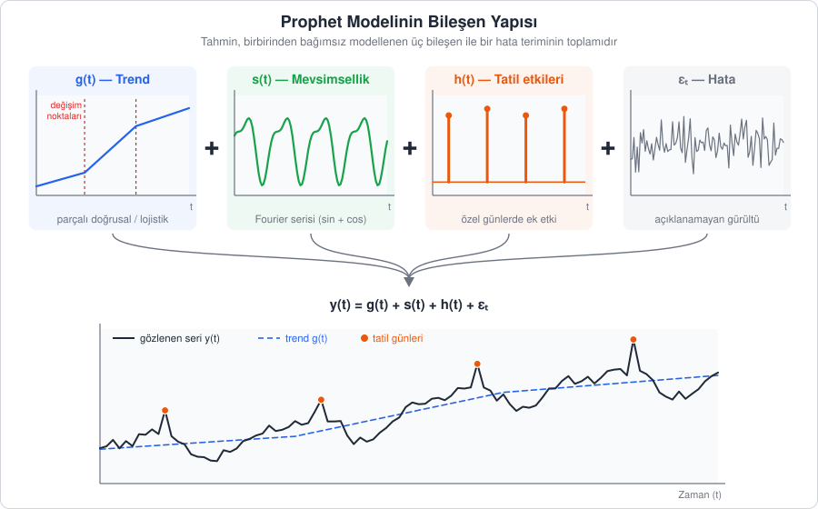
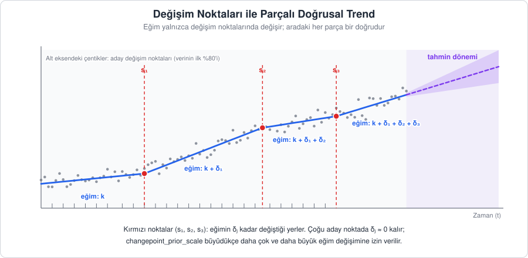
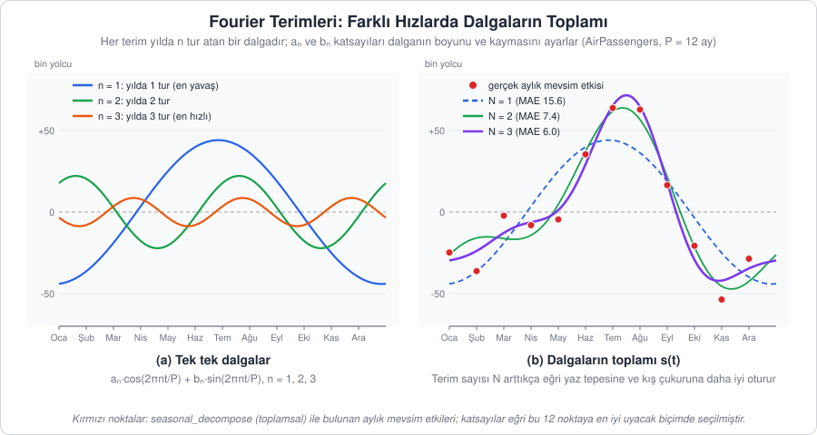
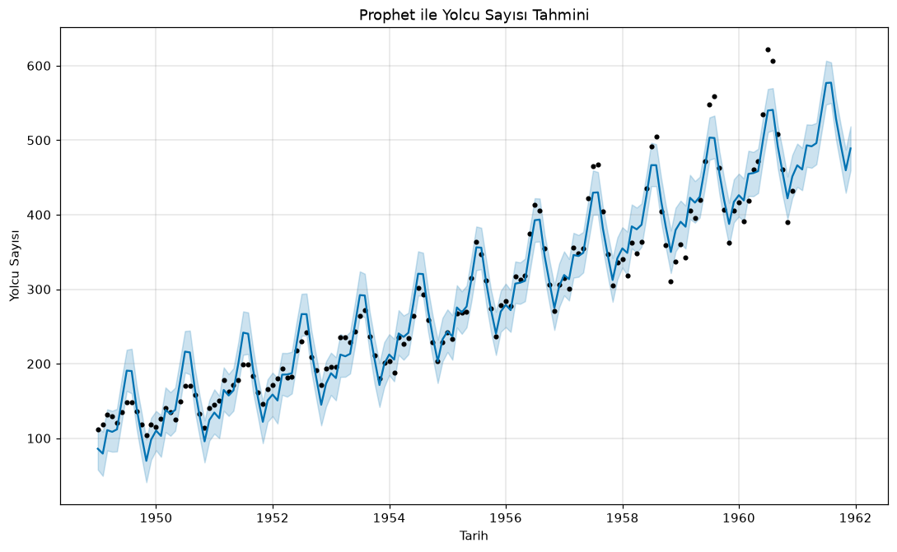
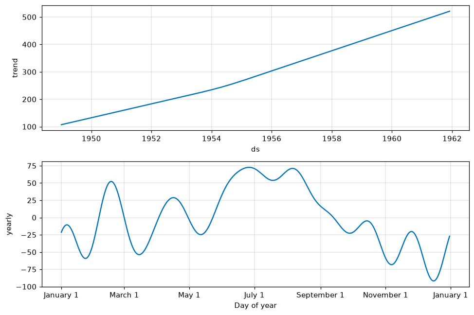
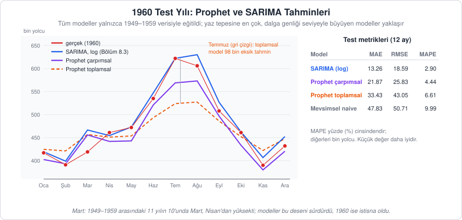

[İçindekiler](../Course_notes.md) · [← 8. Model Değerlendirme: Hata Metrikleri ve Eğitim-Test Ayrımı](08_model_degerlendirme_hata_metrikleri_ve_egitim_te.md) · [10. VAR: Çok Değişkenli Zaman Serisi Modeli →](10_var_cok_degiskenli_zaman_serisi_modeli.md)

## 9. Facebook Prophet

Bölüm 7'de ARIMA/SARIMA ile seriyi önce durağanlaştırıp sonra kendi geçmişiyle açıkladık; Bölüm 8'de de bir modelin başarısını eğitim-test ayrımı ve hata metrikleriyle ölçmeyi öğrendik. Bu bölümde aynı problemi bambaşka bir açıdan ele alan bir araca bakıyoruz: Facebook (Meta) tarafından geliştirilen **Prophet**.

**Açıklama:** Prophet, bir zaman serisini "zamanın bir fonksiyonu" olarak görür ve bu fonksiyonu anlaşılır parçalara ayırarak kurar: genel gidişat (trend), düzenli tekrarlar (mevsimsellik) ve özel günlerin etkisi (tatiller). ARIMA'daki gibi fark alma, ACF/PACF okuma ya da $(p,d,q)$ derecelerini seçme zorunluluğu yoktur; seri durağan olmasa da doğrudan uygulanabilir. LSTM gibi (Bölüm 15) içyapısı kapalı bir model de değildir: Her bileşeni ayrı ayrı çizip yorumlayabiliriz.

Bu fikir size tanıdık gelmeli. Bölüm 2.2 ve 2.6'da bir seriyi trend, mevsimsellik ve düzensiz bileşene **ayrıştırmıştık**. Prophet, bu ayrıştırma düşüncesini bir **tahmin modeline** dönüştürür: Bileşenleri yalnızca geçmişte ayırmakla kalmaz, her birini matematiksel bir fonksiyonla ifade edip geleceğe uzatır.

---

### 9.1. Model Yapısı

Matematikte **fonksiyon**, her girdiye bir çıktı karşılık getiren kuraldır. Örneğin $g(t) = 2t + 100$ kuralı, $t = 5$ girdisine $g(5) = 2 \cdot 5 + 100 = 110$ çıktısını verir. Prophet'ta girdi zamandır: Her bileşen, "zamanı ver, o andaki katkıyı söyleyeyim" diyen bir fonksiyondur.

**Tanım:** Prophet, gözlenen seriyi üç bileşen ile bir hata teriminin toplamı olarak modeller:

$$
y(t) = g(t) + s(t) + h(t) + \varepsilon_t
$$

> **Simge notu:** $`y(t)`$: $`t`$ anındaki gözlem; "y t" diye okunur. Parantezli yazım $`y(t)`$ ile alt indisli yazım $`y_t`$ aynı şeyi anlatır: "t zamanındaki y değeri" · $`g(t)`$: trend fonksiyonu (*growth*, büyüme) · $`s(t)`$: mevsimsel (periyodik, düzenli tekrar eden) bileşen (*seasonality*) · $`h(t)`$: tatil/özel gün etkileri (*holidays*) · $`\varepsilon_t`$ *(epsilon t)*: modelin açıklayamadığı rastgele hata. $`\varepsilon`$ bir Yunan harfidir; küme işareti $`\in`$ ("elemanıdır") ile karıştırmayın

Küçük bir örnek: Bir ayda trend 450 bin yolcuyu, mevsim etkisi +60'ı, tatil etkisi 0'ı gösteriyor ve o ay açıklanamayan bir −5'lik sapma olmuşsa gözlem $450 + 60 + 0 - 5 = 505$ olur. Model, gözlenen 505'i bu dört parçaya ayırmaya çalışır; tahmin yaparken de hata hariç ilk üç parçayı toplar.

Bileşenler birbirinden bağımsız olarak modellenir ve sonra toplanır. Model teknik olarak bir **eğri uydurma (curve fitting)** ya da regresyon problemidir; yani girdiden (zaman) çıktıyı (gözlem) veren bir denklemin katsayıları veriden bulunur. Zaman, modelin tek girdisidir. Bu yüzden ARIMA'dan farklı olarak gözlemlerin eşit aralıklı olması veya eksiksiz olması gerekmez.



*Şekil 9.1 — Prophet'ın bileşen yapısı: Trend, mevsimsellik ve tatil etkileri ayrı ayrı modellenir, hata terimiyle birlikte toplanarak gözlenen seriyi oluşturur.*

#### 9.1.1. Trend Bileşeni: g(t)

Trend, serinin uzun vadeli yönünü taşır. Prophet'ta iki seçenek vardır.

**Tanım 1 (parçalı doğrusal trend):** Varsayılan seçenektir. Trendi bir cetvel gibi düz bir doğru olarak düşünün; ama bu cetvel belirli noktalarda bükülebilir. Doğrunun **eğimi** (her zaman adımında ne kadar arttığı) belirli zaman noktalarında değişebilir. Eğimin değiştiği bu noktalara **değişim noktaları (changepoints)** denir. $s_1, s_2, \dots, s_S$ değişim noktaları için basitleştirilmiş gösterim şöyledir:

$$
g(t) = \Big(k + \sum_{j: s_j \le t} \delta_j\Big) t + \Big(m + \sum_{j: s_j \le t} \gamma_j\Big)
$$

> **Simge notu:** $`k`$: başlangıç eğimi (büyüme hızı) · $`m`$: başlangıç seviyesi (doğrunun $`t = 0`$'daki değeri, kesişim) · $`s_j`$: j'inci değişim noktasının zamanı (buradaki $`s`$, mevsim uzunluğu değil; $`S`$ de değişim noktalarının sayısıdır) · $`\delta_j`$ *(delta j)*: j'inci değişim noktasında eğime eklenen miktar · $`\gamma_j`$ *(gama j)*: doğru parçalarının kopmadan birleşmesini sağlayan düzeltme terimi · $`\sum_{j: s_j \le t}`$ *(büyük sigma = toplam)*: "$`s_j \le t`$ olan, yani $`t`$ anına kadar geçilmiş bütün değişim noktaları için topla"; henüz gelinmemiş değişim noktaları toplama girmez

**Yorum:** $t$ anındaki eğim, başlangıç eğimi $k$'ye o ana kadar geçilen tüm değişim noktalarındaki $\delta_j$ ayarlamalarının eklenmesiyle bulunur. İlk değişim noktasından sonra eğim $k + \delta_1$, ikincisinden sonra $k + \delta_1 + \delta_2$ olur (Şekil 9.2). $\gamma_j$ terimleri ise trend çizgisinin değişim noktalarında "kırılıp" kopmamasını, sürekli kalmasını sağlar.

Bunu sayılarla görelim. Başlangıç eğimi $k = 2$ (her ay 2 birim artış), başlangıç seviyesi $m = 100$ olsun ve $s_1 = 10$. ayda tek bir değişim noktası bulunsun; burada eğim $\delta_1 = +1$ kadar artsın.

1. **Değişim noktasından önce** ($t < 10$): Toplamlara hiçbir terim girmez, $g(t) = 2t + 100$'dür. $g(0) = 100$, $g(5) = 110$ ve değişim anında $g(10) = 2 \cdot 10 + 100 = 120$.
2. **Değişim noktasından sonra** ($t \ge 10$): Eğim $2 + 1 = 3$ olur. $\gamma_1$ olmasaydı, yani $g(t) = 3t + 100$ deseydik, $g(10) = 130$ çıkardı: Trend 10. ayda 120'den 130'a aniden sıçrardı. Bu kopukluğu önlemek için kesişim $\gamma_1 = -s_1 \cdot \delta_1 = -10 \cdot 1 = -10$ kadar düzeltilir ve $g(t) = 3t + 90$ olur.
3. **Sağlama:** $g(10) = 3 \cdot 10 + 90 = 120$ (sıçrama yok), $g(12) = 3 \cdot 12 + 90 = 126$. Yani 10. aydan sonra trend her ay 2 değil 3 birim artmaktadır.

Genel kural $\gamma_j = -s_j \cdot \delta_j$'dir. $\gamma_j$'ler veriden ayrıca öğrenilmez; $\delta_j$'ler bulununca Prophet onları bu kuralla kendisi hesaplar.



*Şekil 9.2 — Parçalı doğrusal trend: Eğim yalnızca değişim noktalarında ($`s_1, s_2, s_3`$) değişir. Tahmin döneminde trend son eğimle uzatılır ve belirsizlik aralığı giderek genişler.*

Değişim noktalarını elle vermemiz gerekmez. Prophet varsayılan olarak verinin **ilk %80'lik** kısmına eşit aralıklı 25 **aday** değişim noktası yerleştirir (`n_changepoints=25`, `changepoint_range=0.8`). Ardından her $`\delta_j`$ için sıfıra yakın değerleri ödüllendiren bir **ön dağılım** (önsel, *prior*; Laplace önseli) kullanır. Ön dağılım, veriye bakmadan önce bir parametre hakkındaki varsayımımızdır. Buradaki varsayım "eğim değişikliklerinin çoğu sıfırdır, arada bir büyük olabilir" şeklindedir ve bir ceza gibi çalışır: Eğimi değiştirmek modele "pahalıya" mal olur, bu yüzden model eğimi ancak veri bunu açıkça gerektiriyorsa değiştirir. Sonuçta adayların çoğunda $`\delta_j \approx 0`$ kalır; yalnızca gerçekten yön değişimi olan yerlerde eğim anlamlı biçimde değişir. 9.2'deki `AirPassengers` modelinde 25 adayın yalnızca 5'inde (Ağustos 1953 ile Şubat 1955 arasındaki adaylarda) eğim belirgin biçimde artmıştır; bunu Şekil 9.5'teki trend panelinde 1954 civarındaki hafif bükülme olarak görebilirsiniz.

> **Simge notu:** $`\approx`$ *(yaklaşık eşit)*: değerin neredeyse aynı olduğunu gösterir

Bu esnekliği `changepoint_prior_scale` parametresi (varsayılan 0.05) belirler. Parametre, yukarıdaki cezanın ne kadar gevşek olduğunu ayarlar:

- **Büyük değer** (ör. 0.5): Ceza hafifler, trend daha esnek olur, her kıvrımı izler. Aşırı uyum (overfitting) riski artar.
- **Küçük değer** (ör. 0.01): Ceza ağırlaşır, trend katılaşır, gerçek yön değişimlerini kaçırabilir.

> **Hemen deneyin 9.1.1a · `changepoint_prior_scale` ile trendi esnetin** (Python, ~4 dk)
>
> Prophet kodunun ayrıntıları 9.2–9.3'te satır satır açıklanıyor; burada yalnızca tek bir ayarın etkisine bakıyoruz. Modeli 1949–1959 ile eğitip 1960'ı tahmin ediyor, üç farklı esneklik değerini karşılaştırıyoruz. Depo kök dizininden çalıştırın (üç model birkaç saniyede kurulur).
>
> ```python
> import numpy as np
> import pandas as pd
> from prophet import Prophet
> import logging; logging.getLogger("cmdstanpy").disabled = True   # "Chain ..." bilgi satırlarını gizler
>
> df = pd.read_csv("data/AirPassengers.csv")
> df.columns = ["ds", "y"]                             # Prophet'ın beklediği sütun adları
> df["ds"] = pd.to_datetime(df["ds"])
> train, test = df.iloc[:-12], df.iloc[-12:]           # 1949-1959 eğitim, 1960 test
>
> for cps in [0.002, 0.05, 0.5]:                       # trendin esnekliği
>     m = Prophet(changepoint_prior_scale=cps, seasonality_mode="multiplicative")  # çarpımsal: 9.1.4
>     m.fit(train)
>     fc = m.predict(m.make_future_dataframe(periods=12, freq="MS"))
>     tahmin = fc["yhat"].iloc[-12:].values            # son 12 satır = 1960
>     print(cps, " MAE:", round(np.mean(np.abs(test["y"].values - tahmin)), 2),
>           " Aralık 1960 trendi:", round(fc["trend"].iloc[-1], 1))
> ```
>
> **Ne göreceksiniz** (Prophet 1.5; en üstte "Importing plotly failed" uyarısı çıkabilir, etkisi yoktur):
>
> ```text
> 0.002  MAE: 31.77  Aralık 1960 trendi: 461.8
> 0.05  MAE: 21.87  Aralık 1960 trendi: 476.3
> 0.5  MAE: 21.05  Aralık 1960 trendi: 476.7
> ```
>
> Çok küçük değerde (0.002) ceza o kadar ağırdır ki trend eğimini neredeyse hiç değiştiremez; trend daha yavaş büyür, Aralık 1960'ta 461.8'de kalır ve MAE 31.77'ye çıkar. Varsayılan 0.05 (MAE 21.87, 9.3'teki çarpımsal modelle aynı sayı) ile 0.5 arasında ise fark küçüktür.
>
> **Şimdi siz:** Listeye `0.01` ekleyin. MAE kaç çıkıyor? Bu değeri "en iyi" diye seçmek doğru olur mu?
>
> <details><summary>Cevap</summary>
>
> `0.01  MAE: 19.83  Aralık 1960 trendi: 478.6`. Denenenler arasında en küçük MAE budur. Ama bu değeri 1960'a (test setine) bakarak seçersek 8.1.1'deki "test setine bakarak model seçmek" hatasını yapmış oluruz. Doğrusu, ayarı eğitim setinin sonundan ayrılan bir doğrulama döneminde seçmek, test setini yalnızca en sonda bir kez kullanmaktır.
>
> </details>

**Tanım 2 (lojistik büyüme trendi):** Bazı seriler sonsuza kadar büyüyemez; bir doygunluk seviyesine yaklaşır (ör. bir ülkedeki internet kullanıcı sayısı nüfusu aşamaz). Böyle bir büyüme önce yavaş başlar, sonra hızlanır, üst sınıra yaklaştıkça yeniden yavaşlar ve durur. Grafiği S harfine benzeyen bu eğri şöyle yazılır:

$$
g(t) = \frac{C}{1 + \exp\big(-k (t - m)\big)}
$$

> **Simge notu:** $`C`$: taşıma kapasitesi (serinin ulaşabileceği üst sınır) · $`\exp(x)`$ *(üstel fonksiyon)*: $`e^{x}`$, yani $`e \approx 2.718`$ sayısının $`x`$'inci kuvveti; $`\exp(0) = 1`$, $`x`$ büyüdükçe çok hızlı büyür, $`x`$ eksi yönde büyüdükçe sıfıra yaklaşır · $`k`$: büyüme hızı · $`m`$: burada başlangıç seviyesi **değil**, eğrinin en hızlı yükseldiği orta noktanın zamanıdır (aynı harf iki tanımda farklı anlamda kullanılır)

$C = 100$, $k = 1$, $m = 5$ alıp birkaç noktada hesaplayalım:

| $`t`$ | $`-k(t-m)`$ | $`\exp(\cdot)`$ | $`g(t) = 100 / (1 + \exp(\cdot))`$ |
| --- | --- | --- | --- |
| 0 | 5 | ≈ 148.4 | $`100 / 149.4 \approx 0.7`$ |
| 3 | 2 | ≈ 7.39 | $`100 / 8.39 \approx 11.9`$ |
| 5 | 0 | 1 | $`100 / 2 = 50`$ |
| 7 | −2 | ≈ 0.135 | $`100 / 1.135 \approx 88.1`$ |
| 10 | −5 | ≈ 0.0067 | $`100 / 1.0067 \approx 99.3`$ |

Tablo eğrinin hikâyesini anlatır: Başta neredeyse sıfır, orta noktada ($t = m$) tam olarak üst sınırın yarısı (50), sonra 100'e yaklaşır ama onu hiç aşmaz. Prophet'ta bu seçenek `Prophet(growth='logistic')` ile kullanılır; veri çerçevesine üst sınırı gösteren bir `cap` sütunu eklemek gerekir. Lojistik trendde de büyüme hızı $k$ değişim noktalarında ayarlanabilir.

> **Hemen deneyin 9.1.1b · Lojistik eğriyi Excel'de çizin** (Excel / LibreOffice Calc, ~4 dk)
>
> 1. **A1**'e `t`, **B1**'e `g(t)` yazın. **A2:A12** hücrelerine 0'dan 10'a kadar sayıları girin (A2'ye 0, A3'e 1 yazıp ikisini seçin ve aşağı sürükleyin).
> 2. **B2**'ye `=100/(1+ÜS(-1*(A2-5)))` yazın (İngilizce: `=100/(1+EXP(-1*(A2-5)))`). `ÜS(x)`, formüldeki $\exp(x) = e^x$'tir. B2'yi B12'ye kadar aşağı sürükleyin.
> 3. **A1:B12**'yi seçin ve **Ekle → Grafik** menüsünden bir dağılım (çizgili) grafiği ekleyin.
>
> **Ne göreceksiniz:** t = 0, 3, 5, 7, 10 satırlarında 0,67; 11,92; 50; 88,08; 99,33 değerleri (yuvarlanmış hâlde): 9.1.1'deki tablonun aynısı. Grafik S biçimindedir: Önce yavaş, t = 5 civarında en hızlı yükselir, sonra 100'e yaklaşıp yatıklaşır ve 100'ü hiç aşmaz.
>
> **Şimdi siz:** Büyüme hızını bir hücreye taşıyın: **E1**'e `1` yazın ve B2'deki formülü `=100/(1+ÜS(-$E$1*(A2-5)))` yapıp yeniden aşağı sürükleyin (`$E$1`, sürüklerken hep E1'e bakılmasını sağlar). Şimdi E1'e `2` yazın. t = 3 ve t = 7'de değerler nasıl değişti, eğri nasıl görünüyor?
>
> <details><summary>Cevap</summary>
>
> $k = 2$ iken t = 3'te 1,80, t = 7'de 98,20 olur (t = 5'te yine tam 50). Eğri orta noktada çok daha dik yükselir; doygunluğa daha çabuk ulaşır. $k$, "S"nin ne kadar dik olacağını belirler; orta noktanın yeri ($m = 5$) ve üst sınır ($C = 100$) değişmez.
>
> </details>

#### 9.1.2. Mevsimsellik Bileşeni: s(t)

Mevsimsel desen, her yıl aynı biçimde tekrar eden bir dalgadır. Prophet bu dalgayı **Fourier serisi** ile, yani farklı hızlarda salınan basit dalgaların toplamıyla kurar. Fikir, bir müzik akorunun birkaç saf sesin üst üste binmesiyle oluşmasına benzer: Tek bir düzgün dalga kaba bir şekil verir; ona daha hızlı salınan küçük dalgalar eklendikçe karmaşık şekiller de elde edilebilir.

Yapı taşları **kosinüs** (cos) ve **sinüs** (sin) fonksiyonlarıdır. İkisi de −1 ile +1 arasında gidip gelen ve belirli bir aralıkla kendini aynen tekrarlayan dalgalardır. Bir tam tur $2\pi$ ile gösterilir ($\pi$ "pi" ≈ 3.14159 olduğundan $2\pi \approx 6.283$). Formül şudur:

$$
s(t) = \sum_{n=1}^{N} \left[ a_n \cos\left(\frac{2\pi n t}{P}\right) + b_n \sin\left(\frac{2\pi n t}{P}\right) \right]
$$

> **Simge notu:** $`P`$: periyot, yani desenin kendini tekrarladığı süre (Prophet zamanı gün cinsinden ölçer: yıllık mevsimsellik için $`P = 365.25`$ gün, haftalık için $`P = 7`$) · $`n`$: dalganın sırası; $`n`$'inci dalga bir periyotta $`n`$ tur atar · $`N`$: kullanılan dalga (Fourier terimi) sayısı · $`\sum_{n=1}^{N}`$: "$`n`$'yi 1'den $`N`$'ye kadar artırarak köşeli parantez içindekileri topla" · $`a_n, b_n`$: veriden öğrenilen katsayılar; her dalganın boyunu (genliğini) ve ne kadar kaydığını belirler · $`\pi`$ *(pi)*: 3.14159...; ARIMA'daki $`\phi`$ (fi) ile karıştırmayın

Parantez içindeki $2\pi n t / P$ ifadesi dalganın "kaçıncı turda" olduğunu söyler: $t$, 0'dan $P$'ye kadar ilerlerken bu açı 0'dan $2\pi n$'ye, yani $n$ tam tura kadar büyür. Bu yüzden $n = 1$ dalgası yılda bir, $n = 2$ dalgası yılda iki, $n = 3$ dalgası yılda üç tur atar. Okumayı kolaylaştırmak için zamanı ay olarak ölçelim ($P = 12$, Ocak $t = 0$) ve $n = 1$ dalgasının değerlerine bakalım:

| Ay | $`t`$ | açı $`2\pi t / 12`$ | $`\cos`$ | $`\sin`$ |
| --- | --- | --- | --- | --- |
| Ocak | 0 | 0 | 1 | 0 |
| Nisan | 3 | çeyrek tur ($`\pi/2`$) | 0 | 1 |
| Temmuz | 6 | yarım tur ($`\pi`$) | −1 | 0 |
| Ekim | 9 | üç çeyrek tur ($`3\pi/2`$) | 0 | −1 |
| (gelecek) Ocak | 12 | tam tur ($`2\pi`$) | 1 | 0 |

`AirPassengers`'ın aylık mevsim etkilerine (Şekil 9.3'teki kırmızı noktalar) uydurulan ilk dalganın katsayıları yaklaşık $a_1 = -44$ ve $b_1 = 3.6$'dır. Tablodaki değerleri yerine koyalım:

- Ocak: $s = -44 \cdot 1 + 3.6 \cdot 0 = -44$ (kışın ortalamanın altında)
- Nisan: $s = -44 \cdot 0 + 3.6 \cdot 1 = 3.6$ (ortalamaya yakın)
- Temmuz: $s = -44 \cdot (-1) + 3.6 \cdot 0 = +44$ (yazın ortalamanın üstünde)
- Ekim: $s = -44 \cdot 0 + 3.6 \cdot (-1) = -3.6$

Tek bir dalga bile "kış düşük, yaz yüksek" desenini yakalar. Ancak gerçek desen daha keskindir: Temmuz-Ağustos tepesi daha dar ve yüksek, Kasım çukuru daha derindir. Bunu yakalamak için yılda iki ve üç tur atan daha hızlı dalgalar eklenir (Şekil 9.3).



*Şekil 9.3 — Fourier terimleri: (a) Yılda 1, 2 ve 3 tur atan dalgalar, katsayıları `AirPassengers` verisinden bulunmuş hâlleriyle. (b) Bu dalgaların toplamı: Yalnızca ilk dalga ($`N = 1`$) aylık mevsim etkilerinden ortalama 15.6 bin yolcu sapar; üç dalga ($`N = 3`$) bu sapmayı 6.0'a indirir.*

**Yorum:** $n = 1$ terimi periyot başına tek bir tepe ve tek bir çukur üreten en kaba dalgadır. $n$ büyüdükçe daha hızlı salınan dalgalar eklenir; bunların toplamı, yaz tepesi ve kış çukuru gibi düzgün olmayan desenleri de yakalayabilir. $N$ (Prophet'taki adı `fourier_order`) büyüdükçe mevsimsel eğri daha esnek olur; varsayılan değer yıllık mevsimsellik için 10, haftalık için 3'tür. Esneklik bedelsiz değildir: Çok büyük $N$, veriye değil gürültüye uyan kıpır kıpır bir eğri üretebilir (9.2.1'deki bileşen grafiğinde bunun bir örneğini göreceğiz). Katsayılar $a_n, b_n$ sıradan bir regresyonla tahmin edilir: Her $\cos$ ve $\sin$ terimi bir girdi sütunu gibi davranır.

Bölüm 2.3'teki ayrımı hatırlayalım: Prophet'ın $s(t)$ bileşeni sabit ve bilinen periyotlu **mevsimselliği** modeller; süresi belirsiz **döngüsel** dalgalanmalar ise çoğunlukla trend bileşenine karışır.

> **Hemen deneyin 9.1.2 · İlk Fourier dalgasını Excel'de hesaplayın** (Excel / LibreOffice Calc, ~5 dk)
>
> 9.1.2'deki $a_1 = -44$, $b_1 = 3.6$ katsayılı dalgayı 12 ay için hesaplayalım.
>
> 1. **A1**'e `Ay`, **B1**'e `t`, **C1**'e `s(t)` yazın. **A2:A13**'e Ocak ... Aralık, **B2:B13**'e 0'dan 11'e kadar sayıları girin.
> 2. **C2**'ye `=-44*COS(2*Pİ()*B2/12)+3,6*SİN(2*Pİ()*B2/12)` yazın (İngilizce: `=-44*COS(2*PI()*B2/12)+3.6*SIN(2*PI()*B2/12)`) ve C13'e kadar aşağı sürükleyin. `Pİ()` π sayısını (3.14159...) verir.
> 3. **C14**'e `=TOPLA(C2:C13)` (İngilizce: `=SUM(C2:C13)`) yazın. Sonra **A1:A13** ve **C1:C13**'ü (Ctrl tuşuyla) seçip bir çizgi grafiği ekleyin.
>
> **Ne göreceksiniz:** C sütununda yuvarlanmış olarak −44; −36,3; −18,9; 3,6; 25,1; 39,9; 44; 36,3; 18,9; −3,6; −25,1; −39,9. Ocak, Nisan, Temmuz ve Ekim değerleri 9.1.2'deki elle hesapla (−44, 3.6, +44, −3.6) aynıdır. Grafik tek tepeli (Temmuz) ve tek çukurlu (Ocak) düzgün bir dalgadır. C14 0'dır (ya da `1E-14` gibi sıfıra çok yakın bir sayı): Bir tam periyot boyunca dalganın artıları ve eksileri birbirini götürür, yani mevsim etkileri yıl içinde toplamda seviyeyi değiştirmez.
>
> **Şimdi siz:** Yılda iki tur atan ikinci bir dalga ekleyin: C2'deki formülün sonuna `+10*COS(2*Pİ()*2*B2/12)` (İngilizce: `+10*COS(2*PI()*2*B2/12)`) ekleyip yeniden sürükleyin. Temmuz ve Ocak değerleri ne oldu? Grafiğin biçimi nasıl değişti?
>
> <details><summary>Cevap</summary>
>
> Temmuz 44'ten 54'e çıkar, Ocak −44'ten −34'e yükselir; değerler sırasıyla yaklaşık −34; −31,3; −23,9; −6,4; 20,1; 44,9; 54; 41,3; 13,9; −13,6; −30,1; −34,9 olur. Yaz tepesi daha dar ve sivri, kış çukuru ise daha geniş ve yayvan hâle gelir. Tek dalga simetrik bir şekil verirken ikinci dalga bu simetriyi bozar; 9.1.2'deki "daha hızlı dalgalar eklendikçe daha karmaşık şekiller" fikri budur.
>
> </details>

#### 9.1.3. Tatil ve Özel Gün Etkileri: h(t)

Bayramlar, Kara Cuma, okul tatilleri veya kampanya günleri gibi olaylar her yıl aynı takvim gününe denk gelmeyebilir (ör. Ramazan Bayramı her yıl yaklaşık 11 gün öne kayar). Bu yüzden periyodu sabit olan Fourier serisiyle yakalanamazlar. Prophet bu günleri kullanıcıdan bir liste olarak alır ve her olay için ayrı bir etki katsayısı öğrenir:

$$
h(t) = \sum_{i=1}^{L} \kappa_i \cdot \mathbf{1}\big[t \in D_i\big]
$$

> **Simge notu:** $`L`$: tanımlanan tatil/olay sayısı · $`D_i`$: i'inci olayın gerçekleştiği tarihler kümesi (ör. bütün yılların Ramazan Bayramı günleri) · $`\in`$ *(elemanıdır)*: $`t`$ tarihinin bu kümede olduğunu belirtir; epsilon ($`\varepsilon`$) ile karıştırmayın · $`\mathbf{1}[\cdot]`$ *(gösterge fonksiyonu)*: köşeli parantezdeki koşul doğruysa 1, değilse 0 veren bir açma-kapama anahtarı · $`\kappa_i`$ *(kappa i, "k"ye benzeyen Yunan harfi)*: i'inci olayın seriye eklediği etki

Yani $t$ günü bir tatile denk geliyorsa, o tatilin etkisi $\kappa_i$ tahmine eklenir. Örneğin günlük satış verisinde iki olay tanımlayalım: Ramazan Bayramı ($\kappa_1 = +80$) ve yılbaşı ($\kappa_2 = +120$). Bayram günlerinden birinde $h(t) = 80 \cdot 1 + 120 \cdot 0 = 80$, 31 Aralık'ta $h(t) = 80 \cdot 0 + 120 \cdot 1 = 120$, sıradan bir günde ise $80 \cdot 0 + 120 \cdot 0 = 0$'dır. Tatiller `holidays` parametresiyle bir veri çerçevesi olarak verilir; ülke tatilleri için `m.add_country_holidays(country_name='TR')` kısayolu da vardır. Aylık `AirPassengers` verisinde günlük tatil etkisi anlamlı olmadığından bu bileşeni aşağıdaki uygulamada kullanmıyoruz.

> **Hemen deneyin 9.1.3 · Türkiye tatillerini Prophet'a öğretin** (Python, ~5 dk)
>
> `AirPassengers` aylık olduğu için tatil etkisini yapay bir günlük seriyle görelim: Her gün 200 civarında satış yapan bir dükkân, Ramazan Bayramı günlerinde 80 adet fazla satıyor. Prophet bu +80'i bulabilecek mi?
>
> ```python
> import numpy as np
> import pandas as pd
> from prophet import Prophet
> from prophet.make_holidays import make_holidays_df
> import logging; logging.getLogger("cmdstanpy").disabled = True
>
> # Türkiye tatil tablosu (make_holidays_df: verilen yıllar ve ülke için tatil listesi üretir)
> tatil = make_holidays_df(year_list=[2023, 2024, 2025], country="TR")
> bayram = tatil.loc[tatil["holiday"] == "Eid al-Fitr", "ds"]   # Ramazan Bayramı günleri
> print(sorted(bayram.dt.strftime("%Y-%m-%d")))
>
> # Yapay günlük satış: 200 civarı + gürültü, bayram günlerinde +80
> np.random.seed(0)
> gun = pd.date_range("2023-01-01", "2025-12-31", freq="D")
> y = 200 + np.random.normal(0, 10, len(gun)) + 80 * gun.isin(bayram)
> df = pd.DataFrame({"ds": gun, "y": y})
>
> m = Prophet(yearly_seasonality=False, weekly_seasonality=False)
> m.add_country_holidays(country_name="TR")            # Türkiye tatillerini modele ekle
> m.fit(df)
> fc = m.predict(df)
> print("Bayram etkisi:", fc.loc[gun.isin(bayram), "Eid al-Fitr"].round(1).unique())
> print("Yılbaşı etkisi:", fc.loc[gun == "2024-01-01", "New Year's Day"].round(1).values)
> ```
>
> `np.random.normal(0, 10, n)` ortalaması 0, standart sapması 10 olan n rastgele sayı üretir; `gun.isin(bayram)` her gün için "bayram mı?" sorusuna `True`/`False` (sayı olarak 1/0) cevabı verir, yani 9.1.3'teki $\mathbf{1}[t \in D_i]$ göstergesidir. `.unique()` tekrarlayan değerleri bir kez gösterir.
>
> **Ne göreceksiniz:**
>
> ```text
> ['2023-04-21', '2023-04-22', '2023-04-23', '2024-04-10', '2024-04-11', '2024-04-12', '2025-03-30', '2025-03-31', '2025-04-01']
> Bayram etkisi: [82.5]
> Yılbaşı etkisi: [3.9]
> ```
>
> Ramazan Bayramı her yıl yaklaşık 11 gün öne kayar (ilk günü 21 Nisan 2023 → 10 Nisan 2024 → 30 Mart 2025); sabit periyotlu Fourier terimleri bunu yakalayamaz, tatil listesi yakalar. Model bayram etkisini $\kappa \approx 82.5$ olarak bulur (gerçek değer 80; fark gürültüden gelir). Yılbaşına hiçbir etki koymadık; bulunan 3.9 da gürültü düzeyindedir. Tatil adları `holidays` paketinden İngilizce gelir; sürüme göre değişebilir, `tatil["holiday"].unique()` ile listeye bakabilirsiniz.
>
> **Şimdi siz:** Dükkânın bayramda kapalı olduğunu ve satışın 50 adet **düştüğünü** varsayın: `+ 80 * gun.isin(bayram)` yerine `- 50 * gun.isin(bayram)` yazın. Bayram etkisi kaç çıkar?
>
> <details><summary>Cevap</summary>
>
> `Bayram etkisi: [-47.6]`. Tatil etkisi eksi de olabilir: $\kappa$ yalnızca "o gün seriye ne eklenir" sorusunun cevabıdır. Yılbaşı etkisi yine 3.9'dur, çünkü gürültü aynıdır (aynı `seed`).
>
> </details>

#### 9.1.4. Toplamsal ve Çarpımsal Mevsimsellik

Yukarıdaki model **toplamsaldır**: Mevsimsel etki, trendin seviyesinden bağımsız, sabit bir miktardır. Bölüm 2.4'te gördüğümüz gibi `AirPassengers` serisinde ise mevsimsel dalgaların genliği yolcu sayısıyla birlikte büyür; seri "huni" gibi açılır. Bu yapı **çarpımsaldır**.

Prophet bunu `seasonality_mode='multiplicative'` seçeneğiyle karşılar. Bu durumda model şu biçimi alır:

$$
y(t) = g(t) \cdot \big(1 + s(t) + h(t)\big) + \varepsilon_t
$$

Artık $s(t)$ bir miktar değil, trendin **oransal** bir düzeltmesidir: $s(t) = 0$ "trend aynen", $s(t) = 0.20$ "trendin %20 üzerinde", $s(t) = -0.20$ "trendin %20 altında" demektir. Parantez içindeki 1, trendin kendisini temsil eder: $g(t) \cdot (1 + 0.20) = g(t) + 0.20 \cdot g(t)$, yani trend artı trendin %20'si. Farkı sayılarla görelim:

| Trend $`g(t)`$ | Toplamsal, $`s(t) = +60`$ | Çarpımsal, $`s(t) = 0.20`$ |
| --- | --- | --- |
| 200 | $`200 + 60 = 260`$ | $`200 \cdot 1.20 = 240`$ |
| 450 | $`450 + 60 = 510`$ | $`450 \cdot 1.20 = 540`$ |

Toplamsal modelde yaz artışı seviye ne olursa olsun 60 yolcudur. Çarpımsal modelde ise trend 200'deyken 40, 450'deyken 90 yolcudur: Trend yükseldikçe aynı %20'nin mutlak karşılığı da büyür; tıpkı Bölüm 2.4'teki çarpımsal modelde olduğu gibi. 9.3'te kuracağımız çarpımsal modelde Temmuz 1960 için trend yaklaşık 462.4, yıllık etki $s(t) \approx 0.230$'dur ve tahmin $462.4 \cdot 1.230 \approx 568.9$ bin yolcu olur. Bu %23'lük Temmuz etkisi, Bölüm 2.6'daki çarpımsal ayrıştırmada bulduğumuz Temmuz katsayısıyla (yaklaşık 1.23) neredeyse aynıdır.

**Not —** Bölüm 7'de SARIMA'yı `log(AirPassengers)` üzerine kurarak aynı sorunu log dönüşümüyle çözmüştük. Prophet'ta iki yol da mümkündür: Ya seriyi `np.log()` ile dönüştürüp toplamsal model kurarsınız (tahminleri sonra `np.exp()` ile geri çevirirsiniz), ya da doğrudan `seasonality_mode='multiplicative'` kullanırsınız.

> **Hemen deneyin 9.1.4 · Toplamsal mı, çarpımsal mı? Excel'de karşılaştırın** (Excel / LibreOffice Calc, ~3 dk)
>
> 1. **A1**'e `Trend`, **B1**'e `Toplamsal`, **C1**'e `Çarpımsal`, **D1**'e `Yaz artışı (çarpımsal)` yazın.
> 2. **A2:A6**'ya 100, 200, 300, 400, 500 girin.
> 3. **B2**'ye `=A2+60`, **C2**'ye `=A2*1,2` (İngilizce Excel'de `=A2*1.2`), **D2**'ye `=C2-A2` yazıp 6. satıra kadar sürükleyin.
>
> **Ne göreceksiniz:** B sütunu 160, 260, 360, 460, 560; C sütunu 120, 240, 360, 480, 600; D sütunu 20, 40, 60, 80, 100. Toplamsal modelde yaz artışı her seviyede 60'tır; çarpımsal modelde trendle birlikte büyür. İki model trend = 300'de aynı sonucu (360) verir; trend bunun altındayken toplamsal, üstündeyken çarpımsal model daha büyük bir yaz tepesi üretir.
>
> **Şimdi siz:** Çarpımsal yaz etkisi %20 değil %30 olsaydı ($s(t) = 0.30$), iki model hangi trend seviyesinde aynı sonucu verirdi? Önce kâğıtta $g + 60 = 1.30 \cdot g$ denklemini çözün, sonra C2'deki 1,2'yi 1,3 yapıp kontrol edin.
>
> <details><summary>Cevap</summary>
>
> $60 = 0.30 \cdot g$, yani $g = 200$. Excel'de trend 200 satırında B ve C sütunlarının ikisi de 260 olur.
>
> </details>

---

### 9.2. Python ile Uygulama

> **Uygulama dosyası:** [`Codes/python/ch09_prophet.py`](../Codes/python/ch09_prophet.py) · [Notebook](../Codes/notebooks/ch09_prophet.ipynb) · [](https://colab.research.google.com/github/erkanozhan/AI_Based_Time_Series-Data_Analytics/blob/main/Codes/notebooks/ch09_prophet.ipynb)
>
> Bu bölümdeki kodların tamamı bu dosyada. Bilgisayarınızda çalıştırmak için depo kök dizininde `python Codes/python/ch09_prophet.py` komutunu kullanın ya da dosyayı VS Code'da açıp hücre hücre çalıştırın. Kurulum yapmadan denemek için Colab bağlantısını kullanabilirsiniz.

Prophet'ı kullanmanın ilk kuralı, veriyi onun beklediği biçime getirmektir: Tarih sütununun adı `ds` (*datestamp*, tarih damgası), tahmin edilecek değer sütununun adı `y` olmalıdır. Prophet sütunları adlarıyla tanır; başka adlar verirseniz `fit()` hata verir. Kurulum için `pip install prophet` yeterlidir.

İlk olarak varsayılan (toplamsal) modeli tüm veriyle eğitip 12 ay ileriye tahmin yapalım.

```python
import numpy as np
import pandas as pd
from prophet import Prophet
import matplotlib.pyplot as plt

# Veri setini yükleyelim. Orijinal CSV dosyasında sütun isimleri 'Month' ve 'Passengers'.
df = pd.read_csv('data/AirPassengers.csv')

# Prophet'ın gerektirdiği şekilde sütun isimlerini 'ds' ve 'y' olarak değiştirelim.
df.columns = ['ds', 'y']

# Prophet, 'ds' sütununun tarih-zaman nesneleri içerdiğinden emin olmak ister.
# Bu yüzden pandas'ın to_datetime fonksiyonu ile bu dönüşümü yapıyoruz.
df['ds'] = pd.to_datetime(df['ds'])

# Şimdi modelimizi oluşturalım.
# AirPassengers verisi aylık olduğu ve yıllık bir döngüye sahip olduğu için
# yearly_seasonality=True parametresini kullanıyoruz.
# Günlük döngüyü açıkça kapatıyoruz; haftalık döngüyü Prophet aylık veride zaten
# kendiliğinden kapatır (varsayılan ayar 'auto').
m = Prophet(yearly_seasonality=True, daily_seasonality=False)

# fit() metodu ile modelimizi hazırladığımız veri setine eğitiyoruz.
# Bu aşamada Prophet, veriden trendi ve mevsimsel desenleri öğrenir.
m.fit(df)

# Tahmin yapabilmek için gelecekteki tarihleri içeren bir veri çerçevesine ihtiyacımız var.
# Prophet bu işlemi make_future_dataframe metodu ile bizim için kolaylaştırır.
# periods=12 ile 12 dönem (ay) ileriye, freq='MS' ile de her ayın başına
# denk gelecek şekilde tarihler oluşturmasını söylüyoruz.
future = m.make_future_dataframe(periods=12, freq='MS')

# predict() metodu, oluşturduğumuz bu gelecek tarihleri alır ve her bir tarih için
# bir tahmin üretir. Belirsizlik aralığı rastgele simülasyonla hesaplandığı için
# aynı sonuçları almak üzere rastgele sayı üretecini sabitliyoruz.
np.random.seed(42)
forecast = m.predict(future)

# Tahmin sonuçları oldukça detaylı bir veri çerçevesi olarak döner.
# Bizi en çok ilgilendiren sütunlar şunlardır:
# 'ds': Tarih
# 'yhat': Modelin yaptığı tahmin
# 'yhat_lower' ve 'yhat_upper': Tahminin belirsizlik aralığı. Model, gerçek değerin
# büyük olasılıkla bu iki sınır arasında olacağını öngörür.
print("--- Tahmin Sonuçları (Son 12 Ay) ---")
print(forecast.set_index('ds')[['yhat', 'yhat_lower', 'yhat_upper']].tail(12).round(1))
```

Çıktı (Prophet 1.5, eğitim sırasında `cmdstanpy`'nin yazdığı "Chain [1] start/done processing" bilgi satırları hariç):

```text
--- Tahmin Sonuçları (Son 12 Ay) ---
             yhat  yhat_lower  yhat_upper
ds
1961-01-01  466.2       437.3       495.3
1961-02-01  460.7       432.7       489.6
1961-03-01  493.1       464.2       521.0
1961-04-01  491.7       462.8       520.7
1961-05-01  496.0       467.6       523.1
1961-06-01  537.1       508.7       566.5
1961-07-01  576.7       547.7       606.5
1961-08-01  577.1       549.8       604.3
1961-09-01  528.5       500.5       555.3
1961-10-01  493.4       465.7       520.2
1961-11-01  459.5       429.2       487.2
1961-12-01  488.9       459.4       518.5
```

Kodu adım adım okuyalım:

1. Kütüphane satırları Bölüm 7.7'deki gibidir; `from prophet import Prophet` ise `prophet` paketinden yalnızca `Prophet` sınıfını (model şablonunu) alır.
2. `pd.read_csv()` CSV dosyasını satır ve sütunlardan oluşan bir tabloya (DataFrame) okur. Dosyadaki sütunlar `Month` ve `Passengers`'tır; `df.columns = ['ds', 'y']` bu adları sırasıyla Prophet'ın beklediği adlarla değiştirir. `pd.to_datetime()` ise `"1949-01"` gibi metinleri gerçek tarih nesnesine (1949-01-01) çevirir; Prophet zamanı ancak tarih nesnesinden hesaplayabilir. `df['ds']` köşeli parantezle tablodan adı verilen sütunu seçer.
3. `Prophet(...)` henüz eğitilmemiş, boş bir model nesnesi oluşturur; ayarlar argümanlarla verilir. `yearly_seasonality=True`, 9.1.2'deki yıllık Fourier terimlerini (varsayılan $N = 10$) modele ekler. Varsayılan değer `'auto'` olsaydı da veri iki yıldan uzun olduğu için açılırdı; burada niyetimizi açıkça yazıyoruz. `daily_seasonality=False` gün içi döngüyü kapatır. Haftalık döngü (`weekly_seasonality`) varsayılan `'auto'` ayarında kalır ve Prophet gözlemler arasında bir haftadan kısa aralık olmadığını görünce onu kendiliğinden kapatır.
4. `m.fit(df)` modeli eğitir: Trendin $k$, $m$, $\delta_j$ değerlerini ve mevsimselliğin $a_n$, $b_n$ katsayılarını veriye en iyi uyacak biçimde bulur. Prophet bu hesabı arka planda Stan adlı istatistik yazılımıyla yapar; ekranda görülen "Chain [1] start processing / done processing" satırları bu işlemin bilgi mesajlarıdır, hata değildir.
5. `m.make_future_dataframe(periods=12, freq='MS')` yalnızca bir `ds` sütunu olan yeni bir tablo üretir: Eğitim verisindeki 144 tarihin hepsi ve ardından gelen 12 yeni tarih, toplam 156 satır. `periods=12` kaç yeni dönem ekleneceğini, `freq='MS'` (*Month Start*, ay başı) bu dönemlerin aralığını belirler: 1961-01-01, 1961-02-01, ... Bu argüman unutulursa varsayılan sıklık **günlük** olur ve Prophet 1961'in 12 ayı yerine Aralık 1960'ın 2'sinden 13'üne kadar 12 gün üretir; aylık veride bu hatalı bir tahmin tablosu demektir.
6. `np.random.seed(42)`: Prophet, `yhat_lower` ve `yhat_upper` sınırlarını gelecekteki olası trend değişimlerini ve gürültüyü varsayılan olarak 1000 kez rastgele simüle ederek hesaplar. Rastgele sayı üretecinin başlangıç noktasını (tohum, *seed*) sabitlemek, kodu her çalıştırdığınızda aynı sınırları almanızı sağlar; `yhat` ise simülasyona bağlı değildir.
7. `m.predict(future)` her tarih için tahmini hesaplar ve `trend`, `yearly`, `yhat`, `yhat_lower`, `yhat_upper` gibi çok sayıda sütun içeren bir tablo döndürür. Son satırda `set_index('ds')` tarihleri satır etiketi yapar, `[['yhat', 'yhat_lower', 'yhat_upper']]` (çift köşeli parantez: sütun listesi) yalnızca bu üç sütunu seçer, `tail(12)` son 12 satırı (1961) alır, `round(1)` bir ondalığa yuvarlar.

Ardından Prophet'ın hazır grafik fonksiyonlarıyla sonuçları çizelim:

```python
# Prophet'ın en güzel yanlarından biri, sonuçları görselleştirmek için
# kendi içerisinde hazır fonksiyonlar sunmasıdır.
# plot() fonksiyonu, geçmiş verileri, tahminleri ve belirsizlik aralığını çizer.
fig1 = m.plot(forecast)
plt.title('Prophet ile Yolcu Sayısı Tahmini')
plt.xlabel('Tarih')
plt.ylabel('Yolcu Sayısı')
plt.show()

# plot_components() fonksiyonu ise modelin öğrendiği bileşenleri ayrı ayrı görmemizi sağlar.
# Bu, serinin yapısını anlamak için çok değerlidir.
# Trend grafiği, yolcu sayısındaki genel artışı gösterir.
# Yıllık mevsimsellik grafiği ise hangi aylarda artış, hangilerinde azalış olduğunu net bir şekilde ortaya koyar.
fig2 = m.plot_components(forecast)
plt.show()
```

`m.plot(forecast)` siyah noktalarla gerçek gözlemleri, koyu mavi çizgiyle `yhat`'ı, açık mavi bantla da `yhat_lower` ile `yhat_upper` arasını çizer (Şekil 9.4). Grafik `matplotlib` ile çizildiği için başlık ve eksen adları `plt.title()`, `plt.xlabel()`, `plt.ylabel()` ile değiştirilebilir; `plt.show()` grafiği ekranda gösterir. `m.plot_components(forecast)` ise modeli oluşturan bileşenleri alt alta ayrı paneller hâlinde çizer (Şekil 9.5).



*Şekil 9.4 — `m.plot(forecast)` çıktısı: Siyah noktalar gerçek değerler, koyu mavi çizgi modelin tahmini (`yhat`), açık mavi bant %80'lik belirsizlik aralığıdır. 1961 yılı tahmin dönemidir.*



*Şekil 9.5 — `m.plot_components(forecast)` çıktısı: Üstte trend, altta yıllık mevsimsellik bileşeni. Aylık veride alt paneldeki eğrinin yalnızca ay başlarındaki değerleri anlamlıdır.*

> **Hemen deneyin 9.2 · Prophet'ı başka bir seride deneyin: Mauna Loa CO₂** (Python, ~5 dk)
>
> statsmodels kütüphanesi, Hawaii'deki Mauna Loa gözlemevinin 1958–2001 arası haftalık atmosferik CO₂ ölçümlerini (ppm, milyonda bir) hazır veri olarak içerir; ek dosya gerekmez. Seriyi aylığa çevirip Prophet'la 2 yıl ileriye tahmin edelim.
>
> ```python
> import numpy as np
> import pandas as pd
> import statsmodels.api as sm
> from prophet import Prophet
> import logging; logging.getLogger("cmdstanpy").disabled = True
>
> co2 = sm.datasets.co2.load_pandas().data             # Mauna Loa CO2 (ppm), haftalık, 1958-2001
> df = co2["co2"].resample("MS").mean().reset_index()   # resample("MS").mean(): aylık ortalama
> df.columns = ["ds", "y"]
> print("ay sayısı:", len(df), " eksik ay:", df["y"].isna().sum())
>
> m = Prophet(daily_seasonality=False)
> m.fit(df)                                            # eksik (NaN) aylar kendiliğinden atlanır
> np.random.seed(42)
> fc = m.predict(m.make_future_dataframe(periods=24, freq="MS"))
> print(fc.set_index("ds")[["yhat", "yhat_lower", "yhat_upper"]].tail(3).round(1))
> yil = fc.set_index("ds")["yearly"].iloc[:12]          # ilk 12 ayın mevsim etkisi
> print("en yüksek:", yil.idxmax().month_name(), round(yil.max(), 2),
>       " en düşük:", yil.idxmin().month_name(), round(yil.min(), 2))
> ```
>
> `reset_index()` tarih indeksini sıradan bir sütuna çevirir (Prophet `ds`'yi sütun olarak ister). `idxmax()` / `idxmin()` en büyük / en küçük değerin tarihini, `.month_name()` o tarihin ay adını verir.
>
> **Ne göreceksiniz:**
>
> ```text
> ay sayısı: 526  eksik ay: 5
>              yhat  yhat_lower  yhat_upper
> ds                                       
> 2003-10-01  372.0       371.2       372.8
> 2003-11-01  373.4       372.5       374.2
> 2003-12-01  374.7       373.8       375.6
> en yüksek: May 2.92  en düşük: October -3.23
> ```
>
> 5 eksik aya rağmen model hatasız kurulur (9.1'de söylediğimiz gibi Prophet eşit aralıklı, eksiksiz veri istemez). Yıllık bileşen, CO₂'nin Mayıs'ta mevsim ortalamasının yaklaşık 2.9 ppm üstüne çıktığını, Ekim'de 3.2 ppm altına indiğini söyler: Kuzey yarımkürede bitkiler yazın CO₂ emer. Bant çok dardır (yaklaşık ±0.8), çünkü bu seri çok düzenlidir.
>
> **Şimdi siz:** `periods=24` yerine `periods=120` (10 yıl) yazın. Son satırdaki (Aralık 2011) bant genişliği `yhat_upper - yhat_lower` ne kadar oldu? Aralık 2003'teki genişlikle (375.6 − 373.8 = 1.8) karşılaştırın.
>
> <details><summary>Cevap</summary>
>
> Aralık 2011 satırı: `388.7  376.3  400.1`; genişlik yaklaşık 23.8, yani 2 yıllık ufuktakinin 13 katı. Kısa ufukta bandı gürültü belirler; uzun ufukta ise Prophet'ın gelecekteki olası trend değişimlerini simüle etmesi baskın hâle gelir ve bant hızla açılır (9.2.1'deki "Aralığın genişliği" maddesi, Şekil 9.2).
>
> </details>

#### 9.2.1. Çıktının Yorumlanması

`forecast` veri çerçevesi, `future` içindeki **her tarih** için (geçmiş 144 ay + gelecek 12 ay) bir satır içerir. Yani geçmiş dönem için de modelin uydurduğu değerleri verir. `tail(12)` ile yalnızca gelecek 12 ayı (1961) görürüz. Başlıca sütunlar:

| Sütun | Anlamı | Nasıl okunur? |
| --- | --- | --- |
| `ds` | Tahmin edilen tarih | 1961-01-01, 1961-02-01, ... |
| `yhat` | Nokta tahmini; toplamsal modelde $`\hat{y}(t) = g(t) + s(t) + h(t)`$ | "Bu ay için en olası yolcu sayısı" |
| `yhat_lower` | Belirsizlik aralığının alt sınırı | Gerçek değerin büyük olasılıkla bu değerin üstünde kalması beklenir |
| `yhat_upper` | Belirsizlik aralığının üst sınırı | Gerçek değerin büyük olasılıkla bu değerin altında kalması beklenir |
| `trend`, `yearly` | Bileşenlerin tek tek katkısı | Toplamsal modelde `yhat` = `trend` + `yearly` (tatil eklenmişse onun da katkısı) |

> **Simge notu:** $`\hat{y}`$ *(y şapka)*: modelin tahmin ettiği değer

Örneğin Ocak 1961 satırı şöyle okunur: Model 1961 Ocak'ında yaklaşık 466 bin yolcu bekliyor ve gerçek değerin 437 ile 495 bin arasında kalacağını %80 olasılıkla öngörüyor. Temmuz ve Ağustos (yaklaşık 577) yılın en yüksek, Kasım (yaklaşık 460) ve Şubat (yaklaşık 461) en düşük ayları olarak tahmin edilmiştir.

Yorumlarken şunlara dikkat edin:

- **Aralığın düzeyi:** Prophet'ın belirsizlik aralığı varsayılan olarak **%80**'dir (`interval_width=0.8`), %95 değil. Bu, model doğruysa gerçek değerlerin yaklaşık 10'da 8'inin bandın içine düşmesi gerektiği anlamına gelir. Nitekim geçmiş 144 aydan 27'si (yaklaşık %19) bandın dışında kalır. %95'lik aralık için modeli `Prophet(interval_width=0.95)` ile kurun; bant genişler.
- **Aralığın genişliği:** Bandın iki kaynağı vardır: gözlemlerin modelin çevresindeki olağan dağınıklığı (gürültü) ve trendin gelecekte değişebilme ihtimali. İkincisi ufuk uzadıkça büyür, çünkü Prophet geçmişte gördüğü değişim noktası sıklığına ve büyüklüğüne bakarak gelecekte de benzer eğim değişimleri olabileceğini simüle eder (Şekil 9.2'deki genişleyen bant). Burada ise 12 aylık kısa ufukta gürültü baskındır: `yhat_upper - yhat_lower` farkı Ocak 1961'de yaklaşık 58, Aralık 1961'de yaklaşık 59'dur; genişleme ancak çok yıllık ufuklarda belirginleşir.
- **Toplamsal modelin zayıflığı:** Varsayılan toplamsal modelde mevsimsel genlik sabittir; model bütün yıllara aynı boyda bir dalga uydurur. `AirPassengers`'ta ise dalgalar zamanla büyür. Sonuç Şekil 9.4'te açıkça görülür: İlk yıllarda model dalgayı abartır (Temmuz 1949'da tahmin yaklaşık 191, gerçek 148), son yıllarda ise yetersiz kalır (Temmuz 1960'ta gerçek değer 622, tahminin yaklaşık 80 üzerinde). Bandın dışına taşan siyah noktaların ilk ve son yıllarda toplanması bundandır. Bu yüzden model 1961 yazının tepesini olduğundan **düşük**, kış çukurunu olduğundan **yüksek** tahmin etme eğilimindedir.
- **Bileşen grafiği (Şekil 9.5):** *Trend* paneli, yolcu sayısının 1949'da yaklaşık 107 binden 1960 sonunda yaklaşık 484 bine neredeyse doğrusal arttığını gösterir; eğim 1954 civarında, 9.1.1'de sözünü ettiğimiz değişim noktalarında hafifçe dikleşir. *Yearly* paneli yılın günlerine göre mevsimsel etkiyi gösterir. Ay başlarındaki değerlere bakıldığında Temmuz (yaklaşık +71) ve Ağustos (yaklaşık +69) en yüksek, Kasım (yaklaşık −60) en düşük, Şubat, Aralık ve Ocak da (yaklaşık −35, −33, −25) ortalamanın altındadır. Bu sıralama, Bölüm 2.6'daki ayrıştırmada elde ettiğimiz mevsimsel katsayılarla tutarlıdır.
- **Ay aralarındaki kıvrımlar:** Yearly panelindeki eğri ay başları arasında da inip çıkar (ör. Şubat ortasında +50'nin üstüne çıkan bir tepe, Aralık ortasında −90'a inen bir çukur). Bunlar gerçek değildir: Aylık veride yalnızca her ayın 1'inde gözlem vardır ve 10 Fourier çiftiyle ($N = 10$, yani 20 katsayı) kurulan esnek eğri, gözlem olmayan günlerde serbestçe kıvrılabilir. Aylık veride bu panelin yalnızca ay başı değerlerini okuyun. Daha düzgün bir eğri isterseniz `Prophet(yearly_seasonality=5)` gibi bir tam sayı vererek Fourier terimi sayısını azaltabilirsiniz.

> **Hemen deneyin 9.2.1 · Fourier terimi sayısını azaltınca kıvrımlar kaybolur mu?** (Python, ~4 dk)
>
> Yukarıdaki son maddeyi sayılarla sınayalım. Modeli tüm veriyle iki kez kuruyoruz ($N = 10$ ve $N = 5$) ve yıllık bileşeni 1960'ın **her günü** için hesaplıyoruz.
>
> ```python
> import pandas as pd
> from prophet import Prophet
> import logging; logging.getLogger("cmdstanpy").disabled = True
>
> df = pd.read_csv("data/AirPassengers.csv")
> df.columns = ["ds", "y"]
> df["ds"] = pd.to_datetime(df["ds"])
> gunler = pd.DataFrame({"ds": pd.date_range("1960-01-01", "1960-12-31", freq="D")})  # 1960'ın her günü
>
> for N in [10, 5]:                                    # yıllık Fourier dalga sayısı
>     m = Prophet(yearly_seasonality=N, daily_seasonality=False)
>     m.fit(df)
>     yearly = m.predict(gunler).set_index("ds")["yearly"]
>     ay_basi = yearly[yearly.index.day == 1]          # yalnızca ayların 1'i
>     print("N =", N, " ay başlarında en düşük:", round(ay_basi.min(), 1),
>           "  tüm günlerde en düşük:", round(yearly.min(), 1))
> ```
>
> **Ne göreceksiniz:**
>
> ```text
> N = 10  ay başlarında en düşük: -59.5   tüm günlerde en düşük: -91.8
> N = 5  ay başlarında en düşük: -59.5   tüm günlerde en düşük: -59.9
> ```
>
> Ay başlarındaki en düşük değer (Kasım, −59.5) iki modelde de aynıdır; diğer ay başı değerleri de en fazla 2–3 birim farklıdır. Ama $N = 10$'da eğri ay araları gözlemsiz günlerde −91.8'e kadar iner (Aralık ortası; maddedeki "−90'a inen çukur"). $N = 5$'te bu sahte çukur kaybolur: Günlük en düşük değer (−59.9) ay başı değerine neredeyse eşittir. Aylık veride 5 dalga, ay başı değerlerini neredeyse bozmadan eğriyi düzgünleştirmeye yetmektedir.
>
> **Şimdi siz:** Listeye `3` ekleyin. Ay başlarındaki en düşük değer ne olur? Daha da azaltmak iyi bir fikir mi?
>
> <details><summary>Cevap</summary>
>
> `N = 3  ay başlarında en düşük: -47.7   tüm günlerde en düşük: -47.9`. Kıvrım yoktur, ama Kasım çukuru artık −59.5 değil −47.7'dir: Üç dalga, Kasım'ın keskin düşüşünü yakalayacak kadar esnek değildir. Çok büyük $N$ gürültüye, çok küçük $N$ ise yetersiz uyuma yol açar; 9.1.2'deki dengedir.
>
> </details>

---

### 9.3. Test Setiyle Değerlendirme

Yukarıdaki tahminin ne kadar iyi olduğunu bilemeyiz, çünkü 1961 için gerçek değerler elimizde yok. Bölüm 8'deki ilkeyi uygulayalım: Son 12 ayı (1960) **test seti** olarak ayıralım, modeli yalnızca 1949–1959 verisiyle eğitelim ve tahminleri gerçek değerlerle karşılaştıralım. Bölüm 8.3'teki SARIMA uygulamasında da 1960 yılını test seti olarak kullandığımız için sonuçlar doğrudan karşılaştırılabilir.

Aşağıda hem toplamsal hem çarpımsal modeli kuruyor ve Bölüm 8'deki MAE, RMSE ve MAPE metrikleriyle ölçüyoruz.

```python
import numpy as np
import pandas as pd
from prophet import Prophet
from sklearn.metrics import mean_absolute_error, mean_squared_error

df = pd.read_csv('data/AirPassengers.csv')
df.columns = ['ds', 'y']
df['ds'] = pd.to_datetime(df['ds'])

# Zamansal ayrım: son 12 ay (1960) test seti. Veri KARIŞTIRILMAZ.
train = df.iloc[:-12]
test = df.iloc[-12:]

sonuclar = {}
for mod in ['additive', 'multiplicative']:
    model = Prophet(seasonality_mode=mod,
                    yearly_seasonality=True,
                    weekly_seasonality=False,
                    daily_seasonality=False)
    model.fit(train)  # Model test dönemini hiç görmez

    # Eğitim verisinin sonundan itibaren 12 ay ileriye tahmin
    future = model.make_future_dataframe(periods=12, freq='MS')
    forecast = model.predict(future)
    tahmin = forecast['yhat'].iloc[-12:].values

    gercek = test['y'].values
    mae = mean_absolute_error(gercek, tahmin)
    rmse = np.sqrt(mean_squared_error(gercek, tahmin))
    mape = np.mean(np.abs((gercek - tahmin) / gercek)) * 100
    sonuclar[mod] = {'MAE': mae, 'RMSE': rmse, 'MAPE (%)': mape}

# İki modelin metriklerini tablo hâlinde yazdıralım
print(pd.DataFrame(sonuclar).T.round(2))
```

Çıktı:

```text
                  MAE   RMSE  MAPE (%)
additive        33.43  43.05      6.61
multiplicative  21.87  25.83      4.44
```

Kodun önemli noktaları şunlardır:

1. `df.iloc[:-12]` ve `df.iloc[-12:]`: `.iloc` satırları **sırasına göre** seçer. `:-12` "baştan son 12 satıra kadar" (1949–1959, 132 ay), `-12:` "son 12 satır" (1960) demektir. Kesim sıraya göre yapıldığı için test seti kesin olarak eğitim setinden sonra gelir.
2. `for mod in ['additive', 'multiplicative']:` döngüsü, girintili bloğu iki kez çalıştırır: önce `mod = 'additive'` (toplamsal), sonra `mod = 'multiplicative'` (çarpımsal). Böylece aynı kodla iki model kurulur ve tek fark `seasonality_mode=mod` argümanıdır (9.1.4).
3. `model.fit(train)` yalnızca eğitim verisini kullanır. `make_future_dataframe(periods=12, freq='MS')` eğitim verisinin son tarihinden (Aralık 1959) sonra 12 ay ekler; bu 12 ay tam olarak test yılı olan 1960'tır.
4. `forecast['yhat'].iloc[-12:].values`: Tahmin tablosu 132 geçmiş + 12 gelecek satır içerir; son 12 satır test dönemidir. `.values` tarih indeksini atıp düz bir NumPy dizisi verir; `test['y'].values` da aynı biçimdedir, böylece iki dizi sıralarına göre karşılaştırılır.
5. Metrik satırları Bölüm 8.4'teki `evaluate_model()` fonksiyonunun içindekilerle aynıdır; fonksiyonu tanımladıysanız bu satırların yerine `evaluate_model(test['y'], tahmin, f"Prophet ({mod})")` çağrısını da kullanabilirsiniz. Sonuçlar `sonuclar[mod] = {...}` ile bir sözlükte toplanır; `pd.DataFrame(sonuclar).T` her modeli bir satıra, her metriği bir sütuna yerleştirir.

**Çıktının yorumu:** Tabloda her satır bir modeli, her sütun bir metriği gösterir; üç metrikte de **küçük değer daha iyidir**. Beklendiği gibi çarpımsal model üç metrikte de belirgin biçimde daha iyidir: MAE 33.43'ten 21.87'ye, RMSE 43.05'ten 25.83'e iner. Nedeni 1960 yazıdır. Toplamsal model, bütün yılların ortalaması olan sabit boyda bir dalga kullandığı için Temmuz 1960'ı yaklaşık 524 bin olarak tahmin eder; gerçek değer 622'dir (yaklaşık 98 bin eksik). Dalga genliği seviyeyle büyüyen çarpımsal model aynı ay için yaklaşık 569 bin tahmin ederek farkı yarıya indirir (Şekil 9.6). Sonuçları yorumlarken Bölüm 8'deki sorular burada da geçerlidir:

- **RMSE, MAE'den çok büyük mü?** Toplamsal modelde RMSE (43.05), MAE'nin (33.43) belirgin biçimde üstündedir: Hata birkaç ayda, özellikle yaz tepesinde yoğunlaşmıştır. Çarpımsal modelde iki değer birbirine daha yakındır (25.83 ve 21.87); hatalar daha dengeli dağılmıştır.
- **MAPE kaç?** Çarpımsal model 1960'ı ortalama %4.4 hatayla tahmin etmiştir; 8.4.3'teki kaba eşiklere göre "iyi" sayılır.
- **Naive referansı yeniyor mu?** Bölüm 8.3'te aynı test yılı için mevsimsel naive yöntemin MAE'si 47.83, RMSE'si 50.71 idi. İki Prophet modeli de bu referansı yener.
- **SARIMA ile karşılaştırma:** Aynı test yılında log dönüşümlü SARIMA modeli MAE = 13.26, RMSE = 18.59, MAPE = %2.90 vermişti (Bölüm 8.3). Yani bu seride SARIMA, en iyi Prophet modelinden de belirgin biçimde daha iyidir. Bu şaşırtıcı değildir: `AirPassengers` düzenli, tek mevsimli, tatil etkisi olmayan kısa bir aylık seridir; Prophet'ın güçlü olduğu günlük veri, çoklu mevsimsellik ve tatil etkileri burada yoktur (bkz. 9.4). Hangi modelin daha iyi olduğu veriye bağlıdır; Prophet'ın her zaman kazanacağını varsaymayın.



*Şekil 9.6 — 1960 test yılı: Gerçek değerler, Bölüm 8.3'teki log dönüşümlü SARIMA modeli ve iki Prophet modelinin tahminleri. Toplamsal Prophet yaz tepesini en çok kaçıran modeldir; Mart ayında ise modellerin hepsi gerçeğin üstünde kalır.*

**Not —** 9.1.4'teki diğer yolu, yani seriyi `np.log()` ile dönüştürüp toplamsal model kurmayı ve tahminleri `np.exp()` ile geri çevirmeyi de denedik: Aynı test yılında MAE = 23.52, RMSE = 29.46, MAPE = %4.70 elde edildi. Bu, çarpımsal modele çok yakın bir sonuçtur; iki yol da aynı sorunu (seviyeyle büyüyen dalgalar) çözer.

**Not —** Tek bir test yılı, şansa bağlı iyi ya da kötü bir sonuç verebilir. Daha güvenilir bir değerlendirme için test penceresini zaman içinde kaydırarak birden çok kez ölçmek gerekir. Prophet bunun için `prophet.diagnostics` modülünde `cross_validation()` ve `performance_metrics()` fonksiyonlarını sunar. Bu yaklaşımın genel mantığı Bölüm 16'da (TimeSeriesSplit) ele alınmaktadır.

> **Hemen deneyin 9.3 · 1960'ın gerçek değerleri %80'lik bandın içinde mi?** (Python, ~4 dk)
>
> MAE yalnızca nokta tahmini (`yhat`) ölçer. Belirsizlik bandının da dürüst olup olmadığına bakalım: %80'lik bandın 12 test ayının yaklaşık 10'unu içine alması beklenir.
>
> ```python
> import numpy as np
> import pandas as pd
> from prophet import Prophet
> import logging; logging.getLogger("cmdstanpy").disabled = True
>
> df = pd.read_csv("data/AirPassengers.csv")
> df.columns = ["ds", "y"]
> df["ds"] = pd.to_datetime(df["ds"])
> train, test = df.iloc[:-12], df.iloc[-12:]
> gercek = test["y"].values
>
> for mod in ["additive", "multiplicative"]:
>     m = Prophet(seasonality_mode=mod, daily_seasonality=False)
>     m.fit(train)
>     np.random.seed(42)
>     fc = m.predict(m.make_future_dataframe(periods=12, freq="MS")).iloc[-12:]
>     alt, ust = fc["yhat_lower"].values, fc["yhat_upper"].values
>     icinde = (gercek >= alt) & (gercek <= ust)       # gerçek değer bandın içinde mi?
>     print(mod, " bant içindeki ay:", icinde.sum(), "/ 12",
>           " ortalama bant genişliği:", round(np.mean(ust - alt), 1))
> ```
>
> `&` iki `True`/`False` dizisini eleman eleman "ve" ile birleştirir: Bir ay ancak hem alt sınırın üstünde hem üst sınırın altındaysa `True` olur. `.sum()` `True`'ları sayar.
>
> **Ne göreceksiniz:**
>
> ```text
> additive  bant içindeki ay: 6 / 12  ortalama bant genişliği: 51.6
> multiplicative  bant içindeki ay: 4 / 12  ortalama bant genişliği: 25.5
> ```
>
> Beklenen yaklaşık 10 aydır, ikisi de bunun çok altında kalır. İlginç olan, MAE'si daha iyi olan çarpımsal modelin (21.87) bandının **daha az** ayı kapsamasıdır: Eğitim dönemine çok iyi uyduğu için gürültüyü küçük tahmin eder ve dar (25.5) bir bant çizer; oysa 1960'taki hatası (Mart'ta olduğu gibi) bu bandı aşar. Doğru nokta tahmini, dürüst bir belirsizlik aralığı anlamına gelmez.
>
> **Şimdi siz:** Modeli `Prophet(seasonality_mode=mod, daily_seasonality=False, interval_width=0.95)` ile kurun. Kaç ay bandın içine düşer?
>
> <details><summary>Cevap</summary>
>
> ```text
> additive  bant içindeki ay: 8 / 12  ortalama bant genişliği: 77.1
> multiplicative  bant içindeki ay: 6 / 12  ortalama bant genişliği: 38.2
> ```
>
> Bantlar yaklaşık %50 genişler ve kapsama artar, ama %95'lik bir bandın 12 aydan 11–12'sini kapsaması beklenirdi. Prophet'ın bandı bu seride belirsizliği olduğundan küçük gösterir.
>
> </details>

---

### 9.4. Güçlü ve Zayıf Yönler

| Güçlü yönler | Zayıf yönler |
| --- | --- |
| Durağanlık varsayımı yok; fark alma ve derece seçimi gerekmez | Serinin kendi geçmiş değerlerini (gecikmeleri) doğrudan kullanmaz; kısa vadeli otokorelasyonu ARIMA kadar iyi yakalayamaz |
| Bileşenler (trend, mevsimsellik, tatil) ayrı ayrı çizilip yorumlanabilir | Trendi son eğimle doğrusal uzattığı için uzun vadeli tahminlerde yanılabilir |
| Birden çok mevsimsellik (yıllık, haftalık, günlük) ve tatil etkileri kolayca eklenir | Kısa serilerde (birkaç yıllık veri) mevsimselliği güvenilir öğrenemez |
| Eksik gözlemlere, düzensiz aralıklara ve aykırı değerlere karşı dayanıklıdır | Varsayılan ayarlar her seri için uygun değildir; `changepoint_prior_scale`, `seasonality_mode` gibi parametreler dikkatle seçilmelidir |
| Belirsizlik aralığını otomatik üretir; alan bilgisi (üst sınır, özel günler) modele kolayca aktarılır | Belirgin mevsimsellik ya da trend içermeyen, gürültülü serilerde basit yöntemlerden daha iyi olmayabilir |

**Ne zaman tercih edilmeli?** Prophet özellikle günlük ya da haftalık iş verilerinde (satış, web trafiği, talep) parlar: Bu serilerde birden çok mevsimsellik, tatil etkileri ve zaman zaman yön değiştiren bir trend bir arada bulunur. Kısa vadeli dinamiklerin baskın olduğu ya da değişkenler arası etkileşimin önemli olduğu durumlarda ARIMA/SARIMA (Bölüm 7), VAR (Bölüm 10) veya makine öğrenmesi yaklaşımları (Bölüm 12–15) daha uygun olabilir. `AirPassengers` örneği bunu somut olarak gösterdi: Bu düzenli aylık seride log dönüşümlü SARIMA, Prophet'tan daha küçük hata verdi. Hangi model seçilirse seçilsin, Bölüm 8'deki gibi basit bir referans modelle (naive) karşılaştırmak unutulmamalıdır.

> **Hemen deneyin 9.4 · Desensiz seride Prophet naive'i yenebilir mi?** (Python, ~4 dk)
>
> Tablodaki son zayıf yönü görelim: Trendi ve mevsimi olmayan bir **rastgele yürüyüş** (her gün bir öncekine rastgele bir adım eklenen seri) üretip son 30 günü tahmin ediyoruz.
>
> ```python
> import numpy as np
> import pandas as pd
> from prophet import Prophet
> import logging; logging.getLogger("cmdstanpy").disabled = True
>
> np.random.seed(1)
> gun = pd.date_range("2024-01-01", periods=400, freq="D")
> y = 100 + np.cumsum(np.random.normal(0, 1, 400))     # cumsum(): adımların birikimli toplamı
> df = pd.DataFrame({"ds": gun, "y": y})
> train, test = df.iloc[:-30], df.iloc[-30:]           # son 30 gün test
>
> m = Prophet(daily_seasonality=False)
> m.fit(train)
> tahmin = m.predict(test[["ds"]])["yhat"].values
> naive = train["y"].iloc[-1]                          # naive: eğitimin son değeri
> print("Prophet MAE:", round(np.mean(np.abs(test["y"].values - tahmin)), 2))
> print("Naive   MAE:", round(np.mean(np.abs(test["y"].values - naive)), 2))
> ```
>
> **Ne göreceksiniz:**
>
> ```text
> Prophet MAE: 2.22
> Naive   MAE: 1.51
> ```
>
> Prophet, rastgele dalgalanmaları trend ve mevsim sanıp geleceğe taşır; "yarın da bugünkü gibi" diyen naive yöntem daha iyi sonuç verir.
>
> **Şimdi siz:** Bu tek bir seri; şans eseri olabilir mi? `np.random.seed(1)` satırındaki 1'i 2, 3, 4, 5 yaparak tekrar deneyin. Prophet kaç kez kazanıyor?
>
> <details><summary>Cevap</summary>
>
> seed 2: Prophet 8.74 / naive 7.03; seed 3: 2.31 / 4.02; seed 4: 10.22 / 2.80; seed 5: 2.57 / 2.69. Prophet beş seriden yalnızca ikisinde (3 ve 5, sonuncusunda çok az farkla) kazanır. Aynı denemeyi 10 seriyle döngü içinde yaptığımızda Prophet 10 seriden yalnızca 2'sinde naive'i yendi. Desen içermeyen seride karmaşık model avantaj sağlamaz; Bölüm 8'deki "önce naive'i yen" kuralı burada da geçerlidir.
>
> </details>

---

[İçindekiler](../Course_notes.md) · [← 8. Model Değerlendirme: Hata Metrikleri ve Eğitim-Test Ayrımı](08_model_degerlendirme_hata_metrikleri_ve_egitim_te.md) · [10. VAR: Çok Değişkenli Zaman Serisi Modeli →](10_var_cok_degiskenli_zaman_serisi_modeli.md)
