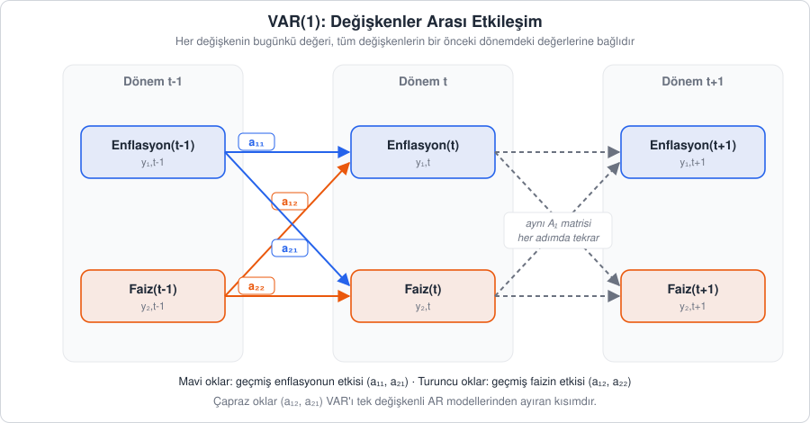
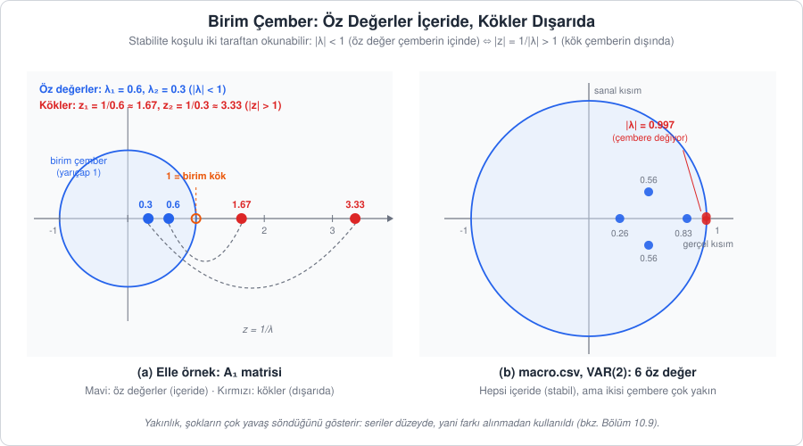
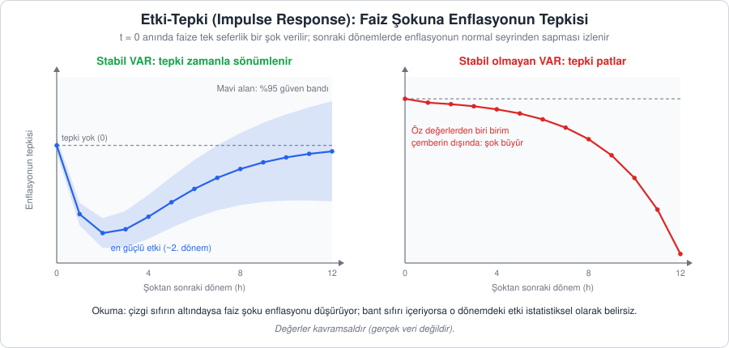
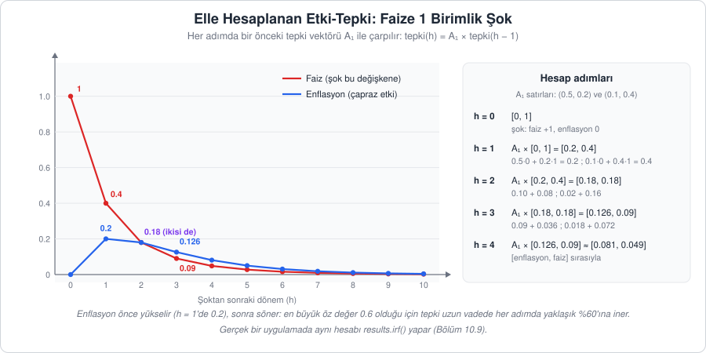

[İçindekiler](../Course_notes.md) · [← 9. Facebook Prophet](09_facebook_prophet.md) · [11. Gretl: Ekonometrik Analiz için Görsel Ortam →](11_gretl_ekonometrik_analiz_icin_gorsel_ortam.md)

## 10. VAR: Çok Değişkenli Zaman Serisi Modeli

Bölüm 7'de gördüğümüz ARIMA gibi tek değişkenli modeller her seriyi **tek başına** ele alır: bir serinin geleceğini yalnızca kendi geçmişinden tahmin ederiz. Oysa Bölüm 3.1'de tanıttığımız **çok değişkenli** serilerde değişkenlerin birbirini etkilemesi çoğu zaman asıl ilgilendiğimiz konudur:

*   Enflasyon ↔ faiz oranı
*   Döviz kuru ↔ faiz ↔ sanayi üretimi
*   Elektrik talebi ↔ sıcaklık ↔ fiyat

Bu durumda ihtiyaç duyduğumuz şey, yalnızca "kendi geçmişine bakarak kendini tahmin eden" bir model değil, **tüm serilerin geçmişine birlikte bakarak** hepsini aynı anda tahmin eden bir yapıdır. **VAR (Vector Autoregression, vektör otoregresyon)** tam olarak bunu yapar. Adından da anlaşılacağı gibi VAR, Bölüm 7.1.1'deki AR modelinin çok değişkenli (vektör) genellemesidir.

Bu bölümde önce modelin tanımını ve varsayımlarını, ardından VAR'a özgü yorum araçlarını (Granger nedenselliği, etki-tepki fonksiyonu, varyans ayrıştırması) ele alacak, son olarak Python ile uçtan uca bir uygulama yapacağız. Aynı modelin Gretl'de menüler ve betik ile nasıl kurulacağı Bölüm 11'de anlatılmaktadır.

Bu bölüm dersin matematik açısından en yoğun bölümüdür. VAR'ı anlatmak için **vektör**, **matris**, **determinant** ve **öz değer** kavramlarına ihtiyaç duyacağız. Bunların hiçbirini bildiğinizi varsaymıyoruz: her birini ilk kullandığımız yerde sıfırdan, iki değişkenli küçük bir örnek üzerinde ve elle yapılan hesaplarla kuracağız.

---

### 10.1. AR'dan VAR'a: Temel Fikir

**Açıklama:** Bölüm 7.1.1'deki AR(p) modelinde bir serinin bugünkü değeri, kendi $p$ gecikmesinin doğrusal bir fonksiyonudur. Bölüm 3 ve 7'de $x_t$ ile gösterdiğimiz seriyi bu bölümde, VAR yazınındaki yaygın kullanıma uygun olarak $y_t$ ile gösteriyoruz; model aynıdır:

$$
y_t = c + \phi_1 y_{t-1} + \phi_2 y_{t-2} + \dots + \phi_p y_{t-p} + \varepsilon_t
$$

> **Simge notu:** $`y_t`$ *(y t)*: serinin $`t`$ dönemindeki değeri; alt indis (sağ alttaki küçük yazı) zamanı gösterir · $`y_{t-1}`$: bir önceki dönemin değeri, $`y_{t-2}`$: iki önceki dönemin değeri · $`c`$: sabit terim · $`\phi_i`$ *(fi; π "pi" ile karıştırmayın)*: $`i`$. gecikmenin katsayısı · $`p`$: modelin kaç dönem geriye baktığı · $`\varepsilon_t`$ *(epsilon; küme işareti ∈ değildir)*: $`t`$ dönemindeki beklenmedik şok (beyaz gürültü hata terimi) · $`\dots`$ *(üç nokta)*: aradaki terimler

VAR'da ise her değişken için ayrı bir denklem yazılır ve her denklemde **hem kendi gecikmeleri hem de diğer değişkenlerin gecikmeleri** yer alır. İki değişkenli (enflasyon ve faiz) en basit örnek olan VAR(1) modelini düşünelim:

*   $y_{1,t}$: Enflasyon
*   $y_{2,t}$: Faiz oranı

```math
\begin{aligned}
y_{1,t} &= c_1 + \overbrace{a_{11} y_{1,t-1}}^{\text{kendi gecikmesi}} + \overbrace{a_{12} y_{2,t-1}}^{\substack{\text{faizin gecikmesi}\\\text{(çapraz etki)}}} + \overbrace{u_{1,t}}^{\text{şok}} \\
y_{2,t} &= c_2 + \underbrace{a_{21} y_{1,t-1}}_{\substack{\text{enflasyonun gecikmesi}\\\text{(çapraz etki)}}} + \underbrace{a_{22} y_{2,t-1}}_{\text{kendi gecikmesi}} + u_{2,t}
\end{aligned}
```

**Ne anlatıyor?** Her değişkenin bugünkü değeri, hem kendi bir önceki değerine hem de diğer değişkenin bir önceki değerine bağlıdır. Çapraz katsayılar, bir değişkenin geçmişinin diğer değişkeni ne ölçüde etkilediğini gösterir.

Bu yazımda alt indisler iki bilgi taşır. $y_{2,t-1}$ ifadesinde virgülden önceki sayı **hangi değişken** olduğunu (1 = enflasyon, 2 = faiz), virgülden sonraki kısım **hangi dönem** olduğunu söyler; yani $y_{2,t-1}$ "faizin bir önceki dönemdeki değeri" diye okunur. Katsayılarda da iki sayı vardır: $a_{12}$ ("a bir iki" diye okunur) birinci denklemdeki (enflasyon denklemi) ikinci değişkenin (faiz) katsayısıdır. Akılda tutmak için: **ilk sayı etkilenen, ikinci sayı etkileyen** değişkendir.

Her denklemde:

*   **Kendi gecikmesi** yer alır (ör. $y_{1,t-1}$ → $y_{1,t}$, katsayı $a_{11}$). Yalnız bu terim olsaydı, elimizde sıradan bir AR(1) modeli olurdu.
*   **Diğer değişkenin gecikmesi** yer alır (ör. $y_{2,t-1}$ → $y_{1,t}$, katsayı $a_{12}$). VAR'ı AR'dan ayıran kısım bu **çapraz etkilerdir**: $a_{12} \neq 0$ ise geçmiş faiz bugünkü enflasyonu etkiliyor demektir.

> **Simge notu:** $`c_1, c_2`$: iki denklemin sabit terimleri · $`a_{ij}`$: $`i`$. denklemde $`j`$. değişkenin gecikmesinin katsayısı · $`u_{i,t}`$ *(u)*: $`i`$. denklemin $`t`$ dönemindeki şoku; AR'daki $`\varepsilon_t`$ ile aynı rolü oynar, VAR'da geleneksel olarak u harfi kullanılır · $`\neq`$ *(eşit değil)*

**Sayısal örnek:** Katsayılar $c_1 = 1$, $c_2 = 0.5$, $a_{11} = 0.5$, $a_{12} = 0.2$, $a_{21} = 0.1$, $a_{22} = 0.4$ olsun. Geçen ay enflasyon 10, faiz 8 idi. Bu ayın şoklarını önceden bilemeyiz; ortalamaları sıfır olduğu için tahmin yaparken onları 0 alırız. Bu ay için tahminler:

```math
\begin{aligned}
\text{Enflasyon} &= 1 + 0.5 \cdot 10 + 0.2 \cdot 8 = 1 + 5 + 1.6 = 7.6 \\
\text{Faiz} &= 0.5 + 0.1 \cdot 10 + 0.4 \cdot 8 = 0.5 + 1 + 3.2 = 4.7
\end{aligned}
```

Enflasyon tahmininin 1.6 puanı faizden gelir ($a_{12} = 0.2$ çarpı geçen ayın faizi 8). Tek değişkenli bir AR(1) modelinde bu parça hiç olmazdı. (Sayılar yalnızca hesabı göstermek için seçildi; ekonomik bir iddia taşımaz. Aynı katsayıları bölüm boyunca kullanacağız.)

> **Hemen deneyin 10.1 · VAR(1)'i Excel'de 20 ay ileri yürütün** (Excel / LibreOffice Calc, ~5 dk)
>
> Yukarıdaki iki denklemi Excel'e yazıp tahmini ay ay ilerletelim. Her ayın tahmini, bir önceki ayın değerlerinden hesaplanır (şoklar 0 alınır).
>
> 1. **A1**'e `Ay`, **B1**'e `Enflasyon`, **C1**'e `Faiz` yazın. **A2**'ye 0, **B2**'ye 10, **C2**'ye 8 girin (geçen ay).
> 2. **A3**'e `=A2+1`, **B3**'e `=1+0,5*B2+0,2*C2`, **C3**'e `=0,5+0,1*B2+0,4*C2` yazın. (İngilizce Excel'de ondalık ayırıcı noktadır: `=1+0.5*B2+0.2*C2` ve `=0.5+0.1*B2+0.4*C2`.)
> 3. **A3:C3**'ü seçip 22. satıra kadar aşağı sürükleyin (20 ay).
>
> **Ne göreceksiniz:** 3. satırda 7,6 ve 4,7 (10.1'deki elle hesap), sonra 5,74 ve 3,14; 4,498 ve 2,33 ... 10. ayda yaklaşık 2,557 ve 1,279; 20. ayda 2,5003 ve 1,2502. Tahminler giderek **2,5** (enflasyon) ve **1,25** (faiz) değerlerine yerleşir. Sağlama: $1 + 0.5 \cdot 2.5 + 0.2 \cdot 1.25 = 2.5$ ve $0.5 + 0.1 \cdot 2.5 + 0.4 \cdot 1.25 = 1.25$; bu iki sayı denklemlere konunca kendilerini verir. Bu, modelin uzun dönem ortalamasıdır (10.7'deki $\boldsymbol{\mu}$).
>
> **Şimdi siz:** Başlangıç değerlerini değiştirin: **B2**'ye 0, **C2**'ye 0 yazın. 20. aydaki değerler ne olur? Sonuç başlangıca bağlı mı?
>
> <details><summary>Cevap</summary>
>
> 1. ayda 1 ve 0,5; 2. ayda 1,6 ve 0,8; 20. ayda yaklaşık 2,4999 ve 1,25. Seri bu kez aşağıdan yukarı çıkar ama yine aynı yere, 2,5 ve 1,25'e yerleşir. Stabil bir VAR'da uzun dönem tahmini başlangıç noktasını "unutur"; neden böyle olduğunu 10.5'te (öz değerler) göreceğiz.
>
> </details>

#### 10.1.1. Matris Biçimi

Denklemleri tek tek yazmak değişken sayısı arttıkça zahmetli hâle gelir: 5 değişkenli bir VAR(1)'de 5 denklem ve 25 katsayı vardır. Bu yüzden VAR **vektör** ve **matris** adı verilen iki araçla kısaca yazılır. İkisini sıfırdan kuralım.

**Vektör:** Alt alta yazılmış bir sayı listesidir. Bir dönemdeki tüm değişkenleri tek bir "paket" hâline getirir. Geçen ayın durumu (üst satır enflasyon, alt satır faiz):

```math
\mathbf{y}_{t-1} = \begin{bmatrix} 10 \\ 8 \end{bmatrix}
```

Vektörleri sıradan sayılardan ayırmak için **kalın** harfle yazarız ($\mathbf{y}$). VAR'daki "V" harfi buradan gelir: model tek bir sayıyı değil, bir sayı listesini (vektörü) tahmin eder.

**Matris:** Satırlar ve sütunlardan oluşan bir sayı tablosudur. VAR(1)'in dört katsayısını şöyle bir tabloya dizeriz: her **satır** bir denklemi (etkilenen değişkeni), her **sütun** bir açıklayıcı değişkeni (etkileyen değişkeni) temsil eder.

```math
A_1 =
\begin{bmatrix}
a_{11} & a_{12} \\
a_{21} & a_{22}
\end{bmatrix}
=
\begin{bmatrix}
0.5 & 0.2 \\
0.1 & 0.4
\end{bmatrix}
```

Bu, 2 satır ve 2 sütunu olduğu için "2 × 2" (iki çarpı iki) boyutlu bir matristir. $a_{ij}$ katsayısı $i$. satır ile $j$. sütunun kesiştiği hücrededir; örneğin $a_{12} = 0.2$, 1. satır 2. sütundadır.

**Matrisi vektörle çarpmak:** Kural şudur: matrisin **her satırını** vektörle eşleştir, karşılıklı elemanları çarp ve topla. Her satır sonuç vektörünün bir elemanını verir:

```math
A_1 \mathbf{y}_{t-1} =
\begin{bmatrix} 0.5 & 0.2 \\ 0.1 & 0.4 \end{bmatrix}
\begin{bmatrix} 10 \\ 8 \end{bmatrix}
=
\begin{bmatrix} 0.5 \cdot 10 + 0.2 \cdot 8 \\ 0.1 \cdot 10 + 0.4 \cdot 8 \end{bmatrix}
=
\begin{bmatrix} 5 + 1.6 \\ 1 + 3.2 \end{bmatrix}
=
\begin{bmatrix} 6.6 \\ 4.2 \end{bmatrix}
```

1. satır (0.5, 0.2) vektörün elemanlarıyla (10, 8) çarpılıp toplanır: $0.5 \cdot 10 + 0.2 \cdot 8 = 6.6$. 2. satır (0.1, 0.4) için: $0.1 \cdot 10 + 0.4 \cdot 8 = 4.2$. Sonuç yine iki elemanlı bir vektördür. Çarpımın yapılabilmesi için matrisin sütun sayısı vektörün eleman sayısına eşit olmalıdır (burada ikisi de 2).

**Günlük hayattan bir örnek:** Matrisi vektörle çarpmak market fişi hesaplamaya benzer. Her satır bir sepettir (her üründen kaç tane alındığı), vektör de ürünlerin birim fiyatlarıdır; karşılıklı çarpıp toplayınca o sepetin tutarı çıkar. İki satır, iki sepet ve iki tutar demektir. Benzetmenin sınırı: VAR katsayıları eksi de olabilir; bir sepette "eksi 2 ürün" olmaz.

**Vektörleri toplamak** daha da kolaydır: aynı sıradaki elemanlar toplanır. Sabitler vektörü $\mathbf{c}$ ile yukarıdaki sonucu toplarsak:

```math
\mathbf{c} + A_1 \mathbf{y}_{t-1} =
\begin{bmatrix} 1 \\ 0.5 \end{bmatrix} + \begin{bmatrix} 6.6 \\ 4.2 \end{bmatrix}
=
\begin{bmatrix} 7.6 \\ 4.7 \end{bmatrix}
```

Bu, 10.1'deki sayısal örnekte iki denklemi ayrı ayrı çözerek bulduğumuz tahminlerin (7.6 ve 4.7) aynısıdır. Hesabı Python ile de kontrol edebiliriz:

```python
import numpy as np

A1 = np.array([[0.5, 0.2],     # 1. satır: enflasyon denklemi
               [0.1, 0.4]])    # 2. satır: faiz denklemi
c = np.array([1.0, 0.5])       # sabitler
y_onceki = np.array([10, 8])   # geçen ay: [enflasyon, faiz]

print(A1 @ y_onceki)           # matris × vektör
#> [6.6 4.2]
print(c + A1 @ y_onceki)       # sabit + matris × vektör
#> [7.6 4.7]
```

`import numpy as np` satırı sayısal hesap kütüphanesi NumPy'ı `np` kısa adıyla yükler. `np.array([[0.5, 0.2], [0.1, 0.4]])` iç içe bir listeden matris oluşturur: her iç liste bir satırdır, bu yüzden sonuç 2 × 2'lik bir tablodur. Tek katlı liste (`[1.0, 0.5]`) ise bir vektördür. `@` işareti matris çarpımı yapar; yukarıda elle yaptığımız "satırla çarp ve topla" işlemini yürütür. (Sıradan `*` işareti elemanları tek tek çarpardı; o başka bir işlemdir.) NumPy vektörleri ekrana yan yana yazar, ama biz onları alt alta (sütun olarak) düşünüyoruz.

Şimdi aynı çarpımı sayılar yerine harflerle yapalım:

```math
A_1 \mathbf{y}_{t-1} =
\begin{bmatrix} a_{11} & a_{12} \\ a_{21} & a_{22} \end{bmatrix}
\begin{bmatrix} y_{1,t-1} \\ y_{2,t-1} \end{bmatrix}
=
\begin{bmatrix} a_{11} y_{1,t-1} + a_{12} y_{2,t-1} \\ a_{21} y_{1,t-1} + a_{22} y_{2,t-1} \end{bmatrix}
```

Sonuç vektörünün iki satırı, 10.1'deki iki denklemin sağ tarafındaki gecikme terimlerinin ta kendisidir. Bugünkü değerleri, sabitleri ve şokları da vektör olarak yazalım:

```math
\mathbf{y}_t =
\begin{bmatrix}
y_{1,t} \\
y_{2,t}
\end{bmatrix},
\quad
\mathbf{c} =
\begin{bmatrix}
c_1 \\
c_2
\end{bmatrix},
\quad
A_1 =
\begin{bmatrix}
a_{11} & a_{12} \\
a_{21} & a_{22}
\end{bmatrix},
\quad
\mathbf{u}_t =
\begin{bmatrix}
u_{1,t} \\
u_{2,t}
\end{bmatrix}
```

Bu gösterimle iki denklem tek satıra iner:

$$
\mathbf{y}_t = \mathbf{c} + A_1 \mathbf{y}_{t-1} + \mathbf{u}_t
$$

```math
\underbrace{\mathbf{y}_t}_{\substack{\text{bugünkü değerler}\\\text{vektörü}}} = \overbrace{\mathbf{c}}^{\text{sabitler}} + \underbrace{A_1}_{\substack{\text{katsayı}\\\text{matrisi}}} \overbrace{\mathbf{y}_{t-1}}^{\text{geçen dönem}} + \underbrace{\mathbf{u}_t}_{\text{şoklar}}
```

**Ne anlatıyor?** İki değişkenin bugünkü değerleri; sabitler, geçen dönemin değerlerinin katsayı matrisiyle çarpımı ve şokların toplamı olarak tek satırda yazılır. Değişken sayısı artsa da denklemin biçimi değişmez.

Bu satırı açık hâliyle yazıp satır satır okursak, 10.1'deki iki denklemi aynen geri elde ederiz:

```math
\underbrace{\begin{bmatrix} y_{1,t} \\ y_{2,t} \end{bmatrix}}_{\substack{\mathbf{y}_t\\\text{bugünkü değerler}}}
=
\overbrace{\begin{bmatrix} c_1 \\ c_2 \end{bmatrix}}^{\substack{\mathbf{c}\\\text{sabitler}}}
+
\underbrace{\begin{bmatrix} a_{11} & a_{12} \\ a_{21} & a_{22} \end{bmatrix}}_{\substack{A_1\\\text{katsayı matrisi}}}
\overbrace{\begin{bmatrix} y_{1,t-1} \\ y_{2,t-1} \end{bmatrix}}^{\substack{\mathbf{y}_{t-1}\\\text{geçen dönem}}}
+
\underbrace{\begin{bmatrix} u_{1,t} \\ u_{2,t} \end{bmatrix}}_{\substack{\mathbf{u}_t\\\text{şoklar}}}
```

**Ne anlatıyor?** İki denklem tek bir matris denklemiyle yazılır: Katsayı matrisinin geçen dönemin değer vektörüyle yan yana yazılması, 10.1.1'deki "satırla çarp ve topla" işlemi demektir.

Yani matris biçimi yeni bir model değildir; aynı iki denklemin kısaltılmış yazımıdır. Avantajı, 3, 5 ya da 10 değişkenli modellerde de aynı tek satırın kullanılabilmesidir.

**Tanım (VAR(p) modeli):** $k$ değişkenli bir VAR(p) modeli şöyle yazılır:

```math
\underbrace{\begin{bmatrix} y_{1,t} \\ \vdots \\ y_{k,t} \end{bmatrix}}_{\substack{\mathbf{y}_t\\\text{k değişkenin}\\\text{bugünkü değeri}}}
= \overbrace{\mathbf{c}}^{\text{sabitler}} + \underbrace{A_1 \mathbf{y}_{t-1} + A_2 \mathbf{y}_{t-2} + \dots + A_p \mathbf{y}_{t-p}}_{\substack{\text{tüm değişkenlerin}\\\text{son p dönemi}}} + \overbrace{\mathbf{u}_t}^{\text{şok vektörü}},
\qquad
\underbrace{\mathrm{E}[\mathbf{u}_t] = \mathbf{0}}_{\substack{\text{şokların}\\\text{ortalaması sıfır}}},
\quad
\overbrace{\mathrm{Cov}(\mathbf{u}_t) = \Sigma_u}^{\substack{\text{aynı dönemdeki şoklar}\\\text{ilişkili olabilir}}}
```

**Ne anlatıyor?** $k$ değişkenin bugünkü değerleri; bir sabit vektörü, bütün değişkenlerin son $p$ dönemdeki değerlerinin katsayı matrisleriyle çarpımları ve bir şok vektörünün toplamıdır. Şokların ortalaması sıfırdır; aynı dönemdeki şoklar ise kovaryans matrisi aracılığıyla birbiriyle ilişkili olabilir.

Burada:

*   $\mathbf{y}_ t$: Tüm değişkenleri aynı anda içeren $k \times 1$ boyutlu vektör ($k$ satır, 1 sütun; $k$ değişken sayısıdır)
*   $\mathbf{c}$: Sabit terimler vektörü
*   $A_i$: $i$. gecikmeye ait $k \times k$ katsayı matrisi. $A_1$ bir önceki dönemin değerlerini, $A_2$ iki önceki dönemin değerlerini çarpar; VAR(1)'den farkı yalnızca bu ek terimlerdir.
*   $\mathbf{u}_ t$: Hata (şok) vektörü. $\mathrm{E}[\mathbf{u}_ t] = \mathbf{0}$ "şokların ortalaması sıfırdır" demektir: bazen yukarı, bazen aşağı yönlü gelirler ama sistematik bir yönleri yoktur. Şoklar **zaman içinde ilişkisizdir**: bu ayın şoku, gelecek ayın şoku hakkında bilgi vermez. Ama **aynı dönemdeki** şoklar birbiriyle ilişkili olabilir; örneğin döviz kurunda beklenmedik bir sıçrama olduğu ay faizde de beklenmedik bir artış görülebilir. Bu eşanlı ilişkiyi $\Sigma_u$ tablosu taşır.

$\Sigma_u$ bir **varyans-kovaryans matrisidir**. İki değişkenli modelde 2 × 2'lik bir tablodur: sol üstten sağ alta inen köşegende her şokun **varyansı** (şokun tipik olarak ne kadar büyük olduğu; karekökü standart sapmadır) yer alır, köşegen dışındaki hücrelerde ise iki şokun **kovaryansı** (aynı ay birlikte aynı yönde gelme eğilimi) bulunur. Kovaryans 0 ise iki şok birbiriyle **ilişkisizdir**: aralarında doğrusal bir birliktelik yoktur. (İlişkisizlik, bağımsızlıkla aynı şey değildir; şoklar normal dağılıyorsa ikisi örtüşür.)

> **Simge notu:** $`\mathbf{y}_t`$ *(kalın y)*: değişkenler vektörü · $`A_i`$: katsayı matrisi · $`\mathrm{E}[\cdot]`$ *(beklenen değer)*: kuramsal ortalama · $`\mathrm{Cov}(\cdot)`$ *(kovaryans)*: varyans-kovaryans matrisi · $`\Sigma_u`$ *(büyük sigma u)*: hata terimlerinin varyans-kovaryans matrisi. Dikkat: burada $`\Sigma`$ bir tablonun **adıdır**, toplam sembolü değildir (toplam anlamındaki $`\sum`$ Bölüm 10.6'da gelecek) · $`\times`$ *(çarpı)*: matris boyutu (satır × sütun) · $`\vdots`$ *(dikey üç nokta)*: aradaki satırlar · $`\mathbf{0}`$: tüm elemanları sıfır olan vektör

**Not —** $k = 1$ alındığında $\mathbf{y}_ t$ tek bir sayıya, $A_i$ matrisleri de tek birer katsayıya ($\phi_i$) iner ve VAR(p), Bölüm 7.1.1'deki AR(p) modelinin ta kendisi olur.

**Parametre sayısı:** Her denklemde $1 + kp$ katsayı (sabit + $k$ değişkenin $p$ gecikmesi) vardır; toplamda $k(1 + kp)$ parametre tahmin edilir. Örneğin 3 değişkenli bir VAR(4) modelinde her denklemde $1 + 3 \cdot 4 = 13$, toplamda $3 \cdot 13 = 39$ parametre vardır. Parametre sayısı $p$ ile hızla büyüdüğü için gecikme seçimi (Bölüm 10.4) VAR'da özellikle önemlidir.

**Tahmin:** Her denklemin sağ tarafında aynı açıklayıcı değişkenler (tüm değişkenlerin aynı gecikmeleri) bulunduğundan, VAR denklem denklem sıradan **en küçük kareler** (OLS, *ordinary least squares*) yöntemiyle tahmin edilebilir; bu, sistemi birlikte tahmin etmekle aynı sonucu verir. OLS, katsayıları "modelin hatalarının karelerinin toplamı en küçük olacak" biçimde seçen standart regresyon yöntemidir.

---

### 10.2. VAR'ı Görselleştirmek: Değişkenler Arası Etkileşim

Modelin denklemleri, değişkenler arasındaki bir etkileşim ağını tarif eder. İki değişkenli bir VAR(1) modelinde, bir önceki dönemdeki ($t-1$) her değişken, bugünkü ($t$) her değişkeni etkileyebilir:



*Şekil 10.1 — İki değişkenli VAR(1): $`t-1`$ dönemindeki enflasyon ve faiz, $`t`$ dönemindeki her iki değişkeni de $`A_1`$ matrisinin katsayıları aracılığıyla etkiler; aynı yapı her dönem tekrarlanır.*

Şekli şöyle okuyabiliriz:

*   `Enflasyon(t-1)` hem `Enflasyon(t)` hem de `Faiz(t)` üzerinde etkili olabilir. Bu etkilerin gücünü $a_{11}$ ve $a_{21}$ katsayıları belirler. Bunlar $A_1$ matrisinin **1. sütunudur**: bir sütun, o değişkenin "gönderdiği" etkileri toplar.
*   Benzer şekilde `Faiz(t-1)`, her iki güncel değişkeni $a_{12}$ ve $a_{22}$ katsayıları (2. sütun) aracılığıyla etkiler.
*   Bu etkileşim her zaman adımında aynı $A_1$ matrisiyle tekrarlanır: bir dönemin çıktıları bir sonraki dönemin girdileri olur. Bir şokun sistemde nasıl yayıldığını (Bölüm 10.7) bu zincir belirler.

Kısacası "geçmiş enflasyon" ve "geçmiş faiz" bilgileri, hem bugünkü enflasyonu hem de bugünkü faizi tahmin etmek için birlikte kullanılır.

---

### 10.3. VAR Kurmadan Önce: Veri Hazırlığı

VAR modeli tahmin etmeden önce birkaç kritik noktayı gözden geçirmek gerekir. Bu adımları atlamak, sonradan "nerede hata yaptım?" sorusuyla uğraşmak demektir.

#### 10.3.1. Aynı Frekansta Veri

Tüm serilerin aynı zaman aralığında ölçülmüş olması gerekir: bir seri aylık, diğeri üç aylık, bir diğeri yıllık olamaz. Bir değişken her ay değişirken diğeri yılda bir kez güncelleniyorsa, ikisini aynı modele koymak farklı hızlarda koşan iki kişiyi aynı yarışta değerlendirmeye benzer.

Frekans uyumsuzluğu varsa ya yüksek frekanslı veri toplulaştırılır (ör. aylık veri üç aylık ortalamalara dönüştürülür) ya da düşük frekanslı veri interpolasyonla daha sık gözleme çevrilir. İnterpolasyon yapay bilgi eklediği için dikkatli kullanılmalıdır.

#### 10.3.2. Ortak Örnek Aralığı (Sample)

Bir seri 1990'dan, diğeri 1995'ten başlıyor; biri 2020'de, diğeri 2023'te bitiyor olabilir. VAR tahmini için tüm değişkenlerin aynı dönemde gözlenmiş olması gerekir. Bu nedenle **ortak kesişim aralığı**, yani tüm serilerin birlikte mevcut olduğu en geniş zaman penceresi kullanılır (bu örnekte 1995–2020). Bu pencerenin dışındaki gözlemler analize alınmaz; veri kaybı olsa da tutarlılık sağlanır.

> **Hemen deneyin 10.3.2 · Ortak aralığı ve frekansı pandas'la ayarlayın** (Python, ~4 dk)
>
> `macro.csv`'den iki seriyi bilerek farklı dönemlerle keselim, sonra ortak aralığı bulup aylık veriyi üç aylığa çevirelim (10.3.1). Depo kök dizininden çalıştırın.
>
> ```python
> import pandas as pd
>
> df = pd.read_csv("data/macro.csv", parse_dates=["date"], index_col="date")
> enf = df["inflation"]["2016":"2024"]               # 2016-01 ... 2024-12
> kur = df["exchange"]["2015":"2023"]                # 2015-01 ... 2023-12
> ortak = pd.concat([enf, kur], axis=1, join="inner")   # yalnızca ikisinde de olan aylar
> print(ortak.index.min().date(), ortak.index.max().date(), len(ortak))
>
> ceyrek = ortak.resample("QS").mean()               # aylık -> üç aylık (çeyrek) ortalama
> print(len(ceyrek))
> print(ceyrek.head(2).round(2))
> ```
>
> `pd.concat([...], axis=1)` serileri yan yana sütun olarak koyar; `join="inner"` yalnızca iki seride de bulunan tarihleri tutar. `resample("QS")` veriyi çeyrek başı tarihlere göre gruplar, `.mean()` her grubun ortalamasını alır.
>
> **Ne göreceksiniz:**
>
> ```text
> 2016-01-01 2023-12-01 96
> 32
>             inflation  exchange
> date                           
> 2016-01-01       8.61      2.92
> 2016-04-01       6.93      2.88
> ```
>
> Ortak aralık 2016–2023'tür (96 ay): Enflasyonun 2024'ü ve kurun 2015'i atılmıştır. 96 ay, 32 çeyreğe iner; 2016'nın ilk çeyreğinin enflasyonu Ocak, Şubat ve Mart değerlerinin (9.58, 8.78, 7.46) ortalaması olan 8.61'dir.
>
> **Şimdi siz:** `"QS"` yerine `"YS"` (yıl başı) yazın. Kaç satır kalır ve 2016'nın enflasyon değeri ne olur?
>
> <details><summary>Cevap</summary>
>
> 8 satır (2016–2023) kalır; 2016'nın yıllık ortalama enflasyonu 7.78'dir. Frekansı düşürmek bilgi kaybettirir: 96 gözlemden 8'e indik. Bu kadar az gözlemle bir VAR kurmak (10.1.1'deki parametre sayısını düşünün) güvenilir olmaz; bu yüzden frekans uyumu sağlanırken genellikle en düşük ortak frekansa inmek gerekse de gözlem sayısı göz önünde tutulmalıdır.
>
> </details>

#### 10.3.3. Durağanlık Kontrolü

VAR'ın yakaladığı dinamik ilişkilerin anlamlı olabilmesi için serilerin **durağan** olması beklenir. Bölüm 3.2'den hatırlarsak: ortalaması, varyansı ve otokovaryans yapısı zamanla değişmeyen seri durağandır. Sürekli yükselen bir GSYİH serisi, ortalaması sürekli arttığı için durağan değildir. Durağan olmayan serilerle çalışmak, aslında ilişkisiz iki serinin yalnızca ikisi de yükseldiği için ilişkili görünmesine (**sahte regresyon**, *spurious regression*) yol açabilir. Örneğin bir ülkedeki cep telefonu sayısı ile ortalama ömür yıllar içinde birlikte artar; ama biri diğerini açıklamaz, ikisi de zamanla yükselir.

Durağanlık ADF ve KPSS testleriyle sınanır (ayrıntısı Bölüm 3.2 ve 7.5'te):

*   **ADF:** Sıfır hipotezi $H_0$: "seri durağan değildir (birim kök vardır)". p-değeri 0.05'ten küçükse $H_0$ reddedilir ve seri durağan kabul edilir.
*   **KPSS:** Mantık terstir; $H_0$: "seri durağandır".

(H₀/H₁ simgeleri ve p-değerinin anlamı: bkz. Bölüm 3.2.)

Durağan olmayan serilerde en yaygın çözüm, Bölüm 2.1 ve 7.1.4'teki $\nabla$ operatörüyle **fark almaktır**: $\nabla y_t = y_t - y_{t-1}$, yani bu dönemin değeri eksi bir önceki dönemin değeri. Örneğin faiz üç ay boyunca 40, 45, 45 ise fark serisi 5, 0 olur: artık faizin düzeyini değil, her ay ne kadar değiştiğini modelleriz. Birinci fark alındığında çoğu ekonomik seri durağan hâle gelir; ikinci fark nadiren gerekir. Bir kez fark alınınca durağanlaşan seriye **birinci dereceden bütünleşik** (*integrated of order one*) denir ve **I(1)** diye yazılır; zaten durağan olan seri I(0)'dır.

**Not —** Seriler aynı mertebeden bütünleşikse (ör. hepsi I(1)) ve aralarında uzun dönemli bir denge ilişkisi (**eşbütünleşme**, *cointegration*) varsa, farkları alınmış bir VAR bu uzun dönem bilgisini kaybeder. Bilinen bir benzetme: tasmalı köpeğiyle yürüyen bir kişinin ve köpeğin yolları ayrı ayrı rastgele görünür, ama aralarındaki mesafe tasmanın boyunu aşamaz. Farkları alınmış VAR yalnızca adımları modeller, "tasmayı" görmez. Bu durumda VAR yerine **VECM** (Vector Error Correction Model, hata düzeltme modeli) kullanmak daha uygundur: VECM, farklar için kurulan VAR'a "tasma ne kadar gerildi?" bilgisini taşıyan bir düzeltme terimi ekler. VECM bu dersin kapsamı dışındadır; bu bölümde VAR çerçevesinde kalıyoruz.

> **Hemen deneyin 10.3.3 · Sahte regresyonu kendi gözünüzle görün** (R, ~4 dk)
>
> Birbirinden **tamamen bağımsız** iki rastgele yürüyüş üretip birini diğerine regresyonla açıklamaya çalışalım.
>
> ```r
> set.seed(7)
> x <- cumsum(rnorm(200))   # rastgele yürüyüş 1: cumsum() rastgele adımları biriktirir
> y <- cumsum(rnorm(200))   # rastgele yürüyüş 2 (x ile hiçbir ilgisi yok)
> s1 <- summary(lm(y ~ x))                   # düzeylerle regresyon
> s2 <- summary(lm(diff(y) ~ diff(x)))       # birinci farklarla regresyon
> signif(c(R2_duzey = s1$r.squared, p_duzey = coef(s1)[2, 4],
>          R2_fark  = s2$r.squared, p_fark  = coef(s2)[2, 4]), 3)
> ```
>
> `lm(y ~ x)` "y'yi x ile açıkla" diyen doğrusal regresyondur; `r.squared` **R²** değerini verir ($R^2$: modelin açıkladığı varyans oranı, 0 ile 1 arası; 1'e yakın olması uyumun iyi olduğunu gösterir, ama durağan olmayan serilerde yanıltıcı biçimde yüksek çıkabilir, yani sahte regresyon), `coef(s1)[2, 4]` x katsayısının p-değerini verir. `signif(..., 3)` sayıları 3 anlamlı basamağa yuvarlar.
>
> **Ne göreceksiniz:**
>
> ```text
> R2_duzey  p_duzey  R2_fark   p_fark 
> 4.07e-01 3.24e-24 1.69e-03 5.64e-01 
> ```
>
> `e-24` "10 üzeri −24" demektir: p-değeri 0.000...0324 (ondalık ayırıcıdan sonra 23 sıfır). Düzeylerle kurulan regresyon x'in y'nin **%40.7**'sini açıkladığını ve ilişkinin "son derece anlamlı" olduğunu söyler. Oysa iki seri birbirinden habersizdir; ikisi de rastgele dolaştığı için tesadüfen benzer yönlere kaymıştır. Farkları alınınca gerçek ortaya çıkar: R² = 0.0017, p = 0.56; ilişki yoktur.
>
> **Şimdi siz:** Bu tek bir şanssız deneme mi? Aynı deneyi 1000 kez tekrarlayıp kaç kez "anlamlı" (p < 0.05) sonuç çıktığını sayın:
>
> ```r
> set.seed(1)
> sonuc <- replicate(1000, {      # replicate(): süslü parantezdeki işi 1000 kez yapar
>   x <- cumsum(rnorm(200)); y <- cumsum(rnorm(200))
>   c(duzey = coef(summary(lm(y ~ x)))[2, 4] < 0.05,
>     fark  = coef(summary(lm(diff(y) ~ diff(x))))[2, 4] < 0.05)
> })
> rowMeans(sonuc)                 # "anlamlı" çıkan denemelerin oranı
> ```
>
> <details><summary>Cevap</summary>
>
> ```text
> duzey  fark 
> 0.833 0.044 
> ```
>
> Bağımsız iki rastgele yürüyüşün düzeyleri denemelerin **%83**'ünde "anlamlı" ilişki gösterir. Farklarda oran %4.4'tür; bu, %5'lik anlamlılık düzeyinde tesadüfen beklenen orandır. Durağan olmayan serilerle VAR (ya da regresyon) kurmadan önce durağanlık kontrolünün neden şart olduğu buradan anlaşılır.
>
> </details>

---

### 10.4. Gecikme Uzunluğu Seçimi (AIC, BIC, HQ)

VAR(p) modelinde $p$, kaç dönem geriye bakılacağını, yani modelin "hafızasını" belirler:

- **$`p`$ çok küçükse:** Dinamik yapı yeterince yakalanmaz; değişkenler arasındaki gecikmeli etkileşimler gözden kaçar ve artıklarda otokorelasyon kalır.
- **$`p`$ çok büyükse:** Her ek gecikme $`k^2`$ yeni parametre demektir (her denkleme $`k`$ yeni katsayı, $`k`$ denklem; 4 değişkenli bir VAR'da 16). Aşırı parametreleşme tahmin varyansını yükseltir ve öngörü gücünü zayıflatır.

Bu dengeyi kurmak için **bilgi kriterleri** kullanılır. Hepsi aynı felsefeye, **Occam'ın usturasına** dayanır: benzer uyum sağlayan modeller arasında en basiti tercih edilir. Bir terzi benzetmesiyle: çok az ölçü alınarak dikilen ceket üzerinize oturmaz (yetersiz öğrenme); vücudunuzun o anki her milimetresine göre dikilen ceket ise hareket ettiğiniz anda işe yaramaz (aşırı öğrenme, Bölüm 8.1). Bilgi kriterleri en makul ceketi bulmaya yardım eder.

**Tanım:** $T$ gözlem sayısı, $\hat{\Sigma}_ u(p)$ VAR(p) modelinin tahmin edilen hata kovaryans matrisi olmak üzere:

```math
\begin{aligned}
\mathrm{AIC}(p) &= \overbrace{\ln \lvert \hat{\Sigma}_u(p) \rvert}^{\substack{\text{uyum: hatalar}\\\text{küçüldükçe küçülür}}} + \overbrace{\frac{2}{T} \, p k^2}^{\text{karmaşıklık cezası}} \\
\mathrm{BIC}(p) &= \ln \lvert \hat{\Sigma}_u(p) \rvert + \underbrace{\frac{\ln T}{T}}_{\substack{\text{daha ağır}\\\text{ceza katsayısı}}} \, p k^2 \\
\mathrm{HQ}(p)  &= \ln \lvert \hat{\Sigma}_u(p) \rvert + \frac{2 \ln(\ln T)}{T} \, \underbrace{p k^2}_{\substack{\text{parametre}\\\text{sayısı}}}
\end{aligned}
```

**Ne anlatıyor?** Üç kriterde de ilk terim, hata kovaryans matrisinin determinantı üzerinden modelin uyumunu ölçer ve hatalar küçüldükçe küçülür. İkinci terim parametre sayısıyla ($p k^2$) orantılı bir karmaşıklık cezasıdır; kriterler yalnızca bu cezanın katsayısında ayrılır ve BIC'nin katsayısı daha ağırdır.

> **Simge notu:** $`\hat{\Sigma}_u`$ *(sigma u şapka)*: veriden tahmin edilen hata kovaryans matrisi; şapka (^) "tahmin edilen" demektir · $`\lvert \cdot \rvert`$: **burada mutlak değer değil, determinant** anlamındadır (aşağıda) · $`\ln`$ *(doğal logaritma, "el en")*: büyüdükçe yavaş artan bir fonksiyon; burada yalnızca "küçük değer, küçük sonuç" sırasını korumak için kullanılır

**Determinant nedir?** Bir kare matristen (satır ve sütun sayısı eşit) hesaplanan tek bir sayıdır. 2 × 2'lik bir matris için kural "çapraz çarpımların farkı"dır:

```math
\det \begin{bmatrix} a & b \\ c & d \end{bmatrix} = a \cdot d - b \cdot c
```

```math
\det \begin{bmatrix} a & b \\ c & d \end{bmatrix} = \underbrace{a \cdot d}_{\substack{\text{ana köşegenin}\\\text{çarpımı}}} - \underbrace{b \cdot c}_{\substack{\text{öteki köşegenin}\\\text{çarpımı}}}
```

**Ne anlatıyor?** 2 × 2'lik bir matrisin determinantı, sol üstten sağ alta uzanan köşegendeki elemanların çarpımından öteki köşegendeki elemanların çarpımı çıkarılarak bulunur.

Örneğin iki şokun varyansları 4 ve 9, kovaryansları 1 ise $\lvert \Sigma_u \rvert = 4 \cdot 9 - 1 \cdot 1 = 35$ olur. Hata kovaryans matrisinin determinantı, tüm denklemlerin hatalarının **toplam büyüklüğünü** tek sayıyla özetler: hatalar küçüldükçe determinant da küçülür. (Determinantı 10.5'te öz değerleri bulurken yeniden kullanacağız.)

**Açıklama:** Mantık, Bölüm 7.4'teki AIC ve BIC ile aynıdır: İlk terim **uyumu** ölçer (hatalar küçüldükçe küçülür), ikinci terim parametre sayısı $pk^2$ ile büyüyen **karmaşıklık cezasıdır**. (Bölüm 7.4'te $k$ parametre sayısını gösteriyordu; burada $k$ değişken sayısıdır ve gecikme katsayılarının sayısını $pk^2$ verir.) Kriterler yalnızca ceza katsayısında ayrılır. $p = 1, 2, \dots, p_{max}$ için hesaplanır ve **en küçük değeri veren $`p`$ seçilir** (değerler negatif de olabilir; önemli olan hangisinin en küçük olduğudur).

*   **AIC (Akaike):** Ceza katsayısı ($2/T$) görece hafiftir. Gerçek dinamiği kaçırmamak için biraz daha büyük modellere izin verir; öngörü odaklı çalışmalarda sık tercih edilir.
*   **BIC (Bayesci, Schwarz):** Ceza katsayısı ($\ln T / T$), $T \geq 8$ için AIC'ninkinden büyüktür ($\ln 8 \approx 2.08 > 2$) ve gözlem sayısıyla artar. Bu yüzden daha az gecikmeli, **tutumlu** (*parsimonious*) modelleri seçer; temel yapıyı anlamaya çalışırken güvenilir bir rehberdir.
*   **HQ (Hannan-Quinn):** Cezası AIC ile BIC arasındadır; ikisi arasında bir uzlaşma sunar.

> **Simge notu:** $`\geq`$ *(büyük eşit)* · $`p_{max}`$: denenecek en büyük gecikme

**Sayısal örnek:** Bölüm 10.9'daki veride $k = 3$ değişken vardır ve gecikme seçimi $T = 112$ ortak gözlemle yapılır. Bir gecikme eklemek $k^2 = 9$ yeni parametre demektir. Gecikme başına ceza:

*   AIC: $9 \cdot 2 / 112 \approx 0.16$
*   BIC: $9 \cdot \ln 112 / 112 = 9 \cdot 4.72 / 112 \approx 0.38$
*   HQ: $9 \cdot 2 \ln(4.72) / 112 \approx 0.25$

VAR(2)'den VAR(7)'ye çıkmak (5 ek gecikme) uyum terimini yaklaşık 1.20 azaltır. AIC buna karşılık $5 \cdot 0.16 = 0.80$ ceza keser; net kazanç kalır ve AIC VAR(7)'yi seçer. BIC'nin cezası $5 \cdot 0.38 = 1.90$'dır; kazanç cezayı karşılamaz ve BIC VAR(2)'de kalır. Aynı veriye bakan iki kriterin farklı karar vermesinin nedeni yalnızca ceza katsayısıdır.

Pratikte kriterler farklı gecikme önerebilir. Böyle durumlarda BIC'nin önerdiği daha düşük gecikme genellikle güvenli bir başlangıçtır; ancak seçilen modelin artıklarında otokorelasyon kalıp kalmadığı da (Bölüm 10.9'daki artık analizi) mutlaka kontrol edilmelidir. Artıklar otokorelasyonluysa gecikme artırılır. (statsmodels tablosunda bir de **FPE**, *Final Prediction Error*, "nihai tahmin hatası" sütunu görürsünüz; çoğunlukla AIC ile aynı gecikmeyi önerir.)

> **Hemen deneyin 10.4 · `maxlags` değişince seçim değişir mi?** (R ve Python, ~6 dk)
>
> **Python:** 10.9'daki `macro.csv` verisiyle gecikme seçimini üç farklı üst sınırla tekrarlayalım (depo kök dizininden).
>
> ```python
> import pandas as pd
> from statsmodels.tsa.api import VAR
>
> df = pd.read_csv("data/macro.csv", parse_dates=["date"], index_col="date")
> df_var = df[["inflation", "interest", "exchange"]].asfreq("MS")
> model = VAR(df_var)
> for maxlag in [4, 8, 12]:                           # denenecek en büyük gecikme
>     sec = model.select_order(maxlags=maxlag).selected_orders   # her kriterin seçtiği p
>     print(maxlag, sec)
> ```
>
> **Ne göreceksiniz:**
>
> ```text
> 4 {'aic': np.int64(4), 'bic': np.int64(2), 'hqic': np.int64(3), 'fpe': np.int64(4)}
> 8 {'aic': np.int64(7), 'bic': np.int64(2), 'hqic': np.int64(3), 'fpe': np.int64(7)}
> 12 {'aic': np.int64(12), 'bic': np.int64(2), 'hqic': np.int64(2), 'fpe': np.int64(12)}
> ```
>
> (`np.int64(4)` NumPy'ın 4 tam sayısını yazma biçimidir.) BIC her durumda 2'de kalır. AIC ise neredeyse hep izin verilen en büyük gecikmeyi (4 ve 12) seçer: Hafif cezası, uyumdaki küçük kazançları bile ödüllendirir. Bir kriterin hep üst sınırı seçmesi, o kriterin seçimine güvenmemek için bir uyarıdır.
>
> **R:** `vars` paketinin yerleşik `Canada` verisiyle (Kanada'da istihdam `e`, verimlilik `prod`, reel ücret `rw`, işsizlik `U`; 1980–2000, üç aylık) aynı işi yapalım.
>
> ```r
> library(vars)                                  # VARselect() ve Canada verisi
> data(Canada)                                   # 4 değişken, 84 çeyrek
> VARselect(Canada, lag.max = 8, type = "const")$selection
> ```
>
> **Ne göreceksiniz:**
>
> ```text
> AIC(n)  HQ(n)  SC(n) FPE(n) 
>      3      2      1      3 
> ```
>
> `SC` (Schwarz) BIC'nin diğer adıdır. AIC 3, HQ 2, BIC 1 gecikme önerir; sıralama yine "AIC ≥ HQ ≥ BIC"dir.
>
> **Şimdi siz:** R'da `lag.max = 4` ve `lag.max = 12` ile tekrarlayın. BIC (SC) hep aynı gecikmeyi mi seçiyor?
>
> <details><summary>Cevap</summary>
>
> `lag.max = 4`: AIC 3, HQ 2, SC **2**, FPE 3. `lag.max = 12`: AIC 3, HQ **1**, SC 1, FPE 3. BIC bile değişebilir. Nedeni, kriterlerin bütün gecikmeler için **aynı ortak örnekle** hesaplanmasıdır: `lag.max` büyüdükçe baştan daha çok gözlem atılır ($T$ küçülür) ve hem uyum terimi hem ceza değişir. 84 çeyreklik kısa bir seride bu etki belirgindir. Seçimin `lag.max`'a duyarlı olup olmadığını denemek iyi bir alışkanlıktır.
>
> </details>

---

### 10.5. Stabilite Koşulu: Öz Değerler Birim Çemberin İçinde

Model tahmin edildikten sonra yapılması gereken önemli bir kontrol, **modelin stabil olup olmadığıdır**. Bu bölüm, ADF testindeki "birim kök" kavramının (Bölüm 3.2) çok değişkenli karşılığıdır.

**Açıklama:** Stabil bir VAR'da sisteme verilen bir şokun etkisi zamanla söner; sistem eski dengesine döner. Stabil olmayan bir VAR'da ise küçük bir şok bile büyüyerek patlar. Tek değişkenli AR(1) modeli $y_t = \phi y_{t-1} + \varepsilon_t$ için bunu Bölüm 3.2'de görmüştük (Şekil 3.4): 100 birimlik bir şok $\phi = 0.5$ iken söner (100 → 50 → 25 → ...), $\phi = 1$ iken hiç sönmez (**birim kök**), $\phi = 1.2$ iken büyür ve seri patlar. Koşul $\lvert \phi \rvert < 1$ idi ($\lvert \phi \rvert$: işaretini yok sayarak büyüklük). VAR'da ise şok tek bir sayı değil bir vektördür ve her dönem bir sayıyla değil, $A_1$ matrisiyle çarpılır. "Matris bir şoku her adımda kaç katına çıkarır?" sorusunun cevabı **öz değerlerdir**.

**Öz değer nedir?** Bir matris, çarptığı vektörün hem büyüklüğünü hem de yönünü (elemanlar arasındaki oranı) genellikle değiştirir. Ama bazı özel yönlerde yalnızca büyüklüğü değiştirir. Örnek matrisimizle deneyelim:

```math
A_1 \begin{bmatrix} 2 \\ 1 \end{bmatrix}
= \begin{bmatrix} 0.5 \cdot 2 + 0.2 \cdot 1 \\ 0.1 \cdot 2 + 0.4 \cdot 1 \end{bmatrix}
= \begin{bmatrix} 1.2 \\ 0.6 \end{bmatrix}
= 0.6 \begin{bmatrix} 2 \\ 1 \end{bmatrix},
\qquad
A_1 \begin{bmatrix} -1 \\ 1 \end{bmatrix}
= \begin{bmatrix} -0.5 + 0.2 \\ -0.1 + 0.4 \end{bmatrix}
= \begin{bmatrix} -0.3 \\ 0.3 \end{bmatrix}
= 0.3 \begin{bmatrix} -1 \\ 1 \end{bmatrix}
```

"Enflasyon 2 birim, faiz 1 birim yukarı" yönündeki bir sapma, bir dönem sonra **aynı oranda** kalır ama %60'ına iner. "Enflasyon 1 birim aşağı, faiz 1 birim yukarı" yönündeki bir sapma ise her dönem %30'una iner. Bu özel yönlere **öz vektör** (*eigenvector*), her yöndeki küçülme çarpanına (0.6 ve 0.3) **öz değer** (*eigenvalue*) denir. Herhangi bir şok bu iki yönün bir karışımı olarak yazılabildiği için, her parça kendi hızında söner; en yavaş sönen parça en büyük öz değere (0.6) sahip olandır ve sistemin hafızasını o belirler. Kısacası öz değer, **sistemin belirli bir yöndeki bir sapmayı her adımda kaç katına çıkardığıdır**. AR(1)'deki $\phi$'nin rolünü VAR'da öz değerler üstlenir.

**Günlük hayattan bir örnek:** Mikrofonu hoparlöre yaklaştırdığınızda ses her turda hoparlörden mikrofona geri döner. Her turda sesin %60'ı geri geliyorsa yankı birkaç turda söner (öz değer 0.6). %100'ün üstü geri geliyorsa ses tur tur büyüyüp kulak tırmalayan bir cızırtıya dönüşür (öz değer 1'den büyük). Stabilite koşulu "her turda geri dönen pay 1'den küçük olsun" demektir. Benzetmenin sınırı: VAR'da tek bir döngü değil, her öz vektör yönü için ayrı bir "geri dönme payı" vardır; uzun vadeyi en büyüğü belirler.

**Öz değerler nasıl bulunur?** Aradığımız şey, $A_1 \mathbf{v} = \lambda \mathbf{v}$ eşitliğini sağlayan bir $\lambda$ sayısı ve sıfır olmayan bir $\mathbf{v}$ yönüdür. Her şeyi bir tarafa toplarsak $(A_1 - \lambda I)\mathbf{v} = \mathbf{0}$ olur. Burada $I$ **birim matristir** (*identity matrix*): köşegeninde 1, geri kalanında 0 olan ve matris dünyasında "1 sayısı" gibi davranan tablodur ($I \mathbf{v} = \mathbf{v}$). Sıfır olmayan bir yönü sıfıra götüren matrislerin determinantı sıfırdır (bunu kabul edelim). Öyleyse öz değerler şu denklemin kökleridir:

$$
\det(A_1 - \lambda I) = 0
$$

```math
\underbrace{\det}_{\text{determinant}}\big(\underbrace{A_1}_{\substack{\text{katsayı}\\\text{matrisi}}} - \overbrace{\lambda}^{\text{öz değer}} \underbrace{I}_{\text{birim matris}}\big) = 0
```

**Ne anlatıyor?** Öz değerler, katsayı matrisinden $\lambda$ kez birim matris çıkarıldığında determinantı sıfır yapan $\lambda$ sayılarıdır. Bu sayılar, sistemin belirli yönlerdeki sapmaları her adımda kaç katına çıkardığını gösterir.

Bu denklemi örnek matrisimiz için adım adım çözelim. Bir denklemin **kökü**, denklemi sağlayan sayıdır ($2x - 6 = 0$ denkleminin kökü $x = 3$'tür).

1.  $A_1 - \lambda I$ matrisini yazalım: köşegendeki elemanlardan $\lambda$ çıkarılır, diğerleri aynen kalır:

    $`\displaystyle A_1 - \lambda I = \begin{bmatrix} 0.5 - \lambda & 0.2 \\ 0.1 & 0.4 - \lambda \end{bmatrix}`$

2.  Determinantı "çapraz çarpımların farkı" kuralıyla (Bölüm 10.4) alalım: $(0.5 - \lambda)(0.4 - \lambda) - 0.2 \cdot 0.1$.
3.  Parantezleri açalım: $(0.5 - \lambda)(0.4 - \lambda) = 0.2 - 0.5\lambda - 0.4\lambda + \lambda^2 = \lambda^2 - 0.9\lambda + 0.2$. Bundan $0.2 \cdot 0.1 = 0.02$ çıkarınca **ikinci dereceden bir denklem** elde ederiz:

    $\displaystyle \lambda^2 - 0.9\lambda + 0.18 = 0$

4.  $a\lambda^2 + b\lambda + c = 0$ biçimindeki bir denklemin kökleri $\lambda = \dfrac{-b \pm \sqrt{b^2 - 4ac}}{2a}$ formülüyle bulunur. Burada $a = 1$, $b = -0.9$, $c = 0.18$:

    $\displaystyle \lambda = \frac{0.9 \pm \sqrt{0.81 - 0.72}}{2} = \frac{0.9 \pm \sqrt{0.09}}{2} = \frac{0.9 \pm 0.3}{2} \quad\Rightarrow\quad \lambda_1 = 0.6, \quad \lambda_2 = 0.3$

5.  Sağlama: $(\lambda - 0.6)(\lambda - 0.3) = \lambda^2 - 0.9\lambda + 0.18$. Ayrıca öz değerlerin toplamı köşegen elemanlarının toplamına ($0.5 + 0.4 = 0.9$, buna matrisin **izi**, *trace*, denir), çarpımları da determinanta ($0.5 \cdot 0.4 - 0.2 \cdot 0.1 = 0.18$) eşittir: $0.6 + 0.3 = 0.9$ ve $0.6 \cdot 0.3 = 0.18$.

Bulduğumuz 0.6 ve 0.3, yukarıda öz vektörlerle deneyerek gördüğümüz çarpanlarla aynıdır. İkisi de 1'den küçük olduğundan model **stabildir**. NumPy ile kontrol:

```python
import numpy as np

A1 = np.array([[0.5, 0.2],
               [0.1, 0.4]])
ozdeger = np.linalg.eigvals(A1)   # det(A1 - λI) = 0 denkleminin kökleri
print(ozdeger)
#> [0.6 0.3]
print(1 / ozdeger)                # karakteristik denklemin kökleri z = 1/λ
#> [1.66666667 3.33333333]
```

`np.linalg.eigvals()` fonksiyonu (NumPy'ın doğrusal cebir modülündeki "eigenvalues", öz değerler) yukarıdaki adımların tamamını yapar ve öz değerleri bir dizi olarak döndürür. Bölüm 10.9'daki gibi büyük modellerde elle hesap yapılmaz; ama yazılımın ne hesapladığını bilmek, çıktıyı doğru okumak için gereklidir. `1 / ozdeger` dizinin her elemanının tersini alır; bu değerlerin ne anlama geldiğini hemen aşağıda göreceğiz. Öz değerlerin hepsi gerçel sayı olduğunda NumPy sonucu sıradan sayılar olarak yazar (`[0.6 0.3]`). Öz değerler karmaşık sayı çıkarsa çıktı `0.5+0.6j` biçiminde olur: `j`, sanal kısmı gösterir (karmaşık sayılar hemen aşağıda; örneği Hemen deneyin 10.5'te).

**Birim çember ve karmaşık sayılar:** Dördüncü adımdaki karekökün içi ($b^2 - 4ac$) negatif çıkarsa öz değerler **karmaşık sayı** olur ($a + bi$ biçiminde, $i^2 = -1$). Bölüm 3.2'deki yan notta (Şekil 3.6) gördüğümüz gibi karmaşık sayılar bir düzlemde nokta olarak gösterilir ve **birim çember** bu düzlemde merkezi sıfır, yarıçapı 1 olan çemberdir. Karmaşık bir öz değerin büyüklüğü (**modülü**), noktanın merkeze uzaklığıdır: $\sqrt{a^2 + b^2}$. "Öz değer birim çemberin içinde" demek "modülü 1'den küçük" demektir (gerçel bir öz değer için $-1$ ile $1$ arası). Karmaşık öz değerler, şokun etkisinin sönerken bir aşağı bir yukarı **salınmasına** yol açar.

**Tanım 1 (VAR(1) için stabilite):** $\mathbf{y}_ t = \mathbf{c} + A_1 \mathbf{y}_ {t-1} + \mathbf{u}_ t$ modeli, $A_1$ matrisinin tüm öz değerleri birim çemberin içindeyse stabildir:

```math
\underbrace{\lvert \lambda_i \rvert}_{\substack{\text{i. öz değerin}\\\text{büyüklüğü (modülü)}}} < \overbrace{1}^{\substack{\text{birim çemberin}\\\text{yarıçapı}}} \quad (i = 1, \dots, k), \qquad \underbrace{\det(A_1 - \lambda I) = 0}_{\substack{\text{öz değerleri}\\\text{veren denklem}}}
```

**Ne anlatıyor?** VAR(1) modelinin stabil olması için katsayı matrisinin bütün öz değerlerinin büyüklüğü 1'den küçük, yani birim çemberin içinde olmalıdır. Öz değerler, sağdaki determinant denklemini sağlayan sayılardır.

> **Simge notu:** $`\lambda_i`$ *(lambda)*: $`i`$. öz değer (karmaşık sayı olabilir) · $`\det`$ *(determinant)* · $`I`$: birim matris · $`\lvert \lambda \rvert`$ *(mutlak değer / modül)*: sayının işaretten bağımsız büyüklüğü; karmaşık sayıda merkeze uzaklık · $`\mathbf{v}`$ *(kalın v)*: öz vektör (yön)

Sezgisi şudur: şoksuz bir sistemde $\mathbf{y}_ t$ yaklaşık olarak $A_1^h \mathbf{y}_ {t-h}$ ile belirlenir; $A_1^h$, $A_1$'in kendisiyle $h$ kez çarpılmasıdır ($A_1^2 = A_1 A_1$). $A_1$'in öz değerlerinin hepsi 1'den küçükse $A_1^h$, $h$ büyüdükçe sıfır matrise yaklaşır ve geçmişin etkisi söner; tıpkı $0.5^h$'nin sıfıra gitmesi gibi.

**AR(1) ile bağlantı: "içeride öz değer" = "dışarıda kök".** Bölüm 3.2'de AR(1)'in karakteristik denklemi $1 - \phi z = 0$'ın kökünün $z = 1/\phi$ olduğunu ve durağanlığın "kök birim çemberin dışında" ($\lvert z \rvert > 1$), yani "katsayı içeride" ($\lvert \phi \rvert < 1$) demek olduğunu görmüştük (Şekil 3.6). AR(1)'i tek değişkenli bir VAR(1) olarak düşünürsek $A_1$ matrisi tek bir sayıya, $\phi$'ye iner. Öz değer denklemi $\det(\phi - \lambda) = \phi - \lambda = 0$ olur ve tek öz değer $\lambda = \phi$'nin kendisidir. Dolayısıyla $z = 1/\phi = 1/\lambda$: **kök, öz değerin tersidir**. Örneğin $\phi = 0.5$ için öz değer 0.5 (çemberin içinde), kök 2'dir (çemberin dışında); $\phi = 1$ için ikisi de tam 1'dir (birim kök).

VAR'da da aynısı geçerlidir: karakteristik denklem $\det(I - A_1 z) = 0$'ın kökleri, öz değerlerin tersleridir. Örnek matrisimizde $z_1 = 1/0.6 \approx 1.67$ ve $z_2 = 1/0.3 \approx 3.33$ bulunur (yukarıdaki NumPy çıktısının ikinci satırı); ikisi de 1'den büyüktür. Şekil 10.2'nin sol paneli bu ilişkiyi gösterir.



*Şekil 10.2 — (a) Örnek matrisin öz değerleri (0.6 ve 0.3, mavi) birim çemberin içinde, kökleri ($`z = 1/\lambda`$: 1.67 ve 3.33, kırmızı) dışındadır; turuncu halka birim kökün (1) yeridir. (b) Bölüm 10.9'daki VAR(2) modelinin altı öz değeri: hepsi içeride; ancak karmaşık eşlenik bir çift oluşturan ikisinin modülü 0.997'dir ve bu iki öz değer çembere neredeyse değer.*

**Tanım 2 (VAR(p) için stabilite):** VAR(2) ya da daha fazla gecikmeli bir modelde tek bir $A_1$ matrisi yoktur. Bu durumda şu dönüşüme başvurulur: bu ayın ve geçen ayın değerleri alt alta yazılarak daha uzun bir vektör oluşturulur ve model bu uzun vektör için bir VAR(1)'e dönüştürülür. Bu VAR(1)'in katsayı matrisine **eşlik (companion) matrisi** denir ve $kp \times kp$ boyutludur:

```math
\mathbf{F} =
\begin{bmatrix}
A_1 & A_2 & \cdots & A_{p-1} & A_p \\
I   & 0   & \cdots & 0       & 0   \\
0   & I   & \cdots & 0       & 0   \\
\vdots & & \ddots & & \vdots \\
0   & 0   & \cdots & I       & 0
\end{bmatrix}
```

```math
\underbrace{\mathbf{F}}_{\substack{\text{eşlik matrisi}\\kp \times kp}} =
\begin{bmatrix}
A_1 & A_2 & \cdots & A_{p-1} & A_p \\
I   & 0   & \cdots & 0       & 0   \\
0   & I   & \cdots & 0       & 0   \\
\vdots & & \ddots & & \vdots \\
0   & 0   & \cdots & I       & 0
\end{bmatrix}
\begin{matrix}
\leftarrow \text{modelin katsayıları} \\
\leftarrow \text{bir dönem kaydırma} \\
\leftarrow \text{bir dönem kaydırma} \\
\vdots \\
\leftarrow \text{bir dönem kaydırma}
\end{matrix}
```

**Ne anlatıyor?** Eşlik matrisi, VAR(p) modelini daha uzun bir vektör için VAR(1) biçimine getirir: İlk satır bloğu modelin katsayılarını taşır, alttaki birim matrisler ise her dönemin değerini bir dönem geriye kaydırır. Stabilite, bu matrisin öz değerlerine bakılarak sınanır.

İlk satır bloğu modelin kendisidir; alttaki $I$ blokları yalnızca "geçen ayın değeri, bir ay sonra iki ay önceki değer olur" bilgisini taşır. Model, $\mathbf{F}$ matrisinin tüm öz değerlerinin modülü 1'den küçükse (ya da karakteristik polinom $\det(I - A_1 z - \dots - A_p z^p) = 0$ denkleminin kökleri birim çemberin dışındaysa) stabildir. 3 değişkenli bir VAR(2)'de $\mathbf{F}$ 6 × 6 boyutludur ve 6 öz değer vardır; Bölüm 10.9'da Python'un altı kök yazdırmasının nedeni budur.

> **Simge notu:** $`\mathbf{F}`$ *(kalın F)*: eşlik matrisi · $`\cdots`$, $`\ddots`$ *(yatay / çapraz üç nokta)*: tekrarlanan bloklar · $`0`$: tüm elemanları sıfır olan blok · $`z`$: karakteristik polinomun değişkeni · **polinom**: $`x`$'in kuvvetlerinin katsayılarla toplamı, ör. $`\lambda^2 - 0.9\lambda + 0.18`$

**Günlük hayattan bir örnek:** Bu dönüşüm, karneye bir "geçen dönem" sütunu eklemeye benzer. Notu hesaplamak için iki dönem öncesine bakmak gerekiyorsa, her karneye bir önceki dönemin notu da yazılır; böylece yalnızca son karneye bakmak yeter. Her dönem "bu dönem" sütunu bir sonraki karnede "geçen dönem" sütununa kayar; eşlik matrisindeki $I$ blokları tam olarak bu kaydırmayı yapar.

**Not —** Yazılımlar bu koşulu farklı biçimde raporlayabilir. Gretl ve pek çok ders kitabı öz değerlerin (Gretl'deki adıyla "ters köklerin", *inverse roots*) birim çemberin **içinde** olmasını ister; statsmodels'taki `results.roots` ise karakteristik polinomun köklerini verir ve bunların birim çemberin **dışında** olması gerekir. `results.is_stable()` her iki durumda da doğrudan `True`/`False` döndürür.

Stabil olmayan bir VAR modelinde:

- Etki-tepki fonksiyonları patlayıcı davranış gösterir (Şekil 10.3'ün sağ paneli),
- Varyans ayrıştırması anlamsız sonuçlar verir,
- Öngörüler güvenilir olmaktan çıkar.

Kararsızlığın en yaygın nedenleri durağan olmayan (farkı alınmamış) seriler, gereğinden fazla gecikme ve aykırı gözlemlerdir.

> **Hemen deneyin 10.5 · Patlayan bir VAR'ı izleyin** (Python, ~4 dk)
>
> Önce aşağıdaki "Kendinizi test edin" kutusunun 2. sorusunu kâğıt üzerinde çözmeyi deneyin; sonra aynı matrisi NumPy'a verelim. Her katsayısı 1'den küçük olan bu matriste faize 1 birimlik şok verip etkisini 30 dönem izliyoruz.
>
> ```python
> import numpy as np
>
> A = np.array([[0.8, 0.4],
>               [0.3, 0.6]])
> print(np.round(np.linalg.eigvals(A), 3))     # öz değerler
> sok = np.array([0, 1])                       # faize 1 birimlik şok
> for h in [1, 10, 30]:
>     print(h, np.round(np.linalg.matrix_power(A, h) @ sok, 2))   # A^h @ şok: h dönem sonraki etki
> ```
>
> `np.linalg.matrix_power(A, h)`, $A$'yı kendisiyle $h$ kez çarpar ($A^h$, 10.5'teki sezgi paragrafı).
>
> **Ne göreceksiniz:**
>
> ```text
> [1.061 0.339]
> 1 [0.4 0.6]
> 10 [1.   0.65]
> 30 [3.24 2.11]
> ```
>
> Öz değerler 1.061 ve 0.339'dur ("Kendinizi test edin"deki elle hesap: yaklaşık 1.06 ve 0.34). Şokun etkisi sönmek yerine büyür: 30 dönem sonra enflasyondaki etki, başlangıçtaki şokun 3 katından fazladır. Her dönem kabaca 1.061 katına çıkar.
>
> **Şimdi siz:** Satırları (0.5, −0.6) ve (0.6, 0.5) olan matrisi deneyin (`A = np.array([[0.5, -0.6], [0.6, 0.5]])`), öz değerlerin modülünü de `np.abs(np.linalg.eigvals(A))` ile yazdırın ve `for h in range(1, 7):` ile ilk 6 dönemi izleyin. Öz değerler nasıl? Faizin tepkisi nasıl ilerliyor?
>
> <details><summary>Cevap</summary>
>
> Öz değerler karmaşıktır: `0.5+0.6j` ve `0.5-0.6j`; modülleri $\sqrt{0.5^2 + 0.6^2} \approx 0.781$, yani birim çemberin içinde: Model stabildir. Faizin tepkisi h = 1...6 için 0.5, −0.11, −0.415, −0.348, −0.095, 0.117'dir: İşaret değiştirerek **salınır** ve her turda küçülür. 10.5'teki "karmaşık öz değerler, şokun sönerken bir aşağı bir yukarı salınmasına yol açar" cümlesinin sayısal karşılığı budur.
>
> </details>

<details>
<summary><b>Kendinizi test edin (cevaplar için tıklayın)</b></summary>

1. **$`A_1`$ matrisinin satırları (0.7, 0.2) ve (0.2, 0.7) ise öz değerler nedir? Model stabil midir?**
   → $`\det(A_1 - \lambda I) = (0.7 - \lambda)^2 - 0.04 = 0`$, yani $`0.7 - \lambda = \pm 0.2`$. Öz değerler 0.5 ve 0.9'dur; ikisi de 1'den küçük olduğu için model stabildir. 0.9 bire yakın olduğu için şoklar yavaş söner.

2. **Satırları (0.8, 0.4) ve (0.3, 0.6) olan matris için?**
   → İz $`0.8 + 0.6 = 1.4`$, determinant $`0.8 \cdot 0.6 - 0.4 \cdot 0.3 = 0.36`$; denklem $`\lambda^2 - 1.4\lambda + 0.36 = 0`$. Kökler $`(1.4 \pm \sqrt{1.96 - 1.44})/2 = (1.4 \pm 0.721)/2`$, yani yaklaşık 1.06 ve 0.34. Öz değerlerden biri 1'den büyük olduğu için model **stabil değildir**: her bir katsayı 1'den küçük olsa bile çapraz etkiler birbirini besleyerek sistemi patlatabilir.

3. **Bir AR(1) modelinde karakteristik denklemin kökü $`z = 1.25`$ bulunmuştur. Öz değer ve $`\phi`$ nedir?**
   → $`\lambda = \phi = 1/1.25 = 0.8`$. Kök birim çemberin dışında, öz değer içindedir: seri durağandır.

</details>

---

### 10.6. Granger Nedenselliği

**Açıklama:** VAR'da sık sorulan sorulardan biri şudur: "Faizin geçmiş değerleri, enflasyonun kendi geçmişinin ötesinde ek bir bilgi taşıyor mu?" Taşıyorsa faiz, enflasyonun **Granger nedenidir** denir (bu kavrama **Granger nedenselliği**, *Granger causality*, adı verilir). Buradaki "nedensellik" günlük dildeki neden-sonuç ilişkisi değil, **öngörü üstünlüğüdür**: $x$'in geçmişi $y$'nin tahminini iyileştiriyorsa "$`x`$, $y$'nin Granger nedenidir".

Bilinen bir örnek: Aralık başındaki yılbaşı süsü satışları, birkaç hafta sonra gelecek yılbaşı alışverişi yoğunluğunu iyi öngörür; ama süs satışları yılbaşına **neden olmaz**. Öngörü gücü ile neden-sonuç ilişkisi farklı şeylerdir.

**Tanım:** İki değişkenli VAR(p) modelinde enflasyon ($y_1$) denklemi

```math
\underbrace{y_{1,t}}_{\text{bugünkü enflasyon}} = c_1 + \underbrace{\sum_{i=1}^{p} a_{11}^{(i)} y_{1,t-i}}_{\substack{\text{enflasyonun kendi}\\\text{p gecikmesi}}} + \overbrace{\sum_{i=1}^{p} a_{12}^{(i)} y_{2,t-i}}^{\substack{\text{faizin p gecikmesi}\\\text{(kısıtlı modelde yok)}}} + u_{1,t}
```

olsun. $\sum$ işareti "toplam" demektir: altındaki $i = 1$'den üstündeki $p$'ye kadar her $i$ için terimi yazıp toplarız. Örneğin $p = 2$ için ikinci toplam açık hâliyle $a_{12}^{(1)} y_{2,t-1} + a_{12}^{(2)} y_{2,t-2}$'dir: faizin bir ve iki önceki dönemdeki değerleri, her biri kendi katsayısıyla. "$`y_2`$, $y_1$'in Granger nedeni değildir" hipotezi, $y_2$'nin tüm gecikme katsayılarının sıfır olmasıdır:

$$
H_0: a_{12}^{(1)} = a_{12}^{(2)} = \dots = a_{12}^{(p)} = 0
$$

```math
H_0: \underbrace{a_{12}^{(1)} = a_{12}^{(2)} = \dots = a_{12}^{(p)}}_{\substack{\text{faizin enflasyon denklemindeki}\\\text{bütün gecikme katsayıları}}} = \overbrace{0}^{\substack{\text{faizin geçmişi}\\\text{katkı yapmaz}}}
```

**Ne anlatıyor?** Enflasyon denklemi, enflasyonun kendi $p$ gecikmesi ile faizin $p$ gecikmesinin ağırlıklı toplamlarını içerir. Sıfır hipotezi, faizin bütün gecikme katsayılarının sıfır olduğunu, yani faizin geçmişinin enflasyonu açıklamaya katkı yapmadığını söyler. Bu hipotez doğruysa üstteki parantezle işaretli toplamın tamamı düşer ve geriye **kısıtlı model** (*restricted model*) kalır; tüm terimleri içeren denklem **kısıtsız modeldir** (*unrestricted model*).

> **Simge notu:** $`\sum`$ *(büyük sigma = toplam)*: altındaki başlangıçtan üstündeki sona kadar terimlerin toplamı; 10.1.1'deki $`\Sigma_u`$ ile aynı harftir ama orada bir matrisin adıdır · $`a_{12}^{(i)}`$: $`A_i`$ matrisinin (1,2) elemanı, yani faizin $`i`$. gecikmesinin enflasyon denklemindeki katsayısı. Üstteki parantezli $`(i)`$ **üs değildir**, yalnızca gecikme numarasıdır ($`a^{(2)}`$ "a kare" değil, "2. gecikmenin a'sı" diye okunur)

Bu $p$ kısıt birlikte bir **F-testi** (ya da onun büyük örneklem karşılığı olan Wald testi; ayrıntısı kapsam dışı) ile sınanır. Testin mantığı iki modeli karşılaştırmaktır: faizin gecikmelerini **içeren** enflasyon denklemi ile bu gecikmeler **çıkarılmış** denklem. Faizin gecikmeleri çıkarılınca hatalar belirgin biçimde büyüyorsa faiz ek bilgi taşıyordur; F istatistiği büyük, p-değeri küçük çıkar. p-değeri 0.05'ten küçükse $H_0$ reddedilir: faizin geçmişi enflasyonu öngörmeye yardımcıdır.

**Sayısal örnek (Bölüm 10.9'daki veri, VAR(2)):** Enflasyon denkleminin hata kareleri toplamı tüm değişkenlerle 722.3'tür.

*   Faizin iki gecikmesi çıkarılınca bu toplam yalnızca 724.6'ya çıkar (%0.3 artış). Faiz neredeyse hiç ek bilgi taşımaz: F = 0.18, p = 0.84. Faizin hiçbir katkısı olmasa bile bu kadarlık ya da daha büyük bir iyileşmeyi tesadüfen görme olasılığı %84'tür; $H_0$ reddedilemez.
*   Döviz kurunun iki gecikmesi çıkarılınca toplam 1157.2'ye çıkar (%60 artış). F = 33.4, p < 0.001: döviz kuru enflasyonun Granger nedenidir.

Yorumlarken dikkat edilecekler:

*   Granger nedenselliği **yönlüdür**; iki yön ayrı ayrı test edilir. Çift yönlü nedensellik (enflasyon faizi, faiz de enflasyonu öngörüyor) mümkündür ve tam da VAR'ın varlık sebebidir.
*   Her iki seri de üçüncü, modelde yer almayan bir değişkenden etkileniyorsa, aralarında gerçek bir neden-sonuç ilişkisi olmadan Granger nedenselliği çıkabilir.
*   Test, durağan seriler ve doğru seçilmiş gecikme sayısı varsayımına dayanır. Bölüm 10.9'da göreceğimiz gibi, düzey serilerle anlamlı çıkan bir sonuç farkı alınmış serilerde kaybolabilir.

> **Hemen deneyin 10.6 · Granger testini ters yönde ve kur için deneyin** (Python, ~4 dk)
>
> Granger nedenselliği yönlüdür. 10.9'daki VAR(2) modelinde dört yönü birlikte sınayalım (depo kök dizininden).
>
> ```python
> import pandas as pd
> from statsmodels.tsa.api import VAR
>
> df = pd.read_csv("data/macro.csv", parse_dates=["date"], index_col="date")
> df_var = df[["inflation", "interest", "exchange"]].asfreq("MS")
> results = VAR(df_var).fit(2)                          # 10.9'daki VAR(2)
>
> ciftler = [("interest", "inflation"), ("inflation", "interest"),   # (etkileyen, etkilenen)
>            ("inflation", "exchange"), ("interest", "exchange")]
> for neden, sonuc in ciftler:
>     gc = results.test_causality(caused=sonuc, causing=[neden], kind="f")
>     print(neden, "->", sonuc, "  p =", round(gc.pvalue, 4))
> ```
>
> `test_causality()` 10.9'da açıklanıyor: `caused` etkilenen, `causing` etkileyen değişkendir; `.pvalue` testin p-değeridir.
>
> **Ne göreceksiniz:**
>
> ```text
> interest -> inflation   p = 0.8374
> inflation -> interest   p = 0.0201
> inflation -> exchange   p = 0.4977
> interest -> exchange   p = 0.1389
> ```
>
> Faiz enflasyonu öngörmez (p = 0.84, 10.6'daki örnekle aynı), ama **ters yön** anlamlıdır: Enflasyonun geçmişi faizi öngörmeye yardım eder (p = 0.02). Kurun kendisi ise ne enflasyon ne faiz tarafından öngörülür (p = 0.50 ve 0.14). Yani bu veride bilgi kurdan enflasyon ve faize doğru akar, tersine akmaz.
>
> **Şimdi siz:** Serilerin birinci farkını alıp aynı testleri yapın: `df_var` satırının sonuna `.diff().dropna()` ekleyin ve `fit(2)` yerine `fit(1)` yazın (farkı alınmış seriler için BIC 1 gecikme önerir). Hangi sonuç değişti?
>
> <details><summary>Cevap</summary>
>
> ```text
> interest -> inflation   p = 0.5277
> inflation -> interest   p = 0.367
> inflation -> exchange   p = 0.1789
> interest -> exchange   p = 0.5894
> ```
>
> "Enflasyon → faiz" ilişkisi anlamlılığını yitirir (p = 0.02 → 0.37). 10.6'daki uyarının (ve 10.9'daki alıştırmanın) örneğidir: Düzey serilerde görülen bu sonuç kısmen iki serinin ortak trendinden kaynaklanıyordu.
>
> </details>

---

### 10.7. Etki-Tepki Fonksiyonu (Impulse Response Function, IRF)

**Açıklama:** VAR katsayıları tek tek yorumlanması zor sayılardır: 3 değişkenli bir VAR(2)'de 18 katsayı vardır ve bir değişkenin etkisi birden çok gecikme ve dolaylı kanal üzerinden yayılır. Etki-tepki fonksiyonu bu karmaşayı tek bir soruya indirger:

> "Bugün faiz oranına bir birimlik (ya da bir standart sapmalık) şok gelse, sonraki dönemlerde enflasyon ve diğer değişkenler nasıl tepki verir?"

Bu, durgun suya atılan taşın yarattığı dalgaları izlemeye benzer: şok (taş) sistemdeki diğer değişkenleri (dalgalar) nasıl etkiler ve bu etki zamanla nasıl söner?



*Şekil 10.3 — Faize verilen tek seferlik şoka enflasyonun tepkisi (kavramsal). Solda stabil bir VAR: tepki birkaç dönem sonra en güçlü hâline ulaşır ve sonra sıfıra döner. Sağda stabil olmayan bir VAR: tepki giderek büyür.*

**Elle bir etki-tepki hesabı:** Örnek matrisimizle ($A_1$ satırları (0.5, 0.2) ve (0.1, 0.4)) başlayalım. Sistem dengede dururken $h = 0$ anında faize 1 birimlik bir şok gelsin, sonra başka şok gelmesin. Şok vektörü $[0, 1]$'dir (enflasyon 0, faiz 1; bundan sonra vektörleri kısalık için köşeli parantez içinde [enflasyon, faiz] sırasıyla yan yana yazıyoruz). Her dönem bir önceki dönemin tepkisi $A_1$ ile çarpılır:

*   $h = 1$: $A_1 \cdot [0, 1] = [0.5 \cdot 0 + 0.2 \cdot 1,\thickspace  0.1 \cdot 0 + 0.4 \cdot 1] = [0.2, 0.4]$
*   $h = 2$: $A_1 \cdot [0.2, 0.4] = [0.10 + 0.08,\thickspace  0.02 + 0.16] = [0.18, 0.18]$
*   $h = 3$: $A_1 \cdot [0.18, 0.18] = [0.09 + 0.036,\thickspace  0.018 + 0.072] = [0.126, 0.090]$
*   $h = 4$: $A_1 \cdot [0.126, 0.090] \approx [0.081, 0.049]$

Faiz kendi şokundan sonra hızla düşer (1 → 0.4 → 0.18 → ...). Enflasyon ise $h = 0$'da hiç etkilenmez, çünkü faiz enflasyonu ancak bir dönem gecikmeyle etkiler. Sonra 0.2'ye çıkar ve yavaşça söner. Bu "önce yüksel, sonra sön" biçimi, çapraz etkilerin tipik izidir. Uzun vadede tepkiler her adımda kabaca %60'ına iner (0.081 / 0.126 ≈ 0.64, 0.050 / 0.081 ≈ 0.62): bu, en büyük öz değer olan 0.6'dır. Stabilite koşulu ile etki-tepki arasındaki bağ budur.



*Şekil 10.4 — Örnek $`A_1`$ matrisiyle faize verilen 1 birimlik şokun yayılması. Kırmızı: faizin kendi tepkisi; mavi: enflasyonun tepkisi. Sağdaki kutu ilk dört adımın matris × vektör hesabını gösterir.*

**Tanım:** Elle yaptığımız hesabın genel hâli şudur. VAR(1)'i geriye doğru açalım: $\mathbf{y}_ t = A_1 \mathbf{y}_ {t-1} + \mathbf{u}_ t$ eşitliğinde $\mathbf{y}_ {t-1}$ yerine $A_1 \mathbf{y}_ {t-2} + \mathbf{u}_ {t-1}$ yazarsak $\mathbf{y}_ t = \mathbf{u}_ t + A_1 \mathbf{u}_ {t-1} + A_1^2 \mathbf{y}_ {t-2}$ olur; bunu sürdürdükçe bugünkü değer geçmiş şokların ağırlıklı toplamına dönüşür: bugünkü şok 1 ile, geçen dönemin şoku $A_1$ ile, iki dönem öncekinin şoku $A_1^2$ ile çarpılır ve böyle gider. Stabil bir VAR(p) için genel yazım (hareketli ortalama, MA(∞) gösterimi):

```math
\mathbf{y}_t = \underbrace{\boldsymbol{\mu}}_{\text{ortalama}} + \sum_{i=0}^{\infty} \underbrace{\Phi_i}_{\substack{\text{i dönem sonraki}\\\text{tepki matrisi}}} \overbrace{\mathbf{u}_{t-i}}^{\substack{\text{i dönem}\\\text{önceki şok}}}, \qquad \Phi_0 = I, \quad \underbrace{\Phi_i = \sum_{j=1}^{\min(i,p)} \Phi_{i-j} A_j}_{\substack{\text{tepkiler, önceki tepkilerden}\\\text{adım adım hesaplanır}}}
```

**Ne anlatıyor?** Stabil bir VAR modelinde bugünkü değer, ortalama ile bugünkü ve geçmiş bütün şokların tepki matrisleriyle ağırlıklandırılmış toplamıdır. Tepki matrisleri birim matristen başlar ve her biri, önceki tepkilerin katsayı matrisleriyle çarpılmasıyla adım adım hesaplanır.

$\Phi_h$ matrisinin $(j, m)$ elemanı, $m$. değişkene $t$ anında gelen bir birimlik şokun $h$ dönem sonra $j$. değişkende yarattığı değişimdir. Bu değerlerin $h = 0, 1, 2, \dots$ için çizilmesi etki-tepki fonksiyonudur. VAR(1) için formül çok sadedir: $\Phi_h = A_1^h$. Örneğin $A_1^2$'nin satırları (0.27, 0.18) ve (0.09, 0.18)'dir; 2. sütunu [0.18, 0.18], yukarıda $h = 2$ için bulduğumuz tepkinin aynısıdır. Stabilite koşulu (Bölüm 10.5) tam olarak bu matris kuvvetlerinin sıfıra gitmesini, yani tepkilerin sönmesini garanti eder.

> **Simge notu:** $`\boldsymbol{\mu}`$ *(kalın mü)*: sürecin ortalama vektörü · $`\infty`$ *(sonsuz)*: toplamın sonsuza kadar sürdüğü, ama terimlerin giderek küçüldüğü · $`\Phi_i`$ *(büyük fi)*: $`i`$. dönem tepki (MA katsayı) matrisi; küçük $`\phi`$ ile aynı harfin büyük yazılışıdır (Bölüm 7.3 ve 11.5'te büyük $`\Phi`$ mevsimsel AR katsayısıydı; burada anlamı farklıdır) · $`\min(i,p)`$: iki değerden küçüğü · $`A_1^h`$: $`A_1`$'in kendisiyle $`h`$ kez çarpımı

**Ortalama vektörü:** Stabil bir VAR(p) sürecinin uzun dönem ortalaması kapalı biçimde hesaplanabilir: $\boldsymbol{\mu} = (I - A_1 - \dots - A_p)^{-1}\mathbf{c}$. 10.1'deki örnekte $\mathbf{c} = (1,\ 0.5)$ ve $I - A_1$ matrisinin satırları $(0.5,\ -0.2)$ ile $(-0.1,\ 0.6)$'dır; determinantı $0.5 \cdot 0.6 - 0.2 \cdot 0.1 = 0.28$'dir. Ters matrisle çarpım $(0.7,\ 0.35) / 0.28 = (2.5,\ 1.25)$ verir. Bu sonuç, Hemen deneyin 10.1'de Excel tahminlerinin yerleştiği 2.5 ve 1.25 değerlerinin kapalı formdaki sağlamasıdır.

**Ortogonal (Cholesky) şoklar:** Gerçek verilerde şoklar çoğu zaman birlikte gelir: $\Sigma_u$ köşegen değilse, yani aynı dönemdeki şoklar birbiriyle ilişkiliyse, "yalnızca faize şok verip diğerlerini sabit tutmak" gerçekçi değildir. Bu yüzden genellikle $\Sigma_u = P P^\top$ **Cholesky ayrıştırması** ile ilişkisiz (ortogonal) şoklar elde edilir ve tepkiler $\Theta_i = \Phi_i P$ ile hesaplanır. Sade bir dille: değişkenler bir sıraya dizilir ve listede önce gelen değişkenin şokunun, sonrakileri **aynı dönemde** etkilemesine izin verilir, tersine izin verilmez. Bu yöntemde **değişkenlerin sırası sonucu etkiler**. Bölüm 11.6'daki Gretl çıktısında enflasyon listede ilk sırada olduğu için, faiz şokuna enflasyonun ilk dönemdeki tepkisi tam olarak 0'dır. Sıralama ekonomik mantığa göre (ör. yavaş tepki verenler önce) seçilmeli ve raporlanmalıdır. Cholesky şokları genellikle "bir standart sapmalık" büyüklükte verilir: yani o değişkende tipik olarak görülen büyüklükte bir sürpriz.

> **Simge notu:** $`P`$: Cholesky ayrıştırmasından gelen alt üçgen matris (köşegenin üstü sıfır) · $`P^\top`$ *(P devrik)*: $`P`$'nin satırlarıyla sütunlarının yer değiştirmiş hâli (transpoz) · $`\Theta_i`$ *(büyük teta)*: ortogonal şoklara göre tepki matrisi (Bölüm 7.3'teki mevsimsel MA katsayısı $`\Theta`$ ile karıştırmayın)

**Elle bir Cholesky örneği:** 10.4'teki kovaryans matrisini enflasyon ve faiz şokları için kullanalım: enflasyon şokunun varyansı 4, faiz şokunun varyansı 9, kovaryansları 1. Sıra [enflasyon, faiz] ise $P$'nin elemanları adım adım bulunur: $p_{11} = \sqrt{4} = 2$, $p_{21} = 1 / 2 = 0.5$, $p_{22} = \sqrt{9 - 0.5^2} = \sqrt{8.75} \approx 2.958$; $p_{12} = 0$'dır. Sağlama: $P P^\top$'nin elemanları $2^2 = 4$, $2 \cdot 0.5 = 1$ ve $0.5^2 + 8.75 = 9$'dur. $\Theta_0 = \Phi_0 P = P$ olduğundan $P$'nin sütunları şokların **aynı dönemdeki** etkisidir: bir standart sapmalık enflasyon şoku enflasyonu 2, faizi 0.5 artırır; faiz şoku ise enflasyonu aynı dönemde hiç etkilemez (0), faizi 2.958 artırır. Sırayı [faiz, enflasyon] yaparsak hesap $p_{11} = \sqrt{9} = 3$, $p_{21} = 1/3 \approx 0.333$, $p_{22} = \sqrt{4 - 1/9} \approx 1.972$ verir: bu kez faiz şoku enflasyonu aynı dönemde 0.333 artırır, enflasyon şoku ise faizi aynı dönemde etkilemez. Veri aynıdır; değişen yalnızca iki şokun ortak kısmının hangisine yazıldığıdır.

**Günlük hayattan bir örnek:** Aynı ay hem kur hem faiz beklenmedik biçimde yükseldiyse veri "hangisi diğerini tetikledi?" sorusunu cevaplayamaz. Cholesky bu soruyu "haberi ilk kim duydu?" sorusuna çevirir ve cevabı bize bırakır: Listede önce gelen değişken haberi ilk alan sayılır ve aynı ay sonrakilere iletebilir; sonrakilerin haberi ona ancak bir ay sonra ulaşır. Sırayı değiştirirsek aynı veriden farklı bir hikâye çıkar. Benzetmenin sınırı: sıralama yalnızca aynı dönemdeki etkiler için yapılan bir varsayımdır ve gerçek nedenselliği kanıtlamaz.

**IRF grafiklerinin yorumlanması**

*   Yatay eksen: şoktan sonra geçen dönem sayısı ($h$).
*   Dikey eksen: tepkinin büyüklüğü (değişkenin kendi biriminde).
*   Çizgi sıfırın üstündeyse pozitif, altındaysa negatif tepki vardır.
*   Grafikteki **güven bandı** (genellikle %95), tahmin edilen tepkinin belirsizliğini gösterir. Bant sıfırı içeriyorsa o dönemdeki tepki istatistiksel olarak sıfırdan ayırt edilemez.
*   Stabil bir modelde tüm tepkiler zamanla sıfıra yaklaşmalıdır.

**Günlük hayattan bir örnek:** Durgun bir göle atılan taş düşünülsün. Taşın düştüğü yerde dalgalar oluşur, halkalar genişledikçe küçülür ve göl bir süre sonra yeniden durulur. IRF de bir değişkene verilen tek seferlik şokun öteki değişkenlere dönem dönem nasıl yayıldığını ve nasıl söndüğünü gösterir; güven bandı, dalgaların yüksekliğine ilişkin belirsizliği yansıtır. Halkalar sönmek yerine büyüyorsa model stabil değildir (Bölüm 10.5). Benzetmenin sınırı: Göldeki dalga taşın düştüğü anda en yüksektir; IRF'de ise tepki şoktan birkaç dönem sonra en güçlü hâline ulaşabilir (Şekil 10.3).

> **Hemen deneyin 10.7 · Etki-tepkiyi matris kuvvetleriyle hesaplayın** (Python, ~4 dk)
>
> 10.7'de elle bulduğumuz tepkileri (0.2, 0.18, 0.126, 0.081, ...) $\Phi_h = A_1^h$ formülüyle tek satırda üretelim.
>
> ```python
> import numpy as np
>
> A1 = np.array([[0.5, 0.2],
>                [0.1, 0.4]])
> # Φ_h = A1^h; [0, 1] elemanı: faize gelen 1 birimlik şoka enflasyonun h dönem sonraki tepkisi
> enf = np.array([np.linalg.matrix_power(A1, h)[0, 1] for h in range(9)])
> print(np.round(enf, 4))
> print(np.round(enf[2:] / enf[1:-1], 3))      # ardışık iki tepkinin oranı
> print(np.round(np.linalg.eigvals(A1), 3))
> ```
>
> `[... for h in range(9)]` h = 0, 1, ..., 8 için köşeli parantezdeki hesabı yapıp sonuçları bir listede toplar. `[0, 1]` matrisin 1. satır 2. sütun elemanıdır (Python 0'dan sayar). `enf[2:] / enf[1:-1]` her tepkiyi bir öncekine böler.
>
> **Ne göreceksiniz:**
>
> ```text
> [0.     0.2    0.18   0.126  0.081  0.0502 0.0306 0.0185 0.0112]
> [0.9   0.7   0.643 0.62  0.61  0.605 0.602]
> [0.6 0.3]
> ```
>
> İlk satır 10.7'deki elle hesabın devamıdır. Ardışık oranlar 0.9'dan başlayıp **0.6**'ya yaklaşır; bu en büyük öz değerdir. Uzun vadede şokun her dönem kaçta kaçının kaldığını en büyük öz değer belirler.
>
> **Şimdi siz:** Enflasyonun kendi gecikme katsayısını $a_{11} = 0.5$'ten 0.8'e çıkarın (`[0.5, 0.2]` yerine `[0.8, 0.2]`). Tepki ne zaman en yüksek olur ve oranlar hangi sayıya yaklaşır?
>
> <details><summary>Cevap</summary>
>
> Tepkiler `0, 0.2, 0.24, 0.228, 0.2016, 0.1735, ...` olur: En yüksek değer h = 2'de (0.24) gelir ve çok daha yavaş söner. Oranlar 0.846'ya yaklaşır; yeni en büyük öz değer 0.845'tir. Enflasyon kendi geçmişine daha çok bağlı olduğunda (daha "inatçı" olduğunda) faiz şokunun etkisi daha uzun sürer.
>
> </details>

---

### 10.8. Tahmin Hatası Varyans Ayrıştırması (FEVD)

**Açıklama:** IRF "şok gelince ne olur?" sorusunu yanıtlarken, FEVD (*Forecast Error Variance Decomposition*) şu soruyu yanıtlar: "Bir değişkenin $h$ dönem sonrası için yaptığımız tahmindeki belirsizliğin (hata varyansının) ne kadarı **kendi şoklarından**, ne kadarı **diğer değişkenlerin şoklarından** kaynaklanıyor?" Bugün yaptığımız 3 ay sonrasına ait enflasyon tahmini, aradaki aylarda gelecek şoklar yüzünden tutmayacaktır. FEVD bu hatayı bir pasta gibi dilimlere ayırır ve her dilimin hangi değişkenin şoklarından geldiğini söyler.

**Tanım:** Ortogonal tepki matrislerinin elemanları $\theta_{jm,i}$ olmak üzere, $j$. değişkenin $h$ adımlı tahmin hatası varyansında $m$. değişkenin şokunun payı:

```math
\underbrace{\omega_{jm}(h)}_{\substack{\text{m. şokun j. değişkenin}\\\text{hata varyansındaki payı}}} = \frac{\overbrace{\sum_{i=0}^{h-1} \theta_{jm,i}^2}^{\substack{\text{yalnızca m. şokun}\\\text{katkısı}}}}{\underbrace{\sum_{i=0}^{h-1} \sum_{l=1}^{k} \theta_{jl,i}^2}_{\text{tüm şokların katkısı}}}
```

**Ne anlatıyor?** $j$. değişkenin $h$ adımlı tahmin hatası varyansındaki $m$. şokun payı, bu şokun ilk $h$ adımdaki tepkilerinin kareleri toplamının, bütün şokların tepkilerinin kareleri toplamına oranıdır. Böylece her değişkenin tahmin belirsizliği, şokların kaynağına göre dilimlere ayrılır.

Payda tüm şokların katkılarının toplamı, pay ise yalnızca $m$. şokun katkısıdır. Tepkilerin karesi alınır, çünkü varyans (belirsizlik) şokun yönüne değil büyüklüğüne bağlıdır.

> **Simge notu:** $`\theta_{jm,i}`$ *(teta)*: $`\Theta_i`$ matrisinin $`(j,m)`$ elemanı, yani $`m`$. şokun $`i`$ dönem sonra $`j`$. değişkende yarattığı tepki · $`\theta^2`$: tepkinin karesi · $`\omega_{jm}(h)`$ *(omega)*: $`h`$ ufkunda $`m`$. şokun $`j`$. değişkenin hata varyansındaki payı · iç içe iki $`\sum`$: önce tüm şoklar ($`l`$), sonra tüm dönemler ($`i`$) üzerinden toplam

**Elle bir örnek:** Örnek $A_1$ matrisimizde şokların ilişkisiz ve büyüklüklerinin 1 olduğunu varsayalım (bu durumda $\Theta_i = \Phi_i = A_1^i$). Enflasyonun 2 adımlı tahmin hatası, önümüzdeki iki dönemin şoklarından gelir. Enflasyonun tepkileri $\Phi_0 = I$'nın 1. satırında (1, 0) ve $\Phi_1 = A_1$'in 1. satırında (0.5, 0.2)'dir. Karelerini toplayalım:

*   Enflasyonun kendi şoku: $1^2 + 0.5^2 = 1.25$
*   Faiz şoku: $0^2 + 0.2^2 = 0.04$
*   Toplam: $1.29$ → kendi payı $1.25 / 1.29 \approx 0.969$ (%96.9), faizin payı $0.04 / 1.29 \approx 0.031$ (%3.1)

3 adımda $A_1^2$'nin 1. satırı (0.27, 0.18) da eklenir: kendi $1.25 + 0.0729 = 1.3229$, faiz $0.04 + 0.0324 = 0.0724$; faizin payı %5.2'ye çıkar. Ufuk uzadıkça diğer değişkenin payı artar.

Her değişken ve her ufuk için paylar 0 ile 1 arasındadır ve toplamları 1'dir (%100). Bölüm 10.9'daki gerçek veride enflasyonun 12 ay sonrası tahmin hatasının yaklaşık %44'ü kendi şoklarından, %55'i döviz kuru şoklarından, %1'den azı faiz şoklarından kaynaklanmaktadır. Böyle bir sonuç, enflasyonu kontrol etmek isteyen bir politika yapıcı için döviz kuru istikrarının önemini gösterir (düzey serilerle kurulmuş, artıkları beyaz gürültü olmayan bir modelden; yorum temkinli okunmalı, bkz. 10.9 sonundaki Not).

Tipik örüntü şudur: kısa ufuklarda değişken ağırlıklı olarak kendi şoklarıyla açıklanır; ufuk uzadıkça diğer değişkenlerin payı artar ve sonunda paylar sabitlenir (uzun dönem etkisi). FEVD Cholesky şoklarını kullandığından, IRF'deki gibi değişken sıralamasına duyarlıdır.

> **Hemen deneyin 10.8 · FEVD paylarını ufuk ufuk hesaplayın** (Python, ~4 dk)
>
> 10.8'deki elle örneği (2 adımda faizin payı %3.1, 3 adımda %5.2) bir döngüyle uzatalım. Şokların ilişkisiz ve büyüklüklerinin 1 olduğunu varsayıyoruz.
>
> ```python
> import numpy as np
>
> A1 = np.array([[0.5, 0.2],
>                [0.1, 0.4]])
> kendi, faiz = 0.0, 0.0
> for h in range(1, 11):                          # h adımlı tahmin hatası
>     satir = np.linalg.matrix_power(A1, h - 1)[0]   # Φ_(h-1)'in 1. satırı (enflasyon)
>     kendi += satir[0] ** 2                      # enflasyon şokunun katkısı (karesi)
>     faiz  += satir[1] ** 2                      # faiz şokunun katkısı (karesi)
>     if h in (1, 2, 3, 10):
>         print(h, "adım: faizin payı = %", round(100 * faiz / (kendi + faiz), 1))
> ```
>
> `kendi += x`, "kendi = kendi + x" demektir: Her turda yeni katkı birikimli toplama eklenir (formüldeki $\sum$).
>
> **Ne göreceksiniz:**
>
> ```text
> 1 adım: faizin payı = % 0.0
> 2 adım: faizin payı = % 3.1
> 3 adım: faizin payı = % 5.2
> 10 adım: faizin payı = % 6.8
> ```
>
> 1 adımda faizin payı 0'dır (faiz enflasyonu ancak bir dönem gecikmeyle etkiler). Pay ufukla birlikte artar ve %6.8 civarında sabitlenir: 10.8'deki "tipik örüntü".
>
> **Şimdi siz:** Faizin enflasyona etkisini güçlendirin: $a_{12} = 0.2$ yerine 0.6 yazın (`[0.5, 0.6]`). 10 adımda faizin payı kaç olur?
>
> <details><summary>Cevap</summary>
>
> 2 adımda %22.4, 3 adımda %32.6, 10 adımda %40.5. Çapraz katsayı büyüdükçe enflasyon belirsizliğinin daha büyük bir dilimi faiz şoklarından gelir. (Bu matrisin öz değerleri 0.7 ve 0.2'dir; model hâlâ stabildir.)
>
> </details>

---

### 10.9. Python ile VAR Uygulaması (statsmodels)

Bu uygulamada şimdiye kadar anlatılan adımların tamamını (veri hazırlığı, durağanlık, gecikme seçimi, stabilite, artık analizi, tahmin, IRF, FEVD, Granger) tek bir programda bir araya getiriyoruz. Örnek veri setinde (`data/macro.csv`, kendi verinizle değiştirebilirsiniz) Ocak 2015 – Aralık 2024 arasına ait 120 aylık gözlemden oluşan üç seri bulunur:

*   `inflation`: Enflasyon oranı (%)
*   `interest`: Faiz oranı (%)
*   `exchange`: Döviz kuru (USD/TRY)

Tam program yaklaşık 450 satır olduğu için ayrı bir dosyaya taşındı. Aşağıda yalnızca modeli kuran ve sonuçları üreten kilit satırlar yer alıyor; kod bölümlerinin numaraları (1–10), Bölüm 10.9.1'deki yorum tablosundaki numaralarla aynıdır.

```python
# VAR uygulamasının kilit satırları (tam kod: Codes/python/ch10_var.py)
import numpy as np
import pandas as pd
from statsmodels.tsa.api import VAR
from statsmodels.tsa.stattools import adfuller

# 1) Veri (dosyada veri_yolu("macro.csv") kullanılır: önce yerel data/ klasörüne, yoksa GitHub'a bakar)
df = pd.read_csv("data/macro.csv", parse_dates=["date"], index_col="date")
vars_selected = ["inflation", "interest", "exchange"]
df_var = df[vars_selected].dropna().asfreq("MS")   # MS: aylık, ay başı

for col in vars_selected:                          # 3) ADF: p < 0.05 ise durağan
    print(col, round(adfuller(df_var[col], autolag="AIC")[1], 3))

model = VAR(df_var)                                # 4) Gecikme seçimi ve tahmin
lag_order_results = model.select_order(maxlags=8)
print(lag_order_results.summary())
selected_lag = max(1, lag_order_results.selected_orders['bic'])  # bu veride BIC → 2
results = model.fit(selected_lag)
print(results.summary())

print(results.is_stable())                         # 5) Stabilite
print(np.round(np.abs(results.roots), 3))          #    tüm |kök| > 1 olmalı
print(np.round(1 / np.abs(results.roots), 3))      #    |öz değer| = 1/|kök| < 1

print(results.test_whiteness(nlags=12).pvalue)     # 6) Artıklarda otokorelasyon

forecast_values = results.forecast(y=df_var.values[-selected_lag:], steps=4)  # 7) Tahmin

irf = results.irf(12)                              # 8) IRF (12 dönem)
irf.plot(orth=False)
irf.plot(impulse="interest", response="inflation")

fevd = results.fevd(12)                            # 9) FEVD
fevd.summary()

gc = results.test_causality(caused="inflation", causing=["interest"], kind="f")  # 10) Granger
print(gc.summary())
```

Çıktının kilit kısımları (sabit, katsayı ve FEVD tabloları kısaltılmıştır):

```text
#> inflation 0.806
#> interest 0.128
#> exchange 0.999
#>  VAR Order Selection (* highlights the minimums)
#> =================================================
#>       AIC         BIC         FPE         HQIC
#> -------------------------------------------------
#> 0       13.78       13.85   9.607e+05       13.80
#> 1       2.786       3.078       16.22       2.904
#> 2       1.794      2.304*       6.019       2.001
#> 3       1.701       2.429       5.489      1.997*
#> 4       1.630       2.577       5.120       2.014
#> 5       1.578       2.743       4.873       2.051
#> 6       1.658       3.041       5.299       2.219
#> 7      1.399*       3.001      4.114*       2.049
#> 8       1.426       3.247       4.260       2.165
#> -------------------------------------------------
#> Results for equation inflation
#>                   coefficient       std. error           t-stat            prob
#> L1.inflation         1.444557         0.063360           22.799           0.000
#> L1.interest         -0.020435         0.140791           -0.145           0.885
#> L1.exchange          3.666997         0.458237            8.002           0.000
#> L2.inflation        -0.480591         0.066184           -7.261           0.000
#> L2.interest          0.039731         0.137865            0.288           0.773
#> L2.exchange         -3.717500         0.486191           -7.646           0.000
#> ...
#> True
#> [3.8   1.8   1.8   1.2   1.003 1.003]
#> [0.263 0.556 0.556 0.833 0.997 0.997]
#> 3.2266279417763184e-07
#> Granger causality F-test. H_0: interest does not Granger-cause inflation. Conclusion: fail to reject H_0 at 5% significance level.
#> Test statistic Critical value p-value         df
#>         0.1776          3.023   0.837 (2, np.int64(333))
```

Kütüphane satırları Bölüm 7.7'deki gibi okunur (`from statsmodels.tsa.api import VAR` yalnızca `VAR` sınıfını getirir). Ardından kilit satırlar şunları yapar:

*   `pd.read_csv(..., parse_dates=["date"], index_col="date")`: CSV dosyasını okur, `date` sütununu metin olarak değil tarih olarak yorumlar ve satır etiketi (indeks) yapar; böylece her satır bir aya karşılık gelir. `df[vars_selected]` köşeli parantez içine bir sütun adları listesi vererek yalnızca bu üç sütunu seçer, `.dropna()` eksik değer içeren satırları atar, `.asfreq("MS")` ise verinin aylık ve ay başı tarihli olduğunu açıkça belirtir (statsmodels aksi hâlde frekansı tahmin etmeye çalışıp uyarı verir).
*   `adfuller(seri, autolag="AIC")[1]`: ADF testinin p-değerini alır (`[1]`, 7.7.2'deki gibi); `autolag="AIC"` testin kaç gecikme kullanacağını AIC ile seçer.
*   `VAR(df_var)`: Modeli **tanımlar** ama henüz tahmin etmez; yalnızca hangi verinin kullanılacağını kaydeder.
*   `model.select_order(maxlags=8)`: VAR(0)'dan VAR(8)'e kadar tüm modelleri aynı ortak örnekle ($T = 112$) kurar ve her biri için AIC, BIC, FPE, HQIC değerlerini hesaplar. `.selected_orders` her kriterin önerdiği gecikmeyi tutan bir sözlüktür; `['bic']` BIC'nin önerisini alır. `max(1, ...)` kriterin 0 gecikme önermesi hâlinde en az 1 gecikme kullanmayı garanti eder.
*   `model.fit(selected_lag)`: Seçilen gecikmeyle her denklemi OLS ile tahmin eder ve sonuç nesnesini (`results`) döndürür; sonraki tüm analizler bu nesnenin metotlarıyla yapılır. `results.summary()` her katsayı için `coefficient` (katsayı), `std. error` (standart hata), `t-stat` (t = katsayı / standart hata, bkz. 7.6.5) ve `prob` (bu t değerinin p-değeri) sütunlarını yazar. Aynı işi tek satırda `model.fit(maxlags=8, ic="bic")` da yapar: `ic` (*information criterion*) argümanı, gecikmeyi verilen kritere göre seçip modeli o gecikmeyle kurar (bu veride yine VAR(2)).
*   `results.is_stable()`: Eşlik matrisinin tüm öz değerlerinin birim çemberin içinde olup olmadığını `True`/`False` olarak döndürür. `results.roots` karakteristik denklemin köklerini verir; `np.abs()` her kökün modülünü (büyüklüğünü) alır, `1 / ...` ise bunları öz değer modüllerine çevirir (Bölüm 10.5'teki $z = 1/\lambda$ ilişkisi). `np.round(..., 3)` yalnızca okunabilirlik için üç basamağa yuvarlar.
*   `results.test_whiteness(nlags=12)`: Artıklarda 12 gecikmeye kadar otokorelasyon olup olmadığını tüm denklemler için birlikte sınar (çok değişkenli *portmanteau* testi; statsmodels varsayılan olarak Box-Pierce tipi, yani küçük örneklem düzeltmesi yapılmamış istatistiği kullanır; $H_0$: otokorelasyon yok). `.pvalue` p-değerini verir.
*   `results.forecast(y=df_var.values[-selected_lag:], steps=4)`: Tahmini başlatmak için modele son $p$ gözlemi vermemiz gerekir; VAR(2) bir sonraki ayı hesaplamak için son iki ayı kullanır. `df_var.values` tabloyu sayı dizisine çevirir, `[-selected_lag:]` dizinin sondan `selected_lag` satırını (burada son 2 ayı) alır. `steps=4` dört ay ileriye tahmin üretir; sonuç 4 satır × 3 sütunluk bir dizidir.
*   `results.irf(12)`: 0'dan 12'ye kadar her ufuk için tepki matrislerini (10.7'deki $\Phi_h$ ve $\Theta_h$) hesaplar. `irf.plot(orth=False)` tüm şok-tepki çiftlerini bir birimlik şoklarla (ortogonal olmayan) çizer; `impulse=` şokun verildiği, `response=` tepkisi izlenen değişkeni seçer.
*   `results.fevd(12)`: 12 ufuklu varyans ayrıştırmasını hesaplar; `.summary()` her değişken için dönem dönem pay tablosunu ekrana yazar.
*   `results.test_causality(caused=..., causing=[...], kind="f")`: Granger testini yapar. `caused` etkilenen, `causing` etkileyen değişken(ler)dir; `kind="f"` F-testi kullanılacağını söyler. `.summary()` test istatistiğini, kritik değeri, p-değerini ve "reject / fail to reject" (reddet / reddedilemedi) kararını yazar. statsmodels bu testi tüm sistem üzerinden kurduğu için serbestlik derecesi (2, 333) çıkar (`np.int64(333)` yazımı yalnızca NumPy'ın sayıyı gösterme biçimidir); Gretl aynı testi tek denklem üzerinden F(2, 111) olarak yapar. p-değerleri neredeyse aynıdır (0.837 ve 0.838).

Çıktıyı okurken: Enflasyon denkleminde döviz kurunun iki katsayısı dikkat çekicidir: $3.67$ ve $-3.72$ neredeyse eşit büyüklükte ve zıt işaretlidir. $3.67 \cdot \text{kur}_ {t-1} - 3.72 \cdot \text{kur}_ {t-2} \approx 3.7 \cdot (\text{kur}_ {t-1} - \text{kur}_ {t-2})$ olduğu için, enflasyonu kurun **düzeyi** değil, geçen ayki **artışı** etkilemektedir. Faizin katsayıları ise küçüktür ve p-değerleri yüksektir (0.885, 0.773). Diğer çıktıların bu verideki sonuçları ve nasıl okunacakları 10.9.1'deki tabloda toplanmıştır.

Dosya bu satırlara ek olarak serilerin grafiklerini, her denklemin Durbin-Watson istatistiğini (artıklarda birinci derece otokorelasyonu ölçer; 2'ye yakınsa otokorelasyon yok, 0'a yakınsa pozitif, 4'e yakınsa negatif otokorelasyon var), 4 aylık tahmin grafiğini ve dört yönlü Granger testlerini üretir.

**Neden BIC?** AIC'nin önerdiği VAR(7) her denklemde 22 parametre taşır ve stabil değildir (en büyük öz değer modülü ≈ 1.02). BIC'nin VAR(2)'si hem sade hem stabildir. Önerilen model stabil değilse IRF, FEVD ve tahminler güvenilmez (kriterlerin neden ayrıştığı için bkz. 10.4).

**Not —** Bu ana uygulama, düzey serilerle kurulduğu için öğretici bir örnektir; doğru kurulum farkı alınmış serilerle yapılır (aşağıdaki 2. alıştırma ve Hemen deneyin 10.6). En büyük öz değerin 1'e bu kadar yakın çıkması (0.997) tesadüf değildir: seriler durağan olmadığı için model neredeyse bir birim kök taşır. Bu durumda IRF'ler çok yavaş söner ve uzun ufuklu yorumlar dikkatle yapılmalıdır. Portmanteau testinin reddi (p ≈ 0.0000003) de aynı soruna işaret eder. Kod eğitim amaçlı olarak düzey serilerle devam eder. Alıştırma olarak:

1. Kodun 4. adımında `'bic'` yerine `'aic'` yazıp VAR(7)'nin stabil çıkmadığını görün.
2. Serilerin birinci farkını alıp (`df_var = df_var.diff().dropna()`) modeli yeniden kurun. Farkı alınmış serilerde ADF p-değerleri 0.05'in altına iner, BIC 1 gecikme önerir ve en büyük öz değer modülü 0.997'den yaklaşık 0.55'e düşer; model artık sınırda değil, rahatça stabildir. Granger sonuçlarındaki değişimi Hemen deneyin 10.6'da gördünüz: "enflasyon → faiz" ilişkisi anlamlılığını yitirir; döviz kurunun enflasyona (p < 0.001) ve faize (p ≈ 0.006) etkisi ise sürer.

> **Uygulama dosyası:** [`Codes/python/ch10_var.py`](../Codes/python/ch10_var.py) · [Notebook](../Codes/notebooks/ch10_var.ipynb) · [](https://colab.research.google.com/github/erkanozhan/AI_Based_Time_Series-Data_Analytics/blob/main/Codes/notebooks/ch10_var.ipynb)
>
> Bu bölümdeki kodların tamamı bu dosyada. Bilgisayarınızda çalıştırmak için depo kök dizininde `python Codes/python/ch10_var.py` komutunu kullanın ya da dosyayı VS Code'da açıp hücre hücre çalıştırın. Kurulum yapmadan denemek için Colab bağlantısını kullanabilirsiniz. statsmodels'ın yeni sürümleri ADF satırında bir `FutureWarning` (gelecek sürüm uyarısı) gösterebilir; sonuçları etkilemez.

#### 10.9.1. Çıktıların Yorumlanması

Kodun ürettiği her çıktı bölümünün bu veride (`data/macro.csv`, VAR(2)) verdiği sonuç ve neye bakılacağı şöyle özetlenebilir:

| Çıktı | Bu verideki sonuç | Neye bakılır? |
| --- | --- | --- |
| 3) ADF: test istatistiği, p-değeri | p = 0.81, 0.13, 0.999: üç seri de durağan değil. | p < 0.05 ise seri durağan. Değilse `diff()` ile fark alınıp test tekrarlanır (Bölüm 10.3.3). |
| 4) Gecikme seçimi: AIC, BIC, FPE, HQIC tablosu | AIC ve FPE 7, BIC 2, HQIC 3 gecikme önerir. | Her sütunda en küçük değer yıldızla (`*`) işaretlenir. Kriterler farklı $`p`$ önerebilir (Bölüm 10.4). |
| 4) `results.summary()`: her denklem için katsayılar (`L1.` bir, `L2.` iki gecikme), p-değerleri (`prob`); en altta artıkların korelasyon matrisi | Enflasyon denkleminde kur katsayıları 3.67 ve −3.72, faiz katsayıları anlamsız; artıklar arası en yüksek korelasyon faiz-kur arasında 0.18. | Tek tek katsayılardan çok, çapraz katsayıların anlamlılığına ve artık korelasyonlarına bakılır. Artıklar arası yüksek korelasyon, IRF'de sıralamanın önemli olacağını gösterir. |
| 5) Stabilite: `True`/`False`, kök modülleri | `True`; en küçük kök modülü 1.003, yani en büyük öz değer modülü 0.997 (Şekil 10.2b). Model stabil, ama sınırda: şoklar çok yavaş söner. | `True` ve tüm kök modülleri $`\lvert z \rvert > 1`$ (öz değer modülleri < 1) olmalı. Değilse fark alma, gecikme sayısı ve aykırı değerler gözden geçirilir. 1'e çok yakın değerler yavaş sönen şoklara işaret eder. |
| 6) Durbin-Watson (her denklem için) | 2.04, 2.23, 1.83: artıklarda belirgin **birinci derece** otokorelasyon yok. | 2'ye yakın değer artıklarda birinci derece otokorelasyon olmadığını gösterir; 1.5–2.5 dışı değerler gecikme artırmayı düşündürür. |
| 6) Portmanteau (12 gecikme): p-değeri | p < 0.001: daha uzun gecikmelerde artık otokorelasyonu kalmış; model eksik. | p > 0.05 istenir. Küçükse artıklarda uzun gecikmeli otokorelasyon vardır: gecikme artırma ya da fark alma denenir. |
| 7) Tahmin (2025 Ocak–Nisan): tahmin tablosu ve grafiği | Enflasyon 42.2, 41.4, 41.6, 42.3; faiz 48.9 → 55.7; kur 35.5 → 37.6. Düzey VAR'ı geçmişteki ilişkileri mekanik olarak sürdürür: faiz tahmini, Kasım 2024'teki indirime (50'den 47.5'e) rağmen yükselir. | Tahminler son gözlemlerden makul biçimde devam etmeli; ufuk uzadıkça belirsizlik artar. Doğruluk ölçümü için Bölüm 8'deki eğitim-test ayrımı ve MAE/RMSE/MAPE kullanılabilir. |
| 8) IRF (bir birimlik şok): şok-tepki grafikleri | Kurda 1 TL'lik artış → enflasyon 1 ay sonra +3.7, 4. ayda +9.1 puan, 12. ayda hâlâ +5.9. Faiz şokuna enflasyonun tepkisi negatif ama güven bandı her dönemde sıfırı içeriyor: kur etkisi güçlü ve kalıcı, faiz etkisi istatistiksel olarak belirsiz. | Tepkinin işareti, en güçlü olduğu dönem, güven bandının sıfırı içerip içermediği ve sönümlenme (Bölüm 10.7). |
| 9) FEVD (12. dönem): dönemlere göre pay tablosu | Enflasyonun tahmin hatası varyansının %44'ü kendi şoklarından, %55'i döviz kuru şoklarından, %1'den azı faiz şoklarından geliyor. | Her satırın toplamı 1'dir; ufuk uzadıkça diğer değişkenlerin payının nasıl değiştiğine bakılır (Bölüm 10.8). statsmodels satırları 0'dan numaralar: 11 numaralı satır 12. dönemdir. |
| 10) Granger: F istatistiği, p-değeri, "reject/fail to reject" | Faiz → enflasyon p = 0.84; döviz kuru → enflasyon p < 0.001; enflasyon → faiz p = 0.02; döviz kuru → faiz p < 0.001. Kurun geçmişi hem enflasyonu hem faizi öngörmeye yardım ediyor; faizin enflasyona katkısı anlamlı değil. | p < 0.05 (*reject*) ise "etkileyen" değişkenin geçmişi, "etkilenen" değişkeni öngörmeye yardımcıdır (Bölüm 10.6). |

**Not —** Koddaki IRF grafikleri `orth=False` ile bir birimlik (ortogonal olmayan) şoklara göre çizilir. Cholesky şoklarına göre tepki için `irf.plot(orth=True)` kullanılabilir; bu durumda sonuç `df_var` sütunlarının sırasına bağlıdır (Bölüm 10.7). `fevd()` her zaman Cholesky şoklarını kullanır.

> **Hemen deneyin 10.9a · VAR naive'i yenebiliyor mu? Bölüm 8'i VAR'a uygulayın** (Python, ~5 dk)
>
> 10.9.1'deki tahmin satırında "doğruluk ölçümü için Bölüm 8'deki eğitim-test ayrımı" önerilmişti. 2024'ü test seti olarak ayırıp VAR(2)'yi naive yöntemle karşılaştıralım (depo kök dizininden).
>
> ```python
> import numpy as np
> import pandas as pd
> from statsmodels.tsa.api import VAR
>
> df = pd.read_csv("data/macro.csv", parse_dates=["date"], index_col="date")
> df_var = df[["inflation", "interest", "exchange"]].asfreq("MS")
> egitim, test = df_var[:-12], df_var[-12:]             # 2015-2023 eğitim, 2024 test
>
> results = VAR(egitim).fit(2)
> tahmin = results.forecast(y=egitim.values[-2:], steps=12)   # 2024'ün 12 ayı
> naive = np.tile(egitim.values[-1], (12, 1))                 # naive: Aralık 2023'ü 12 kez tekrarla
>
> mae_var   = np.mean(np.abs(test.values - tahmin), axis=0)   # axis=0: her sütun (değişken) ayrı
> mae_naive = np.mean(np.abs(test.values - naive), axis=0)
> print(pd.DataFrame({"VAR(2)": mae_var, "Naive": mae_naive}, index=df_var.columns).round(2))
> ```
>
> `np.tile(satir, (12, 1))` son satırı alt alta 12 kez koyarak 12 × 3'lük bir tablo yapar.
>
> **Ne göreceksiniz:**
>
> ```text
>            VAR(2)  Naive
> inflation   24.00   9.51
> interest    11.12   6.25
> exchange     2.88   3.50
> ```
>
> VAR yalnızca kurda naive'i yener; enflasyonda hatası naive'in yaklaşık 2.5 katıdır. 2024'te enflasyon Mayıs'taki 75.45'lik tepeden Aralık'ta 44.38'e düşmüştür; VAR ise 2023'e kadarki yükseliş ilişkilerini sürdürür ve Aralık 2024 için yaklaşık 104 tahmin eder. 10.9.1'deki tablonun tahmin satırında söylenen "düzey VAR'ı geçmişteki ilişkileri mekanik olarak sürdürür" uyarısının sayısal karşılığıdır.
>
> **Şimdi siz:** Test yılını 2023 yapın: `egitim, test = df_var[:-24], df_var[-24:-12]`. VAR bu kez hangi değişkenlerde naive'i yeniyor?
>
> <details><summary>Cevap</summary>
>
> ```text
>            VAR(2)  Naive
> inflation   11.30  10.91
> interest    17.96  12.00
> exchange     1.95   5.27
> ```
>
> VAR yine yalnızca kurda açıkça kazanır (1.95'e karşı 5.27); enflasyonda başa baş, faizde ise kötüdür. Tek bir test yılına bakarak karar vermemek, birkaç farklı kesim noktası denemek gerekir (8.1.1'deki Not).
>
> </details>

> **Hemen deneyin 10.9b · Aynı adımlar R'da: `vars` paketi ve `Canada`** (R, ~5 dk)
>
> 10.4'te gecikme seçimini yaptığımız `Canada` verisiyle VAR(2) kurup 10.9'daki kontrolleri R'da tekrarlayalım.
>
> ```r
> library(vars)
> data(Canada)
> model <- VAR(Canada, p = 2, type = "const")       # 4 değişkenli VAR(2), sabitli
> round(roots(model), 3)                            # eşlik matrisinin öz değer modülleri (< 1 olmalı)
> serial.test(model, lags.pt = 12)$serial$p.value   # portmanteau testi p-değeri (H0: otokorelasyon yok)
> causality(model, cause = "U")$Granger$p.value     # U, diğer üçünün Granger nedeni mi?
> round(predict(model, n.ahead = 4)$fcst$U[, "fcst"], 2)   # işsizlik: 4 çeyrek tahmin
> ```
>
> **Ne göreceksiniz:**
>
> ```text
> [1] 0.995 0.908 0.908 0.738 0.738 0.186 0.143 0.143
> Chi-squared 
>   0.8331585 
>            [,1]
> [1,] 0.01125507
> [1] 6.43 5.90 5.40 4.95
> ```
>
> 4 değişken × 2 gecikme olduğu için eşlik matrisi 8 × 8'dir ve 8 öz değer vardır (10.5). Hepsi 1'den küçüktür, model stabildir; ama en büyüğü 0.995 ile `macro.csv`'deki gibi sınıra çok yakındır: `Canada` serileri de düzeyde durağan değildir. Portmanteau p-değeri 0.83'tür; `macro.csv`'nin aksine artıklarda otokorelasyon kalmamıştır. Granger testi p = 0.011 ile "işsizlik, diğer üç değişkeni öngörmeye yardım eder" der. R'daki `causality()` bir değişkenin **diğer bütün** değişkenler üzerindeki etkisini tek testte sınar.
>
> **Şimdi siz:** `cause = "U"` yerine `cause = "rw"` (reel ücret) yazın. Sonuç ne?
>
> <details><summary>Cevap</summary>
>
> p ≈ 0.018: Reel ücretin geçmişi de diğer üç değişkeni öngörmeye yardım eder (p < 0.05). (Karşılaştırma için: `cause = "e"` ile p ≈ 0.0000032, `cause = "prod"` ile p ≈ 0.012.)
>
> </details>

---

### 10.10. VAR'ın Kullanım Alanları ve Sınırlılıkları

VAR özellikle şu tip sorular için kullanışlıdır:

*   Para politikası şoklarının (faiz değişimleri) enflasyon, çıktı ve döviz kuru üzerindeki etkisi
*   Enerji fiyatı şoklarının üretim, tüketim ve fiyatlar üzerindeki etkisi
*   Finansal piyasalarda endeksler arası etkileşimler
*   Birbiriyle ilişkili çok sayıda göstergenin birlikte öngörülmesi

Sınırlılıkları da akılda tutulmalıdır:

*   **Parametre sayısı hızla artar** ($k^2 p$); değişken sayısı arttıkça kısa veriyle güvenilir tahmin zorlaşır. Bu yüzden VAR genellikle 2–6 değişkenle kurulur.
*   **Doğrusaldır;** doğrusal olmayan ilişkileri yakalamak için Bölüm 12'den itibaren ele alınacak makine öğrenmesi ve derin öğrenme yöntemleri daha uygundur.
*   **Durağanlık ve stabilite varsayımlarına** dayanır; yapısal kırılmalar (kriz dönemleri) sonuçları bozabilir.
*   **Sonuçlar öngörü ilişkileridir;** Granger nedenselliği ve Cholesky sıralamasına dayalı IRF, gerçek nedensellik için ek teorik varsayımlar gerektirir.

Önemli olan, tek bir denklemle sınırlı kalmak yerine değişkenlerin birbirini nasıl **gecikmeli olarak** etkilediğini birlikte görebilmektir. VAR bu etkileşimi hem tahmin hem de yorum açısından anlaşılır bir iskelet üzerinde sunar. Aynı analizi kod yazmadan, menülerle yapmak isteyenler için Gretl'de VAR kurulumu Bölüm 11'de anlatılmaktadır.

---

[İçindekiler](../Course_notes.md) · [← 9. Facebook Prophet](09_facebook_prophet.md) · [11. Gretl: Ekonometrik Analiz için Görsel Ortam →](11_gretl_ekonometrik_analiz_icin_gorsel_ortam.md)
