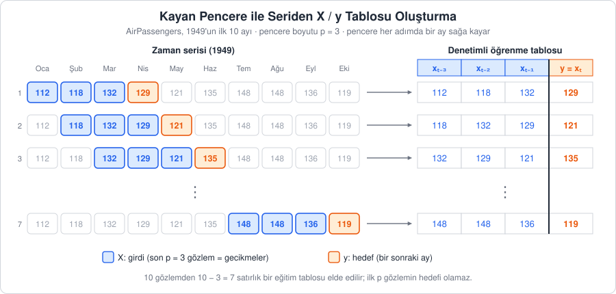
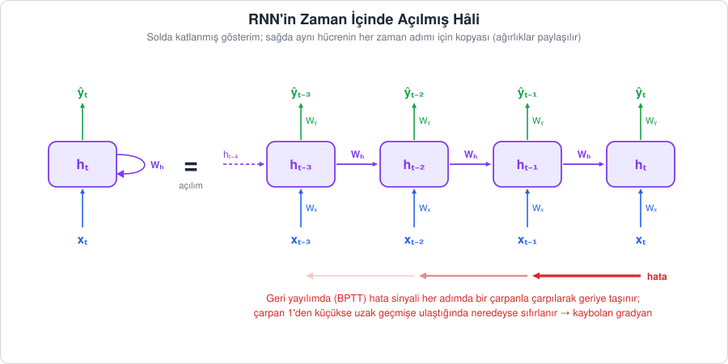
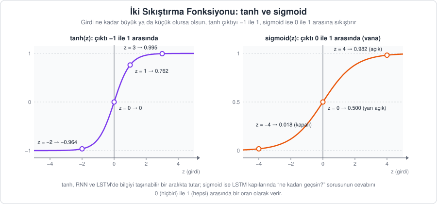
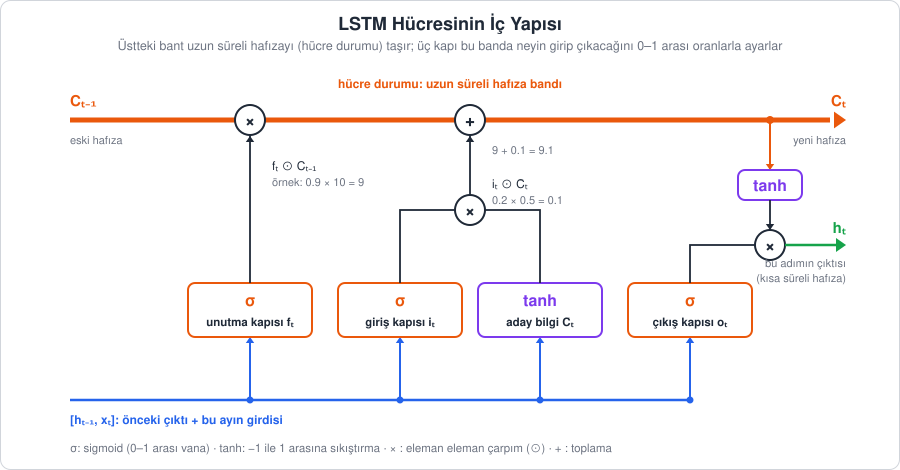

[İçindekiler](../Course_notes.md) · [← 11. Gretl: Ekonometrik Analiz için Görsel Ortam](11_gretl_ekonometrik_analiz_icin_gorsel_ortam.md) · [13. XGBoost ile Zaman Serisi Tahmini →](13_xgboost_ile_zaman_serisi_tahmini.md)

## 12. Yapay Zeka ile Zaman Serisi Analizine Giriş

Şimdiye kadar gördüğümüz ARIMA/SARIMA (Bölüm 7), Prophet (Bölüm 9) ve VAR (Bölüm 10) gibi klasik modeller, verideki doğrusal yapıları ve düzenli kalıpları yakalamada oldukça başarılıdır. Ancak gerçek dünya verileri her zaman bu kadar düzenli değildir. Bazen serinin içindeki ilişkiler doğrusal değildir, birçok dışsal etken (hava durumu, kampanya, fiyat) aynı anda rol oynar ya da elimizde binlerce benzer seri vardır. Bu durumlarda istatistiksel modeller yetersiz kalabilir ve daha esnek araçlara, yani **makine öğrenmesi** ve **derin öğrenme** tabanlı modellere yöneliriz.

Bu bölüm, sonraki bölümlerin ortak zeminini hazırlar:

- **Bölüm 13 ve 14:** XGBoost ve Weka ile makine öğrenmesi yaklaşımı,
- **Bölüm 15:** LSTM, GRU ve 1D-CNN ile derin öğrenme yaklaşımı,
- **Bölüm 16:** Bu modellerin zaman serisine uygun biçimde doğrulanması (TimeSeriesSplit).

Burada önce bir zaman serisinin bu algoritmaların anlayacağı biçime nasıl dönüştürüleceğini, ardından derin öğrenme modellerinin "hafıza" fikrini kavramsal olarak ele alacağız.

---

### 12.1. Problemi Yeniden Çerçevelemek: Denetimli Öğrenmeye Dönüştürme

Makine öğrenmesi yaklaşımının temelinde basit ama güçlü bir fikir yatar: Zaman serisi problemini, bildiğimiz bir **denetimli öğrenme (supervised learning)** problemine dönüştürmek.

**Açıklama:** Bir zaman serisi tek bir sütundan oluşur: her zaman noktası için bir değer. Denetimli öğrenme ise bir girdi tablosu (`X`, her satırı bir örnek, her sütunu bir özellik) ve bir hedef sütunu (`y`) ister. "Denetimli" denmesinin nedeni, modelin eğitim sırasında her örneğin doğru cevabını (`y`) görmesi, yani bir öğretmen tarafından denetlenir gibi öğrenmesidir. Bu dönüşümü, geçmişi geleceğin ipucu olarak kullanarak yaparız: "Bugünkü değeri" tahmin etmek için "dünkü değer", "geçen haftanın aynı günündeki değer" gibi geçmiş bilgileri modele birer **özellik (feature)** olarak sunarız. Tahmin etmeye çalıştığımız "bugünkü değer" ise **hedef (target)** olur. Bu işleme **özellik mühendisliği (feature engineering)** denir.

Bir dondurmacıyı düşünün: Bugünkü satışı tahmin etmek isteyen dükkân sahibi; dünkü satışa, geçen hafta aynı günkü satışa ve bugünün hafta sonu olup olmadığına bakar. Bu üç bilgi tablonun sütunları (özellikler), bugünkü satış ise o satırın hedefidir. Geçmiş günlerin her biri böyle bir satır oluşturur ve model bu satırlardan "hangi koşulda satış ne olur" ilişkisini öğrenir.

**Tanım:** $x_t$ değerini tahmin etmek için, geçmiş değerlerden ve bilinen takvim bilgilerinden oluşan bir fonksiyon öğrenmeye çalışırız. Formül, sözle şunu söyler: *bugünkü değer = (geçmiş değerlerden ve takvimden hesaplanan bir sonuç) + (önceden bilinemeyen bir sürpriz)*.

$$
x_t = f\big(x_{t-1}, x_{t-2}, \dots, x_{t-p}, \text{ay}, \text{haftanın günü}, \text{tatil mi?}, \dots\big) + \varepsilon_t
$$

> **Simge notu:** $`x_t`$ *(x t)*: t anındaki (bugünkü) değer; alttaki küçük $`t`$ (alt indis) değerin hangi zamana ait olduğunu gösterir · $`x_{t-1}`$ *(x t eksi bir)*: bir önceki dönemin değeri; $`x_{t-p}`$: p dönem önceki değer · $`f(\dots)`$ *(f fonksiyonu)*: parantez içindeki girdileri alıp tek bir sayı üreten kural; veriden öğrenilecektir ve doğrusal olması gerekmez · $`\dots`$ *(üç nokta)*: aradaki terimler · $`p`$: kaç geçmiş gözleme bakıldığı (pencere boyutu) · $`\varepsilon_t`$ *(epsilon t)*: modelin açıklayamadığı hata (sürpriz). ε (epsilon) bir Yunan harfidir; "elemanıdır" anlamındaki ∈ işaretiyle karıştırmayın.

**Küçük bir örnek:** Aylık `AirPassengers` serisinde (bin yolcu) Ocak 1950'yi tahmin etmek isteyelim. Çok basit bir kural seçelim: "$`f`$ = geçen yılın aynı ayı + 10". Ocak 1949'da değer 112 olduğuna göre tahmin $112 + 10 = 122$ olur. Gerçek değer 115'tir, dolayısıyla hata $\varepsilon = 115 - 122 = -7$ bulunur. Makine öğrenmesinin işi, bu tür hataları bütün geçmiş satırlarda olabildiğince küçültecek $f$ kuralını veriden kendisinin bulmasıdır.

Bölüm 7'deki AR($p$) modeli de aslında aynı şeyi yapar, ancak $f$'yi **doğrusal** bir fonksiyon olarak varsayar. Doğrusal, girdilerin sabit sayılarla (katsayılarla) çarpılıp toplanması demektir; örneğin $f = 0.8 \cdot x_{t-1} + 0.2 \cdot x_{t-12}$. Makine öğrenmesi ise $f$'yi Gradient Boosting, Random Forest, XGBoost ya da sinir ağları gibi esnek algoritmalarla, "önceki ay yüksekse **ve** yaz ayıysa" gibi doğrusal olmayan etkileşimleri de yakalayacak biçimde öğrenir.

> **Hemen deneyin 12.1 · "Geçen yılın aynı ayı + 10" kuralını bütün 1950 yılına uygulayın** (Python, ~4 dk)
>
> Yukarıda Ocak 1950 için elle yaptığımız hesabı (tahmin 122, hata −7) bütün bir yıla yayalım. Depo kök dizininde bir Python oturumu açın (VS Code, Jupyter ya da Colab) ve şu satırları çalıştırın:
>
> ```python
> import pandas as pd
> df = pd.read_csv("data/AirPassengers.csv", parse_dates=["Month"], index_col="Month")
> seri = df["Passengers"]
> # shift(12): her satırın yanına 12 ay önceki değeri getirir (ayrıntısı 12.1.2'de)
> tablo = pd.DataFrame({"gercek": seri, "tahmin": seri.shift(12) + 10})   # kural: geçen yılın aynı ayı + 10
> tablo["hata"] = tablo["gercek"] - tablo["tahmin"]                       # epsilon = gerçek - tahmin
> print(tablo.loc["1950"].head(4))                    # .loc["1950"]: yalnızca 1950 yılının satırları
> print("1950 ortalama mutlak hata:", tablo.loc["1950", "hata"].abs().mean())   # abs(): mutlak değer
> ```
>
> **Ne göreceksiniz:**
>
> ```text
>             gercek  tahmin  hata
> Month
> 1950-01-01     115   122.0  -7.0
> 1950-02-01     126   128.0  -2.0
> 1950-03-01     141   142.0  -1.0
> 1950-04-01     135   139.0  -4.0
> 1950 ortalama mutlak hata: 6.333333333333333
> ```
>
> İlk satır, elle bulduğumuz sayıların aynısıdır (tahmin 122, hata −7). Bu basit kural 1950'nin on iki ayında ortalama 6.3 bin yolcu yanılıyor.
>
> **Şimdi siz:** (1) `+ 10` yerine `+ 20` yazın. 1950'nin ortalama hatası küçülür mü, büyür mü? (2) `+ 10` ile `+ 50`'yi bu kez 1959 yılı için deneyin (iki yerdeki `"1950"` yazısını `"1959"` yapın). Ne fark ediyorsunuz?
>
> <details><summary>Cevap</summary>
>
> (1) `+ 20` ile 1950'nin ortalama mutlak hatası 8.33'e çıkar; 1950 için +10 daha iyidir. (2) 1959'da `+ 10` ile hata 37.33, `+ 50` ile 10.5'tir. Seri büyüdükçe "doğru" ekleme miktarı da değişir. Kuralı elle seçmek yerine $f$'yi veriden öğrenmemizin nedeni budur.
>
> </details>

#### 12.1.1. Kayan Pencere (Sliding Window)

Dönüşümün en temel yolu **kayan penceredir**: $p$ uzunluğunda bir pencere serinin başından itibaren birer adım kaydırılır. Her konumda pencerenin içindeki $p$ değer bir satırın girdilerini (`X`), pencereden hemen sonraki değer ise o satırın hedefini (`y`) oluşturur.



*Şekil 12.1 — Kayan pencere yöntemi: Pencere boyutu $`p = 3`$ iken her satırın girdisi son üç ay (mavi), hedefi bir sonraki ay (turuncu) olur. Pencere bir adım sağa kaydıkça tabloya yeni bir satır eklenir.*

Şekilden iki önemli sonuç çıkar:

- $n$ gözlemli bir seriden $n - p$ satırlık bir tablo elde edilir ($n$: serideki toplam gözlem sayısı). İlk $p$ gözlemin kendinden önce yeterli geçmişi olmadığı için hedef olamaz. Şekildeki 10 aylık örnekte $10 - 3 = 7$ satır, 144 aylık `AirPassengers` serisinin tamamında ise $144 - 3 = 141$ satır oluşur.
- Satırlar arasında **zaman sırası korunur**. Tablo, sıradan bir veri seti gibi görünse de satırları karıştırmak geleceğin bilgisini geçmişe taşır (bkz. 12.1.5).

Pencere boyutu $p$ bir hiperparametredir, yani modelin veriden öğrenmediği, bizim önceden seçtiğimiz bir ayardır. Bölüm 6'daki PACF grafiği hangi gecikmelerin anlamlı olduğu konusunda ipucu verir. Aylık mevsimsel verilerde $p = 12$ (bir tam yıl) iyi bir başlangıç noktasıdır.

> **Hemen deneyin 12.1.1a · Şekil 12.1'deki tabloyu hücre kaydırarak kurun** (Excel / LibreOffice Calc, ~5 dk)
>
> 1. Boş bir sayfada `A1` hücresine `x`, `B1`–`E1` hücrelerine sırayla `x_t-3`, `x_t-2`, `x_t-1`, `y` başlıklarını yazın.
> 2. `A2:A11` hücrelerine `AirPassengers`'ın ilk 10 ayını alt alta yazın: 112, 118, 132, 129, 121, 135, 148, 148, 136, 119.
> 3. İlk hedef 4. gözlemdir (129, `A5` hücresi). Bu yüzden 5. satıra şu formülleri yazın: `B5` hücresine `=A2`, `C5` hücresine `=A3`, `D5` hücresine `=A4`, `E5` hücresine `=A5`.
> 4. `B5:E5` aralığını seçin ve seçimin sağ alt köşesindeki küçük kareyi (doldurma tutamacı) 11. satıra kadar aşağı sürükleyin.
>
> **Ne göreceksiniz:** 5–11. satırlarda 7 satırlık bir tablo oluşur. İlk satır `112 | 118 | 132 | 129`, son satır `148 | 148 | 136 | 119`'dur; tablo Şekil 12.1'dekinin aynısıdır. Formüllerdeki adresler göreli olduğu için her satırda bir aşağı kayar; pencerenin "kayması" tam olarak budur. 2–4. satırlar boş kalır, çünkü ilk üç gözlemin önünde üç aylık geçmiş yoktur ($10 - 3 = 7$ satır).
>
> **Şimdi siz:** (1) `B8` hücresine tıklayın; formül çubuğunda ne yazdığını önce tahmin edin. (2) Pencereyi $p = 4$'e büyütseydik tablo kaçıncı satırdan başlar ve kaç satır olurdu?
>
> <details><summary>Cevap</summary>
>
> (1) `B8` hücresinde `=A5` yazar: Her satır bir öncekine göre bir hücre aşağıyı gösterir. (2) İlk hedef 5. gözlem olur (`A6`, 121); tablo 6. satırdan başlar ve $10 - 4 = 6$ satır olur. Son satır `135 | 148 | 148 | 136` → 119'dur.
>
> </details>

> **Hemen deneyin 12.1.1b · Aynı tabloyu `shift` ile kontrol edin** (Python, ~3 dk)
>
> Excel'de elle kurduğunuz tabloyu pandas ile tek komutta üretelim:
>
> ```python
> import numpy as np
> import pandas as pd
> x = np.array([112, 118, 132, 129, 121, 135, 148, 148, 136, 119])   # AirPassengers'ın ilk 10 ayı
> s = pd.Series(x)
> # shift(k): seriyi k satır aşağı kaydırır; dropna(): boş (NaN) hücre içeren satırları atar
> tablo = pd.DataFrame({"x_t-3": s.shift(3), "x_t-2": s.shift(2),
>                       "x_t-1": s.shift(1), "y": s}).dropna()
> print(tablo)
> print(tablo.shape)
> ```
>
> **Ne göreceksiniz:**
>
> ```text
>    x_t-3  x_t-2  x_t-1    y
> 3  112.0  118.0  132.0  129
> 4  118.0  132.0  129.0  121
> 5  132.0  129.0  121.0  135
> 6  129.0  121.0  135.0  148
> 7  121.0  135.0  148.0  148
> 8  135.0  148.0  148.0  136
> 9  148.0  148.0  136.0  119
> (7, 4)
> ```
>
> Satırlar Excel tablonuzla birebir aynıdır. Soldaki 3, 4, ... sayıları satırın serideki sıra numarasıdır (0'dan sayılır); ilk üç satır (0, 1, 2) `dropna()` ile atılmıştır.
>
> **Şimdi siz:** 10 gözlemlik bu seride $p = 12$ seçseydik kaç satır kalırdı? Önce tahmin edin, sonra sözlüğe `"x_t-4": s.shift(4)`, …, `"x_t-12": s.shift(12)` sütunlarını ekleyip `shape`'e bakın.
>
> <details><summary>Cevap</summary>
>
> Hiç satır kalmaz (`shape` = `(0, 13)`): Hiçbir gözlemin önünde 12 aylık geçmiş yoktur. Pencere boyunu seçerken serinin uzunluğunu da düşünmek gerekir.
>
> </details>

#### 12.1.2. Gecikme ve Takvim Özellikleri

> **Uygulama dosyası:** [`Codes/python/ch12_kayan_pencere.py`](../Codes/python/ch12_kayan_pencere.py) · [Notebook](../Codes/notebooks/ch12_kayan_pencere.ipynb) · [](https://colab.research.google.com/github/erkanozhan/AI_Based_Time_Series-Data_Analytics/blob/main/Codes/notebooks/ch12_kayan_pencere.ipynb)
>
> Bu bölümdeki kodların tamamı bu dosyada. Bilgisayarınızda çalıştırmak için depo kök dizininde `python Codes/python/ch12_kayan_pencere.py` komutunu kullanın ya da dosyayı VS Code'da açıp hücre hücre çalıştırın. Kurulum yapmadan denemek için Colab bağlantısını kullanabilirsiniz. Dosyadaki `veri_yolu()` yardımcı fonksiyonu, `data/` klasörü bulunamazsa (ör. Colab'da) veriyi doğrudan GitHub'dan okur; geri kalan kod aşağıdakiyle aynıdır.

Kayan pencere yalnızca son $p$ gözlemi kullanır. Özellik mühendisliğiyle bu tabloyu zenginleştirebiliriz:

| Özellik türü | Örnek | Ne yakalar? |
| --- | --- | --- |
| Gecikme (lag) | $`x_{t-1}, x_{t-2}, x_{t-3}`$ | Kısa vadeli bağımlılık (otokorelasyon) |
| Mevsimsel gecikme | $`x_{t-12}`$ (aylık veride geçen yılın aynı ayı) | Mevsimsel tekrar |
| Hareketli (kayan) istatistikler | Son 3 ayın ortalaması, son 12 ayın standart sapması | Yerel seviye ve oynaklık |
| Takvim özellikleri | Ay (1–12), çeyrek, haftanın günü, hafta sonu mu, tatil mi | Takvime bağlı etkiler |
| Dışsal değişkenler | Sıcaklık, fiyat, kampanya göstergesi | Serinin dışındaki nedenler |

"Gecikme" (lag), bir değerin kaç dönem önceki hâlidir: `lag_1` bir ay önceki, `lag_12` on iki ay önceki değerdir. Aşağıdaki kod, `AirPassengers` verisi üzerinde hem kayan pencereyi hem de gecikme ve takvim özelliklerini oluşturur.

```python
import numpy as np
import pandas as pd

# Veriyi yükleyelim: tarih sütununu indeks yapıyoruz
df = pd.read_csv('data/AirPassengers.csv', parse_dates=['Month'], index_col='Month')
seri = df['Passengers']

# 1) Kayan pencere: son p gözlem -> bir sonraki gözlem
def kayan_pencere(dizi, p):
    X, y = [], []
    for i in range(len(dizi) - p):
        X.append(dizi[i:i + p])   # girdi: p uzunluğunda pencere
        y.append(dizi[i + p])     # hedef: pencereden hemen sonraki değer
    return np.array(X), np.array(y)

X, y = kayan_pencere(seri.values, p=3)
print(X.shape, y.shape)   # 144 gözlemden 144 - 3 = 141 örnek
print(X[:3], y[:3])

# 2) Aynı fikir pandas ile: gecikme ve takvim özellikleri
tablo = pd.DataFrame({'y': seri})
for k in [1, 2, 3, 12]:                     # x_{t-1}, x_{t-2}, x_{t-3} ve geçen yılın aynı ayı
    tablo[f'lag_{k}'] = seri.shift(k)
# Hareketli ortalama yalnızca GEÇMİŞ değerlerden hesaplanır: shift(1) sızıntıyı önler
tablo['ort_3'] = seri.shift(1).rolling(window=3).mean()
tablo['ay'] = tablo.index.month             # takvim özelliği: 1-12
tablo['ceyrek'] = tablo.index.quarter       # takvim özelliği: 1-4
tablo = tablo.dropna()                      # geçmişi eksik ilk 12 satır atılır

print(tablo.head(3))

# 3) Zamansal ayrım: son 12 ay test, veri KARIŞTIRILMAZ
X_train, X_test = tablo.drop(columns='y').iloc[:-12], tablo.drop(columns='y').iloc[-12:]
y_train, y_test = tablo['y'].iloc[:-12], tablo['y'].iloc[-12:]
print(X_train.shape, X_test.shape)
```

Kod üç bölümden oluşur. Önce satırlara yakından bakalım:

1. **Kütüphaneler ve veri:** Kütüphaneleri kısa adlarla (`np`, `pd`) yüklemek (bkz. 6.3.7) ve `pd.read_csv(..., parse_dates=['Month'], index_col='Month')` ile tarihleri satır etiketi (indeks) yaparak okumak önceki bölümlerdekiyle aynıdır (bkz. 10.9). Tarih indeksi sayesinde 6. maddedeki takvim özelliklerini çıkarabiliriz. `df['Passengers']` köşeli parantezle tek bir sütunu seçer; sonuç, tarih etiketli tek sütunluk bir *Series*'tir.
2. **`kayan_pencere` fonksiyonu:** `def` ile kendi fonksiyonumuzu tanımlarız. `seri.values`, tarih etiketlerini bırakıp yalnızca 144 sayıyı düz bir NumPy dizisi olarak verir; böylece `dizi[i]` ile sıra numarasına göre erişebiliriz. Python'da sayma 0'dan başlar: `dizi[0]` Ocak 1949'dur (112). `range(len(dizi) - p)` döngüyü $i = 0, 1, \dots, 140$ için çalıştırır (141 tur). `dizi[i:i + p]` bir *dilimdir*: $i$. elemandan başlar, $i + p$. elemanı **dahil etmez**. Örneğin $i = 0$ iken `dizi[0:3]` = 112, 118, 132 (Ocak–Mart) ve hedef `dizi[3]` = 129 (Nisan) olur. `append` her turda listeye bir satır ekler, `np.array` de bu listeyi bir diziye çevirir.
3. **Boyutlar (`shape`):** `X.shape` = `(141, 3)`, "141 satır, 3 sütun" demektir. `y.shape` = `(141,)` ise 141 elemanlı **tek boyutlu** bir dizidir; parantezin içindeki tek sayı ve virgül, tek boyut olduğunu gösterir. `X[:3]` dizinin ilk üç satırını seçer.
4. **`shift(k)` ile gecikmeler:** `pd.DataFrame({'y': seri})` hedef sütunu `y` olan yeni bir tablo kurar. `for k in [1, 2, 3, 12]` döngüsü listedeki her sayı için bir sütun ekler. `f'lag_{k}'` (f-string, bkz. 6.3.7) `'lag_1'`, `'lag_2'` gibi sütun adları üretir. `seri.shift(k)` bütün değerleri $k$ satır aşağı kaydırır. Örneğin 112, 118, 132 dizisi `shift(1)` ile NaN, 112, 118 olur; yani her satırın yanına bir önceki ayın değeri gelir. **NaN** (*Not a Number*), "boş, bilinmeyen değer" anlamına gelir: Ocak 1949'dan önceki ay veride yoktur.
5. **`rolling` ile hareketli ortalama:** `seri.shift(1).rolling(window=3).mean()` önce seriyi bir ay kaydırır, ardından her satırda 3 satırlık bir pencerenin ortalamasını alır. Sonuçta her ayın yanına "kendisinden önceki üç ayın ortalaması" yazılır. `shift(1)` olmasaydı ortalamaya o ayın kendi değeri de girerdi (12.1.5'teki sızıntı).
6. **Takvim özellikleri:** `tablo.index.month` tarih indeksinden ay numarasını (1–12), `tablo.index.quarter` çeyreği (1–4) çıkarır. Ağaç gibi modeller bu sayılar sayesinde "ay 7 ise değer yüksektir" türünden kurallar öğrenebilir. Takvim bilgisi geleceğin her ayı için önceden bilindiği için sızıntı riski taşımaz.
7. **`dropna()`:** NaN içeren her satırı atar. En uzun gecikme `lag_12` olduğu için ilk 12 satır silinir.
8. **Zamansal ayrım:** `tablo.drop(columns='y')` hedef sütunu çıkarıp yedi girdi sütununu bırakır. `.iloc[:-12]` ve `.iloc[-12:]`, 9.3'teki gibi satırları sıra numarasına göre seçerek son 12 ayı teste ayırır.

Çıktı:

```text
(141, 3) (141,)
[[112 118 132]
 [118 132 129]
 [132 129 121]] [129 121 135]
              y  lag_1  lag_2  lag_3  lag_12       ort_3  ay  ceyrek
Month
1950-01-01  115  118.0  104.0  119.0   112.0  113.666667   1       1
1950-02-01  126  115.0  118.0  104.0   118.0  112.333333   2       1
1950-03-01  141  126.0  115.0  118.0   132.0  119.666667   3       1
(120, 7) (12, 7)
```

**Çıktının yorumu:**

- `kayan_pencere` çıktısının ilk üç satırı, Şekil 12.1'deki tablonun aynısıdır: `[112, 118, 132] → 129`, `[118, 132, 129] → 121`, ...
- `shift(k)` seriyi $k$ adım aşağı kaydırır; böylece her satırda $k$ ay önceki değer yan yana gelir. Örneğin 1950-01 satırında `lag_1 = 118` (Aralık 1949) ve `lag_12 = 112` (Ocak 1949) yazar. Gecikme sütunlarının ondalıklı (`118.0`) görünmesi, NaN içeren sütunların pandas'ta ondalık sayı türünde tutulmasındandır.
- `lag_12` en uzun gecikme olduğu için ilk 12 satır `NaN` içerir ve `dropna()` ile atılır. Tablo bu yüzden 1950-01'den başlar ve 144 − 12 = 132 satırdır. Bunun 120'si eğitim, 12'si test için ayrılır; her ikisinde de 7 özellik sütunu vardır, bu yüzden boyutlar `(120, 7)` ve `(12, 7)` olur.
- `ort_3`, 1950-01 için Ekim–Aralık 1949 ortalamasıdır: (119 + 104 + 118) / 3 = 341 / 3 ≈ 113.67. Ocak 1950'nin kendi değeri (115) bu ortalamaya **girmez**.

Bu tablo artık herhangi bir regresyon algoritmasına verilebilir. Bölüm 13'te aynı yaklaşımı daha fazla özellikle XGBoost üzerinde uygulayacağız.

> **Hemen deneyin 12.1.2 · Tabloya kendi özelliklerinizi ekleyin** (Python, ~5 dk)
>
> Yukarıdaki tabloya üç yeni özellik ekleyelim: iki yıl önceki aynı ay (`lag_24`), son üç ayın oynaklığı (`std_3`) ve bir "yaz ayı mı?" göstergesi (`yaz`).
>
> ```python
> import pandas as pd
> df = pd.read_csv("data/AirPassengers.csv", parse_dates=["Month"], index_col="Month")
> seri = df["Passengers"]
> tablo = pd.DataFrame({"y": seri})
> tablo["lag_1"] = seri.shift(1)
> tablo["lag_24"] = seri.shift(24)                         # iki yıl önceki aynı ay
> tablo["std_3"] = seri.shift(1).rolling(3).std()          # önceki 3 ayın standart sapması
> tablo["ay"] = tablo.index.month
> tablo["yaz"] = tablo["ay"].isin([6, 7, 8]).astype(int)   # isin: listede mi? astype(int): True/False -> 1/0
> tablo = tablo.dropna()
> print(tablo.shape)
> print(tablo.loc["1951-05":"1951-07"])                    # Mayıs-Temmuz 1951 satırları
> ```
>
> **Ne göreceksiniz:**
>
> ```text
> (120, 6)
>               y  lag_1  lag_24      std_3  ay  yaz
> Month
> 1951-05-01  172  163.0   121.0  14.011900   5    0
> 1951-06-01  178  172.0   135.0   7.549834   6    1
> 1951-07-01  199  178.0   148.0   7.549834   7    1
> ```
>
> En uzun gecikme artık 24 olduğu için ilk 24 satır atılır ve $144 - 24 = 120$ satır kalır. Haziran ve Temmuz satırlarında `yaz` = 1'dir. `lag_24`, örneğin Haziran 1951 için Haziran 1949'un değeridir (135).
>
> **Şimdi siz:** (1) `lag_24` yerine `lag_36` (üç yıl önce) kullanın; tablonun satır sayısını önce tahmin edin. (2) Haziran 1951 satırındaki `std_3` = 7.55 değerini elle doğrulayın. Önceki üç ay (Mart–Mayıs 1951) 178, 163 ve 172'dir. İpucu: pandas'ın `std()` fonksiyonu kareler toplamını $n - 1$'e böler.
>
> <details><summary>Cevap</summary>
>
> (1) `(108, 6)`: $144 - 36 = 108$ satır. Uzun gecikmeler, eğitim için kalan satır sayısını azaltır. (2) Ortalama $(178 + 163 + 172) / 3 = 171$; sapmalar $7, -8, 1$; kareleri $49 + 64 + 1 = 114$; $114 / (3 - 1) = 57$; $\sqrt{57} \approx 7.55$.
>
> </details>

#### 12.1.3. Tek Adımlı ve Çok Adımlı Tahmin

Yukarıdaki tablo **tek adımlı (one-step-ahead)** bir tahmin kurar: Bilinen geçmişle yalnızca bir sonraki ayı tahmin ederiz. Oysa pratikte çoğu zaman birkaç adım ilerisi gerekir (ör. önümüzdeki 12 ay). Buna **çok adımlı (multi-step)** tahmin denir ve iki temel stratejisi vardır. Aşağıdaki formüllerde şapkalı $\hat{x}$ "tahmin edilen değer", şapkasız $x$ ise "gözlenmiş gerçek değer" anlamına gelir:

```math
\begin{aligned}
\text{Özyinelemeli:}\quad & \hat{x}_{t+1} = f(x_t, x_{t-1}, \dots, x_{t-p+1}), \quad \hat{x}_{t+2} = f(\hat{x}_{t+1}, x_t, \dots, x_{t-p+2}), \quad \dots \\
\text{Doğrudan:}\quad & \hat{x}_{t+h} = f_h(x_t, x_{t-1}, \dots, x_{t-p+1}), \qquad h = 1, 2, \dots, H
\end{aligned}
```

> **Simge notu:** $`t`$: elimizdeki son gözlemin zamanı ("şimdi") · $`\hat{x}_{t+h}`$ *(x şapka t artı h)*: $`h`$ adım sonrası için yapılan tahmin; şapka (^) "bu bir tahmindir" demektir · $`H`$: tahmin ufku (kaç adım ileriye tahmin yapıldığı) · $`h = 1, 2, \dots, H`$: h sırayla 1, 2, ..., H değerlerini alır · $`f_h`$ *(f h)*: yalnızca $`h`$ adım ilerisi için eğitilmiş ayrı model

- **Özyinelemeli (recursive) strateji:** Tek bir tek-adım modeli eğitilir. Bir sonraki adımı tahmin eder, bu tahmini gerçek değermiş gibi pencereye ekler ve bir sonraki adıma geçer. Basittir, ancak her adımdaki hata bir sonraki adımın girdisine karışır ve **hatalar birikir**.
- **Doğrudan (direct) strateji:** Her ufuk $h$ için ayrı bir model eğitilir: "1 ay sonrası modeli", "2 ay sonrası modeli" vb. Örneğin 2 ay sonrası modelinin eğitim tablosunda girdi son üç ay, hedef ise iki ay sonraki değerdir (aradaki ay atlanır). Hata birikimi yoktur, ancak $H$ tane model eğitmek gerekir ve modeller birbirinden habersizdir.
- **Çok çıktılı (MIMO) strateji:** Özellikle sinir ağlarında tek bir model, çıktı katmanında $H$ değeri birden üretir. Derin öğrenme modellerinde sık kullanılır.

**Küçük bir örnek (özyinelemeli):** Modelimiz çok basit olsun: "$`f`$ = son üç değerin ortalaması". Son üç gözlem 100, 110 ve 120 ise:

1. $\hat{x}_ {t+1} = (100 + 110 + 120) / 3 = 110$
2. Pencere bir kayar ve tahmin edilen 110 içeri girer: $\hat{x}_ {t+2} = (110 + 120 + 110) / 3 \approx 113.33$
3. $\hat{x}_ {t+3} = (120 + 110 + 113.33) / 3 \approx 114.44$

Üçüncü adımda üç girdiden ikisi artık modelin kendi tahminidir. İlk tahmin hatalı çıkarsa, bu hata sonraki iki tahminin içine de taşınır.

**Not —** Bölüm 7'deki ARIMA'nın `forecast(h = 24)` çağrısı da arka planda özyinelemeli çalışır: Her adımın tahmini bir sonrakinde girdi olarak kullanılır. Belirsizlik bu şekilde biriktiği için ARIMA'nın tahmin aralıkları ufuk uzadıkça genişler.

> **Hemen deneyin 12.1.3 · Özyinelemeli tahmini "aşağı sürükleyerek" izleyin** (Excel / LibreOffice Calc ve Python, ~5 dk)
>
> Notun "son üç değerin ortalaması" modelini gerçek verilerle deneyelim: Ekim–Aralık 1959 değerlerinden (407, 362, 405) yola çıkıp Ocak–Mart 1960'ı tahmin edeceğiz. Bu ayların gerçek değerleri 417, 391 ve 419'dur.
>
> 1. `A1:A3` hücrelerine 407, 362, 405 yazın.
> 2. `A4` hücresine `=ORTALAMA(A1:A3)` (İngilizce: `=AVERAGE(A1:A3)`) yazın.
> 3. `A4` hücresini `A6`'ya kadar aşağı sürükleyin. `A5` hücresine tıklayın: formül `=ORTALAMA(A2:A4)` olmuştur, yani pencereye `A4`'teki **tahmin** girmiştir.
> 4. `B4:B6` hücrelerine gerçek değerleri (417, 391, 419), `C4` hücresine `=B4-A4` yazıp `C6`'ya kadar sürükleyin.
>
> Aynı hesabın Python karşılığı (kontrol için):
>
> ```python
> pencere = [407, 362, 405]            # Ekim, Kasım, Aralık 1959
> gercek = [417, 391, 419]             # Ocak, Şubat, Mart 1960
> for h in range(3):
>     tahmin = sum(pencere[-3:]) / 3   # f = son üç değerin ortalaması; [-3:] son üç eleman
>     print(h + 1, round(tahmin, 2), "gercek:", gercek[h], "hata:", round(gercek[h] - tahmin, 2))
>     pencere.append(tahmin)           # özyinelemeli: tahmin pencereye girer
> ```
>
> **Ne göreceksiniz:** Excel'de `A4:A6` = 391,33; 386,11; 394,15 ve hatalar 25,67; 4,89; 24,85 (Türkçe Excel ondalık ayırıcı olarak virgül kullanır). Python çıktısı:
>
> ```text
> 1 391.33 gercek: 417 hata: 25.67
> 2 386.11 gercek: 391 hata: 4.89
> 3 394.15 gercek: 419 hata: 24.85
> ```
>
> **Şimdi siz:** (1) `A4` hücresini `A15`'e kadar sürükleyin. Tahminler nereye yerleşir? (2) Şubat ve Mart 1960'ı bu kez **tek adımlı** tahmin edin: Pencereye tahmin yerine bilinen gerçek değeri koyun, ör. Şubat için `=ORTALAMA(362;405;417)`. Hatalar özyinelemeli tahmindekilerle nasıl karşılaştırılır?
>
> <details><summary>Cevap</summary>
>
> (1) İlk birkaç adımdan sonra tahminler 390 ile 392 arasında kalır ve 391 civarına yerleşir (ör. `A15` ≈ 391,02); tahmin düz bir çizgiye dönüşür: Model bir süre sonra yalnızca kendi tahminlerinin ortalamasını alır, pencereye yeni bilgi girmez. (2) Şubat: $(362 + 405 + 417) / 3 \approx 394.67$, hata $391 - 394.67 = -3.67$. Mart: $(405 + 417 + 391) / 3 \approx 404.33$, hata $419 - 404.33 = 14.67$. Mart'ın özyinelemeli hatası (24.85) belirgin biçimde daha büyüktür; gerçek değer yerine tahmin kullanıldıkça hata birikir.
>
> </details>

#### 12.1.4. Ölçekleme İhtiyacı

Farklı algoritmaların verinin ölçeğine (sayıların büyüklüğüne) duyarlılığı farklıdır:

- **Sinir ağları (LSTM, GRU, CNN):** Ağın ağırlıkları **gradyan inişiyle** öğrenilir: Ağ bir tahmin yapar, hatasını ölçer ve her ağırlığı hatayı biraz azaltan yönde küçük bir adımla düzeltir; bu tekrar tekrar yapılır. *Gradyan*, "bu ağırlığı çok az artırırsam hata ne kadar ve hangi yönde değişir?" sorusunun cevabı olan sayıdır (bir eğim). Ağın içindeki `sigmoid` ve `tanh` gibi aktivasyon fonksiyonları (Şekil 12.3) ise yalnızca sıfıra yakın girdilerde birbirinden ayırt edilebilir çıktılar üretir: $\tanh(1) \approx 0.76$ ile $\tanh(2) \approx 0.96$ farklıdır, ama yolcu sayısı gibi büyük değerlerde $\tanh(400)$ ile $\tanh(500)$ ikisi de 1'e eşit çıkar ve aradaki fark kaybolur. Bu yüzden veri genellikle 0–1 aralığına ölçeklenir. Bölüm 15'te kullanacağımız `MinMaxScaler` bunu şu dönüşümle yapar:

$$
x'_t = \frac{x_t - x_{\min}}{x_{\max} - x_{\min}}
$$

> **Simge notu:** $`x'_t`$ *(x kesme t; "x üssü t" diye de okunur, ancak burada bir üs ya da türev yoktur)*: ölçeklenmiş değer · $`x_{\min}, x_{\max}`$: **eğitim setindeki** en küçük ve en büyük değer; buradaki "min" ve "max" bir zaman indisi değil, yalnızca bir etikettir

Sözle: Değerden en küçük değeri çıkarırız (en küçük değer 0'a gelir), sonra aralığın genişliğine böleriz (en büyük değer 1'e gelir). `AirPassengers`'ın ilk 132 ayında (1949–1959) en küçük değer 104, en büyük değer 559'dur; aralığın genişliği $559 - 104 = 455$'tir:

- 104 → $(104 - 104) / 455 = 0$; 559 → $455 / 455 = 1$
- 300 → $(300 - 104) / 455 = 196 / 455 \approx 0.431$
- Test dönemindeki 622 (Temmuz 1960) → $(622 - 104) / 455 = 518 / 455 \approx 1.138$. Değer 1'i aşar; bu bir hata değildir, test döneminde eğitimde görülmemiş bir seviyeye çıkıldığını gösterir.

Model 0–1 ölçeğinde tahmin üretir. Sonucu yolcu sayısı olarak okumak için formülü tersine çeviririz (**ters dönüşüm**, `inverse_transform`): $x_t = x'_ t \cdot (x_{\max} - x_{\min}) + x_{\min}$. Örneğin 0.5 tahmini $0.5 \cdot 455 + 104 = 331.5$ bin yolcuya karşılık gelir.

- **Ağaç tabanlı modeller (XGBoost, Random Forest):** Veriyi "değer 300'den büyük mü?" gibi eşik sorularıyla böldükleri için ölçeklemeye ihtiyaç duymazlar; sayıları 0–1'e çevirmek soruların sırasını değiştirmez. Ancak önemli bir sınırlamaları vardır: Eğitimde görmedikleri bir seviyeye **çıkamazlar** (dışdeğerleme, yani ekstrapolasyon yapamazlar). `AirPassengers` gibi sürekli artan bir seride test dönemindeki değerler eğitimdeki en büyük değeri aşıyorsa, ağaç modeli tahminleri o tavanın altında kalır (ayrıntısı 13.3'te). Bu sorun genellikle hedefi farka dönüştürerek ya da trendi önceden ayırarak çözülür (13.3 ve 13.4.2).

**Not —** Ölçekleyici (`scaler`) **yalnızca eğitim verisiyle** uydurulmalı (`fit`: en küçük ve en büyük değeri hesaplama), test verisine ise aynı parametrelerle yalnızca dönüştürme (`transform`: formülü uygulama) yapılmalıdır. Tüm veriyle uydurmak, test dönemindeki en büyük ve en küçük değerin bilgisini eğitime sızdırır. Örneğin ölçekleyici tüm seriyle uydurulsaydı en büyük değer 622 olurdu ve eğitimdeki tepe 559, 1 yerine $455 / 518 \approx 0.878$'e dönüşürdü; model, eğitim sırasında "ileride daha yüksek bir değer gelecek" bilgisini dolaylı olarak almış olurdu.

> **Hemen deneyin 12.1.4 · MinMax ölçeklemeyi elle hesaplayıp `MinMaxScaler` ile karşılaştırın** (Python, ~5 dk)
>
> ```python
> import numpy as np, pandas as pd
> from sklearn.preprocessing import MinMaxScaler
> df = pd.read_csv("data/AirPassengers.csv", parse_dates=["Month"], index_col="Month")
> egitim = df[["Passengers"]].iloc[:132]            # 1949-1959; çift köşeli parantez tablo biçimini korur
> olcek = MinMaxScaler().fit(egitim)               # fit: en küçük ve en büyük değeri öğren
> print(olcek.data_min_, olcek.data_max_)
> deneme = pd.DataFrame({"Passengers": [104, 300, 559, 622]})
> print(olcek.transform(deneme).round(3).ravel())  # ravel(): sonucu tek satırlık listeye düzleştirir
> print(olcek.inverse_transform([[0.5]]))          # ters dönüşüm: 0.5 kaç yolcu?
> print(np.tanh([1, 2, 400, 500]))                 # ölçeklenmemiş büyük sayılarda tanh
> ```
>
> **Ne göreceksiniz:**
>
> ```text
> [104.] [559.]
> [0.    0.431 1.    1.138]
> [[331.5]]
> [0.76159416 0.96402758 1.         1.        ]
> ```
>
> Sayılar notta elle bulduklarımızla aynıdır: 300 → 0.431, 622 → 1.138 (1'i aşar), 0.5 → 331.5. Son satırda $\tanh(400)$ ve $\tanh(500)$ ikisi de 1'dir; aradaki 100 bin yolcu farkı kaybolur.
>
> **Şimdi siz:** (1) Sızıntılı yolu deneyin: `.iloc[:132]` kısmını silip ölçekleyiciyi bütün seriyle uydurun. 559 ve 622 hangi değerlere dönüşür? (2) Ölçeklemenin tanh'a etkisini görün: `print(np.tanh(olcek.transform(pd.DataFrame({"Passengers": [400, 500]})).ravel()))` satırını (eğitimle uydurulmuş ölçekleyiciyle) çalıştırın.
>
> <details><summary>Cevap</summary>
>
> (1) `data_max_` 622 olur ve ikinci satır `[0.    0.378 0.878 1.   ]` gelir: Eğitimdeki tepe 559 artık 1 değil 0.878'dir. Model, test döneminin daha yüksek olacağını ölçekten "öğrenmiş" olur (12.1.5'teki sızıntı). (2) `[0.57203974 0.70154159]` (yaklaşık 0.572 ve 0.702): Ölçeklenmiş 400 ve 500'ün tanh değerleri artık birbirinden ayırt edilebilir.
>
> </details>

#### 12.1.5. Veri Sızıntısı Uyarısı

**Tanım:** **Veri sızıntısı (data leakage)**, modelin eğitim sırasında, tahmin anında gerçekte bilinemeyecek bir bilgiye erişmesidir. Sızıntılı bir model eğitim ve test metriklerinde harika görünür, ancak gerçek kullanımda çuvallar. Sınavdan önce cevap anahtarını görmüş bir öğrenci gibidir: Notu yüksektir, ama konuyu öğrenmemiştir.

Zaman serisinde sızıntının en sık görülen biçimleri:

1. **Veriyi karıştırmak:** `train_test_split(..., shuffle=True)` ile rastgele ayırmak, geleceğe ait satırları eğitime koyar. Her zaman Bölüm 8'deki gibi **zamansal ayrım** yapın: eğitim geçmiş, test gelecek.
2. **Hedefi içeren özellikler:** `rolling(3).mean()` başına `shift(1)` konmazsa hareketli ortalama o ayın kendi değerini de içerir; model hedefi "kopya çekerek" öğrenir. Ocak 1950 satırında `shift(1)` olmadan ortalama $(104 + 118 + 115) / 3 \approx 112.33$ çıkar ve tahmin etmeye çalıştığımız 115'i içerir; `shift(1)` ile ise $(119 + 104 + 118) / 3 \approx 113.67$ olur ve yalnızca geçmişi kullanır.
3. **Tüm veriyle ölçekleme veya dönüştürme:** 12.1.4'teki not.
4. **Tahmin anında bilinmeyen dışsal değişkenler:** Örneğin bir ayın günlük satışlarını tahmin ederken o ayın ortalama sıcaklığını kullanmak; ortalama ancak ay bitince bilinir.
5. **Çapraz doğrulamada geleceği görmek:** Sıradan k-katlı çapraz doğrulama, gelecekteki katlarla eğitip geçmişi test eder. Bunun zaman serisine uygun karşılığı Bölüm 16'daki TimeSeriesSplit'tir.

Pratik bir kontrol sorusu: *"Bu özelliğin değerini, tahmin yapacağım anda gerçekten bilebilir miyim?"* Cevap hayırsa özellik sızıntılıdır.

> **Hemen deneyin 12.1.5 · Sızıntının "mükemmel" sonucunu kendi gözünüzle görün** (Python, ~5 dk)
>
> Aynı doğrusal regresyon modelini iki kez kuracağız: Birinde hareketli ortalama `shift(1)` ile (temiz), diğerinde `shift(1)` olmadan (sızıntılı) hesaplanıyor. Test dönemi son 12 aydır (1960).
>
> ```python
> import pandas as pd
> from sklearn.linear_model import LinearRegression   # sıradan doğrusal regresyon
> df = pd.read_csv("data/AirPassengers.csv", parse_dates=["Month"], index_col="Month")
> seri = df["Passengers"]
> for sizinti in [False, True]:
>     t = pd.DataFrame({"y": seri, "lag_1": seri.shift(1), "lag_2": seri.shift(2)})
>     # koşullu atama: sizinti True ise soldaki, False ise sağdaki ifade kullanılır
>     t["ort_3"] = seri.rolling(3).mean() if sizinti else seri.shift(1).rolling(3).mean()
>     t = t.dropna()
>     X, y = t.drop(columns="y"), t["y"]
>     model = LinearRegression().fit(X.iloc[:-12], y.iloc[:-12])   # son 12 ay test
>     hata = (y.iloc[-12:] - model.predict(X.iloc[-12:])).abs().mean()
>     print("sizintili" if sizinti else "temiz    ", "test MAE =", round(hata, 2))
> ```
>
> **Ne göreceksiniz:**
>
> ```text
> temiz     test MAE = 39.66
> sizintili test MAE = 0.0
> ```
>
> Sızıntılı model 1960'ın her ayını **hatasız** tahmin ediyor. Bu bir başarı değil, kopya çekmedir: Gerçek gelecekte o ayın kendi değeri ortalamaya giremez.
>
> **Şimdi siz:** Döngüden sonra (girintisiz) `print(model.coef_.round(3))` satırını ekleyin. Bu, son kurulan (sızıntılı) modelin `lag_1`, `lag_2` ve `ort_3` katsayılarını yazar. Model kopyayı nasıl çekmiş?
>
> <details><summary>Cevap</summary>
>
> Çıktı `[-1. -1.  3.]` olur, yani model $\hat{y} = 3 \cdot \text{ort}_ 3 - \text{lag}_ 1 - \text{lag}_ 2$ formülünü bulmuştur. Sızıntılı ortalama $(y_{t-2} + y_{t-1} + y_t) / 3$ olduğundan bu formül tam olarak $y_t$'yi geri verir. Model hiçbir şey öğrenmemiş, hedefi özelliğin içinden geri çözmüştür.
>
> </details>

---

### 12.2. Derin Öğrenme Yaklaşımı: Serinin Hafızasını Modellemek

Makine öğrenmesi yaklaşımında geçmişi elle hazırladığımız sütunlarla (gecikmeler, hareketli ortalamalar) modele veriyoruz. Derin öğrenme ise farklı bir yol izler: Diziyi olduğu gibi, adım adım okuyup hangi geçmiş bilginin önemli olduğunu **kendisi** öğrenen özel sinir ağı mimarileri kullanır.

Girdi yine kayan pencereyle hazırlanır (12.1.1), ancak her örnek artık düz bir satır değil, bir **dizidir**. Bu yüzden LSTM gibi katmanlar veriyi üç boyutlu biçimde bekler: `(örnek sayısı, zaman adımı sayısı, özellik sayısı)`. Örneğin yukarıdaki `X` dizisi `X.reshape(141, 3, 1)` ile "141 örnek, her biri 3 zaman adımı, her adımda 1 değer" biçimine getirilir; `reshape` sayıları değiştirmez, yalnızca yeniden yerleştirir. Bu adımı Bölüm 15.1.3'te ayrıntılı olarak uygulayacağız.

#### 12.2.1. Tekrarlayan Sinir Ağları (RNN) ve Kaybolan Gradyan Sorunu

**Açıklama:** Tekrarlayan Sinir Ağları (Recurrent Neural Network, RNN), en temel hâliyle bir "hafızaya" sahip ağlardır. Diziyi her seferinde bir zaman adımı okur ve o ana kadar gördüklerinin bir özetini **gizli durum (hidden state)** adı verilen bir **vektörde** (sıralı bir sayı listesinde, ör. `[0.2, -0.5, 0.7]`) taşır. Her adımda bu özet, yeni gelen gözlemle birleştirilerek güncellenir: Ağ eski özeti bir ağırlıkla, yeni gözlemi başka bir ağırlıkla çarpar, ikisini toplayıp bir sabit ekler ve sonucu `tanh` fonksiyonuyla belirli bir aralığa sıkıştırır. Ardından bu yeni özetten bir tahmin üretir.

**Tanım:**

$$
h_t = \tanh\left(W_h h_{t-1} + W_x x_t + b\right), \qquad \hat{y}_t = W_y h_t + c
$$

> **Simge notu:** $`h_t`$ *(h t)*: t anındaki gizli durum (ağın "hafızası"); $`h_{t-1}`$: bir önceki adımdaki gizli durum · $`x_t`$: t anındaki girdi (ör. bu ayın ölçeklenmiş yolcu sayısı) · $`W_h, W_x, W_y`$ *(W h, W x, W y)*: öğrenilen ağırlıklar; buradaki alt indis zaman değil, ağırlığın neyle çarpıldığını gösteren bir etikettir · $`b, c`$: sabit (bias) terimleri · $`\tanh`$ *(tanjant hiperbolik, "tanh" diye okunur)*: girdisini −1 ile 1 arasına sıkıştıran aktivasyon fonksiyonu (Şekil 12.3) · $`\hat{y}_t`$ *(y şapka t)*: t anındaki tahmin

Gerçek bir ağda $h_t$ onlarca sayıdan oluşan bir vektör, $W_h$ gibi ağırlıklar ise **matrislerdir** (sayılardan oluşan tablolar); $W_h h_{t-1}$ çarpımı, vektörün her elemanını tablodaki ağırlıklarla çarpıp toplamak demektir. Mantığı görmek için her şeyi tek bir sayı olarak düşünebiliriz. $W_h = 0.5$, $W_x = 1$, $b = 0$ ve başlangıç hafızası $h_0 = 0$ olsun; ağa sırayla $x_1 = 1$ ve $x_2 = 2$ gelsin:

1. $h_1 = \tanh(0.5 \cdot 0 + 1 \cdot 1 + 0) = \tanh(1) \approx 0.762$
2. $h_2 = \tanh(0.5 \cdot 0.762 + 1 \cdot 2 + 0) = \tanh(0.381 + 2) = \tanh(2.381) \approx 0.983$

$h_2$ hem $x_2$'yi hem de $h_1$ üzerinden $x_1$'i içerir: Hafıza, geçmişi bu zincirleme toplamla taşır.

> **Hemen deneyin 12.2.1a · Bir RNN'in hafızasını adım adım izleyin** (Python, ~4 dk)
>
> Notteki iki adımlık örneği numpy ile hesaplayıp üç adım daha sürdürelim; bu üç adımda girdi 0'dır, yani ağa yeni bilgi gelmez.
>
> ```python
> import numpy as np
> W_h, W_x, b = 0.5, 1.0, 0.0        # ağırlıklar (her şey tek sayı)
> h = 0.0                            # başlangıç hafızası h_0
> for t, x in enumerate([1, 2, 0, 0, 0], start=1):   # enumerate: sıra numarası (1'den) ve değer
>     h = np.tanh(W_h * h + W_x * x + b)
>     print(f"t={t}  x={x}  h={h:.3f}")
> ```
>
> **Ne göreceksiniz:**
>
> ```text
> t=1  x=1  h=0.762
> t=2  x=2  h=0.983
> t=3  x=0  h=0.455
> t=4  x=0  h=0.224
> t=5  x=0  h=0.111
> ```
>
> İlk iki satır notta elle bulduğumuz 0.762 ve 0.983'tür. Girdi kesilince hafıza her adımda yaklaşık yarıya iner ($W_h = 0.5$): Geçmişin izi hızla silinir.
>
> **Şimdi siz:** (1) `W_h = 0.0` yapın; `t=2` ve `t=3`'te `h` ne olur? (2) `W_h = 0.9` yapın; `t=5`'teki hafıza ne kadar kalır?
>
> <details><summary>Cevap</summary>
>
> (1) `t=2`'de `h=0.964` (yalnızca $\tanh(2)$), `t=3`'ten itibaren `h=0.000`: $W_h = 0$ iken ağın hiç hafızası yoktur, yalnızca o anki girdiyi görür. (2) `t=5`'te `h=0.469`: $W_h$ büyüdükçe geçmiş daha uzun süre taşınır (0.5 ile yalnızca 0.111 kalmıştı).
>
> </details>

Bu yapının kilit noktası, **aynı ağırlıkların her zaman adımında yeniden kullanılmasıdır.** RNN'i zaman içinde "açarak" çizersek, aynı hücrenin her adım için bir kopyası yan yana dizilir (Şekil 12.2).



*Şekil 12.2 — Solda RNN'in katlanmış (kompakt) gösterimi, sağda zaman içinde açılmış hâli. Her adımda aynı ağırlıklar kullanılır. Eğitimde hata sinyali geriye doğru taşınırken her adımda zayıflar.*

Denklemdeki `tanh` ile LSTM'de kullanacağımız `sigmoid`, girdiyi dar bir aralığa sıkıştıran iki fonksiyondur. Davranışlarını en iyi grafikleri anlatır (Şekil 12.3): Girdi sıfır civarındayken çıktı girdiyle birlikte hızla değişir, girdi çok büyüdükçe ya da küçüldükçe eğri düzleşir ve çıktı sınıra yapışır.



*Şekil 12.3 — İki sıkıştırma fonksiyonu. Solda tanh: girdi ne olursa olsun çıktı −1 ile 1 arasında kalır (tanh(1) ≈ 0.762, tanh(3) ≈ 0.995). Sağda sigmoid: çıktı 0 ile 1 arasındadır ve LSTM kapılarında "ne kadarı geçsin?" oranı olarak kullanılır (sigmoid(−4) ≈ 0.018 neredeyse kapalı, sigmoid(4) ≈ 0.982 neredeyse açık). Büyük girdilerde iki eğri de düzleşir; bu yüzden sinir ağlarında veri önce ölçeklenir (12.1.4).*

**Kaybolan gradyan (vanishing gradient) sorunu:** Ağ, yaptığı hatayı geriye doğru yayarak öğrenir: Son adımdaki hatadan başlayıp her ağırlığın bu hatadaki payını (gradyanını) hesaplar ve ağırlıkları buna göre düzeltir. Açılmış ağda bu, hatanın zaman adımları boyunca geriye taşınması demektir (zamanda geri yayılım, *backpropagation through time*, BPTT). Hata sinyali geriye doğru her adımda bir sayıyla çarpılır. Bu sayı, "bir önceki adımın hafızası çok az değişseydi bu adımın hafızası ne kadar değişirdi?" sorusunun cevabıdır. $k$ adım geriye gitmek, $k$ tane böyle sayıyı art arda çarpmak demektir:

| Geriye adım sayısı $`k`$ | Çarpan 0.5 ise | Çarpan 0.99 ise | Çarpan 1.5 ise |
| --- | --- | --- | --- |
| 1 | 0.5 | 0.99 | 1.5 |
| 5 | 0.031 | 0.951 | 7.6 |
| 10 | 0.00098 | 0.904 | 57.7 |
| 20 | 0.00000095 | 0.818 | 3325 |

Örneğin çarpan 0.5 ise 10 adım sonra $0.5^{10} = 0.5 \cdot 0.5 \cdot \ldots \cdot 0.5$ (10 kez) $= 1/1024 \approx 0.001$ olur: 10 ay önceki bir gözlemin hataya katkısı binde bire iner. 20 adımda $0.5^{20} \approx 0.000001$, yani neredeyse sıfırdır ve ağ bu uzak ilişkiyi **öğrenemez**. Aynı fikrin matematiksel yazımı şöyledir:

$$
\frac{\partial h_t}{\partial h_{t-k}} = \prod_{j=0}^{k-1} \frac{\partial h_{t-j}}{\partial h_{t-j-1}}
$$

> **Simge notu:** $`\partial`$ *(kısmi türev, "del")*: yuvarlak yazılmış bir d harfidir; $`\partial h_t / \partial h_{t-k}`$ "$`h_{t-k}`$ çok az değişirse $`h_t`$ ne kadar değişir?" sorusunun cevabı olan duyarlılık (eğim) sayısıdır · $`\prod`$ *(büyük pi, çarpım)*: altındaki ve üstündeki sınırlar arasındaki terimleri birbiriyle **çarp** demektir; 3.14 olan π sayısı değildir. Toplam sembolü Σ (büyük sigma) terimleri toplar, ∏ ise çarpar · $`j = 0`$'dan $`k - 1`$'e: sayaç j sırayla 0, 1, ..., k − 1 olur; böylece tam $`k`$ tane çarpan vardır

Günlük hayattan bir benzetme: Kulaktan kulağa oyununda mesaj her kişide biraz bozulur; zincir uzadıkça ilk söylenen cümle sona hiç ulaşmaz. Çarpanlar 1'den büyükse bunun tersi olur ve gradyan kontrolsüzce büyür (tablodaki 1.5 sütunu: 10 adımda yaklaşık 58 kat); buna **patlayan gradyan** (*exploding gradient*) denir. Bu durum genellikle gradyanı bir üst sınırla kırparak (*gradient clipping*) önlenir: Gradyanın büyüklüğü belirlenen eşiği (ör. 1) aşarsa eşiğe indirilir.

Zaman serisinde bunun anlamı şudur: Basit bir RNN, geçen ayın etkisini öğrenebilir ama 12 ay önceki mevsimsel etkiyi öğrenmekte zorlanır ($0.5^{12} \approx 0.00024$).

> **Hemen deneyin 12.2.1b · tanh, sigmoid ve çarpan tablosunu Excel'de üretin** (Excel / LibreOffice Calc, ~5 dk)
>
> 1. `A1`'e `x`, `B1`'e `tanh`, `C1`'e `sigmoid` yazın. `A2:A8` hücrelerine −4, −2, −1, 0, 1, 2, 4 yazın.
> 2. `B2` hücresine `=TANH(A2)` (İngilizce de `=TANH(A2)`), `C2` hücresine `=1/(1+ÜS(-A2))` (İngilizce: `=1/(1+EXP(-A2))`) yazın ve ikisini 8. satıra kadar sürükleyin.
> 3. `E1`'e `k`, `F1`'e `0,5^k`, `G1`'e `0,99^k` yazın. `E2:E6` hücrelerine 1, 5, 10, 12, 20 yazın. `F2` hücresine `=0,5^E2`, `G2` hücresine `=0,99^E2` yazıp (İngilizce Excel'de `=0.5^E2` ve `=0.99^E2`) 6. satıra kadar sürükleyin.
>
> **Ne göreceksiniz:**
>
> - `tanh` sütunu: −0,9993; −0,964; −0,7616; 0; 0,7616; 0,964; 0,9993
> - `sigmoid` sütunu: 0,018; 0,1192; 0,2689; 0,5; 0,7311; 0,8808; 0,982
> - `0,5^k`: 0,5; 0,03125; yaklaşık 0,000977; 0,000244; 9,54E-07 (Excel çok küçük sayıları bilimsel gösterimle yazar: 9,54 × 10⁻⁷)
> - `0,99^k`: 0,99; 0,951; 0,904; 0,886; 0,818
>
> Sayılar Şekil 12.3'teki değerlerle (tanh(1) ≈ 0.762, sigmoid(4) ≈ 0.982) ve yukarıdaki çarpan tablosuyla aynıdır. Sütun genişliği dar ise daha az ondalık görebilirsiniz.
>
> **Şimdi siz:** (1) `A9` hücresine 400 yazıp `B` ve `C` formüllerini 9. satıra uzatın. (2) `H` sütununa `=1,5^E2` ekleyip `E2:E6` için patlayan gradyanı görün.
>
> <details><summary>Cevap</summary>
>
> (1) `tanh(400)` = 1 ve `sigmoid(400)` = 1: İki fonksiyon da sınıra yapışmıştır; ölçekleme yapılmazsa büyük girdiler arasındaki farklar kaybolur. (2) 1,5; 7,59; 57,67; 129,75; 3325,26. 10 adımda yaklaşık 58 kat, 20 adımda 3325 kat büyür.
>
> </details>

#### 12.2.2. LSTM Hücresi

**LSTM (Long Short-Term Memory, Uzun Kısa-Süreli Bellek)** mimarisi bu sorunu çözmek için geliştirilmiştir. LSTM'in sırrı, **kapı (gate)** adını verdiğimiz kontrol mekanizmalarıdır. Kapılar, hücrenin hafızasına hangi bilginin gireceğine, hangisinin kalacağına ve hangisinin çıkacağına karar verir. Böylece ağ, hangi bilgiyi uzun süre saklayacağını ve hangisini unutacağını veriden öğrenir.

Kapıları bir musluğun vanası gibi düşünebilirsiniz. Her kapı **sigmoid** fonksiyonuyla 0 ile 1 arasında bir sayı üretir (Şekil 12.3, sağ): 0 "vana tamamen kapalı, hiçbir şey geçmesin", 1 "vana tamamen açık, hepsi geçsin", 0.9 ise "yüzde 90'ı geçsin" demektir. Bu sayı, geçirilecek bilgiyle çarpılır. Bir defter benzetmesiyle: Unutma kapısı eski notların üzerini çizer, giriş kapısı deftere yeni not ekler, çıkış kapısı da defterden o an gereken kısmı yüksek sesle okur.

Bir LSTM hücresinin üç temel kapısı vardır:

1. **Unutma Kapısı (Forget Gate):** Geçmiş hafızadan hangi bilgilerin artık gereksiz olduğuna karar verir ve onları siler.
2. **Giriş Kapısı (Input Gate):** Yeni gelen bilgiden hangi kısımların önemli olduğuna karar verir ve bunları hafızaya ekler.
3. **Çıkış Kapısı (Output Gate):** Mevcut hafızaya ve yeni girdiye bakarak, bu zaman adımı için ne tür bir çıktı üreteceğine karar verir.

Aşağıdaki şema, bir LSTM hücresinin içsel çalışma mekanizmasını kavramsal olarak göstermektedir. Hücre durumu ($C_t$), bilgiyi uzun süre taşıyan bir "hafıza bandı" gibidir ve kapılar bu bant üzerindeki bilgi akışını kontrol eder.



*Şekil 12.4 — LSTM hücresinin iç yapısı: Üstteki turuncu bant hücre durumudur (uzun süreli hafıza). Unutma, giriş ve çıkış kapıları (σ) bu bant üzerindeki bilgi akışını 0–1 arası oranlarla düzenler. Şekildeki küçük sayılar, aşağıdaki sayısal örneği izler.*

**Tanım (LSTM denklemleri):** Her zaman adımında hücre, önceki gizli durum $h_{t-1}$ ile yeni girdi $x_t$'yi birleştirir ve şu hesapları yapar:

```math
\begin{aligned}
f_t &= \sigma\left(W_f [h_{t-1}, x_t] + b_f\right) \\
i_t &= \sigma\left(W_i [h_{t-1}, x_t] + b_i\right) \\
\tilde{C}_t &= \tanh\left(W_C [h_{t-1}, x_t] + b_C\right) \\
C_t &= f_t \odot C_{t-1} + i_t \odot \tilde{C}_t \\
o_t &= \sigma\left(W_o [h_{t-1}, x_t] + b_o\right) \\
h_t &= o_t \odot \tanh\left(C_t\right)
\end{aligned}
```

> **Simge notu:** $`\sigma`$ *(küçük sigma)*: burada sigmoid fonksiyonudur; çıktıyı 0 ile 1 arasına sıkıştırır ve kapının "ne kadar açık" olduğunu gösterir. İstatistikteki standart sapma σ'sı ve toplam sembolü Σ (büyük sigma) ile karıştırmayın · $`W_f, W_i, W_C, W_o`$ ve $`b_f, b_i, b_C, b_o`$: her kapının kendi ağırlıkları ve sabit terimleri; alt indisteki f, i, C, o hangi kapıya ait olduklarını gösterir · $`[h_{t-1}, x_t]`$: iki vektörün uç uca eklenmesi (birleştirme); ör. $`[0.2, -0.1]`$ ile $`[0.5]`$ birleşince $`[0.2, -0.1, 0.5]`$ olur · $`\tilde{C}_t`$ *(C tilda t)*: hafızaya eklenmeye aday yeni bilgi · $`\odot`$ *(Hadamard çarpımı)*: iki vektörün eleman eleman çarpımı; ör. $`[0.9, 0.1] \odot [10, 20] = [0.9 \cdot 10,\ 0.1 \cdot 20] = [9, 2]`$ (sonuçlar toplanmaz) · $`f_t, i_t, o_t`$: unutma, giriş ve çıkış kapılarının değerleri · $`C_t`$: hücre durumu (uzun süreli hafıza) · $`h_t`$: bu adımın çıktısı (kısa süreli hafıza)

$W_f [h_{t-1}, x_t]$ yazımı, $W_{f,h}\thinspace  h_{t-1} + W_{f,x}\thinspace  x_t$ ile aynı şeydir: Ağırlık tablosu, dünkü hafızayı çarpan parça ile bugünkü girdiyi çarpan parça olmak üzere ikiye bölünüp sonuçlar toplanır. Örneğin $h_{t-1} = [0.2, -0.1]$, $x_t = [0.5]$ ve $W_f = [0.4, 0.6, 1.0]$ ise birleşik yazımla $0.4 \cdot 0.2 + 0.6 \cdot (-0.1) + 1.0 \cdot 0.5 = 0.08 - 0.06 + 0.5 = 0.52$ bulunur; ayrık yazımla da hafıza parçası $0.4 \cdot 0.2 + 0.6 \cdot (-0.1) = 0.02$, girdi parçası $1.0 \cdot 0.5 = 0.5$ ve toplam yine $0.52$'dir. Bölüm 15.2 bu ikinci yazımı kullanır: Girdiyi çarpan ağırlığa $W$, önceki gizli durumu çarpan ağırlığa $U$ der ($W x_t + U h_{t-1} + b$).

**Sayısal örnek:** Hafızayı tek bir sayı olarak düşünelim. Önceki hafıza $C_{t-1} = 10$ olsun (ör. "yaz zirvesi yaklaşıyor" bilgisini taşıyan büyük bir değer). Kapılar bu adımda $f_t = 0.9$, $i_t = 0.2$ ve aday bilgi $\tilde{C}_ t = 0.5$ üretmiş olsun:

1. Unutma: $f_t \cdot C_{t-1} = 0.9 \cdot 10 = 9$ (eski bilginin %90'ı korunur)
2. Ekleme: $i_t \cdot \tilde{C}_ t = 0.2 \cdot 0.5 = 0.1$ (yeni bilginin %20'si eklenir)
3. Yeni hafıza: $C_t = 9 + 0.1 = 9.1$
4. Çıktı: $o_t = 0.5$ ise $h_t = 0.5 \cdot \tanh(9.1) \approx 0.5 \cdot 1 = 0.5$

Unutma kapısı $f_t = 0$ üretseydi $C_t = 0 + 0.1 = 0.1$ olurdu, yani eski bilgi tamamen silinirdi. Unutma kapısı 12 ay boyunca 0.99 civarında kalırsa hafızadaki 10'un $10 \cdot 0.99^{12} \approx 8.86$'sı bir yıl sonra hâlâ duruyor olur. Basit RNN'deki 0.5 çarpanında aynı oran $0.5^{12} \approx 0.00024$ idi.

**Denklemlerin yorumu:**

- $f_t$, $i_t$ ve $o_t$ kapılarının her elemanı 0 ile 1 arasındadır. 0 "tamamen kapalı", 1 "tamamen açık" demektir.
- Dördüncü satır LSTM'in kalbidir: Yeni hafıza $C_t$, eski hafızanın unutma kapısından geçen kısmı ($f_t \odot C_{t-1}$) ile yeni aday bilginin giriş kapısından geçen kısmının ($i_t \odot \tilde{C}_ t$) **toplamıdır**.
- Bu toplama yolu kaybolan gradyan sorununun çaresidir. Unutma kapısı 1'e yakın tutulduğunda bilgi (ve hata sinyali) hücre durumu boyunca neredeyse hiç zayıflamadan birçok adım taşınabilir (12.2.1'deki tablonun 0.99 sütunu). RNN'deki gibi her adımda bir `tanh` ile yeniden sıkıştırılmaz.
- Son satırda çıkış kapısı, hafızanın ne kadarının bu adımın çıktısı $h_t$ olarak dışarı verileceğini belirler.

LSTM'in daha sade bir akrabası olan **GRU** (Gated Recurrent Unit), unutma ve giriş kapılarını tek bir "güncelleme kapısı"nda birleştirir ve ayrı bir hücre durumu tutmaz. GRU, LSTM ve 1D-CNN'in Python uygulamaları Bölüm 15'te ele alınmaktadır.

> **Hemen deneyin 12.2.2 · Bir unutma kapısını numpy ile hesaplayın** (Python, ~5 dk)
>
> Notteki örnek girdiler ($h_{t-1} = [0.2, -0.1]$, $x_t = [0.5]$, $W_f = [0.4, 0.6, 1.0]$) ile önce unutma kapısını, sonra yeni hafızayı hesaplayalım. Notun sayısal örneğindeki $f_t = 0.9$ yerine bu kez kapıyı gerçekten sigmoid'den hesaplıyoruz.
>
> ```python
> import numpy as np
> def sigmoid(z):
>     return 1 / (1 + np.exp(-z))                   # çıktı 0 ile 1 arasında
> h_once, x = np.array([0.2, -0.1]), np.array([0.5])
> birlesik = np.concatenate([h_once, x])            # [h_{t-1}, x_t] = [0.2, -0.1, 0.5] (uç uca ekleme)
> W_f = np.array([0.4, 0.6, 1.0])
> z = W_f @ birlesik                                 # @: nokta çarpımı (eleman eleman çarp, topla)
> f = sigmoid(z)
> print("z =", round(z, 2), " f =", round(f, 3))
> C_once, i, C_aday, o = 10, 0.2, 0.5, 0.5
> C = f * C_once + i * C_aday                        # hafıza güncellemesi
> print("C =", round(C, 3), " h =", round(o * np.tanh(C), 3))
> ```
>
> **Ne göreceksiniz:**
>
> ```text
> z = 0.52  f = 0.627
> C = 6.371  h = 0.5
> ```
>
> $z = 0.52$ notta elle bulunan değerdir; sigmoid onu 0.627'ye çevirir. Kapı bu kez %90 değil %63 açık olduğu için hafıza 10'dan 6.37'ye düşer.
>
> **Şimdi siz:** (1) Kapıya bir sabit terim ekleyin: `z = W_f @ birlesik + 3` ($b_f = 3$). `f` ve `C` ne olur? (2) Kapı 12 ay boyunca bu değerde kalsaydı hafızadaki 10'un ne kadarı kalırdı? `print(10 * f ** 12)` ile iki durum için (sabit 0 ve 3) hesaplayın.
>
> <details><summary>Cevap</summary>
>
> (1) `f = 0.971`, `C = 9.813`: Pozitif sabit kapıyı "açık" konumda tutar, eski hafıza neredeyse korunur. (2) $b_f = 3$ iken $10 \cdot 0.971^{12} \approx 7.05$, $b_f = 0$ iken yalnızca $\approx 0.037$ kalır. LSTM'in uzun hafızası, unutma kapısının 1'e yakın değerler öğrenebilmesinden gelir.
>
> </details>

#### 12.2.3. Transformer Modelleri ve Dikkat Mekanizması

Başlangıçta doğal dil işleme (NLP) için geliştirilen **Transformer** mimarisi, zaman serisi tahmininde de kullanılmaktadır. RNN ve LSTM'in aksine diziyi adım adım işlemez. Bunun yerine **dikkat mekanizması (attention mechanism)** sayesinde dizinin tüm adımlarına aynı anda bakar ve her adım için "geçmişteki hangi zaman noktaları şu an benim için önemli?" sorusunu yanıtlayan ağırlıklar öğrenir.

Fikri bir kütüphane benzetmesiyle anlatabiliriz: Aradığınız konuyu bir fişe yazarsınız (**sorgu**), raflardaki her kitabın sırtında bir etiket vardır (**anahtar**), kitabın içeriği ise **değerdir**. Fişiniz hangi etiketlere çok benziyorsa o kitaplardan daha çok, az benziyorsa daha az yararlanırsınız. Dikkat mekanizması bu "benzerliğe göre ağırlıklı yararlanma" işini sayılarla yapar.

**Tanım (ölçekli nokta çarpımı dikkati):**

$$
\mathrm{Attention}(Q, K, V) = \mathrm{softmax}\left(\frac{Q K^{\top}}{\sqrt{d_k}}\right) V
$$

> **Simge notu:** $`Q, K, V`$: her zaman adımından öğrenilen "sorgu" (query), "anahtar" (key) ve "değer" (value) vektörlerinin alt alta dizildiği tablolar (matrisler) · $`K^{\top}`$ *(K transpoz)*: K tablosunun satır ve sütunlarının yer değiştirmiş hâli; $`Q K^{\top}`$ çarpımı, her sorguyu her anahtarla karşılaştıran bir benzerlik tablosu üretir · nokta çarpımı: iki listenin eleman eleman çarpılıp toplanması; ör. $`[1, 0]`$ ile $`[2, 1]`$ için $`1 \cdot 2 + 0 \cdot 1 = 2`$; listeler aynı yöne baktıkça sonuç büyür · $`\sqrt{d_k}`$ *(karekök d k)*: anahtar vektörlerinin uzunluğunun (eleman sayısının) karekökü; puanların aşırı büyümesini önleyen bölen · $`\mathrm{softmax}`$: bir sayı listesini toplamı 1 olan pozitif ağırlıklara çeviren fonksiyon

**Sayısal örnek (softmax ve ağırlıklı ortalama):** Model Temmuz 1960'ı tahmin ederken üç geçmiş adıma bakıyor olsun: geçen yılın aynı ayı (Temmuz 1959, 548), geçen ay (Haziran 1960, 535) ve altı ay önce (Ocak 1960, 417). Sorgunun bu üç anahtarla ölçeklenmiş benzerlik puanları 2, 1 ve 0 çıkmış olsun. Softmax önce her puanı $e \approx 2.718$ sayısının kuvveti yapar, sonra toplama böler:

1. $e^2 \approx 7.389$, $e^1 \approx 2.718$, $e^0 = 1$; toplam $\approx 11.107$
2. Ağırlıklar: $7.389 / 11.107 \approx 0.665$, $2.718 / 11.107 \approx 0.245$, $1 / 11.107 \approx 0.090$ (toplamları 1)
3. Sonuç (değerlerin ağırlıklı ortalaması): $0.665 \cdot 548 + 0.245 \cdot 535 + 0.090 \cdot 417 \approx 364.4 + 131.1 + 37.5 = 533.0$

En benzer adım (geçen yılın Temmuz'u) sonuca en çok katkıyı yapar, ama diğer adımlar da tamamen yok sayılmaz.

> **Hemen deneyin 12.2.3 · Softmax ve dikkat ağırlıklarını hesaplayın** (Python, ~3 dk)
>
> ```python
> import numpy as np
> puan = np.array([2.0, 1.0, 0.0])           # Temmuz 1959, Haziran 1960, Ocak 1960 ile benzerlik
> deger = np.array([548, 535, 417])          # o adımların değerleri
> agirlik = np.exp(puan) / np.exp(puan).sum()   # softmax: e üzeri puan, sonra toplama böl
> print(agirlik.round(3), agirlik.sum())
> print("dikkat sonucu:", round(agirlik @ deger, 1))   # ağırlıklı ortalama
> ```
>
> **Ne göreceksiniz:**
>
> ```text
> [0.665 0.245 0.09 ] 1.0
> dikkat sonucu: 533.0
> ```
>
> Notta elle bulduğumuz ağırlıklar (0.665, 0.245, 0.090) ve sonuç (533.0) birebir çıkar; ağırlıkların toplamı 1'dir.
>
> **Şimdi siz:** (1) Bütün puanları eşit yapın: `[0.0, 0.0, 0.0]`. Sonucu tahmin edin. (2) Puanları iki katına çıkarın: `[4.0, 2.0, 0.0]`. Ağırlıklar nasıl değişir?
>
> <details><summary>Cevap</summary>
>
> (1) Ağırlıklar `[0.333 0.333 0.333]`, sonuç 500.0: Eşit puan, üç değerin düz ortalaması demektir. (2) Ağırlıklar `[0.867 0.117 0.016]`, sonuç 544.4: Puan farkları büyüdükçe dikkat en benzer adıma yoğunlaşır.
>
> </details>

**Yorum:** Her zaman adımı bir *sorgu* üretir ve bunu diğer tüm adımların *anahtarlarıyla* karşılaştırır. Benzerlik ne kadar yüksekse o adıma o kadar büyük ağırlık (dikkat) verilir. Sonuç, diğer adımların *değerlerinin* bu ağırlıklarla alınmış ortalamasıdır. Örneğin aylık bir seride model, Temmuz'u tahmin ederken geçen yılın ve iki yıl önceki Temmuz'un değerlerine yüksek dikkat vermeyi öğrenebilir. Uzaktaki bu adımlara bir RNN'deki gibi adım adım değil, **doğrudan** ulaştığı için hata sinyali uzun bir çarpım zincirinden geçmez ve kaybolan gradyan sorunu yaşanmaz.

Bilinmesi gereken birkaç nokta:

- Dikkat mekanizması sıraya kendiliğinden duyarlı değildir. Zaman bilgisini modele vermek için girdilere bir **konum kodlaması (positional encoding)** eklenir.
- Her adım diğer tüm adımlarla karşılaştırıldığı için hesaplama maliyeti dizi uzunluğunun karesiyle artar: 100 adımlık bir dizide $100 \cdot 100 = 10\thinspace 000$, 1000 adımlıkta $1\thinspace 000\thinspace 000$ karşılaştırma gerekir. Zaman serisine özel Transformer türevleri (Informer, Autoformer, PatchTST, Temporal Fusion Transformer vb.) bu maliyeti azaltmaya ve seriye özgü yapıları kullanmaya odaklanır.
- Transformer'lar genellikle **çok miktarda veri** ister. Tek bir kısa seride (ör. 144 aylık `AirPassengers`) basit modellerden daha iyi olmaları beklenmemelidir. Güçlerini binlerce ilişkili seri ya da çok uzun, yüksek frekanslı verilerde gösterirler.

---

### 12.3. Klasik, Makine Öğrenmesi ve Derin Öğrenme Yaklaşımlarının Karşılaştırılması

| Ölçüt | Klasik istatistiksel (ARIMA, SARIMA, Prophet, VAR) | Makine öğrenmesi (XGBoost, Random Forest) | Derin öğrenme (LSTM, GRU, 1D-CNN, Transformer) |
| --- | --- | --- | --- |
| Girdi | Serinin kendisi (ve varsa birkaç dışsal değişken) | Özellik tablosu: gecikmeler, takvim, dışsal değişkenler | Kayan pencereyle hazırlanmış diziler (3 boyutlu) |
| Temel varsayımlar | Durağanlık (ARIMA, VAR) veya belirli bir bileşen yapısı (Prophet); çoğunlukla doğrusal | Yok denecek kadar az; doğrusal olmayan ilişkileri yakalar | Yok denecek kadar az; en esnek yaklaşım |
| Veri ihtiyacı | Az (onlarca–yüzlerce gözlem yeterli) | Orta | Fazla (binlerce gözlem veya çok sayıda seri) |
| Özellik mühendisliği | Gerekmez; fark alma ve derece seçimi gerekir | **Kritik**: başarı büyük ölçüde özelliklere bağlıdır | Daha az; desenleri diziden kendisi öğrenir |
| Ölçekleme | Genellikle gerekmez (log dönüşümü gerekebilir) | Ağaç modellerinde gerekmez | Gerekir (ör. 0–1 aralığına) |
| Trendi geleceğe uzatma | İyi | Zayıf (ağaçlar eğitim aralığının dışına çıkamaz) | Orta; ölçekleme ve fark almaya bağlı |
| Yorumlanabilirlik | Yüksek (katsayılar, bileşenler) | Orta (özellik önemleri) | Düşük ("kara kutu") |
| Belirsizlik aralığı | Doğal olarak üretilir | Ek yöntem gerekir (ör. kantil regresyon) | Ek yöntem gerekir |
| Hesaplama maliyeti | Düşük | Düşük–orta | Yüksek (GPU gerekebilir) |
| Bu derste | Bölüm 7, 9, 10, 11 | Bölüm 13, 14 | Bölüm 15 |

**Hangisini seçmeliyim?** Tek bir kısa ve düzenli seride klasik modeller çoğu zaman yeterlidir, hatta daha iyidir. Çok sayıda dışsal değişken, doğrusal olmayan etkiler ya da takvim etkileri söz konusuysa makine öğrenmesi öne çıkar. Çok büyük veri setlerinde ve karmaşık ardışık desenlerde ise derin öğrenme avantaj sağlar. Hangi yaklaşım seçilirse seçilsin, modeller Bölüm 8'deki metriklerle, aynı test dönemi üzerinde ve basit bir referans modelle (naive) karşılaştırılarak değerlendirilmelidir. Bu ilkeler Bölüm 17'deki altın kurallarda da özetlenmektedir.

> **Hemen deneyin 12.3 · Her model için "geçilmesi gereken çıta": naive tahminler** (R, ~4 dk)
>
> Bölüm 13'te XGBoost'un 1960 test hatasını göreceğiz. Onu yorumlayabilmek için önce en basit iki referans modelin hatasını bilelim. RStudio'da çalıştırın:
>
> ```r
> library(forecast)
> egitim <- window(AirPassengers, end = c(1959, 12))   # 1949-1959
> test   <- window(AirPassengers, start = c(1960, 1))  # 1960
> n  <- naive(egitim, h = 12)     # her ay = son gözlem (Aralık 1959 = 405)
> sn <- snaive(egitim, h = 12)    # her ay = 1959'un aynı ayı
> round(accuracy(n,  test)["Test set", c("MAE", "RMSE", "MAPE")], 2)
> round(accuracy(sn, test)["Test set", c("MAE", "RMSE", "MAPE")], 2)
> ```
>
> **Ne göreceksiniz** (paket yüklenirken çıkan "Registered S3 method" iletileri önemsizdir):
>
> ```text
>    MAE   RMSE   MAPE
>  76.00 102.98  14.25
>   MAE  RMSE  MAPE
> 47.83 50.71  9.99
> ```
>
> Mevsimsel naive (geçen yılın aynı ayı), düz naive'den çok daha iyidir: MAE 47.83'tür. Bir makine öğrenmesi modelinin bu çıtayı geçmesi gerekir; 13.4'teki XGBoost'un test MAE'si 30.48'dir.
>
> **Şimdi siz:** (1) `mean(test - sn$mean)` yazın (`sn$mean`, tahmin değerlerinin kendisidir). İşaret size ne söylüyor? (2) "Geçen yılın aynı ayı + %10" kuralını deneyin: `mean(abs(test - sn$mean * 1.1))`. XGBoost'la karşılaştırın.
>
> <details><summary>Cevap</summary>
>
> (1) `[1] 47.83333` çıkar, MAE ile aynıdır: 1960'ın her ayı 1959'un aynı ayından yüksektir, yani mevsimsel naive trendi kaçırıp her ayı düşük tahmin eder. (2) `[1] 14.91667` çıkar: Trendi kaba bir büyüme oranıyla ekleyen bu basit kural, 13.4'teki seviye XGBoost modelinden (30.48) daha iyidir. Karmaşık bir modeli her zaman basit referanslarla karşılaştırmanın nedeni budur.
>
> </details>

---

[İçindekiler](../Course_notes.md) · [← 11. Gretl: Ekonometrik Analiz için Görsel Ortam](11_gretl_ekonometrik_analiz_icin_gorsel_ortam.md) · [13. XGBoost ile Zaman Serisi Tahmini →](13_xgboost_ile_zaman_serisi_tahmini.md)
