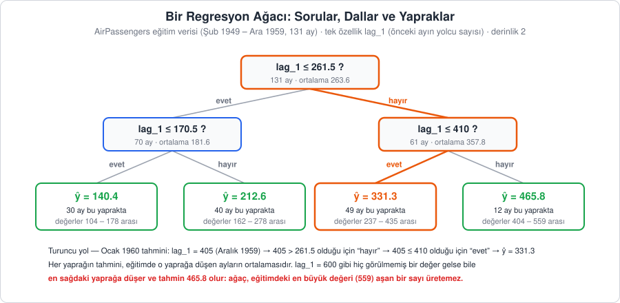
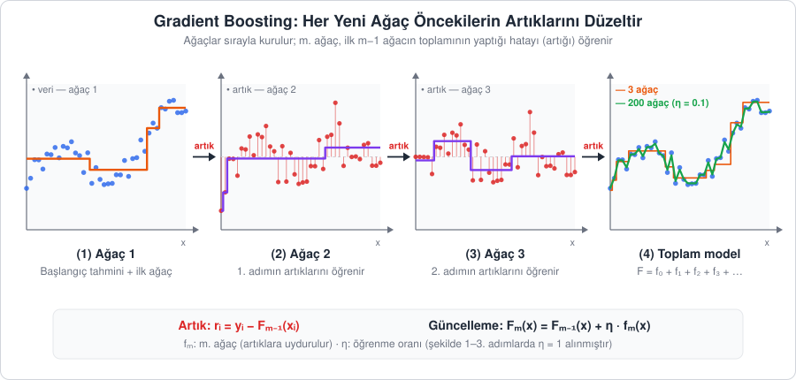
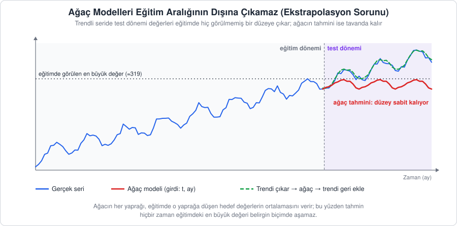

[İçindekiler](../Course_notes.md) · [← 12. Yapay Zeka ile Zaman Serisi Analizine Giriş](12_yapay_zeka_ile_zaman_serisi_analizine_giris.md) · [14. Weka Zaman Serisi Tahmin Modülü (Forecast Sekmesi) →](14_weka_zaman_serisi_tahmin_modulu_forecast_sekmesi.md)

## 13. XGBoost ile Zaman Serisi Tahmini

Şimdiye kadar zaman serilerine farklı açılardan yaklaştık: ARIMA seriyi istatistiksel bir süreç olarak modelledi (Bölüm 7), Prophet trend ve takvim etkilerini ayrıştırdı (Bölüm 9). XGBoost (Extreme Gradient Boosting) ise bambaşka bir yol izler: zaman serisini bir **regresyon problemine** (sayısal bir hedefi girdilerden tahmin etme problemine) dönüştürür ve bu problemi çok sayıda küçük karar ağacının birlikte çalışmasıyla çözer.

Bu dönüşümün özü şu soruda yatar: *"Geçmiş değerleri ve takvim bilgisini biliyorsam, gelecek değeri tahmin edebilir miyim?"* Bunun için geçmiş gözlemleri (gecikme/lag özellikleri) ve takvim bilgilerini (ay, çeyrek) girdi olarak kullanırız. Zaman serisini bu şekilde denetimli öğrenme formatına çevirmenin genel mantığını Bölüm 12'de görmüştük; bu bölümde onu somut bir modelle uygulayacağız.

Bölümün akışı şöyledir: önce XGBoost'un dayandığı kavramları (karar ağacı, gradient boosting, düzenlileştirme) ele alacağız; ardından ağaç modellerinin zaman serilerinde karşılaştığı en önemli sınırlılığı, yani **ekstrapolasyon yapamamayı** tartışacağız. Son olarak modeli önce Python ile, sonra kod yazmadan Weka Explorer ile uygulayacağız.

### 13.1. Temel Fikir: Karar Ağacından Gradient Boosting'e

#### 13.1.1. Karar Ağacı

**Açıklama:** Karar ağacı, veriyi art arda sorulan "evet/hayır" sorularıyla gruplara ayırır. Örneğin yolcu sayısını tahmin eden bir ağaç şöyle kurallar öğrenebilir: *"Önceki ayın yolcu sayısı 300'den fazlaysa **ve** ay Temmuz ise tahmin 350'dir."* Her soru bir **düğüm**, soruların sonunda varılan her grup bir **yaprak** olarak adlandırılır. Ağaç soruları kendisi seçer: Her adımda olası bütün eşikleri dener ve iki gruptaki hatayı en çok azaltan soruyu seçer.

Şekil 13.1, `AirPassengers` eğitim verisine tek bir özellikle (`lag_1`, önceki ayın yolcu sayısı) uydurulmuş gerçek bir ağacı gösterir. Derinlik 2 olduğu için ağaç en fazla iki soru sorar ve dört yaprağa ulaşır.



*Şekil 13.1 — `AirPassengers` (Şubat 1949 – Aralık 1959) üzerinde, yalnızca `lag_1` özelliğiyle kurulmuş derinliği 2 olan bir regresyon ağacı (scikit-learn ile gerçek uyum). Her yaprağın tahmini, o yaprağa düşen ayların ortalamasıdır. Turuncu yol Ocak 1960'ın tahminini izler. En sağdaki yaprak, eğitimdeki en büyük değer 559 olsa bile 465.8'in üzerine çıkamaz.*

**Tanım:** Bir regresyon ağacı, girdi uzayını (girdilerin alabileceği tüm değer bileşimlerini) $T$ adet ayrık bölgeye ( $R_1, R_2, \dots, R_T$ ) ayırır ve her bölgeye sabit bir değer atar. Bir gözlemin tahmini, düştüğü yaprağın değeridir:

$$\hat{y}(x) = w_j \quad \text{eğer } x \in R_j$$

Kare hata kullanıldığında $w_j$, eğitimde o yaprağa düşen hedef değerlerin **ortalamasıdır**. Bu ayrıntı, 13.3'te göreceğimiz ekstrapolasyon sorununun kaynağıdır.

> **Simge notu:** $`x`$: burada serinin tek bir değeri değil, bir satırın bütün özellikleri (ör. `lag_1` = 405) · $`\hat{y}`$ *(y şapka)*: modelin tahmini · $`w_j`$ *(w j)*: j. yaprağın tahmin değeri (yaprak ağırlığı) · $`\in`$ *(elemanıdır)*: "içinde yer alır"; $`x \in R_j`$ "x, j. bölgeye düşüyor" demektir. Bu işaret epsilon (ε) harfi değildir · $`R_j`$ *(R j)*: ağacın j. bölgesi (yaprağı) · $`T`$: yaprak sayısı (Şekil 13.1'de 4)

Şekildeki turuncu yolu izleyelim: Ocak 1960'ı tahmin ederken `lag_1` Aralık 1959'un değeri olan 405'tir. İlk soru "405 ≤ 261.5 mi?" sorusudur; cevap hayır olduğu için sağa gidilir. İkinci soru "405 ≤ 410 mu?" sorusudur; cevap evet olduğu için tahmin, bu yapraktaki 49 ayın ortalaması olan **331.3** olur (gerçek değer 417'dir; iki soruluk bir ağaç kaba bir tahmincidir).

Yaprak değerinin neden ortalama olduğunu küçük bir örnekle görelim. Bir yaprağa 400, 430 ve 460 değerli üç ay düşmüş olsun. Ortalama 430'u tahmin edersek kare hatalar toplamı $30^2 + 0^2 + 30^2 = 900 + 0 + 900 = 1800$ olur. 440'ı tahmin etseydik $40^2 + 10^2 + 20^2 = 1600 + 100 + 400 = 2100$ olurdu. Kare hatayı en küçük yapan tek sayı ortalamadır; ortalama ise hiçbir zaman yapraktaki en büyük değeri aşamaz.

Tek bir ağaç tek başına genellikle zayıf bir tahmincidir: sığ tutulursa veriyi kaba basamaklarla özetler (Şekil 13.1'deki gibi yalnızca dört farklı tahmin üretir), derin tutulursa eğitim verisini ezberler (aşırı öğrenme).

> **Hemen deneyin 13.1.1 · Şekil 13.1'deki ağacı kendiniz kurun ve kurallarını okuyun** (Python, ~4 dk)
>
> ```python
> import pandas as pd
> from sklearn.tree import DecisionTreeRegressor, export_text
> df = pd.read_csv("data/AirPassengers.csv", parse_dates=["Month"], index_col="Month")
> t = pd.DataFrame({"y": df["Passengers"], "lag_1": df["Passengers"].shift(1)}).dropna()
> egitim = t.loc[:"1959-12"]                       # Şubat 1949 - Aralık 1959
> agac = DecisionTreeRegressor(max_depth=2).fit(egitim[["lag_1"]], egitim["y"])
> print(export_text(agac, feature_names=["lag_1"], decimals=1))   # export_text: ağacın kurallarını metin olarak yazar
> yeni = pd.DataFrame({"lag_1": [405, 600]})       # Aralık 1959 (405) ve eğitimde hiç görülmemiş 600
> print(agac.predict(yeni))
> ```
>
> **Ne göreceksiniz:**
>
> ```text
> |--- lag_1 <= 261.5
> |   |--- lag_1 <= 170.5
> |   |   |--- value: [140.4]
> |   |--- lag_1 >  170.5
> |   |   |--- value: [212.6]
> |--- lag_1 >  261.5
> |   |--- lag_1 <= 410.0
> |   |   |--- value: [331.3]
> |   |--- lag_1 >  410.0
> |   |   |--- value: [465.8]
>
> [331.28571429 465.83333333]
> ```
>
> Eşikler (261.5, 410) ve yaprak değerleri Şekil 13.1'dekiyle aynıdır. 405 için tahmin 331.3'tür (turuncu yol). 600 gibi eğitimde hiç görülmemiş bir değer de en sağdaki yaprağa düşer ve tahmin 465.8'de kalır.
>
> **Şimdi siz:** `max_depth=3` yapıp yeniden çalıştırın. Kaç yaprak oluşur (`print(agac.get_n_leaves())`)? 405 ve 600 için tahminler ne olur? 600'ün tahmini eğitimdeki en büyük değeri (559) geçebilir mi?
>
> <details><summary>Cevap</summary>
>
> 8 yaprak oluşur ($2^3$). Tahminler `[361.92307692 495.8       ]` olur (405 → 361.9, 600 → 495.8). Ağaç derinleştikçe basamaklar inceldi, ama 600'ün tahmini (495.8) yine 559'un altında: Yaprak değeri bir ortalamadır ve eğitimdeki değerleri aşamaz.
>
> </details>

#### 13.1.2. Boosting: Hataları Adım Adım Düzeltmek

**Açıklama:** *Boosting*, çok sayıda zayıf modeli **sırayla** kurarak güçlü bir model elde etme fikridir. İlk ağaç veriye kaba bir uyum sağlar. İkinci ağaç veriyi değil, **ilk ağacın yaptığı hataları** (artıkları; artık = gerçek değer − tahmin) öğrenir. Üçüncü ağaç, ilk ikisinin toplamının hâlâ düzeltemediği hataları öğrenir ve bu böyle sürer. Her ağaç küçük bir düzeltme yapar; yüzlerce düzeltmenin toplamı güçlü bir model oluşturur.

Bunu bir öğrencinin sınava hazırlanmasına benzetebiliriz: ilk deneme sınavından sonra yalnızca yanlış yaptığı konulara çalışır, ikinci denemeden sonra yine kalan yanlışlarına odaklanır.

**Sayısal örnek:** Üç aylık küçük bir veri düşünelim: A, B ve C aylarının gerçek değerleri 100, 130 ve 160 olsun. Her ağacın katkısını yarıya indirelim (öğrenme hızı $\eta = 0.5$; pratikte 0.05–0.1 gibi daha küçük değerler kullanılır, burada etkiyi açıkça görmek için büyük seçtik). Her ağaç tek bir soru sorar, yani veriyi ikiye ayırır ve her gruba o gruptaki artıkların ortalamasını verir:

| Adım | A | B | C | Kare hata toplamı |
| --- | --- | --- | --- | --- |
| Gerçek değer $`y`$ | 100 | 130 | 160 | |
| Başlangıç tahmini $`f_0`$ = ortalama | 130 | 130 | 130 | $`30^2 + 0^2 + 30^2 = 1800`$ |
| Artık 1 (gerçek − tahmin) | −30 | 0 | 30 | |
| Ağaç 1: {A} ve {B, C} grupları | −30 | 15 | 15 | |
| Tahmin 1 = önceki + 0.5 × ağaç 1 | 115 | 137.5 | 137.5 | 787.5 |
| Artık 2 | −15 | −7.5 | 22.5 | |
| Ağaç 2: {A, B} ve {C} grupları | −11.25 | −11.25 | 22.5 | |
| Tahmin 2 = önceki + 0.5 × ağaç 2 | 109.375 | 131.875 | 148.75 | 217.97 |
| Artık 3 | −9.375 | −1.875 | 11.25 | |

Ağaç 1'in {B, C} yaprağı, iki artığın ortalamasıdır: $(0 + 30) / 2 = 15$. A ayının tahmini $130 + 0.5 \cdot (-30) = 115$ olur. Her turda artıklar küçülür ve kare hata toplamı 1800 → 787.5 → 217.97 diye düşer. Şekil 13.2 aynı mekanizmayı daha büyük bir veride gösterir.



*Şekil 13.2 — Gradient boosting mekanizması. (1) İlk ağaç veriye kaba bir basamak fonksiyonu uydurur. (2–3) Sonraki her ağaç, o ana kadarki toplam modelin artıklarını (kırmızı) öğrenir. (4) Ağaçların toplamı veriye giderek daha iyi uyar; yüzlerce küçük adımla (η = 0.1) pürüzsüz bir uyum elde edilir.*

**Tanım (Gradient Boosting):** Başlangıç tahmini $f_0$ (genellikle hedefin ortalaması) olmak üzere, $m$. adımda önce her gözlemin artığı hesaplanır:

```math
\underbrace{r_i^{(m)}}_{\substack{\text{m. ağacın}\\\text{öğreneceği hedef}}} = \underbrace{y_i}_{\text{gerçek değer}} - \underbrace{\hat{y}_i^{(m-1)}}_{\substack{\text{önceki adımların}\\\text{toplam tahmini}}}
```

**Nasıl okunur?** "r alt i, üstte parantez içinde m, eşittir y alt i eksi y şapka alt i, üstte parantez içinde m eksi bir." Yani: Tablodaki Artık 1 satırı (−30, 0, 30) bu formülle bulunur.

Ardından bu artıklara yeni bir ağaç $f_m$ uydurulur ve model küçük bir adımla güncellenir:

```math
\underbrace{\hat{y}_i^{(m)}}_{\text{yeni tahmin}} = \underbrace{\hat{y}_i^{(m-1)}}_{\text{önceki tahmin}} + \overbrace{\eta}^{\text{öğrenme hızı}} \underbrace{f_m(x_i)}_{\substack{\text{m. ağacın}\\\text{düzeltmesi}}}
```

**Nasıl okunur?** "y şapka alt i üst m eşittir, y şapka alt i üst m eksi bir, artı eta çarpı f alt m, x alt i." Yani: Tablodaki "Tahmin 1 = önceki + 0.5 × ağaç 1" satırının formül hâlidir.

$M$ ağaç kurulduktan sonra nihai tahmin, tüm ağaçların katkılarının toplamıdır:

```math
\underbrace{\hat{y}_i}_{\text{nihai tahmin}} = \underbrace{f_0}_{\substack{\text{başlangıç}\\\text{(ortalama)}}} + \eta \overbrace{\sum_{m=1}^{M} f_m(x_i)}^{\text{M ağacın katkılarının toplamı}}
```

**Nasıl okunur?** "y şapka alt i eşittir, f sıfır artı eta çarpı, m eşittir 1'den M'ye kadar f alt m x alt i'lerin toplamı."

> **Simge notu:** $`i`$ (alt indis): kaçıncı gözlem olduğu (yukarıdaki örnekte A, B, C) · $`(m)`$ (parantez içindeki üst simge): kaçıncı adım olduğu; **bir üs değildir**, "m'nin kuvveti" diye okunmaz · $`r_i^{(m)}`$ *(r i, m. adım)*: m. ağacın öğrendiği artık · $`\hat{y}_i^{(m-1)}`$: bir önceki adımdaki tahmin · $`\eta`$ *(eta)*: öğrenme hızı (learning rate), her ağacın katkısını küçülten katsayı; Latin n harfine benzer ama Yunanca eta harfidir · $`f_m(x_i)`$ *(f m, x i)*: m. ağacın i. gözlem için verdiği değer · $`\sum_{m=1}^{M}`$ *(büyük sigma, toplam)*: m'yi 1'den M'ye kadar değiştirip terimleri topla; yani $`f_1(x_i) + f_2(x_i) + \dots + f_M(x_i)`$ · $`M`$: toplam ağaç sayısı

Örnekteki A ayı için son formül şöyle işler: $130 + 0.5 \cdot (-30) + 0.5 \cdot (-11.25) = 130 - 15 - 5.625 = 109.375$.

> **Hemen deneyin 13.1.2 · Boosting tablosunu üç turda bilgisayara hesaplatın** (Python, ~5 dk)
>
> Yukarıdaki A, B, C tablosunu, her turda artıklara tek soruluk bir ağaç (`max_depth=1`) uydurarak yeniden üretelim ve bir tur daha ekleyelim:
>
> ```python
> import numpy as np
> from sklearn.tree import DecisionTreeRegressor
> X = np.array([[1], [2], [3]])              # A, B, C aylarının sıra numarası (özellik)
> y = np.array([100, 130, 160])
> eta = 0.5                                  # öğrenme hızı
> tahmin = np.full(3, y.mean())              # f0: üç ay için de ortalama (130); np.full: aynı sayıyla dolu dizi
> for m in range(1, 4):
>     artik = y - tahmin                     # gerçek - tahmin
>     agac = DecisionTreeRegressor(max_depth=1).fit(X, artik)   # tek soruluk ağaç artıkları öğrenir
>     tahmin = tahmin + eta * agac.predict(X)
>     print(m, tahmin.round(3), "SSE =", round(((y - tahmin) ** 2).sum(), 2))
> ```
>
> **Ne göreceksiniz:**
>
> ```text
> 1 [115.  137.5 137.5] SSE = 787.5
> 2 [109.375 131.875 148.75 ] SSE = 217.97
> 3 [106.562 129.062 154.375] SSE = 75.59
> ```
>
> İlk iki satır tablodaki "Tahmin 1" ve "Tahmin 2" satırlarıdır. Üçüncü ağaç Artık 3'ü ({A, B} ve {C} gruplarıyla) öğrenir ve kare hata toplamı (SSE) 75.59'a iner.
>
> **Şimdi siz:** `eta = 1.0` yapın (her ağacın katkısı küçültülmeden eklenir). Hata daha hızlı mı düşer? A ayının tahminini turdan tura izleyin.
>
> <details><summary>Cevap</summary>
>
> ```text
> 1 [100. 145. 145.] SSE = 450.0
> 2 [ 92.5 137.5 160. ] SSE = 112.5
> 3 [100.   133.75 156.25] SSE = 28.12
> ```
>
> SSE daha hızlı düşer, ama A ayının tahmini 100 → 92.5 → 100 diye zikzak çizer: İkinci ağaç B ile C'yi düzeltirken A'yı gereğinden fazla aşağı iter (aşırı düzeltme). Küçük `eta` bu sıçramaları yumuşatır; bunun bedeli daha fazla ağaçtır.
>
> </details>

Yönteme "gradient" (gradyan) denmesinin nedeni şudur. **Kayıp** (loss), bir tahminin ne kadar kötü olduğunu ölçen sayıdır; kare hata kaybı $L = \frac{1}{2}(y - \hat{y})^2$'dir (baştaki ½ yalnızca hesabı sadeleştirmek içindir). **Türev**, tahmin çok az değiştiğinde kaybın ne hızla değiştiğini (eğimini) söyler. Kare hata kaybının tahmine göre türevinin ters işaretlisi tam olarak artıktır:

```math
\underbrace{-\frac{\partial L}{\partial \hat{y}}}_{\substack{\text{kaybın eğiminin}\\\text{ters işaretlisi}}} = \underbrace{y - \hat{y}}_{\text{artık}}
```

**Nasıl okunur?** "Eksi del L bölü del y şapka eşittir y eksi y şapka."

Sayılarla deneyelim: $y = 100$ ve $\hat{y} = 90$ iken kayıp $\frac{1}{2} \cdot 10^2 = 50$'dir. Tahmini 1 artırıp 91 yaparsak kayıp $\frac{1}{2} \cdot 9^2 = 40.5$ olur; yani tahmindeki 1 birimlik artış kaybı yaklaşık 10 birim azaltır. Eğim yaklaşık −10'dur, ters işaretlisi +10'dur ve bu da artığın kendisidir ($100 - 90 = 10$). Yani artıklara ağaç uydurmak, kaybı en hızlı azaltan yönde (gradyanın tersi yönünde) adım atmakla, yani **gradyan inişiyle** aynı şeydir (gradyan inişi: Bölüm 12.1.4 ve 12.2; sisli dağ örneği). Başka kayıp fonksiyonları (ör. mutlak hata) kullanıldığında ağaçlar artık yerine bu negatif gradyana uydurulur.

> **Simge notu:** $`L`$: tek bir gözlemin kaybı · $`\partial`$ *(kısmi türev, "del")*: bir büyüklüğün diğerine göre değişim hızı; $`\partial L / \partial \hat{y}`$ "tahmin çok az değişince kayıp ne kadar değişir?" demektir

#### 13.1.3. XGBoost'u Farklı Kılan: Düzenlileştirme

XGBoost, gradient boosting'in hızlı ve düzenlileştirilmiş (regularized) bir uygulamasıdır. Klasik gradient boosting yalnızca tahmin hatasını küçültmeye çalışırken, XGBoost amaç fonksiyonuna ağaçların **karmaşıklığını cezalandıran** bir terim ekler. Sözle: *toplam puan = tahmin hatası + karmaşıklık cezası*; model bu toplamı küçültmeye çalışır, dolayısıyla hatayı çok az azaltan karmaşık bir ağacı kurmaya değmez.

```math
\underbrace{\mathcal{L}}_{\text{toplam puan}} = \underbrace{\sum_{i=1}^{n} l(y_i, \hat{y}_i)}_{\substack{\text{tahmin hatası}\\\text{(tüm gözlemler)}}} + \underbrace{\sum_{m=1}^{M} \Omega(f_m)}_{\substack{\text{karmaşıklık cezası}\\\text{(tüm ağaçlar)}}}
```

```math
\Omega(f) = \underbrace{\gamma T}_{\substack{\text{yaprak başına}\\\text{sabit ceza}}} + \underbrace{\frac{1}{2} \lambda \sum_{j=1}^{T} w_j^2}_{\substack{\text{büyük yaprak değerlerine}\\\text{ceza}}}
```

**Nasıl okunur?** "Kaligrafik L eşittir, i eşittir 1'den n'ye kadar küçük l, y alt i virgül y şapka alt i'lerin toplamı, artı m eşittir 1'den M'ye kadar omega f alt m'lerin toplamı. Omega f eşittir gama çarpı T, artı yarım çarpı lambda çarpı, j eşittir 1'den T'ye kadar w alt j karelerinin toplamı."

Burada ilk terim tahmin hatasını (ör. kare hata), ikinci terim ise her ağacın karmaşıklığını ölçer. $T$ ağaçtaki yaprak sayısıdır.

> **Simge notu:** $`\mathcal{L}`$ *(kaligrafik L)*: en küçüklenecek toplam amaç fonksiyonu · $`l(y_i, \hat{y}_i)`$ *(küçük l)*: tek bir gözlemin kaybı, ör. $`(y_i - \hat{y}_i)^2`$ · $`\sum_{i=1}^{n}`$: i'yi 1'den n'ye (tüm eğitim gözlemleri) kadar değiştirip topla · $`\Omega`$ *(büyük omega)*: ağaç karmaşıklığı cezası · $`\gamma`$ *(gama)*: her yeni yaprak için ödenen ceza · $`\lambda`$ *(lambda)*: yaprak değerlerinin büyüklüğüne verilen ceza (L2 düzenlileştirme) · $`w_j^2`$: j. yaprağın değerinin karesi (burada üst simge 2 gerçekten bir üstür)

**Sayısal örnek:** $\gamma = 1$ ve $\lambda = 1$ olsun. Üç yapraklı, yaprak değerleri 2, −1 ve 3 olan bir ağacın cezası $\Omega = 1 \cdot 3 + \frac{1}{2} \cdot 1 \cdot (2^2 + (-1)^2 + 3^2) = 3 + \frac{1}{2} \cdot 14 = 3 + 7 = 10$'dur. İki yapraklı, yaprak değerleri 1 ve −1 olan daha sade bir ağacın cezası ise $2 + \frac{1}{2} \cdot (1 + 1) = 3$'tür. Karmaşık ağaç hatayı sade ağaca göre en az $10 - 3 = 7$ birim daha fazla azaltmıyorsa XGBoost sade ağacı tercih eder.

**Yorum:** $\gamma$ büyüdükçe model yeni bir bölme yapmak için daha fazla hata azalması "talep eder": Bir bölme, hatayı en az $\gamma$ kadar azaltmıyorsa yapılmaz ve ağaçlar sade kalır. $\lambda$ büyüdükçe yaprak değerleri sıfıra doğru çekilir ve her ağacın tek başına yapabileceği aşırı düzeltmeler engellenir. Kare hata kaybında XGBoost'un bir yaprağa verdiği değer, *yapraktaki artıkların toplamı / (yapraktaki gözlem sayısı + λ)* formülüyle hesaplanır. Artıkları 10, 20 ve 30 olan bir yaprak için (toplam 60, gözlem sayısı 3): $\lambda = 0$ iken $60 / 3 = 20$ (düz ortalama), $\lambda = 1$ iken $60 / 4 = 15$, $\lambda = 3$ iken $60 / 6 = 10$ olur. İki cezanın ortak amacı, modelin eğitim verisini ezberlemesini (aşırı öğrenme) önlemektir.

```math
\underbrace{w_j}_{\text{yaprak değeri}} = \frac{\overbrace{\textstyle\sum_{x_i \in R_j} r_i}^{\text{yapraktaki artıkların toplamı}}}{\underbrace{n_j}_{\substack{\text{yapraktaki}\\\text{gözlem sayısı}}} + \underbrace{\lambda}_{\text{L2 cezası}}}
```

**Nasıl okunur?** "w alt j eşittir, x alt i R alt j'nin elemanı olan gözlemlerin r alt i değerlerinin toplamı, bölü n alt j artı lambda." Yani: $\lambda = 0$ iken bu, 13.1.1'deki yaprak ortalamasıdır.

**Günlük hayattan bir örnek:** Her yeni yaprak açmak bir şube açmaya benzer. Şubenin sabit bir kirası ($\gamma$) vardır ve şube ancak getireceği ek kazanç (hatadaki azalma) kirayı aşıyorsa açılır. $\lambda$ ise her şubenin vaat ettiği kârı temkinle aşağı çeken bir denetçidir: Az müşterisi (az gözlemi) olan şubenin iddiasını daha çok kırpar. Yukarıdaki formülde de öyledir: 3 gözlemli yaprakta $\lambda = 1$ değeri 20'yi 15'e indirirken, aynı ortalamaya sahip 30 gözlemli bir yaprakta $600 / 31 \approx 19.4$ olur ve değer neredeyse hiç kırpılmaz.

XGBoost bunlara ek olarak ikinci dereceden türev bilgisini (eğimin yanında eğimin ne kadar hızlı değiştiğini, yani kayıp eğrisinin bükülmesini) kullanan hızlı bir bölme arama algoritması, eksik değerleri kendiliğinden yönetme ve paralel hesaplama gibi mühendislik iyileştirmeleri de sunar. Tablo biçimindeki (yapılandırılmış) verilerde çoğu zaman en iyi sonuç veren yöntemlerden biri olmasının nedeni budur.

> **Hemen deneyin 13.1.3 · λ'nın yaprak değerini küçülttüğünü XGBoost'a doğrulatın** (Python, ~5 dk)
>
> Notta artıkları 10, 20, 30 olan bir yaprak için "artık toplamı / (gözlem sayısı + λ)" formülünü elle hesapladık. Aynı yaprağı XGBoost'a kurdurup sonucu karşılaştıralım. Hile şu: Özellik sütunu sabit (hep 0) olduğu için ağaç hiçbir bölme yapamaz ve tek bir yaprakta kalır.
>
> ```python
> import numpy as np
> import xgboost as xgb
> X = np.zeros((3, 1))                 # 3 satır, 1 sütun, hepsi 0: bölme yapılamaz
> artik = np.array([10, 20, 30])       # yapraktaki artıklar (toplam 60, gözlem sayısı 3)
> for lam in [0, 1, 3]:
>     model = xgb.XGBRegressor(n_estimators=1, learning_rate=1.0, base_score=0,
>                              reg_lambda=lam, max_depth=1)   # tek ağaç, başlangıç tahmini 0
>     model.fit(X, artik)
>     print("lambda =", lam, " yaprak degeri =", model.predict(X[:1])[0])
> ```
>
> **Ne göreceksiniz:**
>
> ```text
> lambda = 0  yaprak degeri = 20.0
> lambda = 1  yaprak degeri = 15.0
> lambda = 3  yaprak degeri = 10.0
> ```
>
> Sonuçlar elle bulduğumuz $60/3$, $60/4$ ve $60/6$ değerleridir.
>
> **Şimdi siz:** (1) `lam` listesine 7 ekleyin; sonucu önce kâğıtta bulun. (2) γ'yı deneyin: `X = np.array([[1], [2], [3]])` yazın (artık bölme mümkün), döngüyü kaldırıp `reg_lambda=0, gamma=149` ile bir model kurun ve `print(model.predict(X))` yazın. Sonra `gamma=151` deneyin. İpucu: Ortalamaya (20) göre kare hata toplamı 200'dür; {A} ve {B, C} bölmesi bunu 50'ye indirir.
>
> <details><summary>Cevap</summary>
>
> (1) $60 / (3 + 7) = 6.0$. (2) `gamma=149` iken `[10. 25. 25.]`: Bölme hatayı $200 - 50 = 150$ birim azalttığı için 149'luk cezayı karşılar ve yapılır. `gamma=151` iken `[20. 20. 20.]`: Kazanç (150) cezadan küçük kaldığı için bölme yapılmaz ve ağaç tek yapraklı kalır. "Bir bölme hatayı en az γ kadar azaltmıyorsa yapılmaz" cümlesi tam olarak budur.
>
> </details>

#### 13.1.4. Temel Hiperparametreler

| Hiperparametre | Formüldeki karşılığı | Ne işe yarar? | Tipik değer |
| --- | --- | --- | --- |
| `n_estimators` | ağaç sayısı $`M`$ | Kaç düzeltme adımı yapılacağı. Az olursa yetersiz öğrenme (Bölüm 8.4.3), çok olursa aşırı öğrenme riski; erken durdurma ile belirlenir. | 100–1000 |
| `learning_rate` | $`\eta`$ | Her ağacın katkısı. Küçük değer daha yavaş ama daha kararlı öğrenme sağlar, daha çok ağaç gerektirir. | 0.01–0.1 |
| `max_depth` | ağaç derinliği | Bir ağacın art arda kaç soru sorabileceği; derinlik 4 en fazla $`2^4 = 16`$ yaprak demektir. Derin ağaçlar karmaşık etkileşimleri yakalar ama ezberlemeye yatkındır. | 3–6 |
| `subsample` | — | Her ağaçta kullanılan satır (gözlem) oranı; rastgelelik ekleyerek aşırı öğrenmeyi azaltır. | 0.7–1.0 |
| `colsample_bytree` | — | Her ağaçta kullanılan özellik (sütun) oranı. | 0.7–1.0 |
| `gamma`, `reg_lambda` | $`\gamma`$, $`\lambda`$ | 13.1.3'teki düzenlileştirme cezaları. | 0 / 1 (varsayılan) |
| `early_stopping_rounds` | — | Doğrulama hatası bu kadar tur boyunca iyileşmezse eğitimi durdurur. xgboost 2.0 ve sonrasında modelin kurucusuna (`XGBRegressor(...)`) yazılır; eski kodlardaki `fit(..., early_stopping_rounds=...)` biçimi artık hata verir. | 20–50 |

**Not —** `n_estimators` ile `learning_rate` birbirine bağlıdır: öğrenme hızını yarıya indirirseniz, aynı uyumu yakalamak için yaklaşık iki kat ağaç gerekir. Örneğin $\eta = 0.1$ iken 30 birimlik bir artığı tam öğrenen bir ağaç tahmini yalnızca $0.1 \cdot 30 = 3$ birim düzeltir; $\eta = 0.05$ iken aynı ağaç 1.5 birim düzeltir.

> **Hemen deneyin 13.1.4 · `learning_rate` ile `n_estimators` arasındaki takası görün** (Python, ~6 dk)
>
> Sade bir özellik setiyle (12 gecikme + ay) küçük bir deney düzeneği kuralım. İlk on satır veri hazırlığıdır; 13.4'teki kutularda da bu satırları kullanacağız.
>
> ```python
> import pandas as pd
> import xgboost as xgb
> df = pd.read_csv("data/AirPassengers.csv", parse_dates=["Month"], index_col="Month")
> t = pd.DataFrame({"y": df["Passengers"]})
> for k in range(1, 13):
>     t[f"lag_{k}"] = t["y"].shift(k)
> t["ay"] = t.index.month
> t = t.dropna()
> X_tr, X_te = t.drop(columns="y").iloc[:-12], t.drop(columns="y").iloc[-12:]   # son 12 ay (1960) test
> y_tr, y_te = t["y"].iloc[:-12], t["y"].iloc[-12:]
>
> def dene(n, lr, derinlik):          # verilen ayarlarla model kurup eğitim ve test MAE'sini yazar
>     m = xgb.XGBRegressor(n_estimators=n, learning_rate=lr, max_depth=derinlik, random_state=42)
>     m.fit(X_tr, y_tr)
>     egitim_mae = (y_tr - m.predict(X_tr)).abs().mean()
>     test_mae = (y_te - m.predict(X_te)).abs().mean()
>     print(f"n={n:4d} lr={lr:<5} derinlik={derinlik}  egitim MAE={egitim_mae:6.2f}  test MAE={test_mae:6.2f}")
>
> dene(10, 0.1, 3)
> dene(100, 0.1, 3)
> dene(200, 0.05, 3)
> ```
>
> **Ne göreceksiniz:**
>
> ```text
> n=  10 lr=0.1   derinlik=3  egitim MAE= 32.84  test MAE= 86.34
> n= 100 lr=0.1   derinlik=3  egitim MAE=  3.00  test MAE= 31.02
> n= 200 lr=0.05  derinlik=3  egitim MAE=  3.05  test MAE= 31.82
> ```
>
> 10 ağaç yetersizdir (yetersiz öğrenme, Bölüm 8.4.3). Öğrenme hızını yarıya indirip ağaç sayısını iki katına çıkarınca (200 ağaç, 0.05) 100 ağaç / 0.1 ile neredeyse aynı uyum elde edilir.
>
> **Şimdi siz:** (1) `dene(20, 0.05, 3)` satırını ekleyin; sonucu hangi satıra benzemesini beklersiniz? (2) `dene(1000, 0.1, 3)` deneyin. Eğitim hatası ve test hatası ne olur?
>
> <details><summary>Cevap</summary>
>
> (1) `egitim MAE= 33.59  test MAE= 88.25`: 10 ağaç / 0.1'e çok yakındır (yarı hız, iki kat ağaç). (2) `egitim MAE=  0.00  test MAE= 31.07`: Model eğitim verisini ezberlemiştir, ama test hatası 100 ağaçtakinden (31.02) iyi değildir. Ağaç sayısını erken durdurmayla seçmemizin nedeni budur.
>
> </details>

### 13.2. Zaman Serisini XGBoost'a Hazırlamak

XGBoost zamanın akışını kendiliğinden anlamaz; ona göre her satır birbirinden bağımsız bir örnektir. Bu yüzden zamansal bilgiyi **özellik mühendisliği** ile satırların içine yerleştirmemiz gerekir (dönüşümün genel mantığı için bkz. Bölüm 12). Kullanacağımız özellik grupları 12.1.2'deki tablonun gruplarıdır: gecikmeler (`lag_1`, …, `lag_12`), hareketli istatistikler (`rolling_mean_12`, `rolling_std_3` gibi) ve takvim özellikleri (`month`, `quarter`). Bunlara bir grup ekliyoruz:

| Özellik grubu | Örnek | Neyi yakalar? |
| --- | --- | --- |
| Yıllık değişim | `lag_1 − lag_13` | Büyüme hızı |

Hareketli standart sapma (standart sapma: Bölüm 2.2), son birkaç ayın ne kadar dalgalandığını ölçer: Şubat–Nisan 1949'un değerleri 118, 132 ve 129'dur; ortalamaları 126.33, standart sapmaları yaklaşık 7.4'tür. Üç ay da 126 olsaydı standart sapma 0 olurdu. Yıllık değişim ise örneğin Ocak 1960 satırında `lag_1 − lag_13` = Aralık 1959 − Aralık 1958 = $405 - 337 = 68$ olarak hesaplanır: Son bilinen ay, bir yıl öncesine göre 68 bin yolcu artmıştır.

**Not —** Her özellik yalnızca tahmin anından **önce** bilinen bilgilerle hesaplanmalıdır. Örneğin $t$ anının özelliği olarak $y_t - y_{t-12}$ kullanmak, hedef değeri ($y_t$) özelliğin içine gizlemek anlamına gelir: Ocak 1960 satırında bu özellik $417 - 360 = 57$ olur ve içinde tahmin etmeye çalıştığımız 417 vardır. Model bu durumda eğitimde ve testte olağanüstü başarılı görünür, ama gerçek gelecekte bu bilgi elimizde olmayacağı için çalışmaz. Bu hataya **veri sızıntısı** (data leakage) denir (bkz. 12.1.5). Python kodunda bu yüzden hareketli istatistikler ve yıllık değişim, `shift(1)` ile bir adım kaydırılarak hesaplanmıştır.

> **Hemen deneyin 13.2 · Hareketli standart sapmayı ve yıllık değişimi kontrol edin** (Python, ~4 dk)
>
> Paragraftaki üç sayıyı (7.4, 68 ve sızıntılı 57) pandas ile üretelim:
>
> ```python
> import pandas as pd
> df = pd.read_csv("data/AirPassengers.csv", parse_dates=["Month"], index_col="Month")
> s = df["Passengers"]
> t = pd.DataFrame({"y": s})
> t["rolling_std_3"] = s.shift(1).rolling(3).std()      # önceki 3 ayın standart sapması
> t["seasonal_diff"] = s.shift(1) - s.shift(13)          # lag_1 - lag_13 (temiz)
> t["sizintili_fark"] = s - s.shift(12)                  # y_t - y_{t-12}: hedefi içerir!
> print(t.loc[["1949-05-01", "1960-01-01"]].round(2))    # iki satırı seç
> ```
>
> **Ne göreceksiniz:**
>
> ```text
>               y  rolling_std_3  seasonal_diff  sizintili_fark
> Month
> 1949-05-01  121           7.37            NaN             NaN
> 1960-01-01  417          25.42           68.0            57.0
> ```
>
> Mayıs 1949 satırındaki 7.37, Şubat–Nisan 1949'un (118, 132, 129) standart sapmasıdır (notta ≈ 7.4). Ocak 1960 satırında temiz yıllık değişim 68, sızıntılı fark 57'dir; 57'nin içinde tahmin etmeye çalıştığımız 417 vardır.
>
> **Şimdi siz:** Ocak 1960 satırındaki `rolling_std_3` = 25.42 değerini elle ya da Excel'de doğrulayın. Ekim–Aralık 1959 değerleri 407, 362 ve 405'tir. Excel'de: `=STDSAPMA.S(407;362;405)` (İngilizce: `=STDEV.S(407,362,405)`).
>
> <details><summary>Cevap</summary>
>
> Ortalama $1174 / 3 \approx 391.33$; sapmalar $15.67, -29.33, 13.67$; kareleri toplamı $\approx 245.4 + 860.4 + 186.8 = 1292.7$; $1292.7 / (3 - 1) \approx 646.3$; $\sqrt{646.3} \approx 25.42$. Excel de 25,42 verir. Son çeyrekteki büyük dalgalanma (Ekim'den Kasım'a 45'lik düşüş) oynaklığı yükseltmiştir.
>
> </details>

### 13.3. Önemli Bir Sınırlılık: Ağaçlar Ekstrapolasyon Yapamaz

Bu bölümün belki de en önemli uyarısı budur. **Ekstrapolasyon** (dışdeğerleme), eğitimde görülen aralığın dışına taşan bir tahmin üretmektir. 13.1.1'de gördüğümüz gibi, bir ağacın her yaprağı eğitimde o yaprağa düşen hedef değerlerin ortalamasını verir. Bunun doğal sonucu şudur: tek bir regresyon ağacının tahmini **hiçbir zaman** eğitim verisinde görülen en küçük ve en büyük hedef değerin dışına çıkamaz.

$$\min_i y_i \le \hat{y}(x) \le \max_i y_i$$

> **Simge notu:** $`\le`$ *(küçük eşittir)* · $`\min_i y_i`$, $`\max_i y_i`$ *(minimum, maksimum)*: i'yi tüm eğitim gözlemleri üzerinde gezdirerek bulunan en küçük ve en büyük y değeri

Bunu Hemen deneyin 13.1.1'de doğrudan gördük: `lag_1` = 600 için bile tahmin 465.8'de kalır. Gradient boosting topluluğunda bu sınır tam olarak kesin olmasa da (çok sayıda ağacın küçük katkıları toplanır) pratikte geçerlidir: model, eğitimde gördüğü düzeyin belirgin biçimde üstüne çıkamaz.

**Bu neden zaman serilerinde sorun?** Trendli bir seride (AirPassengers gibi) gelecek değerler çoğu zaman geçmişte hiç görülmemiş düzeydedir. Model, girdi olarak "zaman" veya "yıl" bilgisi verilse bile, eğitim aralığının dışındaki bir yıl için en son öğrendiği yaprağı kullanır ve tahmin düz bir tavana takılır. Model trendi "devam ettiremez"; yalnızca eğitimde gördüğü en yüksek düzeyi tekrar eder.

**Günlük hayattan bir örnek:** Ağaç modeli, yalnızca emsal satışlara bakarak fiyat biçen bir emlakçıya benzer: Size, evinize en çok benzeyen geçmiş satışların ortalamasını söyler. Mahallede o güne kadar satılan en pahalı ev 5 milyonsa, ne kadar lüks bir ev getirirseniz getirin en pahalı emsallerin ortalamasının üstüne çıkamaz. Fiyatlar her yıl artıyorsa hep geride kalır; doğrusal model ise "her yıl şu kadar artıyor" kuralını geleceğe uzatabilir.



*Şekil 13.3 — Trendli bir seride ağaç tabanlı model (kırmızı) test döneminde eğitimdeki en yüksek düzeyin etrafında kalır ve trendi izleyemez. Trend önce çıkarılıp ağaç yalnızca trendden arındırılmış bileşene uygulandığında ve trend sonra geri eklendiğinde (yeşil kesikli) tahmin gerçek seriyi izler.*

AirPassengers verisinde de bu durumu görürüz: eğitim dönemindeki en yüksek değer 559 iken 1960 yılının test döneminde değerler 622'ye kadar çıkar. Seviye üzerinden eğitilen bir XGBoost modeli yaz zirvesini sistematik olarak **düşük** tahmin eder; bunu 13.4.1'deki "Ekstrapolasyon kontrolü" çıktısında sayılarla göreceğiz.

**Çözümler:** Temel fikir, modele eğitim ve test döneminde aynı aralıkta kalan bir hedef vermektir.

1. **Fark alarak tahmin:** Seviye ($y_t$) yerine bir önceki döneme göre değişim tahmin edilir ve sonra seviyeye geri dönülür (fark operatörü için bkz. Bölüm 2.1):

   $\displaystyle d_t = y_t - y_{t-1}, \qquad \hat{y}_ t = y_{t-1} + \hat{d}_ t$

   Burada $d_t$ bu ayın değişimi, $\hat{d}_ t$ *(d şapka t)* modelin tahmin ettiği değişimdir. Örneğin Aralık 1959 = 405 ve Ocak 1960 = 417 ise $d = 417 - 405 = 12$'dir; model Ocak için $\hat{d} = 10$ tahmin ederse seviye tahmini $405 + 10 = 415$ olur. Değişimlerin aralığı zamanla çok daha az kayar (AirPassengers'ta aylık değişim eğitimde −101 ile +76, testte −98 ile +87 arasındadır); bu yüzden ağaç bu hedefte sınır sorunu yaşamaz. Mevsimsel veride $d_t = y_t - y_{t-12}$ (mevsimsel fark) da kullanılabilir.

2. **Trendi çıkarma (detrend):** Önce basit bir trend modeli (ör. doğrusal regresyon) uydurulur, ağaç yalnızca trendden arta kalan kısmı öğrenir, tahminde trend geri eklenir (Şekil 13.3'teki yeşil çizgi).

3. **Logaritma + fark:** Mevsimsel dalgaların genliği seviyeyle birlikte büyüyorsa (çarpımsal yapı, bkz. Bölüm 2.4) önce logaritma alınıp sonra fark alınabilir; bu durumda model yaklaşık yüzde değişimi öğrenir. Örneğin 100'den 110'a çıkışta doğal logaritmaların farkı $\ln 110 - \ln 100 \approx 0.095$'tir, yani yaklaşık %10'luk artışa karşılık gelir.

**Not —** Bu sorun yalnızca XGBoost'a özgü değildir; Random Forest, REPTree gibi tüm ağaç tabanlı yöntemler (13.5'te Weka'da kullanacağımız algoritmalar dahil) aynı sınırlılığa sahiptir. ARIMA ise fark alma işlemini modelin içinde yaptığı için (Bölüm 7) trendi doğal olarak sürdürebilir.

> **Hemen deneyin 13.3 · Ekstrapolasyon sorununu beş satırda görün** (Python, ~3 dk)
>
> Kusursuz düz bir trend (10, 20, ..., 100) üzerinde bir karar ağacı ile doğrusal regresyonu karşılaştıralım:
>
> ```python
> import numpy as np
> from sklearn.tree import DecisionTreeRegressor
> from sklearn.linear_model import LinearRegression
> X = np.arange(1, 11).reshape(-1, 1)        # zaman: 1, 2, ..., 10 (reshape: tek sütunlu tablo yapar)
> y = 10 * X.ravel()                         # düz trend: 10, 20, ..., 100
> yeni = np.array([[5], [12], [20]])         # 12 ve 20 eğitim aralığının dışında
> print("agac    :", DecisionTreeRegressor().fit(X, y).predict(yeni))
> print("dogrusal:", LinearRegression().fit(X, y).predict(yeni).round(1))
> ```
>
> **Ne göreceksiniz:**
>
> ```text
> agac    : [ 50. 100. 100.]
> dogrusal: [ 50. 120. 200.]
> ```
>
> Aralığın içinde (5) iki model de doğru bilir. Dışında ise ağaç eğitimdeki en büyük değere (100) takılır; doğrusal model trendi sürdürür (120, 200).
>
> **Şimdi siz:** (1) Ağaç yerine `xgb.XGBRegressor(n_estimators=200, random_state=42)` deneyin (`import xgboost as xgb` ekleyin). Tavan kalkar mı? (2) Kâğıt üzerinde düşünün: Ağacı seviyeye değil farka ($y_t - y_{t-1}$) uydursaydık hedef sütunu ne olurdu ve $x = 11, 12$ için seviye tahmini kaç çıkardı?
>
> <details><summary>Cevap</summary>
>
> (1) `[50.00012 99.99883 99.99883]`: Yüzlerce ağacın toplamı da 100 tavanını aşamaz. (2) Bütün farklar 10'dur; ağaç her yerde 10 tahmin eder. Geri dönüşümle $\hat{y}_ {11} = 100 + 10 = 110$, $\hat{y}_ {12} = 110 + 10 = 120$ olur: Fark hedefi tavanı ortadan kaldırır (13.4.2).
>
> </details>

### 13.4. Python ile XGBoost Uygulaması

Aşağıdaki kod AirPassengers verisi üzerinde uçtan uca bir XGBoost uygulamasıdır: veri hazırlığı, özellik mühendisliği, eğitim/doğrulama/test ayrımı, erken durdurma ile model eğitimi, değerlendirme, özellik önemi, görselleştirme ve zaman serisi çapraz doğrulaması (fold: Bölüm 16.1). Kodu çalıştırmak için `pip install xgboost` ile paketi kurmanız gerekir.

Programın tamamı (yaklaşık 430 satır) uygulama dosyasındadır; aşağıda yalnızca kilit satırlarını görüyorsunuz.

```python
# XGBoost ile AirPassengers — kilit satırlar (tam kod: Codes/python/ch13_xgboost.py)
# 2) Özellik mühendisliği: her özellik yalnızca geçmiş bilgiden (shift) üretilir
for lag in range(1, 13):
    df_features[f'lag_{lag}'] = df_features['Passengers'].shift(lag)
df_features['rolling_mean_12'] = df_features['Passengers'].shift(1).rolling(12).mean()
df_features['seasonal_diff'] = df_features['Passengers'].shift(1) - df_features['Passengers'].shift(13)
df_features['month'] = df_features.index.month
df_features = df_features.dropna()          # ilk satırlardaki NaN'lar atılır

# 3) Zaman sıralı bölme: son 12 ay test, eğitimin son 12 ayı doğrulama
split_point = len(X) - test_size
X_train, X_test = X.iloc[:split_point], X.iloc[split_point:]
y_train, y_test = y.iloc[:split_point], y.iloc[split_point:]
X_tr_in, X_val = X_train.iloc[:-val_size], X_train.iloc[-val_size:]
y_tr_in, y_val = y_train.iloc[:-val_size], y_train.iloc[-val_size:]

# 4) Erken durdurmayla ağaç sayısını bul, sonra tüm eğitim verisiyle yeniden eğit
params = dict(learning_rate=0.05, max_depth=4, subsample=0.8,
              colsample_bytree=0.8, random_state=SEED)
es_model = xgb.XGBRegressor(n_estimators=1000, early_stopping_rounds=50, **params)
es_model.fit(X_tr_in, y_tr_in, eval_set=[(X_val, y_val)], verbose=False)
best_n = es_model.best_iteration + 1
model = xgb.XGBRegressor(n_estimators=best_n, **params)
model.fit(X_train, y_train)

# 5) Test tahmini ve metrikler (MAE, RMSE, MAPE; bkz. Bölüm 8)
y_test_pred = model.predict(X_test)
test_mae, test_rmse, test_mape = calculate_metrics(y_test, y_test_pred, "Test Seti")
```

Bu satırların her biri belirli bir iş görür:

1. **Gecikmeler:** `range(1, 13)` 1'den 12'ye kadar sayıları üretir (13 dahil değildir). Her tur için `shift(lag)` ile `lag_1` … `lag_12` sütunları oluşur (12.1.2'deki `shift` açıklaması).
2. **Hareketli ortalama ve yıllık değişim:** `shift(1).rolling(12).mean()` her ayın yanına kendisinden önceki 12 ayın ortalamasını yazar. `seasonal_diff`, `shift(1) - shift(13)` yani `lag_1 − lag_13` farkıdır (13.2'deki örnek: 68).
3. **`dropna()`:** En uzun kaydırma `shift(13)` olduğu için ilk 13 satır NaN içerir ve atılır; 144 aydan **131** satır (Şubat 1950 – Aralık 1960) kalır.
4. **Bölme:** `split_point = len(X) - test_size` = $131 - 12 = 119$'dur. `X.iloc[:119]` ilk 119 satırı (Şubat 1950 – Aralık 1959) eğitime, `X.iloc[119:]` son 12 satırı (1960) teste ayırır. Eğitimin içinden `iloc[:-12]` ile ilk 107 satır (Şubat 1950 – Aralık 1958) asıl eğitime, `iloc[-12:]` ile 1959 yılı doğrulamaya ayrılır. Hiçbir aşamada satırlar karıştırılmaz.
5. **`params` ve `**params`:** `dict(...)` hiperparametreleri bir sözlükte (anahtar–değer listesi) toplar. `XGBRegressor(..., **params)` yazımındaki iki yıldız sözlüğü "açar", yani `learning_rate=0.05, max_depth=4, ...` argümanlarını tek tek yazmışız gibi iletir. Böylece aynı ayarlar üç ayrı modelde tekrar yazılmadan kullanılır. Ayarların anlamı: `learning_rate=0.05` her ağacın katkısını %5'e indirir; `max_depth=4` her ağacın en fazla 4 soru sormasına izin verir; `subsample=0.8` her ağacın satırların rastgele %80'iyle, `colsample_bytree=0.8` ise 21 özelliğin rastgele %80'iyle (16 özellik) kurulmasını sağlar; `random_state=SEED` bu rastgeleliği sabitler, böylece kod her çalıştığında aynı sonucu verir.
6. **Erken durdurma:** `XGBRegressor(n_estimators=1000, early_stopping_rounds=50, ...)` en fazla 1000 ağaç kurmaya hazırdır, ama doğrulama hatası art arda 50 ağaç boyunca iyileşmezse durur. `fit(X_tr_in, y_tr_in, eval_set=[(X_val, y_val)], verbose=False)` modeli asıl eğitim verisiyle kurar; `eval_set`, içinde `(girdi, hedef)` çiftleri bulunan bir listedir ve model her yeni ağaçtan sonra bu kümedeki hatayı (varsayılan olarak RMSE) ölçer. `verbose=False`, her turun hatasının ekrana yazdırılmasını engeller. `eval_set` olarak test setini vermek sızıntıdır: Test bilgisi model seçimine karışır ve sonuçlar olduğundan iyi görünür; bu yüzden doğrulama yılı eğitimin içinden ayrılır. (`early_stopping_rounds`'un neden kurucuya yazıldığı için bkz. 13.1.4'teki tablo.)
7. **`best_iteration`:** Doğrulama hatasının en düşük olduğu turun numarasıdır. Python'da sayma 0'dan başladığı için bu numaranın 1 fazlası ağaç sayısıdır: `best_n = best_iteration + 1`. Bizim çalıştırmamızda `best_iteration` = 172, yani `best_n` = 173'tür; eğitim, 173. ağaçtan sonra 50 tur daha denenip iyileşme görülmeyince 223. ağaçta durmuştur.
8. **Yeniden eğitim ve tahmin:** `XGBRegressor(n_estimators=best_n, **params)` aynı ayarlarla, ama tam 173 ağaçlık yeni bir model kurar ve `fit(X_train, y_train)` ile doğrulama yılı dahil bütün eğitim verisinde eğitir. `model.predict(X_test)` 12 test ayı için 12 sayılık bir NumPy dizisi döndürür. `calculate_metrics` ise üç değer döndürür; `a, b, c = ...` yazımı bu üç değeri sırayla üç değişkene atar.

Dosyadaki tam program bu satırlara ek olarak 3/6/12 aylık hareketli ortalamaları, 3 ve 12 aylık hareketli standart sapmaları, çeyreği ve normalize yılı, yani (yıl − 1949) / 11 değerini üretir (toplam 21 özellik). Ayrıca özellik önemi ve test grafiklerini çizer ve eğitim verisinde 5 fold'lu `TimeSeriesSplit` ile çapraz doğrulama yapar (Bölüm 16).

Programın ekran çıktısının önemli kısımları (xgboost 3.4, Windows; aradaki satırlar `...` ile kısaltılmıştır):

```text
Özellik mühendisliği sonrası:
  Gözlem sayısı: 131
  Özellik sayısı: 21
...
Veri bölümü:
  Eğitim: 119 gözlem (1950-02-01 00:00:00 - 1959-12-01 00:00:00)
    (bunun son 12 ayı erken durdurma için doğrulama)
  Test: 12 gözlem (1960-01-01 00:00:00 - 1960-12-01 00:00:00)

XGBoost modeli eğitiliyor (erken durdurma)...
Seçilen ağaç sayısı: 173
...
Eğitim Seti Performansı:
  MAE:  1.54
  RMSE: 1.98
  MAPE: 0.64%

Test Seti Performansı:
  MAE:  30.48
  RMSE: 37.81
  MAPE: 6.23%

Eğitimdeki en büyük değer : 559
Testteki en büyük değer   : 622
Testteki en büyük tahmin  : 544

En önemli 5 özellik:
        feature  importance
         lag_12    0.383104
rolling_mean_12    0.219770
 rolling_mean_3    0.181947
          lag_1    0.098623
         lag_11    0.057858
...
Fold 1: RMSE=36.61, MAE=27.78, MAPE=11.83%
Fold 2: RMSE=23.79, MAE=20.05, MAPE=9.00%
Fold 3: RMSE=56.07, MAE=44.53, MAPE=12.93%
Fold 4: RMSE=31.45, MAE=26.30, MAPE=7.30%
Fold 5: RMSE=47.87, MAE=36.43, MAPE=8.04%

Ortalama Sonuçlar:
  RMSE: 39.16 ± 11.52
  MAE:  31.02 ± 8.54
  MAPE: 9.82% ± 2.19%
```

> **Uygulama dosyası:** [`Codes/python/ch13_xgboost.py`](../Codes/python/ch13_xgboost.py) · [Notebook](../Codes/notebooks/ch13_xgboost.ipynb) · [](https://colab.research.google.com/github/erkanozhan/AI_Based_Time_Series-Data_Analytics/blob/main/Codes/notebooks/ch13_xgboost.ipynb)
>
> Bu bölümdeki kodların tamamı bu dosyada. Bilgisayarınızda çalıştırmak için depo kök dizininde `python Codes/python/ch13_xgboost.py` komutunu kullanın ya da dosyayı VS Code'da açıp hücre hücre çalıştırın. Kurulum yapmadan denemek için Colab bağlantısını kullanabilirsiniz.
>
> Dosya, 13.4.2'deki fark üzerinden tahmin kodunu da içerir.

#### 13.4.1. Kodun Önemli Noktaları ve Çıktının Yorumlanması

- **Metrikler:** MAE, RMSE ve MAPE'nin tanımları ve yorumu için Bölüm 8'e bakınız. Testte MAE = 30.48, model 1960'ın her ayında ortalama yaklaşık 30 bin yolcu yanılıyor demektir; MAPE = %6.23 ise bu hatanın gerçek değerlerin ortalama %6'sı kadar olduğunu söyler. Eğitim hatasının test hatasından düşük çıkması beklenen bir durumdur; ancak burada fark çok büyüktür (eğitim MAE 1.54, test MAE 30.48). Model eğitim verisine neredeyse birebir uymuştur; bu, aşırı öğrenmenin ve aşağıdaki ekstrapolasyon sorununun birlikte görüldüğü bir durumdur.
- **Ekstrapolasyon kontrolü:** Seviye modelinin en büyük tahmini (544), eğitimdeki en büyük değerin (559) bile altında, gerçek zirvenin (622) ise çok altındadır. Bu, 13.3'te anlatılan sınırlılığın ta kendisidir. Detaylı test grafiğine eklenen yatay kesikli çizgi de bu tavanı gösterir.
- **Özellik önemi:** `feature_importances_`, her özelliğin ağaçlarda yaptığı bölmelerin hatayı ne kadar azalttığının (XGBoost'ta varsayılan ölçü *gain*) payıdır; tüm özelliklerin değerleri toplanınca 1 eder. AirPassengers'ta `lag_12` (geçen yılın aynı ayı) 0.38 ile açık ara en önemli özellik çıkar; onu 12 ve 3 aylık hareketli ortalamalar izler. Bu, serinin güçlü yıllık mevsimselliğini ve yerel düzeyini modelin kendiliğinden keşfettiğini gösterir. Önemi sıfıra yakın özellikler modelden çıkarılarak daha sade bir model denenebilir.
- **Çapraz doğrulama:** `TimeSeriesSplit(n_splits=5)`, 119 aylık eğitim verisini her biri 19 aylık beş doğrulama dilimine (fold; Bölüm 16.1) böler; ilk katta model yalnızca 24 ayla, son katta 100 ayla eğitilir. Katlar arasındaki hata farkı (± işaretinden sonraki değer, yani beş katın standart sapması) modelin farklı dönemlerdeki tutarlılığını gösterir: RMSE ortalaması 39.16, katlar arası yayılım 11.52'dir. Çapraz doğrulama yalnızca eğitim verisi üzerinde yapılır; test seti yine dokunulmadan kalır.

**Not —** Kodun ürettiği sayılar XGBoost sürümüne ve işletim sistemine göre küçük farklılıklar gösterebilir; yorumlarken sayıların kendisinden çok göreli büyüklüklerine (eğitim ile test farkı, seviye modeli ile fark modeli farkı) odaklanın.

> **Hemen deneyin 13.4.1 · Özellik önemi ve tavanı kendi modelinizde kontrol edin** (Python, ~5 dk)
>
> Hemen deneyin 13.1.4'teki veri hazırlığı satırlarını (`import pandas as pd`'den `y_tr, y_te = ...` satırına kadar) çalıştırın, ardından:
>
> ```python
> model = xgb.XGBRegressor(n_estimators=100, learning_rate=0.1, max_depth=3, random_state=42)
> model.fit(X_tr, y_tr)
> onem = pd.Series(model.feature_importances_, index=X_tr.columns)   # her özelliğin önemi
> print(onem.sort_values(ascending=False).head(3).round(3))         # en önemli üç özellik
> tahmin = pd.Series(model.predict(X_te), index=y_te.index).astype(float)
> print(pd.DataFrame({"gercek": y_te, "tahmin": tahmin.round(1)}).loc["1960-06":"1960-08"])
> print("egitim max:", y_tr.max(), " test tahmin max:", round(tahmin.max(), 1))
> ```
>
> **Ne göreceksiniz:**
>
> ```text
> lag_12    0.825
> lag_1     0.072
> lag_11    0.056
> dtype: float32
>             gercek  tahmin
> Month
> 1960-06-01     535   514.4
> 1960-07-01     622   544.6
> 1960-08-01     606   543.7
> egitim max: 559  test tahmin max: 544.6
> ```
>
> Hareketli ortalamalar olmayan bu sade modelde `lag_12` önemin %82'sini tek başına alır. Temmuz zirvesi (622) yine 544.6 civarında tahmin edilir; ana programdaki "Ekstrapolasyon kontrolü" ile aynı tablo.
>
> **Şimdi siz:** Modeli "zorlayın": `n_estimators=1000, max_depth=10` yapın. Daha derin ve daha çok ağaç tavanı aşmayı sağlar mı?
>
> <details><summary>Cevap</summary>
>
> Hayır. Haziran–Ağustos tahminleri 504.4, 557.6, 559.0 olur ve `test tahmin max: 559.0` yazar: Tahmin, eğitimdeki en büyük değere (559) tam olarak dayanır ama onu geçemez. `lag_12`'nin önemi 0.950'ye çıkar. Karmaşıklık artırmak ekstrapolasyon sorununu çözmez; hedefi değiştirmek gerekir (13.4.2).
>
> </details>

#### 13.4.2. Ekstrapolasyon Sorununa Çözüm: Fark Üzerinden Tahmin

**Günlük hayattan bir örnek:** Bir çocuğun 15 yaşındaki boyunu, yalnızca 10 yaşına kadarki boyları görmüş bir ağaçla tahmin edemezsiniz: Ağaç gördüğü en uzun boyun üstüne çıkamaz. Ama "bu yıl kaç santim uzar?" sorusunun cevabı her yıl benzer bir aralıktadır. Ağaç uzamayı rahatça öğrenir; tahmin edilen uzama geçen yılki boya eklenince yeni boy bulunur. Benzetmenin sınırı: Birkaç yıl ilerisi için tahmin edilen uzamalar art arda eklendiğinden, her yılın hatası sonrakilere taşınır ve birikir.

13.3'teki ilk çözümü uygulayalım. Aşağıdaki kod, yukarıdaki kodun devamıdır (aynı `X_train`, `X_test`, `params`, `best_n` ve `calculate_metrics` nesnelerini kullanır). Hedef olarak seviye yerine bir önceki aya göre değişimi kullanır ve tahmini `lag_1` ile toplayarak seviyeye geri döner.

```python
# 9) Fark üzerinden tahmin (13.3, çözüm 1)
d_train = y_train - X_train['lag_1']

diff_model = xgb.XGBRegressor(n_estimators=best_n, **params)
diff_model.fit(X_train, d_train)

y_test_pred_diff = X_test['lag_1'].values + diff_model.predict(X_test)

print("\n" + "=" * 50)
print("SEVİYE MODELİ vs FARK MODELİ (Test)")
print("=" * 50)
calculate_metrics(y_test, y_test_pred, "Seviye modeli")
calculate_metrics(y_test, y_test_pred_diff, "Fark modeli")
print(f"\nFark modelinin testteki en büyük tahmini: {y_test_pred_diff.max():.0f}")
```

Kodun üç kilit satırı şunlardır:

1. `d_train = y_train - X_train['lag_1']` yeni hedefi, yani her ayın bir önceki aya göre değişimini üretir. İki pandas nesnesi tarih indeksine göre eşleştirilerek çıkarılır; örneğin Şubat 1950 satırında $126 - 115 = 11$ bulunur.
2. `diff_model.fit(X_train, d_train)` aynı özelliklerle, ama bu kez değişimi hedef alan yeni bir model eğitir. Kısalık için ağaç sayısı olarak seviye modelinde bulunan `best_n` kullanılmıştır; daha titiz bir uygulamada fark modeli için de ayrı bir erken durdurma yapılabilir.
3. `X_test['lag_1'].values + diff_model.predict(X_test)` ters dönüşümdür: Bir önceki ayın bilinen değerine tahmin edilen değişim eklenir. `.values` tarih etiketlerini bırakıp düz bir diziye geçer; böylece iki 12 elemanlı dizi eleman eleman toplanır. Ocak 1960 için: `lag_1` = 405 (Aralık 1959), tahmin edilen değişim ≈ 31.83, seviye tahmini $405 + 31.83 = 436.83$ (gerçek değer 417).

Çıktı:

```text
==================================================
SEVİYE MODELİ vs FARK MODELİ (Test)
==================================================

Seviye modeli Performansı:
  MAE:  30.48
  RMSE: 37.81
  MAPE: 6.23%

Fark modeli Performansı:
  MAE:  24.36
  RMSE: 30.52
  MAPE: 5.03%

Fark modelinin testteki en büyük tahmini: 596
```

**Yorum:** Fark modelinin testteki en büyük tahmini (596, Ağustos 1960) artık eğitimdeki tavanı (559) aşar ve yaz zirvesine yaklaşır (gerçek değer 606). MAE 30.48'den 24.36'ya, yani yaklaşık %20 düşer; RMSE ve MAPE de benzer biçimde iyileşir. Fark modeli her ayı kusursuz tahmin etmez (Temmuz 1960'ın 622'lik zirvesini iki model de yaklaşık 545 civarında tahmin eder), ama artık tavana takılmaz. Bu iyileşme, modelin daha "akıllı" olmasından değil, ona öğrenebileceği aralıkta kalan bir hedef vermemizden kaynaklanır.

**Not —** Bu örnekte yalnızca hedefi farka dönüştürdük; özellikler (gecikmeler, hareketli ortalamalar) hâlâ seviye cinsindendir. Daha ileri bir uygulamada özellikler de farklar ya da oranlar biçiminde (ör. `lag_1 - lag_2`) tanımlanarak sınır sorunu tamamen ortadan kaldırılabilir.

> **Hemen deneyin 13.4.2 · Aylık fark mı, mevsimsel fark mı?** (Python, ~5 dk)
>
> Hemen deneyin 13.1.4'teki veri hazırlığı satırlarını çalıştırdıktan sonra seviye modeliyle fark modelini yan yana kuralım:
>
> ```python
> ayar = dict(n_estimators=100, learning_rate=0.1, max_depth=3, random_state=42)
> p_seviye = xgb.XGBRegressor(**ayar).fit(X_tr, y_tr).predict(X_te)
> baz = "lag_1"                                          # fark hangi geçmiş değere göre alınacak
> fark_modeli = xgb.XGBRegressor(**ayar).fit(X_tr, y_tr - X_tr[baz])
> p_fark = X_te[baz].values + fark_modeli.predict(X_te)  # geri dönüşüm: baz + tahmin edilen fark
> for ad, p in [("seviye", p_seviye), ("fark  ", p_fark)]:
>     print(ad, "MAE:", round((y_te - p).abs().mean(), 2), " en buyuk tahmin:", round(p.max(), 1))
> ```
>
> **Ne göreceksiniz:**
>
> ```text
> seviye MAE: 31.02  en buyuk tahmin: 544.6
> fark   MAE: 25.1  en buyuk tahmin: 615.8
> ```
>
> Ana programdaki gibi fark modeli tavanı aşar (615.8 > 559) ve MAE düşer.
>
> **Şimdi siz:** `baz = "lag_12"` yapın. Hedef artık mevsimsel farktır: $y_t - y_{t-12}$, yani "geçen yılın aynı ayına göre değişim". Sonucu önce tahmin edin.
>
> <details><summary>Cevap</summary>
>
> `fark   MAE: 19.29  en buyuk tahmin: 596.0`. Mevsimsel fark bu seride daha da iyi sonuç verir. Model yalnızca "geçen yıla göre ne kadar arttı?" sorusunu öğrenir; mevsim deseni zaten `lag_12` bazının içinden gelir.
>
> </details>

---

### 13.5. Weka Explorer ile Uygulama

Kod yazmadan aynı mantığı görmek isterseniz Weka'yı kullanabilirsiniz. Weka'nın standart kurulumunda XGBoost bulunmaz; ancak burada önemli olan algoritmanın adı değil, **zaman serisini gecikme özellikleriyle bir regresyon problemine dönüştürme** fikridir. Bu dönüşümü Weka'da bir filtreyle yapıp ardından Weka'nın ağaç tabanlı ve boosting tabanlı regresyon algoritmalarını kullanacağız. Aşağıdaki adımlar ve sayılar Weka 3.8.6 ve `timeseriesForecasting` 1.0.27 paketiyle denenmiştir.

Weka standart hâliyle zaman serisi araçları içermez; bunun için `timeseriesForecasting` paketinin kurulması gerekir.

#### 13.5.1. Paket Kurulumu

1. Weka'yı açın. Karşınıza gelen **Weka GUI Chooser** penceresinin menüsünden `Tools → Package manager` seçeneğine gidin.
2. Açılan pencerenin arama kutusuna `timeseries` yazın.
3. Listede `timeseriesForecasting` paketini seçip **Install** düğmesine tıklayın.
4. Kurulum tamamlandıktan sonra Weka'yı kapatıp yeniden başlatın. Bu paket hem bu bölümde kullanacağımız `TSLagMaker` filtresini hem de Bölüm 14'te ele alacağımız `Forecast` sekmesini ekler.

#### 13.5.2. Veri Yükleme

1. AirPassengers veri setini `https://github.com/erkanozhan/AI_Based_Time_Series-Data_Analytics/blob/main/data/AirPassengers.csv` adresinden indirin: sayfadaki **Raw** düğmesine sağ tıklayıp "Bağlantıyı farklı kaydet" seçeneğiyle dosyayı bilgisayarınıza kaydedin.
2. Weka GUI Chooser'da **Explorer** düğmesine tıklayın.

Weka CSV dosyasındaki `1949-01` biçimli tarihleri varsayılan olarak **nominal** (metin kategorisi) olarak okur. `TSLagMaker` filtresinin trend ve takvim özelliklerini üretebilmesi için tarih sütununun gerçek `Date` tipinde olması **ve** adının `Month` olmaması gerekir: Filtre, ay bilgisini taşıyan kendi sütununa `Month` adını verir ve aynı adlı ikinci bir sütun eklenemez (Weka bu durumda "name 'Month' already in use" hatası verir). İki düzeltmeyi de dosyayı yüklerken yaparız (Invoke options yöntemi):

3. `Preprocess` sekmesinde **`Open file...`** düğmesine basın. Dosya türü olarak CSV'yi seçip indirdiğiniz dosyayı seçin, **ancak hemen `Open` demeyin.**
4. Pencerenin altındaki **`Invoke options dialog`** kutucuğunu işaretleyin.
5. Şimdi `Open` deyin. Karşınıza CSV yükleyicisinin ayar penceresi gelecektir. Bu pencerede şu iki satırı bulup değiştirin:
   - **`dateAttributes`**: Tarih sütununun sıra numarası (AirPassengers için **`1`**).
   - **`dateFormat`**: Dosyadaki tarih biçimi, harfiyen (AirPassengers için **`yyyy-MM`**; `yyyy` dört haneli yıl, büyük `MM` iki haneli ay demektir; küçük `mm` ise dakika anlamına gelir).
6. `OK` dediğinizde veri seti, tarih sütunu `Date` tipine dönüşmüş olarak açılır. Sol alttaki `Attributes` listesinde sütuna tıkladığınızda sağ panelde `Type: Date` yazdığını görmelisiniz.
7. **Çok önemli son adım:** Üstteki `Edit...` düğmesine basın. `Month` sütununun başlığına sağ tıklayıp `Rename attribute` seçeneğiyle adını **`Tarih`** olarak değiştirin ve `OK` ile kaydedin. Hem `TSLagMaker` hem de Bölüm 14'teki `Forecast` sekmesi aylık veride kendi `Month` sütununu ürettiği için bu değişikliği yapmazsak ad çakışması nedeniyle hata alırız.

Alternatif olarak **Raw** düğmesine tıklayınca açılan sayfanın adresini kopyalayıp (`raw.githubusercontent.com` ile başlamalıdır) `Open URL...` ile dosyayı doğrudan yükleyebilirsiniz. Bu yolda seçenek penceresi açılmaz ve tarih sütunu nominal okunur; düzeltmek için Bölüm 14.1.2'deki ARFF yöntemini kullanabilirsiniz.

#### 13.5.3. Özellik Mühendisliği (Dönüşüm)

Python'da `shift()` fonksiyonu ile yaptığımız gecikme üretimini Weka'da `TSLagMaker` filtresiyle yapacağız. Ancak bu filtre, hedef (class) olarak seçilmiş sütunun gecikmelerini üretmeyi reddeder; denerseniz Weka "Can't create a lagged version of the class attribute ... insert a copy of the class globally into your data first and then lag this" hatası verir. Gerekçesi şudur: Değerlendirme sırasında hedefin değerleri gizli tutulur, dolayısıyla hedeften türetilen bir sütun bu değerleri sızdırabilir. Weka'nın önerdiği çözüm, hedefin bir kopyasını oluşturup gecikmeleri kopyadan üretmektir. Bu nedenle önce verimizi üç adımda hazırlayacağız.

Tüm filtreler `Preprocess` sekmesindeki **Filter** bölümünden şu şekilde uygulanır: `Choose` düğmesine tıklayın, ağaçtan filtreyi seçin, filtre adının yazılı olduğu kutuya tıklayarak ayarlarını açın, `OK` deyin ve son olarak sağdaki `Apply` düğmesine basın.

1. **Sütunu kopyalama:** `filters → unsupervised → attribute → Copy` filtresini seçin. `attributeIndices` ayarına `Passengers` sütununun sıra numarasını (genellikle `2`) yazıp uygulayın. Listenin sonuna `Copy of Passengers` adlı yeni bir sütun eklenir.
2. **Yeniden adlandırma:** Kopyanın adındaki boşluklar ileride sorun yaratabilir. `filters → unsupervised → attribute → RenameAttribute` filtresiyle bu sütunun adını `YolcuGiris` gibi bitişik bir ada dönüştürün (ayarlar: `attributeIndices` = `last`, `find` = `.*`, `replace` = `YolcuGiris`; `.*` "adın tamamı" anlamına gelen bir kalıptır) (alternatif olarak `Edit` penceresinde sütun başlığına sağ tıklayıp `Rename attribute` da kullanılabilir).
3. **Sıralama:** Weka, hedefi belirtilmemiş verilerde varsayılan olarak **en son sütunu hedef** (class) kabul eder; `Preprocess` sekmesinde denetimli (supervised) bir filtre uygulanırken de sağ alttaki `Class` kutusunda seçili sütun, yani başlangıçta son sütun hedef sayılır. `filters → unsupervised → attribute → Reorder` filtresinde `attributeIndices` ayarını `1,3,2` yapın. Böylece sıralama Tarih, YolcuGiris (girdi), Passengers (hedef) olur ve `TSLagMaker` hedefi doğru tanır.

Hazırlık tamamlandıktan sonra asıl dönüşüme geçin: `filters → supervised → attribute → TSLagMaker` filtresini seçin ve ayarlarını şöyle yapın. Ayar penceresinde ayarlar ilk sütundaki okunaklı adlarıyla görünür; parantez içinde Weka'nın iç adları da verilmiştir:

| Arayüzdeki ad (iç ad) | Değer | Açıklama |
| --- | --- | --- |
| `Fields to lag` (`fieldsToLag`) | YolcuGiris | Gecikmesi alınacak kopya sütunun adı |
| `Timestamp field` (`timeStampField`) | Tarih | Zamanı gösteren tarih sütunu. Boş bırakılırsa Weka yapay bir sıra numarası (`ArtificialTimeIndex`) kullanır ve aşağıdaki ay özelliği **hiç üretilmez**. |
| `Periodicity of the data` (`periodicity`) | MONTHLY | Verinin aylık olduğunu belirtir |
| `Maximum lag length` (`maxLag`) | 12 | Mevsimselliği yakalamak için bir yıl geriye bakılır |
| `Adjust for trends` (`adjustForTrends`) | True | Zaman indeksine dayalı trend özellikleri ekler |
| `Add month of the year` (`addMonthOfYear`) | True | Hangi ayda olduğumuzu belirten özellik ekler |

`Apply` düğmesine bastığınızda veri setinin 3 sütundan 30 sütuna genişlediğini göreceksiniz:

- `Month`: ay adı (`jan`, `feb`, …, `dec`) taşıyan nominal sütun (Python'daki `month` özelliğinin karşılığı),
- `Tarih-remapped`: 0, 1, 2, … diye artan ay sayacı (trend özelliği); `Tarih-remapped^2` ve `Tarih-remapped^3` bu sayacın karesi ve küpüdür,
- `Lag_YolcuGiris-1`, …, `Lag_YolcuGiris-12`: geçmişe yönelik gecikme sütunları (Python'daki `lag_1`…`lag_12`),
- `Tarih-remapped*Lag_YolcuGiris-1`, …: zaman sayacı ile her gecikmenin çarpımı. Bu sütunlar, trend ilerledikçe gecikmelerin etkisinin değişebilmesine izin verir; `Adjust for trends` = True iken otomatik eklenir.

İlk 12 satırda gecikme değerleri doğal olarak eksik olur; Weka eksik değeri `?` ile gösterir (pandas'taki NaN'ın karşılığı). İsterseniz filtrenin `Remove instances with unknown lag values` ayarını True yaparak bu satırları Python'daki `dropna()` gibi baştan atabilirsiniz.

**Not —** Filtreyi uyguladıktan sonra `Attributes` listesini mutlaka kontrol edin. `TSLagMaker` gecikmesiz `YolcuGiris` sütununu normalde kendisi siler; yine de bu sütun listede duruyorsa hedefin (Passengers) **birebir kopyasıdır**. Onu işaretleyip listenin altındaki `Remove` düğmesiyle silin; aksi hâlde model cevabı doğrudan girdiden okur, `Correlation coefficient` 1'e çok yakın çıkar ve sonuçlar tamamen yanıltıcı olur (13.2'de anlatılan veri sızıntısı). `Tarih` sütununu da aynı yolla silin: Zaman bilgisi artık `Tarih-remapped` sütunlarında sayı olarak bulunur, ayrıca `SMOreg` ve `LinearRegression` gibi algoritmalar tarih tipindeki sütunları kabul etmez ("Cannot handle date attributes!" hatası).

> **Hemen deneyin 13.5.3 · `TSLagMaker`'ın iki ayarıyla oynayın** (Weka Explorer, ~5 dk)
>
> 1. `Preprocess` sekmesinde sağ üstteki `Undo` düğmesine, ekranda yalnızca `Tarih`, `YolcuGiris` ve `Passengers` sütunları kalana kadar basın (her `Undo` son işlemi geri alır).
> 2. `TSLagMaker` ayarlarını yukarıdaki tablodaki gibi yapın, yalnızca `Maximum lag length` değerini `3` girin. `OK` → `Apply`.
>
> **Ne göreceksiniz:** `Attributes` listesinde 12 sütun: `Tarih`, `Passengers`, `Month`, `Tarih-remapped`, `Lag_YolcuGiris-1`…`3`, `Tarih-remapped^2`, `Tarih-remapped^3` ve üç çarpım sütunu (`Tarih-remapped*Lag_YolcuGiris-1`…`3`). Satır sayısı (`Instances`) 144'tür; `Edit...` düğmesiyle veriye bakarsanız ilk üç satırın gecikme hücrelerinde `?` görürsünüz.
>
> **Şimdi siz:** Yine `Undo` ile geri dönün; bu kez `Maximum lag length` = 12 ve `Remove instances with unknown lag values` = True yapıp uygulayın. `Instances` kaç olur? `Edit...` ile ilk satıra bakın: Hangi ay, `Lag_YolcuGiris-1` ve `Lag_YolcuGiris-12` kaç? Bölüm 12.1.2'deki Python tablosunun ilk satırıyla karşılaştırın.
>
> <details><summary>Cevap</summary>
>
> 132 satır kalır ($144 - 12$, Python'daki `dropna()` ile aynı). İlk satır `1950-01`'dir: `Passengers` = 115, `Tarih-remapped` = 12, `Lag_YolcuGiris-1` = 118, `Lag_YolcuGiris-12` = 112. Bunlar 12.1.2'deki tablonun `lag_1 = 118.0` ve `lag_12 = 112.0` değerleridir: Weka'nın filtresi ile pandas'ın `shift`'i aynı işi yapar. (Devam etmeden önce yine `Undo` ile notun ayarlarına dönebilirsiniz.)
>
> </details>

#### 13.5.4. Model Kurma ve Değerlendirme

1. `Classify` sekmesine geçin. `Start` düğmesinin hemen üstündeki açılır listede hedef olarak `(Num) Passengers` sütununu seçin. `TSLagMaker` sütunların sırasını değiştirdiği için `Passengers` artık son sütun değildir; liste varsayılan olarak son sütunu (`Tarih-remapped*Lag_YolcuGiris-12`) gösterir ve bunu değiştirmezseniz Weka yanlış sütunu tahmin etmeye çalışır.
2. `Classifier` bölümündeki `Choose` düğmesiyle bir algoritma seçin. Zaman serilerinde sık kullanılan seçenekler:
   - **`trees → RandomForest`:** Birbirinden bağımsız çok sayıda ağacın ortalamasını alır (bagging: her ağaç verinin rastgele seçilmiş bir örneklemiyle kurulur), genellikle kararlı sonuçlar verir.
   - **`trees → REPTree`:** Hızlı çalışan ve budama (pruning: hatayı belirgin biçimde azaltmayan dalları sonradan kesme) yaparak aşırı öğrenmeyi azaltan tek bir karar ağacıdır.
   - **`meta → AdditiveRegression`:** Weka'daki **gradient boosting** karşılığıdır; XGBoost'a en yakın seçenek budur. Ayarlarında `classifier` olarak `trees → REPTree` seçin; `numIterations` ağaç sayısını ($M$), `shrinkage` ise öğrenme hızını ($\eta$) belirler (ör. 200 iterasyon, 0.1 shrinkage).
   - **`functions → SMOreg`:** Destek vektör makinelerinin (SVM: küçük hataları görmezden gelip büyük hataları cezalandırarak bir fonksiyon uyduran yöntem) regresyon sürümüdür. Varsayılan doğrusal çekirdekle (çekirdek: girdiler arasındaki benzerliği ölçen fonksiyon; doğrusal çekirdek modeli bir doğrusal fonksiyon yapar) ağaçlardan farklı olarak trendi eğitim aralığının dışına taşıyabilir; 13.3'teki sınırlılığı karşılaştırmak için iyi bir referanstır.
3. `Test options` bölümünde `Percentage split` seçeneğini işaretleyip oranı `80` yapın. Bu, verinin ilk %80'iyle modelin eğitileceği, kalan %20'siyle sınanacağı anlamına gelir.
4. **Çok önemli:** Weka, `Percentage split` kullanıldığında varsayılan olarak veriyi bölmeden önce **karıştırır**. Zaman serisinde bu, geleceği görerek geçmişi tahmin etmek demektir. Bunu önlemek için `More options...` düğmesine tıklayın ve **`Preserve order for % Split`** kutucuğunu işaretleyin.
5. `Start` düğmesine basın.

**Not —** 144 satırın %80'i $144 \cdot 0.8 = 115.2$, yuvarlanınca 115 satırdır: Eğitim Ocak 1949 – Temmuz 1958, test ise kalan 29 ay, yani **Ağustos 1958 – Aralık 1960** dönemidir. Eğitimdeki en büyük değer 491 (Temmuz 1958) iken test dönemindeki değerler 622'ye kadar çıkar. Bu yüzden RandomForest, REPTree ve AdditiveRegression gibi ağaç tabanlı yöntemlerin zirveleri düşük tahmin etmesi beklenir (13.3). Aynı deneyi SMOreg ile tekrarlayıp hataları karşılaştırmak öğretici olacaktır.

> **Hemen deneyin 13.5.4 · `Preserve order` işaretini kaldırırsanız ne olur?** (Weka Explorer, ~4 dk)
>
> 1. Yukarıdaki adımlarla `trees → RandomForest` modelini `Percentage split` = 80 ve **`Preserve order for % Split` işaretli** olarak çalıştırın.
> 2. `More options...` penceresini yeniden açıp `Preserve order for % Split` işaretini **kaldırın**, `OK` → `Start`. Sol alttaki `Result list` bölümünde iki sonuç alt alta durur; üzerlerine tıklayarak çıktılar arasında geçiş yapabilirsiniz.
>
> **Ne göreceksiniz** (komut satırından doğrulanmış değerler; Explorer'da varsayılan `Random seed` = 1 ile aynısını ya da çok yakınını görürsünüz):
>
> | Ayrım | Correlation coefficient | MAE | RMSE | Relative absolute error |
> | --- | --- | --- | --- | --- |
> | Sıralı (Preserve order işaretli) | 0.8821 | 43.98 | 63.18 | %21.95 |
> | Karıştırılmış (işaretsiz) | 0.9821 | 15.51 | 19.13 | %17.42 |
>
> Karıştırınca hata neredeyse üçte birine iner ve model çok daha iyi görünür.
>
> **Şimdi siz:** Model değişmedi; peki hata neden bu kadar düştü? Gerçek bir tahmin işinde hangi sonuca güvenirdiniz?
>
> <details><summary>Cevap</summary>
>
> Karıştırınca eğitim setine 1959–1960'tan aylar da girer; test aylarının hemen komşuları ve eğitimde görülmemiş zirveler (622 gibi) artık eğitimdedir. Ağaçların tavanı yükselir, ekstrapolasyon gerekmez ve model geleceği "görerek" test edilir (12.1.5'teki sızıntı). Gerçek gelecekte bu bilgi olmayacağından güvenilecek sonuç sıralı ayrımdır (MAE ≈ 44).
>
> </details>

#### 13.5.5. Sonuçların Yorumlanması

Analiz tamamlandığında sağdaki `Classifier output` panelinde bir sonuç özeti görürsünüz. Odaklanmanız gereken temel metrikler şunlardır (tanımları için bkz. Bölüm 8):

| Metrik | Anlamı |
| --- | --- |
| **Correlation coefficient** | Tahmin ile gerçek değer arasındaki doğrusal ilişkinin gücü (−1 ile 1 arası). 1'e ne kadar yakınsa tahminler gerçek değerlerle o kadar birlikte iner çıkar; ancak 1'e "fazla" yakınsa veri sızıntısından şüphelenin. |
| **Mean absolute error (MAE)** | Hataların ortalama büyüklüğü (yolcu sayısı biriminde, bin kişi). |
| **Root mean squared error (RMSE)** | Hataların karesi alındığı için büyük sapmaları daha fazla cezalandıran hata ölçüsü. |
| **Relative absolute error / Root relative squared error** | Modelin hatasının, her zaman eğitim verisinin ortalamasını tahmin eden basit bir modelin hatasına oranı (%). %100'ün altındaki değerler modelin bu basit yaklaşımdan iyi olduğunu gösterir. |

Yukarıdaki ayarlarla (Tarih sütunu silinmiş, %80 sıralı ayrım) bizim denememizde test döneminde şu sonuçlar elde edildi:

| Algoritma | Correlation coefficient | MAE | RMSE | Relative absolute error |
| --- | --- | --- | --- | --- |
| RandomForest | 0.882 | 44.0 | 63.2 | %21.9 |
| REPTree | 0.884 | 105.0 | 113.3 | %52.4 |
| AdditiveRegression (REPTree, 200 iterasyon, shrinkage 0.1) | 0.904 | 45.7 | 60.6 | %22.8 |
| SMOreg | 0.969 | 15.3 | 19.8 | %7.6 |

Tablo 13.3'teki sınırlılığı açıkça gösterir: Eğitim aralığının dışına çıkabilen SMOreg'in hatası, ağaç tabanlı yöntemlerin üçte biri civarındadır. REPTree satırı ise ayrı bir ders verir: Korelasyon 0.88 gibi yüksek bir değerdir, ama MAE 105'tir. Korelasyon yalnızca tahminlerin gerçek değerlerle **birlikte** inip çıkıp çıkmadığını ölçer; tahminlerin hepsi gerçeğin 100 birim altında olsa bile yüksek çıkabilir. Bu yüzden korelasyon tek başına başarı ölçüsü olarak kullanılmamalıdır.

Bu değerleri Python ile elde ettiğiniz sonuçlarla (13.4) kıyaslayarak hangi algoritmanın veriniz için daha uygun olduğuna karar verebilirsiniz. Kıyaslamanın adil olması için test döneminin iki ortamda da aynı olmasına dikkat edin: Python'da test yalnızca 1960 yılıdır (12 ay), buradaki %80 ayrımında ise 29 aydır.

> **Hemen deneyin 13.5.5 · "Relative absolute error" neye göre ölçülüyor?** (Weka Explorer, ~5 dk)
>
> 1. `Classify` sekmesinde `Choose` → `rules → ZeroR` seçin. ZeroR hiçbir özelliğe bakmaz; her ay için eğitim verisinin ortalamasını tahmin eder.
> 2. Aynı ayarlarla (`Percentage split` = 80, `Preserve order for % Split` işaretli, hedef `(Num) Passengers`) `Start`'a basın.
>
> **Ne göreceksiniz:** `Correlation coefficient` 0, `Mean absolute error` 200.3625, `Root mean squared error` 215.0573, `Relative absolute error` **100 %**. Tablodaki göreli hatalar tam olarak bu modele göre hesaplanır: RandomForest'ın %21.9'u, $43.98 / 200.36 \approx 0.219$ demektir.
>
> **Şimdi siz:** `meta → AdditiveRegression` modelini (`classifier` = `REPTree`, `numIterations` = 200) iki farklı ayarla çalıştırın: (a) `shrinkage` = 1.0, (b) `shrinkage` = 0.1 ama `numIterations` = 10. Tablodaki satırla (0.1 ve 200 iterasyon: MAE 45.7) karşılaştırın.
>
> <details><summary>Cevap</summary>
>
> (a) Correlation 0.8836, MAE 69.17, RMSE 80.81, RAE %34.52: Her ağaç tam katkıyla eklenince model kaba sıçramalar yapar ve test hatası artar. (b) Correlation 0.9015, MAE 101.25, RMSE 116.00, RAE %50.53: Küçük öğrenme hızıyla 10 ağaç çok azdır (yetersiz öğrenme, Bölüm 8.4.3). 13.1.4'teki kural Weka'da da geçerlidir: Küçük `shrinkage` ($\eta$) daha çok ağaç (`numIterations`, $M$) ister.
>
> </details>

#### 13.5.6. Tahmin Değerlerinin Raporlanması ve Gelecek Tahmini

Şu ana kadar modelimizin ne kadar hata yaptığını ölçtük (MAE, RMSE). Ancak bir yönetici ya da karar verici "Hata oranımız %5" cevabını duyduğunda hemen şunu soracaktır: *"Peki sayı kaç? Önümüzdeki ay tam olarak kaç yolcu bekliyoruz?"* Weka'nın standart çıktı ekranı yalnızca özet istatistikleri verir; tek tek tahmin değerlerini görmek için küçük bir ayar yapmamız gerekir.

**1. Test verisi üzerindeki tahminleri görmek**

Ayırdığımız %20'lik test kısmındaki (modelin hiç görmediği, "gelecek" kabul ettiği) ayların tahminlerini listelemek için:

1. `Classify` sekmesinde `Test options` bölümündeki **`More options...`** düğmesine tıklayın.
2. Açılan pencerede **`Output predictions`** satırının yanındaki `Choose` düğmesiyle **`PlainText`** biçimini seçin (CSV veya HTML de seçilebilir; okunması en kolay olanı PlainText'tir).
3. `OK` diyerek pencereyi kapatın ve yeniden **`Start`** düğmesine basın.

Sonuç ekranında artık *Summary* bölümünün üzerinde şuna benzer bir liste görürsünüz (RandomForest ile alınmış gerçek çıktıdan bir kesit):

```text
=== Predictions on test split ===

    inst#     actual  predicted      error
        1    505        441.282    -63.718
        2    404        427.184     23.184
        3    359        380.222     21.222
      ...
       24    622        448.403   -173.597
       25    606        440.565   -165.435
      ...
```

Burada:

- **inst#:** Test setindeki gözlemin sıra numarası (1'den başlar; 1 = Ağustos 1958, 24 = Temmuz 1960).
- **actual:** Gerçekleşen değer (veri setindeki gerçek sayı).
- **predicted:** Modelin tahmini.
- **error:** Tahmin ile gerçek değer arasındaki fark (predicted − actual); örneğin ilk satırda $441.282 - 505 = -63.718$.

Bu liste, modelin hangi aylarda başarılı, hangi aylarda (ör. yaz zirvelerinde) başarısız olduğunu satır satır incelemenizi sağlar. Ağaç tabanlı bir model kullandığınızda zirve aylarında `error` değerlerinin sistematik olarak negatif (düşük tahmin) çıktığını görürsünüz: Temmuz 1960'ta gerçek değer 622 iken RandomForest'ın tahmini 448.4'tür. Bu denemede RandomForest'ın 29 test tahmininin en büyüğü 457.5'tir, yani eğitimdeki tavanın (491) bile altında kalır.

> **Hemen deneyin 13.5.6 · SMOreg'in tahmin listesini RandomForest'ınkiyle karşılaştırın** (Weka Explorer, ~4 dk)
>
> `Output predictions` = `PlainText` ayarı açıkken (yukarıdaki 1. adım) `Choose` → `functions → SMOreg` seçin ve aynı ayarlarla `Start`'a basın. Listede 24. ve 25. satırlara (Temmuz ve Ağustos 1960) bakın.
>
> **Ne göreceksiniz** (komut satırından doğrulanmış kesit):
>
> ```text
>     inst#     actual  predicted      error
>        24    622        604.061    -17.939
>        25    606        611.867      5.867
> ```
>
> RandomForest Temmuz 1960'ı 448.4 tahmin ederken SMOreg 604.1 tahmin eder. SMOreg'in 25. satırdaki tahmini (611.9), eğitimdeki tavanı (491) rahatça aşar.
>
> **Şimdi siz:** SMOreg listesinde mutlak değerce en büyük `error` hangi satırdadır ve o ay hangisidir (1 = Ağustos 1958)? Hata işareti neyi söylüyor?
>
> <details><summary>Cevap</summary>
>
> 2. satır (Eylül 1958): gerçek 404, tahmin 455.316, hata +51.316. Pozitif hata fazla tahmin demektir: Model, Ağustos'tan Eylül'e olan sert mevsimsel düşüşü (505 → 404) tam yakalayamamıştır. Yani SMOreg'in zayıf noktası zirveler değil, ani düşüşlerdir.
>
> </details>

**2. Veri setinde olmayan tarihleri tahmin etmek (gerçek gelecek)**

Burada önemli bir ayrıma dikkat edin. Yukarıdaki işlem, elimizde zaten var olan ama modelden sakladığımız veriler içindi. Peki veri setimiz Aralık 1960'ta bitiyorsa ve biz **Ocak 1961**'i tahmin etmek istiyorsak ne yapacağız?

`TSLagMaker` ile kurduğumuz model Ocak 1961'i tahmin edebilir, çünkü Aralık 1960 bilinmektedir. Şubat 1961 için ise henüz gerçekleşmemiş Ocak değerine ihtiyaç duyar. Çözüm, modelin kendi tahminini girdi olarak kullanmasıdır (özyinelemeli tahmin, 12.1.3). Weka'da bunu otomatik yapan `Forecast` sekmesi Bölüm 14'te anlatılıyor.

Bu bölümde temel mantığı kavramak için `Explorer` ekranındaki `Classify` sekmesini kullandık. Geleceğe yönelik bir tahmin raporu hazırlayacaksanız, burada öğrendiğiniz veri hazırlığı mantığıyla `Forecast` sekmesini kullanmanız daha doğru olacaktır. Bir sonraki bölüm tamamen bu sekmeye ayrılmıştır.

---

[İçindekiler](../Course_notes.md) · [← 12. Yapay Zeka ile Zaman Serisi Analizine Giriş](12_yapay_zeka_ile_zaman_serisi_analizine_giris.md) · [14. Weka Zaman Serisi Tahmin Modülü (Forecast Sekmesi) →](14_weka_zaman_serisi_tahmin_modulu_forecast_sekmesi.md)
