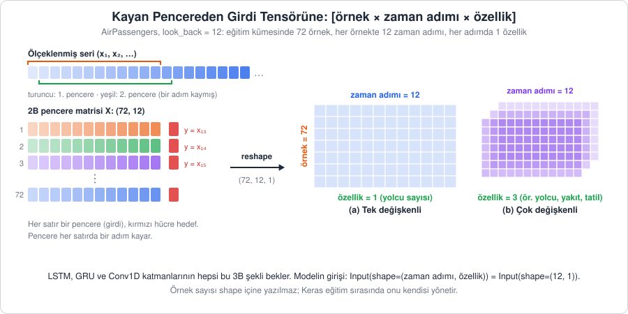
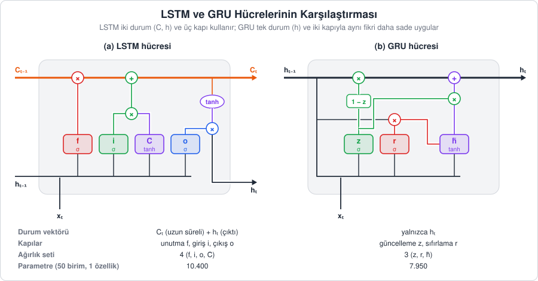
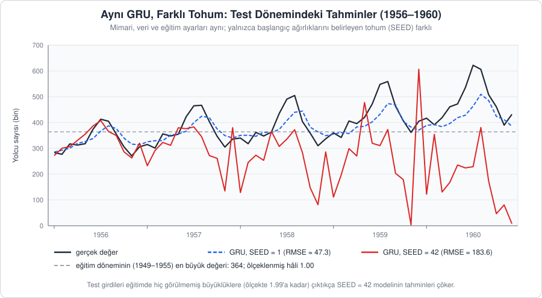
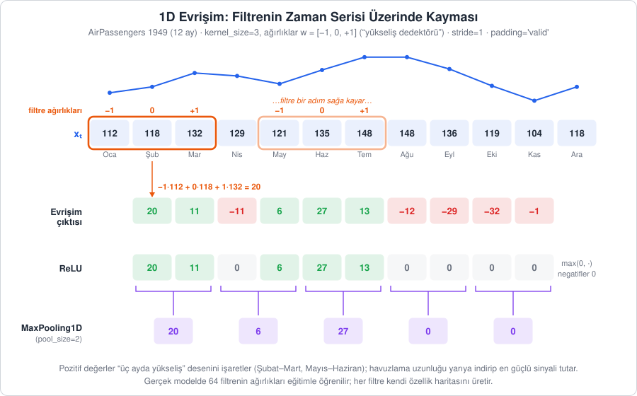
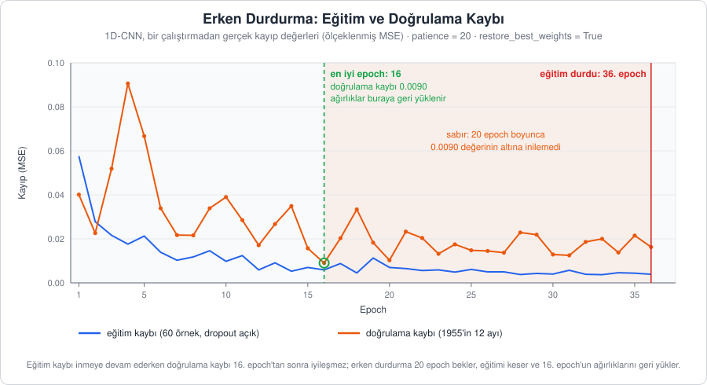

[İçindekiler](../Course_notes.md) · [← 14. Weka Zaman Serisi Tahmin Modülü (Forecast Sekmesi)](14_weka_zaman_serisi_tahmin_modulu_forecast_sekmesi.md) · [16. TimeSeriesSplit: Zaman Serisinde Çapraz Doğrulama →](16_timeseriessplit_zaman_serisinde_capraz_dogrulama.md)

## 15. Derin Öğrenme ile Tahmin: LSTM, GRU ve 1D-CNN

Bölüm 12'de yapay zekanın zaman serisine nasıl uygulandığını kavramsal olarak gördük: seriyi kayan bir pencereyle denetimli öğrenme problemine dönüştürmek ve LSTM hücresinin kapılar aracılığıyla "neyi hatırlayıp neyi unutacağına" karar vermesi. Bölüm 13'te aynı dönüşümü ağaç tabanlı XGBoost ile kullandık. Bu bölümde üç derin öğrenme mimarisini AirPassengers verisi üzerinde, Keras ile adım adım uyguluyoruz:

| Mimari | Temel fikir | Seriye nasıl bakar? |
| --- | --- | --- |
| **LSTM** | Kapılı tekrarlayan ağ, ayrı bir uzun süreli hafıza (hücre durumu) taşır | Pencereyi baştan sona adım adım "okur" |
| **GRU** | LSTM'in sadeleştirilmiş hâli, daha az kapı ve parametre | LSTM gibi adım adım okur |
| **1D-CNN** | Evrişimli ağ, kısa desenleri filtrelerle arar | Pencerenin üzerinde küçük bir filtre gezdirir |

Üç modelin adil karşılaştırılabilmesi için hepsi **aynı veri hazırlığını** (15.1) ve Bölüm 7'deki ARIMA uygulamasıyla **aynı test dönemini** (son 60 ay) kullanacak. Bölümün sonunda (15.5) ARIMA, XGBoost, LSTM, GRU ve 1D-CNN'i aynı ölçütle, RMSE ile karşılaştıracağız.

Nöron, ağırlık, yanlılık, aktivasyon (ReLU, sigmoid, tanh), katman ve gradyan inişi kavramları 12.2'nin başında anlatıldı; bu bölüm onları doğrudan kullanır.

### 15.1. Ortak Veri Hazırlığı

> **Uygulama dosyası:** [`Codes/python/ch15_derin_ogrenme.py`](../Codes/python/ch15_derin_ogrenme.py) · [Notebook](../Codes/notebooks/ch15_derin_ogrenme.ipynb) · [](https://colab.research.google.com/github/erkanozhan/AI_Based_Time_Series-Data_Analytics/blob/main/Codes/notebooks/ch15_derin_ogrenme.ipynb)
>
> Bu bölümdeki kodların tamamı bu dosyada. Bilgisayarınızda çalıştırmak için depo kök dizininde `python Codes/python/ch15_derin_ogrenme.py` komutunu kullanın ya da dosyayı VS Code'da açıp hücre hücre çalıştırın. Kurulum yapmadan denemek için Colab bağlantısını kullanabilirsiniz.
>
> Dosya 15.1'den 15.5'e kadar baştan sona çalışacak sırayla düzenlenmiştir. 15.5'teki `rmse_arima` değeri için Bölüm 7.7'deki `auto_arima` modeli dosyada yeniden kurulur; Bölüm 7'nin kodunu ayrıca çalıştırmanız gerekmez.


Bu alt bölümdeki kod, 15.2–15.5'teki bütün modellerin başlangıç noktasıdır. Burada üç şey yapıyoruz: veriyi eğitim ve test olarak ayırmak, ölçeklemek ve kayan pencereyle Keras'ın beklediği üç boyutlu şekle getirmek. **Keras**, Python'da sinir ağı kurmayı birkaç satıra indiren bir kütüphanedir ve **TensorFlow** kütüphanesinin içinde gelir (`tensorflow.keras`).

#### 15.1.1. Veri, Eğitim-Test Ayrımı ve Ölçekleme

Ölçeklemenin nedeni ve `MinMaxScaler` formülü 12.1.4'te anlatıldı. Bu bölümün ayrımında eğitim dönemi 1949–1955'tir (ilk 84 ay): en küçük değer 104, en büyük 364, aralık 260. Ocak 1949 (112) ≈ 0.03'e, test dönemindeki Temmuz 1960 (622) ise $(622 - 104) / 260 \approx 1.99$ değerine gider. Ölçekleyici yalnızca bu 84 ayla fit edilir. Tüm seriyle fit edilseydi 622 tam 1'e, eğitimin tepesi 364 ise ≈ 0.50'ye düşer ve model serinin ileride büyüyeceğini ölçekten sezerdi (12.1.4, 16.4).

```python
import numpy as np
import pandas as pd
import matplotlib.pyplot as plt

import tensorflow as tf
from pmdarima.datasets import load_airpassengers
from sklearn.preprocessing import MinMaxScaler
from sklearn.metrics import mean_squared_error

# Tekrarlanabilirlik: ağırlıkların başlangıç değerleri rastgele atanır.
# set_random_seed, Python'un, NumPy'ın ve TensorFlow'un rastgele sayı
# üreteçlerini tek satırda aynı tohuma sabitler.
SEED = 42
tf.keras.utils.set_random_seed(SEED)

# Bölüm 7'deki Python uygulamasıyla aynı veri: 1949-1960 aylık yolcu sayıları (144 gözlem)
data = load_airpassengers(as_series=True)
dates = pd.date_range(start='1949-01-01', periods=len(data), freq='MS')  # grafikler için tarih ekseni

# Ölçekleyici 2 boyutlu dizi bekler: (gözlem sayısı, 1)
dataset = data.values.astype('float32').reshape(-1, 1)

# Bölüm 7'deki ARIMA ile aynı ayrım: son 60 ay (1956-1960) test dönemi
test_horizon = 60
train_size = len(dataset) - test_horizon   # 84 ay eğitim

# Ölçekleyici YALNIZCA eğitim dönemiyle fit edilir; test dönemine sadece dönüşüm uygulanır.
scaler = MinMaxScaler(feature_range=(0, 1))
scaler.fit(dataset[:train_size])
dataset_scaled = scaler.transform(dataset)

print(f"Eğitim: {train_size} ay, Test: {test_horizon} ay")
print(f"Ölçeklenmiş eğitim aralığı: {dataset_scaled[:train_size].min():.2f} - {dataset_scaled[:train_size].max():.2f}")
print(f"Ölçeklenmiş test üst değeri: {dataset_scaled[train_size:].max():.2f}")
```

Çıktı:

```text
Eğitim: 84 ay, Test: 60 ay
Ölçeklenmiş eğitim aralığı: 0.00 - 1.00
Ölçeklenmiş test üst değeri: 1.99
```

Kodu satır satır okuyalım:

1. `import numpy as np` satırı NumPy kütüphanesini yükler ve ona kısa bir takma ad (`np`) verir; bundan sonra `np.array(...)` yazmak yeterlidir. `from sklearn.preprocessing import MinMaxScaler` ise kütüphanenin tamamını değil, yalnızca adı geçen aracı getirir.
2. `tf.keras.utils.set_random_seed(SEED)` rastgele sayı üreteçlerini sabit bir başlangıç değerine (**tohum**, *seed*) bağlar. Sinir ağının ağırlıkları başta rastgele seçildiği için tohum sabitlenmezse her çalıştırmada farklı bir model elde edilir. Tohum aynı makinede sonuçları büyük ölçüde tekrarlanabilir kılar. Yine de işletim sistemi, işlemci ve TensorFlow sürümü değiştiğinde sayılar biraz farklı çıkabilir; bu bölümde verdiğimiz derin öğrenme sonuçlarını bu yüzden "yaklaşık" olarak okuyun.
3. `load_airpassengers(as_series=True)` 144 aylık yolcu sayısını bir pandas serisi olarak getirir. `pd.date_range(start='1949-01-01', periods=144, freq='MS')` ise grafiklerin yatay ekseni için 144 tarih üretir (`'MS'`: her ayın ilk günü, *month start*).
4. `data.values.astype('float32').reshape(-1, 1)` üç iş yapar: değerleri NumPy dizisine çevirir, sinir ağlarının kullandığı 32 bitlik ondalık sayı türüne dönüştürür ve diziyi tek sütunlu bir tabloya çevirir. Örneğin `[112, 118, 132]` listesi `reshape(-1, 1)` ile `[[112], [118], [132]]` hâline gelir; şekli `(3, 1)`, yani 3 satır ve 1 sütundur. `-1` "satır sayısını sen hesapla" demektir. `MinMaxScaler` girdiyi bu tablo biçiminde ister.
5. `train_size = 144 - 60 = 84`. `dataset[:train_size]` köşeli parantez içindeki **dilimleme** ile ilk 84 satırı (Python'da 0'dan 83'e kadar olan sıra numaraları) seçer.
6. `scaler.fit(...)` yalnızca eğitim dönemine bakarak en küçük (104) ve en büyük (364) değeri **öğrenir**; `scaler.transform(dataset)` formülü serinin tamamına **uygular** (fit ile transform ayrımı: 12.1.4'teki not).
7. Son üç `print` satırı birer f-string'dir: `f"...{değişken:.2f}..."` küme parantezindeki değeri metnin içine, virgülden sonra 2 basamakla yazar.

**Çıktının yorumu:** Eğitim döneminin ölçeklenmiş değerleri tam olarak 0–1 aralığındadır; test döneminin üst değeri ise yukarıda hesapladığımız 1.99'dur. 12.1.4'te gördüğümüz gibi bu bir hata değildir: Model, eğitimde hiç görmediği büyüklükte değerleri tahmin etmek zorundadır.

> **Not —** Güçlü trend içeren serilerde sinir ağları eğitim aralığının dışına **ekstrapolasyon** (bilinen aralığın dışına taşma) yapmakta zorlanır ve tahminler sistematik olarak düşük kalabilir. Bunu hafifletmek için seriye önce log dönüşümü ve/veya fark alma (Bölüm 2.4 ve 7.6.3) uygulanıp model farklar üzerinde eğitilebilir; aynı fikrin XGBoost'taki uygulaması Bölüm 13.4.2'dedir. Bu bölümde kodu sade tutmak için ham seriyle çalışıyoruz.

#### 15.1.2. Kayan Pencere: Seriden Girdi-Hedef Çiftlerine

Bölüm 12.1.1'deki kayan pencereyi (Şekil 12.1) burada `look_back` adıyla kullanıyoruz; `look_back`, 12.1.1'deki pencere boyu $p$'dir: Son `look_back` gözlem girdi, hemen sonraki gözlem hedef olur ve $n$ gözlemli seriden `n - look_back` örnek elde edilir.

12.1.1'de önerildiği gibi aylık mevsimsel seride `look_back = 12` seçiyoruz: Model her tahminde tam bir yıllık döngüyü görür. Pencere çok büyürse örnek sayısı azalır ve aşırı öğrenme (modelin genel deseni değil eğitim verisinin ayrıntılarını ezberlemesi) riski artar. AirPassengers'ta $144 - 12 = 132$ örnek elde ederiz.

```python
def create_dataset(series, look_back=1):
    """
    Kayan pencere: her örnekte look_back geçmiş değer girdi,
    hemen sonraki değer hedef olur.

    series   : ölçeklenmiş seri, boyut (n, 1)
    Döndürür : X boyutu (n - look_back, look_back), y boyutu (n - look_back,)
    """
    X, y = [], []
    for i in range(len(series) - look_back):
        X.append(series[i:(i + look_back), 0])   # girdi penceresi
        y.append(series[i + look_back, 0])       # pencerenin hemen sonraki değeri
    return np.array(X), np.array(y)

look_back = 12
X_all, y_all = create_dataset(dataset_scaled, look_back)   # (132, 12) ve (132,)

# i. örneğin hedefi serinin (i + look_back). gözlemidir.
# Hedefi test dönemine (son 60 ay) düşen örnekler test kümesine gider.
split = train_size - look_back   # 84 - 12 = 72
trainX, trainY = X_all[:split], y_all[:split]
testX, testY = X_all[split:], y_all[split:]

# Keras'ın tekrarlayan ve evrişimli katmanları 3 boyutlu girdi bekler:
# [örnek sayısı, zaman adımı sayısı, özellik sayısı]
trainX = trainX.reshape(trainX.shape[0], look_back, 1)
testX = testX.reshape(testX.shape[0], look_back, 1)
print("trainX:", trainX.shape, " testX:", testX.shape)   # (72, 12, 1)  (60, 12, 1)

# Karşılaştırmalarda kullanacağımız gerçek test değerleri (orijinal ölçek) ve tarihleri
testY_inv = scaler.inverse_transform(testY.reshape(-1, 1)).ravel()
test_dates = dates[train_size:]
```

Çıktı:

```text
trainX: (72, 12, 1)  testX: (60, 12, 1)
```

`create_dataset`, 12.1.2'deki `kayan_pencere` fonksiyonunun aynısıdır (satır satır açıklaması orada). `look_back=1` varsayılan değerdir, yani çağırırken başka değer verilmezse 1 kullanılır; üç tırnak arasındaki metin (*docstring*) fonksiyonun ne aldığını ve ne döndürdüğünü anlatır. Tek fark, girdinin `(n, 1)` biçiminde tek sütunlu bir tablo olmasıdır: Bu yüzden dilimlerde `, 0` ile 0. sütun seçilir (`series[i:(i + look_back), 0]` girdi penceresi, `series[i + look_back, 0]` hedef). 144 gözlem ve `look_back = 12` için döngü 132 tur atar; `X`'in şekli `(132, 12)`, `y`'ninki `(132,)` olur.

Ardından örnekler eğitim ve test olarak ayrılır. `i`. örneğin hedefi serinin `i + 12` numaralı gözlemidir. Eğitim dönemi 0–83 numaralı gözlemlerdir; hedefi bu aralıkta kalan örnekler `i + 12 ≤ 83`, yani `i ≤ 71` olanlardır. Bu da $0$'dan $71$'e kadar $72$ örnek eder: `split = 84 - 12 = 72`. Kalan $132 - 72 = 60$ örneğin hedefleri tam olarak test dönemindeki 60 aydır. `X_all[:split]` ilk 72 satırı, `X_all[split:]` 72. satırdan sonuna kadar olanları seçer.

`trainX.reshape(trainX.shape[0], look_back, 1)` satırı tabloyu Keras'ın istediği üç boyutlu şekle getirir (15.1.3). `trainX.shape[0]` şeklin ilk sayısıdır, yani 72. Son iki satırda test hedefleri `inverse_transform` ile (ters dönüşüm, 12.1.4) orijinal ölçeğe geri çevrilir. `.ravel()` `(60, 1)` şeklindeki tek sütunlu tabloyu düz bir 60 sayılık diziye çevirir. `dates[train_size:]` ise 84. sıradan başlayan 60 tarihi, yani Ocak 1956–Aralık 1960'ı verir.

**Açıklama:** İlk test örneğinin girdisi, eğitim döneminin son 12 ayıdır (1955). Bu bir sızıntı değildir; çünkü 1956 Ocak'ı tahmin ederken 1955'in değerlerini bilmek gerçekçidir. Her test tahmininde model, bir önceki ayların **gerçek** değerlerini görür. Buna **tek adımlı (one-step-ahead) tahmin** denir (Bölüm 12.1.3). 15.5'teki karşılaştırmada bu ayrıntı önemli olacak.

Eski sürümlerde sık görülen `range(len(dataset) - look_back - 1)` döngüsü gereksiz yere son gözlemi kaybettiriyordu. Yukarıdaki fonksiyon tüm gözlemleri kullanır.

> **Hemen deneyin 15.1.2 · Pencere boyunu değiştirip şekli tahmin edin** (Python, ~4 dk)
>
> `create_dataset` fonksiyonunu 8 gözlemlik küçük bir seride deneyin.
>
> ```python
> import numpy as np
>
> def create_dataset(series, look_back=1):        # 15.1.2'deki fonksiyonun aynısı
>     X, y = [], []
>     for i in range(len(series) - look_back):
>         X.append(series[i:(i + look_back), 0])
>         y.append(series[i + look_back, 0])
>     return np.array(X), np.array(y)
>
> seri = np.array([10, 20, 30, 40, 50, 60, 70, 80]).reshape(-1, 1)   # 8 gözlem
> X, y = create_dataset(seri, look_back=3)
> print(X)
> print("y:", y, "  X şekli:", X.shape)
> ```
>
> **Ne göreceksiniz:**
>
> ```text
> [[10 20 30]
>  [20 30 40]
>  [30 40 50]
>  [40 50 60]
>  [50 60 70]]
> y: [40 50 60 70 80]   X şekli: (5, 3)
> ```
>
> Kural tutuyor: $8 - 3 = 5$ örnek, her biri 3 değerlik bir pencere. Her satırın hedefi, pencerenin hemen sağındaki sayıdır.
>
> **Şimdi siz:** (1) `look_back=5` yapmadan önce `X.shape`'i ve `y`'yi tahmin edin. (2) 15.1'deki kodu çalıştırdıysanız aynı oturumda `create_dataset(dataset_scaled, 24)` ile AirPassengers'ta `look_back = 24` deneyin: kaç örnek çıkar, `split = train_size - 24` kaç olur, eğitim ve test tensörlerinin şekli ne olur?
>
> <details><summary>Cevap</summary>
>
> (1) $8 - 5 = 3$ örnek: `X şekli: (3, 5)`, `y: [60 70 80]`. (2) $144 - 24 = 120$ örnek, yani `(120, 24)`. `split = 84 - 24 = 60`; eğitim `(60, 24, 1)`, test `(60, 24, 1)`. Test hâlâ son 60 aydır, ama eğitim örneği 72'den 60'a düştü: pencere büyüdükçe örnek sayısı azalır.
>
> </details>

#### 15.1.3. Girdi Tensörünün Şekli

**Tensör**, sayıların belirli bir düzende yerleştirildiği çok boyutlu bir kaptır. Tek bir sayı sıfır boyutlu, bir liste tek boyutlu, satır ve sütunlardan oluşan bir tablo iki boyutlu bir tensördür. Üç boyutlu tensörü, üst üste konmuş tablolardan oluşan bir yığın ya da "listelerin listelerinin listesi" gibi düşünebilirsiniz. Bir tensörün **şekli (shape)**, her boyutta kaç eleman olduğunu söyleyen sayılardır: `(72, 12, 1)` "72 tane, her biri 12 satır ve 1 sütundan oluşan tablo" demektir.

Keras'ta `LSTM`, `GRU` ve `Conv1D` katmanları girdiyi üç boyutlu bir tensör olarak ister:

- **Örnek (sample):** Kaç pencere var? Bizde eğitimde 72, testte 60.
- **Zaman adımı (time step):** Her pencerede kaç ardışık gözlem var? Bizde `look_back = 12`.
- **Özellik (feature):** Her zaman adımında kaç değişken ölçülüyor? Tek değişkenli seride 1. Yolcu sayısının yanına yakıt fiyatı ve tatil bilgisi eklenseydi 3 olurdu.

Küçük bir örnekle görelim. Seri 10, 20, 30, 40, 50 ve `look_back = 3` ise `create_dataset` iki pencere üretir. `reshape` öncesi ve sonrası:

```text
reshape öncesi, şekil (2, 3):        reshape(2, 3, 1) sonrası, şekil (2, 3, 1):
[[10, 20, 30],                       [[[10], [20], [30]],
 [20, 30, 40]]                        [[20], [30], [40]]]
```

Sayılar ve sıraları değişmez; değişen yalnızca kabın düzenidir. Sağdaki yapıda her sayı kendi küçük listesine (`[10]`) girmiştir: Bu iç liste o zaman adımındaki **özellikler** listesidir ve tek değişkenli seride tek elemanlıdır. Bir eleman üç sıra numarasıyla bulunur: `X[1, 2, 0]` "2. örneğin 3. zaman adımındaki 1. özelliği" demektir ve değeri 40'tır (Python saymaya 0'dan başladığı için 1 ikinci, 2 üçüncü elemanı gösterir). Her ay için yolcu sayısıyla birlikte yakıt fiyatı da olsaydı iç listeler iki elemanlı olurdu, örneğin `[10, 3.2]`, ve şekil `(2, 3, 2)` olurdu.



*Şekil 15.1 — Kayan pencereyle oluşturulan 2B tablo (72 × 12), `reshape` ile [örnek × zaman adımı × özellik] biçiminde 3B tensöre dönüşür. Modelin girişine yazılan `Input(shape=(12, 1))` yalnızca son iki boyutu içerir; örnek sayısı yazılmaz.*

> **Hemen deneyin 15.1.3 · Tensörü `reshape` ile kurup içinde gezinin** (Python, ~3 dk)
>
> Metindeki iki pencereyi üç boyutlu tensöre çevirin, sonra ikinci bir özellik (yakıt fiyatı) ekleyin.
>
> ```python
> import numpy as np
> X = np.array([[10, 20, 30],
>               [20, 30, 40]])          # 2 pencere, her biri 3 zaman adımı
> X3 = X.reshape(2, 3, 1)               # (örnek, zaman adımı, özellik)
> print(X3.shape, "boyut sayısı:", X3.ndim)
> print(X3[1, 2, 0])                    # 2. örnek, 3. zaman adımı, 1. özellik
>
> yakit = np.array([[3.1, 3.2, 3.3],
>                   [3.2, 3.3, 3.5]])   # aynı aylar için ikinci bir değişken
> X_cok = np.stack([X, yakit], axis=-1) # iki tabloyu en iç boyutta yan yana koy
> print(X_cok.shape)
> print(X_cok[1, 2])                    # 2. örneğin 3. zaman adımındaki özellik listesi
> ```
>
> `ndim` boyut sayısını verir. `np.stack(..., axis=-1)` iki tabloyu üst üste değil, her hücreyi yan yana gelecek biçimde birleştirir: her zaman adımında artık iki sayı vardır.
>
> **Ne göreceksiniz:**
>
> ```text
> (2, 3, 1) boyut sayısı: 3
> 40
> (2, 3, 2)
> [40.   3.5]
> ```
>
> `X3[1, 2, 0]` metindeki gibi 40'tır. İkinci özellik eklenince şekil `(2, 3, 2)` olur ve aynı konumdaki iç liste `[40, 3.5]`: o ayın yolcu sayısı ve yakıt fiyatı. (NumPy, tamsayı ile ondalığı aynı dizide tuttuğu için 40'ı `40.` diye yazar.)
>
> **Şimdi siz:** `X_cok[0, :, 1]` ve `X_cok[:, 0, 0]` neyi verir? Önce tahmin edin. Ayrıca yolcu, yakıt ve tatil bilgisiyle 72 pencere ve `look_back = 12` için tensörün şekli ne olurdu?
>
> <details><summary>Cevap</summary>
>
> `X_cok[0, :, 1]` → `[3.1 3.2 3.3]` (1. örneğin bütün zaman adımlarındaki 2. özellik, yani yakıt fiyatları). `X_cok[:, 0, 0]` → `[10. 20.]` (her iki örneğin ilk zaman adımındaki yolcu sayısı). Üç değişkenle şekil `(72, 12, 3)` olurdu; modelin girişi de `Input(shape=(12, 3))` olurdu.
>
> </details>

### 15.2. LSTM ile Tahmin

LSTM'in iç yapısını Bölüm 12.2.2'de kavramsal olarak gördük: Hücre, uzun süreli bilgiyi taşıyan bir **hücre durumu** $C_t$ (defter) ve her adımda dışarıya verilen bir **gizli durum** $h_t$ tutar; 0 ile 1 arasında değer alan üç **kapı** (vana) bu iki durum arasındaki bilgi akışını denetler.

LSTM hücresinin denklemleri ve sayısal örneği 12.2.2'dedir. Keras aynı denklemleri 12.2.2'de gösterdiğimiz ayrık yazımla uygular: Her kapıda girdiyi çarpan bir $W$, önceki gizli durumu çarpan bir $U$ ve bir yanlılık $b$ vardır; örneğin unutma kapısı $f_t = \sigma(W_f x_t + U_f h_{t-1} + b_f)$ biçiminde yazılır. Bu yazım, aşağıdaki parametre sayımını (dört ağırlık seti, her birinde $W$, $U$ ve $b$) ve 15.3'teki GRU denklemlerini okumayı kolaylaştırır. 50 birimli bir katmanda her harf 50 sayılık bir listeyi, $W$ ve $U$ de ağırlık tablolarını temsil eder.

Diğer kapılar ($i_t$, $\tilde{C}_t$, $o_t$) aynı kalıpla, kendi $W$, $U$ ve $b$'leriyle yazılır; açıklamalı gösterimi ve okunuşu 12.2.2'dedir. Aşağıdaki "dört ağırlık seti" bu dört satırın ağırlıklarıdır.

Modelimiz tek bir LSTM katmanı (50 birim) ve tek nöronlu bir çıktı katmanından (`Dense(1)`) oluşuyor. Keras'ta bir model dört adımda hazırlanır: (1) katmanlar sırayla dizilir, (2) `compile` ile hatanın nasıl ölçüleceği ve ağırlıkların nasıl düzeltileceği seçilir, (3) `fit` ile model eğitilir, (4) `predict` ile tahmin üretilir.

```python
# 15.1'de hazırlanan trainX, trainY, testX, testY, scaler, dates, test_dates,
# testY_inv ve look_back değişkenlerini kullanır.
from tensorflow.keras.models import Sequential
from tensorflow.keras.layers import Input, LSTM, Dense

model_lstm = Sequential()
# Girdi şekli: (zaman adımı sayısı, özellik sayısı) = (12, 1); örnek sayısı yazılmaz
model_lstm.add(Input(shape=(look_back, 1)))
# 50: katmandaki hafıza birimi (gizli durum boyutu) sayısı
model_lstm.add(LSTM(50))
# Tek nöronlu çıktı katmanı: bir sonraki ayın (ölçeklenmiş) değeri
model_lstm.add(Dense(1))

# Kayıp fonksiyonu: ortalama kare hata; optimizasyon: Adam
model_lstm.compile(loss='mean_squared_error', optimizer='adam')
model_lstm.summary()

# epochs: eğitim verisinin model üzerinden kaç kez geçirileceği
# batch_size=1: her örnekten sonra ağırlıklar güncellenir (küçük veri için uygun, ama yavaş)
# verbose=2: her epoch için tek satır bilgi
model_lstm.fit(trainX, trainY, epochs=100, batch_size=1, verbose=2)

# Tahminler ve orijinal ölçeğe geri dönüş
train_predict = scaler.inverse_transform(model_lstm.predict(trainX, verbose=0))
test_predict = scaler.inverse_transform(model_lstm.predict(testX, verbose=0))

rmse_lstm = np.sqrt(mean_squared_error(testY_inv, test_predict[:, 0]))
print(f'LSTM Modeli RMSE Değeri: {rmse_lstm:.2f}')

# Görselleştirme: eğitim tahminlerinin hedefleri look_back. aydan başlar
plt.figure(figsize=(15, 7))
plt.plot(dates, dataset[:, 0], label='Orijinal Veri')
plt.plot(dates[look_back:train_size], train_predict[:, 0], label='Eğitim Tahminleri (LSTM)')
plt.plot(test_dates, test_predict[:, 0], label='Test Tahminleri (LSTM)', color='orange')
plt.axvline(test_dates[0], color='gray', linestyle=':', label='Test başlangıcı')
plt.title('LSTM Modeli ile Yolcu Sayısı Tahmini')
plt.xlabel('Tarih')
plt.ylabel('Yolcu Sayısı')
plt.legend()
plt.show()
```

Kodun önemli satırları şunlardır:

1. **`Sequential()`** boş bir model açar; `add(...)` ile eklenen katmanlar verinin içinden sırayla geçeceği bir hat oluşturur: girdi → LSTM → Dense → tahmin.
2. **`Input(shape=(look_back, 1))`** modele her örneğin şeklini bildirir: 12 zaman adımı, her adımda 1 özellik. Örnek sayısı (72) yazılmaz, çünkü model aynı şekildeki istediği sayıda örneği işleyebilir. (Eski Keras sürümlerinde bu bilgi `LSTM(50, input_shape=(12, 1))` biçiminde katmanın içine yazılırdı. Keras 3 bu yazımda uyarı verir ve ayrı bir `Input` satırını önerir.)
3. **`LSTM(50)`** 50 birimli bir LSTM katmanıdır. Katman, penceredeki 12 değeri Ocak'tan Aralık'a sırayla okur ve her adımda 12.2.2'deki denklemleri işletir. Okuma bitince son adımın gizli durumunu, yani 50 sayılık bir özeti verir. 50, bu özetin ne kadar "geniş" olduğunu belirleyen bir tasarım seçimidir; daha büyük sayı daha fazla öğrenme kapasitesi, ama aynı zamanda daha fazla ezberleme riski demektir.
4. **`Dense(1)`** 50 sayılık özeti tek bir sayıya, bir sonraki ayın ölçeklenmiş tahminine çevirir. Aktivasyon verilmediği için çıktı herhangi bir değeri alabilir; regresyon problemleri (sayı tahmini) için doğru seçim budur.
5. **`compile(loss='mean_squared_error', optimizer='adam')`** eğitimin kurallarını belirler. **Kayıp fonksiyonu** olarak ortalama kare hata (MSE) kullanılır: Gerçek değerler 0.2 ve 0.4, tahminler 0.1 ve 0.5 ise hatalar 0.1 ve −0.1, kareleri 0.01 ve 0.01, ortalamaları 0.01 olur. **Optimizasyon algoritması** Adam ise her güncellemede her ağırlığı, kaybı azaltan yöne doğru küçük bir adım kaydırır (gradyan inişi, 12.2'nin başı). Adımın büyüklüğünü **öğrenme oranı** (Adam'da varsayılan 0.001) belirler. Adam, her ağırlık için adımı geçmiş güncellemelere bakarak kendisi ayarladığı için çoğu problemde iyi bir varsayılan seçimdir.
6. **`summary()`** katmanları, çıktı şekillerini ve öğrenilecek **parametre** (ağırlık ve yanlılık) sayısını tablo olarak yazdırır.
7. **`fit(trainX, trainY, epochs=100, batch_size=1, verbose=2)`** eğitimi başlatır. **Batch** (yığın), ağırlıklar bir kez güncellenmeden önce birlikte işlenen örnek sayısıdır. **Epoch** ise eğitim verisinin tamamının modelden bir kez geçmesidir. `batch_size=1` ile 72 örneğin her birinden sonra güncelleme yapılır: bir epoch'ta 72 güncelleme, 100 epoch'ta $72 \cdot 100 = 7200$ güncelleme. `batch_size=16` seçilseydi bir epoch $72 / 16 = 4.5$, yani 5 yığın (dört tane 16'lık, bir tane 8'lik) ve 5 güncelleme olurdu. Küçük yığın daha çok ve daha "gürültülü" adım, büyük yığın daha az ve daha düzgün adım demektir. `verbose=2` her epoch için kaybı tek satırda yazdırır; bu satırlarda kaybın giderek küçüldüğünü görmeniz beklenir.

   **Günlük hayattan bir örnek:** Bir ders kitabını baştan sona bir kez okumak bir epoch'tur. Her sayfadan sonra özet notlarınızı düzeltirseniz `batch_size=1` gibi çalışırsınız: çok sayıda ama telaşlı düzeltme. Her 16 sayfada bir düzeltirseniz `batch_size=16` olur: daha az ama daha olgun düzeltme.

   **Not —** `fit` eğitim pencerelerinin sırasını her epoch'ta varsayılan olarak karıştırır (`shuffle=True`). Bu bir sızıntı değildir: Her pencere kendi geçmişini içinde taşır ve test dönemi zaten ayrı tutulmuştur. 17.2'deki "asla karıştırmayın" kuralı eğitim-test ayrımıyla ilgilidir.

8. **`predict(trainX, verbose=0)`** her örnek için bir tahmin üretir; sonuç `(72, 1)` şeklinde, 0–1 ölçeğinde bir tablodur. `inverse_transform` tahminleri yolcu sayısına geri çevirir. `test_predict[:, 0]` "bütün satırlar, 0. sütun" demektir ve tabloyu düz bir diziye indirir.
9. **RMSE** (kök ortalama kare hata, Bölüm 8.2.2): `mean_squared_error` hataların karelerinin ortalamasını, `np.sqrt` bunun karekökünü alır. Böylece hata yeniden yolcu biriminde okunur.
10. Grafikte eğitim tahminleri `dates[look_back:train_size]`, yani 12. ile 83. sıradaki 72 tarihe çizilir: İlk 12 ay hiçbir örneğin hedefi olmadığı için bu ayların tahmini yoktur. `plt.axvline` test döneminin başladığı yere dikey bir çizgi koyar.

**Çıktının yorumu:**

- `model_lstm.summary()` LSTM katmanı için 10.400 parametre gösterir. Dört ağırlık seti ($f, i, o, \tilde{C}$) vardır. Her set, her birim için 1 girdi ağırlığı, önceki gizli durumdaki 50 değer için 50 ağırlık ve 1 yanlılık, yani 52 sayı içerir: $50 \times (1 + 50) + 50 = 2550 + 50 = 2600$. Dört set için $4 \times 2600 = 10.400$ olur. Buna `Dense` katmanının $50 + 1 = 51$ parametresi eklenir; toplam 10.451.
- Eğitim tahminleri gerçek seriyi yakından izliyorsa ama test tahminleri özellikle 1959–1960 tepelerinde gerçek değerlerin altında kalıyorsa bu, 15.1.1'deki ekstrapolasyon sorununun işaretidir.
- `rmse_lstm` yolcu sayısıyla aynı birimdedir (bin yolcu). Bizim çalıştırmamızda 46.19 çıktı. Sizin değeriniz 15.1.1'de (2. madde) belirttiğimiz nedenlerle farklı olabilir. Farkın ne kadar büyük olabileceğini 15.3'te göreceğiz. 15.5'te diğer modellerle bu değer üzerinden karşılaştıracağız.

```math
\text{LSTM parametre sayısı} = \underbrace{4}_{\substack{\text{ağırlık seti}\\(f,\ i,\ o,\ \tilde{C})}} \cdot \big[\underbrace{h \cdot (h + x)}_{\substack{\text{W ve U}\\\text{ağırlıkları}}} + \underbrace{h}_{\text{yanlılıklar}}\big]
```

**Nasıl okunur?** "Dört çarpı, köşeli parantez içinde h çarpı parantez içinde h artı x, artı h." Burada h birim sayısı (bizde 50), x her zaman adımındaki özellik sayısıdır (bizde 1). Yani: $h \cdot (h + x) = h \cdot x + h \cdot h$; ilk terim girdiyi çarpan $W$ tablosunun, ikincisi önceki gizli durumu çarpan $U$ tablosunun eleman sayısıdır.

> **Hemen deneyin 15.2 · Parametre sayısını formülle doğrulayın** (Python, ~4 dk)
>
> Küçük bir LSTM kurun (eğitmeden) ve `summary()`'deki parametre sayısını formülle karşılaştırın. $h$ birim ve $x$ özellik için LSTM katmanı $4 \cdot [h \cdot (h + x) + h]$ parametre taşır.
>
> ```python
> from tensorflow.keras.models import Sequential
> from tensorflow.keras.layers import Input, LSTM, Dense
>
> h, x = 8, 1                                  # h: birim sayısı, x: özellik sayısı
> model = Sequential([Input(shape=(12, x)), LSTM(h), Dense(1)])
> model.summary()
> print("Formül:", 4 * (h * (h + x) + h))      # 4 ağırlık seti x [h·(h+x) ağırlık + h yanlılık]
> ```
>
> **Ne göreceksiniz:** Tabloda `lstm (LSTM)` satırında `320`, `dense (Dense)` satırında `9`, altta `Total params: 329` ve en sonda `Formül: 320`. Hesap: $4 \cdot [8 \cdot 9 + 8] = 4 \cdot 80 = 320$; `Dense(1)` için $8 + 1 = 9$. (Katman adlarının sonunda `_1`, `_2` gibi ekler görebilirsiniz; aynı oturumda birden çok model kurduğunuzda Keras adları numaralandırır.)
>
> **Şimdi siz:** Çalıştırmadan önce tahmin edin: (1) `x = 3` (üç değişkenli seri) olursa LSTM katmanı kaç parametre taşır? (2) `Input(shape=(24, x))` ile pencere 24 aya çıkarsa toplam değişir mi? (3) `LSTM(h)` yerine `GRU(h)` yazarsanız (15.3'teki formül: $3 \cdot [h \cdot (h + x) + 2h]$) kaç olur?
>
> <details><summary>Cevap</summary>
>
> (1) $4 \cdot [8 \cdot 11 + 8] = 384$; Keras da 384 gösterir (toplam 393). (2) Değişmez, toplam yine 329: aynı ağırlıklar her zaman adımında tekrar kullanılır, pencere uzunluğu parametre sayısını etkilemez. (3) $3 \cdot [8 \cdot 9 + 16] = 264$; Keras'ta GRU katmanı 264 parametre gösterir (aynı boyutlu LSTM'den 56 az).
>
> </details>

### 15.3. GRU: Zaman Bağımlılıklarını Daha Sade Bir Yapıyla Öğrenmek

LSTM güçlüdür ama biraz ağırdır: iki ayrı durum vektörü, üç kapı ve dört ağırlık seti taşır. **GRU (Gated Recurrent Unit)** aynı fikri daha sade bir yapıyla uygular. Ayrı bir hücre durumu yoktur; hafıza doğrudan gizli durum $h_t$ üzerinde tutulur ve iki kapı yeterlidir:

- **Güncelleme kapısı (update gate)** $z_t$: Ne kadar yeni bilgi alınacağını ve eski bilginin ne kadarının korunacağını tek bir düğmeyle ayarlar. LSTM'deki unutma ve giriş kapılarının birleşmiş hâli gibidir.
- **Sıfırlama kapısı (reset gate)** $r_t$: Aday bilgi hesaplanırken geçmiş bilginin ne ölçüde devre dışı bırakılacağını belirler.



*Şekil 15.2 — LSTM hücresinde turuncu hücre durumu bandı $`C_t`$ ve üç kapı (f, i, o) vardır. GRU'da tek bir durum $`h_t`$ vardır; güncelleme kapısı z eski durumla aday durumu $`(1-z)`$ ve $`z`$ oranlarında karıştırır, sıfırlama kapısı r ise adayın hesaplanmasında geçmişin etkisini ayarlar.*

GRU'nun bir zaman adımındaki hesaplaması:

```math
\begin{aligned}
z_t &= \sigma\left(W_z x_t + U_z h_{t-1} + b_z\right) &&\text{(güncelleme kapısı)}\\
r_t &= \sigma\left(W_r x_t + U_r h_{t-1} + b_r\right) &&\text{(sıfırlama kapısı)}\\
\tilde{h}_t &= \tanh\big(W_h x_t + U_h \underbrace{\left(r_t \odot h_{t-1}\right)}_{\substack{\text{sıfırlama kapısından}\\\text{geçen geçmiş}}} + b_h\big) &&\text{(aday durum)}\\
h_t &= \underbrace{\left(1 - z_t\right) \odot h_{t-1}}_{\substack{\text{eski durumdan}\\\text{alınan pay}}} + \underbrace{z_t \odot \tilde{h}_t}_{\substack{\text{adaydan}\\\text{alınan pay}}} &&\text{(yeni durum)}
\end{aligned}
```

**Nasıl okunur?** "z alt t eşittir sigma, parantez içinde W alt z çarpı x alt t artı U alt z çarpı h alt t eksi bir artı b alt z; r alt t de aynı biçimde, kendi W, U ve b'siyle okunur. h tilda alt t eşittir tanh, parantez içinde W alt h çarpı x alt t artı U alt h çarpı r alt t eleman eleman çarpı h alt t eksi bir, artı b alt h. h alt t eşittir, bir eksi z alt t eleman eleman çarpı h alt t eksi bir, artı z alt t eleman eleman çarpı h tilda alt t."

> **Simge notu:** $`z_t`$ *(z t)*: güncelleme kapısının çıktısı (0–1 arası) · $`r_t`$ *(r t)*: sıfırlama kapısının çıktısı (0–1 arası) · $`\tilde{h}_t`$ *(h tilda t)*: aday gizli durum, yani bu ayın girdisinden ve sıfırlama kapısından geçen geçmişten hesaplanan "yeni durum önerisi" · $`1 - z_t`$: kapının "kapalı" kalan payı; $`z_t = 0.3`$ ise $`1 - z_t = 0.7`$ · Diğer harfler ($`\sigma`$, $`\tanh`$, $`W`$, $`U`$, $`b`$, $`\odot`$) 12.2.2 ve 15.2'dekiyle aynı anlamdadır.

**Açıklama:** Son denklem bir **ağırlıklı ortalamadır**: Eski durumdan $1 - z_t$ kadar, yeni adaydan $z_t$ kadar alınır ve iki pay her zaman 1'e tamamlanır. $z_t$ sıfıra yakınsa model eski durumu olduğu gibi korur, yani "bu ay önemli bir şey olmadı" der. Bire yakınsa durumu büyük ölçüde yeni adayla değiştirir. $r_t$ sıfıra yakınsa aday durum geçmişi neredeyse yok sayar ve yalnızca yeni girdiye bakar. Bu, serideki ani bir kırılmadan sonra "baştan başlamak" için kullanışlıdır.

**Günlük hayattan bir örnek:** LSTM'in unutma ve giriş kapıları iki ayrı musluk gibiyse (12.2.2'deki vana benzetmesi), GRU'nun güncelleme kapısı tek kollu bir mutfak bataryasıdır. Kolu bir yöne çevirdikçe yeni adaydan gelen pay artarken eski durumdan gelen pay aynı oranda azalır; iki payın toplamı hep 1'dir. Sıfırlama kapısı ise yeni karışımı hazırlarken eski suyu hesaba katıp katmayacağınızı belirler. Benzetmenin sınırı: Bu "kol" her birim için ayrıdır ve her adımda girdiye bakılarak yeniden hesaplanır.

**Sayısal örnek (tek birim):** Eski durum $h_{t-1} = 0.8$, aday durum $\tilde{h}_ t = 0.2$ olsun.

- Güncelleme kapısı neredeyse kapalı, $z_t = 0.1$: $h_t = 0.9 \cdot 0.8 + 0.1 \cdot 0.2 = 0.72 + 0.02 = 0.74$. Yeni durum eskisine çok yakın kaldı.
- Güncelleme kapısı neredeyse açık, $z_t = 0.9$: $h_t = 0.1 \cdot 0.8 + 0.9 \cdot 0.2 = 0.08 + 0.18 = 0.26$. Yeni durum adaya yaklaştı.

Sıfırlama kapısının etkisini görmek için adayın hesabına bakalım. Basitlik için $W_h = 1$, $U_h = 1$, $b_h = 0$ ve bu ayın girdisi $x_t = 0.3$ olsun. $r_t = 1$ iken geçmiş tam olarak hesaba girer: $\tilde{h}_ t = \tanh(0.3 + 1 \cdot 0.8) = \tanh(1.1) \approx 0.80$. $r_t = 0$ iken geçmiş tamamen devre dışı kalır: $\tilde{h}_ t = \tanh(0.3 + 0 \cdot 0.8) = \tanh(0.3) \approx 0.29$. Gerçek modelde $z_t$ ve $r_t$ sabit değildir; her ay, o ayın girdisine ve önceki duruma bakılarak yeniden hesaplanır ve bunları üreten ağırlıklar eğitimle öğrenilir.

> **Not —** Kaynaklarda son denklemde $`z_t`$ ile $`1-z_t`$ bazen yer değiştirmiş olarak yazılır (Keras'ın uygulaması $`h_t = z_t \odot h_{t-1} + (1-z_t) \odot \tilde{h}_t`$ biçimindedir). Bu yalnızca kapının neyi "açık" saydığıyla ilgili bir gösterim farkıdır; model aynı şeyi öğrenir.

Böylece GRU, LSTM'e göre:

- daha az parametre kullanır (üç ağırlık seti),
- daha hızlı eğitilir,
- küçük veri kümelerinde ezberlemeye biraz daha az eğilim gösterebilir.

Zaman serisi söz konusu olduğunda GRU da tıpkı LSTM gibi belirli sayıda önceki adımı (son 12 ay) girdi olarak alır ve bir sonraki adımı tahmin etmeye çalışır. Aşağıdaki kodda LSTM'le **birebir aynı** veri hazırlığını, aynı `look_back = 12` değerini ve aynı eğitim ayarlarını kullanıyoruz. Böylece iki model arasındaki fark, rastgele başlangıç ağırlıkları dışında, yalnızca hücre yapısından kaynaklanır.

```python
# 15.1'de hazırlanan trainX, trainY, testX, testY, scaler, dates, test_dates,
# testY_inv ve look_back değişkenlerini kullanır.
from tensorflow.keras.models import Sequential
from tensorflow.keras.layers import Input, GRU, Dense

# Aynı başlangıç koşulları için tohumu yeniden sabitliyoruz
tf.keras.utils.set_random_seed(SEED)

model_gru = Sequential()
# Girdi şekli LSTM'dekiyle aynı: (12 zaman adımı, 1 özellik)
model_gru.add(Input(shape=(look_back, 1)))
# 50 birimli GRU katmanı
model_gru.add(GRU(50))
model_gru.add(Dense(1))

model_gru.compile(loss='mean_squared_error', optimizer='adam')
model_gru.summary()   # GRU katmanı: 7.950 parametre (LSTM'de 10.400)

# LSTM ile aynı eğitim ayarları: adil karşılaştırma için
model_gru.fit(trainX, trainY, epochs=100, batch_size=1, verbose=2)

# Tahminler ve orijinal ölçeğe dönüş
train_predict_gru = scaler.inverse_transform(model_gru.predict(trainX, verbose=0))
test_predict_gru = scaler.inverse_transform(model_gru.predict(testX, verbose=0))

rmse_gru = np.sqrt(mean_squared_error(testY_inv, test_predict_gru[:, 0]))
print(f'GRU Modeli RMSE Değeri: {rmse_gru:.2f}')

# Görselleştirme
plt.figure(figsize=(15, 7))
plt.plot(dates, dataset[:, 0], label='Orijinal Veri')
plt.plot(dates[look_back:train_size], train_predict_gru[:, 0], label='Eğitim Tahminleri (GRU)')
plt.plot(test_dates, test_predict_gru[:, 0], label='Test Tahminleri (GRU)', color='green')
plt.axvline(test_dates[0], color='gray', linestyle=':', label='Test başlangıcı')
plt.title('GRU Modeli ile Yolcu Sayısı Tahmini')
plt.xlabel('Tarih')
plt.ylabel('Yolcu Sayısı')
plt.legend()
plt.show()
```

Kod, LSTM kodunun neredeyse aynısıdır; değişen iki şey vardır. Birincisi, `LSTM(50)` yerine `GRU(50)` katmanı kullanılır. İkincisi, model kurulmadan önce `tf.keras.utils.set_random_seed(SEED)` yeniden çağrılır. Böylece GRU'nun ağırlıkları, LSTM eğitimi sırasında üretilen rastgele sayılardan etkilenmeden, aynı tohumdan başlar ve kodu tek başına çalıştırdığınızda da aynı sonucu verir. `compile`, `fit`, `predict` ve `inverse_transform` satırları 15.2'de anlattığımız gibi çalışır.

**Çıktının yorumu:** Keras'ın varsayılan GRU uygulaması (`reset_after=True`) her ağırlık seti için iki yanlılık tutar. Bu yüzden parametre sayısı $3 \times [50 \times (1 + 50) + 2 \times 50] = 3 \times [2550 + 100] = 3 \times 2650 = 7950$ olur. LSTM'in 10.400 parametresine göre fark $10400 - 7950 = 2450$, yani yaklaşık %24'tür ($2450 / 10400 \approx 0.236$).

Bizim bilgisayarımızda `SEED = 42` ile GRU'nun test RMSE'si **183.64** çıktı; LSTM'in 46.19'unun yaklaşık dört katı. Eğitim hatası ise iki modelde de benzer ve küçüktü (yaklaşık 13–15 yolcu). Sorun eğitimde değil, test döneminde ortaya çıkıyor. Bunun bir model hatası mı yoksa şanssız bir başlangıç mı olduğunu anlamak için aynı kodu yalnızca tohumu değiştirerek yeniden çalıştırdık:

| Tohum (`SEED`) | LSTM test RMSE | GRU test RMSE |
| --- | --- | --- |
| 42 | 46.19 | 183.64 |
| 1 | 50.10 | 47.31 |
| 7 | 93.19 | 52.66 |



*Şekil 15.3 — Aynı GRU mimarisi, aynı veri ve aynı eğitim ayarlarıyla, yalnızca tohum değiştirilerek eğitildi. `SEED = 1` ile tahminler (mavi, kesikli) gerçek seriyi izler; `SEED = 42` ile tahminler (kırmızı) girdiler eğitim döneminin en büyük değerini (gri kesikli çizgi) aşmaya başladıktan sonra dağılır ve 1959–1960'ta sıfıra kadar düşer.*

Tablo ve Şekil 15.3 bu bölümün belki de en önemli dersini veriyor: Küçük bir veri setinde, eğitim aralığının dışına çıkmak zorunda kalan bir sinir ağının sonucu **başlangıç ağırlıklarına çok duyarlıdır**. Test girdileri ölçeklenmiş değerde 1.99'a kadar çıkar (15.1.1) ve modelin bu bölgedeki davranışını eğitim verisi hiç belirlememiştir. Bir tohumda ağırlıklar bu bölgede "makul" bir davranış üretir, diğerinde üretmez. LSTM de bu sorundan muaf değildir (`SEED = 7` ile 93.19). Bu yüzden iki modeli tek bir çalıştırmayla karşılaştırıp "LSTM GRU'dan iyidir" ya da tersini söylemek yanlış olur. Doğru yaklaşım, her modeli birkaç tohumla ve birkaç zaman dilimiyle (Bölüm 16'daki zaman serisi çapraz doğrulaması) değerlendirip ortalamaya bakmaktır. Sorunun kendisini hafifletmenin yolu ise seriyi farklar üzerinden modellemektir (15.1.1'deki not): Farklar eğitim aralığının dışına çok daha az taşar.

> **Hemen deneyin 15.3 · Küçük bir GRU, üç tohum** (Python, ~4 dk; eğitim yaklaşık 15 sn)
>
> Tohum duyarlılığını GPU'suz, kısa bir eğitimle kendiniz görün. Bu kod 15.1'deki değişkenleri (`trainX`, `trainY`, `testX`, `scaler`, `testY_inv`, `look_back`) kullanır; 15.1'in kodunu aynı oturumda (Colab/Jupyter'de önceki hücrelerde) çalıştırdıktan sonra yeni bir hücreye yazın.
>
> ```python
> # 15.1'deki kodu çalıştırdıktan sonra (trainX, trainY, testX, scaler, testY_inv hazır olmalı)
> from tensorflow.keras.models import Sequential
> from tensorflow.keras.layers import Input, GRU, Dense
>
> birim = 16                                     # GRU'daki birim (hafıza) sayısı
> for tohum in [1, 7, 42]:
>     tf.keras.utils.set_random_seed(tohum)
>     model = Sequential([Input(shape=(look_back, 1)), GRU(birim), Dense(1)])
>     model.compile(loss='mean_squared_error', optimizer='adam')
>     model.fit(trainX, trainY, epochs=50, batch_size=8, verbose=0)   # kısa eğitim
>     tahmin = scaler.inverse_transform(model.predict(testX, verbose=0))[:, 0]
>     print(f"Tohum {tohum:2d}: test RMSE = {np.sqrt(mean_squared_error(testY_inv, tahmin)):.2f}")
> ```
>
> **Ne göreceksiniz:** Bizim bilgisayarımızda (Windows, TensorFlow 2.21, yalnızca işlemci) `Tohum  1: 53.74`, `Tohum  7: 54.93`, `Tohum 42: 56.03` çıktı ve aynı bilgisayarda tekrar çalıştırınca aynı sayılar geldi. Sizin değerleriniz birkaç birim farklı olabilir. Önemli olan üçünün birbirine yakın (yaklaşık 50–60) olmasıdır. Ekranda `retracing` diye başlayan uyarılar görebilirsiniz; döngüde model yeniden kurulduğu için çıkar ve zararsızdır.
>
> **Şimdi siz:** `birim = 4` yapıp yeniden çalıştırın. Üç tohumun sonuçları birbirine yine yakın mı? Neden?
>
> <details><summary>Cevap</summary>
>
> Bizde `115.70`, `72.19`, `112.79` çıktı: hem hata büyüdü hem de tohumlar arasındaki fark 40 birimi aştı. 4 birimlik bir GRU deseni öğrenmeye yetecek kapasiteye sahip değil (yetersiz öğrenme, Bölüm 8.4.3); nereye varacağı da büyük ölçüde başlangıç ağırlıklarına bağlı. Sayılarınız farklı olabilir, ama "küçük model, geniş yayılım" deseni genelde görülür. Ders: Bir modeli tek tohumla değerlendirmeyin; birim sayısı gibi ayarları değiştirirken de her ayarı birkaç tohumla deneyin.
>
> </details>

### 15.4. 1D-CNN: Desen Tabanlı Yaklaşım

Şimdiye kadar zaman serilerine iki temel felsefeyle yaklaştık: geçmişi hatırlamak (LSTM, GRU) ve kurallar oluşturmak (XGBoost); Prophet ise seriyi bileşenlere ayırıp eğri uydurur. Yapay zeka literatüründe, genellikle görüntü işlemeyle özdeşleşmiş olsa da zaman serilerinde de başarılı sonuçlar veren bir yöntem daha vardır: **1D-CNN (bir boyutlu evrişimli sinir ağı)**.

CNN'leri çoğunlukla "bu resimde kedi var mı?" sorusuyla duyarız. Orada ağ, resmin üzerinde küçük pencereler gezdirerek kenarları ve köşeleri öğrenir. Zaman serisinde mantık aynıdır; yalnızca pencere iki boyutlu bir resim yerine tek boyutlu bir dizi üzerinde kayar. Filtreler, verinin içindeki yükseliş eğilimini, ani düşüşü veya tepe noktasını birer **desen** olarak tanımayı öğrenir.

LSTM veriyi bir hikâye gibi baştan sona okuyup aklında tutmaya çalışır; CNN ise veriye desen taraması gibi yaklaşır. "Geçen ay ne oldu?" sorusundan çok "Son üç aydaki hareketin şekli neye benziyor?" sorusuna odaklanır. Bu özellik gürültüyü süzmede ve kısa vadeli desenleri yakalamada etkilidir.

#### 15.4.1. Evrişim, Filtre, `kernel_size` ve Havuzlama

Evrişimin fikri basittir: Birkaç sayıdan oluşan küçük bir **filtre** (ağırlık listesi) serinin üzerine konur, altında kalan değerlerle eleman eleman çarpılır, çarpımlar toplanır ve tek bir sayı elde edilir. Sonra filtre bir adım sağa kaydırılır ve aynı işlem tekrarlanır. Sonuçta seri boyunca "bu konumda filtrenin aradığı desen ne kadar güçlü?" sorusunun cevaplarından oluşan yeni bir dizi çıkar. Bu diziye **özellik haritası (feature map)** denir.

**Günlük hayattan bir örnek:** Bir filtre, üzerine küçük bir şekil çizilmiş şeffaf bir şablona benzer (ör. üç kare boyunca "yukarı çıkan çizgi"). Şablonu grafik kâğıdının üzerinde soldan sağa kaydırırsınız; her konumda alttaki eğri şablona ne kadar benziyorsa o kadar yüksek bir puan yazarsınız. Puanların dizisi özellik haritasıdır. Benzetmenin sınırı: Gerçek ağda şablonlar elle çizilmez, eğitimle öğrenilir.

**Tanım (1D evrişim):** Uzunluğu $K$ olan bir filtrenin ağırlıkları $w_0, \dots, w_{K-1}$ ve yanlılığı $b$ olsun. Filtrenin $t$ konumundaki çıktısı:

```math
\underbrace{y_t}_{\substack{\text{t konumundaki}\\\text{çıktı}}} = \underbrace{g}_{\text{aktivasyon}}\Big(\overbrace{\sum_{k=0}^{K-1} w_k x_{t+k}}^{\substack{\text{filtre altındaki K değerin}\\\text{ağırlıklı toplamı}}} + \underbrace{b}_{\text{yanlılık}}\Big)
```

**Nasıl okunur?** "y alt t eşittir g, parantez içinde: k eşittir sıfırdan K eksi bire kadar w alt k çarpı x alt t artı k'ların toplamı, artı b."

> **Simge notu:** $`\sum`$ *(büyük sigma, "toplam")*: altındaki $`k=0`$ ile üstündeki $`K-1`$ arasındaki her $`k`$ için yanındaki terimi yazıp hepsini toplamak demektir. $`K = 3`$ için $`\sum_{k=0}^{2} w_k x_{t+k} = w_0 x_t + w_1 x_{t+1} + w_2 x_{t+2}`$ olur. LSTM'deki küçük $`\sigma`$ (sigmoid) ile karıştırmayın · $`K`$: filtre uzunluğu (Keras'ta `kernel_size`) · $`k`$: filtre içindeki sıra numarası (0, 1, …, K−1) · $`w_k`$ *(dabılyu k)*: filtrenin $`k`$. ağırlığı, eğitimle öğrenilir · $`x_{t+k}`$: serinin $`t+k`$. değeri; $`t`$ filtrenin o anda başladığı konumdur · $`b`$: yanlılık · $`y_t`$: filtrenin $`t`$ konumundaki çıktısı · $`g`$: aktivasyon fonksiyonu (burada ReLU; tanımı 12.2'nin başındaki tabloda)

**Sayısal örnek:** Şekil 15.4'teki elle seçilmiş filtrenin ağırlıkları $w_0 = -1$, $w_1 = 0$, $w_2 = +1$, yanlılığı $b = 0$ olsun. Seri 1949'un ilk ayları: 112, 118, 132, 129, 121, 135, … Filtre ilk üç aya oturduğunda:

```math
\begin{aligned}
y_1 &= (-1) \cdot 112 + 0 \cdot 118 + (+1) \cdot 132 = -112 + 0 + 132 = 20 &&\Rightarrow \text{ReLU: } 20\\
y_2 &= (-1) \cdot 118 + 0 \cdot 132 + (+1) \cdot 129 = -118 + 0 + 129 = 11 &&\Rightarrow \text{ReLU: } 11\\
y_3 &= (-1) \cdot 132 + 0 \cdot 129 + (+1) \cdot 121 = -132 + 0 + 121 = -11 &&\Rightarrow \text{ReLU: } 0
\end{aligned}
```

Bu filtre aslında $y_t = x_{t+2} - x_t$ farkını, yani "iki ay sonraki değer bugünküne göre ne kadar yüksek?" sorusunu hesaplar. Pozitif sonuç üç aylık bir yükselişi, negatif sonuç düşüşü gösterir; ReLU düşüşleri 0'a çevirir ve yalnızca yükselişleri bırakır. 12 aylık seride filtre 10 farklı konuma oturabilir ($12 - 3 + 1 = 10$), bu yüzden 10 çıktı oluşur: 20, 11, 0, 6, 27, 13, 0, 0, 0, 0.

**Havuzlama (pooling):** `MaxPooling1D(pool_size=2)` bu diziyi ikişerli gruplara ayırır ve her gruptan yalnızca en büyüğünü tutar: (20, 11) → 20, (0, 6) → 6, (27, 13) → 27, (0, 0) → 0, (0, 0) → 0. 10 değer 5'e iner. Havuzlama hem hesabı küçültür hem de desenin bir ay erken ya da geç görülmesini önemsiz kılar: Yükseliş grubun birinci ya da ikinci ayında olsun, sonuç aynıdır.

**Günlük hayattan bir örnek:** Havuzlama, her iki günlük dilimden yalnızca en yüksek sıcaklığı deftere yazmaya benzer. Defter yarı yarıya incelir ve sıcak dalganın pazartesi mi salı mı başladığı önemsizleşir, ama "bu iki günde sıcak bir gün vardı" bilgisi korunur. Benzetmenin sınırı: Hangi günün sıcak olduğu bilgisi kaybolur.

**Açıklama:** Filtre, serinin üzerinde birer adım kayarak (`strides=1`) her konumda ardışık $K$ değerin ağırlıklı toplamını hesaplar. Aynı ağırlıklar serinin her yerinde kullanılır (**ağırlık paylaşımı**). Bu yüzden "Şubat–Mart yükselişi" deseni hangi yılda görülürse görülsün aynı filtre tarafından yakalanır. Yukarıdaki $[-1, 0, +1]$ filtresini biz seçtik; gerçek modelde 64 filtrenin her birinin ağırlıkları eğitim sırasında öğrenilir ve her filtre kendine farklı bir desen (yükseliş, düşüş, tepe, çukur …) bulur.



*Şekil 15.4 — Üç elemanlı bir filtre 1949 yılının 12 ayı üzerinde kayar. Her konumda bir çıktı üretilir, ReLU negatifleri sıfırlar, `MaxPooling1D(pool_size=2)` ise uzunluğu yarıya indirerek her çiftteki en güçlü sinyali tutar.*

> **Hemen deneyin 15.4.1a · Evrişimi elle yapın, Keras'la karşılaştırın** (Python, ~5 dk)
>
> $[-1, 0, +1]$ filtresini 1949'un 12 ayı üzerinde önce kendiniz gezdirin, sonra aynı ağırlıkları bir Keras `Conv1D` katmanına yerleştirip sonucu karşılaştırın.
>
> ```python
> import numpy as np
> import tensorflow as tf
>
> x = np.array([112, 118, 132, 129, 121, 135, 148, 148, 136, 119, 104, 118], dtype="float32")  # 1949
> w = np.array([-1, 0, 1], dtype="float32")                    # filtre
> elle = np.array([np.sum(w * x[t:t + 3]) for t in range(10)])  # 10 konumda çarp-topla
> elle = np.maximum(elle, 0)                                    # ReLU: negatifleri 0 yap
> print("Elle        :", elle)
> print("Elle havuz  :", elle.reshape(5, 2).max(axis=1))        # 5 çift, her çiftin en büyüğü
>
> conv = tf.keras.layers.Conv1D(filters=1, kernel_size=3, activation="relu")  # padding='valid'
> conv.build((None, 12, 1))                                     # ağırlık yerlerini oluştur
> conv.set_weights([w.reshape(3, 1, 1), np.zeros(1)])           # bizim filtremiz ve b = 0
> y = conv(x.reshape(1, 12, 1))                                 # (örnek, zaman adımı, özellik)
> print("Keras       :", y.numpy().ravel())
> print("Keras havuz :", tf.keras.layers.MaxPooling1D(pool_size=2)(y).numpy().ravel())
> ```
>
> `[... for t in range(10)]` her `t` konumu için köşeli parantezdeki hesabı yapıp sonuçları bir listede toplar. `reshape(5, 2)` 10 değeri 5 satır, 2 sütunluk tabloya dizer; `max(axis=1)` her satırın en büyüğünü alır. `set_weights` katmanın rastgele ağırlıklarını bizim seçtiğimiz sayılarla değiştirir.
>
> **Ne göreceksiniz:**
>
> ```text
> Elle        : [20. 11.  0.  6. 27. 13.  0.  0.  0.  0.]
> Elle havuz  : [20.  6. 27.  0.  0.]
> Keras       : [20. 11.  0.  6. 27. 13.  0.  0.  0.  0.]
> Keras havuz : [20.  6. 27.  0.  0.]
> ```
>
> Elle hesap, Keras ve metindeki sayılar birebir aynıdır: `Conv1D` gerçekten "kaydır, çarp, topla, ReLU uygula" işini yapar.
>
> **Şimdi siz:** (1) Filtreyi `[1, 0, -1]` yapın. Hangi ayları "yakalar"? Çıktıyı tahmin edin. (2) Filtreyi eski hâline getirip Keras katmanına `padding="same"` ekleyin. Keras çıktısı kaç değerlik olur ve ilk değeri neden 118'dir?
>
> <details><summary>Cevap</summary>
>
> (1) Bu filtre $x_t - x_{t+2}$'yi, yani düşüşleri ölçer: `[0. 0. 11. 0. 0. 0. 12. 29. 32. 1.]`, havuzlama sonrası `[0. 11. 0. 29. 32.]`. En güçlü sinyaller yaz sonrasındaki düşüştedir: Ağustos → Ekim ($148 - 119 = 29$) ve Eylül → Kasım ($136 - 104 = 32$). (2) 12 değer: `[118. 20. 11. 0. 6. 27. 13. 0. 0. 0. 0. 0.]`. `'same'` serinin başına bir 0 eklediği için ilk konumda hesap $(-1) \cdot 0 + 0 \cdot 112 + 1 \cdot 118 = 118$ olur. Bu kenar etkisi gerçek bir yükseliş değildir; dolgunun yan etkisidir.
>
> </details>

Keras'taki `Conv1D` ve ilgili katmanların parametreleri:

| Parametre / katman | Anlamı |
| --- | --- |
| `filters` | Kaç farklı desen aranacağı; her filtre ayrı bir özellik haritası üretir |
| `kernel_size` | Filtrenin aynı anda kaç zaman adımına baktığı |
| `padding` | `'valid'`: kenar eklenmez, çıktı $`n-K+1`$ uzunluğundadır; `'same'`: kenarlara sıfır eklenir, çıktı uzunluğu girdiyle aynı kalır |
| `MaxPooling1D(pool_size=2)` | Ardışık iki değerin en büyüğünü alır: uzunluk yarıya iner, küçük kaymalara karşı dayanıklılık artar |
| `Flatten` + `Dense` | Özellik haritalarını tek bir sayı listesine açıp tahmine dönüştürür |

Bizim modelimizdeki sayıları birlikte izleyelim. Girdi 12 aylık penceredir. `padding='same'` serinin iki ucuna birer 0 ekler; 14 değerlik dizide 3'lük filtre $14 - 3 + 1 = 12$ konuma oturur ve uzunluk 12 olarak kalır (`'valid'` olsaydı yukarıdaki örnekteki gibi 10'a inerdi). İlk evrişim katmanındaki 64 filtrenin her biri ayrı bir 12 değerlik özellik haritası üretir; çıktının şekli `(12, 64)` olur. Havuzlama uzunluğu $12 / 2 = 6$'ya indirir. İkinci evrişim katmanı 128 filtreyle `(6, 128)`, ikinci havuzlama `(3, 128)` verir. `Flatten` bu $3 \times 128 = 384$ sayıyı tek bir uzun listeye dizer; `Dense(50)` bunları 50 sayıya, `Dense(1)` de tek tahmine indirir.

Birden fazla evrişim katmanı üst üste konduğunda ikinci katmandaki bir filtre, ilk katmanın desenlerinin birleşimine bakar. Havuzlamayla birlikte her katman serinin daha uzun bir bölümünü "görür". Buna filtrenin **alıcı alanı (receptive field)** denir. Örneğin ilk katmandaki bir filtre 3 ayı görür. Havuzlamadan sonra ikinci katmandaki 3'lük bir filtre, her biri iki ilk-katman çıktısını özetleyen 3 değere, yani 6 ilk-katman çıktısına bakar; bu 6 çıktının her biri 3 aylık, birbirine bir ay kaydırılmış dilimlerden geldiği için toplamda $6 + 2 = 8$ aylık bir dilimi kapsar.

> **Hemen deneyin 15.4.1b · `padding` ve havuzlama şekli nasıl değiştirir?** (Python, ~3 dk)
>
> 15.4.2'deki iki evrişim bloğunu (eğitmeden) kurun ve her katmanın çıktı şeklini yazdırın.
>
> ```python
> from tensorflow.keras.models import Sequential
> from tensorflow.keras.layers import Input, Conv1D, MaxPooling1D, Flatten
>
> dolgu = "same"                                # sonra "valid" deneyin
> model = Sequential([Input(shape=(12, 1)),
>                     Conv1D(64, kernel_size=3, padding=dolgu), MaxPooling1D(2),
>                     Conv1D(128, kernel_size=3, padding=dolgu), MaxPooling1D(2),
>                     Flatten()])
> for katman in model.layers:
>     print(f"{katman.name:16s} {katman.output.shape}")   # her katmanın çıktı şekli
> ```
>
> **Ne göreceksiniz:**
>
> ```text
> conv1d           (None, 12, 64)
> max_pooling1d    (None, 6, 64)
> conv1d_1         (None, 6, 128)
> max_pooling1d_1  (None, 3, 128)
> flatten          (None, 384)
> ```
>
> Metindeki hesabın aynısı: 12 → 6 → 3 ve $3 \cdot 128 = 384$. `None` örnek sayısıdır; model her sayıda örneği kabul ettiği için boş bırakılır.
>
> **Şimdi siz:** (1) `dolgu = "valid"` yapın. Her satırdaki uzunluğu önce $n - K + 1$ ve "ikiye böl, küsuratı at" kurallarıyla tahmin edin. (2) `"valid"` iken iki `kernel_size`'ı da 5 yapın. Ne olur?
>
> <details><summary>Cevap</summary>
>
> (1) $12 - 3 + 1 = 10$ → havuz 5 → $5 - 3 + 1 = 3$ → havuz 1 (3/2'nin tam kısmı) → `Flatten` 128. Çıktı: `(None, 10, 64)`, `(None, 5, 64)`, `(None, 3, 128)`, `(None, 1, 128)`, `(None, 128)`. (2) Hata alırsınız: `ValueError: Computed output size would be zero or negative...`. $12 - 5 + 1 = 8$ → havuz 4 → 4 uzunluğundaki diziye 5'lik filtre sığmaz. Kısa pencerelerde büyük `kernel_size` ile `'valid'` birlikte kullanılamaz.
>
> </details>

#### 15.4.2. 1D-CNN Uygulaması

Aşağıdaki kod 15.1'deki ortak veriyi kullanır. Evrişimli model LSTM'den çok daha fazla parametre taşır (44.261; LSTM'de 10.451) ve 60 örnekle eğitildiğinde genel deseni öğrenmek yerine eğitim verisini ezberleyebilir. Bunu izlemek için XGBoost'ta olduğu gibi eğitim kümesinin son 12 ayını **doğrulama** kümesi olarak ayırıyor ve **erken durdurma** kullanıyoruz (bkz. 13.4 ve 8.1.1): Doğrulama hatası iyileşmeyi bırakınca eğitim kesilir.

Tam program (yaklaşık 260 satır) uygulama dosyasındadır; aşağıda kilit satırlar yer alıyor. Dosyada katmanlar tek tek, açıklamalı olarak alt alta yazılmıştır.

```python
# 1D-CNN — kilit satırlar (tam kod: Codes/python/ch15_derin_ogrenme.py)
val_size = 12
X_train, y_train = trainX[:-val_size], trainY[:-val_size]   # eğitim
X_val, y_val = trainX[-val_size:], trainY[-val_size:]       # doğrulama (erken durdurma)
X_test, y_test = testX, testY

def build_cnn_model(look_back, filters=64, kernel_size=3, dropout_rate=0.2):
    model = Sequential([
        Input(shape=(look_back, 1)),
        Conv1D(filters=filters, kernel_size=kernel_size, activation='relu', padding='same'),
        MaxPooling1D(pool_size=2), Dropout(dropout_rate),
        Conv1D(filters=filters * 2, kernel_size=kernel_size, activation='relu', padding='same'),
        MaxPooling1D(pool_size=2), Dropout(dropout_rate),
        Flatten(), Dense(50, activation='relu'), Dropout(dropout_rate),
        Dense(1)                                    # regresyon çıktısı
    ])
    model.compile(optimizer=Adam(learning_rate=0.001), loss='mse', metrics=['mae'])
    return model

model_cnn = build_cnn_model(look_back, filters=64, kernel_size=3, dropout_rate=0.2)
early_stop = EarlyStopping(monitor='val_loss', patience=20, restore_best_weights=True, verbose=1)
history = model_cnn.fit(X_train, y_train, epochs=300, batch_size=16,
                        validation_data=(X_val, y_val), callbacks=[early_stop], verbose=1)

test_pred_inv = scaler.inverse_transform(model_cnn.predict(X_test, verbose=0))
y_test_inv = scaler.inverse_transform(y_test.reshape(-1, 1))
rmse_cnn = np.sqrt(mean_squared_error(y_test_inv, test_pred_inv))   # 15.5'te kullanılır
```

Kilit satırları sırayla açıklayalım:

- **`trainX[:-val_size]` ve `trainX[-val_size:]`:** Eksi işaretli sıra numaraları sondan sayar. `[:-12]` "son 12 hariç hepsi" ($72 - 12 = 60$ örnek), `[-12:]` "son 12" demektir. Doğrulama kümesi, eğitim döneminin son yılıdır (1955); zaman sırası bozulmaz.
- **`def build_cnn_model(look_back, filters=64, kernel_size=3, dropout_rate=0.2)`:** Modeli bir fonksiyonun içinde kurmak, aynı mimariyi farklı ayarlarla (ör. `filters=32`) tek satırda yeniden üretmeyi sağlar; dosyadaki hiperparametre karşılaştırması bunu kullanır. `Sequential([...])` katmanları `add` yerine köşeli parantez içinde bir liste olarak alır; iki yazım aynı modeli kurar.
- **`Conv1D(filters, kernel_size, activation='relu', padding='same')`:** 15.4.1'de anlatılan evrişim katmanıdır: 64 farklı 3'lük filtre, ReLU aktivasyonu, uzunluğu koruyan kenar dolgusu.
- **`MaxPooling1D(pool_size=2)`:** İkişerli gruplardan en büyüğünü tutar ve uzunluğu yarıya indirir (15.4.1'deki örnek).
- **`Dropout(0.2)`:** Eğitimin her adımında katmandaki nöronların rastgele seçilmiş yüzde 20'sini geçici olarak kapatır (çıktılarını 0 yapar). Her gün rastgele birkaç üyesi izinli olan bir ekip düşünün: Ekip tek bir kişiye bağımlı kalamaz ve işi paylaşmayı öğrenir. Ağ da böylece tek tek nöronlara dayanmak yerine daha genel desenler öğrenir. Tahmin sırasında (`predict`) dropout kapanır ve bütün nöronlar çalışır.
- **`Flatten()`, `Dense(50, activation='relu')` ve `Dense(1)`:** Özellik haritalarını tek bir listeye açıp önce 50 sayıya, sonra tek tahmine indirir (şekiller 15.4.1'deki hesapta).
- **`compile(optimizer=Adam(learning_rate=0.001), loss='mse', metrics=['mae'])`:** Kayıp yine ortalama kare hatadır (`'mse'`, `'mean_squared_error'` yazımının kısaltması). Öğrenme oranı açıkça 0.001 olarak verilmiştir. `metrics=['mae']` ortalama mutlak hatayı da izler; MAE eğitimi etkilemez, yalnızca raporlanır.
- **`EarlyStopping(monitor='val_loss', patience=20, restore_best_weights=True)`:** Her epoch sonunda doğrulama kaybını (`val_loss`) izler. **Sabır (patience)**, iyileşme olmadan kaç epoch bekleneceğidir. Örneğin doğrulama kaybı en düşük değerine 35. epoch'ta ulaşmış ve sonraki 20 epoch boyunca bu değerin altına hiç inememişse eğitim 55. epoch'un sonunda durur. `restore_best_weights=True` modelin ağırlıklarını 55. epoch'taki hâlinden 35. epoch'taki en iyi hâline geri çevirir.

  **Günlük hayattan bir örnek:** Erken durdurma, fotoğraf makinesinde elle netlik ayarlamaya benzer. Halkayı çevirdikçe görüntü netleşir (doğrulama hatası düşer), bir noktadan sonra yeniden bulanıklaşır (hata yükselir). Sabır (`patience`), "belki yine netleşir" diye kaç tık daha çevireceğinizdir; bulanıklık sürerse en net olduğu konuma geri dönersiniz (`restore_best_weights=True`).

- **`fit(..., epochs=300, batch_size=16, validation_data=(X_val, y_val), callbacks=[early_stop])`:** 300 yalnızca bir üst sınırdır; erken durdurma genellikle çok daha önce keser. 60 eğitim örneği 16'lık yığınlara bölündüğünde her epoch'ta 4 güncelleme yapılır (16 + 16 + 16 + 12). `validation_data` doğrulama kümesini, `callbacks` ise her epoch sonunda çağrılacak yardımcıları (burada erken durdurma) verir. `fit` eğitim boyunca kaydedilen kayıpları `history` nesnesinde döndürür; dosyadaki öğrenme eğrileri bu kayıtlardan çizilir.
- **Son üç satır** test tahminlerini ve gerçek değerleri `inverse_transform` ile yolcu sayısına çevirir ve test RMSE'sini `rmse_cnn` adıyla saklar.

> **Hemen deneyin 15.4.2a · Erken durdurmanın kararını elle izleyin** (Python, ~3 dk)
>
> Elinizde 12 epoch'luk doğrulama kayıpları olsun. `EarlyStopping`'in sabır (`patience`) kuralını birkaç satırla uygulayın.
>
> ```python
> val_loss = [0.30, 0.22, 0.18, 0.17, 0.19, 0.16, 0.18, 0.20, 0.21, 0.22, 0.25, 0.24]
> patience = 3                                 # sabır: iyileşmesiz kaç epoch beklenecek
> en_iyi, en_iyi_epoch, bekleme = float("inf"), 0, 0
> for epoch, kayip in enumerate(val_loss, 1):
>     if kayip < en_iyi:                       # yeni rekor: kaydet, sayacı sıfırla
>         en_iyi, en_iyi_epoch, bekleme = kayip, epoch, 0
>     else:                                    # iyileşme yok: sayacı 1 artır
>         bekleme += 1
>     print(f"epoch {epoch:2d}: val_loss {kayip:.2f}  en iyi epoch {en_iyi_epoch}  bekleme {bekleme}")
>     if bekleme == patience:
>         print(f"-> {epoch}. epoch'ta durdu; geri yüklenen ağırlıklar: epoch {en_iyi_epoch}")
>         break
> ```
>
> `float("inf")` sonsuz büyük bir sayıdır; ilk kayıp ne olursa olsun ondan küçük olduğu için ilk epoch rekor sayılır. `break` döngüyü hemen bitirir.
>
> **Ne göreceksiniz:** Son satırlar:
>
> ```text
> epoch  8: val_loss 0.20  en iyi epoch 6  bekleme 2
> epoch  9: val_loss 0.21  en iyi epoch 6  bekleme 3
> -> 9. epoch'ta durdu; geri yüklenen ağırlıklar: epoch 6
> ```
>
> Beşinci epoch'taki küçük kötüleşme (0.19) sayacı yalnızca 1'e çıkarır; 6. epoch'ta yeni rekor (0.16) gelince sayaç sıfırlanır. Ardından üç epoch üst üste iyileşme olmayınca eğitim durur ve en iyi epoch'un (6) ağırlıkları geri yüklenir: tıpkı Şekil 15.5'teki 16 → 36 örneği gibi. (Aynı kayıpları Keras'ın kendi `EarlyStopping` sınıfına verdiğimizde de 9. epoch'ta durup 6. epoch'u seçtiğini kontrol ettik.)
>
> **Şimdi siz:** `patience = 5` ve `patience = 1` için durma epoch'unu ve geri yüklenecek epoch'u önce tahmin edin, sonra çalıştırın.
>
> <details><summary>Cevap</summary>
>
> `patience = 5`: 11. epoch'ta durur, epoch 6 geri yüklenir (7–11 arası beş epoch iyileşmesiz). `patience = 1`: 5. epoch'ta durur, epoch 4 geri yüklenir. Sabır çok küçükse tek bir gürültülü epoch eğitimi erken keser ve 6. epoch'taki daha iyi noktaya hiç ulaşılmaz.
>
> </details>

Dosya bu satırlara ek olarak eğitim, doğrulama ve test için RMSE, MAE ve MAPE değerlerini (Bölüm 8.2), öğrenme eğrilerini, hata analizini ve hiperparametre karşılaştırmasını da içerir (çıktı yorumunda).

Tam kod: [`Codes/python/ch15_derin_ogrenme.py`](../Codes/python/ch15_derin_ogrenme.py) · [Notebook](../Codes/notebooks/ch15_derin_ogrenme.ipynb)

Bizim çalıştırmamızda programın sayısal çıktıları şöyle oldu (model özet tablosu ve epoch satırları kısaltılmıştır; aynı bilgisayarda tekrar çalıştırıldığında aynı sayılar elde edildi; başka bir ortamda birkaç birim, hatta 15.3'teki gibi daha fazla fark olabilir):

```text
Eğitim: 60, Doğrulama: 12, Test: 60 örnek
 Total params: 44,261 (172.89 KB)
Restoring model weights from the end of the best epoch: 16.
Eğitim 36 epoch sürdü.

1D-CNN MODEL PERFORMANSI
Eğitim          RMSE:   13.65   MAE:   10.46   MAPE:  5.74%
Doğrulama       RMSE:   24.66   MAE:   20.47   MAPE:  6.99%
Test            RMSE:   32.43   MAE:   26.41   MAPE:  6.42%
Ortalama hata: 18.38 (0'a yakın olmalı)
Hata std     : 26.72

Yapılandırma 1: {'filters': 32, 'kernel_size': 2, 'dropout_rate': 0.1}  ->  doğrulama RMSE: 26.66
Yapılandırma 2: {'filters': 64, 'kernel_size': 3, 'dropout_rate': 0.2}  ->  doğrulama RMSE: 22.23
Yapılandırma 3: {'filters': 128, 'kernel_size': 3, 'dropout_rate': 0.3}  ->  doğrulama RMSE: 26.14
Seçilen yapılandırma (doğrulamaya göre): {'filters': 64, 'kernel_size': 3, 'dropout_rate': 0.2}
Bu yapılandırmanın test RMSE değeri: 27.91
```



*Şekil 15.5 — Yukarıdaki çalıştırmanın öğrenme eğrileri. Eğitim kaybı (mavi) düzenli olarak azalırken doğrulama kaybı (turuncu) en düşük değerine 16. epoch'ta ulaşır. Sonraki 20 epoch'ta (turuncu gölgeli bölge) bu değerin altına inilemeyince eğitim 36. epoch'ta durur ve 16. epoch'un ağırlıkları geri yüklenir.*

**Çıktının yorumu:**

- **Parametre sayısı:** 44.261 parametrenin hesabı: ilk evrişim katmanında her filtre 3 ağırlık ve 1 yanlılık taşır, $64 \times (3 + 1) = 256$. İkinci katmanda her filtre 3 zaman adımı × 64 özellik haritası = 192 ağırlık ve 1 yanlılık taşır, $128 \times (192 + 1) = 24.704$. `Dense(50)` için $384 \times 50 + 50 = 19.250$, çıktı katmanı için $50 + 1 = 51$. Toplam $256 + 24.704 + 19.250 + 51 = 44.261$.
- **Öğrenme eğrileri (Şekil 15.5):** Durma ve geri yükleme noktaları (16. epoch'un ağırlıkları, 36. epoch'ta durma) şeklin alt yazısında açıklanmıştır. Doğrulama kaybı eğitim kaybından çok yüksekse model ezberliyordur; dropout oranını artırmak ya da filtre sayısını azaltmak denenebilir.
- **Eğitim, doğrulama ve test RMSE:** Eğitimden teste doğru hatanın artması (13.65 → 24.66 → 32.43) normaldir: Model eğitim verisini zaten görmüştür, doğrulama yılı (1955) eğitime en yakın dönemdir, test dönemi ise hem daha uzun hem de eğitimde hiç görülmemiş yolcu düzeyleri içerir. Test RMSE'nin eğitimin birkaç katı olması hem aşırı öğrenmeye hem de 15.1.1'deki ekstrapolasyon sorununa işaret eder; burada oran $32.43 / 13.65 \approx 2.4$'tür.
- **Hata analizi:** Hata burada "gerçek eksi tahmin" olarak hesaplanır. Ortalama hata 18.38, yani pozitiftir: Model test döneminde ortalama olarak yaklaşık 18 bin yolcu **düşük** tahmin yapıyor. Bu sistematik sapma da ekstrapolasyon sorununun işaretidir (15.1.1). Hataların zamanla büyümesi, trendin model tarafından tam yakalanamadığını gösterir.
- **Hiperparametre karşılaştırması:** Doğrulama RMSE'si en küçük olan yapılandırma (2) seçildi. Bu yapılandırma ana modelle aynı ayarlara sahip olduğu hâlde doğrulama RMSE'si farklıdır (22.23 ve 24.66), çünkü döngüdeki modeller farklı rastgele başlangıç ağırlıklarıyla kurulur ve erken durdurma sabrı 15'tir. Üç yapılandırma arasındaki farklar (22–27) bu rastgelelikten kaynaklanan farkla aynı büyüklüktedir; yani bu küçük deneyle hangi ayarın gerçekten daha iyi olduğunu kesin olarak söyleyemeyiz.

> **Not — Neden `BatchNormalization` kullanmıyoruz?** İnternetteki birçok 1D-CNN örneğinde her evrişim katmanından sonra bir `BatchNormalization` katmanı bulunur. Bu katman, bir önceki katmanın çıktılarını eğitim sırasında her yığının kendi ortalamasına göre, tahmin sırasında ise eğitim boyunca biriktirdiği ortalamalara göre yeniden ölçekler. Büyük veri setlerinde eğitimi hızlandırır ve kararlı kılar. Bizim denememizde aynı modelde her iki evrişim katmanının arkasına bu katmanı eklediğimizde sonuç çarpıcı biçimde kötüleşti: Eğitim RMSE'si 118.68, test RMSE'si 247.86 çıktı ve model test döneminde ortalama 234 bin yolcu düşük tahmin yaptı; yani model kendi eğitim verisini bile tahmin edemez hâle geldi. Olası neden, yalnızca 60 örnek ve 16'lık küçük yığınlarla hesaplanan yığın ortalamalarının hem birbirinden hem de tahmin sırasında kullanılan birikmiş ortalamalardan çok farklı olmasıdır; trendli bir seride her yığın farklı bir yolcu düzeyini temsil eder. Ders: Bir katmanın "genellikle işe yaradığı" söylense bile, eklediğiniz her bileşenin kendi verinizdeki etkisini ölçün.

> **Hemen deneyin 15.4.2b · 44.261 parametreyi saydırın** (Python, ~4 dk)
>
> 15.4.2'deki mimariyi eğitmeden kurun ve her katmanın parametre sayısını yazdırın.
>
> ```python
> from tensorflow.keras.models import Sequential
> from tensorflow.keras.layers import Input, Conv1D, MaxPooling1D, Dropout, Flatten, Dense
>
> def cnn(filters=64, kernel_size=3):          # 15.4.2'deki mimari (derlemeden, eğitmeden)
>     return Sequential([Input(shape=(12, 1)),
>         Conv1D(filters, kernel_size, activation='relu', padding='same'), MaxPooling1D(2), Dropout(0.2),
>         Conv1D(filters * 2, kernel_size, activation='relu', padding='same'), MaxPooling1D(2), Dropout(0.2),
>         Flatten(), Dense(50, activation='relu'), Dropout(0.2), Dense(1)])
>
> model = cnn(filters=64, kernel_size=3)
> for katman in model.layers:
>     if katman.count_params() > 0:            # parametresi olmayan katmanları atla
>         print(f"{katman.name:10s} {katman.count_params():6d}")
> print("Toplam    ", model.count_params())
> ```
>
> **Ne göreceksiniz:**
>
> ```text
> conv1d        256
> conv1d_1    24704
> dense       19250
> dense_1        51
> Toplam     44261
> ```
>
> Metindeki elle hesabın aynısı. Havuzlama, dropout ve `Flatten` katmanları hiç parametre taşımaz; öğrenilen sayıların çoğu ikinci evrişim katmanında ve `Dense(50)`'dedir.
>
> **Şimdi siz:** Çalıştırmadan önce elle hesaplayın: (1) `filters=32` (ikinci katman 64 filtre) olursa toplam kaç olur? (2) `filters=64, kernel_size=5` olursa hangi satırlar değişir?
>
> <details><summary>Cevap</summary>
>
> (1) $32 \cdot (3 + 1) = 128$; $64 \cdot (3 \cdot 32 + 1) = 6208$; `Flatten` $3 \cdot 64 = 192$ → $192 \cdot 50 + 50 = 9650$; $51$. Toplam **16.037**. (2) Yalnızca evrişim satırları değişir: $64 \cdot (5 + 1) = 384$ ve $128 \cdot (5 \cdot 64 + 1) = 41.088$; `Dense` satırları aynı kalır (19.250 ve 51), çünkü `'same'` dolgu uzunluğu değiştirmez. Toplam **60.773**.
>
> </details>

1D-CNN'in zaman serilerindeki **güçlü yanları:**

- Yerel desenleri (trend değişimleri, ani sıçramalar, kısa mevsimsel şekiller) iyi yakalar.
- Hesaplamalar paralel yapılabildiği için tekrarlayan ağlardan daha hızlı eğitilir.
- Ağırlık paylaşımı sayesinde evrişim katmanlarının kendisi az parametre taşır (bizim modelde ilk katman yalnızca 256); parametrelerin büyük kısmı ikinci evrişim katmanında ve sondaki `Dense` katmanındadır.

**Zayıf yanları:**

- Çok uzun vadeli bağımlılıkları yakalamakta zorlanabilir; alıcı alanı sınırlıdır.
- Sıralı yapıyı doğrudan modellemez; iki desenin hangi sırayla geldiği bilgisi havuzlamayla kısmen kaybolur.
- Mevsimsellik için ek özellik mühendisliği gerekebilir.

**İyileştirme önerileri:** Daha fazla Conv1D katmanı kullanmak, alıcı alanı genişletmek için **genişletilmiş evrişim (dilated convolution)**, yani filtrenin aradaki adımları atlayarak daha uzun bir geçmişi görmesini sağlamak, CNN + LSTM hibrit modeller kurmak ve mevsimsel farkı alınmış veriyle çalışmak.

#### 15.4.3. 1D-CNN ile Tekrarlayan Ağların Karşılaştırması

**Karma kullanım:** Modern araştırmalarda **CNN-LSTM hibrit** modelleri sıkça görülür. Önce CNN ile verideki önemli desenler çıkarılır, sonra bu özellikler LSTM'e verilerek zamansal ilişki kurulur.

İki yaklaşımın odak farkı 15.4'ün girişinde, hız farkı yukarıdaki güçlü yanlar listesinde özetlendi; hız farkını aşağıdaki kutuda kendiniz ölçebilirsiniz.

> **Hemen deneyin 15.4.3 · Sıralı hesap ve paralel hesap: süreyi ölçün** (Python, ~4 dk)
>
> Benzer büyüklükte bir LSTM ve bir 1D-CNN'e 2000 rastgele pencere verip tahmin süresini ölçün (eğitim yok).
>
> ```python
> import time
> import numpy as np
> from tensorflow.keras.models import Sequential
> from tensorflow.keras.layers import Input, LSTM, Conv1D, GlobalMaxPooling1D, Dense
>
> adim = 200                                          # pencere uzunluğu (zaman adımı)
> X = np.random.default_rng(0).random((2000, adim, 1)).astype("float32")   # 2000 rastgele pencere
> lstm = Sequential([Input(shape=(adim, 1)), LSTM(32), Dense(1)])
> cnn = Sequential([Input(shape=(adim, 1)), Conv1D(32, 3, activation="relu"),
>                   Conv1D(32, 3, activation="relu"),
>                   GlobalMaxPooling1D(), Dense(1)])  # GlobalMaxPooling1D: her filtrenin en büyük değeri
> for ad, model in [("LSTM", lstm), ("1D-CNN", cnn)]:
>     model.predict(X[:10], verbose=0)                # ısınma turu (ilk çağrı hep yavaştır)
>     t0 = time.perf_counter()
>     model.predict(X, verbose=0)
>     print(f"{ad:6s}: {time.perf_counter() - t0:.2f} sn, {model.count_params()} parametre")
> ```
>
> `np.random.default_rng(0).random(...)` 0–1 arasında rastgele sayılardan istenen şekilde bir dizi üretir. `time.perf_counter()` o anki zamanı saniye olarak verir; iki ölçümün farkı geçen süredir.
>
> **Ne göreceksiniz:** Süreler bilgisayara göre değişir. Bizim bilgisayarımızda (yalnızca işlemci) LSTM yaklaşık 0.8–0.9 sn, 1D-CNN yaklaşık 0.15–0.25 sn sürdü; parametre sayıları her yerde aynıdır: LSTM 4385, 1D-CNN 3265. Daha az değil, benzer sayıda parametreyle CNN birkaç kat hızlıdır, çünkü 200 konumdaki evrişimleri aynı anda hesaplayabilir. LSTM ise $h_t$ için $h_{t-1}$'i beklemek zorundadır. (GPU yok uyarısı çıkarsa görmezden gelin.)
>
> **Şimdi siz:** `adim = 800` yapın. İki modelin süresi ve parametre sayısı nasıl değişir? Tahmin edip çalıştırın.
>
> <details><summary>Cevap</summary>
>
> Parametre sayıları değişmez (4385 ve 3265): pencere uzunluğu ağırlık sayısını etkilemez (Hemen deneyin 15.2'deki sonuçla aynı). Bizde LSTM yaklaşık 2.7–3.3 sn'ye çıktı (adım sayısıyla birlikte yaklaşık 4 kat), 1D-CNN ise yalnızca 0.3–0.45 sn'ye. Pencere uzadıkça sıralı hesabın dezavantajı büyür.
>
> </details>

### 15.5. Model Karşılaştırması

Artık çantamızda beş farklı yaklaşım var. Bunların yanına, hiçbir şey öğrenmeyen iki **referans** (naive) tahmini de koyuyoruz; bir modelin işe yarayıp yaramadığını ancak bu çıtaya göre söyleyebiliriz (Bölüm 8.1.2 ve 17.3):

| Model | Yaklaşım | Bölüm | Tahmin biçimi (bu karşılaştırmada) |
| --- | --- | --- | --- |
| ARIMA / SARIMA | İstatistiksel, doğrusal | Bölüm 7 | 60 ay ileriye **çok adımlı** tahmin |
| XGBoost | Ağaç tabanlı, gecikme özellikleri | Bölüm 13 | Tek adımlı |
| LSTM | Tekrarlayan sinir ağı | 15.2 | Tek adımlı |
| GRU | Sade tekrarlayan sinir ağı | 15.3 | Tek adımlı |
| 1D-CNN | Evrişimli, desen tabanlı | 15.4 | Tek adımlı |
| Naive / Mevsimsel naive | Referans: öğrenme yok, geçen ayı ya da geçen yılın aynı ayını yazar | Bölüm 8.1.2 | Tek adımlı |

Karşılaştırmanın adil olması için hepsini **aynı test döneminde** (1956–1960, son 60 ay) ve aynı ölçütle (RMSE, bkz. Bölüm 8.2.2) değerlendiriyoruz:

- `rmse_arima`, Bölüm 7'deki Python uygulamasında (`auto_arima` ile `train_data = data[:-60]`, `test_data = data[-60:]`) hesaplanan değişkendir. Aşağıdaki kodu notlardaki sırayla çalıştırıyorsanız Bölüm 7.7'deki Python kodunun aynı oturumda çalıştırılmış olması gerekir. Uygulama dosyası ise bu modeli kendisi yeniden kurar; bizim çalıştırmamızda `auto_arima` yine sabit terimli ARIMA(1,0,0)(0,1,1)[12] modelini seçti ve RMSE 47.87 çıktı (Bölüm 7.7.5'teki yaklaşık 47.9 ile aynı).
- `rmse_lstm`, `rmse_gru` ve `rmse_cnn` bu bölümün 15.2–15.4 kodlarından gelir.
- `rmse_naive` ve `rmse_snaive` aşağıdaki kodda, model kurmadan hesaplanır: Tahmin olarak geçen ayın ya da geçen yılın aynı ayının **gerçek** değeri yazılır. LSTM, GRU, 1D-CNN ve XGBoost gibi bunlar da her ay gerçek geçmişi gördüğü için, tek adımlı modellerin geçmesi gereken çıtayı gösterir.
- Bölüm 13'teki XGBoost uygulaması farklı bir test dönemi (son 12 ay) kullandığı için RMSE'si doğrudan karşılaştırılamaz. Aşağıda XGBoost'u aynı 60 aylık test dönemi için, 12 gecikme ve ay bilgisiyle yeniden eğitiyoruz.

```python
# Gerekli değişkenler:
#   rmse_arima                     -> Bölüm 7'deki Python uygulaması (ARIMA, son 60 ay test)
#   rmse_lstm, rmse_gru, rmse_cnn  -> bu bölümün 15.2, 15.3 ve 15.4 kodları
#   dataset, dates, test_dates, look_back, SEED -> 15.1
#   rmse_naive, rmse_snaive        -> aşağıda, model kurmadan hesaplanır
import xgboost as xgb

# ---- XGBoost (Bölüm 13) aynı test dönemi için: 12 gecikme + ay bilgisi
s = pd.Series(dataset[:, 0], index=dates)
feat = pd.DataFrame({'y': s})
for lag in range(1, look_back + 1):
    feat[f'lag_{lag}'] = s.shift(lag)     # yalnızca geçmiş değerler: sızıntı yok
feat['month'] = feat.index.month
feat = feat.dropna()                      # ilk 12 ayın gecikmeleri eksik

train_f = feat[feat.index < test_dates[0]]
test_f = feat[feat.index >= test_dates[0]]   # 60 ay

model_xgb = xgb.XGBRegressor(n_estimators=500, learning_rate=0.05, max_depth=4,
                             subsample=0.8, colsample_bytree=0.8, random_state=SEED)
model_xgb.fit(train_f.drop(columns='y'), train_f['y'])
pred_xgb = model_xgb.predict(test_f.drop(columns='y'))
rmse_xgb = np.sqrt(mean_squared_error(test_f['y'], pred_xgb))

# ---- Naive referanslar (Bölüm 8.1.2, 17.3): öğrenme yok, aynı 60 ay, tek adımlı
test_mask = s.index >= test_dates[0]             # test ayı mı? (True/False)
rmse_naive = np.sqrt(mean_squared_error(s[test_mask], s.shift(1)[test_mask]))    # tahmin = geçen ay
rmse_snaive = np.sqrt(mean_squared_error(s[test_mask], s.shift(12)[test_mask]))  # tahmin = geçen yılın aynı ayı

# ---- Karşılaştırma tablosu
results_df = pd.DataFrame({
    'Model': ['ARIMA (Bölüm 7)', 'XGBoost (Bölüm 13)', 'LSTM', 'GRU', '1D-CNN',
              'Naive (geçen ay)', 'Mevsimsel naive (geçen yıl)'],
    'RMSE': [rmse_arima, rmse_xgb, rmse_lstm, rmse_gru, rmse_cnn,
             rmse_naive, rmse_snaive],
}).sort_values('RMSE').reset_index(drop=True)
print(results_df.to_string(index=False, float_format='%.2f'))

# ---- Görsel karşılaştırma
plt.figure(figsize=(9, 4))
plt.barh(results_df['Model'], results_df['RMSE'], color='steelblue')
plt.gca().invert_yaxis()                  # en iyi model en üstte
plt.xlabel('Test RMSE (bin yolcu, düşük = iyi)')
plt.title('Son 60 Ay (1956-1960) için Model Karşılaştırması')
plt.grid(True, axis='x', alpha=0.3)
plt.tight_layout()
plt.show()
```

Kod dört bölümden oluşur:

1. **XGBoost için tablo:** `pd.Series(dataset[:, 0], index=dates)` yolcu sayılarını tarihlerle etiketlenmiş bir seriye çevirir. `s.shift(lag)` 12.1.2'deki gibi her satıra `lag` ay önceki değeri yazar. Döngü 1'den 12'ye kadar bütün gecikmeleri `lag_1`, …, `lag_12` sütunları olarak ekler; `feat.index.month` ise ay numarasını (1–12) ekler. İlk 12 satırda bazı gecikmeler boş kalacağı için `dropna()` bu satırları atar.
2. **Ayrım ve eğitim:** `feat[feat.index < test_dates[0]]` yalnızca Ocak 1956'dan önceki satırları seçer (köşeli parantez içine bir koşul yazmak, koşulu sağlayan satırları süzer). `drop(columns='y')` hedef sütununu girdilerden çıkarır. XGBoost Bölüm 13'teki ayarlarla (ağaç sayısı erken durdurma yerine 500'e sabitlenerek) eğitilir ve 60 test ayını tahmin eder. Bu satırlar her test ayı için gerçek geçmiş değerleri kullandığından XGBoost da LSTM, GRU ve CNN gibi tek adımlı tahmin yapar.
3. **Naive referanslar:** `test_mask = s.index >= test_dates[0]` her ay için "bu ay test döneminde mi?" sorusunun cevabını (`True`/`False`) tutar; `s[test_mask]` yalnızca 60 test ayını seçer. `s.shift(1)` her aya bir önceki ayın değerini, `s.shift(12)` ise bir yıl önceki aynı ayın değerini yazar; bunların test aylarına düşen kısmı doğrudan tahmin olarak kullanılır. Burada hiçbir model eğitilmez.
4. **Tablo ve grafik:** `pd.DataFrame({...})` model adları ile RMSE değerlerinden iki sütunlu bir tablo kurar, `sort_values('RMSE')` satırları küçükten büyüğe sıralar ve `to_string(index=False, float_format='%.2f')` tabloyu satır numarası olmadan, iki ondalıkla yazdırır. `plt.barh` yatay çubuk grafiği çizer; `invert_yaxis()` en küçük hatayı en üste getirir.

Bizim çalıştırmamızda tablo şöyle çıktı:

```text
                      Model   RMSE
                     1D-CNN  32.43
Mevsimsel naive (geçen yıl)  42.54
           Naive (geçen ay)  45.57
                       LSTM  46.19
            ARIMA (Bölüm 7)  47.87
         XGBoost (Bölüm 13)  89.42
                        GRU 183.64
```

ARIMA, XGBoost ve iki naive satırı her çalıştırmada aynıdır. LSTM, GRU ve 1D-CNN satırları ise tohuma, işletim sistemine ve TensorFlow sürümüne göre değişir; sizin tablonuzda sıralama bile farklı çıkabilir.

**Sonuçların yorumu:** Tablo en düşük RMSE'den en yükseğe doğru sıralanır. Bu veri setinde şu genel tablo ortaya çıkar:

- **1D-CNN** bu çalıştırmada en düşük hatayı verdi (32.43) ve iki naive referansı da belirgin biçimde geçen tek model oldu. Kısa vadeli desenleri iyi yakalar ve her ay bir önceki 12 ayın gerçek değerlerini gördüğü için (tek adımlı tahmin) işi görece kolaydır. Yine de 15.3'teki tohum deneyi, bu sıralamanın tek bir çalıştırmaya dayandığını hatırlatır.
- **Naive referanslar** tablonun ikinci ve üçüncü sırasındadır: Hiçbir şey öğrenmeden geçen yılın aynı ayını (42.54) ya da geçen ayı (45.57) yazmak, LSTM'den, XGBoost'tan ve GRU'dan daha düşük hata verir. Tek adımlı bir model bu çıtayı geçemiyorsa, eğitim için harcanan çaba pratikte bir şey kazandırmamıştır (Bölüm 17.3).
- **LSTM** (46.19), her ay gerçek son 12 ayı görmesine rağmen bu çalıştırmada mevsimsel naive'in (42.54) gerisinde kaldı: Geçen yılın aynı ayını kopyalamaktan daha iyi bir tahmin üretemedi.
- **ARIMA (SARIMA)** (47.87) tablodaki tek adımlı referanslarla doğrudan karşılaştırılmamalıdır, çünkü çok daha zor bir görevi çözer: 1955 sonunda durup 60 ay ileriyi tahmin eder (15.5'in başındaki tablonun son sütunu; çok adımlı tahmin için bkz. 12.1.3 ve 14.2.1). Örneğin Aralık 1960'ı tahmin ederken ARIMA'nın elinde yalnızca 1955 sonuna kadarki veri vardır; LSTM ise Aralık 1959–Kasım 1960 arasındaki 12 gerçek değeri görür. ARIMA'nın adil referansı, aynı koşulda 1955'i beş kez tekrarlayan çok adımlı mevsimsel naive'dir; bu referansın RMSE'si 126.01'dir (Bölüm 8.4.2'deki tablo), yani ARIMA onu çok büyük farkla yener. ARIMA trend ve 12 aylık mevsimselliği açıkça modellediği için eğitim aralığının dışına da doğal biçimde uzanır; üstelik sonucu tohuma bağlı değildir. Bu zor görevde bile LSTM'e yakın sonuç vermesi onun lehine güçlü bir kanıttır; 1D-CNN'in bu çalıştırmadaki üstünlüğü de daha kolay bir görevde elde edildiği bilinerek okunmalıdır. Tamamen eşit koşullar için ya ARIMA da her ay yeni gözlemle güncellenerek tek adımlı tahmin yapmalı ya da sinir ağları kendi tahminlerini girdi olarak kullanarak (özyinelemeli) çok adımlı tahmine zorlanmalıdır. İlk yolun sonucunu aşağıdaki **Hemen deneyin 15.5** kutusunda göreceksiniz.
- **XGBoost** bu testte zorlandı (89.42): Karar ağaçları eğitimde gördükleri en büyük değerin üzerinde tahmin üretemez (ekstrapolasyon sorunu, bkz. Bölüm 13.3). Eğitim döneminin en büyük değeri 364 iken XGBoost'un 60 test ayındaki en büyük tahmini yaklaşık 361'dir; test dönemindeki 364'ün üzerindeki rekor yolcu sayılarına (en yüksek 622) hiç ulaşamaz.
- **GRU** (183.64), 15.3'te gördüğümüz gibi bu tohumla test döneminde çöktü; başka tohumlarla LSTM'e yakın sonuçlar (yaklaşık 47–53) verdi. Derin öğrenme modelleri kısa vadeli desenleri iyi yakalar, ancak 72 eğitim örneği derin öğrenme için çok küçüktür ve 15.1.1'de gördüğümüz ekstrapolasyon sorunu tahminleri kararsız kılabilir.

Genel ders şudur: Bu tür küçük, düzenli ve klasik zaman serilerinde iyi ayarlanmış bir ARIMA modeli oldukça başarılıdır. LSTM, GRU ve 1D-CNN gibi derin öğrenme modelleri ise çok daha fazla veriye sahip, çok değişkenli, karmaşık ve doğrusal olmayan desenler içeren problemlerde gerçekten öne çıkar. Veri bilimcinin ustalığı, verinin yapısına bakarak hangi aracın daha iyi çalışacağına karar verebilmesindedir. Her problemin kendine özgü dinamikleri vardır; en iyi modeli bulmak için denemeler yapmak ve sonuçları dikkatle analiz etmek gerekir.

Son olarak, buradaki bütün sonuçlar **tek bir** eğitim-test ayrımına dayanıyor. 1956–1960 dönemi bir modele "şanslı", ötekine "şanssız" gelmiş olabilir. Birden fazla zaman dilimi üzerinde, geleceğe sızıntı yapmadan güvenilir bir karşılaştırma yapmanın yolu olan **TimeSeriesSplit** yöntemini Bölüm 16'da ele alıyoruz.

> **Hemen deneyin 15.5 · ARIMA'ya da gerçek geçmişi verin: tek adımlı ARIMA** (Python, ~4 dk)
>
> ARIMA maddesindeki ilk öneriyi uygulayalım: ARIMA'yı yeniden eğitmeden, aynı katsayılarla her ay için yalnızca bir adım ileriyi tahmin ettirelim. Böylece ARIMA da LSTM, GRU ve 1D-CNN gibi her ay gerçek geçmişi görür.
>
> ```python
> import numpy as np
> import pandas as pd
> from pmdarima.datasets import load_airpassengers
> from statsmodels.tsa.statespace.sarimax import SARIMAX
>
> y = load_airpassengers(as_series=True)
> y.index = pd.date_range('1949-01-01', periods=144, freq='MS')
> egitim, test = y[:-60], y[-60:]                    # 1949-1955 eğitim, 1956-1960 test
>
> # Bölüm 7.7'de auto_arima'nın seçtiği model: ARIMA(1,0,0)(0,1,1)[12], sabit terimli
> fit = SARIMAX(egitim, order=(1, 0, 0), seasonal_order=(0, 1, 1, 12), trend='c').fit(disp=False)
> cok_adim = fit.forecast(60)                        # 1955 sonunda dur, 60 ay ileriyi tahmin et
> tek_adim = fit.apply(y).fittedvalues[-60:]         # aynı katsayılar, her ay gerçek geçmişle 1 adım
>
> rmse = lambda tahmin: np.sqrt(np.mean((test.values - np.asarray(tahmin)) ** 2))
> print(f"Çok adımlı ARIMA: {rmse(cok_adim):.2f}")
> print(f"Tek adımlı ARIMA: {rmse(tek_adim):.2f}")
> ```
>
> `SARIMAX(..., trend='c')` Bölüm 7.7'deki `auto_arima` modelinin aynısını statsmodels ile kurar (`trend='c'` sabit terimi ekler). `fit.apply(y)` katsayıları **yeniden tahmin etmeden** modeli bütün seriye uygular; `fittedvalues` her ay için "bir önceki aya kadarki gerçek değerlerle yapılan" tahmindir. Katsayılar yalnızca 1949–1955'ten öğrenildiği için test verisi modele sızmaz.
>
> **Ne göreceksiniz:**
>
> ```text
> Çok adımlı ARIMA: 47.87
> Tek adımlı ARIMA: 13.96
> ```
>
> İlk satır tablodaki ARIMA değeridir. Aynı model, diğerleriyle aynı koşulda (tek adımlı) çalıştırılınca hata üçte birin altına iner: 13.96, tablodaki en iyi model olan 1D-CNN'in (32.43) ve mevsimsel naive'in (42.54) çok altındadır. Bu küçük ve düzenli seride, adil koşullarda en iyi sonucu klasik model verir.
>
> **Şimdi siz:** (1) Tabloyu "tek adımlı" modellerle adil biçimde yeniden sıralayın. (2) Katsayıları bütün seriden tahmin etseydik ne olurdu? `fit` yerine `SARIMAX(y, ...)` ile kurulan bir modelin `fittedvalues[-60:]` değerleriyle RMSE'yi hesaplayın ve neden bu sonucun kullanılamayacağını açıklayın.
>
> <details><summary>Cevap</summary>
>
> (1) Tek adımlı ARIMA 13.96, 1D-CNN 32.43, mevsimsel naive 42.54, naive 45.57, LSTM 46.19, XGBoost 89.42, GRU 183.64. (2) RMSE 13.26 çıkar, biraz daha iyi görünür. Ama bu sayı geçersizdir: Katsayılar (ör. mevsimsel MA katsayısı −0.300 yerine −0.142) test dönemi de görülerek tahmin edilmiştir; model sınava girmeden cevap anahtarını görmüştür (veri sızıntısı, Bölüm 12.1.5 ve 17.6). Doğru yöntem, katsayıları yalnızca eğitimden öğrenip test dönemine `apply` ile uygulamaktır.
>
> </details>

#### Hangi bölüm hangi test dönemini kullandı?

Notlar boyunca `AirPassengers` farklı test dönemleriyle değerlendirildi. Başlıca uygulamalar:

| Test dönemi | Uzunluk | Kullanan bölümler |
| --- | --- | --- |
| 1960 | 12 ay | 8.3 (R), 9.3 (Prophet), 11 (Gretl), 12.1.5 ve 12.3, 13.4 (XGBoost, Python) |
| 1956–1960 | 60 ay | 7.7 (ARIMA, Python), 8.4.2, 15; 16.4 ve 16.5'te aynı 60 ay beş ayrı 12 aylık fold olarak |
| Ağustos 1958 – Aralık 1960 | 29 ay | 13.5 (Weka Explorer, %80 sıralı ayrım) |
| Kasım 1959 – Aralık 1960 | 14 ay | 14 (Weka Forecast, held out `0.1`) |

Farklı test dönemlerindeki hata değerleri doğrudan karşılaştırılamaz: Test dönemi uzadıkça ve seri büyüdükçe aynı yöntemin hatası da büyür (bkz. 8.4.2).

---

[İçindekiler](../Course_notes.md) · [← 14. Weka Zaman Serisi Tahmin Modülü (Forecast Sekmesi)](14_weka_zaman_serisi_tahmin_modulu_forecast_sekmesi.md) · [16. TimeSeriesSplit: Zaman Serisinde Çapraz Doğrulama →](16_timeseriessplit_zaman_serisinde_capraz_dogrulama.md)
