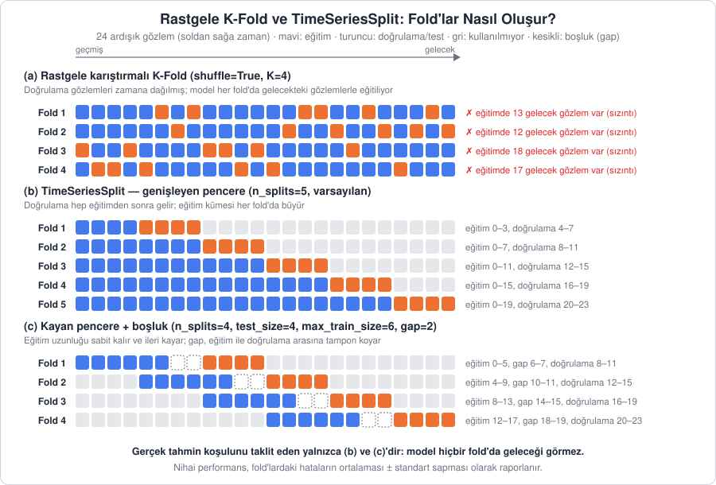

[İçindekiler](../Course_notes.md) · [← 15. Derin Öğrenme ile Tahmin: LSTM, GRU ve 1D-CNN](15_derin_ogrenme_ile_tahmin_lstm_gru_ve_1d_cnn.md) · [17. Zaman Serisi Tahmininde 10 Altın Kural →](17_zaman_serisi_tahmininde_10_altin_kural.md)

## 16. TimeSeriesSplit: Zaman Serisinde Çapraz Doğrulama

Bölüm 8'de modeli eğitim ve test olarak ikiye ayırıp hata metrikleriyle değerlendirdik. Bölüm 15'te beş modeli aynı 60 aylık test dönemi üzerinden karşılaştırdık. Her iki durumda da sonuç **tek bir** test dönemine dayanıyordu. O dönem bir model için "şanslı", öteki için "şanssız" olabilir: Test dönemine denk gelen bir kriz, bir tatil kayması ya da olağandışı bir yıl sıralamayı tek başına değiştirebilir.

Makine öğrenmesinde bu sorunun standart çözümü **çapraz doğrulamadır (cross-validation)**: Veri birkaç kez farklı biçimlerde bölünür, model her bölmede yeniden eğitilir ve performans bölmelerin ortalaması olarak raporlanır. Ancak alışılmış çapraz doğrulama zaman serisinde doğrudan kullanılamaz. Bu bölümde nedenini ve doğru yöntemi, `TimeSeriesSplit`'i ele alıyoruz.

### 16.1. Neden Rastgele K-Fold Zaman Serisinde Yanlıştır?

**Tanım (K-fold çapraz doğrulama):** Veri $K$ eşit parçaya (fold) bölünür. Her turda bir parça doğrulama, kalan $K-1$ parça eğitim için kullanılır. $K$ turun hatalarının ortalaması modelin performans tahminidir. Genellikle bölmeden önce veri **rastgele karıştırılır** (`shuffle=True`). Dikkat: `cross_val_score(..., cv=5)` gibi bir **tamsayı** verildiğinde scikit-learn regresyonda karıştırmasız `KFold` kullanır; bu bölme de zaman serisinde geleceği eğitime sızdırır (Hemen deneyin 16.4b).

Burada $K$ yalnızca parça (fold) sayısını gösteren bir harftir. Örneğin 100 gözlem ve $K = 5$ için her parça 20 gözlemdir. 1. turda 1. parça doğrulamaya ayrılır ve model kalan $5 - 1 = 4$ parçayla (80 gözlem) eğitilir; 2. turda 2. parça doğrulamaya ayrılır, ve böyle devam eder. 5 tur sonunda her gözlem tam bir kez doğrulamada yer almış olur. Turların hataları 10, 12, 9, 11 ve 13 çıktıysa performans tahmini $(10 + 12 + 9 + 11 + 13) / 5 = 55 / 5 = 11$ olur.

Bu yöntem, gözlemlerin birbirinden bağımsız olduğu tablo verilerinde (ör. farklı hastalar, farklı müşteriler) sorunsuz çalışır. Zaman serisinde ise iki temel sorun doğurur:

1. **Gelecekten sızıntı (look-ahead leakage):** Karıştırılmış bir fold'da model, örneğin 1958 ve 1960 verileriyle eğitilip 1955'i "tahmin eder". Bu gerçek hayatta asla mümkün değildir; 2010 verisiyle 2008'i tahmin etmek istemeyiz. Model, geleceğe ait trend düzeyini zaten öğrendiği için doğrulama hatası yapay olarak düşük çıkar.
2. **Otokorelasyon nedeniyle komşu sızıntısı:** Zaman serisinde ardışık gözlemler birbirine çok benzer (Bölüm 6'daki ACF). 8.1.1'deki Mart örneğinde olduğu gibi model, doğrulamadaki bir ayı eğitimdeki komşularından neredeyse "okuyarak" tahmin eder. Gecikmeli özellikler (`lag_1`, `lag_2`, …) kullanıldığında sorun daha da belirginleşir: Bir satırın hedefi, başka bir satırın girdisidir.

**Günlük hayattan bir örnek:** Rastgele K-fold, bir futbol yorumcusunu sezonun ortasındaki maçları tahmin etmeye çağırıp ona sezon sonu puan tablosunu da vermeye benzer. Kim şampiyon oldu, kim küme düştü bildiği için tahminleri harika görünür; ama gerçek bir sezon başında bu tablo elinde olmayacaktır. Benzetmenin sınırı: Puan tablosu yalnızca 1. sorunu (gelecekten sızıntı) anlatır; 2. sorundaki sızıntı, tahmin edilen maçın hemen öncesi ve sonrasındaki komşu maçlardan (otokorelasyon) gelir.

> **Hemen deneyin 16.1a · Rastgele K-fold'da "gelecekten gelen" ayları sayın** (Python, ~3 dk)
>
> 12 aylık bir dizide rastgele K-fold ile `TimeSeriesSplit`'in fold'larını yan yana yazdırın ve her fold'un eğitim kümesinde, doğrulamanın ilk ayından **sonra** gelen kaç ay olduğunu sayın.
>
> ```python
> import numpy as np
> from sklearn.model_selection import KFold, TimeSeriesSplit
>
> X = np.arange(12).reshape(-1, 1)            # 12 ay: 0, 1, ..., 11
> for ad, cv in [("KFold", KFold(n_splits=4, shuffle=True, random_state=0)),
>                ("TSS  ", TimeSeriesSplit(n_splits=4))]:
>     for k, (tr, te) in enumerate(cv.split(X), 1):
>         gelecek = (tr > te.min()).sum()     # doğrulamanın ilk ayından SONRA gelen eğitim ayları
>         print(f"{ad} {k}: doğrulama {te}  eğitimde gelecekten {gelecek} ay")
> ```
>
> `KFold(..., shuffle=True, random_state=0)` veriyi karıştırıp 4 parçaya böler; `random_state` herkesin aynı karışımı görmesini sağlar. `(tr > te.min())` her eğitim ayı için "doğrulamanın ilk ayından sonra mı?" sorusuna `True`/`False` cevabı verir; `.sum()` `True`'ları sayar.
>
> **Ne göreceksiniz:**
>
> ```text
> KFold 1: doğrulama [ 4  6 11]  eğitimde gelecekten 5 ay
> KFold 2: doğrulama [ 2  8 10]  eğitimde gelecekten 7 ay
> KFold 3: doğrulama [1 7 9]  eğitimde gelecekten 8 ay
> KFold 4: doğrulama [0 3 5]  eğitimde gelecekten 9 ay
> TSS   1: doğrulama [4 5]  eğitimde gelecekten 0 ay
> TSS   2: doğrulama [6 7]  eğitimde gelecekten 0 ay
> TSS   3: doğrulama [8 9]  eğitimde gelecekten 0 ay
> TSS   4: doğrulama [10 11]  eğitimde gelecekten 0 ay
> ```
>
> Rastgele K-fold'da doğrulama ayları zamana dağılır ve her fold'un eğitiminde 5–9 "gelecek" ay vardır (örneğin 4. fold'da 0. ay, 3 ve 5 dışındaki 1–11. aylar, yani 9 gelecek ay görülerek tahmin edilir). `TimeSeriesSplit`'te bu sayı her zaman 0'dır.
>
> **Şimdi siz:** `shuffle=True, random_state=0` kısmını silin (`KFold(n_splits=4)`). Karıştırma olmayınca sorun çözülür mü? Önce tahmin edin.
>
> <details><summary>Cevap</summary>
>
> Çözülmez. Doğrulama blokları artık bitişiktir (`[0 1 2]`, `[3 4 5]`, …), ama eğitimde gelecekten sırasıyla 9, 6, 3 ve 0 ay vardır. Yalnızca son fold zamana saygılıdır; ilk fold'da model 3–11. aylarla eğitilip 0–2. ayları "tahmin eder".
>
> </details>

Sonuç: Rastgele K-fold, zaman serisinde **gerçekte olduğundan çok daha iyi** görünen, iyimser performans tahminleri üretir. Bu tahminlere güvenerek seçilen model, kullanıma alındığında hayal kırıklığı yaratır.

Doğru değerlendirme **gerçek tahmin koşulunu taklit etmelidir**. Tahminin yapıldığı ana $t$ diyelim (ör. Aralık 1955'in sonu). Model, $t$ anına kadar olan veriyle eğitilir ve yalnızca $t$'den **sonraki** gözlemler üzerinde test edilir. Bu işlem farklı $t$ noktaları için tekrarlanır. Literatürde bu yaklaşıma **kayan başlangıç noktası (rolling origin)** ya da **ileriye doğru yürüyen doğrulama (walk-forward validation)** denir.



*Şekil 16.1 — (a) Rastgele K-fold'da doğrulama gözlemleri (turuncu) zamana dağılır ve her fold'un eğitim kümesinde doğrulamadan sonraki gözlemler bulunur. (b) TimeSeriesSplit'te doğrulama her zaman eğitimden sonra gelir ve eğitim kümesi genişler. (c) Kayan pencere varyantında eğitim uzunluğu sabittir; `gap` eğitim ile doğrulama arasına tampon koyar.*

> **Hemen deneyin 16.1b · İyimserliği sayıyla görün** (Python, ~4 dk)
>
> Aynı model ve aynı özelliklerle (12 gecikme) AirPassengers'ta rastgele K-fold ile `TimeSeriesSplit`'in verdiği hatayı karşılaştırın. Kodu depo kök dizininden çalıştırın (Colab'da dosya yolu yerine depo bağlantısını kullanın: `https://raw.githubusercontent.com/erkanozhan/AI_Based_Time_Series-Data_Analytics/main/data/AirPassengers.csv`).
>
> ```python
> import numpy as np, pandas as pd
> from sklearn.ensemble import RandomForestRegressor
> from sklearn.model_selection import KFold, TimeSeriesSplit, cross_val_score
>
> s = pd.read_csv("data/AirPassengers.csv")["Passengers"]
> X = pd.DataFrame({f"lag_{l}": s.shift(l) for l in range(1, 13)}).dropna()  # 12 gecikme
> y = s.loc[X.index]                                                          # 132 satır
> model = RandomForestRegressor(n_estimators=200, random_state=0)
> for ad, cv in [("Rastgele KFold ", KFold(n_splits=5, shuffle=True, random_state=0)),
>                ("TimeSeriesSplit", TimeSeriesSplit(n_splits=5))]:
>     rmse = -cross_val_score(model, X, y, cv=cv, scoring="neg_root_mean_squared_error")
>     print(f"{ad} ortalama RMSE: {rmse.mean():6.2f}   fold'lar: {np.round(rmse, 1)}")
> ```
>
> `RandomForestRegressor` 200 karar ağacının tahminlerinin ortalamasını alan bir ağaç modelidir (Bölüm 13'teki XGBoost'un akrabası). `cross_val_score` her fold'da modeli sıfırdan eğitip doğrulama puanını döndürür. scikit-learn "büyük puan iyidir" kuralıyla çalıştığı için RMSE'yi eksi işaretli verir; baştaki `-` bunu düzeltir. `{... for l in range(1, 13)}` 12 sütunu (`lag_1` … `lag_12`) tek satırda üretir.
>
> **Ne göreceksiniz:**
>
> ```text
> Rastgele KFold  ortalama RMSE:  19.65   fold'lar: [18.4 22.3 18.8 18.6 20.2]
> TimeSeriesSplit ortalama RMSE:  41.15   fold'lar: [33.7 26.  46.2 47.5 52.2]
> ```
>
> Aynı model, rastgele K-fold'a göre yaklaşık iki kat daha iyi görünüyor. Bu "başarı" gerçek değildir: Karıştırılmış fold'larda model, doğrulama yılının hem öncesini hem sonrasını görür ve trendin düzeyini önceden bilir. Gerçek kullanımda beklenecek hata `TimeSeriesSplit`'in 41 civarındaki değeridir.
>
> **Şimdi siz:** Rastgele K-fold'u karıştırmasız hâle getirin (`KFold(n_splits=5)`). Ortalama RMSE iki sonucun arasında mı kalır? Hangi fold'lar kötüleşir?
>
> <details><summary>Cevap</summary>
>
> Ortalama 32.01 çıkar, fold'lar `[40.8 20.6 26.3 24.1 48.2]`. İlk fold (Ocak 1950–Mart 1952, yalnızca sonraki yıllarla eğitilmiş) ve son fold (Kasım 1958–Aralık 1960, ağaçların eğitimde görmediği rekor düzeyler) kötüleşir; aradaki fold'lar ise iki yanındaki komşu yıllardan "okuyarak" iyimser kalır. Karıştırmamak tek başına yetmez; doğrulama her zaman eğitimden sonra gelmelidir.
>
> </details>

### 16.2. Genişleyen Pencere ve Kayan Pencere Doğrulaması

Zamana saygılı çapraz doğrulamanın iki temel biçimi vardır. Günlük hayattan bir benzetmeyle: **Genişleyen pencere**, her yeni tahminde doğduğunuz günden bu yana tuttuğunuz bütün günlükleri yeniden okumaktır; okunacak sayfa sayısı her seferinde artar. **Kayan pencere** ise yalnızca son altı ayın günlüklerini okumaktır; yeni bir ay eklendiğinde en eski ay rafa kaldırılır ve okunan miktar hep aynı kalır. (Bölüm 12.1.1'deki model girdi penceresiyle karıştırmayın: Burada pencere, eğitim verisinin uzunluğudur.)

Bunu kesin olarak yazmak için birkaç harf kullanacağız. $n$ gözlemli bir seride $k$. fold'un doğrulama kümesi $t_k$ anından hemen sonra başlayan $h$ gözlemden oluşsun.

**Tanım 1 (Genişleyen pencere, expanding window):** $k$. fold'da eğitim kümesi serinin başından $t_k$'ye kadar olan tüm gözlemlerdir:

```math
\text{Eğitim}_k = \underbrace{\lbrace 1, \dots, t_k \rbrace}_{\substack{\text{serinin başından}\\t_k\text{ anına kadar}}}, \quad \text{Doğrulama}_k = \underbrace{\lbrace t_k + 1, \dots, t_k + h \rbrace}_{\substack{t_k\text{ anından sonraki}\\h\text{ gözlem}}}, \quad \overbrace{t_1 < t_2 < \dots < t_K}^{\substack{\text{başlangıç noktaları}\\\text{ileri kayar}}}
```

**Nasıl okunur?** "Eğitim alt k eşittir, birden t alt k'ya kadar olan küme; doğrulama alt k eşittir, t alt k artı birden t alt k artı h'ye kadar olan küme; t bir küçüktür t iki küçüktür … küçüktür t alt büyük K." Yani: Eğitim her fold'da serinin ilk gözleminden başlar ve fold ilerledikçe uzar.

**Tanım 2 (Kayan pencere, sliding / rolling window):** Eğitim kümesi sabit uzunlukta, $m$ gözlemdir ve fold'lar ilerledikçe pencere ileri kayar:

```math
\text{Eğitim}_k = \underbrace{\lbrace \overbrace{t_k - m + 1}^{\text{pencerenin başı}}, \dots, t_k \rbrace}_{\substack{\text{yalnızca son m gözlem}\\\text{(pencere ileri kayar)}}}, \quad \text{Doğrulama}_k = \underbrace{\lbrace t_k + 1, \dots, t_k + h \rbrace}_{\text{Tanım 1 ile aynı}}
```

**Nasıl okunur?** "Eğitim alt k eşittir, t alt k eksi m artı birden t alt k'ya kadar olan küme; doğrulama alt k eşittir, t alt k artı birden t alt k artı h'ye kadar olan küme." Yani: Pencerenin iki ucu da $t_k$ ile birlikte ileri kayar; uzunluğu hep $t_k - (t_k - m + 1) + 1 = m$ gözlemdir.

> **Simge notu:** $`\lbrace \dots \rbrace`$ *(küme parantezi)*: içine yazılan gözlem sıra numaralarının oluşturduğu küme; $`\lbrace 1, \dots, 12 \rbrace`$ "1'den 12'ye kadar bütün gözlemler" diye okunur, üç nokta aradaki sayıların atlandığını gösterir · $`k`$ *(küçük k)*: fold'un sıra numarası (1., 2., …) · $`K`$ *(büyük K)*: toplam fold sayısı · $`t_k`$ *(t k)*: $`k`$. fold'da eğitimin bittiği an (tahmin başlangıç noktası); alt indis $`k`$ bu anın hangi fold'a ait olduğunu söyler · $`t_1 < t_2 < \dots < t_K`$: her fold'un başlangıç noktası bir öncekinden daha ileridedir · $`h`$: doğrulama kümesinin uzunluğu (her doğrulama kümesi $`h`$ aylık bir dönemi kapsar; tahminlerin tek adımlı mı özyinelemeli mi yapıldığı ayrıca belirtilmelidir, bkz. Hemen deneyin 16.5b) · $`m`$: kayan penceredeki sabit eğitim uzunluğu · "Eğitim" ve "Doğrulama" yanındaki alt indis $`k`$: o kümelerin $`k`$. fold'a ait olduğu

**Sayısal örnek:** $n = 24$ gözlem, $K = 5$ fold ve $h = 4$ olsun. Fold'ların başlangıç noktaları $t_1 = 4$, $t_2 = 8$, $t_3 = 12$, $t_4 = 16$, $t_5 = 20$ olur. 3. fold'a bakalım ($t_3 = 12$):

- Genişleyen pencere: Eğitim $\lbrace 1, \dots, 12 \rbrace$ (12 gözlem), doğrulama $\lbrace 13, \dots, 16 \rbrace$, çünkü $t_3 + 1 = 13$ ve $t_3 + h = 12 + 4 = 16$.
- Kayan pencere, $m = 4$: Eğitim $\lbrace 12 - 4 + 1, \dots, 12 \rbrace = \lbrace 9, \dots, 12 \rbrace$ (4 gözlem), doğrulama yine $\lbrace 13, \dots, 16 \rbrace$.

Beşinci fold'da ($t_5 = 20$) genişleyen pencerenin eğitimi 20 gözleme çıkar, kayan pencereninki ise $\lbrace 17, \dots, 20 \rbrace$ olur ve yine 4 gözlemdir. Pencere boyu olarak $m = 4$'ün seçilmesi tesadüf değildir: İlk fold'un eğitimi $t_1 = 4$'te bittiği için seride o ana kadar yalnızca 4 gözlem vardır. $m$ bundan büyük seçilseydi (ör. $m = 6$), ilk fold'da $\lbrace 4 - 6 + 1, \dots, 4 \rbrace = \lbrace -1, \dots, 4 \rbrace$ gibi var olmayan gözlemler istenirdi; pencere ilk fold'larda dolmaz ve o fold'lar diğerlerinden daha az veriyle eğitilirdi. Bu yüzden kayan pencerede $m \le t_1$ olmalıdır; ya pencere daraltılır ya da daha uzun bir seri kullanılır. Genişleyen pencerenin bu beş fold'unu 16.3'teki kod çıktısının ilk bölümünde aynen göreceksiniz; tek fark, Python saymaya 0'dan başladığı için orada her sıra numarasının bir eksik yazılmasıdır (1–12 yerine 0–11, 13–16 yerine 12–15).

| Özellik | Genişleyen pencere | Kayan pencere |
| --- | --- | --- |
| Eğitim uzunluğu | Her fold'da büyür | Sabit ($`m`$) |
| Eski veriler | Hep kullanılır | Pencereden çıkınca unutulur |
| Uygun olduğu durum | Serinin yapısı zamanla fazla değişmiyorsa, veri azsa | Yapısal değişim (rejim değişikliği) varsa, eski veri yanıltıcıysa |
| Fold'lar arası karşılaştırma | İlk fold'lar az veriyle eğitildiği için daha kötü görünebilir | Her fold aynı miktarda veri gördüğü için daha dengeli |
| `TimeSeriesSplit` ayarı | Varsayılan | `max_train_size=m` |

> **Hemen deneyin 16.2a · Genişleyen ve kayan pencereyi tanımdan üretin** (Python, ~3 dk)
>
> Tanım 1 ve Tanım 2'yi (1'den sayan numaralarla) birkaç satırla uygulayın: $n = 20$, $K = 4$, $h = 3$, $m = 5$.
>
> ```python
> n, K, h, m = 20, 4, 3, 5          # gözlem, fold, doğrulama uzunluğu, kayan pencere boyu
> for k in range(1, K + 1):
>     t = n - (K - k + 1) * h       # t_k: bu fold'da eğitimin bittiği gözlem (1'den sayarak)
>     print(f"Fold {k}: genişleyen eğitim 1-{t:2d} ({t:2d} gözlem) | "
>           f"kayan eğitim {t - m + 1:2d}-{t:2d} ({m} gözlem) | doğrulama {t + 1:2d}-{t + h:2d}")
> ```
>
> $t_k$ formülü `TimeSeriesSplit`'in yaptığı gibi fold'ları sondan geriye yerleştirir: son doğrulama serinin son gözlemiyle biter.
>
> **Ne göreceksiniz:**
>
> ```text
> Fold 1: genişleyen eğitim 1- 8 ( 8 gözlem) | kayan eğitim  4- 8 (5 gözlem) | doğrulama  9-11
> Fold 2: genişleyen eğitim 1-11 (11 gözlem) | kayan eğitim  7-11 (5 gözlem) | doğrulama 12-14
> Fold 3: genişleyen eğitim 1-14 (14 gözlem) | kayan eğitim 10-14 (5 gözlem) | doğrulama 15-17
> Fold 4: genişleyen eğitim 1-17 (17 gözlem) | kayan eğitim 13-17 (5 gözlem) | doğrulama 18-20
> ```
>
> Genişleyen pencerede eğitim her fold'da $h = 3$ gözlem büyür; kayan pencerede hep 5 gözlemdir ve ileri kayar. Doğrulama her iki yöntemde de aynıdır.
>
> **Şimdi siz:** (1) İlk satırı metindeki örneğe çevirin: `n, K, h, m = 24, 5, 4, 4`. 3. ve 5. fold'u metinle karşılaştırın. (2) Sonra pencereyi büyütün: `m = 6`. 1. fold'da ne olur? Önce tahmin edin.
>
> <details><summary>Cevap</summary>
>
> (1) Üçüncü fold: genişleyen 1–12, kayan 9–12, doğrulama 13–16; beşinci fold: kayan 17–20, doğrulama 21–24. Metinle aynı. 1. fold'da iki pencere çakışır (ikisi de 1–4), çünkü $m = t_1 = 4$'tür. (2) 1. fold `kayan eğitim -1- 4` yazar: $t_1 = 4$ iken 6 gözlemlik pencere için yeterli geçmiş yoktur, formül var olmayan −1. ve 0. gözlemleri ister (metindeki $m \le t_1$ kuralı). Gerçekte kütüphane elde ne varsa onu kullanır: `TimeSeriesSplit(n_splits=5, test_size=4, max_train_size=6)` 1. fold'da yalnızca `[0 1 2 3]` (4 gözlem) verir, sonraki fold'larda 6'ya çıkar. Yani bu fold diğerlerinden daha az veriyle eğitilir ve hatası diğerleriyle tam karşılaştırılamaz.
>
> </details>

**Açıklama:** Her iki yöntemde de doğrulama kümesi **daima** eğitim kümesinden sonra gelir. Aradaki fark, eski bilginin ne kadar süre "hafızada" tutulduğudur. AirPassengers gibi kısa ve düzenli bir seride genişleyen pencere doğal tercihtir. Pazarlama politikası değişmiş bir satış serisinde ya da kriz öncesi ve sonrası davranışı farklı olan finansal bir seride kayan pencere daha gerçekçi olabilir.

> **Hemen deneyin 16.2b · Rejim değişikliğinde kayan pencere: Nil Nehri** (R, ~4 dk)
>
> Nil'in yıllık akışı (1871–1970) 1898 civarında belirgin biçimde düşer (eski Asvan barajının yapımına bu yıl başlanmıştır). "Tahmin = penceredeki değerlerin ortalaması" modelini genişleyen ve kayan pencereyle yürütün. `forecast` paketindeki `tsCV()` bu ileriye doğru yürüyen doğrulamayı tek satırda yapar: her yıl modeli o yıla kadarki veriyle kurar ve bir sonraki yılın hatasını kaydeder; `window` verilirse yalnızca son `window` gözlemi kullanır.
>
> ```r
> library(forecast)
> # meanf: tahmin = eğitim penceresindeki değerlerin ortalaması
> e_gen <- tsCV(Nile, meanf, h = 1)                # genişleyen pencere: tüm geçmiş
> e_kay <- tsCV(Nile, meanf, h = 1, window = 15)   # kayan pencere: yalnızca son 15 yıl
> ortak <- !is.na(e_gen) & !is.na(e_kay)           # ikisinin de hata ürettiği yıllar
> rmse <- function(e) sqrt(mean(e^2))
> round(c(genisleyen = rmse(e_gen[ortak]), kayan = rmse(e_kay[ortak])), 1)
> sum(ortak)
> ```
>
> Kayan pencere ilk yıllarda hata üretemez (`NA`), çünkü elinde henüz 15 yıl yoktur; adil olsun diye iki yöntemi yalnızca ortak yıllarda karşılaştırıyoruz. `!is.na(...)` "boş değil mi?" sorusunun cevabıdır, `&` iki koşulun birlikte sağlanmasını ister.
>
> **Ne göreceksiniz:**
>
> ```text
> genisleyen      kayan 
>      175.8      149.2 
> [1] 85
> ```
>
> 85 ortak yılda kayan pencerenin hatası belirgin biçimde küçüktür. Genişleyen pencerenin ortalaması 1898 öncesinin yüksek akışlarını (ortalama yaklaşık 1098) yıllarca taşır; oysa sonraki dönemin ortalaması yaklaşık 850'dir. Kayan pencere eski rejimi 15 yıl sonra "unutur".
>
> **Şimdi siz:** `window = 5` ve `window = 30` deneyin (her seferinde `e_kay` ve `ortak` satırlarını yeniden çalıştırın). Kayan pencere her iki durumda da kazanır mı? Hangi pencere boyu en iyisi?
>
> <details><summary>Cevap</summary>
>
> `window = 5`: genişleyen 174.5, kayan 153.2 (95 ortak yıl). `window = 30`: genişleyen 178.4, kayan 154.5 (70 ortak yıl). Kayan pencere hepsinde kazanır. Kayan pencerenin kendi hataları (153.2, 149.2, 154.5) birbirine yakındır; 15 yıl en düşüğünü verdi, ama her pencerenin ortak yılları farklı olduğu için bu kesin bir sıralama değildir. Genel kural: çok kısa pencere gürültüye fazla tepki verir, çok uzun pencere eski rejimi daha uzun taşır.
>
> </details>

### 16.3. `TimeSeriesSplit` Parametreleri

> **Uygulama dosyası:** [`Codes/python/ch16_timeseriessplit.py`](../Codes/python/ch16_timeseriessplit.py) · [Notebook](../Codes/notebooks/ch16_timeseriessplit.ipynb) · [](https://colab.research.google.com/github/erkanozhan/AI_Based_Time_Series-Data_Analytics/blob/main/Codes/notebooks/ch16_timeseriessplit.ipynb)
>
> Bu bölümdeki kodların tamamı bu dosyada. Bilgisayarınızda çalıştırmak için depo kök dizininde `python Codes/python/ch16_timeseriessplit.py` komutunu kullanın ya da dosyayı VS Code'da açıp hücre hücre çalıştırın. Kurulum yapmadan denemek için Colab bağlantısını kullanabilirsiniz.


scikit-learn'deki `TimeSeriesSplit` sınıfı, yukarıdaki iki yöntemi dört parametreyle uygular:

| Parametre | Varsayılan | Anlamı |
| --- | --- | --- |
| `n_splits` | 5 | Fold sayısı $`K`$ |
| `test_size` | `n // (n_splits + 1)` | Her doğrulama kümesinin uzunluğu $`h`$. Aylık veride 12 seçmek, her fold'u tam bir yılla test etmek demektir. |
| `gap` | 0 | Eğitimin sonu ile doğrulamanın başı arasında atlanan gözlem sayısı |
| `max_train_size` | `None` | Verilirse eğitim kümesi en fazla bu kadar son gözlemden oluşur (kayan pencere, $`m`$) |

Tablodaki `//` işareti Python'da **tam sayı bölmesidir**: Bölümün yalnızca tam kısmı alınır, küsurat atılır. 24 gözlem ve 5 fold için varsayılan doğrulama uzunluğu $24 / 6 = 4$; 131 gözlem için $131 / 6 = 21.83…$ olduğundan `131 // 6 = 21` olur. `None` "değer verilmedi" anlamına gelir; `max_train_size=None` eğitim uzunluğuna sınır konmadığını, yani genişleyen pencereyi gösterir.

```math
\underbrace{h}_{\substack{\text{doğrulama}\\\text{uzunluğu}}} = \underbrace{\big\lfloor n / (K + 1) \big\rfloor}_{\substack{\text{bölümün tam kısmı}\\\text{(Python'da //)}}}
```

**Nasıl okunur?** "h eşittir, n bölü K artı birin tam kısmı (aşağı yuvarlanmış değeri)." Burada n gözlem sayısı, K fold sayısıdır (`n_splits`). Yani: Seri $K + 1$ eşit parçaya bölünür; ilk parça (bölmeden artan gözlemlerle birlikte) yalnızca eğitimde kalır, kalan $K$ parçanın her biri sırayla bir fold'un doğrulama kümesi olur.

`TimeSeriesSplit` fold'ları serinin **sonundan geriye doğru** yerleştirir. Doğrulama kümelerinin toplamı $K \cdot h$ gözlemdir ve son doğrulama kümesi serinin son gözlemiyle biter. Bu yüzden ilk doğrulama kümesi $n - K \cdot h$ numaralı gözlemden başlar (Python'un 0'dan sayan numaralandırmasıyla). Her fold'un eğitimi ise doğrulamanın başlangıcından `gap` kadar önce biter.

**`gap` neden gerekir?** İki tipik durum vardır. Birincisi, gerçek hayatta verinin gecikmeli gelmesidir: Bu ayın satış raporu ancak iki ay sonra kesinleşiyorsa model, son iki ayı görmeden tahmin yapmak zorundadır. İkincisi, çok adımlı tahmindir: 3 ay sonrasını tahmin eden bir modelde, eğitimin son gözlemleriyle doğrulamanın ilk gözlemleri arasındaki güçlü otokorelasyon sonucu iyimser gösterebilir. `gap`, bu tamponu kurar.

Aşağıdaki kısa kod, 24 gözlemlik bir dizide üç farklı ayarın fold'larını yazdırır. Şekil 16.1'deki (b) ve (c) panelleri tam olarak bu çıktılardan çizilmiştir.

```python
import numpy as np
from sklearn.model_selection import TimeSeriesSplit

X = np.arange(24).reshape(-1, 1)   # 24 ardışık gözlem (ör. 2 yıllık aylık veri)

def show_folds(tscv, title):
    print(title)
    for k, (tr, te) in enumerate(tscv.split(X), 1):
        print(f"  Fold {k}: eğitim {tr.min():>2}-{tr.max():>2} ({len(tr):>2} gözlem)  "
              f"doğrulama {te.min():>2}-{te.max():>2}")

show_folds(TimeSeriesSplit(n_splits=5), "Genişleyen pencere (varsayılan):")
show_folds(TimeSeriesSplit(n_splits=3, test_size=4, gap=2), "Genişleyen pencere + gap=2:")
show_folds(TimeSeriesSplit(n_splits=4, test_size=4, max_train_size=6, gap=2),
           "Kayan pencere (max_train_size=6) + gap=2:")
```

Çıktı:

```text
Genişleyen pencere (varsayılan):
  Fold 1: eğitim  0- 3 ( 4 gözlem)  doğrulama  4- 7
  Fold 2: eğitim  0- 7 ( 8 gözlem)  doğrulama  8-11
  Fold 3: eğitim  0-11 (12 gözlem)  doğrulama 12-15
  Fold 4: eğitim  0-15 (16 gözlem)  doğrulama 16-19
  Fold 5: eğitim  0-19 (20 gözlem)  doğrulama 20-23
Genişleyen pencere + gap=2:
  Fold 1: eğitim  0- 9 (10 gözlem)  doğrulama 12-15
  Fold 2: eğitim  0-13 (14 gözlem)  doğrulama 16-19
  Fold 3: eğitim  0-17 (18 gözlem)  doğrulama 20-23
Kayan pencere (max_train_size=6) + gap=2:
  Fold 1: eğitim  0- 5 ( 6 gözlem)  doğrulama  8-11
  Fold 2: eğitim  4- 9 ( 6 gözlem)  doğrulama 12-15
  Fold 3: eğitim  8-13 ( 6 gözlem)  doğrulama 16-19
  Fold 4: eğitim 12-17 ( 6 gözlem)  doğrulama 20-23
```

Kod üç adımdan oluşur. `np.arange(24)` 0'dan 23'e kadar 24 tam sayı üretir; `reshape(-1, 1)` bunları tek sütunlu bir tabloya çevirir (her satır bir "gözlem", değeri de kendi sıra numarası olduğu için çıktıyı okumak kolaydır). `show_folds` fonksiyonu kendisine verilen ayarlı `TimeSeriesSplit` nesnesinin `split(X)` metodunu çağırır. `split`, her fold için iki dizi verir: eğitim satırlarının sıra numaraları (`tr`) ve doğrulama satırlarının sıra numaraları (`te`). Verinin kendisini değil, yalnızca hangi satırların hangi kümeye gideceğini söyler. `enumerate(..., 1)` fold'ları 1'den başlayarak numaralandırır. `tr.min()` ve `tr.max()` eğitim kümesinin ilk ve son sıra numarasını, `len(tr)` eleman sayısını verir. f-string içindeki `:>2` sayıyı iki karakterlik alana sağa yaslı yazar; tek basamaklı sayıların önüne boşluk gelmesinin nedeni budur.

**Çıktının yorumu:** Varsayılan ayarda `test_size = 24 // 6 = 4` olur ve fold'lar serinin **sonundan geriye doğru** yerleştirilir: son fold daima serinin son gözlemleriyle biter. İkinci ayarda 3 fold × 4 gözlem = 12 gözlem doğrulamaya gider; ilk doğrulama kümesi $24 - 3 \cdot 4 = 12$ numaralı gözlemde başlar. `gap=2` ile eğitimin son iki gözlemi atlanır: 1. fold'da doğrulama 12'de başladığı için 10 ve 11 numaralı gözlemler kullanılmaz ve eğitim 9'da biter. Üçüncü ayarda ilk doğrulama $24 - 4 \cdot 4 = 8$'de başlar; eğitim yine iki gözlem önce (5'te) biter. `max_train_size=6` ile eğitim kümesi her fold'da en son 6 gözlemle sınırlanır ve ileri kayar: 2. fold'da eğitim 9'da bittiği için $9 - 6 + 1 = 4$'ten başlar.

> **Not —** `TimeSeriesSplit` veriyi **sıralı** kabul eder; karıştırmaz ve tarihlere bakmaz. Bu yüzden veri çerçevesinin tarihe göre sıralı olduğundan ve (panel verilerde) her satırın tek bir zaman noktasına karşılık geldiğinden emin olun.

> **Hemen deneyin 16.3 · İndeksleri önce tahmin edin, sonra yazdırın** (Python, ~4 dk)
>
> 15 gözlemlik bir dizide `n_splits=3, test_size=3, gap=1` ayarının fold'larını **çalıştırmadan önce** kâğıda yazın (ipucu: ilk doğrulama $15 - 3 \cdot 3 = 6$'da başlar), sonra kontrol edin.
>
> ```python
> import numpy as np
> from sklearn.model_selection import TimeSeriesSplit
>
> X = np.arange(15).reshape(-1, 1)              # 15 gözlem: 0, 1, ..., 14
> tss = TimeSeriesSplit(n_splits=3, test_size=3, gap=1)
> for k, (tr, te) in enumerate(tss.split(X), 1):
>     print(f"Fold {k}: eğitim {tr}  doğrulama {te}")
> ```
>
> **Ne göreceksiniz:**
>
> ```text
> Fold 1: eğitim [0 1 2 3 4]  doğrulama [6 7 8]
> Fold 2: eğitim [0 1 2 3 4 5 6 7]  doğrulama [ 9 10 11]
> Fold 3: eğitim [ 0  1  2  3  4  5  6  7  8  9 10]  doğrulama [12 13 14]
> ```
>
> `gap=1` yüzünden her fold'da doğrulamadan hemen önceki gözlem (5, 8, 11) hiçbir kümeye girmez.
>
> **Şimdi siz:** Her birinin sonucunu önce tahmin edin: (1) aynı ayara `max_train_size=4` ekleyin; (2) yalnızca `TimeSeriesSplit(n_splits=4)` yazın (varsayılan `test_size` kaç olur?); (3) `TimeSeriesSplit(n_splits=5, test_size=3)` yazın.
>
> <details><summary>Cevap</summary>
>
> (1) Eğitim kümeleri son 4 gözlemle sınırlanır: `[1 2 3 4]`, `[4 5 6 7]`, `[7 8 9 10]`; doğrulamalar aynı kalır. (2) `test_size = 15 // 5 = 3`: eğitim `[0 1 2]` → doğrulama `[3 4 5]`, …, son fold eğitim 0–11 → doğrulama `[12 13 14]` (4 fold). (3) Hata: `ValueError: Too many splits=5 for number of samples=15 with test_size=3 and gap=0.` Beş doğrulama kümesi $5 \cdot 3 = 15$ gözlemin tamamını kaplar; eğitime hiçbir şey kalmaz.
>
> </details>

### 16.4. Her Fold'da Ön İşleme Yalnızca Eğitim Verisiyle Fit Edilmeli

Zamana saygılı bölmek tek başına yetmez. Veriyi dönüştüren **her** adım (ölçekleme, eksik değer doldurma, özellik seçimi, PCA gibi boyut indirgeme yöntemleri vb.) yalnızca o fold'un eğitim kümesinden öğrenilmelidir. Aksi hâlde sızıntı bölme yoluyla değil, ön işleme yoluyla gerçekleşir.

**Açıklama:** 12.1.4'te (ve 15.1.1'de) gördüğümüz ölçekleme sızıntısı her fold'da yeniden ortaya çıkabilir. `MinMaxScaler` döngüden önce **tüm seriyle** fit edilirse, aşağıdaki kodun 1. fold'unda (eğitim 1949–1955) eğitimin en büyük değeri olan 364, 1'e değil $(364 - 104) / (622 - 104) = 260 / 518 \approx 0.50$'ye gider ve model "ölçeğin geri kalanı ileride dolacak" bilgisini dolaylı olarak almış olur. Doğru sıra şudur:

1. Fold'u böl: `train_idx`, `val_idx`.
2. Ölçekleyiciyi **yalnızca** `train_idx` ile `fit` et.
3. Aynı ölçekleyiciyle hem eğitim hem doğrulama verisini `transform` et.
4. Modeli eğit, doğrulamada tahmin yap, tahmini `inverse_transform` ile orijinal ölçeğe döndür ve hatayı hesapla.

Aşağıdaki kod bu kalıbı Bölüm 15.3'teki GRU modeliyle uygular. Her fold'da doğrulama kümesi tam bir yıldır (`test_size=12`).

```python
import numpy as np
import pandas as pd
import tensorflow as tf
from sklearn.preprocessing import MinMaxScaler
from sklearn.metrics import mean_squared_error
from sklearn.model_selection import TimeSeriesSplit
from tensorflow.keras.models import Sequential
from tensorflow.keras.layers import Input, GRU, Dense

SEED = 42
tf.keras.utils.set_random_seed(SEED)   # Python, NumPy ve TensorFlow tohumları

df = pd.read_csv('data/AirPassengers.csv', parse_dates=['Month'], index_col='Month')
if '#Passengers' in df.columns:
    df.rename(columns={'#Passengers': 'Passengers'}, inplace=True)
values = df['Passengers'].values.astype('float32').reshape(-1, 1)

look_back = 12

def create_dataset(sequence, look_back=1):
    """Kayan pencere (Bölüm 15.1): look_back geçmiş değer girdi, sonraki değer hedef."""
    X, y = [], []
    for i in range(len(sequence) - look_back):
        X.append(sequence[i:(i + look_back), 0])
        y.append(sequence[i + look_back, 0])
    return np.array(X), np.array(y)

tscv = TimeSeriesSplit(n_splits=5, test_size=12)
fold_rmse = []

for k, (train_idx, val_idx) in enumerate(tscv.split(values), 1):
    # 1) Ölçekleyici YALNIZCA bu fold'un eğitim gözlemleriyle fit edilir
    scaler = MinMaxScaler(feature_range=(0, 1))
    scaler.fit(values[train_idx])
    scaled = scaler.transform(values)   # dönüşüm tüm seriye uygulanabilir; öğrenilen min/max yalnızca eğitimden

    # 2) Pencereler: i. örneğin hedefi serinin (i + look_back). gözlemidir
    X_all, y_all = create_dataset(scaled, look_back)
    target_idx = np.arange(look_back, len(values))
    tr_mask = target_idx <= train_idx[-1]      # hedefi eğitim döneminde olanlar
    va_mask = np.isin(target_idx, val_idx)     # hedefi doğrulama döneminde olanlar
    X_tr = X_all[tr_mask].reshape(-1, look_back, 1)
    X_va = X_all[va_mask].reshape(-1, look_back, 1)
    y_tr, y_va = y_all[tr_mask], y_all[va_mask]

    # 3) Her fold'da SIFIRDAN yeni bir model (önceki fold'un ağırlıkları taşınmaz)
    model = Sequential([Input(shape=(look_back, 1)), GRU(50), Dense(1)])
    model.compile(loss='mean_squared_error', optimizer='adam')
    model.fit(X_tr, y_tr, epochs=100, batch_size=8, verbose=0)

    # 4) Tahmini orijinal ölçeğe döndürüp hatayı hesapla
    pred = scaler.inverse_transform(model.predict(X_va, verbose=0))
    true = scaler.inverse_transform(y_va.reshape(-1, 1))
    rmse = np.sqrt(mean_squared_error(true, pred))
    fold_rmse.append(rmse)
    print(f"Fold {k}: eğitim {df.index[train_idx[0]]:%Y-%m} - {df.index[train_idx[-1]]:%Y-%m}, "
          f"doğrulama {df.index[val_idx[0]]:%Y-%m} - {df.index[val_idx[-1]]:%Y-%m}, RMSE = {rmse:.2f}")

print(f"\nGRU çapraz doğrulama RMSE: {np.mean(fold_rmse):.2f} ± {np.std(fold_rmse):.2f}")
```

Kodun 15. bölümden farklı olan kısımları döngünün içindedir. Ayrıca burada `batch_size=8` kullanılır (15.3'te 1); bu, her fold'daki eğitimi hızlandırır:

1. `read_csv` satırı Hemen deneyin 13.1.1'deki gibidir; `rename`, bazı kopyalardaki `#Passengers` adını `Passengers` yapar.
2. `TimeSeriesSplit(n_splits=5, test_size=12)` 144 aylık seride son $5 \cdot 12 = 60$ ayı beş yıllık doğrulama dilimine ayırır; ilk doğrulama dilimi $144 - 60 = 84$ numaralı gözlemde, yani Ocak 1956'da başlar. `tscv.split(values)` her turda `train_idx` (eğitim aylarının sıra numaraları) ve `val_idx` (doğrulama aylarının sıra numaraları) verir.
3. Her turda **yeni** bir `MinMaxScaler` oluşturulur ve yalnızca `values[train_idx]` ile fit edilir. Dönüşüm tüm seriye uygulanır; bu bir sızıntı değildir, çünkü kullanılan en küçük ve en büyük değerler yalnızca eğitim aylarından öğrenilmiştir.
4. Pencereler bütün seriden bir kez kurulur; sonra her pencerenin hedefinin hangi aya düştüğüne bakılarak ayrılır. `target_idx = np.arange(12, 144)` her pencerenin hedef ayının sıra numarasıdır (1. pencerenin hedefi 12. ay, …). `target_idx <= train_idx[-1]` her pencere için "hedefi eğitimin son ayında ya da öncesinde mi?" sorusunu sorar ve `True`/`False` değerlerinden oluşan bir **maske** üretir. `train_idx[-1]` eğitimin son ayının numarasıdır (`[-1]` "sondan birinci eleman"). `np.isin(target_idx, val_idx)` ise "hedefi doğrulama aylarından biri mi?" sorusunun maskesidir. `X_all[tr_mask]` yalnızca maskesi `True` olan satırları seçer.
5. Her fold'da model **sıfırdan** kurulur. Önceki fold'un ağırlıklarıyla devam etmek, o fold'un doğrulama yılını görmüş bir modelle başlamak, yani sızıntı olurdu.
6. Tahminler ve gerçek değerler `inverse_transform` ile yolcu sayısına çevrilir, RMSE hesaplanır ve `fold_rmse` listesine eklenir. `{df.index[train_idx[0]]:%Y-%m}` biçimi bir tarihi "yıl-ay" olarak yazar.
7. Son satır beş RMSE'nin **ortalamasını** (`np.mean`) ve **standart sapmasını** (`np.std`, Bölüm 2.2) yazdırır; `np.std` burada farkların karelerini n'e böler (n − 1'e değil).

Bizim çalıştırmamızda çıktı şöyle oldu (GRU'nun rastgele başlangıcı yüzünden sizin sayılarınız birkaç birim farklı olabilir; tarih aralıkları ise hep aynıdır):

```text
Fold 1: eğitim 1949-01 - 1955-12, doğrulama 1956-01 - 1956-12, RMSE = 31.67
Fold 2: eğitim 1949-01 - 1956-12, doğrulama 1957-01 - 1957-12, RMSE = 25.72
Fold 3: eğitim 1949-01 - 1957-12, doğrulama 1958-01 - 1958-12, RMSE = 33.82
Fold 4: eğitim 1949-01 - 1958-12, doğrulama 1959-01 - 1959-12, RMSE = 40.78
Fold 5: eğitim 1949-01 - 1959-12, doğrulama 1960-01 - 1960-12, RMSE = 28.84

GRU çapraz doğrulama RMSE: 32.17 ± 5.09
```

Ortalama $(31.67 + 25.72 + 33.82 + 40.78 + 28.84) / 5 = 160.83 / 5 \approx 32.17$'dir. ± işaretinin ("artı eksi") sağındaki 5.09 standart sapmadır ve fold hatalarının ortalamanın çevresinde tipik olarak 5 birim kadar dağıldığını söyler.

```math
\underbrace{\overline{\text{RMSE}}}_{\substack{\text{çapraz doğrulama}\\\text{sonucu}}} = \overbrace{\frac{1}{K}\sum_{k=1}^{K}}^{\text{K fold'un ortalaması}} \underbrace{\text{RMSE}_k}_{\substack{\text{k. fold'un}\\\text{doğrulama hatası}}}, \qquad \text{rapor: } \overline{\text{RMSE}} \pm \underbrace{\sigma}_{\substack{\text{fold hatalarının}\\\text{standart sapması}}}
```

**Nasıl okunur?** "RMSE bar eşittir, bir bölü K çarpı, k eşittir birden K'ya kadar RMSE alt k'ların toplamı; rapor edilen değer RMSE bar artı eksi sigma." Burada sigma, fold hatalarının Bölüm 2.2'deki standart sapmasıdır (`np.std`).

**Çıktının yorumu:** Beş fold, 1956'dan 1960'a kadar her yılı ayrı ayrı test eder ve eğitim kümesi her fold'da bir yıl büyür (genişleyen pencere). Fold'ların RMSE değerleri birbirinden belirgin biçimde farklıdır: En kolay yıl (1957) ile en zor yıl (1959) arasında 15 birimden fazla fark vardır. Yolcu sayısı ve mevsimsel dalgalanmalar yıllar içinde büyüdüğü için son yıllarda hata büyüme eğilimindedir, ama bu artış düzenli değildir; bir yılın kolay ya da zor olması o yılın kendine özgü hareketlerine de bağlıdır. Bu nedenle performansı tek bir sayı olarak değil, **ortalama ± standart sapma** olarak raporlamak gerekir. Standart sapmanın büyük olması, modelin dönemden döneme kararsız olduğunu gösterir. İki modeli karşılaştırırken aradaki fark bu standart sapmadan küçükse, "biri diğerinden daha iyi" demek için yeterli kanıt yoktur. Daha doğru bir kontrol, her fold'daki farka (model A − model B) bakmaktır; farkların çoğu aynı işaretteyse üstünlük daha inandırıcıdır. Yalnızca 1956'yı test etseydik (Fold 1) bu modelin hatasını 31.67 sanacaktık; yalnızca 1959'u test etseydik 40.78. Hangisinin "doğru" olduğunu tek bir dönemle bilemeyiz.

**Günlük hayattan bir örnek:** Bir basketbolcuyu tek maçtaki sayısıyla değil, sezon ortalaması ve skorunun maçtan maça ne kadar dalgalandığıyla değerlendiririz. Ortalama 30 sayı atan oyuncu bir maçta 15, ötekinde 45 atıyorsa tek maça bakarak "en iyisi" demek yanıltır. Fold'ların RMSE'leri de o modelin maç maç skorlarıdır.

> **Not —** Aynı ilke hiperparametre seçimi ve erken durdurma için de geçerlidir. Erken durdurmada izlenen doğrulama kümesi, hatası raporlanan fold'un kendisiyse sonuç yine iyimser olur: Model tam da o dönemde en iyi göründüğü noktada durdurulmuş olur. Doğrusu, erken durdurma için fold'un **eğitim** kısmının sonundan ayrı bir iç doğrulama dilimi ayırmaktır; 16.5'teki GRU bunu uygular. Ağaç tabanlı modellerde ölçekleme gerekmez, ancak gecikme ve hareketli ortalama gibi özelliklerin yalnızca geçmiş değerlerden (`shift(1)` ile) üretildiğinden emin olmak gerekir. scikit-learn'de ön işlemeyi `Pipeline` içine koymak, `fit` işleminin her fold'da otomatik olarak yalnızca eğitim verisiyle yapılmasını garanti eder.

> **Hemen deneyin 16.4 · Ölçekleyici fold içinde mi, dışında mı?** (Python, ~4 dk)
>
> Ölçekleyiciyi bir kez döngüden önce tüm seriyle (yanlış), bir kez de her fold'da yalnızca eğitimle (doğru) fit edin; eğitim ve doğrulama kümelerinin ölçeklenmiş en büyük değerlerine bakın.
>
> ```python
> import pandas as pd
> from sklearn.model_selection import TimeSeriesSplit
> from sklearn.preprocessing import MinMaxScaler
>
> v = pd.read_csv("data/AirPassengers.csv")["Passengers"].values.astype(float).reshape(-1, 1)
> disarida = MinMaxScaler().fit(v)               # YANLIŞ: döngüden önce, tüm seriyle
> for k, (tr, va) in enumerate(TimeSeriesSplit(n_splits=5, test_size=12).split(v), 1):
>     icerde = MinMaxScaler().fit(v[tr])         # DOĞRU: yalnızca bu fold'un eğitimiyle
>     print(f"Fold {k}: eğitim maks  içeride {icerde.transform(v[tr]).max():.2f}  "
>           f"dışarıda {disarida.transform(v[tr]).max():.2f}  |  doğrulama maks  "
>           f"içeride {icerde.transform(v[va]).max():.2f}  dışarıda {disarida.transform(v[va]).max():.2f}")
> ```
>
> **Ne göreceksiniz:**
>
> ```text
> Fold 1: eğitim maks  içeride 1.00  dışarıda 0.50  |  doğrulama maks  içeride 1.19  dışarıda 0.60
> Fold 2: eğitim maks  içeride 1.00  dışarıda 0.60  |  doğrulama maks  içeride 1.17  dışarıda 0.70
> Fold 3: eğitim maks  içeride 1.00  dışarıda 0.70  |  doğrulama maks  içeride 1.10  dışarıda 0.77
> Fold 4: eğitim maks  içeride 1.00  dışarıda 0.77  |  doğrulama maks  içeride 1.13  dışarıda 0.88
> Fold 5: eğitim maks  içeride 1.00  dışarıda 0.88  |  doğrulama maks  içeride 1.14  dışarıda 1.00
> ```
>
> Doğru ölçeklemede eğitim hep 1.00'de biter ve doğrulama yılı 1'in üzerine taşar (1.10–1.19): Model gerçek hayattaki gibi "yeni rekor" görür. Yanlış ölçeklemede 1. fold'un eğitimi 0.50'de kalır; doğrulama bile 0.60'ı geçmez. Model "ölçeğin yarısı boş, seri büyüyecek" bilgisini fold'u görmeden almış olur. Metindeki $260 / 518 \approx 0.50$ hesabının aynısı.
>
> **Şimdi siz:** "Dışarıda" sütununda hiçbir değer 1'i geçmiyor. Neden? Bu, gelecek hakkında modelin bilmemesi gereken hangi bilgiyi verir?
>
> <details><summary>Cevap</summary>
>
> Dışarıdaki ölçekleyici serinin tamamındaki en büyük değeri (Temmuz 1960, 622) 1'e eşitlemiştir; hiçbir gözlem bundan büyük olamaz. Yani her fold, serinin ileride ulaşacağı en yüksek düzeyi önceden "biliyor": 1. fold'da 0.50 ile 1 arasında kalan boş aralık, model 1956'yı tahmin ederken yolcu sayısının 1960'a kadar eğitimdeki rekorun yaklaşık 1.7 katına (364'ten 622'ye) çıkacağının ipucudur. Fold 5'te iki sütunun doğrulama maksimumu farklıdır (1.14 ve 1.00), çünkü içerideki ölçekleyici 1960'ı görmemiştir.
>
> </details>

> **Hemen deneyin 16.4b · Ölçekleyiciyi bir `Pipeline` içinde fold'a bırakın** (Python, ~3 dk)
>
> Ölçekleyici ile modeli `make_pipeline` ile tek bir nesnede birleştirince, `cross_val_score` ölçekleyiciyi her fold'da yalnızca o fold'un eğitim kısmıyla fit eder.
>
> ```python
> import numpy as np, pandas as pd
> from sklearn.pipeline import make_pipeline
> from sklearn.preprocessing import MinMaxScaler
> from sklearn.linear_model import Ridge
> from sklearn.model_selection import TimeSeriesSplit, cross_val_score, cross_validate
> s = pd.read_csv("data/AirPassengers.csv")["Passengers"]
> X = pd.DataFrame({f"lag_{l}": s.shift(l) for l in range(1, 13)}).dropna()   # 12 gecikme
> y = s.loc[X.index]
> model = make_pipeline(MinMaxScaler(), Ridge(alpha=1.0))
> for ad, cv in [("cv=5           ", 5), ("TimeSeriesSplit", TimeSeriesSplit(n_splits=5, test_size=12))]:
>     rmse = -cross_val_score(model, X, y, cv=cv, scoring="neg_root_mean_squared_error")
>     print(f"{ad} ortalama RMSE: {rmse.mean():6.2f}   fold'lar: {np.round(rmse, 1)}")
> sonuc = cross_validate(model, X, y, cv=TimeSeriesSplit(n_splits=5, test_size=12), return_estimator=True)
> for k, est in enumerate(sonuc["estimator"], 1):
>     print(f"Fold {k}: ölçekleyicinin gördüğü en büyük lag_1 = {est.named_steps['minmaxscaler'].data_max_[0]:.0f}")
> ```
>
> **Ne göreceksiniz:**
>
> ```text
> cv=5            ortalama RMSE:  20.28   fold'lar: [10.6 17.1 19.9 25.4 28.4]
> TimeSeriesSplit ortalama RMSE:  24.98   fold'lar: [18.5 21.2 31.5 26.9 26.8]
> Fold 1: ölçekleyicinin gördüğü en büyük lag_1 = 364
> Fold 2: ölçekleyicinin gördüğü en büyük lag_1 = 413
> Fold 3: ölçekleyicinin gördüğü en büyük lag_1 = 467
> Fold 4: ölçekleyicinin gördüğü en büyük lag_1 = 505
> Fold 5: ölçekleyicinin gördüğü en büyük lag_1 = 559
> ```
>
> Ölçekleyicinin her fold'da gördüğü en büyük değer, yalnızca o fold'un eğitim dönemindeki rekordur; doğrulama yılının değerleri ölçeklemeye karışmaz. İlk satır ayrıca önemli bir tuzağı gösterir: `cv=5` gibi bir **tamsayı** verildiğinde scikit-learn regresyonda karıştırmasız `KFold` kullanır. Bu bölmede de modelin eğitim kümesi doğrulama döneminden sonraki ayları içerir; sonuç bu yüzden iyimserdir (20.28'e karşı 24.98). Zaman serisinde `cv` parametresine her zaman `TimeSeriesSplit(...)` nesnesi verilmelidir.

### 16.5. Uygulama: GRU ve XGBoost'u Aynı Fold'larda Karşılaştırmak

Bu bölümün mesajı, bir modeli tek bir dönemle değerlendirmenin yanıltabileceğidir. Aynı mesaj iki modeli **karşılaştırırken** de geçerlidir. Bu uygulamada Bölüm 15.3'teki GRU, Bölüm 13'teki XGBoost ve referans olarak mevsimsel naive (Bölüm 8), 16.4'teki beş fold'un **aynısında** değerlendirilir: 1956'dan 1960'a kadar her yıl ayrı bir doğrulama dilimidir. Fold'ların aynı olması şarttır, çünkü farklı yıllarda ölçülen hatalar birbiriyle karşılaştırılamaz (bkz. Bölüm 15'in sonundaki test dönemleri tablosu).

Programın tamamı (yaklaşık 310 satır) uygulama dosyasındadır; aşağıda kilit satırlar yer alıyor. Dosya ayrıca her fold'un MAE ve MAPE değerlerini hesaplar, fold başına RMSE'yi ve 1956–1960 tahminlerini çizer.

```python
# GRU + XGBoost aynı fold'larda — kilit satırlar (tam kod: Codes/python/ch16_timeseriessplit.py)
tscv = TimeSeriesSplit(n_splits=5, test_size=12)
folds = list(tscv.split(values))       # fold'lar BİR KEZ belirlenir; üç yöntem de bu listeyi kullanır

for k, (train_idx, val_idx) in enumerate(folds, 1):
    # GRU: ölçekleyici, pencereler ve maskeler 16.4'teki gibi kurulur (X_tr, y_tr, X_va)
    # Kaç epoch? Fold eğitiminin son 12 penceresi iç doğrulama olur
    model = build_gru_model(look_back)
    history = model.fit(X_tr[:-inner_val], y_tr[:-inner_val], epochs=200, batch_size=8,
                        validation_data=(X_tr[-inner_val:], y_tr[-inner_val:]),
                        callbacks=[early_stop], verbose=0)
    best_epoch = int(np.argmin(history.history['val_loss'])) + 1
    # Aynı mimari SIFIRDAN, fold'un bütün eğitim verisiyle best_epoch kadar eğitilir
    model = build_gru_model(look_back)
    model.fit(X_tr, y_tr, epochs=best_epoch, batch_size=8, verbose=0)
    gru_pred[k] = scaler.inverse_transform(model.predict(X_va, verbose=0)).ravel()

for k, (train_idx, val_idx) in enumerate(folds, 1):
    # XGBoost: satırlar TARİHLE seçilir; doğrulama ayları GRU'nunkilerle aynı olur
    train_end = df.index[train_idx[-1]]
    model_xgb = xgb.XGBRegressor(n_estimators=500, learning_rate=0.05, max_depth=4,
                                 random_state=SEED)        # alt örnekleme yok: sonuç belirlenimci
    model_xgb.fit(X.loc[:train_end], y.loc[:train_end])
    xgb_pred[k] = model_xgb.predict(X.loc[df.index[val_idx]])
    naive_pred[k] = values[val_idx - 12].ravel()     # mevsimsel naive: geçen yılın aynı ayı
```

Kilit satırlarda üç fikir vardır:

1. **Ortak fold listesi.** `tscv.split(values)` bir kez çalıştırılır ve `list(...)` ile saklanır. Üç yöntem de aynı `(train_idx, val_idx)` çiftlerini kullanır; `train_idx` ve `val_idx` ayların sıra numaralarıdır (0 = Ocak 1949).
2. **En iyi epoch'u fold'un içinde bulmak.** Bu, 16.4'teki Not'un uygulamasıdır. Erken durdurma fold'un doğrulama yılını izleseydi, model tam da o yılda en iyi göründüğü noktada durdurulur ve hata iyimser çıkardı. Bu yüzden fold'un **eğitim** kısmının son 12 penceresi ayrı bir iç doğrulama dilimi olur: `X_tr[:-inner_val]` "son 12 hariç hepsi", `X_tr[-inner_val:]` "son 12" demektir. `np.argmin(history.history['val_loss'])` iç doğrulama kaybı listesinde en küçük değerin sıra numarasını verir; Python 0'dan saydığı için `+ 1` ile epoch numarasına çevrilir (ör. liste [0.30, 0.20, 0.25] ise `argmin` 1 döndürür ve en iyi epoch 2'dir). Sonra aynı mimari sıfırdan kurulur ve iç doğrulama dahil fold'un bütün eğitim verisiyle tam o kadar epoch eğitilir. Böylece doğrulama yılından hemen önceki en güncel 12 ay da öğrenmeye katılır.
3. **XGBoost'ta tarihle seçim.** XGBoost'un özellik tablosu Şubat 1950'de başlar (gecikmeler ve `seasonal_diff` 13 aylık geçmiş ister, Bölüm 13.2), GRU'nun ilk penceresinin hedefi ise Ocak 1950'dir. İki tablonun aynı sıra numarası farklı aylara düştüğü için satırlar sıra numarasıyla değil tarihle seçilir: `.loc[...]` satırları **etiketle** (burada tarihle) seçer, `.iloc[...]` ise sıra numarasıyla. `X.loc[:train_end]` "baştan `train_end` dahil o tarihe kadar" demektir. Mevsimsel naive için model gerekmez: `val_idx - 12` doğrulama aylarının bir yıl önceki karşılıklarıdır. XGBoost'un parametreleri Bölüm 13.1.4'te açıklanmıştır.

Tam kod: [`Codes/python/ch16_timeseriessplit.py`](../Codes/python/ch16_timeseriessplit.py) · [Notebook](../Codes/notebooks/ch16_timeseriessplit.ipynb)

Programın bizim çalıştırmamızdaki çıktısının özeti aşağıdadır. XGBoost ve mevsimsel naive satırları, aynı xgboost sürümüyle (3.2.0) her çalıştırmada aynı çıkar: Model satır ve sütun alt örneklemesi kullanmadığı için rastgelelik içermez. GRU satırları ise işletim sistemine ve TensorFlow sürümüne göre birkaç birim değişebilir.

```text
Fold 1: 72 eğitim penceresi, 74 epoch sürdü, en iyi epoch 59
Fold 2: 84 eğitim penceresi, 86 epoch sürdü, en iyi epoch 71
Fold 3: 96 eğitim penceresi, 200 epoch sürdü, en iyi epoch 193
Fold 4: 108 eğitim penceresi, 200 epoch sürdü, en iyi epoch 195
Fold 5: 120 eğitim penceresi, 114 epoch sürdü, en iyi epoch 99

Fold 1: XGBoost eğitimi 71 gözlem (1950-02 - 1955-12)
...
Fold 5: XGBoost eğitimi 119 gözlem (1950-02 - 1959-12)

FOLD BAŞINA RMSE
model    GRU  XGBoost  Mevsimsel naive  GRU - XGBoost
yıl
1956   34.71    22.06            45.18          12.65
1957   34.20    27.87            41.47           6.33
1958   25.82    28.65            17.01          -2.83
1959   35.73    52.16            49.25         -16.43
1960   37.13    35.62            50.71           1.51

Model                       RMSE             MAE             MAPE
GRU                33.52 ± 3.98    26.92 ± 2.77    6.71% ± 0.65%
XGBoost            33.27 ± 10.38   27.08 ± 11.42   6.50% ± 2.48%
Mevsimsel naive    40.73 ± 12.29   38.43 ± 13.21   9.68% ± 3.48%

GRU, XGBoost'tan 2 fold'da daha iyi, 3 fold'da daha kötü; fark ortalaması 0.25

En önemli 5 özellik:
        feature  importance
         lag_12    0.886182
          lag_1    0.053156
rolling_mean_12    0.021985
         lag_11    0.010599
 rolling_mean_6    0.007080
```

**Çıktının yorumu:**

- **GRU'nun epoch sayıları:** Fold 1'in eğitimi 1949–1955'tir (84 ay). İlk 12 ay yalnızca ilk pencerenin girdisi olduğu için $84 - 12 = 72$ pencere oluşur; bunların son 12'si iç doğrulamaya ayrılır. Fold 1, 2 ve 5'te erken durdurma devreye girmiştir: Örneğin Fold 1'de en iyi epoch 59'dur ve eğitim 15 epoch'luk sabırdan sonra $59 + 15 = 74$. epoch'ta durmuştur. Fold 3 ve 4'te iç doğrulama kaybı 200 epoch boyunca yavaş da olsa iyileşmeye devam etmiş, eğitim üst sınırda bitmiştir. Her fold'un kendi epoch sayısını seçmesi doğaldır: Veri miktarı ve iç doğrulama ayları değiştikçe "kaç epoch yeter?" sorusunun cevabı da değişir. Bu GRU, 16.4'tekinden iki noktada ayrılır (`Dropout` katmanı ve fold içinde seçilen epoch sayısı); bu yüzden ortalama hatası 16.4'teki 32.17'den biraz farklıdır.
- **XGBoost'un eğitim boyu:** Özellik tablosu bir ay geç başladığı için XGBoost her fold'da GRU'dan bir gözlem eksikle eğitilir (72'ye karşı 71, …). Doğrulama ayları ise birebir aynıdır.
- **İki model berabere:** Ortalama RMSE'ler 33.52 ve 33.27'dir; aradaki 0.25'lik fark iki modelin standart sapmasından (3.98 ve 10.38) çok küçüktür. 16.4'teki ölçüte göre bu veriyle "biri diğerinden daha iyi" demek için kanıt yoktur. Fold fold farklara bakınca da tablo aynıdır: GRU 1958 ve 1959'da, XGBoost 1956, 1957 ve 1960'ta öndedir. Beş farkın 2'ye 3 bölünmesi açık bir üstünlük göstermez.
- **Ama kararlılıkları farklı:** XGBoost'un fold hataları GRU'nunkilerin yaklaşık 2.6 katı dağılır (10.38'e karşı 3.98). En kötü yılı 1959'dur (52.16); o yıl mevsimsel naive'in (49.25) de gerisinde kalır. Bölüm 13.3'teki tavan sorunu burada açıkça görülür: Fold 4'ün eğitimindeki en büyük değer 505 (Ağustos 1958) iken XGBoost 1959 için en fazla yaklaşık 499 tahmin eder, oysa 1959 yazında gerçek değer 559'a çıkar. Ağaçlar eğitimde gördükleri değerlerin üstüne çıkamadığı için her fold'da tahmin tavanı eğitimdeki rekorun biraz altında kalır. GRU ise ölçeklenmiş girdilerle bu rekorun bir miktar üstüne çıkabilir.
- **Tek yıl yanıltırdı:** Yalnızca 1959'u test etseydik GRU'yu yaklaşık 16 birim farkla açıkça daha iyi bulurduk; yalnızca 1956'yı test etseydik XGBoost'u yaklaşık 13 birim farkla daha iyi bulurduk. İkisi de beş yılın bütününün söylediğiyle çelişir.
- **Referans:** İki model de ortalamada mevsimsel naive'i (40.73 ± 12.29) geçer. Ancak 1958'de naive (17.01) ikisini de yener. O yıl yolcu sayısı bir önceki yıla göre yalnızca %3.4 artmıştır (diğer doğrulama yıllarında %11–16; bkz. Hemen deneyin 8.4.2). "Geçen yılın aynı ayı" tahmini bu durgun yılda neredeyse isabetliyken trendi öğrenmiş modeller büyümeyi olduğundan fazla tahmin eder.
- **Özellik önemi:** Son fold'un modelinde (eğitim 1950-02 – 1959-12) `lag_12` (bir yıl önceki aynı ay) toplam önemin yaklaşık %89'unu tek başına alır; onu çok geride `lag_1` (0.05), 12 aylık hareketli ortalama (0.02), `lag_11` (0.01) ve 6 aylık hareketli ortalama (0.007) izler. Önem skorlarının toplamı 1'dir. Tablo, modelin kararlarını büyük ölçüde serinin güçlü mevsimselliğine (`lag_12`) dayandırdığını gösterir; düzey ve trend bilgisi ağırlıklı olarak `lag_1` ve hareketli ortalamalar üzerinden gelir.
- **Hangisi seçilmeli?** Bu veriyle doğruluk tek başına bir seçim gerekçesi değildir. XGBoost daha hızlı eğitilir, daha kolay yorumlanır ve tohumdan etkilenmez. GRU bu deneyde yıldan yıla daha kararlıdır, ama sonucu tohuma ve donanıma bağlıdır (15.3'te aynı mimarinin bir tohumda test döneminde çöktüğünü gördük). Seçim, verinin büyüklüğüne, yorumlanabilirlik ihtiyacına ve problemin yapısına göre yapılmalıdır.

> **Not —** Bu kodda ölçekleyici her fold'da yalnızca o fold'un eğitim aylarıyla fit edilir, GRU'nun erken durdurması fold'un eğitim kısmından ayrılan iç doğrulamayla yapılır ve `seasonal_diff` yalnızca geçmiş değerlerden üretilir (13.2). Yıl bilgisi tüm seri üzerinden ölçeklenmez; böyle bir ölçekleme doğrulama yıllarının en büyük değerini eğitime taşırdı. Özellik tablosunda bu yüzden 21 sütun vardır. Doğrulama yılları hiçbir aşamada model kurmak ya da ayar seçmek için kullanılmaz. Beş fold'un GRU eğitimleri CPU'da birkaç dakika sürer.

> **Hemen deneyin 16.5 · Fold fold XGBoost'a karşı mevsimsel naive** (Python, ~5 dk)
>
> 16.5'teki 21 özellik yerine yalnızca 12 gecikmeyle kurulan sade bir XGBoost'u her fold'da mevsimsel naive ile ("bu ay = geçen yılın aynı ayı") karşılaştırın. Doğrulama dilimleri tam birer yıldır (`test_size=12`).
>
> ```python
> import numpy as np, pandas as pd, xgboost as xgb
> from sklearn.model_selection import TimeSeriesSplit
>
> s = pd.read_csv("data/AirPassengers.csv")["Passengers"]
> X = pd.DataFrame({f"lag_{l}": s.shift(l) for l in range(1, 13)}).dropna()  # 12 gecikme
> y = s.loc[X.index]                                                          # 132 satır
> r_xgb, r_sn = [], []
> for k, (tr, va) in enumerate(TimeSeriesSplit(n_splits=5, test_size=12).split(X), 1):
>     m = xgb.XGBRegressor(n_estimators=300, max_depth=3, learning_rate=0.05, random_state=42)
>     m.fit(X.iloc[tr], y.iloc[tr])
>     r_xgb.append(np.sqrt(np.mean((y.iloc[va] - m.predict(X.iloc[va])) ** 2)))
>     r_sn.append(np.sqrt(np.mean((y.iloc[va] - X["lag_12"].iloc[va]) ** 2)))  # mevsimsel naive
>     print(f"Fold {k} ({1955 + k}): XGBoost {r_xgb[-1]:6.2f}   mevsimsel naive {r_sn[-1]:6.2f}")
> print(f"Ortalama ± std: XGBoost {np.mean(r_xgb):.2f} ± {np.std(r_xgb):.2f}   "
>       f"mevsimsel naive {np.mean(r_sn):.2f} ± {np.std(r_sn):.2f}")
> ```
>
> Mevsimsel naive için model gerekmez: tahmin zaten `lag_12` sütunudur. `r_xgb[-1]` listeye son eklenen değerdir.
>
> **Ne göreceksiniz:**
>
> ```text
> Fold 1 (1956): XGBoost  21.69   mevsimsel naive  45.18
> Fold 2 (1957): XGBoost  32.35   mevsimsel naive  41.47
> Fold 3 (1958): XGBoost  30.63   mevsimsel naive  17.01
> Fold 4 (1959): XGBoost  55.26   mevsimsel naive  49.25
> Fold 5 (1960): XGBoost  40.28   mevsimsel naive  50.71
> Ortalama ± std: XGBoost 36.04 ± 11.28   mevsimsel naive 40.73 ± 12.29
> ```
>
> XGBoost beş yılın üçünde kazanır, ama 1958 ve 1959'da hiçbir şey öğrenmeyen referansa yenilir. Ortalamalar arasındaki fark (yaklaşık 4.7) fold'ların standart sapmasından (11–12) küçüktür: Bu veriyle "XGBoost referanstan kesin olarak iyidir" demek için yeterli kanıt yoktur (16.4'teki ölçüt). Fold fold farklara bakınca da tablo aynıdır: Beş farkın üçü XGBoost lehine, ikisi aleyhinedir; 3'e 2'lik bir bölünme açık bir üstünlük göstermez.
>
> **Şimdi siz:** `max_depth=3` yerine `max_depth=6` deneyin. Ortalama değişir mi? Naive'i hâlâ hangi yıllarda yenemiyor?
>
> <details><summary>Cevap</summary>
>
> `XGBoost 33.80 ± 9.56` (fold'lar 24.49, 29.58, 28.25, 51.69, 34.99); naive satırları değişmez. Ortalama biraz iyileşti, ama 1958 (28.25'e karşı 17.01) ve 1959 (51.69'a karşı 49.25) yine naive'in yılı. Fark (yaklaşık 6.9) hâlâ standart sapmalar düzeyinde; tek bir ayarı değiştirmek tabloyu kökten değiştirmedi.
>
> </details>

> **Hemen deneyin 16.5b · Aynı fold'larda tek adımlı ve özyinelemeli tahmin** (Python, ~5 dk)
>
> 16.5'teki karşılaştırmalar **tek adımlıdır**: Doğrulama yılının her ayı tahmin edilirken gecikme sütunlarında o yılın gerçekleşen değerleri bulunur (12.1.3). Gerçek bir 12 aylık tahminde model kendi tahminlerini girdi olarak kullanmak zorundadır. Hemen deneyin 16.5'teki sade XGBoost ile iki düzeni aynı fold'larda karşılaştıralım:
>
> ```python
> import numpy as np, pandas as pd, xgboost as xgb
> from sklearn.model_selection import TimeSeriesSplit
> s = pd.read_csv("data/AirPassengers.csv")["Passengers"]
> X = pd.DataFrame({f"lag_{l}": s.shift(l) for l in range(1, 13)}).dropna()
> y = s.loc[X.index]
> r_tek, r_oz = [], []
> for k, (tr, va) in enumerate(TimeSeriesSplit(n_splits=5, test_size=12).split(X), 1):
>     m = xgb.XGBRegressor(n_estimators=300, max_depth=3, learning_rate=0.05, random_state=42)
>     m.fit(X.iloc[tr], y.iloc[tr])
>     tek = m.predict(X.iloc[va])                       # tek adımlı: gecikmeler gerçek değerler
>     gecmis = list(y.iloc[tr].values[-12:])            # özyinelemeli: eğitimin son 12 ayı
>     oz = []
>     for _ in range(len(va)):
>         girdi = pd.DataFrame([gecmis[::-1][:12]], columns=X.columns)   # lag_1 = en son değer
>         tahmin = float(m.predict(girdi)[0])
>         oz.append(tahmin)
>         gecmis.append(tahmin)                         # tahmin, sonraki ayın girdisi olur
>     gercek = y.iloc[va].values
>     r_tek.append(np.sqrt(np.mean((gercek - tek) ** 2)))
>     r_oz.append(np.sqrt(np.mean((gercek - np.array(oz)) ** 2)))
>     print(f"Fold {k} ({1955 + k}): tek adımlı {r_tek[-1]:6.2f}   özyinelemeli {r_oz[-1]:6.2f}")
> print(f"Ortalama: tek adımlı {np.mean(r_tek):.2f}   özyinelemeli {np.mean(r_oz):.2f}")
> ```
>
> **Ne göreceksiniz:**
>
> ```text
> Fold 1 (1956): tek adımlı  21.69   özyinelemeli  22.20
> Fold 2 (1957): tek adımlı  32.35   özyinelemeli  33.74
> Fold 3 (1958): tek adımlı  30.63   özyinelemeli  31.07
> Fold 4 (1959): tek adımlı  55.26   özyinelemeli  44.85
> Fold 5 (1960): tek adımlı  40.28   özyinelemeli  39.17
> Ortalama: tek adımlı 36.04   özyinelemeli 34.21
> ```
>
> Dört fold'da iki düzen birbirine yakın sonuç verir. 1959'da ise tek adımlı tahmin belirgin biçimde kötüdür: Model, eğitim aralığının üstündeki gerçek Temmuz değerini (548) girdi olarak alınca Ağustos'u yaklaşık 443 tahmin eder (gerçek değer 559); özyinelemeli tahmin aynı ay için yaklaşık 499 verir. Değerlendirme düzeni sonucu değiştirebilir; özyinelemeli tahmin her zaman daha kötü değildir. Bu yüzden bir karşılaştırmada hangi düzenin kullanıldığı açıkça belirtilmelidir.

---

[İçindekiler](../Course_notes.md) · [← 15. Derin Öğrenme ile Tahmin: LSTM, GRU ve 1D-CNN](15_derin_ogrenme_ile_tahmin_lstm_gru_ve_1d_cnn.md) · [17. Zaman Serisi Tahmininde 10 Altın Kural →](17_zaman_serisi_tahmininde_10_altin_kural.md)
